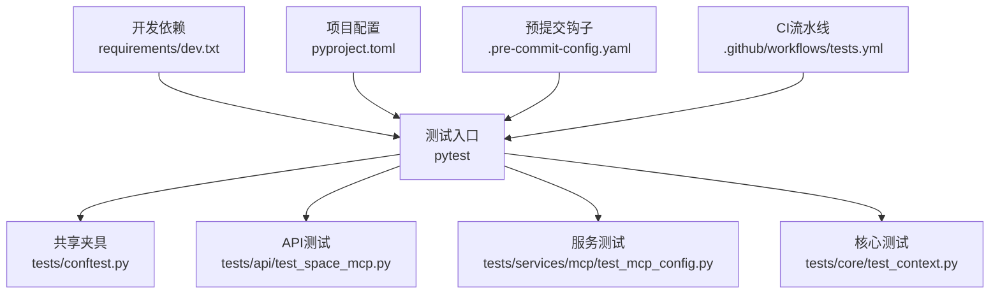
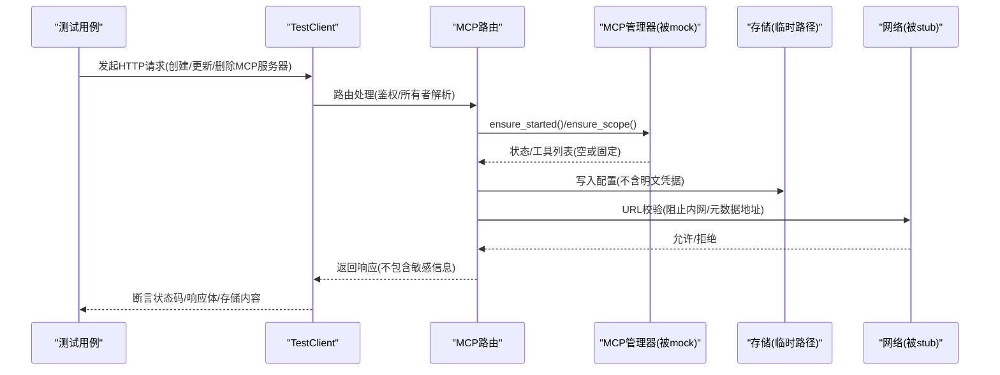
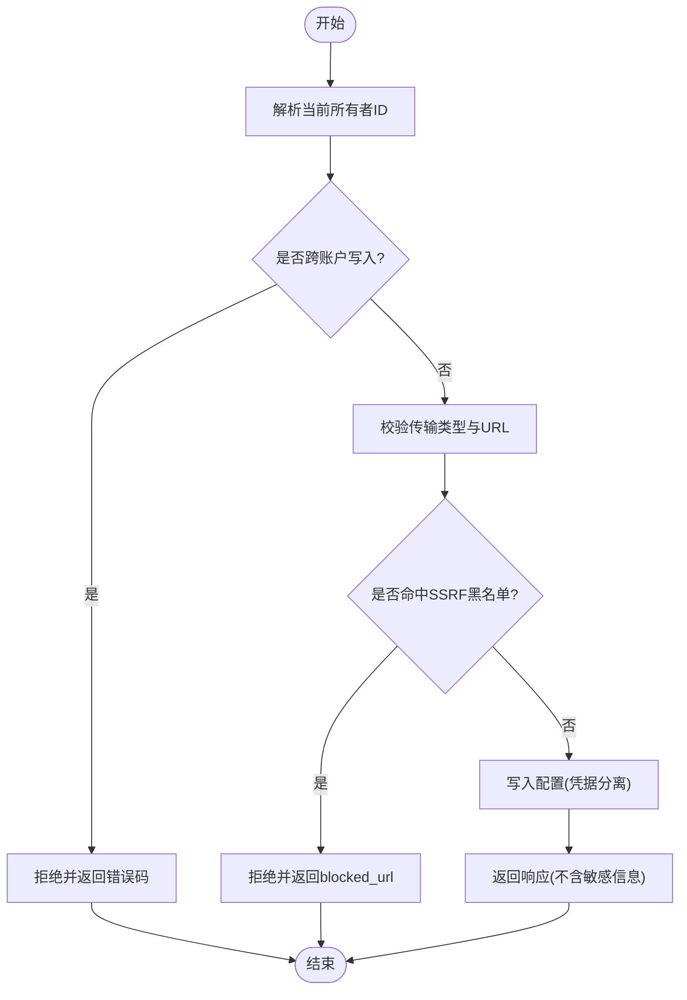
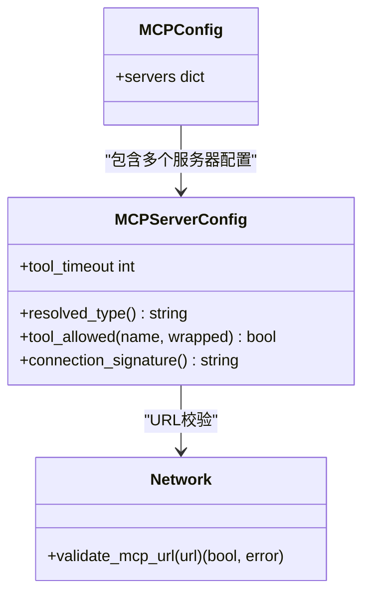
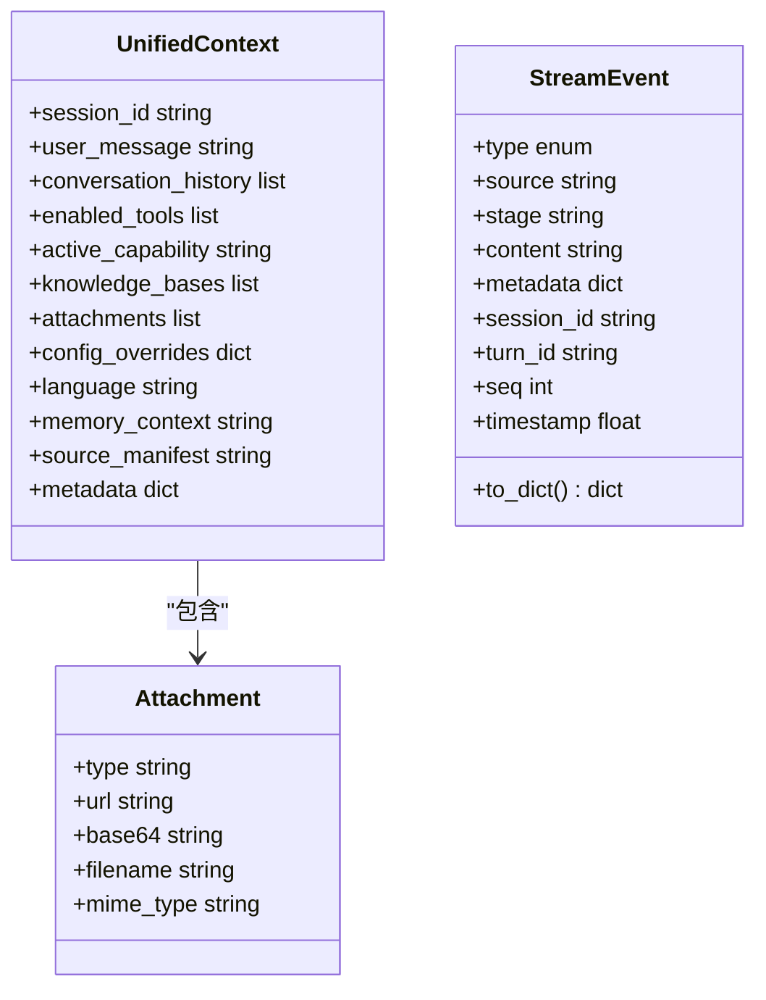
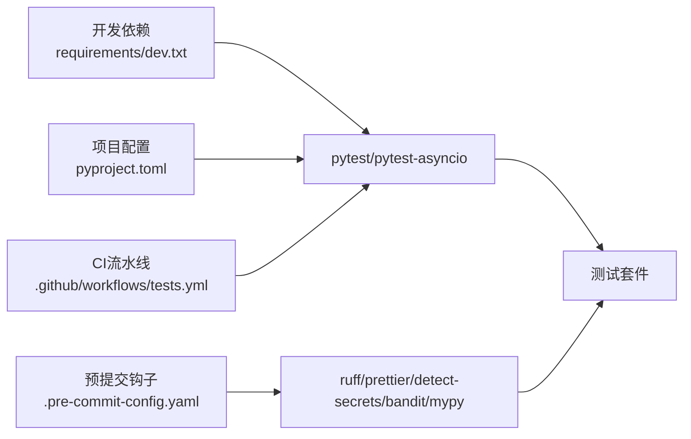

# 测试与质量保证

<cite>
**本文引用的文件**
- [pyproject.toml](file://pyproject.toml)
- [requirements/dev.txt](file://requirements/dev.txt)
- [.pre-commit-config.yaml](file://.pre-commit-config.yaml)
- [tests/conftest.py](file://tests/conftest.py)
- [tests/api/test_space_mcp.py](file://tests/api/test_space_mcp.py)
- [tests/services/mcp/test_mcp_config.py](file://tests/services/mcp/test_mcp_config.py)
- [tests/core/test_context.py](file://tests/core/test_context.py)
- [.github/workflows/tests.yml](file://.github/workflows/tests.yml)
</cite>

## 目录
1. [简介](#简介)
2. [项目结构](#项目结构)
3. [核心组件](#核心组件)
4. [架构总览](#架构总览)
5. [详细组件分析](#详细组件分析)
6. [依赖关系分析](#依赖关系分析)
7. [性能考虑](#性能考虑)
8. [故障排查指南](#故障排查指南)
9. [结论](#结论)
10. [附录](#附录)

## 简介
本指南面向DeepTutor项目的MCP（Model Context Protocol）服务器测试与质量保证，覆盖测试框架选择、测试环境搭建、测试数据准备、单元测试编写方法、模拟对象使用、断言策略、集成测试设计、端到端测试流程、自动化流水线、代码质量检查、静态分析与性能测试方法，以及覆盖率要求、质量门禁和持续集成配置。文档同时提供常见测试场景、用例模板与调试技巧，帮助团队在本地与CI中稳定、高效地保障MCP相关功能的质量。

## 项目结构
DeepTutor的测试体系以pytest为核心，配合异步测试支持、预提交钩子、安全扫描与类型检查等工具链。关键位置如下：
- 测试根配置与共享夹具：tests/conftest.py
- API层集成测试：tests/api/...（含MCP路由测试）
- 服务层单元与集成测试：tests/services/...（含MCP配置与网络校验）
- 核心数据结构与流事件测试：tests/core/...
- 开发依赖与可选特性：requirements/dev.txt、pyproject.toml
- 预提交质量门禁：.pre-commit-config.yaml
- CI流水线：.github/workflows/tests.yml

**图表来源**
- [tests/conftest.py:1-195](file://tests/conftest.py#L1-L195)
- [tests/api/test_space_mcp.py:1-402](file://tests/api/test_space_mcp.py#L1-L402)
- [tests/services/mcp/test_mcp_config.py:1-94](file://tests/services/mcp/test_mcp_config.py#L1-L94)
- [tests/core/test_context.py:1-207](file://tests/core/test_context.py#L1-L207)
- [requirements/dev.txt:1-26](file://requirements/dev.txt#L1-L26)
- [pyproject.toml:415-428](file://pyproject.toml#L415-L428)
- [.pre-commit-config.yaml:1-107](file://.pre-commit-config.yaml#L1-L107)
- [.github/workflows/tests.yml:1-200](file://.github/workflows/tests.yml#L1-L200)

**章节来源**
- [tests/conftest.py:1-195](file://tests/conftest.py#L1-L195)
- [requirements/dev.txt:1-26](file://requirements/dev.txt#L1-L26)
- [pyproject.toml:415-428](file://pyproject.toml#L415-L428)
- [.pre-commit-config.yaml:1-107](file://.pre-commit-config.yaml#L1-L107)
- [.github/workflows/tests.yml:1-200](file://.github/workflows/tests.yml#L1-L200)

## 核心组件
- 测试运行器与配置
  - pytest作为主测试框架，启用严格标记与导入模式，统一测试路径与异步默认作用域。
  - 通过pyproject.toml集中管理测试参数、markers与异步行为。
- 共享夹具与环境隔离
  - tests/conftest.py提供StreamBus、UnifiedContext、SQLite临时存储、Fake LLM配置等通用夹具。
  - 自动守卫防止测试写入真实用户密钥树或触发遗留迁移，确保测试可重复与无副作用。
- API集成测试
  - tests/api/test_space_mcp.py对MCP路由进行认证、隔离、拒绝策略与凭据安全的端到端验证。
  - 使用FastAPI TestClient构造请求，mock外部网络解析与MCP管理器，保证离线与可控环境。
- 服务层配置与安全
  - tests/services/mcp/test_mcp_config.py验证传输类型推断、工具白名单、名称包装、超时边界与SSRF防护。
- 核心数据结构与流事件
  - tests/core/test_context.py覆盖Attachment、UnifiedContext、StreamEvent与错误层次、追踪元数据生成。

**章节来源**
- [pyproject.toml:415-428](file://pyproject.toml#L415-L428)
- [tests/conftest.py:1-195](file://tests/conftest.py#L1-L195)
- [tests/api/test_space_mcp.py:1-402](file://tests/api/test_space_mcp.py#L1-L402)
- [tests/services/mcp/test_mcp_config.py:1-94](file://tests/services/mcp/test_mcp_config.py#L1-L94)
- [tests/core/test_context.py:1-207](file://tests/core/test_context.py#L1-L207)

## 架构总览
下图展示MCP服务器测试在API与服务层的交互与隔离机制，包括认证上下文、所有者隔离、凭据分离与SSRF防护。

**图表来源**
- [tests/api/test_space_mcp.py:19-75](file://tests/api/test_space_mcp.py#L19-L75)
- [tests/api/test_space_mcp.py:82-183](file://tests/api/test_space_mcp.py#L82-L183)
- [tests/api/test_space_mcp.py:205-226](file://tests/api/test_space_mcp.py#L205-L226)
- [tests/api/test_space_mcp.py:292-327](file://tests/api/test_space_mcp.py#L292-L327)
- [tests/services/mcp/test_mcp_config.py:76-93](file://tests/services/mcp/test_mcp_config.py#L76-L93)

## 详细组件分析

### MCP路由与所有者隔离测试
- 目标：验证每个用户的MCP服务器可见性、跨账户写保护、stdio禁用、内网URL拒绝、凭据分离存储、目录安装限制、名称冲突与草稿测试不持久化。
- 关键点：
  - 使用TestClient装配路由并注入当前所有者ID。
  - 通过monkeypatch替换网络解析为本地回环，避免真实网络调用。
  - 将数据存储重定向到tmp_path，确保每次测试干净。
  - 断言响应体不包含任何明文凭据，且磁盘存储仅包含引用。

**图表来源**
- [tests/api/test_space_mcp.py:19-75](file://tests/api/test_space_mcp.py#L19-L75)
- [tests/api/test_space_mcp.py:82-183](file://tests/api/test_space_mcp.py#L82-L183)
- [tests/api/test_space_mcp.py:205-226](file://tests/api/test_space_mcp.py#L205-L226)
- [tests/api/test_space_mcp.py:292-327](file://tests/api/test_space_mcp.py#L292-L327)

**章节来源**
- [tests/api/test_space_mcp.py:1-402](file://tests/api/test_space_mcp.py#L1-L402)

### MCP配置与安全校验测试
- 目标：验证传输类型推断、工具白名单匹配、名称包装规则、超时边界、SSRF防护。
- 关键点：
  - MCPServerConfig.resolved_type()根据command/url/type推断传输方式。
  - tool_allowed()支持通配符与显式原始/包装名匹配。
  - validate_mcp_url()阻止云元数据地址与非HTTP协议。
  - wrapped_tool_name()对server/tool名进行规范化。

**图表来源**
- [tests/services/mcp/test_mcp_config.py:12-28](file://tests/services/mcp/test_mcp_config.py#L12-L28)
- [tests/services/mcp/test_mcp_config.py:31-40](file://tests/services/mcp/test_mcp_config.py#L31-L40)
- [tests/services/mcp/test_mcp_config.py:43-54](file://tests/services/mcp/test_mcp_config.py#L43-L54)
- [tests/services/mcp/test_mcp_config.py:64-68](file://tests/services/mcp/test_mcp_config.py#L64-L68)
- [tests/services/mcp/test_mcp_config.py:71-73](file://tests/services/mcp/test_mcp_config.py#L71-L73)
- [tests/services/mcp/test_mcp_config.py:76-93](file://tests/services/mcp/test_mcp_config.py#L76-L93)

**章节来源**
- [tests/services/mcp/test_mcp_config.py:1-94](file://tests/services/mcp/test_mcp_config.py#L1-L94)

### 核心上下文与流事件测试
- 目标：验证UnifiedContext默认值与可变字段独立性、Attachment构建、StreamEvent序列化、错误层次与追踪元数据生成。
- 关键点：
  - UnifiedContext的conversation_history等可变字段需独立实例化。
  - StreamEvent.to_dict()保持类型小写与元数据完整性。
  - 错误类层次清晰，便于上层捕获与分类。
  - 追踪元数据用于链路追踪与诊断。

**图表来源**
- [tests/core/test_context.py:28-46](file://tests/core/test_context.py#L28-L46)
- [tests/core/test_context.py:53-103](file://tests/core/test_context.py#L53-L103)
- [tests/core/test_context.py:110-139](file://tests/core/test_context.py#L110-L139)
- [tests/core/test_context.py:146-163](file://tests/core/test_context.py#L146-L163)
- [tests/core/test_context.py:170-207](file://tests/core/test_context.py#L170-L207)

**章节来源**
- [tests/core/test_context.py:1-207](file://tests/core/test_context.py#L1-L207)

## 依赖关系分析
- 测试框架与异步支持
  - pytest与pytest-asyncio在dev依赖中声明，并在pyproject.toml中配置测试路径、markers与异步默认作用域。
- 预提交质量门禁
  - ruff格式化与lint、Prettier前端格式、detect-secrets、bandit安全扫描、mypy类型检查。
- CI流水线
  - .github/workflows/tests.yml驱动测试执行与报告。

**图表来源**
- [requirements/dev.txt:10-26](file://requirements/dev.txt#L10-L26)
- [pyproject.toml:415-428](file://pyproject.toml#L415-L428)
- [.pre-commit-config.yaml:42-107](file://.pre-commit-config.yaml#L42-L107)
- [.github/workflows/tests.yml:1-200](file://.github/workflows/tests.yml#L1-L200)

**章节来源**
- [requirements/dev.txt:1-26](file://requirements/dev.txt#L1-L26)
- [pyproject.toml:415-428](file://pyproject.toml#L415-L428)
- [.pre-commit-config.yaml:1-107](file://.pre-commit-config.yaml#L1-L107)
- [.github/workflows/tests.yml:1-200](file://.github/workflows/tests.yml#L1-L200)

## 性能考虑
- 测试数据与I/O
  - 使用临时数据库路径与临时目录，避免磁盘竞争与污染。
  - 对网络调用进行stub/mock，减少外部依赖导致的抖动。
- 并发与异步
  - 利用pytest-asyncio与函数级fixture作用域，确保测试并行时资源隔离。
- 配置边界
  - 对工具超时、连接签名等配置进行边界测试，确保极端情况下系统仍稳定。

[本节为通用指导，无需特定文件来源]

## 故障排查指南
- 常见问题
  - 测试写入真实用户密钥树：通过conftest中的自动守卫检测并失败，提示重定向paths.SYSTEM_ROOT与ADMIN_WORKSPACE_ROOT。
  - 遗留迁移误触发：强制设置LEGACY_MULTI_USER_ROOT为不存在路径，重置once标志。
  - 网络调用导致不稳定：使用monkeypatch替换socket.getaddrinfo，仅允许本地回环。
  - 凭据泄露：断言响应体与磁盘存储不包含明文，仅保留引用。
- 调试技巧
  - 使用TestClient打印响应体与状态码，定位路由逻辑问题。
  - 在夹具中逐步缩小范围，确认mock是否正确生效。
  - 结合追踪元数据与日志，定位流事件与上下文传递问题。

**章节来源**
- [tests/conftest.py:17-90](file://tests/conftest.py#L17-L90)
- [tests/api/test_space_mcp.py:19-75](file://tests/api/test_space_mcp.py#L19-L75)
- [tests/api/test_space_mcp.py:123-145](file://tests/api/test_space_mcp.py#L123-L145)
- [tests/core/test_context.py:170-207](file://tests/core/test_context.py#L170-L207)

## 结论
DeepTutor的MCP测试体系以pytest为核心，结合严格的夹具隔离、API集成测试与服务层安全校验，形成了从单元到集成的完整质量保障闭环。通过预提交钩子与CI流水线，代码风格、安全扫描与类型检查贯穿开发全流程。建议持续完善覆盖率阈值与性能基准，确保MCP功能在高可用与高安全标准下稳定演进。

[本节为总结性内容，无需特定文件来源]

## 附录

### 测试环境与依赖安装
- 安装开发依赖
  - 推荐使用pip安装开发扩展，确保pytest、pytest-asyncio与文档解析工具齐全。
- 运行测试
  - 使用pytest命令，依据pyproject.toml配置的路径与标记执行。
- 环境变量与路径隔离
  - 通过夹具重定向数据根路径，避免影响开发者机器。

**章节来源**
- [requirements/dev.txt:1-26](file://requirements/dev.txt#L1-L26)
- [pyproject.toml:415-428](file://pyproject.toml#L415-L428)
- [tests/conftest.py:32-48](file://tests/conftest.py#L32-L48)

### 单元测试编写方法与断言策略
- 夹具复用
  - 使用conftest中的stream_bus、minimal_context、rich_context、sqlite_store等夹具快速构造测试环境。
- 模拟对象
  - 对网络、MCP管理器、LLM配置等进行mock，确保测试可控与可重复。
- 断言策略
  - 断言HTTP状态码、响应体字段、存储内容与引用、错误码与消息。
  - 对边界条件（超时、非法名称、SSRF）进行强断言。

**章节来源**
- [tests/conftest.py:97-195](file://tests/conftest.py#L97-L195)
- [tests/api/test_space_mcp.py:82-183](file://tests/api/test_space_mcp.py#L82-L183)
- [tests/services/mcp/test_mcp_config.py:64-93](file://tests/services/mcp/test_mcp_config.py#L64-L93)

### 集成测试设计与端到端流程
- 设计要点
  - 以FastAPI TestClient发起请求，覆盖认证、所有者隔离、凭据安全与目录安装。
  - 通过monkeypatch替换外部依赖，确保离线与可控环境。
- 端到端流程
  - 创建/更新/删除MCP服务器，验证可见性与隔离。
  - 安装目录条目，验证凭据分离与引用存储。
  - 测试草稿探测，确保无副作用。

**章节来源**
- [tests/api/test_space_mcp.py:19-75](file://tests/api/test_space_mcp.py#L19-L75)
- [tests/api/test_space_mcp.py:205-226](file://tests/api/test_space_mcp.py#L205-L226)
- [tests/api/test_space_mcp.py:375-401](file://tests/api/test_space_mcp.py#L375-L401)

### 代码质量检查、静态分析与性能测试
- 代码质量
  - 使用ruff进行格式化与lint，Prettier处理前端代码。
- 静态分析
  - detect-secrets扫描敏感信息，bandit进行安全扫描，mypy进行类型检查。
- 性能测试
  - 针对工具超时、连接签名与SSRF防护进行边界测试，确保极端情况下的稳定性。

**章节来源**
- [.pre-commit-config.yaml:42-107](file://.pre-commit-config.yaml#L42-L107)
- [tests/services/mcp/test_mcp_config.py:64-93](file://tests/services/mcp/test_mcp_config.py#L64-L93)

### 测试覆盖率要求、质量门禁与持续集成
- 覆盖率要求
  - 建议在CI中引入覆盖率收集与阈值检查，确保关键路径覆盖。
- 质量门禁
  - 预提交钩子强制执行格式、lint、安全扫描与类型检查。
- 持续集成
  - .github/workflows/tests.yml驱动测试执行与报告，确保每次提交质量。

**章节来源**
- [.pre-commit-config.yaml:1-107](file://.pre-commit-config.yaml#L1-L107)
- [.github/workflows/tests.yml:1-200](file://.github/workflows/tests.yml#L1-L200)

### 常见测试场景与用例模板
- 场景示例
  - 所有者隔离：不同用户ID访问同一资源，验证隔离。
  - 凭据安全：PUT/GET响应不包含明文，存储仅含引用。
  - 目录安装：必填凭据缺失时拒绝，安装后正确标记已安装。
  - 草稿测试：探测不持久化，确保无副作用。
- 模板参考
  - 使用TestClient装配路由与夹具，构造请求并断言响应与存储。
  - 对网络与外部服务进行mock，确保测试稳定。

**章节来源**
- [tests/api/test_space_mcp.py:82-183](file://tests/api/test_space_mcp.py#L82-L183)
- [tests/api/test_space_mcp.py:205-226](file://tests/api/test_space_mcp.py#L205-L226)
- [tests/api/test_space_mcp.py:375-401](file://tests/api/test_space_mcp.py#L375-L401)

### 调试技巧
- 使用夹具逐步缩小范围，确认mock与路径重定向是否生效。
- 打印响应体与状态码，定位路由逻辑问题。
- 结合追踪元数据与日志，定位流事件与上下文传递问题。

**章节来源**
- [tests/conftest.py:17-90](file://tests/conftest.py#L17-L90)
- [tests/core/test_context.py:170-207](file://tests/core/test_context.py#L170-L207)