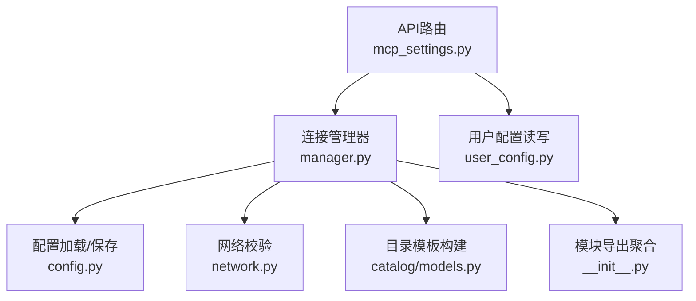
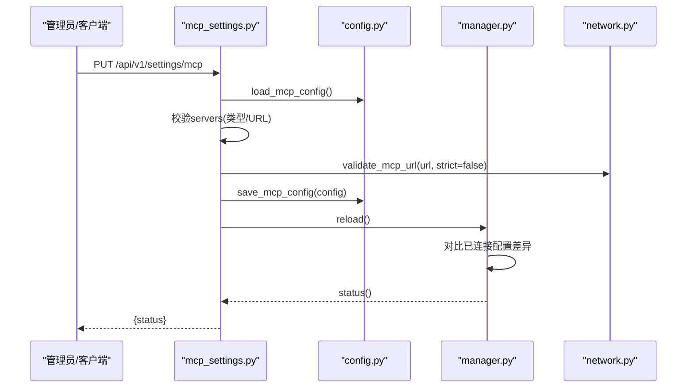
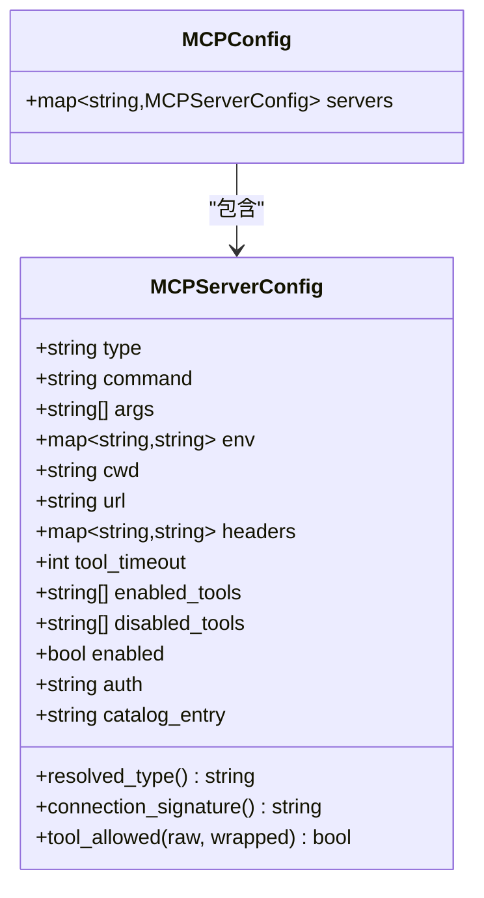
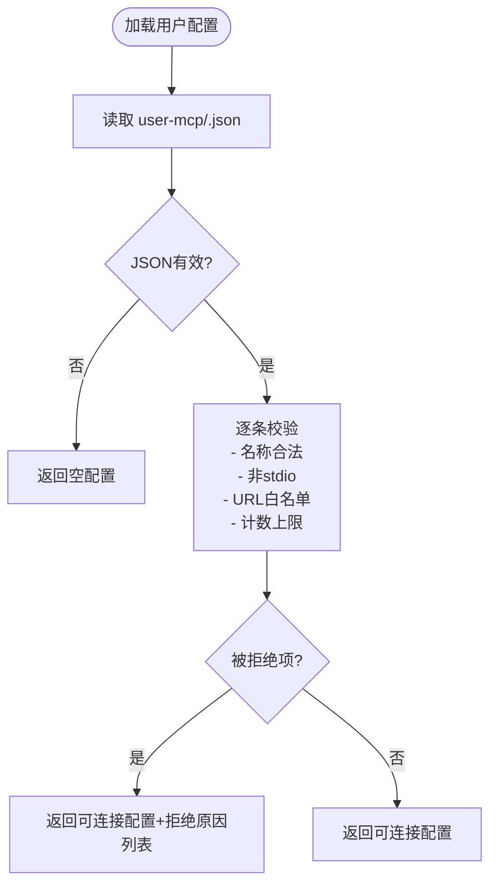
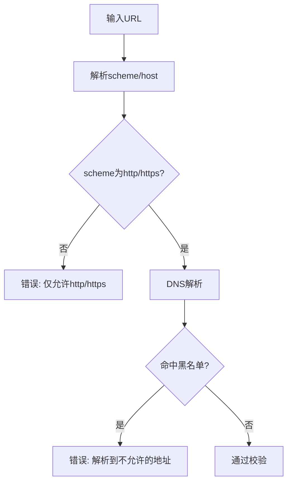
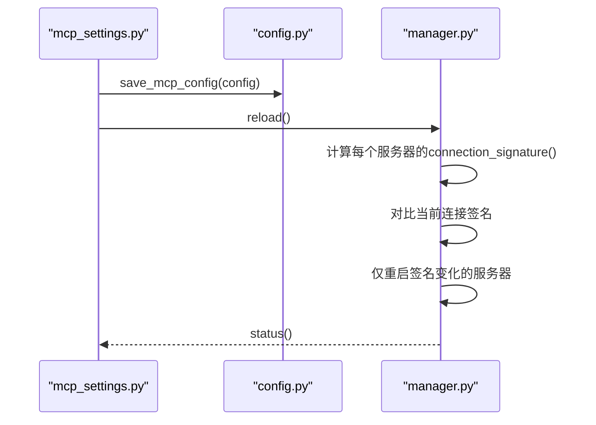
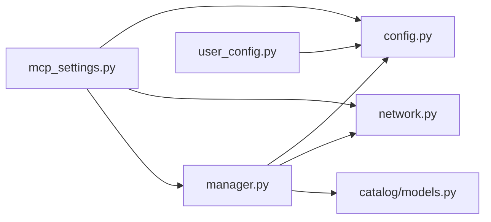

# MCP服务器配置

<cite>
**本文引用的文件**
- [deeptutor/services/mcp/config.py](file://deeptutor/services/mcp/config.py)
- [deeptutor/services/mcp/user_config.py](file://deeptutor/services/mcp/user_config.py)
- [deeptutor/api/routers/mcp_settings.py](file://deeptutor/api/routers/mcp_settings.py)
- [deeptutor/services/mcp/manager.py](file://deeptutor/services/mcp/manager.py)
- [deeptutor/services/mcp/network.py](file://deeptutor/services/mcp/network.py)
- [deeptutor/services/mcp/catalog/models.py](file://deeptutor/services/mcp/catalog/models.py)
- [deeptutor/services/mcp/__init__.py](file://deeptutor/services/mcp/__init__.py)
</cite>

## 目录
1. [简介](#简介)
2. [项目结构](#项目结构)
3. [核心组件](#核心组件)
4. [架构总览](#架构总览)
5. [详细组件分析](#详细组件分析)
6. [依赖关系分析](#依赖关系分析)
7. [性能考虑](#性能考虑)
8. [故障诊断指南](#故障诊断指南)
9. [结论](#结论)
10. [附录](#附录)

## 简介
本文件面向DeepTutor中的MCP（Model Context Protocol）服务器配置，系统性说明：
- 配置格式与参数选项（本地stdio、远程SSE、HTTP流式）
- 配置文件组织（部署级与用户级）
- 安全配置（OAuth、API密钥、URL白名单）
- 配置热重载机制与验证规则
- 常见配置场景示例（数据库访问、文件系统操作、外部API调用）
- 配置故障诊断与调试方法

## 项目结构
MCP相关代码集中在 services/mcp 与 api/routers/mcp_settings 中，围绕“配置模型—持久化—连接管理—网络校验—目录模板”形成闭环。

图表来源
- [deeptutor/api/routers/mcp_settings.py:1-134](file://deeptutor/api/routers/mcp_settings.py#L1-L134)
- [deeptutor/services/mcp/manager.py:1-200](file://deeptutor/services/mcp/manager.py#L1-L200)
- [deeptutor/services/mcp/config.py:1-163](file://deeptutor/services/mcp/config.py#L1-L163)
- [deeptutor/services/mcp/network.py:1-122](file://deeptutor/services/mcp/network.py#L1-L122)
- [deeptutor/services/mcp/catalog/models.py:1-333](file://deeptutor/services/mcp/catalog/models.py#L1-L333)
- [deeptutor/services/mcp/user_config.py:1-234](file://deeptutor/services/mcp/user_config.py#L1-L234)
- [deeptutor/services/mcp/__init__.py:1-33](file://deeptutor/services/mcp/__init__.py#L1-L33)

章节来源
- [deeptutor/api/routers/mcp_settings.py:1-134](file://deeptutor/api/routers/mcp_settings.py#L1-L134)
- [deeptutor/services/mcp/config.py:1-163](file://deeptutor/services/mcp/config.py#L1-L163)
- [deeptutor/services/mcp/user_config.py:1-234](file://deeptutor/services/mcp/user_config.py#L1-L234)
- [deeptutor/services/mcp/manager.py:1-200](file://deeptutor/services/mcp/manager.py#L1-L200)
- [deeptutor/services/mcp/network.py:1-122](file://deeptutor/services/mcp/network.py#L1-L122)
- [deeptutor/services/mcp/catalog/models.py:1-333](file://deeptutor/services/mcp/catalog/models.py#L1-L333)
- [deeptutor/services/mcp/__init__.py:1-33](file://deeptutor/services/mcp/__init__.py#L1-L33)

## 核心组件
- 配置模型与持久化
  - MCPServerConfig：单条服务器配置，支持 stdio/sse/streamableHttp 三种传输；包含工具超时、启用工具列表、禁用工具列表、认证方式、目录来源等字段。
  - MCPConfig：服务器集合容器，提供名称合法性校验。
  - 部署级配置路径与原子写入：通过 mcp.json 存储于管理员工作区设置目录，读取失败回退为空配置，写入采用临时文件+fsync+替换的原子策略。
- 用户级配置
  - 独立存储位置，仅允许远程传输（禁止stdio），限制每账户最大服务器数量，拒绝保留前缀命名冲突。
- 连接管理器
  - 生命周期管理：懒启动、按服务器任务隔离、重试退避、空闲回收、工具适配器注册。
  - 探测与热重载：更新配置后触发reload，仅重启变更的服务器。
- 网络校验
  - SSRF防护：对http/https强制校验，解析域名并检查IP是否命中黑名单；用户自配模式严格禁止内网/环回地址。
- 目录模板
  - 将可安装条目转换为MCPServerConfig，注入凭据目标（env/header/url_param/arg），敏感值以引用形式存放，不直接落盘。

章节来源
- [deeptutor/services/mcp/config.py:31-163](file://deeptutor/services/mcp/config.py#L31-L163)
- [deeptutor/services/mcp/user_config.py:1-234](file://deeptutor/services/mcp/user_config.py#L1-L234)
- [deeptutor/services/mcp/manager.py:1-200](file://deeptutor/services/mcp/manager.py#L1-L200)
- [deeptutor/services/mcp/network.py:1-122](file://deeptutor/services/mcp/network.py#L1-L122)
- [deeptutor/services/mcp/catalog/models.py:105-333](file://deeptutor/services/mcp/catalog/models.py#L105-L333)

## 架构总览
下图展示从API到连接管理的完整流程，包括配置加载、校验、探测与热重载。

图表来源
- [deeptutor/api/routers/mcp_settings.py:57-78](file://deeptutor/api/routers/mcp_settings.py#L57-L78)
- [deeptutor/services/mcp/config.py:120-152](file://deeptutor/services/mcp/config.py#L120-L152)
- [deeptutor/services/mcp/network.py:69-105](file://deeptutor/services/mcp/network.py#L69-L105)
- [deeptutor/services/mcp/manager.py:1-200](file://deeptutor/services/mcp/manager.py#L1-L200)

## 详细组件分析

### 配置模型与参数选项
- 传输类型自动推断
  - 未显式指定 type 时：存在 command → stdio；存在 url 且以 /sse 结尾 → sse；否则为 streamableHttp。
- 关键字段
  - command/args/env/cwd：本地进程执行所需。
  - url/headers：远程服务连接与请求头。
  - tool_timeout：工具调用超时（秒）。
  - enabled_tools/disabled_tools：工具白/黑名单，支持通配符。
  - auth："" 或 "oauth"，用于指示是否需要交互式授权。
  - catalog_entry：记录安装来源，便于去重与溯源。
- 名称与校验
  - 服务器名需匹配正则；保存时进行JSON解析与Pydantic校验，异常回退空配置。

图表来源
- [deeptutor/services/mcp/config.py:31-113](file://deeptutor/services/mcp/config.py#L31-L113)

章节来源
- [deeptutor/services/mcp/config.py:31-113](file://deeptutor/services/mcp/config.py#L31-L113)

### 部署级与用户级配置
- 部署级配置
  - 位置：管理员工作区的 settings/mcp.json。
  - 权限：仅管理员可写，避免非管理员通过命令执行提升权限。
  - 特点：全局共享，所有账户可见同一组服务器。
- 用户级配置
  - 位置：data/system/user-mcp/<owner>.json，不在沙箱挂载范围内，防止跨用户篡改。
  - 限制：仅允许远程传输（禁止stdio），每账户最多N个服务器，拒绝保留前缀命名。
  - 用途：用户自行添加的远程MCP服务，适合SaaS集成。

图表来源
- [deeptutor/services/mcp/user_config.py:80-118](file://deeptutor/services/mcp/user_config.py#L80-L118)
- [deeptutor/services/mcp/user_config.py:164-189](file://deeptutor/services/mcp/user_config.py#L164-L189)

章节来源
- [deeptutor/services/mcp/user_config.py:1-234](file://deeptutor/services/mcp/user_config.py#L1-L234)

### 安全配置：OAuth、API密钥、URL白名单
- OAuth认证
  - 在MCPServerConfig.auth中声明“oauth”，表示该服务器需要交互式授权；系统不会因401而自动触发，避免误判。
- API密钥管理
  - 通过目录模板将凭据注入到env/header/url_param/arg；敏感值以引用形式保存在独立的秘密存储中，不落盘明文。
- URL白名单与SSRF防护
  - 部署级：阻止链路本地/云元数据/0.0.0.0/8等危险范围。
  - 用户级（strict）：额外阻止环回与私有网段，确保用户配置的URL只能指向公网可达服务。

图表来源
- [deeptutor/services/mcp/network.py:69-105](file://deeptutor/services/mcp/network.py#L69-L105)

章节来源
- [deeptutor/services/mcp/network.py:1-122](file://deeptutor/services/mcp/network.py#L1-L122)
- [deeptutor/services/mcp/catalog/models.py:105-333](file://deeptutor/services/mcp/catalog/models.py#L105-L333)
- [deeptutor/services/mcp/config.py:54-66](file://deeptutor/services/mcp/config.py#L54-L66)

### 配置热重载机制
- 触发点
  - 通过API更新配置后，调用manager.reload()，内部比较已连接服务器的签名与磁盘配置，仅重启发生变化的服务器。
- 健壮性
  - 连接失败会按指数退避重试；工具调用支持超时控制；连接任务与事件循环解耦，避免阻塞。

图表来源
- [deeptutor/api/routers/mcp_settings.py:68-78](file://deeptutor/api/routers/mcp_settings.py#L68-L78)
- [deeptutor/services/mcp/config.py:82-91](file://deeptutor/services/mcp/config.py#L82-L91)
- [deeptutor/services/mcp/manager.py:1-200](file://deeptutor/services/mcp/manager.py#L1-L200)

章节来源
- [deeptutor/api/routers/mcp_settings.py:68-78](file://deeptutor/api/routers/mcp_settings.py#L68-L78)
- [deeptutor/services/mcp/config.py:82-91](file://deeptutor/services/mcp/config.py#L82-L91)
- [deeptutor/services/mcp/manager.py:1-200](file://deeptutor/services/mcp/manager.py#L1-L200)

### 配置验证规则
- 服务器名：必须匹配正则，避免非法字符与过长名称。
- 传输类型：必须能推断出一种（command或url），否则报错。
- 远程URL：必须http/https，且解析后的IP不得命中黑名单；用户级配置要求更严格。
- 工具过滤：enabled_tools与disabled_tools共同决定最终可用工具集。
- 目录模板：transport与server_template一致；stdio条目不可设为self_service。

章节来源
- [deeptutor/services/mcp/config.py:101-113](file://deeptutor/services/mcp/config.py#L101-L113)
- [deeptutor/services/mcp/network.py:69-105](file://deeptutor/services/mcp/network.py#L69-L105)
- [deeptutor/services/mcp/catalog/models.py:163-212](file://deeptutor/services/mcp/catalog/models.py#L163-L212)

### 常见配置场景示例
- 本地stdio服务器（部署级）
  - 使用command/args/env/cwd启动本地进程；适用于文件系统操作、本地CLI工具封装。
  - 注意：仅管理员可配置，避免任意命令执行风险。
- 远程SSE服务器（部署级/用户级）
  - 使用url以/sse结尾；headers注入鉴权信息；适用于服务端长连接推送。
- HTTP流式服务器（部署级/用户级）
  - 使用普通url；headers或url_param注入令牌；适用于标准REST/MCP流式接口。
- 数据库访问
  - 通过外部MCP服务暴露查询工具；在headers或env中注入连接串/凭据；开启工具白名单限制暴露面。
- 外部API调用
  - 通过目录模板将API Key注入header或url_param；结合URL白名单确保仅访问可信域名。

章节来源
- [deeptutor/services/mcp/config.py:31-66](file://deeptutor/services/mcp/config.py#L31-L66)
- [deeptutor/services/mcp/catalog/models.py:238-274](file://deeptutor/services/mcp/catalog/models.py#L238-L274)
- [deeptutor/services/mcp/network.py:69-105](file://deeptutor/services/mcp/network.py#L69-L105)

## 依赖关系分析
- 模块耦合
  - API路由依赖配置加载与网络校验，调用连接管理器完成状态同步。
  - 连接管理器依赖配置模型、网络校验与目录模板，负责会话生命周期与工具适配。
  - 用户配置模块复用配置模型，但施加更严格的传输与安全约束。
- 外部依赖
  - Pydantic用于数据校验；异步I/O用于DNS解析与连接；可选的MCP SDK用于实际通信。

图表来源
- [deeptutor/api/routers/mcp_settings.py:1-134](file://deeptutor/api/routers/mcp_settings.py#L1-L134)
- [deeptutor/services/mcp/manager.py:1-200](file://deeptutor/services/mcp/manager.py#L1-L200)
- [deeptutor/services/mcp/config.py:1-163](file://deeptutor/services/mcp/config.py#L1-L163)
- [deeptutor/services/mcp/network.py:1-122](file://deeptutor/services/mcp/network.py#L1-L122)
- [deeptutor/services/mcp/catalog/models.py:1-333](file://deeptutor/services/mcp/catalog/models.py#L1-L333)
- [deeptutor/services/mcp/user_config.py:1-234](file://deeptutor/services/mcp/user_config.py#L1-L234)

章节来源
- [deeptutor/services/mcp/__init__.py:1-33](file://deeptutor/services/mcp/__init__.py#L1-L33)

## 性能考虑
- 懒启动与按需连接：首次调用才建立连接，降低冷启动开销。
- 连接任务隔离：每个服务器一个任务持有AsyncExitStack，避免跨任务泄漏。
- 重试与退避：连接失败指数退避，提高鲁棒性。
- 空闲回收：按所有者与作用域限制，避免多租户下会话膨胀。
- 工具超时：通过tool_timeout限制单次调用耗时，防止长尾拖垮整体。

[本节为通用指导，无需特定文件来源]

## 故障诊断指南
- 配置无法生效
  - 检查服务器名是否合法；确认type可推断（command或url）；查看load/save日志与返回值。
- 远程连接失败
  - 使用测试端点探测：POST /api/v1/settings/mcp/test，传入待测配置，返回连通性与错误信息。
  - 检查URL scheme与host；确认DNS解析结果未被黑名单拦截。
- 用户级配置被拒绝
  - 确认非stdio；确认URL为公网可达；检查每账户服务器数量上限；核对命名冲突。
- 工具不可用
  - 检查enabled_tools与disabled_tools；确认工具名未被包装器修改导致不匹配。
- 权限问题
  - 部署级配置仅管理员可写；用户级配置仅允许远程传输；避免越权编辑。

章节来源
- [deeptutor/api/routers/mcp_settings.py:121-134](file://deeptutor/api/routers/mcp_settings.py#L121-L134)
- [deeptutor/services/mcp/network.py:69-105](file://deeptutor/services/mcp/network.py#L69-L105)
- [deeptutor/services/mcp/user_config.py:164-189](file://deeptutor/services/mcp/user_config.py#L164-L189)

## 结论
DeepTutor的MCP服务器配置以清晰的模型与严格的校验为核心，兼顾部署级与用户级场景，提供安全的远程接入能力与灵活的本地扩展。通过热重载、探测与完善的网络防护，能够在多租户环境下稳定运行。建议在生产环境中：
- 最小化暴露工具集，优先使用白名单。
- 对用户级URL实施严格白名单。
- 定期审计目录模板与凭据注入策略。
- 利用测试端点与日志快速定位问题。

[本节为总结，无需特定文件来源]

## 附录
- API端点参考
  - GET /api/v1/settings/mcp：获取当前配置与连接状态。
  - PUT /api/v1/settings/mcp：批量更新配置并热重载。
  - PUT /api/v1/settings/mcp/servers/{name}：新增/更新单个服务器。
  - DELETE /api/v1/settings/mcp/servers/{name}：删除单个服务器。
  - POST /api/v1/settings/mcp/test：测试服务器连通性。

章节来源
- [deeptutor/api/routers/mcp_settings.py:57-134](file://deeptutor/api/routers/mcp_settings.py#L57-L134)