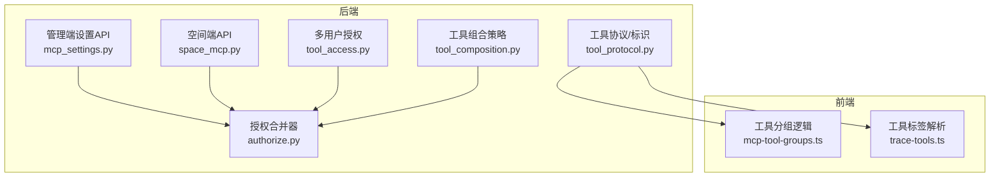
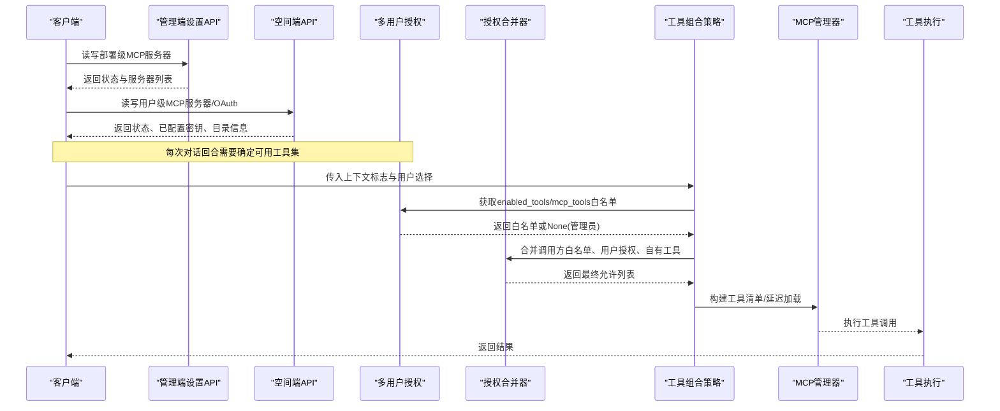
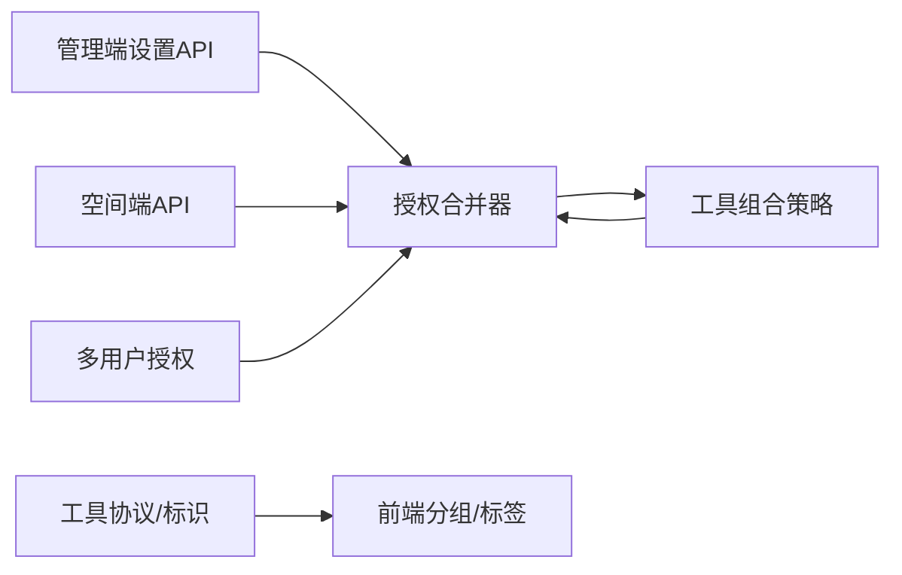

# 工具访问控制

<cite>
**本文引用的文件**
- [deeptutor/api/routers/mcp_settings.py](file://deeptutor/api/routers/mcp_settings.py)
- [deeptutor/api/routers/space_mcp.py](file://deeptutor/api/routers/space_mcp.py)
- [deeptutor/multi_user/tool_access.py](file://deeptutor/multi_user/tool_access.py)
- [deeptutor/agents/_shared/tool_composition.py](file://deeptutor/agents/_shared/tool_composition.py)
- [deeptutor/core/tool_protocol.py](file://deeptutor/core/tool_protocol.py)
- [deeptutor/runtime/providers/authorize.py](file://deeptutor/runtime/providers/authorize.py)
- [web/lib/mcp-tool-groups.ts](file://web/lib/mcp-tool-groups.ts)
- [web/lib/trace-tools.ts](file://web/lib/trace-tools.ts)
- [deeptutor/multi_user/audit.py](file://deeptutor/multi_user/audit.py)
</cite>

## 目录
1. [简介](#简介)
2. [项目结构](#项目结构)
3. [核心组件](#核心组件)
4. [架构总览](#架构总览)
5. [详细组件分析](#详细组件分析)
6. [依赖关系分析](#依赖关系分析)
7. [性能考量](#性能考量)
8. [故障排查指南](#故障排查指南)
9. [结论](#结论)
10. [附录](#附录)

## 简介
本文件聚焦于MCP服务器工具的访问控制，围绕enabled_tools与disabled_tools的使用方式、优先级规则、通配符匹配机制、工具名称解析、分组管理与批量控制、动态发现与加载机制、不同环境配置示例以及权限审计与监控进行系统化说明。文档以代码为依据，提供可追溯的章节来源与图示来源，帮助读者快速理解并正确配置。

## 项目结构
与MCP工具访问控制相关的后端主要位于以下模块：
- 管理端设置API：部署级MCP服务器注册表（管理员）
- 空间端API：用户级MCP服务器配置（非管理员）
- 多用户授权：按用户授予的工具白名单与合并策略
- 工具组合：每轮对话中启用哪些内置工具的策略
- 工具协议与提供者标识：用于分组、追踪与前端展示
- 前端工具分组与标签：将工具按提供者分组、显示原始工具名

图表来源
- [deeptutor/api/routers/mcp_settings.py:1-134](file://deeptutor/api/routers/mcp_settings.py#L1-L134)
- [deeptutor/api/routers/space_mcp.py:1-461](file://deeptutor/api/routers/space_mcp.py#L1-L461)
- [deeptutor/multi_user/tool_access.py:1-114](file://deeptutor/multi_user/tool_access.py#L1-L114)
- [deeptutor/agents/_shared/tool_composition.py:1-260](file://deeptutor/agents/_shared/tool_composition.py#L1-L260)
- [deeptutor/core/tool_protocol.py:259-274](file://deeptutor/core/tool_protocol.py#L259-L274)
- [deeptutor/runtime/providers/authorize.py:40-66](file://deeptutor/runtime/providers/authorize.py#L40-L66)
- [web/lib/mcp-tool-groups.ts:1-116](file://web/lib/mcp-tool-groups.ts#L1-L116)
- [web/lib/trace-tools.ts:1-29](file://web/lib/trace-tools.ts#L1-L29)

章节来源
- [deeptutor/api/routers/mcp_settings.py:1-134](file://deeptutor/api/routers/mcp_settings.py#L1-L134)
- [deeptutor/api/routers/space_mcp.py:1-461](file://deeptutor/api/routers/space_mcp.py#L1-L461)
- [deeptutor/multi_user/tool_access.py:1-114](file://deeptutor/multi_user/tool_access.py#L1-L114)
- [deeptutor/agents/_shared/tool_composition.py:1-260](file://deeptutor/agents/_shared/tool_composition.py#L1-L260)
- [deeptutor/core/tool_protocol.py:259-274](file://deeptutor/core/tool_protocol.py#L259-L274)
- [deeptutor/runtime/providers/authorize.py:40-66](file://deeptutor/runtime/providers/authorize.py#L40-L66)
- [web/lib/mcp-tool-groups.ts:1-116](file://web/lib/mcp-tool-groups.ts#L1-L116)
- [web/lib/trace-tools.ts:1-29](file://web/lib/trace-tools.ts#L1-L29)

## 核心组件
- 管理端MCP设置API：负责部署级MCP服务器注册表的读取、更新、删除与测试连接；仅管理员可写。
- 空间端MCP API：用户级MCP服务器配置、OAuth授权、目录安装、测试连接；非管理员也可用。
- 多用户工具授权：定义enabled_tools、mcp_tools等白名单，并提供合并策略。
- 工具组合策略：决定每轮对话启用的内置工具集合，支持条件挂载与强制/抑制。
- 工具协议与标识：统一提取工具来源（mcp/cli）与提供者ID，用于分组与追踪。
- 授权合并器：将调用方白名单、用户授权、自有服务器工具与隐式工具合并为最终允许列表。
- 前端工具分组与标签：按提供者分组工具，解析真实工具名以便展示。

章节来源
- [deeptutor/api/routers/mcp_settings.py:1-134](file://deeptutor/api/routers/mcp_settings.py#L1-L134)
- [deeptutor/api/routers/space_mcp.py:1-461](file://deeptutor/api/routers/space_mcp.py#L1-L461)
- [deeptutor/multi_user/tool_access.py:1-114](file://deeptutor/multi_user/tool_access.py#L1-L114)
- [deeptutor/agents/_shared/tool_composition.py:1-260](file://deeptutor/agents/_shared/tool_composition.py#L1-L260)
- [deeptutor/core/tool_protocol.py:259-274](file://deeptutor/core/tool_protocol.py#L259-L274)
- [deeptutor/runtime/providers/authorize.py:40-66](file://deeptutor/runtime/providers/authorize.py#L40-L66)
- [web/lib/mcp-tool-groups.ts:1-116](file://web/lib/mcp-tool-groups.ts#L1-L116)
- [web/lib/trace-tools.ts:1-29](file://web/lib/trace-tools.ts#L1-L29)

## 架构总览
下图展示了从请求到工具调用的关键路径，包括管理员与用户侧MCP配置、授权合并、工具组合与执行。

图表来源
- [deeptutor/api/routers/mcp_settings.py:57-134](file://deeptutor/api/routers/mcp_settings.py#L57-L134)
- [deeptutor/api/routers/space_mcp.py:92-352](file://deeptutor/api/routers/space_mcp.py#L92-L352)
- [deeptutor/multi_user/tool_access.py:44-105](file://deeptutor/multi_user/tool_access.py#L44-L105)
- [deeptutor/agents/_shared/tool_composition.py:100-193](file://deeptutor/agents/_shared/tool_composition.py#L100-L193)
- [deeptutor/runtime/providers/authorize.py:40-66](file://deeptutor/runtime/providers/authorize.py#L40-L66)

## 详细组件分析

### enabled_tools与disabled_tools：使用方式与优先级
- enabled_tools（启用白名单）
  - 由多用户授权提供，表示“允许使用的工具集合”。对非管理员用户，若未显式授予mcp_tools则默认拒绝所有MCP工具；管理员为无限制。
  - 在工具组合阶段，用户选择的工具需通过optional_whitelist过滤，确保只接受合法的可切换工具。
- disabled_tools（禁用黑名单）
  - 在工具组合流程中体现为suppressed参数，用于从最终列表中移除工具，无论其如何被加入。
- 优先级规则（从高到低）
  1) 强制启用（forced）：绕过所有门控，无条件追加。
  2) 用户选择工具：经registry.get_enabled与optional_whitelist过滤。
  3) 条件自动挂载：基于上下文标志（如知识库、记忆、笔记本等）。
  4) 能力拥有工具：特定能力附加的工具。
  5) 始终开启工具：如write_memory、web_fetch、github、ask_user、cron。
  6) 禁用抑制（suppressed）：最后从结果中剔除。
- 注意
  - builtin_whitelist仅影响内置工具的自动挂载与始终开启，不影响用户选择与能力拥有工具。
  - exclusive模式会替换工具表面，仅保留能力拥有工具与ask_user，但允许rag与kb_files在具备KB时共存。

章节来源
- [deeptutor/multi_user/tool_access.py:44-105](file://deeptutor/multi_user/tool_access.py#L44-L105)
- [deeptutor/agents/_shared/tool_composition.py:100-193](file://deeptutor/agents/_shared/tool_composition.py#L100-L193)

### 通配符匹配机制与工具名称解析
- 通配符匹配
  - 当前仓库未发现针对MCP工具名的通配符匹配实现。工具访问控制以精确名称白名单为主，结合分组与批量操作在前端完成。
- 工具名称解析
  - 后端通过工具协议提取provider_kind与provider_id，用于分组与追踪。
  - 前端根据serverId与工具名前缀还原真实工具名，避免服务器名含下划线导致的误解析。

章节来源
- [deeptutor/core/tool_protocol.py:259-274](file://deeptutor/core/tool_protocol.py#L259-L274)
- [web/lib/trace-tools.ts:1-29](file://web/lib/trace-tools.ts#L1-L29)

### 工具分组管理与批量控制策略
- 分组依据
  - 工具按provider_id（或server）分组，保持后端发送顺序。
- 批量控制
  - 支持整组全选/全不选/部分选择，返回扁平工具名列表保存。
  - 单工具开关与计数统计辅助UI呈现三态复选框。
- 适用场景
  - 管理员授权编辑、伙伴工具选择器、节点测试共享逻辑。

章节来源
- [web/lib/mcp-tool-groups.ts:1-116](file://web/lib/mcp-tool-groups.ts#L1-L116)

### 动态工具发现与加载机制
- 目录发现
  - 空间端提供目录查询接口，支持搜索、分类、层级筛选，返回条目信息与字段描述。
- 安装与配置
  - 用户可从目录安装条目，生成服务器配置与存储密钥；支持自定义本地名称。
- 连接预热与状态
  - 列出服务器时会预热连接（带超时），返回状态与已配置密钥字段。
- OAuth授权
  - 支持开始授权与回调页面，令牌不暴露给前端。

章节来源
- [deeptutor/api/routers/space_mcp.py:287-352](file://deeptutor/api/routers/space_mcp.py#L287-L352)
- [deeptutor/api/routers/space_mcp.py:92-135](file://deeptutor/api/routers/space_mcp.py#L92-L135)
- [deeptutor/api/routers/space_mcp.py:169-226](file://deeptutor/api/routers/space_mcp.py#L169-L226)

### 不同场景下的配置示例
- 开发环境
  - 管理员开放更多MCP工具，便于调试；用户可自由添加远程MCP服务器。
  - 建议：在授权中放宽mcp_tools，或在伙伴配置中允许更宽泛的过滤器。
- 生产环境
  - 严格最小权限原则：非管理员用户若无mcp_tools授权则默认拒绝；仅授予必要工具。
  - 建议：使用白名单精确指定工具名，配合禁用抑制移除敏感工具。
- 伙伴集成
  - 通过builtin_whitelist限制内置工具挂载，结合forced/suppressed满足业务需求。
  - 使用exclusive模式替换工具表面，仅保留能力拥有工具与ask_user。

章节来源
- [deeptutor/multi_user/tool_access.py:44-105](file://deeptutor/multi_user/tool_access.py#L44-L105)
- [deeptutor/agents/_shared/tool_composition.py:100-193](file://deeptutor/agents/_shared/tool_composition.py#L100-L193)
- [deeptutor/runtime/providers/authorize.py:40-66](file://deeptutor/runtime/providers/authorize.py#L40-L66)

### 权限审计与监控
- 审计日志
  - 多用户层记录资源访问与管理员操作的审计日志，写入系统目录的usage.jsonl。
- 监控要点
  - 关注MCP服务器连接状态、OAuth授权状态、工具调用来源（provider_kind/provider_id）。
  - 利用工具分组与标签功能，在前端识别具体MCP服务器与工具。

章节来源
- [deeptutor/multi_user/audit.py:1-35](file://deeptutor/multi_user/audit.py#L1-L35)
- [deeptutor/core/tool_protocol.py:259-274](file://deeptutor/core/tool_protocol.py#L259-L274)
- [web/lib/trace-tools.ts:1-29](file://web/lib/trace-tools.ts#L1-L29)

## 依赖关系分析
- 管理端与空间端API均依赖MCP管理器进行连接与状态管理。
- 工具组合策略依赖多用户授权获取白名单，并通过授权合并器计算最终允许列表。
- 工具协议与标识支撑前端分组与追踪，保证跨层一致性。

图表来源
- [deeptutor/api/routers/mcp_settings.py:57-134](file://deeptutor/api/routers/mcp_settings.py#L57-L134)
- [deeptutor/api/routers/space_mcp.py:92-352](file://deeptutor/api/routers/space_mcp.py#L92-L352)
- [deeptutor/multi_user/tool_access.py:44-105](file://deeptutor/multi_user/tool_access.py#L44-L105)
- [deeptutor/agents/_shared/tool_composition.py:100-193](file://deeptutor/agents/_shared/tool_composition.py#L100-L193)
- [deeptutor/core/tool_protocol.py:259-274](file://deeptutor/core/tool_protocol.py#L259-L274)
- [deeptutor/runtime/providers/authorize.py:40-66](file://deeptutor/runtime/providers/authorize.py#L40-L66)

## 性能考量
- 连接预热
  - 列出服务器时对连接进行预热，设置超时以避免慢响应阻塞页面。
- DNS与网络
  - 保存配置时进行URL验证与DNS解析，避免请求链路阻塞。
- 分组与批量操作
  - 前端分组逻辑采用单次遍历计算选中数量与三态，避免二次扫描导致的时间复杂度上升。

章节来源
- [deeptutor/api/routers/space_mcp.py:92-135](file://deeptutor/api/routers/space_mcp.py#L92-L135)
- [web/lib/mcp-tool-groups.ts:57-82](file://web/lib/mcp-tool-groups.ts#L57-L82)

## 故障排查指南
- 无法连接MCP服务器
  - 检查传输类型与URL格式，使用测试接口验证连通性。
- OAuth授权失败
  - 确认回调地址与重定向URI正确，查看授权回调页面的错误信息。
- 工具未出现或被禁用
  - 检查用户授权中的mcp_tools白名单、工具组合中的suppressed列表与builtin_whitelist。
- 工具名称显示异常
  - 确认provider_kind与provider_id是否正确传递，前端使用serverId解析工具名。

章节来源
- [deeptutor/api/routers/mcp_settings.py:121-134](file://deeptutor/api/routers/mcp_settings.py#L121-L134)
- [deeptutor/api/routers/space_mcp.py:169-226](file://deeptutor/api/routers/space_mcp.py#L169-L226)
- [deeptutor/agents/_shared/tool_composition.py:100-193](file://deeptutor/agents/_shared/tool_composition.py#L100-L193)
- [deeptutor/core/tool_protocol.py:259-274](file://deeptutor/core/tool_protocol.py#L259-L274)

## 结论
本项目实现了分层、可组合且安全的MCP工具访问控制：管理员与用户分别管理服务器配置，多用户授权提供细粒度白名单，工具组合策略确保内置工具的条件挂载与强制/抑制，授权合并器统一计算最终允许列表。前端分组与标签提升可观测性与易用性。建议在生产环境中坚持最小权限原则，结合审计日志与监控指标持续优化。

## 附录
- 术语
  - enabled_tools：启用白名单，表示允许使用的工具集合。
  - disabled_tools：禁用黑名单，在工具组合中以suppressed形式生效。
  - provider_kind/provider_id：工具来源与提供者标识，用于分组与追踪。
  - 强制/抑制：forced与suppressed，分别用于无条件启用与最终剔除。