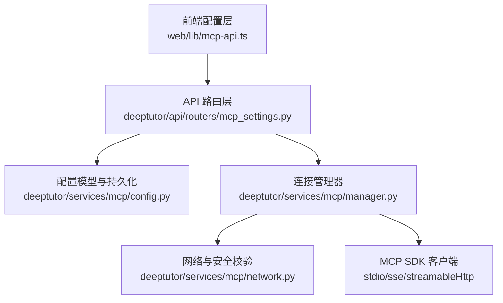
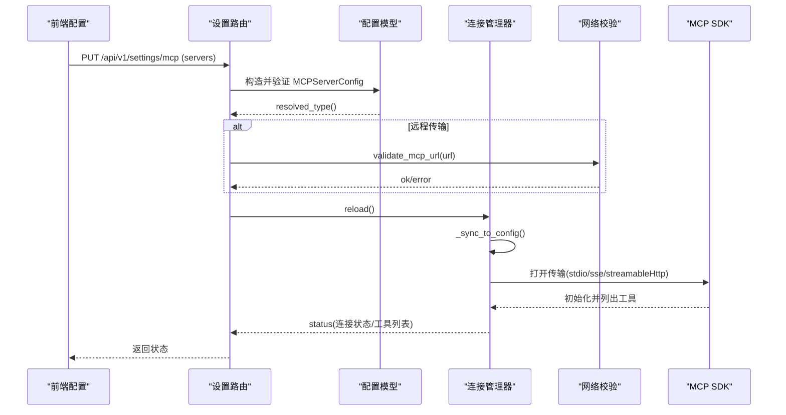
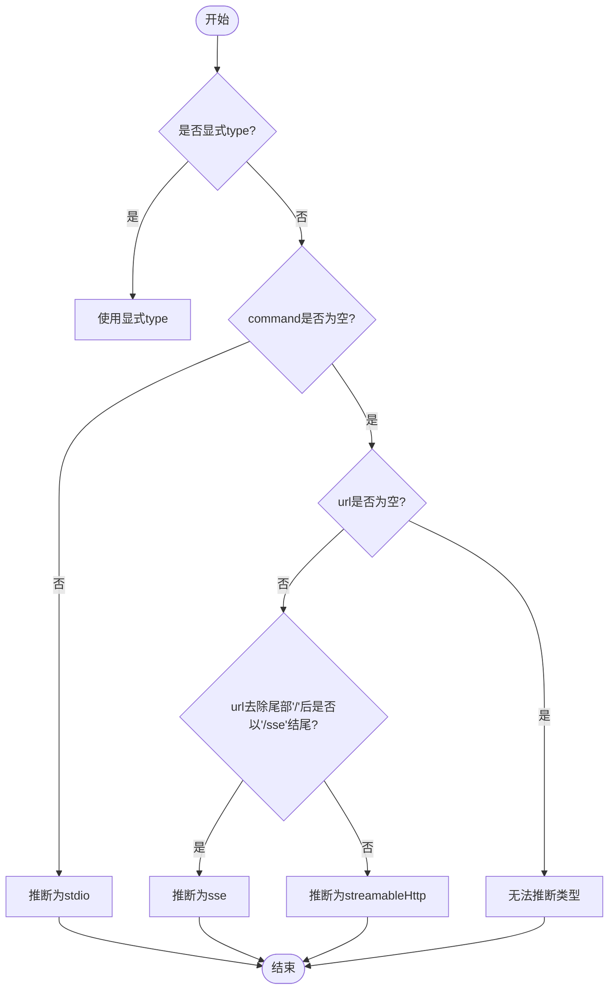
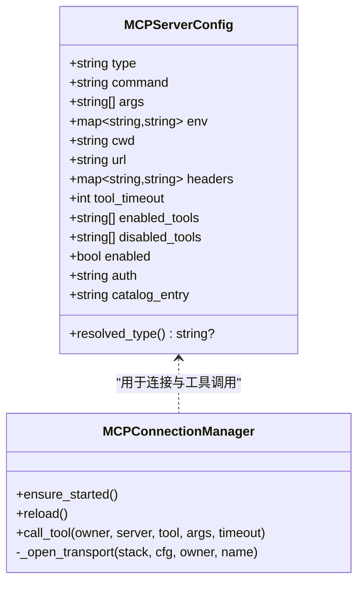
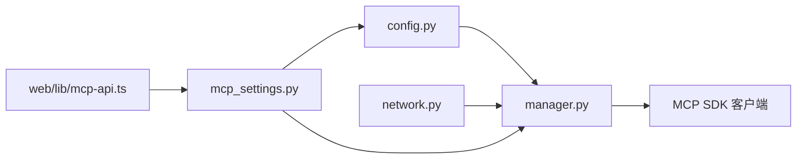

# 服务器类型配置

<cite>
**本文引用的文件**
- [deeptutor/services/mcp/config.py](file://deeptutor/services/mcp/config.py)
- [deeptutor/services/mcp/manager.py](file://deeptutor/services/mcp/manager.py)
- [deeptutor/services/mcp/network.py](file://deeptutor/services/mcp/network.py)
- [deeptutor/api/routers/mcp_settings.py](file://deeptutor/api/routers/mcp_settings.py)
- [web/lib/mcp-api.ts](file://web/lib/mcp-api.ts)
- [tests/api/test_space_mcp.py](file://tests/api/test_space_mcp.py)
</cite>

## 目录
1. [简介](#简介)
2. [项目结构](#项目结构)
3. [核心组件](#核心组件)
4. [架构总览](#架构总览)
5. [详细组件分析](#详细组件分析)
6. [依赖关系分析](#依赖关系分析)
7. [性能与连接特性](#性能与连接特性)
8. [故障排查指南](#故障排查指南)
9. [结论](#结论)
10. [附录：完整配置示例与最佳实践](#附录完整配置示例与最佳实践)

## 简介
本文件面向需要配置 MCP（Model Context Protocol）服务器的用户与管理员，系统性地说明三种传输类型的配置方法、适用场景、性能特点与配置选项：
- stdio：本地命令服务器（进程内通过标准输入输出通信）
- SSE：远程服务器（基于服务端事件流）
- HTTP 流式：远程服务器（基于可流式化的 HTTP 协议）

文档还涵盖自动检测机制、环境变量与工作目录、命令参数传递、安全校验、以及每种传输的完整配置示例与最佳实践。

## 项目结构
MCP 相关能力由后端配置模型、连接管理器、网络校验与 API 路由共同构成；前端提供统一的配置界面与类型推断逻辑，确保前后端行为一致。

图表来源
- [web/lib/mcp-api.ts:101-223](file://web/lib/mcp-api.ts#L101-L223)
- [deeptutor/api/routers/mcp_settings.py:37-133](file://deeptutor/api/routers/mcp_settings.py#L37-L133)
- [deeptutor/services/mcp/config.py:31-103](file://deeptutor/services/mcp/config.py#L31-L103)
- [deeptutor/services/mcp/manager.py:493-708](file://deeptutor/services/mcp/manager.py#L493-L708)
- [deeptutor/services/mcp/network.py:69-105](file://deeptutor/services/mcp/network.py#L69-L105)

章节来源
- [web/lib/mcp-api.ts:101-223](file://web/lib/mcp-api.ts#L101-L223)
- [deeptutor/api/routers/mcp_settings.py:37-133](file://deeptutor/api/routers/mcp_settings.py#L37-L133)
- [deeptutor/services/mcp/config.py:31-103](file://deeptutor/services/mcp/config.py#L31-L103)
- [deeptutor/services/mcp/manager.py:493-708](file://deeptutor/services/mcp/manager.py#L493-L708)
- [deeptutor/services/mcp/network.py:69-105](file://deeptutor/services/mcp/network.py#L69-L105)

## 核心组件
- 配置模型 MCPServerConfig：定义三种传输类型及通用字段（命令、参数、环境变量、工作目录、URL、请求头、工具超时、工具白/黑名单、启用开关、认证方式、目录来源等），并提供类型自动推断方法。
- 连接管理器 MCPConnectionManager：负责生命周期管理、连接重试、工具适配器注册、调用转发、状态上报。
- 网络校验 validate_mcp_url / validate_mcp_url_async：对远程 URL 进行安全校验，区分部署级宽松策略与用户级严格策略。
- API 路由 mcp_settings：提供获取、更新、删除、测试配置的接口，并在保存前执行校验。
- 前端 mcp-api：提供类型推断、表单构建、状态归一化、与后端交互的封装。

章节来源
- [deeptutor/services/mcp/config.py:31-103](file://deeptutor/services/mcp/config.py#L31-L103)
- [deeptutor/services/mcp/manager.py:216-708](file://deeptutor/services/mcp/manager.py#L216-L708)
- [deeptutor/services/mcp/network.py:69-105](file://deeptutor/services/mcp/network.py#L69-L105)
- [deeptutor/api/routers/mcp_settings.py:37-133](file://deeptutor/api/routers/mcp_settings.py#L37-L133)
- [web/lib/mcp-api.ts:101-223](file://web/lib/mcp-api.ts#L101-L223)

## 架构总览
下图展示了从配置到连接的端到端流程，包括自动类型推断、安全校验、连接建立与工具发现。

图表来源
- [deeptutor/api/routers/mcp_settings.py:37-133](file://deeptutor/api/routers/mcp_settings.py#L37-L133)
- [deeptutor/services/mcp/config.py:73-80](file://deeptutor/services/mcp/config.py#L73-L80)
- [deeptutor/services/mcp/network.py:69-105](file://deeptutor/services/mcp/network.py#L69-L105)
- [deeptutor/services/mcp/manager.py:474-592](file://deeptutor/services/mcp/manager.py#L474-L592)

## 详细组件分析

### 配置模型与自动类型推断
- 支持三种传输类型：stdio、sse、streamableHttp。
- 当未显式指定 type 时，按以下规则推断：
  - 存在 command 且非空 → stdio
  - 存在 url 且以 /sse 结尾（忽略尾部斜杠）→ sse
  - 其他 url → streamableHttp
- 若既无 command 也无 url，则无法推断类型，保存时会报错。

图表来源
- [deeptutor/services/mcp/config.py:73-80](file://deeptutor/services/mcp/config.py#L73-L80)
- [web/lib/mcp-api.ts:192-201](file://web/lib/mcp-api.ts#L192-L201)

章节来源
- [deeptutor/services/mcp/config.py:31-80](file://deeptutor/services/mcp/config.py#L31-L80)
- [web/lib/mcp-api.ts:192-201](file://web/lib/mcp-api.ts#L192-L201)

### 连接管理器与传输打开
- 连接管理器根据 resolved_type 选择具体传输：
  - stdio：使用 StdioServerParameters(command, args, env, cwd) 启动本地进程并通过 stdio_client 通信。仅管理员可配置（用户空间禁止）。
  - sse：使用 sse_client，传入合并后的 headers，必要时附加 OAuth 认证。
  - streamableHttp：使用 streamable_http_client，显式创建 httpx 客户端并设置超时与认证。
- 连接失败会记录错误、进入重试退避，并在需要授权时标记 needs_auth。

图表来源
- [deeptutor/services/mcp/config.py:31-103](file://deeptutor/services/mcp/config.py#L31-L103)
- [deeptutor/services/mcp/manager.py:493-708](file://deeptutor/services/mcp/manager.py#L493-L708)

章节来源
- [deeptutor/services/mcp/manager.py:493-708](file://deeptutor/services/mcp/manager.py#L493-L708)

### 网络与安全校验
- 部署级服务器（管理员配置）允许访问本地或局域网地址，但阻止链路本地/云元数据范围。
- 用户级服务器（self-service）采用严格模式：额外阻止回环与私有网段，防止 SSRF。
- 校验在保存时与连接时均执行，避免 DNS 变化绕过。

章节来源
- [deeptutor/services/mcp/network.py:1-23](file://deeptutor/services/mcp/network.py#L1-L23)
- [deeptutor/services/mcp/network.py:69-105](file://deeptutor/services/mcp/network.py#L69-L105)
- [deeptutor/services/mcp/manager.py:646-653](file://deeptutor/services/mcp/manager.py#L646-L653)

### API 路由与校验
- GET /api/v1/settings/mcp：返回当前配置与连接状态。
- PUT /api/v1/settings/mcp：接收 servers 映射，构造配置对象，校验每个服务器（必须可推断类型；远程需校验 URL），保存后触发重载。
- DELETE /api/v1/settings/mcp/servers/{name}：删除指定服务器并刷新状态。
- POST /api/v1/settings/mcp/test：测试单个服务器配置，返回连通性与可用工具列表。

章节来源
- [deeptutor/api/routers/mcp_settings.py:37-133](file://deeptutor/api/routers/mcp_settings.py#L37-L133)

### 前端类型推断与表单处理
- 前端实现与后端一致的 resolveMcpTransport，以便在保存前预览自动推断的类型。
- 表单构建函数 buildMcpServerConfig 将编辑草稿转换为持久化配置，保留不可编辑字段（如 enabled、disabled_tools、catalog_entry）。
- 状态显示中，禁用服务器优先于实时状态行，避免“禁用”状态被“连接中”覆盖。

章节来源
- [web/lib/mcp-api.ts:192-201](file://web/lib/mcp-api.ts#L192-L201)
- [web/lib/mcp-api.ts:248-268](file://web/lib/mcp-api.ts#L248-L268)
- [web/lib/mcp-api.ts:217-223](file://web/lib/mcp-api.ts#L217-L223)

## 依赖关系分析
- 配置模型依赖 Pydantic 进行校验与序列化。
- 连接管理器依赖 MCP SDK 的 stdio/sse/streamable_http 客户端。
- 网络模块依赖 socket 与 ipaddress 进行解析与拦截。
- API 路由依赖配置加载器与连接管理器，完成读写与热重载。
- 前端依赖统一 API 封装，保证类型推断与状态展示一致性。

图表来源
- [deeptutor/services/mcp/config.py:31-103](file://deeptutor/services/mcp/config.py#L31-L103)
- [deeptutor/services/mcp/manager.py:493-708](file://deeptutor/services/mcp/manager.py#L493-L708)
- [deeptutor/services/mcp/network.py:69-105](file://deeptutor/services/mcp/network.py#L69-L105)
- [deeptutor/api/routers/mcp_settings.py:37-133](file://deeptutor/api/routers/mcp_settings.py#L37-L133)
- [web/lib/mcp-api.ts:101-223](file://web/lib/mcp-api.ts#L101-L223)

章节来源
- [deeptutor/services/mcp/config.py:31-103](file://deeptutor/services/mcp/config.py#L31-L103)
- [deeptutor/services/mcp/manager.py:493-708](file://deeptutor/services/mcp/manager.py#L493-L708)
- [deeptutor/services/mcp/network.py:69-105](file://deeptutor/services/mcp/network.py#L69-L105)
- [deeptutor/api/routers/mcp_settings.py:37-133](file://deeptutor/api/routers/mcp_settings.py#L37-L133)
- [web/lib/mcp-api.ts:101-223](file://web/lib/mcp-api.ts#L101-L223)

## 性能与连接特性
- 连接超时：默认连接超时为固定秒数，超过则标记失败并进入重试退避。
- 工具调用超时：可通过 tool_timeout 控制单次工具调用超时时间（单位秒，范围有限制）。
- 重试退避：失败连接按指数退避重试，上限有最大值，避免风暴。
- 临时错误：对管道断开、连接重置等临时错误进行一次重试。
- 进度上报：长耗时工具可通过进度回调上报，便于前端展示百分比或步骤。

章节来源
- [deeptutor/services/mcp/manager.py:51-81](file://deeptutor/services/mcp/manager.py#L51-L81)
- [deeptutor/services/mcp/manager.py:404-442](file://deeptutor/services/mcp/manager.py#L404-L442)
- [deeptutor/services/mcp/manager.py:518-540](file://deeptutor/services/mcp/manager.py#L518-L540)
- [deeptutor/services/mcp/manager.py:556-570](file://deeptutor/services/mcp/manager.py#L556-L570)

## 故障排查指南
- 无法推断类型：检查是否同时缺少 command 与 url；若有 url，确认是否以 /sse 结尾或使用其他路径。
- 远程 URL 校验失败：确认 scheme 为 http/https；域名可解析；不指向受保护网段（用户级严格模式）。
- 连接超时：检查目标可达性、DNS、防火墙；适当增大 tool_timeout 或调整连接超时策略。
- 需要授权：若服务器声明 OAuth，需在浏览器完成授权流程；连接任务不会阻塞等待交互式授权。
- 用户空间禁止 stdio：用户级配置不允许配置 stdio 服务器，仅管理员可在部署级配置。

章节来源
- [deeptutor/api/routers/mcp_settings.py:41-54](file://deeptutor/api/routers/mcp_settings.py#L41-L54)
- [deeptutor/services/mcp/network.py:69-105](file://deeptutor/services/mcp/network.py#L69-L105)
- [deeptutor/services/mcp/manager.py:518-540](file://deeptutor/services/mcp/manager.py#L518-L540)
- [tests/api/test_space_mcp.py:105-111](file://tests/api/test_space_mcp.py#L105-L111)

## 结论
本系统提供了三种 MCP 传输类型的统一配置与管理能力：
- stdio 适合本地集成与快速调试，具备低延迟与直接进程通信优势，但仅限管理员配置。
- SSE 适合跨进程/跨主机的事件流场景，易于穿透代理与负载均衡。
- HTTP 流式适合现代流式服务，具备更好的可扩展性与可控的超时策略。
通过自动类型推断、严格的网络校验与健壮的重试机制，系统在易用性与安全性之间取得平衡。建议在生产环境优先使用远程传输，并结合 OAuth 与工具白名单进行最小权限控制。

## 附录：完整配置示例与最佳实践

### 通用字段说明
- type：可选，显式指定传输类型；省略时按规则自动推断。
- command：stdio 传输的命令路径或可执行名。
- args：命令参数数组，每行一个参数。
- env：环境变量键值对，用于注入敏感信息或运行时配置。
- cwd：工作目录，命令执行时的初始目录。
- url：远程传输的目标地址。
- headers：HTTP 请求头键值对，用于鉴权或自定义协议头。
- tool_timeout：工具调用超时秒数。
- enabled_tools：启用的工具列表，支持通配符“*”表示全部。
- disabled_tools：禁用的工具列表，优先级高于 enabled_tools。
- enabled：是否启用该服务器。
- auth：认证方式，"" 表示静态头或无认证；"oauth" 表示需要 OAuth 授权。
- catalog_entry：来源标识，用于追踪安装来源。

章节来源
- [deeptutor/services/mcp/config.py:31-67](file://deeptutor/services/mcp/config.py#L31-L67)
- [web/lib/mcp-api.ts:137-153](file://web/lib/mcp-api.ts#L137-L153)

### 配置示例（描述性）
- stdio 本地命令服务器
  - 适用场景：本地开发、脚本集成、无需网络暴露的工具。
  - 关键参数：command、args、env、cwd。
  - 注意事项：仅管理员可配置；注意工作目录与环境变量隔离。
  - 参考路径：[配置模型:31-67](file://deeptutor/services/mcp/config.py#L31-L67)、[连接打开:633-644](file://deeptutor/services/mcp/manager.py#L633-L644)

- SSE 远程服务器
  - 适用场景：跨主机事件流、易于代理与缓存的场景。
  - 关键参数：url（必须以 /sse 结尾）、headers、auth（可选 oauth）。
  - 注意事项：URL 需通过安全校验；用户级严格模式禁止私有网段。
  - 参考路径：[类型推断:73-80](file://deeptutor/services/mcp/config.py#L73-L80)、[连接打开:672-692](file://deeptutor/services/mcp/manager.py#L672-L692)、[网络校验:69-105](file://deeptutor/services/mcp/network.py#L69-L105)

- HTTP 流式服务器
  - 适用场景：现代流式服务、需要细粒度超时控制的场景。
  - 关键参数：url（任意路径）、headers、auth（可选 oauth）。
  - 注意事项：显式创建 httpx 客户端并设置超时；用户级严格模式禁止私有网段。
  - 参考路径：[类型推断:73-80](file://deeptutor/services/mcp/config.py#L73-L80)、[连接打开:693-707](file://deeptutor/services/mcp/manager.py#L693-L707)、[网络校验:69-105](file://deeptutor/services/mcp/network.py#L69-L105)

### 最佳实践
- 明确指定 type 以避免歧义；否则遵循自动推断规则。
- 使用工具白名单与黑名单限制暴露面，减少攻击面。
- 对远程服务器启用 OAuth 认证，避免将密钥写入 headers。
- 合理设置 tool_timeout，避免长耗时任务被误杀。
- 定期测试配置，使用测试接口验证连通性与工具列表。
- 用户级配置务必使用公网可达地址，避免 SSRF 风险。

章节来源
- [deeptutor/services/mcp/config.py:31-67](file://deeptutor/services/mcp/config.py#L31-L67)
- [deeptutor/services/mcp/manager.py:656-671](file://deeptutor/services/mcp/manager.py#L656-L671)
- [deeptutor/api/routers/mcp_settings.py:121-133](file://deeptutor/api/routers/mcp_settings.py#L121-L133)
- [deeptutor/services/mcp/network.py:69-105](file://deeptutor/services/mcp/network.py#L69-L105)