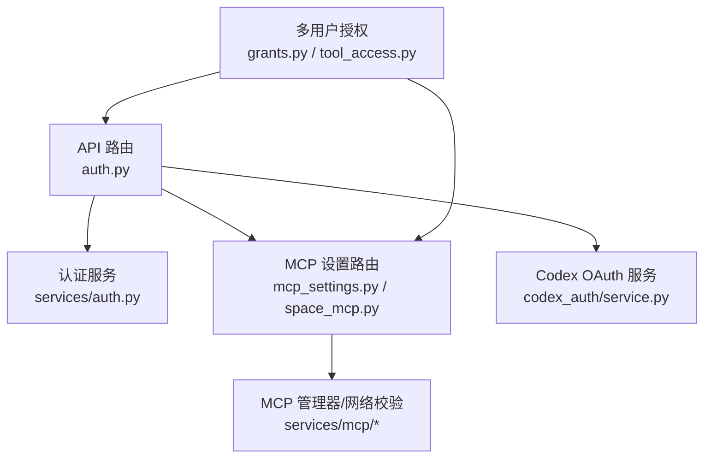
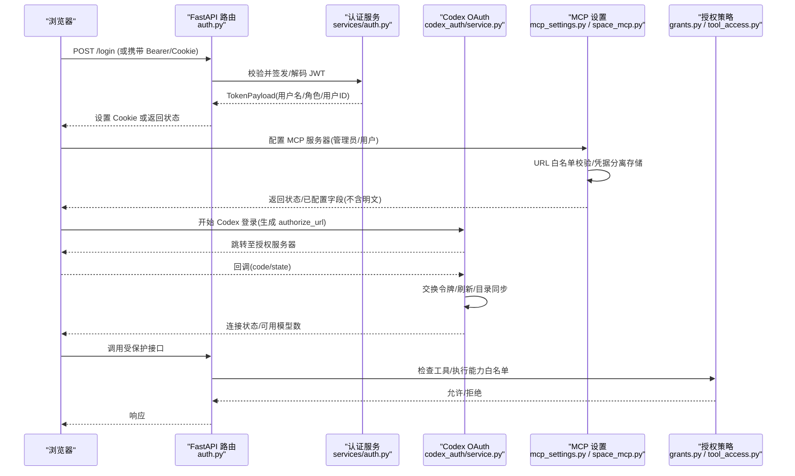
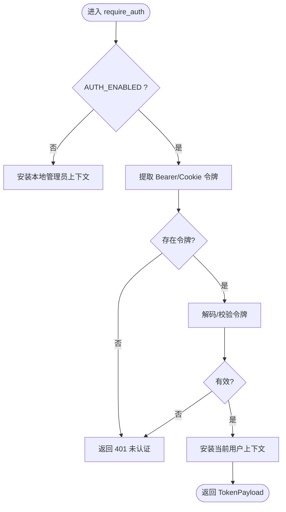
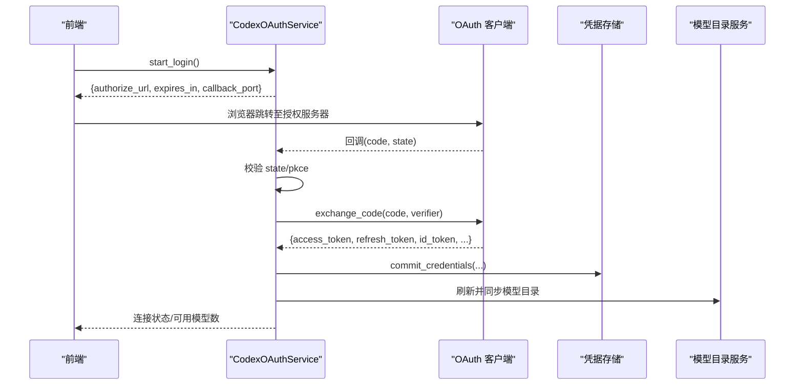
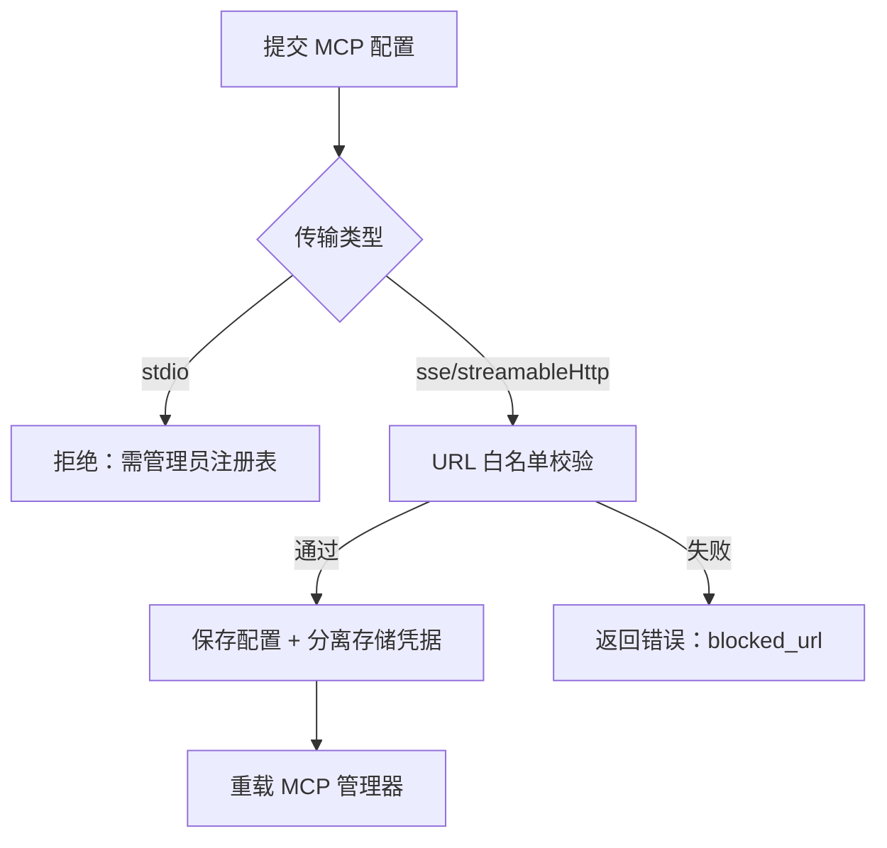
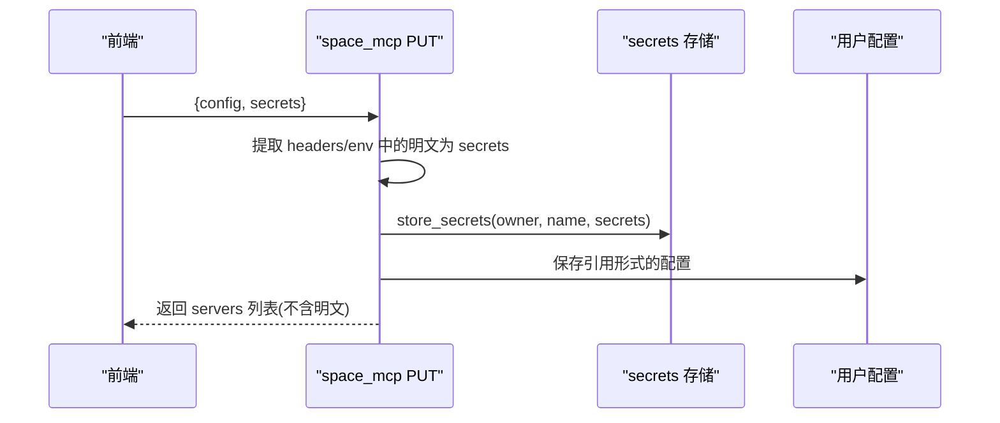
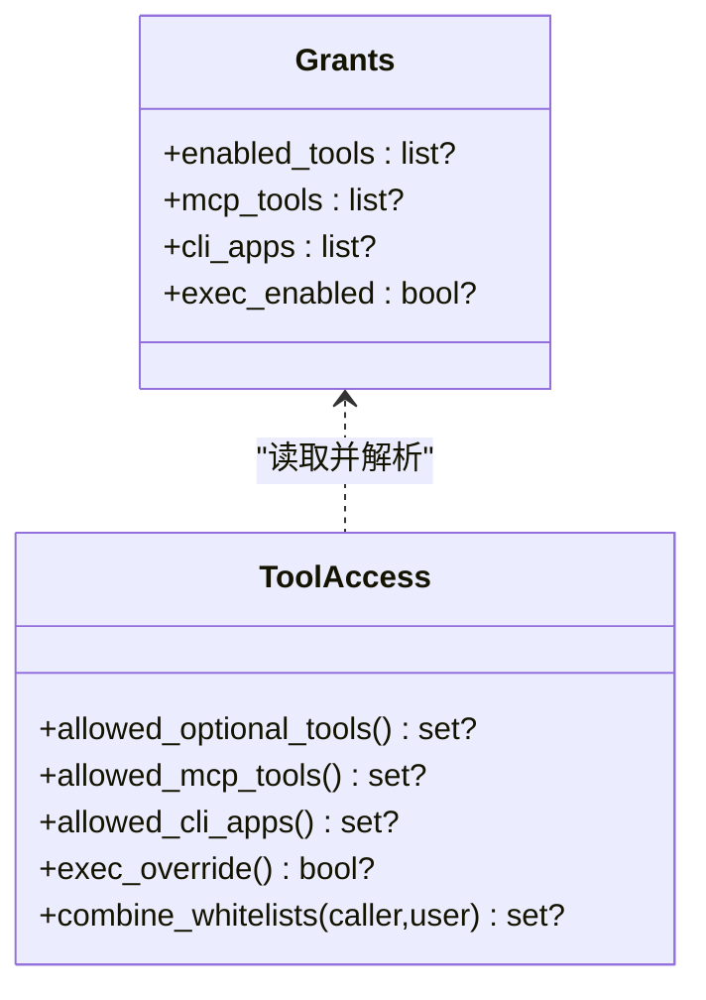
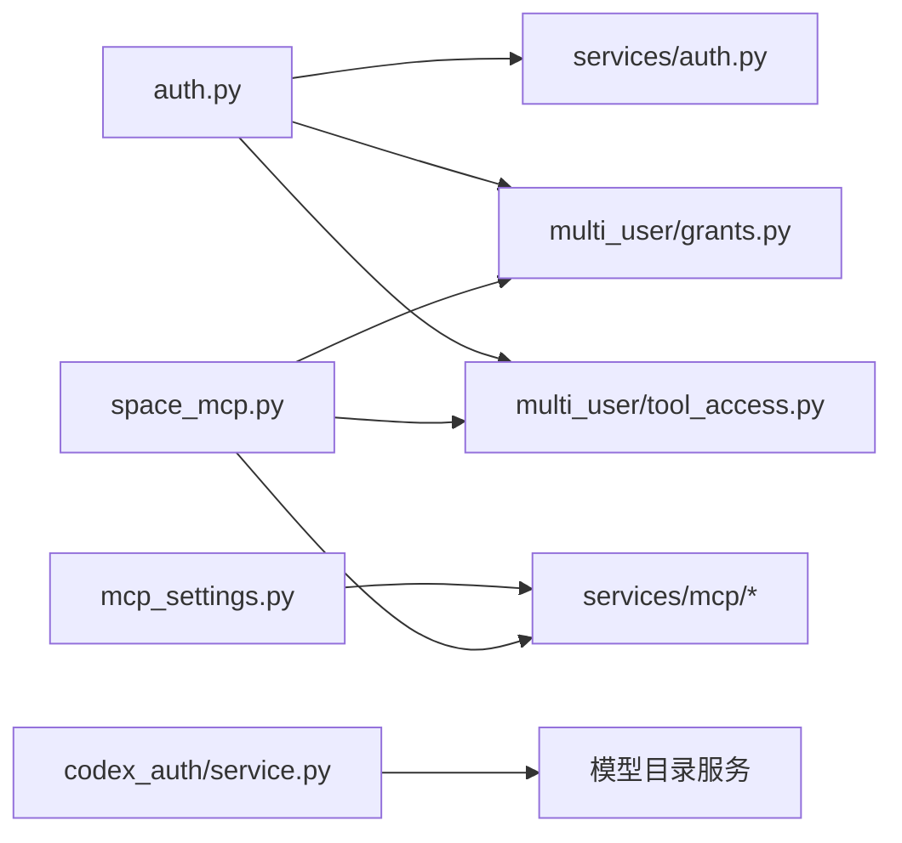

# 认证与安全配置

<cite>
**本文引用的文件**
- [deeptutor/api/routers/auth.py](file://deeptutor/api/routers/auth.py)
- [deeptutor/services/auth.py](file://deeptutor/services/auth.py)
- [deeptutor/services/codex_auth/service.py](file://deeptutor/services/codex_auth/service.py)
- [deeptutor/services/codex_auth/contracts.py](file://deeptutor/services/codex_auth/contracts.py)
- [deeptutor/api/routers/mcp_settings.py](file://deeptutor/api/routers/mcp_settings.py)
- [deeptutor/api/routers/space_mcp.py](file://deeptutor/api/routers/space_mcp.py)
- [deeptutor/services/mcp/__init__.py](file://deeptutor/services/mcp/__init__.py)
- [deeptutor/multi_user/grants.py](file://deeptutor/multi_user/grants.py)
- [deeptutor/multi_user/tool_access.py](file://deeptutor/multi_user/tool_access.py)
- [tests/api/test_space_mcp.py](file://tests/api/test_space_mcp.py)
- [tests/api/test_mcp_settings_auth.py](file://tests/api/test_mcp_settings_auth.py)
</cite>

## 目录
1. [简介](#简介)
2. [项目结构](#项目结构)
3. [核心组件](#核心组件)
4. [架构总览](#架构总览)
5. [详细组件分析](#详细组件分析)
6. [依赖关系分析](#依赖关系分析)
7. [性能考虑](#性能考虑)
8. [故障排查指南](#故障排查指南)
9. [结论](#结论)
10. [附录](#附录)

## 简介
本文件面向 DeepTutor 的 MCP 服务器认证与安全配置，覆盖以下主题：
- OAuth 2.1 认证流程（授权码模式、客户端凭证模式）在系统内的实现与使用方式
- API 密钥管理、请求头认证与 URL 白名单验证机制
- 敏感信息的安全存储方案（加密/隔离存储与环境变量注入）
- 权限控制策略（工具级访问控制、用户角色与资源授权）
- 安全配置最佳实践与常见问题解决方案

## 项目结构
DeepTutor 将认证与安全能力分布在多个模块中：
- 统一鉴权入口与 JWT Cookie/Bearer 处理位于 API 路由层
- 服务层提供 JWT 签发/校验、密码哈希、以及可选的 PocketBase 集成
- Codex OAuth（OpenAI ChatGPT）通过独立服务编排登录、刷新、模型目录同步
- MCP 设置分为“部署级管理员注册表”和“用户级空间配置”，均具备严格的 URL 校验与凭据分离存储
- 多用户授权通过 grants 与 tool_access 进行细粒度工具与执行能力限制

**图表来源**
- [deeptutor/api/routers/auth.py:237-348](file://deeptutor/api/routers/auth.py#L237-L348)
- [deeptutor/services/auth.py:220-280](file://deeptutor/services/auth.py#L220-L280)
- [deeptutor/api/routers/mcp_settings.py:41-78](file://deeptutor/api/routers/mcp_settings.py#L41-L78)
- [deeptutor/api/routers/space_mcp.py:138-205](file://deeptutor/api/routers/space_mcp.py#L138-L205)
- [deeptutor/services/mcp/__init__.py:1-33](file://deeptutor/services/mcp/__init__.py#L1-L33)
- [deeptutor/multi_user/grants.py:16-44](file://deeptutor/multi_user/grants.py#L16-L44)
- [deeptutor/multi_user/tool_access.py:44-104](file://deeptutor/multi_user/tool_access.py#L44-L104)

**章节来源**
- [deeptutor/api/routers/auth.py:237-348](file://deeptutor/api/routers/auth.py#L237-L348)
- [deeptutor/services/auth.py:220-280](file://deeptutor/services/auth.py#L220-L280)
- [deeptutor/api/routers/mcp_settings.py:41-78](file://deeptutor/api/routers/mcp_settings.py#L41-L78)
- [deeptutor/api/routers/space_mcp.py:138-205](file://deeptutor/api/routers/space_mcp.py#L138-L205)
- [deeptutor/services/mcp/__init__.py:1-33](file://deeptutor/services/mcp/__init__.py#L1-L33)
- [deeptutor/multi_user/grants.py:16-44](file://deeptutor/multi_user/grants.py#L16-L44)
- [deeptutor/multi_user/tool_access.py:44-104](file://deeptutor/multi_user/tool_access.py#L44-L104)

## 核心组件
- 统一鉴权依赖 require_auth/require_admin：支持 Authorization: Bearer 与 Cookie 双通道；当 AUTH_ENABLED=false 时回退为本地管理员身份
- JWT 令牌生命周期：create_token/decode_token，HS256 签名，可配置过期时间；支持 PocketBase 模式下的外部 token 校验
- Codex OAuth 服务：完整的授权码流程（含 PKCE）、回调处理、token 刷新、模型目录同步与注销清理
- MCP 设置与用户空间：
  - 管理员端：全局 MCP 注册表读写与测试，URL 白名单校验
  - 用户端：仅远程传输（sse/streamableHttp），凭据与配置分离存储，OAuth 授权入口与回调
- 多用户授权：grants 定义工具/CLI/MCP/执行能力白名单；tool_access 提供运行时解析与交集合并

**章节来源**
- [deeptutor/api/routers/auth.py:237-348](file://deeptutor/api/routers/auth.py#L237-L348)
- [deeptutor/services/auth.py:220-280](file://deeptutor/services/auth.py#L220-L280)
- [deeptutor/services/codex_auth/service.py:237-363](file://deeptutor/services/codex_auth/service.py#L237-L363)
- [deeptutor/api/routers/mcp_settings.py:41-78](file://deeptutor/api/routers/mcp_settings.py#L41-L78)
- [deeptutor/api/routers/space_mcp.py:138-205](file://deeptutor/api/routers/space_mcp.py#L138-L205)
- [deeptutor/multi_user/grants.py:16-44](file://deeptutor/multi_user/grants.py#L16-L44)
- [deeptutor/multi_user/tool_access.py:44-104](file://deeptutor/multi_user/tool_access.py#L44-L104)

## 架构总览
下图展示从浏览器到后端的关键认证与安全路径，包括 JWT、Codex OAuth、MCP 配置与权限控制。

**图表来源**
- [deeptutor/api/routers/auth.py:237-348](file://deeptutor/api/routers/auth.py#L237-L348)
- [deeptutor/services/auth.py:220-280](file://deeptutor/services/auth.py#L220-L280)
- [deeptutor/services/codex_auth/service.py:237-363](file://deeptutor/services/codex_auth/service.py#L237-L363)
- [deeptutor/api/routers/mcp_settings.py:41-78](file://deeptutor/api/routers/mcp_settings.py#L41-L78)
- [deeptutor/api/routers/space_mcp.py:138-205](file://deeptutor/api/routers/space_mcp.py#L138-L205)
- [deeptutor/multi_user/tool_access.py:44-104](file://deeptutor/multi_user/tool_access.py#L44-L104)

## 详细组件分析

### 统一鉴权与令牌管理
- 支持两种认证输入：Authorization: Bearer 与 dt_token Cookie；WebSocket 场景通过查询参数或 Cookie 同样处理
- 当 AUTH_ENABLED=false 时，所有请求视为本地管理员，便于开发调试
- JWT 使用 HS256，可配置过期时间；PocketBase 模式下通过外部 token 校验，无需静态密钥

**图表来源**
- [deeptutor/api/routers/auth.py:237-348](file://deeptutor/api/routers/auth.py#L237-L348)
- [deeptutor/services/auth.py:220-280](file://deeptutor/services/auth.py#L220-L280)

**章节来源**
- [deeptutor/api/routers/auth.py:237-348](file://deeptutor/api/routers/auth.py#L237-L348)
- [deeptutor/services/auth.py:220-280](file://deeptutor/services/auth.py#L220-L280)

### Codex OAuth 2.1（授权码模式 + PKCE）
- 启动登录：生成 state/pkce，构造 authorize_url，启动本地回调监听
- 回调处理：校验 state/code，交换 access_token/refresh_token/id_token，持久化并刷新模型目录
- 刷新与注销：按到期时间刷新；注销时撤销授权、清理凭据与目录条目
- 安全要点：state/pkce 防 CSRF/重放；account_id 一致性校验；敏感数据迁移到不可被沙箱读取的 secrets 目录

**图表来源**
- [deeptutor/services/codex_auth/service.py:237-363](file://deeptutor/services/codex_auth/service.py#L237-L363)
- [deeptutor/services/codex_auth/service.py:427-462](file://deeptutor/services/codex_auth/service.py#L427-L462)
- [deeptutor/services/codex_auth/service.py:493-526](file://deeptutor/services/codex_auth/service.py#L493-L526)
- [deeptutor/services/codex_auth/contracts.py:33-106](file://deeptutor/services/codex_auth/contracts.py#L33-L106)

**章节来源**
- [deeptutor/services/codex_auth/service.py:237-363](file://deeptutor/services/codex_auth/service.py#L237-L363)
- [deeptutor/services/codex_auth/service.py:427-462](file://deeptutor/services/codex_auth/service.py#L427-L462)
- [deeptutor/services/codex_auth/service.py:493-526](file://deeptutor/services/codex_auth/service.py#L493-L526)
- [deeptutor/services/codex_auth/contracts.py:33-106](file://deeptutor/services/codex_auth/contracts.py#L33-L106)

### MCP 服务器配置与 URL 白名单
- 管理员端（/api/v1/settings/mcp）：
  - 读/写全局 MCP 注册表，更新后热重载
  - 对 sse/streamableHttp 的 URL 进行白名单校验，非法地址直接拒绝
- 用户端（/api/v1/space/mcp）：
  - 仅允许远程传输（禁止 stdio），避免主机命令执行风险
  - 凭据与配置分离存储，GET/PUT 不返回明文；仅返回“已配置字段名”
  - 支持 OAuth 授权入口与回调，完成后可用该服务器工具

**图表来源**
- [deeptutor/api/routers/mcp_settings.py:41-78](file://deeptutor/api/routers/mcp_settings.py#L41-L78)
- [deeptutor/api/routers/space_mcp.py:138-166](file://deeptutor/api/routers/space_mcp.py#L138-L166)
- [tests/api/test_space_mcp.py:114-130](file://tests/api/test_space_mcp.py#L114-L130)

**章节来源**
- [deeptutor/api/routers/mcp_settings.py:41-78](file://deeptutor/api/routers/mcp_settings.py#L41-L78)
- [deeptutor/api/routers/space_mcp.py:138-166](file://deeptutor/api/routers/space_mcp.py#L138-L166)
- [tests/api/test_space_mcp.py:114-130](file://tests/api/test_space_mcp.py#L114-L130)

### 凭据与敏感信息管理
- 位置分离：headers/env 中的值自动识别为凭据，写入独立 secrets 存储，配置侧保留引用形式
- 回显保护：任何 GET/PUT 响应绝不包含明文；仅列出已配置的字段名
- 删除联动：删除服务器同时清理其凭据与 OAuth 授权
- 环境变量注入：初始化向导支持从环境变量读取 API Key，并在交互中确认复用

**图表来源**
- [deeptutor/api/routers/space_mcp.py:402-457](file://deeptutor/api/routers/space_mcp.py#L402-L457)
- [tests/api/test_space_mcp.py:123-145](file://tests/api/test_space_mcp.py#L123-L145)

**章节来源**
- [deeptutor/api/routers/space_mcp.py:402-457](file://deeptutor/api/routers/space_mcp.py#L402-L457)
- [tests/api/test_space_mcp.py:123-145](file://tests/api/test_space_mcp.py#L123-L145)

### 权限控制与工具访问策略
- 角色控制：require_admin 确保管理员操作；非 admin 无法编辑全局 MCP 注册表
- 资源授权（grants）：
  - enabled_tools：内置工具的白名单
  - mcp_tools：MCP 工具白名单（非 admin 默认拒绝，除非明确授予）
  - cli_apps：安装的 CLI 应用白名单（第三方代码，默认拒绝）
  - exec_enabled：执行能力开关（叠加部署策略）
- 白名单合并：combine_whitelists 支持调用方与用户授权的交集计算

**图表来源**
- [deeptutor/multi_user/grants.py:16-44](file://deeptutor/multi_user/grants.py#L16-L44)
- [deeptutor/multi_user/tool_access.py:44-104](file://deeptutor/multi_user/tool_access.py#L44-L104)

**章节来源**
- [deeptutor/multi_user/grants.py:16-44](file://deeptutor/multi_user/grants.py#L16-L44)
- [deeptutor/multi_user/tool_access.py:44-104](file://deeptutor/multi_user/tool_access.py#L44-L104)

## 依赖关系分析
- 路由层依赖认证依赖（require_auth/require_admin）与 i18n 提示
- MCP 路由依赖 services/mcp 的配置加载、URL 校验与管理器重载
- 多用户授权通过 grants/tool_access 影响工具与执行能力可见性
- Codex OAuth 依赖模型目录服务以发布/移除托管配置

**图表来源**
- [deeptutor/api/routers/auth.py:237-348](file://deeptutor/api/routers/auth.py#L237-L348)
- [deeptutor/api/routers/mcp_settings.py:41-78](file://deeptutor/api/routers/mcp_settings.py#L41-L78)
- [deeptutor/api/routers/space_mcp.py:138-205](file://deeptutor/api/routers/space_mcp.py#L138-L205)
- [deeptutor/services/mcp/__init__.py:1-33](file://deeptutor/services/mcp/__init__.py#L1-L33)
- [deeptutor/multi_user/grants.py:16-44](file://deeptutor/multi_user/grants.py#L16-L44)
- [deeptutor/multi_user/tool_access.py:44-104](file://deeptutor/multi_user/tool_access.py#L44-L104)
- [deeptutor/services/codex_auth/service.py:123-167](file://deeptutor/services/codex_auth/service.py#L123-L167)

**章节来源**
- [deeptutor/api/routers/auth.py:237-348](file://deeptutor/api/routers/auth.py#L237-L348)
- [deeptutor/api/routers/mcp_settings.py:41-78](file://deeptutor/api/routers/mcp_settings.py#L41-L78)
- [deeptutor/api/routers/space_mcp.py:138-205](file://deeptutor/api/routers/space_mcp.py#L138-L205)
- [deeptutor/services/mcp/__init__.py:1-33](file://deeptutor/services/mcp/__init__.py#L1-L33)
- [deeptutor/multi_user/grants.py:16-44](file://deeptutor/multi_user/grants.py#L16-L44)
- [deeptutor/multi_user/tool_access.py:44-104](file://deeptutor/multi_user/tool_access.py#L44-L104)
- [deeptutor/services/codex_auth/service.py:123-167](file://deeptutor/services/codex_auth/service.py#L123-L167)

## 性能考虑
- 令牌校验：标准模式为本地解码，零网络开销；PocketBase 模式有短时缓存以减少重复网络调用
- MCP 状态预热：列举服务器时对连接进行有限超时预热，避免页面长时间阻塞
- 目录同步：Codex 登录后异步刷新模型目录，减少首次请求延迟
- 建议：在高并发场景下，合理设置令牌过期时间与缓存策略，避免频繁刷新

[本节为通用指导，不直接分析具体文件]

## 故障排查指南
- 401 未认证：检查是否启用认证、Bearer/Cookie 是否正确传递；WebSocket 需先鉴权再 accept
- 403 禁止访问：确认当前用户是否为管理员；检查 grants 中 mcp_tools/enabled_tools/cli_apps 是否包含目标
- MCP URL 被拒：确认 URL 在白名单内；避免指向部署内部地址（如 127.0.0.1）
- 凭据未生效：确认 secrets 已存储且配置侧为引用形式；重新保存触发重载
- Codex 登录失败：检查 state/pkce 匹配、回调端口可达、授权服务器返回完整令牌字段

**章节来源**
- [deeptutor/api/routers/auth.py:237-348](file://deeptutor/api/routers/auth.py#L237-L348)
- [deeptutor/api/routers/mcp_settings.py:41-78](file://deeptutor/api/routers/mcp_settings.py#L41-L78)
- [tests/api/test_space_mcp.py:114-130](file://tests/api/test_space_mcp.py#L114-L130)
- [tests/api/test_mcp_settings_auth.py:121-127](file://tests/api/test_mcp_settings_auth.py#L121-L127)

## 结论
DeepTutor 在认证与安全方面提供了分层防护：统一的 JWT 鉴权、完善的 Codex OAuth 流程、严格的 MCP URL 白名单与凭据分离存储，以及基于 grants 的工具与执行能力细粒度控制。遵循本文的最佳实践可有效降低越权、凭据泄露与恶意连接等安全风险。

[本节为总结性内容，不直接分析具体文件]

## 附录
- 最佳实践清单
  - 生产环境开启认证并配置合适的令牌过期时间
  - 仅暴露远程 MCP 传输（sse/streamableHttp），禁止用户配置 stdio
  - 始终通过官方回调与 state/pkce 完成 OAuth 流程
  - 使用独立的 secrets 存储凭据，不在配置中明文存放
  - 定期审查 grants，最小权限原则分配工具与执行能力
  - 使用环境变量注入敏感配置，避免硬编码

[本节为通用指导，不直接分析具体文件]