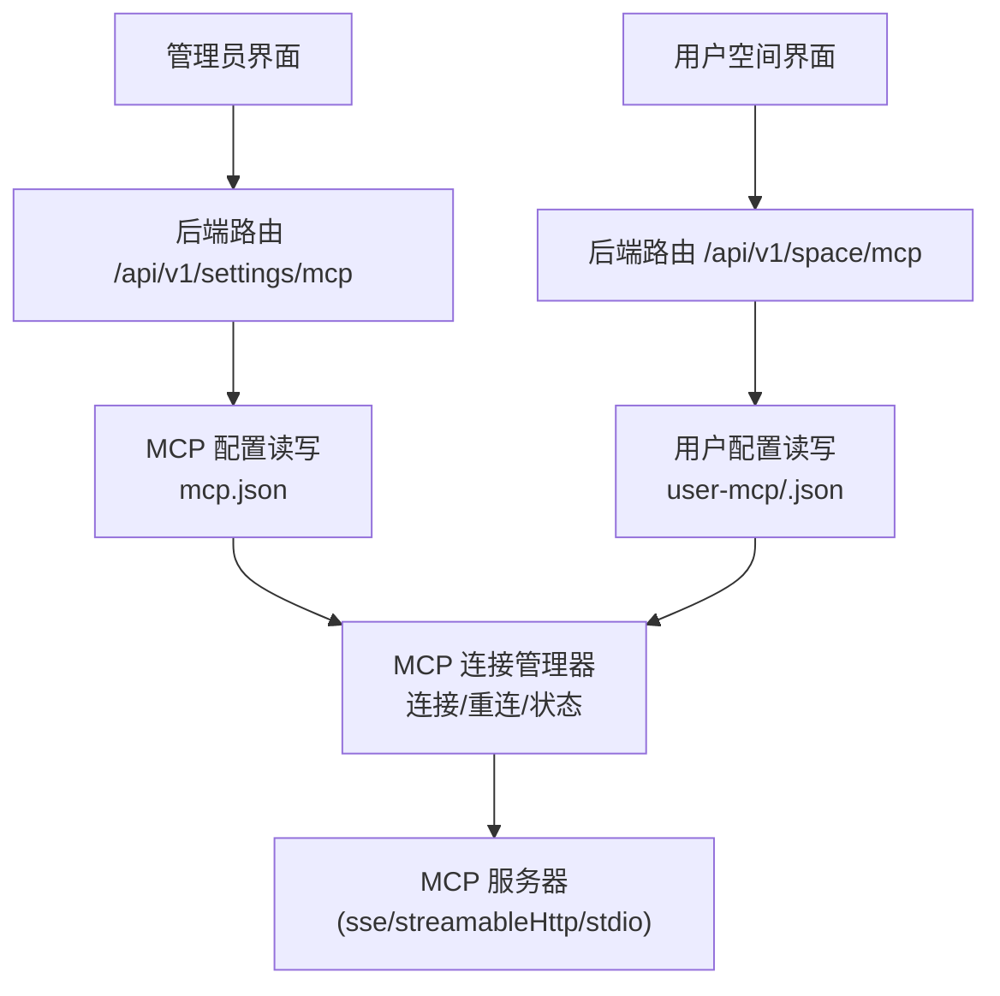
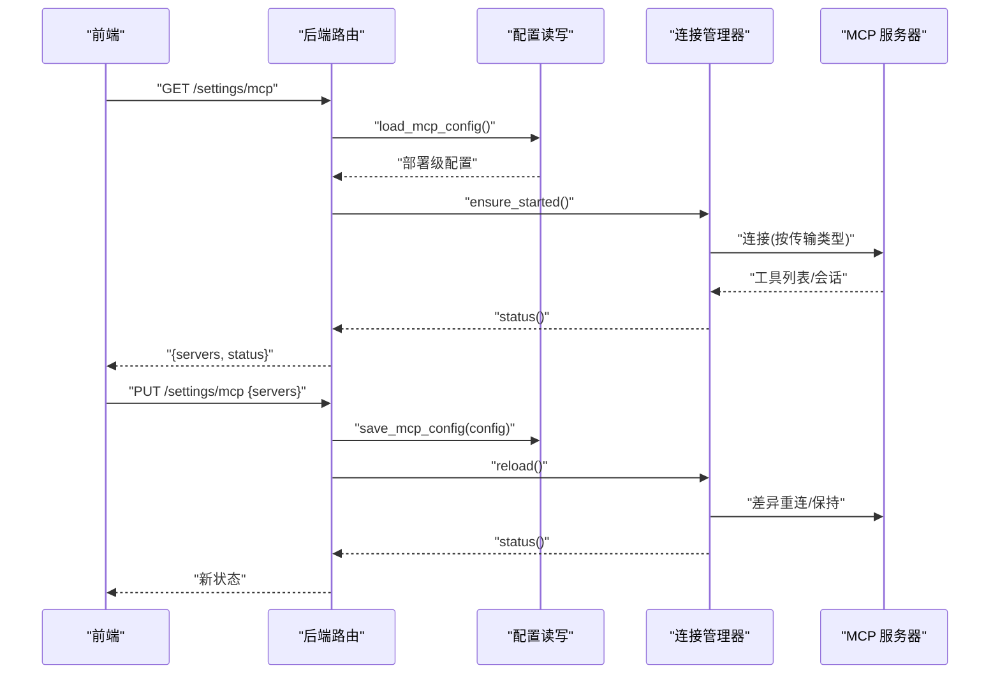
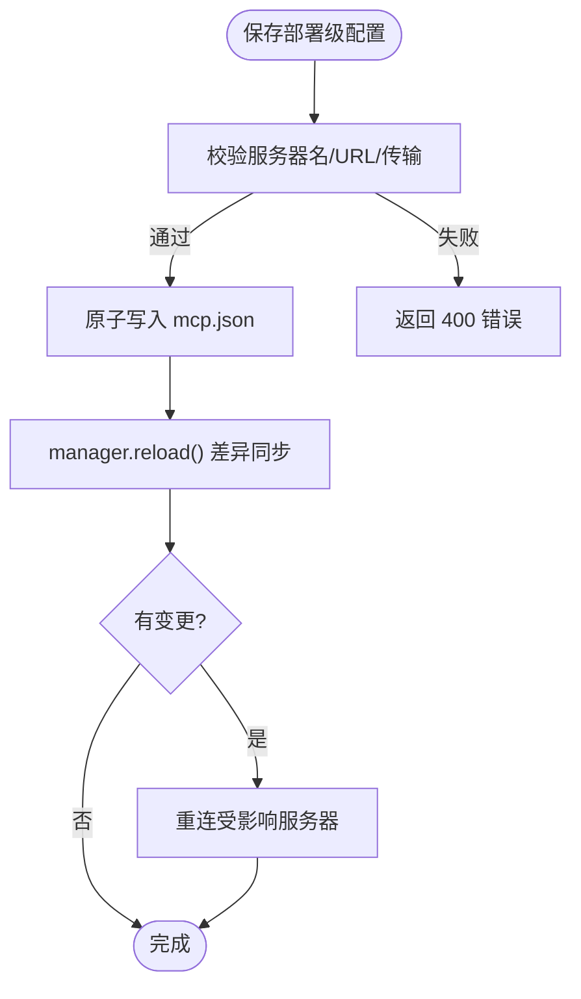
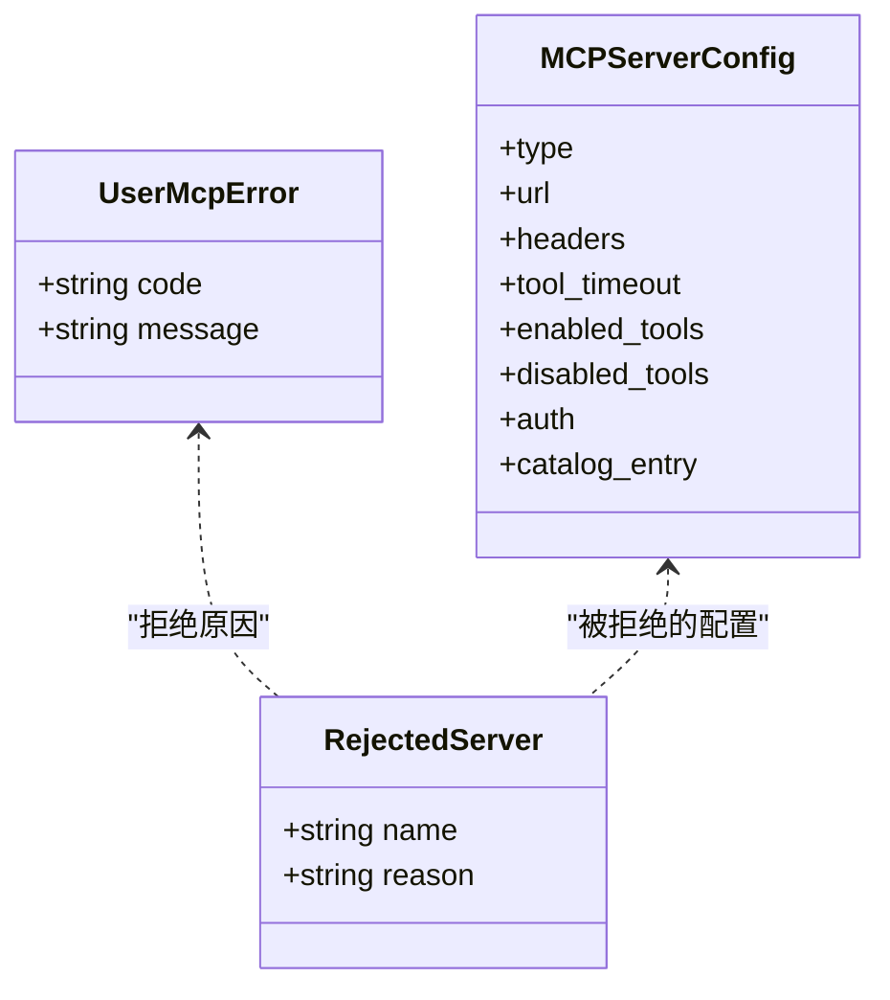
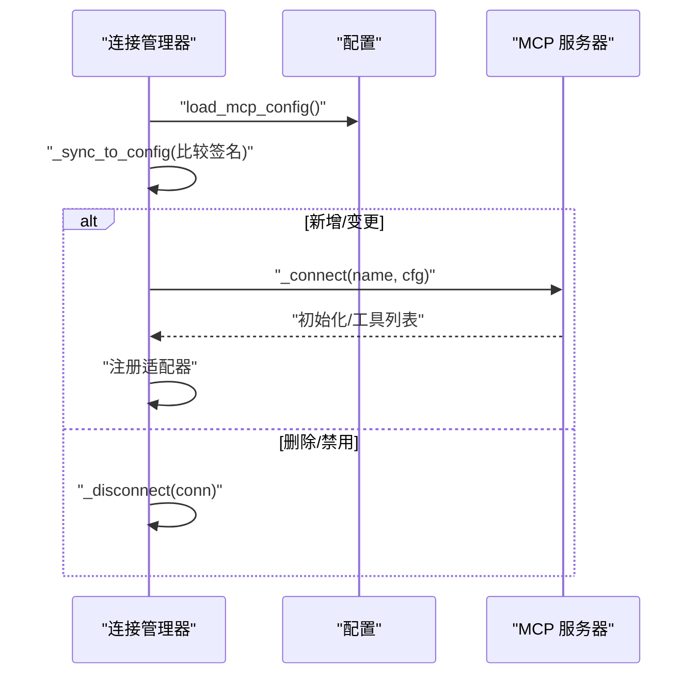
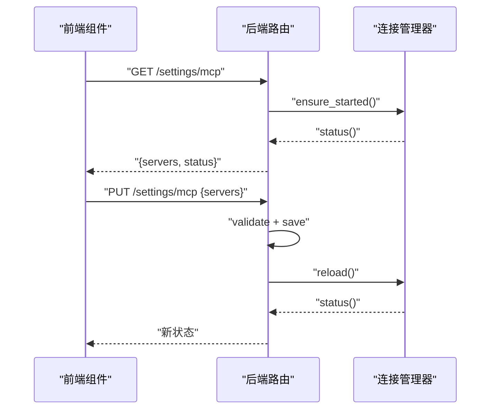
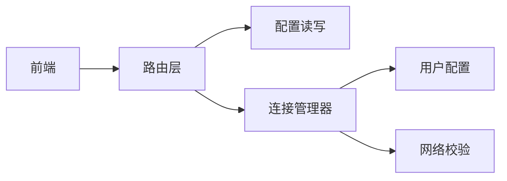

# 配置文件管理

<cite>
**本文引用的文件**
- [deeptutor/services/mcp/config.py](file://deeptutor/services/mcp/config.py)
- [deeptutor/services/mcp/manager.py](file://deeptutor/services/mcp/manager.py)
- [deeptutor/services/mcp/user_config.py](file://deeptutor/services/mcp/user_config.py)
- [deeptutor/api/routers/mcp_settings.py](file://deeptutor/api/routers/mcp_settings.py)
- [deeptutor/api/routers/space_mcp.py](file://deeptutor/api/routers/space_mcp.py)
- [deeptutor/utils/config_manager.py](file://deeptutor/utils/config_manager.py)
- [deeptutor/services/config/loader.py](file://deeptutor/services/config/loader.py)
- [web/lib/mcp-api.ts](file://web/lib/mcp-api.ts)
- [tests/api/test_mcp_settings_auth.py](file://tests/api/test_mcp_settings_auth.py)
</cite>

## 目录
1. [简介](#简介)
2. [项目结构](#项目结构)
3. [核心组件](#核心组件)
4. [架构总览](#架构总览)
5. [详细组件分析](#详细组件分析)
6. [依赖关系分析](#依赖关系分析)
7. [性能与可靠性](#性能与可靠性)
8. [故障诊断与排错](#故障诊断与排错)
9. [结论](#结论)
10. [附录：配置迁移与备份恢复](#附录：配置迁移与备份恢复)

## 简介
本文件面向 DeepTutor 的 MCP（Model Context Protocol）配置管理，覆盖部署级配置与用户级配置的区别、配置文件组织与命名规范、版本与变更策略、热重载机制、验证与错误处理、以及调试与排错方法。文档同时给出前端与后端的交互流程、连接生命周期与资源回收策略，帮助管理员与开发者安全、稳定地管理 MCP 服务器注册表与运行时行为。

## 项目结构
DeepTutor 将“部署级”和“用户级”两类 MCP 配置解耦：
- 部署级配置：由管理员维护，位于系统设置目录下的 mcp.json，描述所有账户共享的 MCP 服务器集合。
- 用户级配置：每个用户独立维护，位于 data/system/user-mcp/<owner>.json，仅允许远程传输（sse/streamableHttp），并受数量上限与安全校验约束。

此外，通用运行期 YAML 配置通过 loader 与 ConfigManager 管理，用于非 MCP 的运行行为控制（如路径注入、默认参数等）。

**图表来源**
- [deeptutor/api/routers/mcp_settings.py:57-78](file://deeptutor/api/routers/mcp_settings.py#L57-L78)
- [deeptutor/api/routers/space_mcp.py:96-120](file://deeptutor/api/routers/space_mcp.py#L96-L120)
- [deeptutor/services/mcp/config.py:116-152](file://deeptutor/services/mcp/config.py#L116-L152)
- [deeptutor/services/mcp/user_config.py:70-118](file://deeptutor/services/mcp/user_config.py#L70-L118)
- [deeptutor/services/mcp/manager.py:243-263](file://deeptutor/services/mcp/manager.py#L243-L263)

**章节来源**
- [deeptutor/services/mcp/config.py:1-163](file://deeptutor/services/mcp/config.py#L1-L163)
- [deeptutor/services/mcp/user_config.py:1-234](file://deeptutor/services/mcp/user_config.py#L1-L234)
- [deeptutor/services/config/loader.py:1-326](file://deeptutor/services/config/loader.py#L1-L326)
- [deeptutor/utils/config_manager.py:1-130](file://deeptutor/utils/config_manager.py#L1-L130)

## 核心组件
- 部署级 MCP 配置模型与持久化：定义服务器条目、传输类型推断、工具白/黑名单、认证标记、原子写入等。
- 用户级 MCP 配置：限制为远程传输、名称与数量上限、URL 严格校验、拒绝 stdio 执行。
- MCP 连接管理器：单例管理所有服务器连接、按需懒启动、差异同步、失败重试、作用域隔离与冷作用域回收。
- API 路由：管理员端点（读/写/测试/删除）与用户空间端点（安装目录项、保存/删除用户服务器、授权 OAuth）。
- 前端接口：统一获取/更新/测试 MCP 设置，封装状态归一化与错误提示。

**章节来源**
- [deeptutor/services/mcp/config.py:31-113](file://deeptutor/services/mcp/config.py#L31-L113)
- [deeptutor/services/mcp/user_config.py:40-118](file://deeptutor/services/mcp/user_config.py#L40-L118)
- [deeptutor/services/mcp/manager.py:216-263](file://deeptutor/services/mcp/manager.py#L216-L263)
- [deeptutor/api/routers/mcp_settings.py:37-133](file://deeptutor/api/routers/mcp_settings.py#L37-L133)
- [deeptutor/api/routers/space_mcp.py:319-352](file://deeptutor/api/routers/space_mcp.py#L319-L352)
- [web/lib/mcp-api.ts:475-512](file://web/lib/mcp-api.ts#L475-L512)

## 架构总览
下图展示从前端到后端再到 MCP 服务器的完整调用链，包括配置读取、验证、持久化、热重载与连接建立。

**图表来源**
- [deeptutor/api/routers/mcp_settings.py:57-78](file://deeptutor/api/routers/mcp_settings.py#L57-L78)
- [deeptutor/services/mcp/config.py:120-152](file://deeptutor/services/mcp/config.py#L120-L152)
- [deeptutor/services/mcp/manager.py:243-263](file://deeptutor/services/mcp/manager.py#L243-L263)

## 详细组件分析

### 部署级配置（管理员）
- 存储位置与命名：mcp.json，位于管理员工作区的 settings 目录。
- 数据模型：MCPServerConfig 支持三种传输（stdio/sse/streamableHttp），自动推断 type；支持工具白名单/黑名单、超时、启用开关、OAuth 标记、目录来源记录。
- 验证规则：服务器名必须匹配正则；URL 在保存时进行合法性校验；stdio 仅限管理员。
- 持久化：原子写入（临时文件 + fsync + replace），崩溃不破坏配置。
- 热重载：保存后调用 manager.reload()，按签名差异重连变更的服务器。

**图表来源**
- [deeptutor/services/mcp/config.py:101-152](file://deeptutor/services/mcp/config.py#L101-L152)
- [deeptutor/api/routers/mcp_settings.py:68-78](file://deeptutor/api/routers/mcp_settings.py#L68-L78)

**章节来源**
- [deeptutor/services/mcp/config.py:31-152](file://deeptutor/services/mcp/config.py#L31-L152)
- [deeptutor/api/routers/mcp_settings.py:37-133](file://deeptutor/api/routers/mcp_settings.py#L37-L133)

### 用户级配置（普通用户）
- 存储位置与命名：data/system/user-mcp/<owner>.json，避免沙箱可写区域，防止凭据泄露。
- 安全限制：禁止 stdio；仅允许 sse 或 streamableHttp；对 URL 进行严格校验；名称保留前缀保护；每账户最多 N 个服务器。
- 目录安装：可从目录安装 self-service 条目，分离凭据引用与实际值，避免明文落盘。
- 热重载：保存或删除后调用 manager.reload_scope(owner)，立即生效。

**图表来源**
- [deeptutor/services/mcp/user_config.py:54-118](file://deeptutor/services/mcp/user_config.py#L54-L118)
- [deeptutor/services/mcp/config.py:31-99](file://deeptutor/services/mcp/config.py#L31-L99)

**章节来源**
- [deeptutor/services/mcp/user_config.py:1-234](file://deeptutor/services/mcp/user_config.py#L1-L234)
- [deeptutor/api/routers/space_mcp.py:319-352](file://deeptutor/api/routers/space_mcp.py#L319-L352)

### 连接管理与热重载
- 懒启动：首次调用 ensure_started() 才连接所有启用的部署级服务器。
- 差异同步：reload() 对比已连接配置的签名，仅重启发生变化的服务器。
- 失败重试：指数退避，避免频繁重连；瞬态错误一次重试。
- 作用域隔离：按 owner 隔离连接与作用域，冷作用域空闲回收，限制最大作用域数。
- 工具适配器：将 MCP 工具包装为 chat 工具，延迟加载 schema，注册到全局或作用域注册表。

**图表来源**
- [deeptutor/services/mcp/manager.py:243-263](file://deeptutor/services/mcp/manager.py#L243-L263)
- [deeptutor/services/mcp/manager.py:474-491](file://deeptutor/services/mcp/manager.py#L474-L491)
- [deeptutor/services/mcp/manager.py:493-533](file://deeptutor/services/mcp/manager.py#L493-L533)

**章节来源**
- [deeptutor/services/mcp/manager.py:216-533](file://deeptutor/services/mcp/manager.py#L216-L533)

### 前端与后端交互
- 获取设置：GET /settings/mcp 或 /space/mcp，返回 servers 与 status。
- 更新设置：PUT /settings/mcp 或 /space/mcp/servers/{name}，提交新的服务器集合或单个条目。
- 测试连接：POST /settings/mcp/test，使用相同的安全策略探测目标服务器。
- 前端封装：统一 fetch 调用、缓存控制、状态归一化与错误格式化。

**图表来源**
- [web/lib/mcp-api.ts:475-512](file://web/lib/mcp-api.ts#L475-L512)
- [deeptutor/api/routers/mcp_settings.py:57-78](file://deeptutor/api/routers/mcp_settings.py#L57-L78)

**章节来源**
- [web/lib/mcp-api.ts:475-512](file://web/lib/mcp-api.ts#L475-L512)
- [deeptutor/api/routers/mcp_settings.py:57-133](file://deeptutor/api/routers/mcp_settings.py#L57-L133)

## 依赖关系分析
- 路由层依赖配置读写与连接管理器，确保每次变更后即时生效。
- 连接管理器依赖配置模型与网络校验，保证连接安全与稳定性。
- 用户配置模块依赖管理员路径服务与网络校验，确保用户配置安全隔离。
- 前端依赖后端 API 契约，保持状态一致性与错误可读性。

**图表来源**
- [deeptutor/api/routers/mcp_settings.py:24-33](file://deeptutor/api/routers/mcp_settings.py#L24-L33)
- [deeptutor/services/mcp/manager.py:42-48](file://deeptutor/services/mcp/manager.py#L42-L48)
- [deeptutor/services/mcp/user_config.py:35-37](file://deeptutor/services/mcp/user_config.py#L35-L37)

**章节来源**
- [deeptutor/api/routers/mcp_settings.py:1-133](file://deeptutor/api/routers/mcp_settings.py#L1-L133)
- [deeptutor/services/mcp/manager.py:1-800](file://deeptutor/services/mcp/manager.py#L1-L800)
- [deeptutor/services/mcp/user_config.py:1-234](file://deeptutor/services/mcp/user_config.py#L1-L234)

## 性能与可靠性
- 懒启动与差异同步：仅在必要时连接或重连，减少冷启动开销。
- 失败重试与退避：指数退避避免雪崩，瞬态错误快速恢复。
- 作用域隔离与回收：限制每进程作用域数量，空闲回收降低内存占用。
- 原子写入：避免部分写入导致的全局断开风险。
- 超时控制：连接与工具调用均有明确超时，避免长时间阻塞。

[本节提供一般性指导，无需特定文件引用]

## 故障诊断与排错
- 配置验证失败：检查服务器名、URL、传输类型与必填字段；确认管理员权限。
- 连接失败：查看 status 中的 error 信息；确认 DNS、网络可达、证书与鉴权。
- 用户配置被拒绝：确认未使用 stdio、名称未冲突、数量未超限、URL 未被拦截。
- 热重载未生效：确认保存后调用了 reload/reload_scope；检查日志中是否触发差异同步。
- 前端状态不同步：确认 GET/PUT 请求无缓存；检查 normalizeStatusRows 与 normalizeServers 逻辑。

**章节来源**
- [deeptutor/api/routers/mcp_settings.py:41-55](file://deeptutor/api/routers/mcp_settings.py#L41-L55)
- [deeptutor/services/mcp/user_config.py:164-190](file://deeptutor/services/mcp/user_config.py#L164-L190)
- [tests/api/test_mcp_settings_auth.py:121-127](file://tests/api/test_mcp_settings_auth.py#L121-L127)

## 结论
DeepTutor 的 MCP 配置管理通过清晰的职责划分与严格的校验策略，实现了部署级与用户级配置的安全隔离与高效管理。连接管理器提供健壮的生命周期控制与热重载能力，配合前端统一的 API 封装，使管理员与用户能够便捷、可靠地配置与运维 MCP 服务器。

[本节总结性内容，无需特定文件引用]

## 附录：配置迁移与备份恢复
- 迁移建议：
  - 将旧版 mcp.json 导出为 JSON 文本，对照新版模型字段进行映射与补全（如 enabled_tools、disabled_tools、auth、catalog_entry）。
  - 用户级配置迁移需确保仅包含远程传输，移除任何 stdio 相关字段。
  - 使用 PUT /settings/mcp/servers/{name} 增量更新，避免覆盖其他管理员修改。
- 备份与恢复：
  - 定期备份 mcp.json 与 user-mcp/*.json；建议使用版本控制系统或对象存储。
  - 恢复时先校验 JSON 格式与字段合法性，再调用 reload 或重启服务以应用。
- 验证与回滚：
  - 使用 POST /settings/mcp/test 预检目标服务器连通性。
  - 若出现问题，回滚至上一版本配置并重新加载。

[本节提供操作指南，无需特定文件引用]