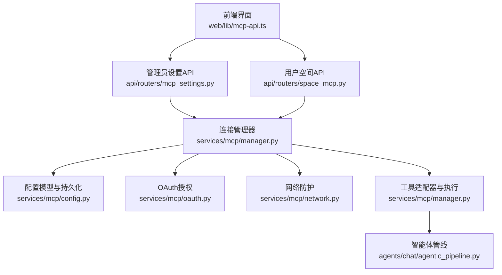
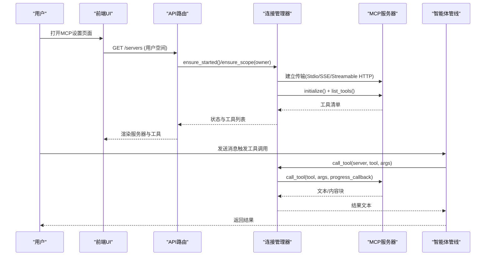
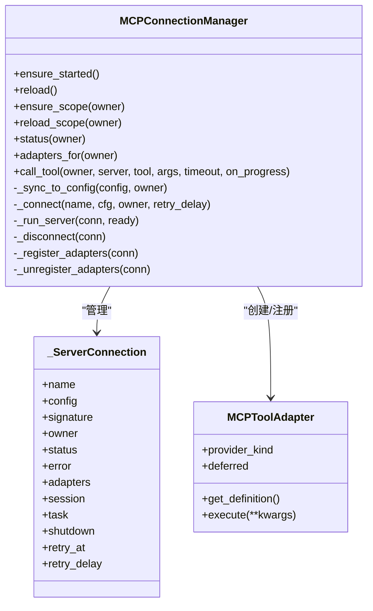
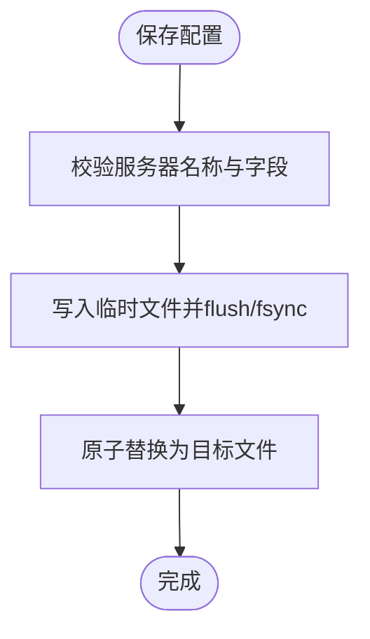
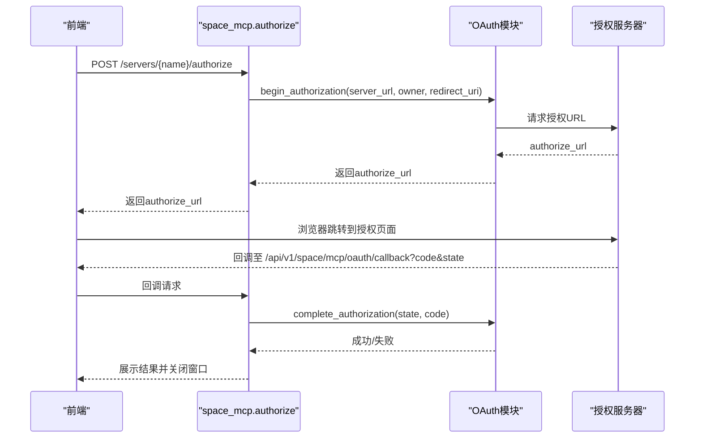
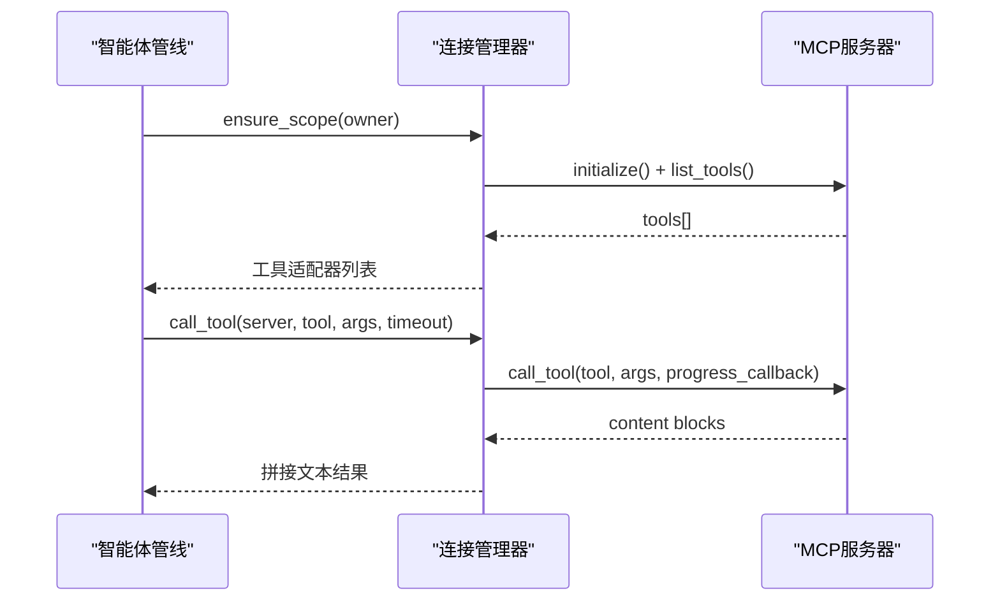
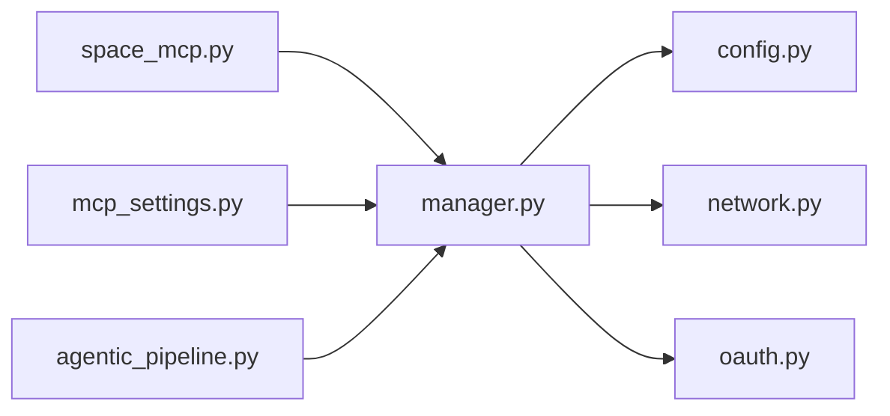

# MCP服务器集成

<cite>
**本文引用的文件**
- [manager.py](file://deeptutor/services/mcp/manager.py)
- [config.py](file://deeptutor/services/mcp/config.py)
- [oauth.py](file://deeptutor/services/mcp/oauth.py)
- [network.py](file://deeptutor/services/mcp/network.py)
- [space_mcp.py](file://deeptutor/api/routers/space_mcp.py)
- [mcp_settings.py](file://deeptutor/api/routers/mcp_settings.py)
- [agentic_pipeline.py](file://deeptutor/agents/chat/agentic_pipeline.py)
- [mcp-api.ts](file://web/lib/mcp-api.ts)
</cite>

## 目录
1. [简介](#简介)
2. [项目结构](#项目结构)
3. [核心组件](#核心组件)
4. [架构总览](#架构总览)
5. [详细组件分析](#详细组件分析)
6. [依赖关系分析](#依赖关系分析)
7. [性能与可靠性](#性能与可靠性)
8. [故障诊断指南](#故障诊断指南)
9. [结论](#结论)
10. [附录：配置与调用示例路径](#附录配置与调用示例路径)

## 简介
本文件面向在DeepTutor中集成MCP（Model Context Protocol）服务器的工程实践，覆盖协议概念、服务器发现与能力协商、消息传递机制、本地与远程服务器配置、工具定义/注册/调用流程、认证机制（OAuth/API密钥）、常见集成场景、开发最佳实践、性能监控与错误处理策略，以及故障诊断方法。文档中的实现细节均基于仓库源码，确保可追溯与可验证。

## 项目结构
DeepTutor对MCP的集成由“后端服务层 + API路由 + 前端API封装”三部分构成：
- 后端服务层：连接管理、配置持久化、网络防护、OAuth授权、工具适配器与调度。
- API路由：管理员全局配置与用户自管配置的REST接口，含测试、目录安装、OAuth回调等。
- 前端API封装：类型定义、状态归一化、与服务端交互的函数集合。

图表来源
- [mcp-settings.py:57-133](file://deeptutor/api/routers/mcp_settings.py#L57-L133)
- [space_mcp.py:92-352](file://deeptutor/api/routers/space_mcp.py#L92-L352)
- [manager.py:216-753](file://deeptutor/services/mcp/manager.py#L216-L753)
- [config.py:31-163](file://deeptutor/services/mcp/config.py#L31-L163)
- [oauth.py:256-439](file://deeptutor/services/mcp/oauth.py#L256-L439)
- [network.py:69-122](file://deeptutor/services/mcp/network.py#L69-L122)
- [agentic_pipeline.py:473-528](file://deeptutor/agents/chat/agentic_pipeline.py#L473-L528)

章节来源
- [mcp-settings.py:1-134](file://deeptutor/api/routers/mcp_settings.py#L1-L134)
- [space_mcp.py:1-461](file://deeptutor/api/routers/space_mcp.py#L1-L461)
- [manager.py:1-863](file://deeptutor/services/mcp/manager.py#L1-L863)
- [config.py:1-163](file://deeptutor/services/mcp/config.py#L1-L163)
- [oauth.py:1-439](file://deeptutor/services/mcp/oauth.py#L1-L439)
- [network.py:1-122](file://deeptutor/services/mcp/network.py#L1-L122)
- [agentic_pipeline.py:459-528](file://deeptutor/agents/chat/agentic_pipeline.py#L459-L528)
- [mcp-api.ts:1-756](file://web/lib/mcp-api.ts#L1-L756)

## 核心组件
- 连接管理器（MCPConnectionManager）：维护所有已配置MCP服务器的生命周期、连接任务、工具适配器注册、重试与退避、空闲作用域回收。
- 配置模型（MCPServerConfig/MCPConfig）：描述传输方式（stdio/sse/streamableHttp）、命令/URL/头/环境变量、工具白名单/黑名单、超时、启用标志、认证模式、目录来源等；提供原子持久化。
- 网络防护（validate_mcp_url/async）：SSRF防护，区分部署级宽松策略与用户自管严格策略，阻止访问内网/云元数据地址。
- OAuth授权：为需要OAuth的MCP服务器提供动态客户端注册、授权码+PKCE、刷新令牌、交互式授权流程与非交互式自动刷新；令牌与客户端信息按用户隔离存储。
- 工具适配器（MCPToolAdapter）：将远端MCP工具包装为聊天工具的BaseTool，支持延迟加载、进度上报、超时控制、元数据标记。
- API路由：管理员设置API（全局注册表）与用户空间API（个人服务器），提供增删改查、测试、目录浏览与安装、OAuth回调等。
- 智能体管线集成：在每轮对话中构建工具视图，解析MCP工具并注入到运行时，支持权限过滤与渐进披露。

章节来源
- [manager.py:89-155](file://deeptutor/services/mcp/manager.py#L89-L155)
- [config.py:31-163](file://deeptutor/services/mcp/config.py#L31-L163)
- [network.py:69-122](file://deeptutor/services/mcp/network.py#L69-L122)
- [oauth.py:64-300](file://deeptutor/services/mcp/oauth.py#L64-L300)
- [space_mcp.py:92-352](file://deeptutor/api/routers/space_mcp.py#L92-L352)
- [mcp-settings.py:57-133](file://deeptutor/api/routers/mcp_settings.py#L57-L133)
- [agentic_pipeline.py:473-528](file://deeptutor/agents/chat/agentic_pipeline.py#L473-L528)

## 架构总览
MCP在DeepTutor中的工作流包括：
- 服务器发现与能力协商：连接建立后通过list_tools获取工具清单，生成适配器并注册到工具系统。
- 消息传递机制：通过MCP SDK的ClientSession调用call_tool，支持progress回调用于进度上报。
- 认证与安全：根据配置选择静态头或OAuth；用户自管服务器强制校验URL，禁止私有/回环地址。
- 工具调用：智能体管线在每轮准备阶段加载可用工具，按需延迟加载，执行时通过适配器转发到对应MCP服务器。

图表来源
- [space_mcp.py:92-135](file://deeptutor/api/routers/space_mcp.py#L92-L135)
- [manager.py:243-298](file://deeptutor/services/mcp/manager.py#L243-L298)
- [manager.py:404-470](file://deeptutor/services/mcp/manager.py#L404-L470)
- [agentic_pipeline.py:473-528](file://deeptutor/agents/chat/agentic_pipeline.py#L473-L528)

## 详细组件分析

### 连接管理器（MCPConnectionManager）
- 职责：
  - 启动与重载：ensure_started()懒加载首次连接；reload()对比配置差异并重启变更服务器。
  - 作用域隔离：按owner键控连接，避免多租户冲突；冷作用域按TTL与上限回收。
  - 工具适配：连接成功后list_tools，过滤enabled/disabled，生成MCPToolAdapter。
  - 调用与容错：call_tool带超时与一次瞬态错误重试；失败记录并指数退避重试。
  - 进度上报：progress回调映射为trace事件，便于长任务可视化。
- 关键行为：
  - 连接任务独立于事件循环任务，使用AsyncExitStack管理资源。
  - 非交互OAuth：后台重连遇到需授权时抛出AuthorizationRequired，UI显示“需要授权”。

图表来源
- [manager.py:197-214](file://deeptutor/services/mcp/manager.py#L197-L214)
- [manager.py:216-753](file://deeptutor/services/mcp/manager.py#L216-L753)
- [manager.py:89-155](file://deeptutor/services/mcp/manager.py#L89-L155)

章节来源
- [manager.py:1-863](file://deeptutor/services/mcp/manager.py#L1-L863)

### 配置模型与持久化（MCPServerConfig/MCPConfig）
- 字段说明：
  - 传输：type可选，自动推断command→stdio；url以/sse结尾→sse，否则streamableHttp。
  - stdio：command/args/env/cwd。
  - http：url/headers。
  - 行为：tool_timeout、enabled_tools、disabled_tools、enabled。
  - 认证：auth=""或"oauth"。
  - 来源：catalog_entry记录目录安装来源。
- 持久化：
  - 管理员配置保存在settings目录下的mcp.json，保存采用原子写入（临时文件+fsync+替换）。
  - 名称校验正则限制，防止非法字符。

图表来源
- [config.py:31-163](file://deeptutor/services/mcp/config.py#L31-L163)

章节来源
- [config.py:1-163](file://deeptutor/services/mcp/config.py#L1-L163)

### 网络防护（SSRF保护）
- 策略：
  - 部署级：允许localhost/LAN，但阻止链路本地/云元数据范围（如169.254.x.x）与0.0.0.0/8。
  - 用户自管（strict=True）：额外阻止回环与私有网段（127/10/172.16/192.168/100.64等）及IPv6对应范围。
- 时机：保存时与连接时双重校验，防止DNS漂移绕过。

章节来源
- [network.py:1-122](file://deeptutor/services/mcp/network.py#L1-L122)

### OAuth授权机制
- 存储：每个用户的private/mcp-oauth/{server}.json，包含tokens与client注册信息，权限位0600。
- 流程：
  - begin_authorization：发起授权，返回authorize_url给前端跳转。
  - callback：服务端接收code/state，完成授权并刷新token。
  - 非交互：后台重连若需授权则抛AuthorizationRequired，UI提示“需要授权”。
- 安全：每次重新授权会丢弃旧注册，避免跨同意串用。

图表来源
- [space_mcp.py:169-226](file://deeptutor/api/routers/space_mcp.py#L169-L226)
- [oauth.py:329-414](file://deeptutor/services/mcp/oauth.py#L329-L414)

章节来源
- [oauth.py:1-439](file://deeptutor/services/mcp/oauth.py#L1-L439)
- [space_mcp.py:169-226](file://deeptutor/api/routers/space_mcp.py#L169-L226)

### 工具定义、注册与调用流程
- 定义：MCP服务器暴露工具名、描述、输入Schema。
- 注册：连接成功后list_tools，生成MCPToolAdapter，按enabled/disabled过滤，仅部署级服务器注册到全局工具注册表；用户级通过作用域叠加可见。
- 调用：智能体管线在每轮构建工具视图，按需延迟加载；执行时通过MCPConnectionManager.call_tool转发，支持超时与进度上报。

图表来源
- [manager.py:542-588](file://deeptutor/services/mcp/manager.py#L542-L588)
- [manager.py:404-470](file://deeptutor/services/mcp/manager.py#L404-L470)
- [agentic_pipeline.py:473-528](file://deeptutor/agents/chat/agentic_pipeline.py#L473-L528)

章节来源
- [manager.py:542-588](file://deeptutor/services/mcp/manager.py#L542-L588)
- [manager.py:404-470](file://deeptutor/services/mcp/manager.py#L404-L470)
- [agentic_pipeline.py:473-528](file://deeptutor/agents/chat/agentic_pipeline.py#L473-L528)

### 管理员与用户配置API
- 管理员设置（/api/v1/settings/mcp）：
  - 读取/更新全局服务器注册表，支持单条upsert/delete。
  - 测试接口：POST /test，验证连通性与工具清单。
- 用户空间（/api/v1/space/mcp）：
  - 列出用户服务器、状态、已配置凭据字段、OAuth授权状态、部署只读服务器。
  - 安装目录条目、测试、删除、OAuth授权开始与回调。

章节来源
- [mcp-settings.py:57-133](file://deeptutor/api/routers/mcp_settings.py#L57-L133)
- [space_mcp.py:92-352](file://deeptutor/api/routers/space_mcp.py#L92-L352)

### 前端API封装
- 类型与归一化：统一后端响应格式，处理未知字段与空值。
- 操作：
  - 管理员：get/update/test。
  - 用户：getSpaceMcpState、put/delete服务器、authorize、test、catalog查询与安装。
- 传输识别：resolveMcpTransport与后端一致，支持stdio/sse/streamableHttp。

章节来源
- [mcp-api.ts:1-756](file://web/lib/mcp-api.ts#L1-L756)

## 依赖关系分析
- 模块耦合：
  - manager依赖config、network、oauth，并通过runtime registry注册工具。
  - space_mcp与mcp_settings依赖manager进行连接与状态查询。
  - agentic_pipeline在每轮构建工具视图，间接依赖manager提供的适配器。
- 外部依赖：
  - mcp SDK：ClientSession、传输客户端（stdio/sse/streamableHttp）、OAuth提供者。
  - httpx：HTTP客户端，用于SSE/Streamable HTTP传输与OAuth流程。

图表来源
- [manager.py:42-48](file://deeptutor/services/mcp/manager.py#L42-L48)
- [space_mcp.py:37-48](file://deeptutor/api/routers/space_mcp.py#L37-L48)
- [mcp-settings.py:24-33](file://deeptutor/api/routers/mcp_settings.py#L24-L33)
- [agentic_pipeline.py:473-528](file://deeptutor/agents/chat/agentic_pipeline.py#L473-L528)

章节来源
- [manager.py:1-863](file://deeptutor/services/mcp/manager.py#L1-L863)
- [space_mcp.py:1-461](file://deeptutor/api/routers/space_mcp.py#L1-L461)
- [mcp-settings.py:1-134](file://deeptutor/api/routers/mcp_settings.py#L1-L134)
- [agentic_pipeline.py:459-528](file://deeptutor/agents/chat/agentic_pipeline.py#L459-L528)

## 性能与可靠性
- 连接管理：
  - 懒连接：首次调用才建立连接，降低冷启动开销。
  - 作用域回收：空闲TTL与最大作用域数限制，避免进程内存膨胀。
  - 重试退避：失败连接指数退避，提高鲁棒性。
- 超时控制：
  - 连接超时与工具调用超时分离，避免默认HTTP超时干扰。
- 进度上报：
  - progress回调映射为trace事件，便于长任务可视化与监控。
- 网络防护：
  - 连接时二次校验URL，防止DNS漂移导致的SSRF风险。

[本节为通用指导，不直接分析具体文件]

## 故障诊断指南
- 常见问题定位：
  - 连接失败：查看服务器状态行error字段；检查URL是否被网络防护拒绝；确认DNS解析正常。
  - 需要授权：状态为needs_auth时，引导用户点击“授权”，完成OAuth回调。
  - 工具不可用：检查enabled_tools/disabled_tools配置；确认工具名匹配原始名或包装名。
- 调试步骤：
  - 使用测试接口POST /test验证连通性与工具清单。
  - 查看日志中MCP相关警告/异常，关注连接任务结束原因。
  - 检查用户私钥存储private/mcp-oauth/{server}.json是否可读。
- 恢复措施：
  - 删除并重新安装目录条目或手动配置。
  - 重置OAuth授权（forget）后重新发起授权流程。
  - 调整tool_timeout或enabled/disabled工具列表。

章节来源
- [space_mcp.py:255-284](file://deeptutor/api/routers/space_mcp.py#L255-L284)
- [manager.py:534-541](file://deeptutor/services/mcp/manager.py#L534-L541)
- [oauth.py:133-152](file://deeptutor/services/mcp/oauth.py#L133-L152)

## 结论
DeepTutor对MCP的集成提供了完整的全栈方案：从连接管理、配置持久化、网络防护、OAuth授权到工具适配与智能体管线集成。通过管理员与用户双视角的配置API，既满足企业级集中管控，又赋予用户自助扩展能力。结合严格的SSRF防护、超时与重试机制、进度上报与错误处理，确保了在生产环境中的稳定性与可观测性。建议在实际部署中遵循最小权限原则，合理配置工具白名单与超时参数，并利用测试接口与日志进行持续验证与排障。

[本节为总结性内容，不直接分析具体文件]

## 附录：配置与调用示例路径
- 管理员配置：
  - 读取/更新全局注册表：[mcp_settings.py:57-133](file://deeptutor/api/routers/mcp_settings.py#L57-L133)
  - 测试服务器：[mcp_settings.py:121-133](file://deeptutor/api/routers/mcp_settings.py#L121-L133)
- 用户配置：
  - 列出服务器与状态：[space_mcp.py:92-135](file://deeptutor/api/routers/space_mcp.py#L92-L135)
  - 安装目录条目：[space_mcp.py:319-352](file://deeptutor/api/routers/space_mcp.py#L319-L352)
  - OAuth授权流程：[space_mcp.py:169-226](file://deeptutor/api/routers/space_mcp.py#L169-L226)
- 连接与调用：
  - 连接管理与工具适配器：[manager.py:216-753](file://deeptutor/services/mcp/manager.py#L216-L753)
  - 工具调用与进度上报：[manager.py:404-470](file://deeptutor/services/mcp/manager.py#L404-L470)
- 前端API：
  - 类型与操作封装：[mcp-api.ts:1-756](file://web/lib/mcp-api.ts#L1-L756)

章节来源
- [mcp-settings.py:57-133](file://deeptutor/api/routers/mcp_settings.py#L57-L133)
- [space_mcp.py:92-352](file://deeptutor/api/routers/space_mcp.py#L92-L352)
- [manager.py:216-753](file://deeptutor/services/mcp/manager.py#L216-L753)
- [mcp-api.ts:1-756](file://web/lib/mcp-api.ts#L1-L756)