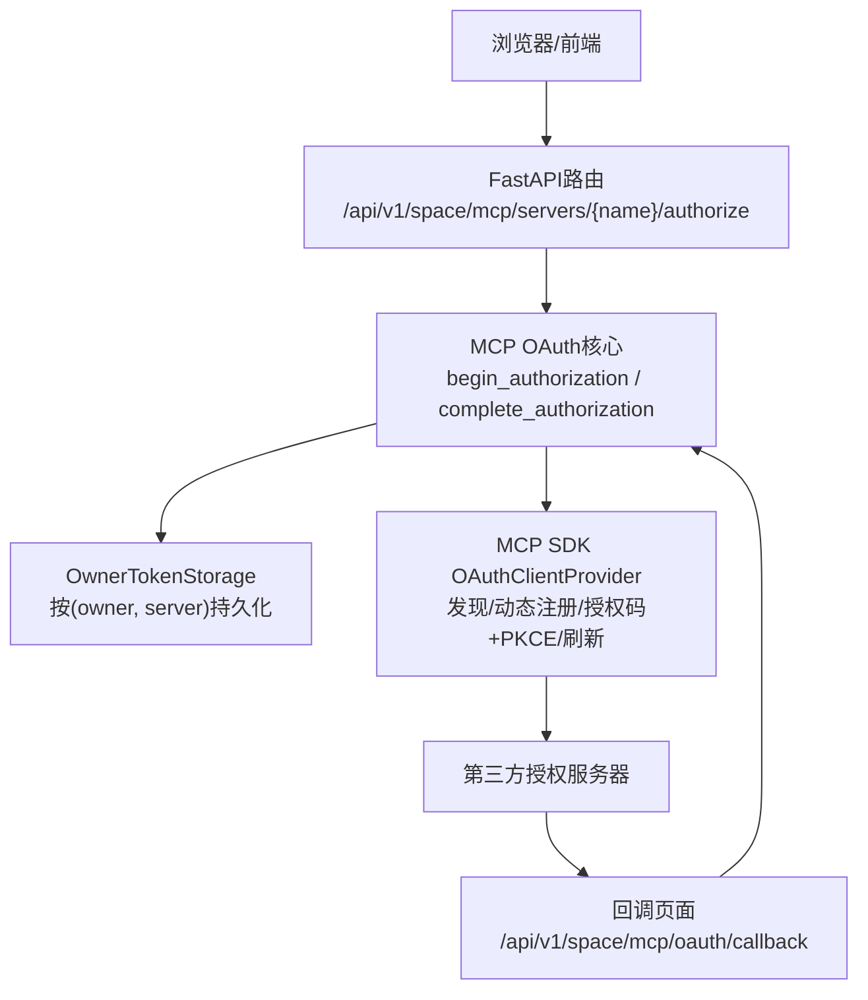
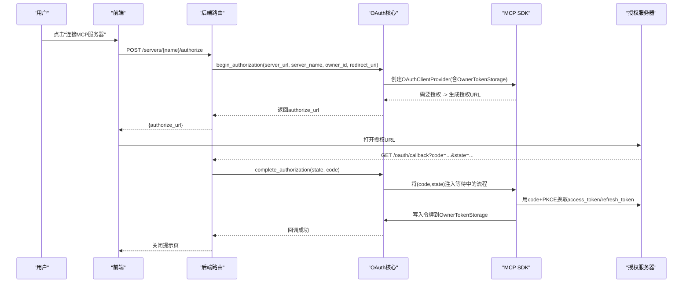
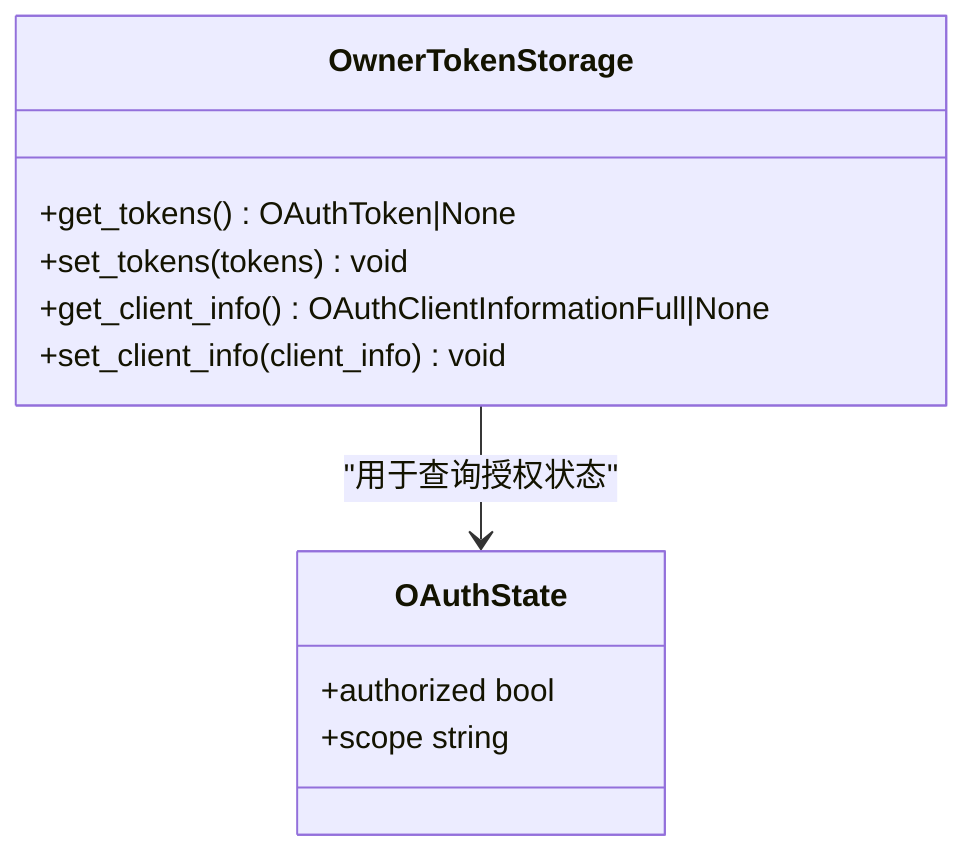
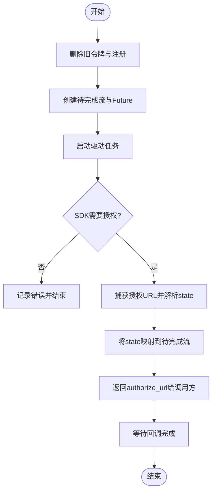
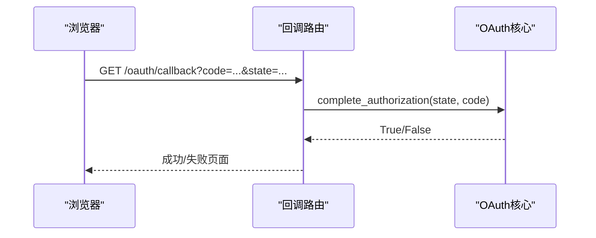
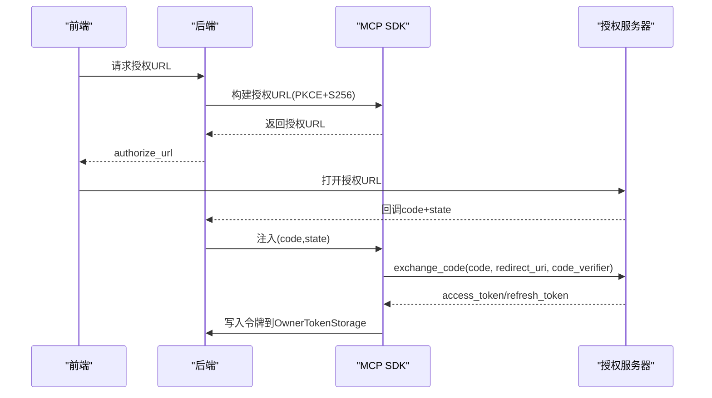
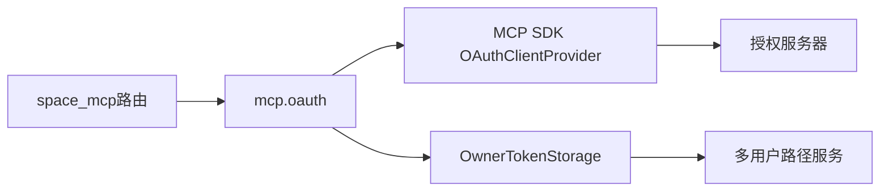

# OAuth 2.0认证

<cite>
**本文引用的文件**
- [deeptutor/services/mcp/oauth.py](file://deeptutor/services/mcp/oauth.py)
- [deeptutor/api/routers/space_mcp.py](file://deeptutor/api/routers/space_mcp.py)
- [tests/services/mcp/test_oauth.py](file://tests/services/mcp/test_oauth.py)
- [deeptutor/services/codex_auth/service.py](file://deeptutor/services/codex_auth/service.py)
- [deeptutor/services/codex_auth/oauth.py](file://deeptutor/services/codex_auth/oauth.py)
- [web/lib/mcp-api.ts](file://web/lib/mcp-api.ts)
</cite>

## 目录
1. [简介](#简介)
2. [项目结构](#项目结构)
3. [核心组件](#核心组件)
4. [架构总览](#架构总览)
5. [详细组件分析](#详细组件分析)
6. [依赖关系分析](#依赖关系分析)
7. [性能考虑](#性能考虑)
8. [故障排查指南](#故障排查指南)
9. [结论](#结论)
10. [附录](#附录)

## 简介
本文件面向在MCP服务器中实现OAuth 2.1认证的工程与运维人员，系统性说明DeepTutor如何在MCP客户端侧完成授权码流程、PKCE扩展、动态客户端注册与令牌刷新。文档重点包括：
- OwnerTokenStorage类的设计与使用方式，如何为每个用户（owner）安全存储与管理OAuth令牌与客户端注册信息。
- begin_authorization与complete_authorization的完整交互流程，涵盖授权URL生成、回调处理与状态校验。
- AuthorizationRequired异常在非交互式场景下的安全行为保障。
- 配置要点与常见问题解决方案。

## 项目结构
与MCP OAuth相关的关键代码分布在以下位置：
- MCP OAuth核心逻辑：deeptutor/services/mcp/oauth.py
- API路由（发起授权、回调处理）：deeptutor/api/routers/space_mcp.py
- 前端调用入口：web/lib/mcp-api.ts
- 测试用例（覆盖存储隔离、回调防重放、非交互式拒绝等）：tests/services/mcp/test_oauth.py
- 参考实现（Codex OAuth服务中的PKCE、回调验证、令牌刷新）：deeptutor/services/codex_auth/service.py, deeptutor/services/codex_auth/oauth.py

图表来源
- [deeptutor/api/routers/space_mcp.py:169-226](file://deeptutor/api/routers/space_mcp.py#L169-L226)
- [deeptutor/services/mcp/oauth.py:329-414](file://deeptutor/services/mcp/oauth.py#L329-L414)

章节来源
- [deeptutor/services/mcp/oauth.py:1-439](file://deeptutor/services/mcp/oauth.py#L1-L439)
- [deeptutor/api/routers/space_mcp.py:1-461](file://deeptutor/api/routers/space_mcp.py#L1-L461)

## 核心组件
- OwnerTokenStorage：基于owner与server维度的令牌与客户端注册存储，读写原子化，权限严格限制。
- build_auth：构建httpx.Auth，支持非交互式（拒绝打开同意页）与交互式两种模式。
- begin_authorization：启动授权流程，返回授权URL；内部维护待完成流的状态。
- complete_authorization：接收回调code与state，完成授权交换。
- oauth_redirect_uri与client_metadata：计算回调URI与动态客户端注册元数据。
- AuthorizationRequired：非交互式场景下需要人工授权的异常类型。

章节来源
- [deeptutor/services/mcp/oauth.py:64-75](file://deeptutor/services/mcp/oauth.py#L64-L75)
- [deeptutor/services/mcp/oauth.py:154-201](file://deeptutor/services/mcp/oauth.py#L154-L201)
- [deeptutor/services/mcp/oauth.py:256-281](file://deeptutor/services/mcp/oauth.py#L256-L281)
- [deeptutor/services/mcp/oauth.py:329-414](file://deeptutor/services/mcp/oauth.py#L329-L414)
- [deeptutor/services/mcp/oauth.py:218-251](file://deeptutor/services/mcp/oauth.py#L218-L251)

## 架构总览
MCP OAuth采用“SDK负责协议细节，应用负责存储与交互边界”的分层设计：
- SDK（mcp.client.auth.OAuthClientProvider）负责RFC 9728/8414发现、动态客户端注册（RFC 7591）、授权码+PKCE、刷新令牌。
- DeepTutor提供：
  - 存储：OwnerTokenStorage将令牌与客户端注册保存在owner私有的系统目录下，避免沙箱可访问路径泄露。
  - 交互边界：仅允许显式用户操作触发授权流程；后台重连若需授权则抛出AuthorizationRequired，使UI显示“需要授权”。
  - 回调路由：/api/v1/space/mcp/oauth/callback用于接收授权服务器的回调并校验state/code。

图表来源
- [deeptutor/api/routers/space_mcp.py:169-226](file://deeptutor/api/routers/space_mcp.py#L169-L226)
- [deeptutor/services/mcp/oauth.py:329-414](file://deeptutor/services/mcp/oauth.py#L329-L414)

## 详细组件分析

### OwnerTokenStorage设计与使用
- 存储位置：owner私有的系统目录private/mcp-oauth/<server>.json，权限严格限制为所有者可读可写。
- 存储内容：tokens（access_token、refresh_token、scope等）与client（动态注册的客户端信息）。
- 安全性：
  - 文件名由server名决定，并进行安全校验，防止路径穿越。
  - 读写采用临时文件+原子替换，保证一致性。
  - 读取损坏文件时降级为未授权，引导重新授权。
- 使用方式：MCP SDK通过OwnerTokenStorage接口存取令牌与客户端信息；每次刷新会更新tokens而不影响client注册。

图表来源
- [deeptutor/services/mcp/oauth.py:154-201](file://deeptutor/services/mcp/oauth.py#L154-L201)
- [deeptutor/services/mcp/oauth.py:146-152](file://deeptutor/services/mcp/oauth.py#L146-L152)

章节来源
- [deeptutor/services/mcp/oauth.py:89-131](file://deeptutor/services/mcp/oauth.py#L89-L131)
- [deeptutor/services/mcp/oauth.py:154-201](file://deeptutor/services/mcp/oauth.py#L154-L201)
- [tests/services/mcp/test_oauth.py:46-153](file://tests/services/mcp/test_oauth.py#L46-L153)

### begin_authorization工作流程
- 前置清理：调用forget删除旧令牌与客户端注册，避免重用旧身份。
- 任务驱动：创建一个后台任务驱动SDK发起首次请求以触发授权流程。
- 授权URL生成：当SDK需要授权时，通过自定义redirect_handler捕获授权URL，并提取state参数建立待完成流。
- 超时与取消：若获取授权URL超时或任务失败，清理资源并抛出异常。

图表来源
- [deeptutor/services/mcp/oauth.py:329-401](file://deeptutor/services/mcp/oauth.py#L329-L401)

章节来源
- [deeptutor/services/mcp/oauth.py:329-401](file://deeptutor/services/mcp/oauth.py#L329-L401)

### complete_authorization与回调处理
- 回调路由：/api/v1/space/mcp/oauth/callback接收授权服务器的回调，包含code与state。
- 状态校验：complete_authorization根据state查找对应的待完成流，若不存在或已完成则拒绝（防重放/伪造）。
- 结果注入：将(code, state)注入到对应流的Future，驱动SDK继续交换令牌。
- 页面反馈：返回一个自关闭的小页面告知用户成功或失败。

图表来源
- [deeptutor/api/routers/space_mcp.py:208-226](file://deeptutor/api/routers/space_mcp.py#L208-L226)
- [deeptutor/services/mcp/oauth.py:404-414](file://deeptutor/services/mcp/oauth.py#L404-L414)

章节来源
- [deeptutor/api/routers/space_mcp.py:208-226](file://deeptutor/api/routers/space_mcp.py#L208-L226)
- [deeptutor/services/mcp/oauth.py:404-414](file://deeptutor/services/mcp/oauth.py#L404-L414)
- [tests/services/mcp/test_oauth.py:163-195](file://tests/services/mcp/test_oauth.py#L163-L195)

### 授权码流程与PKCE扩展
- 授权码流程：
  - 前端调用后端发起授权，获得授权URL。
  - 用户在授权服务器同意授权后，回调至后端回调路由。
  - 后端将code与state交给SDK，SDK用code+PKCE verifier向授权服务器换取令牌。
- PKCE扩展：
  - 授权URL中包含code_challenge与code_challenge_method=S256。
  - 令牌交换时使用code_verifier，增强公共客户端安全性。
- 参考实现（Codex OAuth服务）展示了PKCE生成、授权URL构建、回调验证与令牌交换的完整流程。

图表来源
- [deeptutor/services/codex_auth/oauth.py:62-84](file://deeptutor/services/codex_auth/oauth.py#L62-L84)
- [deeptutor/services/codex_auth/service.py:237-261](file://deeptutor/services/codex_auth/service.py#L237-L261)
- [deeptutor/services/codex_auth/service.py:330-357](file://deeptutor/services/codex_auth/service.py#L330-L357)

章节来源
- [deeptutor/services/codex_auth/oauth.py:62-84](file://deeptutor/services/codex_auth/oauth.py#L62-L84)
- [deeptutor/services/codex_auth/service.py:237-261](file://deeptutor/services/codex_auth/service.py#L237-L261)
- [deeptutor/services/codex_auth/service.py:330-357](file://deeptutor/services/codex_auth/service.py#L330-L357)

### 动态客户端注册
- 客户端元数据：包含client_name、client_uri、redirect_uris、grant_types、response_types、token_endpoint_auth_method等。
- 注册策略：每个(owner, server)独立注册，避免跨账户共享client_id导致授权混淆。
- 生命周期：删除服务器时会同时清除注册信息与令牌，确保无主凭据残留。

章节来源
- [deeptutor/services/mcp/oauth.py:235-251](file://deeptutor/services/mcp/oauth.py#L235-L251)
- [deeptutor/services/mcp/oauth.py:133-144](file://deeptutor/services/mcp/oauth.py#L133-L144)
- [tests/services/mcp/test_oauth.py:108-153](file://tests/services/mcp/test_oauth.py#L108-L153)

### 令牌刷新机制
- 刷新时机：SDK在access_token过期或需要时自动使用refresh_token进行刷新。
- 存储更新：刷新后的新令牌通过OwnerTokenStorage持久化，保持client注册不变。
- 安全要求：refresh_token属于用户级凭据，必须存储在owner私有目录，不可被沙箱访问。

章节来源
- [deeptutor/services/mcp/oauth.py:154-201](file://deeptutor/services/mcp/oauth.py#L154-L201)
- [tests/services/mcp/test_oauth.py:108-133](file://tests/services/mcp/test_oauth.py#L108-L133)
- [deeptutor/services/codex_auth/oauth.py:300-309](file://deeptutor/services/codex_auth/oauth.py#L300-L309)

### AuthorizationRequired异常与非交互式安全
- 触发条件：后台重连等非交互式场景需要授权时，拒绝打开同意页并立即抛出异常。
- 行为效果：上层检测到该异常后，将MCP服务器状态标记为“needs_auth”，UI展示“连接”按钮而非无限重试。
- 测试覆盖：确保非交互式处理器始终抛出AuthorizationRequired，且异常名称包含服务器名以便定位。

章节来源
- [deeptutor/services/mcp/oauth.py:64-75](file://deeptutor/services/mcp/oauth.py#L64-L75)
- [deeptutor/services/mcp/oauth.py:284-299](file://deeptutor/services/mcp/oauth.py#L284-L299)
- [tests/services/mcp/test_oauth.py:201-230](file://tests/services/mcp/test_oauth.py#L201-L230)

## 依赖关系分析
- 模块耦合：
  - space_mcp路由依赖oauth模块提供begin_authorization、complete_authorization、oauth_redirect_uri等能力。
  - oauth模块依赖MCP SDK的OAuthClientProvider与httpx.Auth接口。
  - OwnerTokenStorage依赖多用户路径服务确定owner私有的系统目录。
- 外部依赖：
  - 第三方授权服务器（遵循OAuth 2.1/RFC 9728/8414/7591）。
  - httpx用于HTTP通信。
- 潜在循环依赖：通过延迟导入（TYPE_CHECKING与运行时import）避免初始化阶段循环。

图表来源
- [deeptutor/api/routers/space_mcp.py:31-48](file://deeptutor/api/routers/space_mcp.py#L31-L48)
- [deeptutor/services/mcp/oauth.py:35-48](file://deeptutor/services/mcp/oauth.py#L35-L48)

章节来源
- [deeptutor/api/routers/space_mcp.py:31-48](file://deeptutor/api/routers/space_mcp.py#L31-L48)
- [deeptutor/services/mcp/oauth.py:35-48](file://deeptutor/services/mcp/oauth.py#L35-L48)

## 性能考虑
- 授权流程异步化：begin_authorization使用后台任务驱动SDK，避免阻塞请求线程。
- 回调页面轻量：回调路由返回最小HTML页面，减少网络开销。
- 存储原子性：使用临时文件+原子替换，降低并发写入风险。
- 超时控制：授权URL获取与回调等待均设置超时，防止资源泄漏。

[本节为通用指导，不直接分析具体文件]

## 故障排查指南
- 回调未知state：检查complete_authorization是否找到对应待完成流，确认state未被重放或伪造。
- 无法获取授权URL：检查begin_authorization是否成功创建驱动任务，以及SDK是否正确触发授权流程。
- 令牌刷新失败：确认OwnerTokenStorage中存储的refresh_token有效，且授权服务器支持refresh_token。
- 非交互式授权失败：确认上层正确捕获AuthorizationRequired并提示用户手动授权。

章节来源
- [tests/services/mcp/test_oauth.py:163-195](file://tests/services/mcp/test_oauth.py#L163-L195)
- [deeptutor/services/mcp/oauth.py:329-401](file://deeptutor/services/mcp/oauth.py#L329-L401)
- [deeptutor/services/mcp/oauth.py:284-299](file://deeptutor/services/mcp/oauth.py#L284-L299)

## 结论
DeepTutor在MCP服务器认证中实现了符合OAuth 2.1规范的授权码流程，结合PKCE提升安全性，并通过动态客户端注册与OwnerTokenStorage实现细粒度的用户级凭据管理。非交互式场景通过AuthorizationRequired确保安全边界，避免后台任务阻塞于同意页。整体设计清晰、安全、可扩展，适用于多租户部署环境。

[本节为总结性内容，不直接分析具体文件]

## 附录

### OAuth配置示例与环境变量
- 回调URI计算：
  - 优先使用DEEPTUTOR_PUBLIC_URL环境变量，否则使用请求origin推导。
  - 回调路径固定为/api/v1/space/mcp/oauth/callback。
- 客户端元数据：
  - client_name、client_uri、redirect_uris、grant_types、response_types、token_endpoint_auth_method需在动态注册时声明。
- 前端调用：
  - 通过web/lib/mcp-api.ts调用后端授权接口，获取authorize_url并引导用户跳转。

章节来源
- [deeptutor/services/mcp/oauth.py:218-232](file://deeptutor/services/mcp/oauth.py#L218-L232)
- [deeptutor/services/mcp/oauth.py:235-251](file://deeptutor/services/mcp/oauth.py#L235-L251)
- [web/lib/mcp-api.ts:568-584](file://web/lib/mcp-api.ts#L568-L584)

### 常见问题与解决方案
- 问题：回调state不匹配
  - 原因：伪造或重放回调
  - 解决：确保complete_authorization仅处理已存在的state，并立即消费
- 问题：后台重连卡住
  - 原因：非交互式场景尝试打开同意页
  - 解决：捕获AuthorizationRequired并提示用户手动授权
- 问题：令牌刷新无效
  - 原因：refresh_token过期或被撤销
  - 解决：引导用户重新授权，清理旧注册与令牌

章节来源
- [tests/services/mcp/test_oauth.py:163-195](file://tests/services/mcp/test_oauth.py#L163-L195)
- [deeptutor/services/mcp/oauth.py:284-299](file://deeptutor/services/mcp/oauth.py#L284-L299)
- [deeptutor/services/mcp/oauth.py:133-144](file://deeptutor/services/mcp/oauth.py#L133-L144)