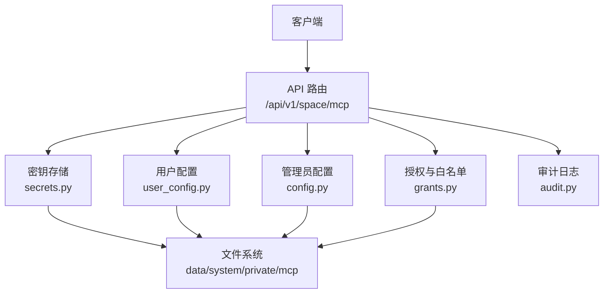
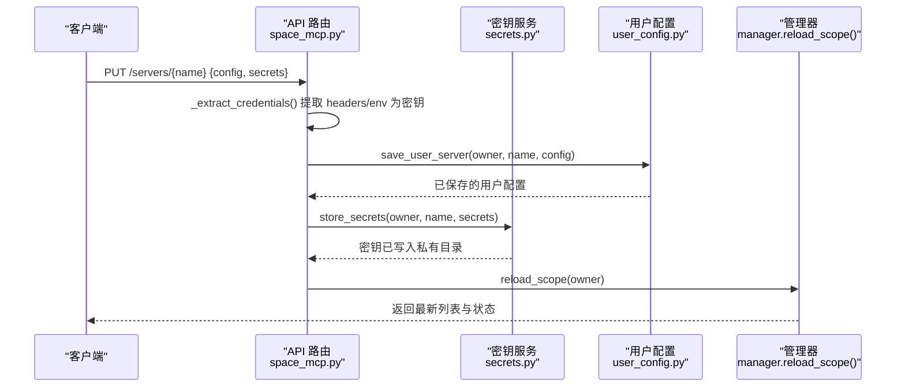
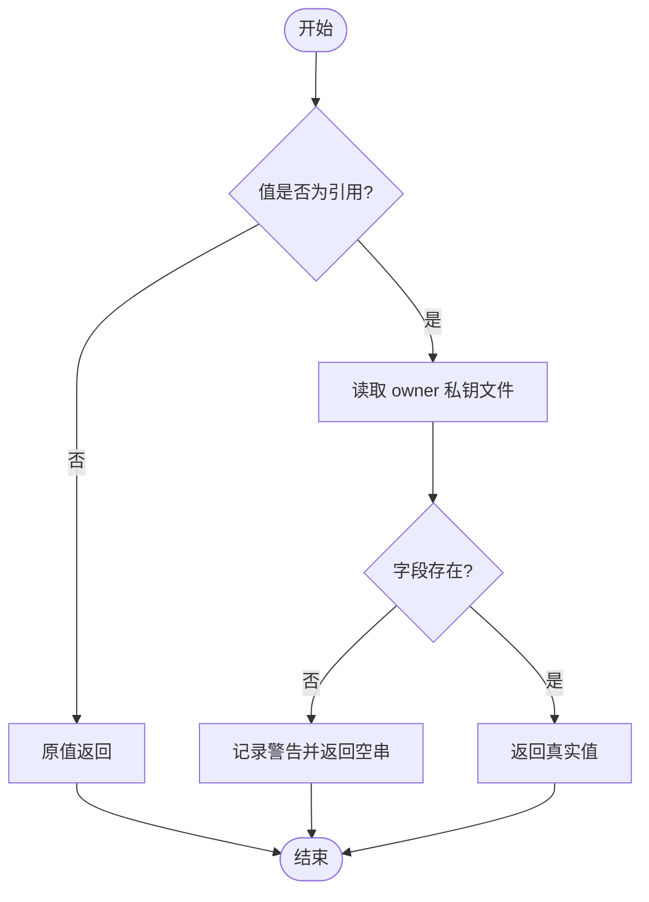
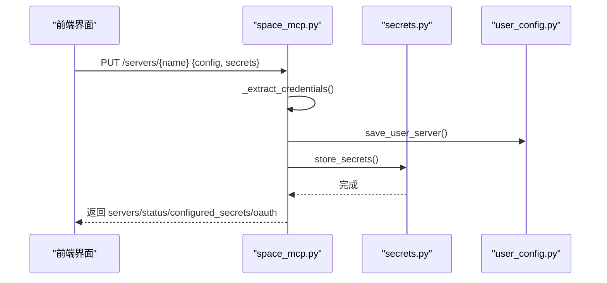
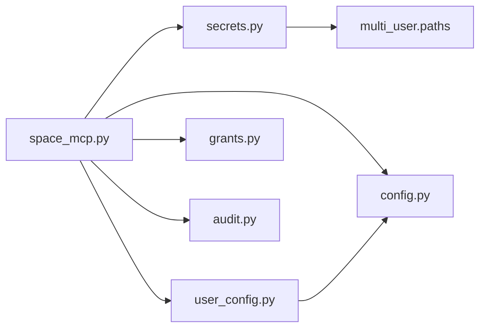

# 敏感信息管理

<cite>
**本文引用的文件**
- [space_mcp.py](file://deeptutor/api/routers/space_mcp.py)
- [secrets.py](file://deeptutor/services/mcp/secrets.py)
- [user_config.py](file://deeptutor/services/mcp/user_config.py)
- [config.py](file://deeptutor/services/mcp/config.py)
- [mcp_settings.py](file://deeptutor/api/routers/mcp_settings.py)
- [grants.py](file://deeptutor/multi_user/grants.py)
- [paths.py](file://deeptutor/multi_user/paths.py)
- [audit.py](file://deeptutor/multi_user/audit.py)
- [runtime_settings.py](file://deeptutor/services/config/runtime_settings.py)
- [settings.py](file://deeptutor/config/settings.py)
- [test_space_mcp.py](file://tests/api/test_space_mcp.py)
</cite>

## 目录
1. [简介](#简介)
2. [项目结构](#项目结构)
3. [核心组件](#核心组件)
4. [架构总览](#架构总览)
5. [详细组件分析](#详细组件分析)
6. [依赖关系分析](#依赖关系分析)
7. [性能考虑](#性能考虑)
8. [故障排查指南](#故障排查指南)
9. [结论](#结论)
10. [附录](#附录)

## 简介
本文件面向 DeepTutor 的 MCP（Model Context Protocol）敏感信息管理，聚焦以下目标：
- 密钥存储机制：文件权限控制、引用式存储与访问审计。
- 环境变量注入：运行时安全获取敏感配置。
- 密钥轮换与过期管理：策略与实践建议。
- 多用户隔离：不同用户间的密钥完全隔离。
- 备份与恢复：密钥数据的可恢复方案。
- 应急响应：密钥泄露时的处置流程。
- 最佳实践与安全建议。

## 项目结构
MCP 敏感信息相关代码主要分布在 API 路由层与服务层：
- API 路由层负责暴露受控接口，分离配置与密钥，并执行访问控制。
- 服务层负责持久化、解析、校验与连接时替换敏感值。
- 多用户模块提供路径隔离、授权与审计。

**图表来源**
- [space_mcp.py:92-166](file://deeptutor/api/routers/space_mcp.py#L92-L166)
- [secrets.py:48-94](file://deeptutor/services/mcp/secrets.py#L48-L94)
- [user_config.py:70-118](file://deeptutor/services/mcp/user_config.py#L70-L118)
- [config.py:116-152](file://deeptutor/services/mcp/config.py#L116-L152)
- [grants.py:16-43](file://deeptutor/multi_user/grants.py#L16-L43)
- [audit.py:13-35](file://deeptutor/multi_user/audit.py#L13-L35)

**章节来源**
- [space_mcp.py:1-461](file://deeptutor/api/routers/space_mcp.py#L1-L461)
- [secrets.py:1-193](file://deeptutor/services/mcp/secrets.py#L1-L193)
- [user_config.py:1-234](file://deeptutor/services/mcp/user_config.py#L1-L234)
- [config.py:1-163](file://deeptutor/services/mcp/config.py#L1-L163)
- [grants.py:1-137](file://deeptutor/multi_user/grants.py#L1-L137)
- [audit.py:1-35](file://deeptutor/multi_user/audit.py#L1-L35)

## 核心组件
- 密钥存储与解析（secrets.py）
  - 采用“引用式”存储：配置中仅保存 ${secret:<server>/<field>} 引用，真实值保存在 owner 私有的 data/system/private/mcp 目录下，按服务器名分文件存储。
  - 写入使用原子替换与严格文件权限，读取失败视为空集合，避免泄露或中断请求。
  - 提供 URL 查询参数中的引用解析能力。
- 用户级 MCP 配置（user_config.py）
  - 用户自管服务器定义位于 data/system/user-mcp/<owner>.json，禁止 stdio 传输，仅允许 sse/streamableHttp。
  - 限制每账户服务器数量，拒绝保留前缀命名冲突。
- 管理员级 MCP 配置（config.py）
  - 部署全局 mcp.json，仅管理员可写；原子写入保证一致性。
- API 路由（space_mcp.py, mcp_settings.py）
  - 将配置与密钥分离：PUT 时自动提取 headers/env 等位置为密钥，存入独立文件；GET 不返回明文。
  - OAuth 支持：授权流程由路由触发，状态仅在后端维护。
- 多用户隔离（grants.py, paths.py）
  - 通过 owner_id 隔离数据目录；授予模型不包含敏感字段，防止误存。
- 审计（audit.py）
  - 记录资源访问与管理员操作，落盘到 data/system/audit/usage.jsonl，异常不影响主流程。

**章节来源**
- [secrets.py:36-156](file://deeptutor/services/mcp/secrets.py#L36-L156)
- [user_config.py:16-23](file://deeptutor/services/mcp/user_config.py#L16-L23)
- [config.py:116-152](file://deeptutor/services/mcp/config.py#L116-L152)
- [space_mcp.py:138-166](file://deeptutor/api/routers/space_mcp.py#L138-L166)
- [mcp_settings.py:57-134](file://deeptutor/api/routers/mcp_settings.py#L57-L134)
- [grants.py:16-43](file://deeptutor/multi_user/grants.py#L16-L43)
- [audit.py:13-35](file://deeptutor/multi_user/audit.py#L13-L35)

## 架构总览
下图展示一次“新增/更新用户级 MCP 服务器”的完整调用链，包括密钥提取、存储与范围重载。

**图表来源**
- [space_mcp.py:138-166](file://deeptutor/api/routers/space_mcp.py#L138-L166)
- [space_mcp.py:402-457](file://deeptutor/api/routers/space_mcp.py#L402-L457)
- [secrets.py:67-84](file://deeptutor/services/mcp/secrets.py#L67-L84)
- [user_config.py:121-138](file://deeptutor/services/mcp/user_config.py#L121-L138)

**章节来源**
- [space_mcp.py:138-166](file://deeptutor/api/routers/space_mcp.py#L138-L166)
- [space_mcp.py:402-457](file://deeptutor/api/routers/space_mcp.py#L402-L457)
- [secrets.py:67-84](file://deeptutor/services/mcp/secrets.py#L67-L84)
- [user_config.py:121-138](file://deeptutor/services/mcp/user_config.py#L121-L138)

## 详细组件分析

### 密钥存储与解析（secrets.py）
- 存储位置与权限
  - 每个 owner 的密钥目录为 data/system/private/mcp，创建时设置仅所有者可读写。
  - 每个服务器一个 JSON 文件，删除服务器即删除其密钥文件，避免孤儿键。
- 引用格式
  - 配置中仅允许 ${secret:<server>/<field>} 形式，连接时在内存中替换为真实值。
- 解析策略
  - resolve_references 对字符串、字典、列表递归替换；未找到则返回空串，使远端认证失败更明确。
  - resolve_url_references 专门处理 URL 查询参数中的引用，保持编码正确性。
- 写入与读取
  - 写入先写临时文件再原子替换，确保崩溃不会损坏配置。
  - 读取失败记录警告并视为空，避免影响主流程。

**图表来源**
- [secrets.py:96-128](file://deeptutor/services/mcp/secrets.py#L96-L128)
- [secrets.py:131-156](file://deeptutor/services/mcp/secrets.py#L131-L156)
- [secrets.py:158-181](file://deeptutor/services/mcp/secrets.py#L158-L181)

**章节来源**
- [secrets.py:36-156](file://deeptutor/services/mcp/secrets.py#L36-L156)
- [secrets.py:158-181](file://deeptutor/services/mcp/secrets.py#L158-L181)

### 用户级 MCP 配置（user_config.py）
- 位置与隔离
  - 用户配置位于 data/system/user-mcp/<owner>.json，属于系统根下不可被沙箱挂载的分支，避免跨用户篡改。
- 安全约束
  - 禁止 stdio 传输，仅允许 sse/streamableHttp；名称需匹配正则且不得以保留前缀开头。
  - 每账户最多 N 个服务器（默认 8），超限拒绝。
- 读写策略
  - 读时过滤不可连接的条目并返回拒绝原因；写时原子替换，保留其他条目。

**章节来源**
- [user_config.py:16-23](file://deeptutor/services/mcp/user_config.py#L16-L23)
- [user_config.py:70-118](file://deeptutor/services/mcp/user_config.py#L70-L118)
- [user_config.py:121-138](file://deeptutor/services/mcp/user_config.py#L121-L138)
- [user_config.py:164-190](file://deeptutor/services/mcp/user_config.py#L164-L190)
- [user_config.py:208-220](file://deeptutor/services/mcp/user_config.py#L208-L220)

### 管理员级 MCP 配置（config.py）
- 全局配置
  - 部署级 mcp.json 存放于管理员工作区，仅管理员可写；包含服务器类型、超时、工具白名单/黑名单、OAuth 标记等。
- 原子写入
  - 写入先写 tmp 再 replace，确保崩溃后仍可回退到有效配置。

**章节来源**
- [config.py:31-103](file://deeptutor/services/mcp/config.py#L31-L103)
- [config.py:116-152](file://deeptutor/services/mcp/config.py#L116-L152)

### API 路由与密钥提取（space_mcp.py, mcp_settings.py）
- 密钥提取规则
  - 对 headers/env 等位置的值进行强制提取，即使前端未标注为 secret；若值为引用则跳过。
  - 将原始明文保存到 owner 私钥文件，配置中替换为引用，GET 响应绝不返回明文。
- 列表与状态
  - 列表返回 configured_secrets（仅字段名）、oauth 授权状态（仅布尔）、拒绝原因与部署侧只读上下文。
- 测试与安装
  - 测试在内存中解析引用，不写盘；安装目录项时根据 catalog 构建配置并可选写入密钥。

**图表来源**
- [space_mcp.py:138-166](file://deeptutor/api/routers/space_mcp.py#L138-L166)
- [space_mcp.py:402-457](file://deeptutor/api/routers/space_mcp.py#L402-L457)
- [secrets.py:67-84](file://deeptutor/services/mcp/secrets.py#L67-L84)
- [user_config.py:121-138](file://deeptutor/services/mcp/user_config.py#L121-L138)

**章节来源**
- [space_mcp.py:92-166](file://deeptutor/api/routers/space_mcp.py#L92-L166)
- [space_mcp.py:255-284](file://deeptutor/api/routers/space_mcp.py#L255-L284)
- [space_mcp.py:319-352](file://deeptutor/api/routers/space_mcp.py#L319-L352)
- [space_mcp.py:402-457](file://deeptutor/api/routers/space_mcp.py#L402-L457)
- [mcp_settings.py:57-134](file://deeptutor/api/routers/mcp_settings.py#L57-L134)

### 多用户隔离与授权（grants.py, paths.py）
- 路径隔离
  - SYSTEM_ROOT 下的 user-mcp 与 private/mcp 均不受沙箱挂载，避免跨用户读写。
- 授权模型
  - grants 仅包含逻辑 ID 与工具白名单，禁止携带敏感字段；mcp_tools 默认 deny-by-default，需管理员显式授权。
- 迁移与幂等
  - 旧版 multi-user 目录迁移至新结构，幂等且可重复执行。

**章节来源**
- [grants.py:16-43](file://deeptutor/multi_user/grants.py#L16-L43)
- [grants.py:90-112](file://deeptutor/multi_user/grants.py#L90-L112)
- [grants.py:115-133](file://deeptutor/multi_user/grants.py#L115-L133)
- [paths.py:51-86](file://deeptutor/multi_user/paths.py#L51-L86)

### 审计（audit.py）
- 审计日志
  - 记录资源访问与管理员操作，落盘到 data/system/audit/usage.jsonl。
  - 写入失败不阻断主流程，确保可用性。

**章节来源**
- [audit.py:13-35](file://deeptutor/multi_user/audit.py#L13-L35)

### 环境变量注入（runtime_settings.py, settings.py）
- 运行时设置导出
  - RuntimeSettingsService 可将配置渲染为环境变量并注入进程环境，支持覆盖策略与内部键追踪。
- 配置加载
  - Settings 基于 pydantic-settings 从环境变量加载，支持嵌套分隔符与前缀。

**章节来源**
- [runtime_settings.py:309-358](file://deeptutor/services/config/runtime_settings.py#L309-L358)
- [runtime_settings.py:548-571](file://deeptutor/services/config/runtime_settings.py#L548-L571)
- [settings.py:27-50](file://deeptutor/config/settings.py#L27-L50)

## 依赖关系分析
- space_mcp.py 依赖 secrets.py、user_config.py、config.py、grants.py、audit.py。
- secrets.py 依赖 multi_user.paths.owner_secrets_dir 定位私钥目录。
- user_config.py 依赖 config.py 的 MCPServerConfig/MCPConfig 模型与 network 校验。
- mcp_settings.py 依赖 services.mcp 的管理器与配置读写。

**图表来源**
- [space_mcp.py:34-56](file://deeptutor/api/routers/space_mcp.py#L34-L56)
- [secrets.py:48-56](file://deeptutor/services/mcp/secrets.py#L48-L56)
- [user_config.py:35-37](file://deeptutor/services/mcp/user_config.py#L35-L37)
- [mcp_settings.py:24-33](file://deeptutor/api/routers/mcp_settings.py#L24-L33)

**章节来源**
- [space_mcp.py:34-56](file://deeptutor/api/routers/space_mcp.py#L34-L56)
- [secrets.py:48-56](file://deeptutor/services/mcp/secrets.py#L48-L56)
- [user_config.py:35-37](file://deeptutor/services/mcp/user_config.py#L35-L37)
- [mcp_settings.py:24-33](file://deeptutor/api/routers/mcp_settings.py#L24-L33)

## 性能考虑
- 列表页预热连接状态，但设置超时以避免慢服务阻塞页面。
- 配置与密钥写入采用原子替换，减少锁竞争与崩溃风险。
- 用户级服务器数量上限降低进程内会话开销。
- 解析引用仅在连接时进行，避免频繁 I/O。

[本节为通用指导，无需具体文件来源]

## 故障排查指南
- 常见问题
  - GET 响应中出现明文密钥：检查是否绕过 _extract_credentials 直接保存了明文；确认配置中均为引用。
  - 连接失败提示缺少密钥：检查对应 server/field 是否在私钥文件中存在；查看日志中关于缺失引用的警告。
  - 删除服务器后仍残留密钥：确认删除流程同时调用 delete_secrets。
- 验证要点
  - 单元测试覆盖了“密钥不随响应返回”和“删除服务器同时删除密钥”的行为。

**章节来源**
- [test_space_mcp.py:123-154](file://tests/api/test_space_mcp.py#L123-L154)
- [space_mcp.py:157-166](file://deeptutor/api/routers/space_mcp.py#L157-L166)
- [secrets.py:92-94](file://deeptutor/services/mcp/secrets.py#L92-L94)

## 结论
DeepTutor 的 MCP 敏感信息管理通过“配置与密钥分离 + 位置隔离 + 权限控制 + 审计”的组合实现高安全性：
- 密钥从不进入配置与响应，仅在连接时解析。
- 用户密钥存储在不可被沙箱访问的系统目录，按 owner 隔离。
- 管理员配置与用户配置分层管理，职责清晰。
- 审计日志保障可追溯性。
结合环境变量注入与严格的写入策略，可在运行时安全地获取敏感配置，并为轮换、备份与应急提供基础。

[本节为总结，无需具体文件来源]

## 附录

### 密钥存储机制与文件权限
- 存储位置
  - 用户密钥：data/system/private/mcp/<server>.json，目录权限仅所有者可读写。
  - 用户配置：data/system/user-mcp/<owner>.json。
  - 管理员配置：管理员工作区的 mcp.json。
- 权限控制
  - 目录与文件写入后设置严格权限；读取失败视为空，避免中断。
- 审计
  - 访问与管理员操作记录到 data/system/audit/usage.jsonl。

**章节来源**
- [secrets.py:48-56](file://deeptutor/services/mcp/secrets.py#L48-L56)
- [secrets.py:171-181](file://deeptutor/services/mcp/secrets.py#L171-L181)
- [user_config.py:70-77](file://deeptutor/services/mcp/user_config.py#L70-L77)
- [config.py:116-152](file://deeptutor/services/mcp/config.py#L116-L152)
- [audit.py:13-35](file://deeptutor/multi_user/audit.py#L13-L35)

### 环境变量注入机制
- 运行时设置服务将配置渲染为环境变量并注入进程，支持覆盖策略与内部键追踪。
- 应用可通过 Settings 从环境变量加载配置，使用前缀与分隔符组织层级。

**章节来源**
- [runtime_settings.py:548-571](file://deeptutor/services/config/runtime_settings.py#L548-L571)
- [settings.py:27-50](file://deeptutor/config/settings.py#L27-L50)

### 密钥轮换与过期管理
- 轮换策略建议
  - 定期轮换外部服务的 API Key/Token。
  - 通过 API 更新 secrets 文件，并在配置中保持引用不变。
  - 对于 OAuth，重新发起授权流程刷新令牌。
- 过期管理建议
  - 在服务端或上游服务设置 Token 有效期。
  - 连接失败时提示需要重新授权或更新密钥。
  - 结合审计日志监控异常访问。

[本节为通用指导，无需具体文件来源]

### 多用户环境下的密钥隔离
- 路径隔离：user-mcp 与 private/mcp 不在沙箱挂载范围内。
- 授权隔离：mcp_tools 默认拒绝，需管理员显式授权。
- 命名隔离：禁止保留前缀，避免工具名冲突。

**章节来源**
- [user_config.py:16-23](file://deeptutor/services/mcp/user_config.py#L16-L23)
- [grants.py:16-43](file://deeptutor/multi_user/grants.py#L16-L43)
- [grants.py:115-133](file://deeptutor/multi_user/grants.py#L115-L133)

### 密钥备份与恢复
- 备份
  - 备份 data/system/private/mcp 目录下的所有 .json 文件。
  - 备份 data/system/user-mcp/*.json 与管理员 mcp.json。
- 恢复
  - 将备份文件恢复到相同路径，确保 owner 与权限一致。
  - 重启或重载 MCP 管理器以生效。

[本节为通用指导，无需具体文件来源]

### 密钥泄露应急响应流程
- 立即停用受影响的服务或撤销令牌。
- 轮换密钥并更新 secrets 文件。
- 审查审计日志，定位泄露路径。
- 通知相关方并评估影响范围。
- 加固配置与权限，增加检测告警。

[本节为通用指导，无需具体文件来源]

### 最佳实践与安全建议
- 始终使用引用式存储，禁止在配置中保存明文。
- 限制用户可配置的传输类型（仅 HTTP 远程）。
- 启用最小权限原则：mcp_tools 默认拒绝，按需授权。
- 使用原子写入与严格文件权限。
- 定期轮换密钥并监控异常访问。
- 对管理员配置与用户配置分别管理，职责分离。

[本节为通用指导，无需具体文件来源]