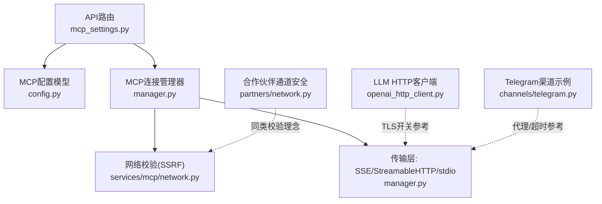
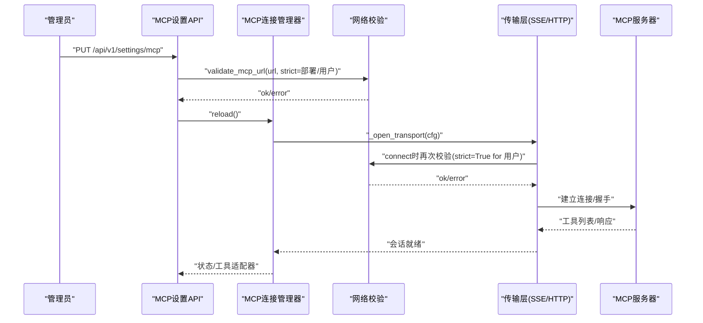
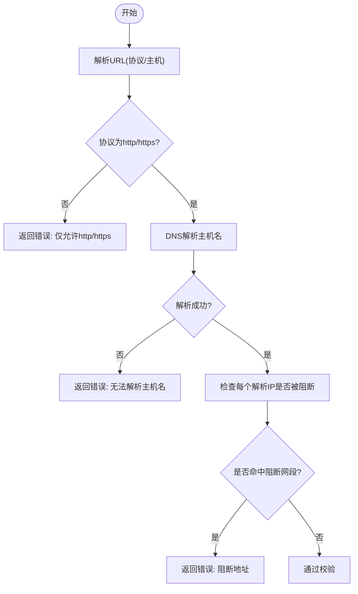
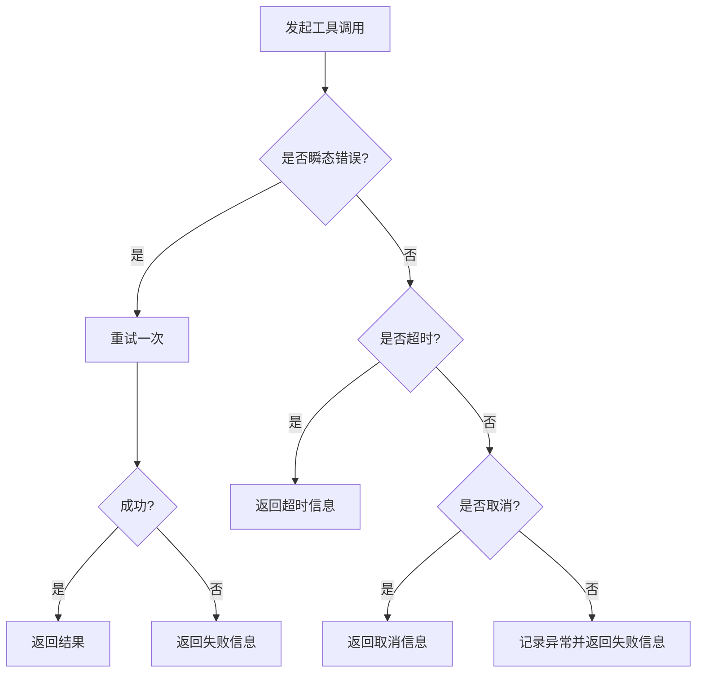
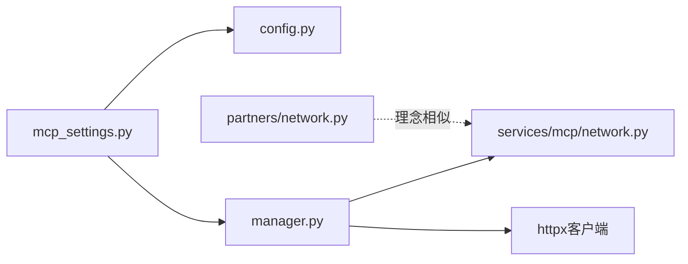

# 网络安全配置

<cite>
**本文引用的文件**
- [deeptutor/api/routers/mcp_settings.py](file://deeptutor/api/routers/mcp_settings.py)
- [deeptutor/services/mcp/network.py](file://deeptutor/services/mcp/network.py)
- [deeptutor/partners/network.py](file://deeptutor/partners/network.py)
- [deeptutor/services/mcp/config.py](file://deeptutor/services/mcp/config.py)
- [deeptutor/services/mcp/manager.py](file://deeptutor/services/mcp/manager.py)
- [deeptutor/services/llm/openai_http_client.py](file://deeptutor/services/llm/openai_http_client.py)
- [deeptutor/partners/channels/telegram.py](file://deeptutor/partners/channels/telegram.py)
</cite>

## 目录
1. [简介](#简介)
2. [项目结构](#项目结构)
3. [核心组件](#核心组件)
4. [架构总览](#架构总览)
5. [详细组件分析](#详细组件分析)
6. [依赖关系分析](#依赖关系分析)
7. [性能考虑](#性能考虑)
8. [故障排查指南](#故障排查指南)
9. [结论](#结论)
10. [附录](#附录)

## 简介
本文件面向DeepTutor中的MCP（Model Context Protocol）网络访问控制与网络安全配置，覆盖以下主题：
- 网络访问控制：URL白名单校验、重定向控制、请求限制与超时。
- SSL/TLS证书验证：自定义CA支持与禁用SSL校验的开关策略。
- 代理服务器配置与网络超时设置。
- 网络错误处理与重试机制：连接失败、超时、证书错误的处理策略。
- 最佳实践与常见问题排查。
- 监控与日志记录的配置建议。

## 项目结构
与MCP网络安全相关的代码主要分布在以下模块：
- API路由层：提供MCP服务器配置的读取、更新、测试接口，并在保存前进行URL合法性校验。
- MCP服务层：负责MCP服务器的连接管理、传输层选择、工具调用、重试与状态维护。
- 网络安全校验：对远程MCP URL进行SSRF防护（域名解析后的IP段检查），区分“部署级”和“用户自服务”两种严格度。
- 合作伙伴通道安全：更严格的URL目标校验，阻断私有/内网地址。
- LLM HTTP客户端：提供全局禁用SSL校验的开关（生产环境禁止）。
- 第三方渠道示例：展示代理与超时配置方式。

图表来源
- [deeptutor/api/routers/mcp_settings.py:1-134](file://deeptutor/api/routers/mcp_settings.py#L1-L134)
- [deeptutor/services/mcp/config.py:1-163](file://deeptutor/services/mcp/config.py#L1-L163)
- [deeptutor/services/mcp/manager.py:1-800](file://deeptutor/services/mcp/manager.py#L1-L800)
- [deeptutor/services/mcp/network.py:1-122](file://deeptutor/services/mcp/network.py#L1-L122)
- [deeptutor/partners/network.py:1-102](file://deeptutor/partners/network.py#L1-L102)
- [deeptutor/services/llm/openai_http_client.py:1-55](file://deeptutor/services/llm/openai_http_client.py#L1-L55)
- [deeptutor/partners/channels/telegram.py:265-305](file://deeptutor/partners/channels/telegram.py#L265-L305)

章节来源
- [deeptutor/api/routers/mcp_settings.py:1-134](file://deeptutor/api/routers/mcp_settings.py#L1-L134)
- [deeptutor/services/mcp/config.py:1-163](file://deeptutor/services/mcp/config.py#L1-L163)
- [deeptutor/services/mcp/manager.py:1-800](file://deeptutor/services/mcp/manager.py#L1-L800)
- [deeptutor/services/mcp/network.py:1-122](file://deeptutor/services/mcp/network.py#L1-L122)
- [deeptutor/partners/network.py:1-102](file://deeptutor/partners/network.py#L1-L102)
- [deeptutor/services/llm/openai_http_client.py:1-55](file://deeptutor/services/llm/openai_http_client.py#L1-L55)
- [deeptutor/partners/channels/telegram.py:265-305](file://deeptutor/partners/channels/telegram.py#L265-L305)

## 核心组件
- MCP服务器配置模型：定义传输类型（stdio/sse/streamableHttp）、工具白/黑名单、超时、认证等。
- MCP连接管理器：统一生命周期管理、连接重试、工具调用封装、状态上报。
- 网络校验器：基于DNS解析结果进行IP段拦截，区分部署级宽松策略与用户自服务严格策略。
- 合作伙伴通道安全：更严格的URL目标校验，防止通过外部媒体链接触发SSRF。
- LLM HTTP客户端：提供全局禁用SSL校验的开关（生产环境强制拒绝）。
- 渠道代理与超时示例：展示如何在实际通道中配置代理与超时。

章节来源
- [deeptutor/services/mcp/config.py:31-103](file://deeptutor/services/mcp/config.py#L31-L103)
- [deeptutor/services/mcp/manager.py:216-442](file://deeptutor/services/mcp/manager.py#L216-L442)
- [deeptutor/services/mcp/network.py:29-105](file://deeptutor/services/mcp/network.py#L29-L105)
- [deeptutor/partners/network.py:17-101](file://deeptutor/partners/network.py#L17-L101)
- [deeptutor/services/llm/openai_http_client.py:21-43](file://deeptutor/services/llm/openai_http_client.py#L21-L43)
- [deeptutor/partners/channels/telegram.py:279-297](file://deeptutor/partners/channels/telegram.py#L279-L297)

## 架构总览
下图展示了从API路由到MCP连接与网络校验的整体流程，包括URL校验、重定向控制、传输层选择与工具调用。

图表来源
- [deeptutor/api/routers/mcp_settings.py:68-133](file://deeptutor/api/routers/mcp_settings.py#L68-L133)
- [deeptutor/services/mcp/manager.py:610-708](file://deeptutor/services/mcp/manager.py#L610-L708)
- [deeptutor/services/mcp/network.py:69-105](file://deeptutor/services/mcp/network.py#L69-L105)

## 详细组件分析

### URL白名单与SSRF防护
- 仅允许http/https协议，缺失主机名或无法解析将拒绝。
- DNS解析后对IPv4/IPv6地址进行IP段检查：
  - 部署级（管理员配置）：阻止链路本地、云元数据范围及“该网络”范围。
  - 用户自服务（strict=True）：额外阻止回环、私有网段、运营商NAT、唯一本地等。
- 校验在保存时与连接时均执行，避免DNS漂移绕过。

图表来源
- [deeptutor/services/mcp/network.py:69-105](file://deeptutor/services/mcp/network.py#L69-L105)
- [deeptutor/partners/network.py:59-101](file://deeptutor/partners/network.py#L59-L101)

章节来源
- [deeptutor/services/mcp/network.py:29-105](file://deeptutor/services/mcp/network.py#L29-L105)
- [deeptutor/partners/network.py:17-101](file://deeptutor/partners/network.py#L17-L101)

### 重定向控制
- 用户自服务（owner为用户）：禁止跟随重定向，防止“合法公网URL被302到内网/元数据地址”。
- 部署级（管理员配置）：允许跟随重定向，便于托管服务场景。
- 该策略在打开传输层时应用，确保每次连接都受控。

章节来源
- [deeptutor/services/mcp/manager.py:624-654](file://deeptutor/services/mcp/manager.py#L624-L654)

### 网络请求限制与超时
- 连接超时：连接阶段有固定超时（秒级），用于快速失败。
- 工具调用超时：按服务器配置的工具超时（默认秒级，可配置范围），通过异步等待限制单次调用耗时。
- HTTP客户端超时：streamableHttp传输使用显式httpx客户端，设置连接与整体超时，避免继承默认短超时。
- 连接池与并发：不同通道示例展示了分离连接池以避免长轮询阻塞发送。

章节来源
- [deeptutor/services/mcp/config.py:48-48](file://deeptutor/services/mcp/config.py#L48-L48)
- [deeptutor/services/mcp/manager.py:51-52](file://deeptutor/services/mcp/manager.py#L51-L52)
- [deeptutor/services/mcp/manager.py:453-463](file://deeptutor/services/mcp/manager.py#L453-L463)
- [deeptutor/services/mcp/manager.py:693-703](file://deeptutor/services/mcp/manager.py#L693-L703)
- [deeptutor/partners/channels/telegram.py:281-297](file://deeptutor/partners/channels/telegram.py#L281-L297)

### SSL/TLS证书验证配置
- 全局禁用SSL校验：通过系统设置开关控制，生产环境强制拒绝禁用。
- 当启用禁用时，构建httpx客户端时传入verify=False；其他传输（如SSE/StreamableHTTP）由各自客户端实例化处决定是否继承此行为。
- 自定义CA证书：当前仓库未提供直接注入自定义CA的入口；如需支持，可在创建httpx.AsyncClient时传入cafile/ca_path参数（需扩展相应配置与传递路径）。

章节来源
- [deeptutor/services/llm/openai_http_client.py:21-43](file://deeptutor/services/llm/openai_http_client.py#L21-L43)
- [deeptutor/services/mcp/manager.py:672-703](file://deeptutor/services/mcp/manager.py#L672-L703)

### 代理服务器配置与网络超时设置
- 代理：示例通道展示了通过HTTPXRequest传入proxy参数的方式；MCP传输层可通过httpx客户端配置代理（需在扩展点注入）。
- 超时：示例通道分别设置连接与读取超时；MCP streamableHttp传输设置了连接与整体超时。

章节来源
- [deeptutor/partners/channels/telegram.py:279-297](file://deeptutor/partners/channels/telegram.py#L279-L297)
- [deeptutor/services/mcp/manager.py:693-703](file://deeptutor/services/mcp/manager.py#L693-L703)

### 网络错误处理与重试机制
- 瞬态错误：连接断开、管道破裂等会触发一次重试。
- 超时：工具调用超时会返回明确的超时信息。
- 取消：任务取消时正确处理并返回取消信息。
- 连接失败：记录错误原因，采用指数退避重试（最小间隔与最大间隔限制），避免频繁重试。
- 需要授权：识别需要交互授权的错误，标记为“需要认证”，不进入常规错误重试。

图表来源
- [deeptutor/services/mcp/manager.py:404-442](file://deeptutor/services/mcp/manager.py#L404-L442)
- [deeptutor/services/mcp/manager.py:534-541](file://deeptutor/services/mcp/manager.py#L534-L541)

章节来源
- [deeptutor/services/mcp/manager.py:77-81](file://deeptutor/services/mcp/manager.py#L77-L81)
- [deeptutor/services/mcp/manager.py:404-442](file://deeptutor/services/mcp/manager.py#L404-L442)
- [deeptutor/services/mcp/manager.py:534-541](file://deeptutor/services/mcp/manager.py#L534-L541)

### 工具访问控制（白名单/黑名单）
- 每服务器可配置enabled_tools（默认全部）与disabled_tools（后置过滤），支持通配符。
- 工具名称会被规范化包装，避免命名冲突。

章节来源
- [deeptutor/services/mcp/config.py:48-53](file://deeptutor/services/mcp/config.py#L48-L53)
- [deeptutor/services/mcp/config.py:93-99](file://deeptutor/services/mcp/config.py#L93-L99)
- [deeptutor/services/mcp/manager.py:84-87](file://deeptutor/services/mcp/manager.py#L84-L87)

## 依赖关系分析
- API路由依赖MCP配置模型与连接管理器，并在保存前调用URL校验。
- 连接管理器依赖网络校验器在连接时再次校验URL，依据owner决定严格模式。
- 传输层选择依赖httpx客户端，可配置超时、重定向、认证等。
- 合作伙伴通道安全与MCP网络校验共享“解析后IP段检查”的理念，但策略更严格。

图表来源
- [deeptutor/api/routers/mcp_settings.py:68-133](file://deeptutor/api/routers/mcp_settings.py#L68-L133)
- [deeptutor/services/mcp/config.py:101-113](file://deeptutor/services/mcp/config.py#L101-L113)
- [deeptutor/services/mcp/manager.py:610-708](file://deeptutor/services/mcp/manager.py#L610-L708)
- [deeptutor/services/mcp/network.py:69-105](file://deeptutor/services/mcp/network.py#L69-L105)
- [deeptutor/partners/network.py:59-101](file://deeptutor/partners/network.py#L59-L101)

章节来源
- [deeptutor/api/routers/mcp_settings.py:68-133](file://deeptutor/api/routers/mcp_settings.py#L68-L133)
- [deeptutor/services/mcp/manager.py:610-708](file://deeptutor/services/mcp/manager.py#L610-L708)
- [deeptutor/services/mcp/network.py:69-105](file://deeptutor/services/mcp/network.py#L69-L105)
- [deeptutor/partners/network.py:59-101](file://deeptutor/partners/network.py#L59-L101)

## 性能考虑
- 连接池隔离：长轮询与发送使用独立连接池，避免互相阻塞。
- 冷作用域回收：闲置的用户作用域连接会被清理，防止进程内存与句柄泄漏。
- 指数退避重试：避免雪崩式重试，限制最大重试间隔。
- 工具超时：按服务器配置限制单次调用耗时，保护后端资源。

章节来源
- [deeptutor/partners/channels/telegram.py:281-297](file://deeptutor/partners/channels/telegram.py#L281-L297)
- [deeptutor/services/mcp/manager.py:319-347](file://deeptutor/services/mcp/manager.py#L319-L347)
- [deeptutor/services/mcp/manager.py:65-69](file://deeptutor/services/mcp/manager.py#L65-L69)
- [deeptutor/services/mcp/config.py:48-48](file://deeptutor/services/mcp/config.py#L48-L48)

## 故障排查指南
- 无法解析主机名：检查DNS与网络连通性，确认主机名正确。
- 阻断地址：确认目标为公网可达地址；用户自服务不允许指向内网/回环/链路本地。
- 连接超时：检查服务端可用性、防火墙与代理配置；适当调整超时。
- 工具调用超时：根据业务调整工具超时；检查后端处理时间。
- 需要认证：按照提示完成OAuth授权流程；非交互式连接不会弹出授权界面。
- 瞬态错误：观察是否自动重试成功；若持续失败，检查网络抖动与服务端稳定性。

章节来源
- [deeptutor/services/mcp/network.py:69-105](file://deeptutor/services/mcp/network.py#L69-L105)
- [deeptutor/services/mcp/manager.py:404-442](file://deeptutor/services/mcp/manager.py#L404-L442)
- [deeptutor/services/mcp/manager.py:518-532](file://deeptutor/services/mcp/manager.py#L518-L532)

## 结论
DeepTutor在MCP网络访问控制上实现了多层防护：
- 严格的URL与IP段校验，区分管理员与用户场景。
- 连接时重放校验与重定向控制，降低SSRF风险。
- 完善的超时与重试策略，提升鲁棒性与用户体验。
- 可选的全局SSL校验禁用（生产环境禁止），并提供代理与超时配置示例。
建议在部署中遵循最小权限原则，仅开放必要的公网可达地址，并结合日志与监控持续观测网络健康。

## 附录
- 监控与日志记录建议：
  - 记录连接状态变更、错误类型与次数、重试次数与延迟。
  - 对工具调用统计成功率、平均耗时与超时率。
  - 对DNS解析失败与阻断事件告警。
  - 结合现有日志输出（连接成功/失败、工具进度、异常堆栈）进行集中采集与分析。