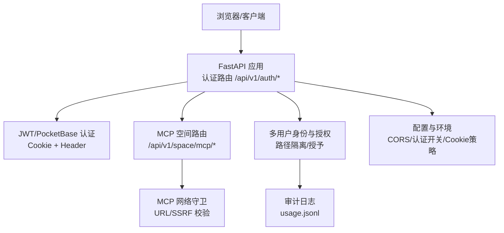
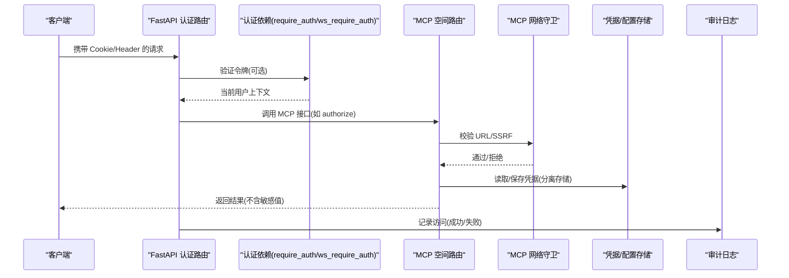
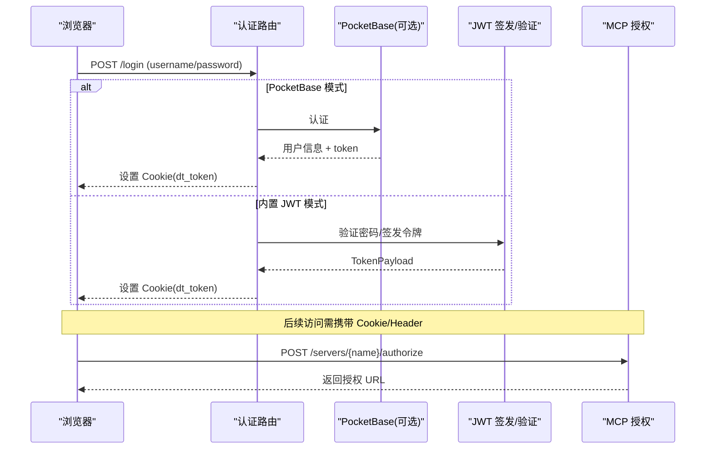
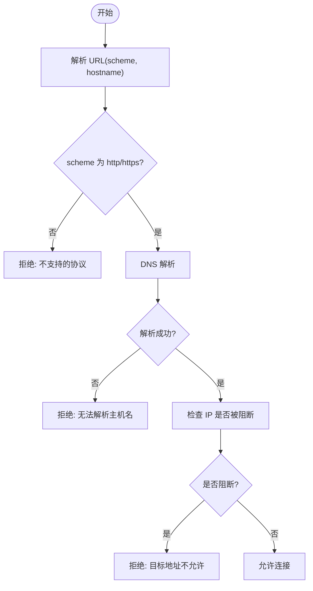
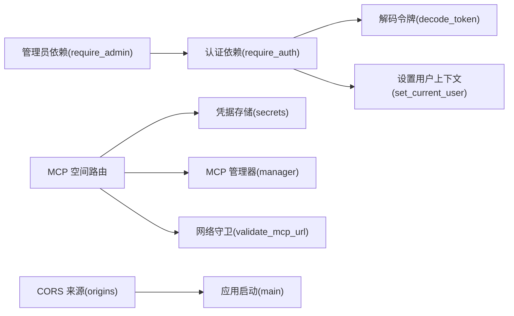

# 认证与安全

<cite>
**本文引用的文件**
- [deeptutor/api/routers/auth.py](file://deeptutor/api/routers/auth.py)
- [deeptutor/services/mcp/network.py](file://deeptutor/services/mcp/network.py)
- [deeptutor/api/routers/space_mcp.py](file://deeptutor/api/routers/space_mcp.py)
- [deeptutor/services/config/runtime_settings.py](file://deeptutor/services/config/runtime_settings.py)
- [deeptutor/services/config/origins.py](file://deeptutor/services/config/origins.py)
- [deeptutor/api/main.py](file://deeptutor/api/main.py)
- [deeptutor/multi_user/identity.py](file://deeptutor/multi_user/identity.py)
- [deeptutor/multi_user/grants.py](file://deeptutor/multi_user/grants.py)
- [deeptutor/multi_user/audit.py](file://deeptutor/multi_user/audit.py)
- [web/lib/proxy-policy.ts](file://web/lib/proxy-policy.ts)
- [tests/api/test_cors_settings.py](file://tests/api/test_cors_settings.py)
</cite>

## 目录
1. [简介](#简介)
2. [项目结构](#项目结构)
3. [核心组件](#核心组件)
4. [架构总览](#架构总览)
5. [详细组件分析](#详细组件分析)
6. [依赖关系分析](#依赖关系分析)
7. [性能考量](#性能考量)
8. [故障排查指南](#故障排查指南)
9. [结论](#结论)
10. [附录](#附录)

## 简介
本文件系统性说明 DeepTutor 在 MCP（Model Context Protocol）与整体服务中的认证与安全机制，覆盖：
- 支持的认证方式：内置 JWT、PocketBase 集成、MCP OAuth 2.0、API 密钥（通过配置与凭据存储）
- 安全配置：CORS/来源白名单、重定向控制、网络访问限制（SSRF 防护）
- 敏感信息管理：密钥存储、环境变量注入、运行时安全
- 身份隔离：多用户资源隔离、权限授予、路径隔离
- 最佳实践与威胁防护：常见攻击面与缓解措施
- 审计与合规：使用审计日志、可观测性建议

## 项目结构
DeepTutor 的认证与安全涉及 API 层路由、MCP 服务、多用户身份与授权、配置与环境变量管理以及前端辅助校验。关键位置如下：
- API 认证路由：登录、状态、登出、注册、头像等
- MCP 空间路由：用户级 MCP 服务器配置、OAuth 授权流程、凭据分离存储
- 网络守卫：MCP URL 合法性与 SSRF 防护
- 配置与环境：CORS 来源规范化、运行时设置、认证开关与 Cookie 策略
- 多用户身份与授权：用户持久化、角色、授予范围、路径隔离
- 审计日志：资源访问记录

图表来源
- [deeptutor/api/routers/auth.py:237-324](file://deeptutor/api/routers/auth.py#L237-L324)
- [deeptutor/api/routers/space_mcp.py:169-205](file://deeptutor/api/routers/space_mcp.py#L169-L205)
- [deeptutor/services/mcp/network.py:69-105](file://deeptutor/services/mcp/network.py#L69-L105)
- [deeptutor/services/config/runtime_settings.py:644-659](file://deeptutor/services/config/runtime_settings.py#L644-L659)
- [deeptutor/multi_user/audit.py:19-35](file://deeptutor/multi_user/audit.py#L19-L35)

章节来源
- [deeptutor/api/routers/auth.py:237-324](file://deeptutor/api/routers/auth.py#L237-L324)
- [deeptutor/api/routers/space_mcp.py:1-22](file://deeptutor/api/routers/space_mcp.py#L1-L22)
- [deeptutor/services/mcp/network.py:1-23](file://deeptutor/services/mcp/network.py#L1-L23)
- [deeptutor/services/config/runtime_settings.py:309-373](file://deeptutor/services/config/runtime_settings.py#L309-L373)
- [deeptutor/multi_user/audit.py:1-35](file://deeptutor/multi_user/audit.py#L1-L35)

## 核心组件
- 认证路由与依赖
  - 支持从 Authorization: Bearer 或 dt_token Cookie 提取令牌
  - 提供 require_auth、ws_require_auth、require_admin 等依赖用于 HTTP/WebSocket
  - 支持内置 JWT 与 PocketBase 两种模式
- MCP 空间路由
  - 用户级 MCP 服务器配置、测试、删除、OAuth 授权
  - 凭据与配置分离存储，不将敏感值回显给前端
  - 仅允许远程传输（stdio 仅限管理员部署配置）
- 网络守卫
  - 对 MCP URL 进行 scheme、hostname、DNS 解析与 IP 段检查
  - 区分“部署级宽松”和“用户级严格”两种策略，防止 SSRF
- 配置与环境
  - CORS 来源规范化与合并，支持逗号/分号/换行分隔
  - 运行时设置集中读取进程环境变量，如 AUTH_ENABLED、AUTH_TOKEN_EXPIRE_HOURS、AUTH_COOKIE_SECURE 等
- 多用户身份与授权
  - 用户持久化、角色、授予范围（模型、知识库、技能、工具、CLI 应用、执行能力）
  - 路径隔离：系统目录与用户工作区分离，迁移兼容旧树
- 审计日志
  - 记录资源访问与管理员操作，写入 system/audit/usage.jsonl，失败不影响请求

章节来源
- [deeptutor/api/routers/auth.py:237-324](file://deeptutor/api/routers/auth.py#L237-L324)
- [deeptutor/api/routers/space_mcp.py:138-205](file://deeptutor/api/routers/space_mcp.py#L138-L205)
- [deeptutor/services/mcp/network.py:69-105](file://deeptutor/services/mcp/network.py#L69-L105)
- [deeptutor/services/config/runtime_settings.py:644-659](file://deeptutor/services/config/runtime_settings.py#L644-L659)
- [deeptutor/multi_user/grants.py:16-44](file://deeptutor/multi_user/grants.py#L16-L44)
- [deeptutor/multi_user/paths.py:51-86](file://deeptutor/multi_user/paths.py#L51-L86)
- [deeptutor/multi_user/audit.py:19-35](file://deeptutor/multi_user/audit.py#L19-L35)

## 架构总览
下图展示认证与安全的关键交互：客户端发起请求，经过认证依赖，进入受保护的路由；MCP 相关调用会触发网络守卫与凭据管理；多用户上下文确保资源隔离；审计日志记录访问行为。

图表来源
- [deeptutor/api/routers/auth.py:237-324](file://deeptutor/api/routers/auth.py#L237-L324)
- [deeptutor/api/routers/space_mcp.py:169-205](file://deeptutor/api/routers/space_mcp.py#L169-L205)
- [deeptutor/services/mcp/network.py:69-105](file://deeptutor/services/mcp/network.py#L69-L105)
- [deeptutor/multi_user/audit.py:19-35](file://deeptutor/multi_user/audit.py#L19-L35)

## 详细组件分析

### 认证方式与实现
- 内置 JWT 认证
  - 登录成功后设置 HttpOnly Cookie（dt_token），支持 SameSite=Lax/None 与 Secure 标志
  - 支持从 Authorization: Bearer 或 Cookie 提取令牌
  - 提供 require_auth 与 ws_require_auth 用于 HTTP/WebSocket 统一鉴权
  - 支持管理员依赖 require_admin
- PocketBase 集成
  - 当启用 PocketBase 时，登录走外部认证，返回外部 token 并设置 Cookie
  - 注册与用户管理通过 PocketBase 接口完成
- MCP OAuth 2.0
  - 用户级 MCP 服务器若配置为 oauth，则通过后端发起授权流程
  - 回调地址基于当前浏览来源动态生成，避免跨域配置问题
  - 授权状态仅在后端维护，令牌不出后端

图表来源
- [deeptutor/api/routers/auth.py:436-480](file://deeptutor/api/routers/auth.py#L436-L480)
- [deeptutor/api/routers/auth.py:402-433](file://deeptutor/api/routers/auth.py#L402-L433)
- [deeptutor/api/routers/space_mcp.py:169-205](file://deeptutor/api/routers/space_mcp.py#L169-L205)

章节来源
- [deeptutor/api/routers/auth.py:237-324](file://deeptutor/api/routers/auth.py#L237-L324)
- [deeptutor/api/routers/auth.py:402-480](file://deeptutor/api/routers/auth.py#L402-L480)
- [deeptutor/api/routers/space_mcp.py:169-205](file://deeptutor/api/routers/space_mcp.py#L169-L205)

### 安全配置选项
- CORS/来源白名单
  - 支持从环境变量合并多个来源，自动规范化 scheme/host/port
  - 默认包含本地开发端口，额外来源按逗号/分号/换行解析
  - 测试覆盖常见输入错误与预检请求
- 重定向控制
  - MCP OAuth 回调使用当前浏览来源作为 redirect_uri，减少跨域配置负担
- 网络访问限制
  - MCP URL 校验：仅允许 http/https，必须存在 hostname，解析后检查 IP 段
  - 部署级宽松：阻止链路本地/云元数据/0.0.0.0/8
  - 用户级严格：额外阻止环回、私有网段、CGNAT、IPv6 环回与唯一本地地址

图表来源
- [deeptutor/services/mcp/network.py:69-105](file://deeptutor/services/mcp/network.py#L69-L105)

章节来源
- [deeptutor/services/config/origins.py:21-55](file://deeptutor/services/config/origins.py#L21-L55)
- [deeptutor/api/main.py:85-101](file://deeptutor/api/main.py#L85-L101)
- [tests/api/test_cors_settings.py:42-75](file://tests/api/test_cors_settings.py#L42-L75)
- [deeptutor/services/mcp/network.py:69-105](file://deeptutor/services/mcp/network.py#L69-L105)

### 敏感信息管理
- 凭据与配置分离
  - MCP 服务器配置与 secrets 分开存储；前端提交 secrets 仅用于写入，不会回显
  - headers/env 中字符串值会被识别为凭据字段并替换为引用标记，避免明文落盘
- 密钥存储
  - 认证密钥文件位于 system/auth/auth_secret，缺失时自动生成并设置严格权限
  - 头像图片按用户 ID 命名存储，类型由魔数检测决定，禁止 SVG
- 环境变量注入
  - 运行时设置集中读取进程环境变量，如 AUTH_ENABLED、AUTH_USERNAME、AUTH_PASSWORD_HASH、AUTH_TOKEN_EXPIRE_HOURS、AUTH_COOKIE_SECURE 等
  - 忽略项目根 .env 文件，避免误用

章节来源
- [deeptutor/api/routers/space_mcp.py:418-460](file://deeptutor/api/routers/space_mcp.py#L418-L460)
- [deeptutor/multi_user/identity.py:303-326](file://deeptutor/multi_user/identity.py#L303-L326)
- [deeptutor/api/routers/auth.py:582-704](file://deeptutor/api/routers/auth.py#L582-L704)
- [deeptutor/services/config/runtime_settings.py:644-673](file://deeptutor/services/config/runtime_settings.py#L644-L673)

### 身份隔离机制
- 用户作用域与路径隔离
  - 每个用户拥有独立的工作区路径，系统目录与用户目录分离
  - 迁移兼容旧的多用户目录结构，保证幂等与可恢复
- 授予范围（Grants）
  - 非管理员用户的资源访问通过授予控制：模型、知识库、技能、工具、CLI 应用、执行能力
  - MCP 工具默认拒绝，除非管理员明确授予名称
- 路径服务
  - 根据当前用户作用域解析路径，伙伴用户与所有者路径不同，避免越权

章节来源
- [deeptutor/multi_user/paths.py:51-86](file://deeptutor/multi_user/paths.py#L51-L86)
- [deeptutor/multi_user/grants.py:16-44](file://deeptutor/multi_user/grants.py#L16-L44)
- [tests/multi_user/test_owner_path_service.py:36-51](file://tests/multi_user/test_owner_path_service.py#L36-L51)

### 安全最佳实践与威胁防护
- 认证
  - 始终启用 AUTH_ENABLED；生产环境设置 AUTH_COOKIE_SECURE=true，并确保 HTTPS
  - 使用 require_auth/require_admin 保护所有敏感路由
  - 前端仅做轻量分类（missing/malformed/expired/valid），后端每次请求均验证签名与过期时间
- 网络
  - 对用户提供的 MCP URL 启用严格校验，避免 SSRF
  - 仅允许 http/https，禁止本地/私有网段
- 凭据
  - 使用 secrets 存储，不将敏感值回显到响应
  - 定期轮换 auth_secret，限制文件权限
- 资源隔离
  - 通过授予最小化权限；MCP 工具默认拒绝
  - 使用路径服务确保用户间资源不可见
- 审计
  - 开启审计日志，记录资源访问与管理员操作
  - 定期审查 usage.jsonl 以发现异常行为

章节来源
- [web/lib/proxy-policy.ts:48-74](file://web/lib/proxy-policy.ts#L48-L74)
- [deeptutor/services/mcp/network.py:1-23](file://deeptutor/services/mcp/network.py#L1-L23)
- [deeptutor/api/routers/space_mcp.py:1-22](file://deeptutor/api/routers/space_mcp.py#L1-L22)
- [deeptutor/multi_user/audit.py:19-35](file://deeptutor/multi_user/audit.py#L19-L35)

### 安全审计与合规性检查方法
- 审计日志
  - 使用 multi_user.audit.log_usage 记录资源访问与管理员动作
  - 日志写入 system/audit/usage.jsonl，失败不中断请求
- 合规检查建议
  - 定期检查 CORS 白名单是否最小化
  - 确认 AUTH_ENABLED、AUTH_COOKIE_SECURE、AUTH_TOKEN_EXPIRE_HOURS 符合策略
  - 审查 MCP 服务器列表与授予范围，移除未使用的第三方服务
  - 监控 SSRF 拦截日志，定位恶意或错误配置

章节来源
- [deeptutor/multi_user/audit.py:19-35](file://deeptutor/multi_user/audit.py#L19-L35)
- [deeptutor/services/config/runtime_settings.py:644-659](file://deeptutor/services/config/runtime_settings.py#L644-L659)
- [deeptutor/services/mcp/network.py:69-105](file://deeptutor/services/mcp/network.py#L69-L105)

## 依赖关系分析
- 认证依赖链
  - require_auth 依赖 decode_token、get_user_info、set_current_user
  - ws_require_auth 依赖 query_params/cookies 与 WebSocket 生命周期
  - require_admin 依赖 require_auth 并检查 role
- MCP 依赖链
  - space_mcp 依赖 mcp.manager、mcp.secrets、mcp.user_config、mcp.oauth
  - network.validate_mcp_url 在保存与连接时重复执行，抵御 DNS 变化
- 配置依赖链
  - origins.normalize_origins 被 main._build_cors_settings 使用
  - runtime_settings 集中处理环境变量与 JSON 配置

图表来源
- [deeptutor/api/routers/auth.py:237-324](file://deeptutor/api/routers/auth.py#L237-L324)
- [deeptutor/api/routers/space_mcp.py:138-205](file://deeptutor/api/routers/space_mcp.py#L138-L205)
- [deeptutor/services/mcp/network.py:69-105](file://deeptutor/services/mcp/network.py#L69-L105)
- [deeptutor/services/config/origins.py:21-55](file://deeptutor/services/config/origins.py#L21-L55)
- [deeptutor/api/main.py:85-101](file://deeptutor/api/main.py#L85-L101)

章节来源
- [deeptutor/api/routers/auth.py:237-324](file://deeptutor/api/routers/auth.py#L237-L324)
- [deeptutor/api/routers/space_mcp.py:138-205](file://deeptutor/api/routers/space_mcp.py#L138-L205)
- [deeptutor/services/mcp/network.py:69-105](file://deeptutor/services/mcp/network.py#L69-L105)
- [deeptutor/services/config/origins.py:21-55](file://deeptutor/services/config/origins.py#L21-L55)
- [deeptutor/api/main.py:85-101](file://deeptutor/api/main.py#L85-L101)

## 性能考量
- 认证开销
  - 令牌解码与用户信息获取为轻量操作；WebSocket 认证需在 accept 前完成以避免无效连接
- MCP 状态预热
  - 列出服务器时对连接进行有界预热（超时），避免页面长时间等待
- DNS 解析阻塞
  - 网络守卫使用线程池执行 DNS 查询，避免阻塞事件循环
- 审计写入
  - 审计写入失败不中断请求，确保高可用

章节来源
- [deeptutor/api/routers/auth.py:294-324](file://deeptutor/api/routers/auth.py#L294-L324)
- [deeptutor/api/routers/space_mcp.py:92-135](file://deeptutor/api/routers/space_mcp.py#L92-L135)
- [deeptutor/services/mcp/network.py:108-118](file://deeptutor/services/mcp/network.py#L108-L118)
- [deeptutor/multi_user/audit.py:19-26](file://deeptutor/multi_user/audit.py#L19-L26)

## 故障排查指南
- 登录失败
  - 检查 AUTH_ENABLED、AUTH_USERNAME/AUTH_PASSWORD_HASH、AUTH_TOKEN_EXPIRE_HOURS
  - 确认 Cookie 属性（Secure/SameSite）与 HTTPS 匹配
- MCP 连接失败
  - 查看 URL 是否被网络守卫拒绝（协议、主机名、IP 段）
  - 检查 OAuth 授权流程是否完成（authorized 状态）
- CORS 预检失败
  - 确认来源已正确规范化并加入 allow_origins
  - 检查 OPTIONS 请求方法与头是否被允许
- 审计日志缺失
  - 检查 system/audit 目录是否存在与可写
  - 关注写入异常但不影响请求的逻辑

章节来源
- [deeptutor/services/config/runtime_settings.py:644-659](file://deeptutor/services/config/runtime_settings.py#L644-L659)
- [deeptutor/services/mcp/network.py:69-105](file://deeptutor/services/mcp/network.py#L69-L105)
- [tests/api/test_cors_settings.py:42-75](file://tests/api/test_cors_settings.py#L42-L75)
- [deeptutor/multi_user/audit.py:19-26](file://deeptutor/multi_user/audit.py#L19-L26)

## 结论
DeepTutor 在认证与安全方面提供了多层次保障：
- 灵活的认证方式（JWT、PocketBase、MCP OAuth）
- 严格的网络访问控制（SSRF 防护）
- 完善的凭据管理（分离存储、环境变量注入）
- 清晰的身份隔离与授予机制
- 可操作的审计与合规检查手段
建议在生产环境中启用强认证、最小化 CORS、严格 MCP URL 校验，并持续审计日志与授予范围，以应对常见安全威胁。

## 附录
- 常用环境变量
  - AUTH_ENABLED：是否启用认证
  - AUTH_USERNAME/AUTH_PASSWORD_HASH：内置认证用户（可选）
  - AUTH_TOKEN_EXPIRE_HOURS：JWT 过期时间（小时）
  - AUTH_COOKIE_SECURE：Cookie 是否要求 HTTPS
  - CORS_ORIGIN/CORS_ORIGINS：CORS 来源（逗号/分号/换行分隔）
  - POCKETBASE_*：PocketBase 集成配置

章节来源
- [deeptutor/services/config/runtime_settings.py:644-673](file://deeptutor/services/config/runtime_settings.py#L644-L673)
- [deeptutor/services/config/origins.py:21-55](file://deeptutor/services/config/origins.py#L21-L55)