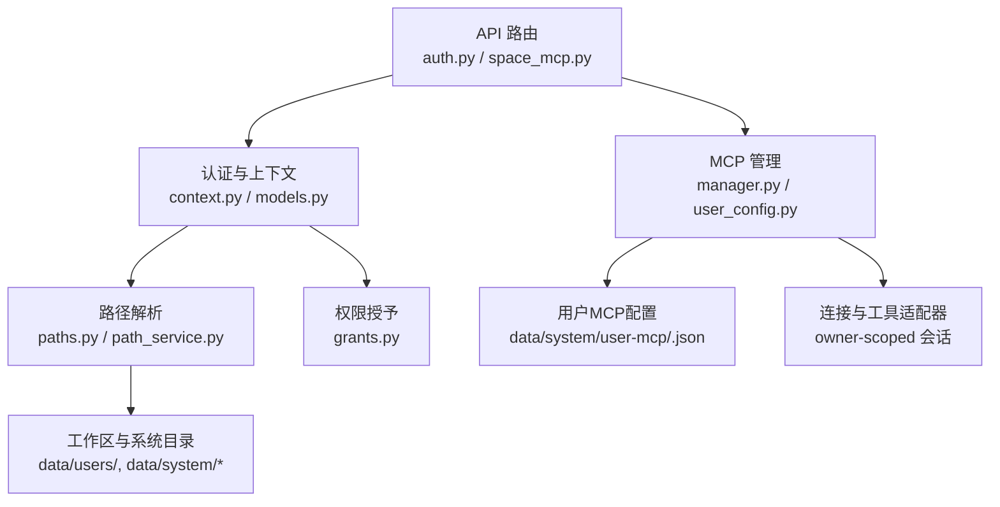
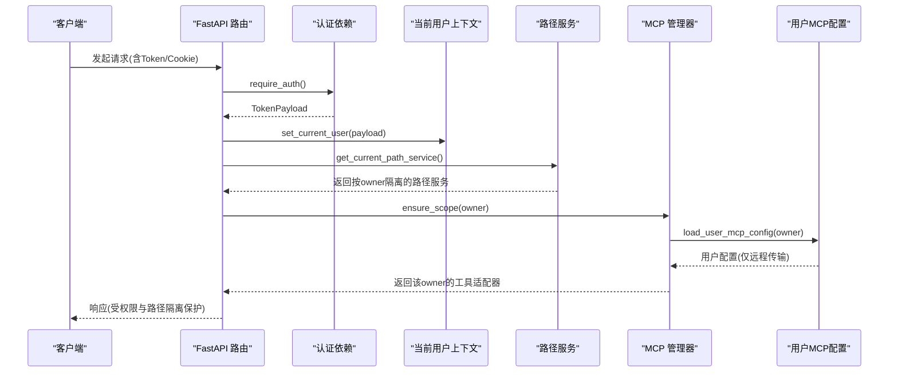
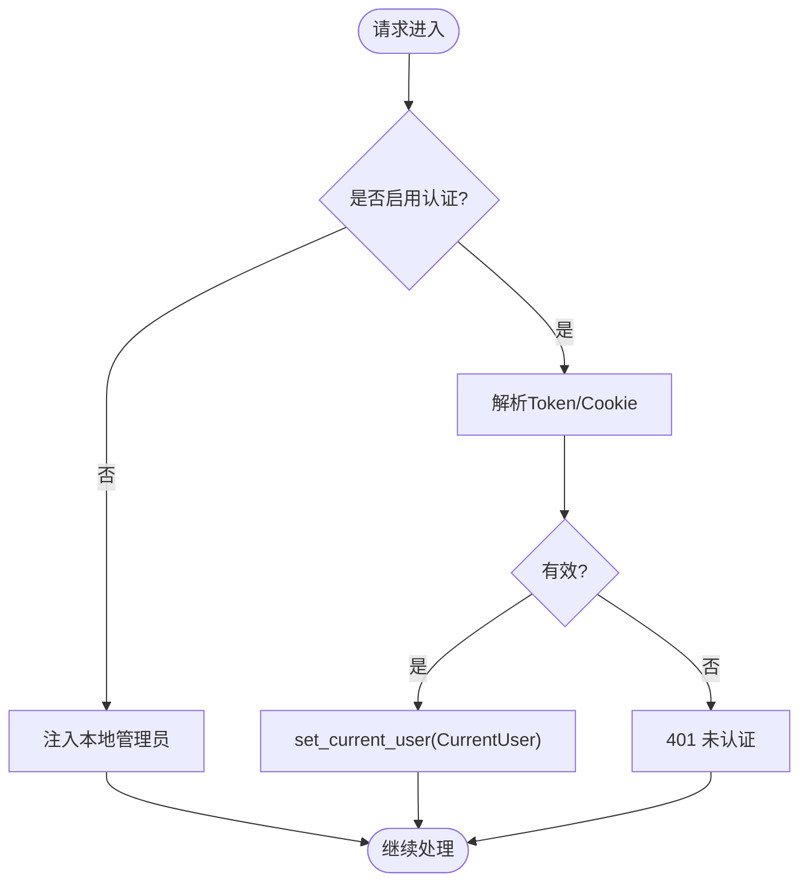
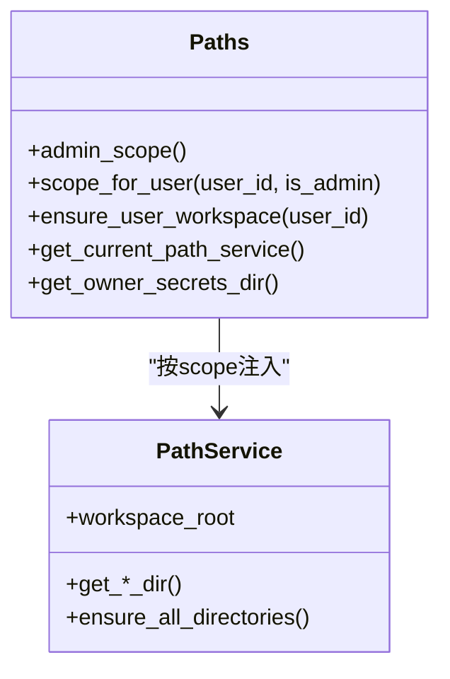
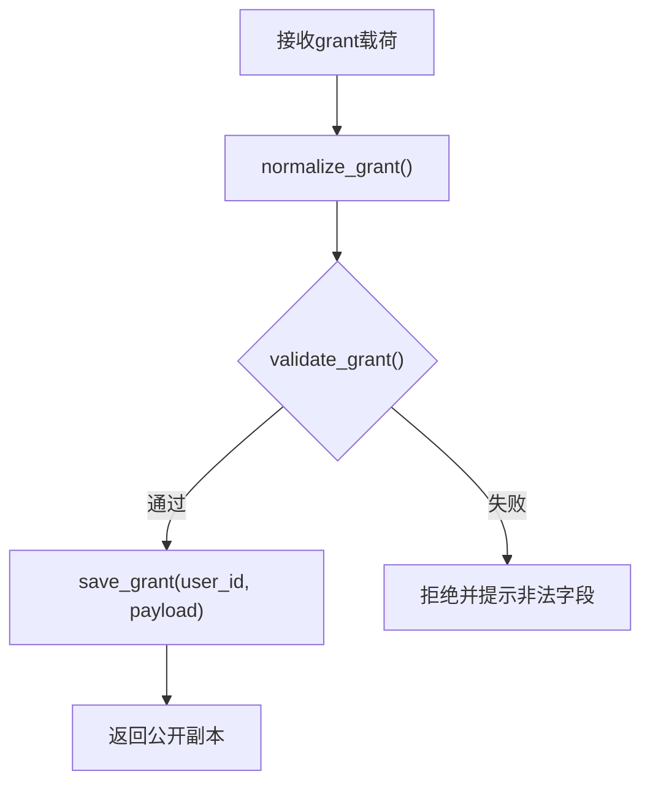
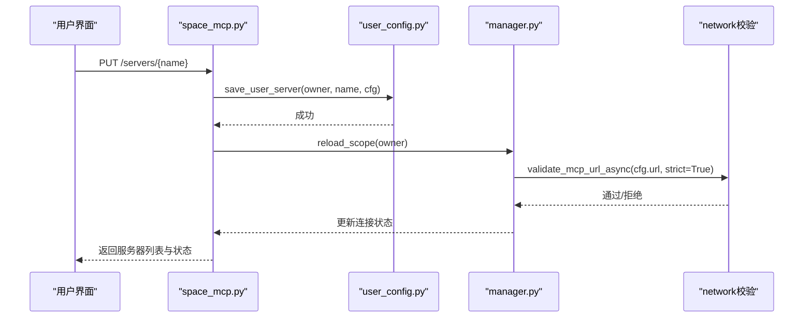
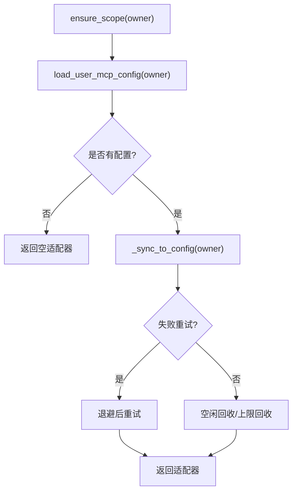
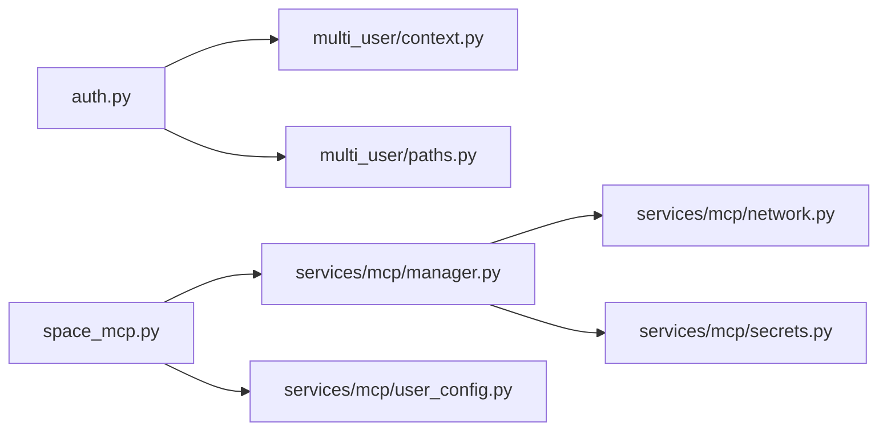

# 身份隔离机制

<cite>
**本文引用的文件**
- [deeptutor/multi_user/identity.py](file://deeptutor/multi_user/identity.py)
- [deeptutor/multi_user/grants.py](file://deeptutor/multi_user/grants.py)
- [deeptutor/multi_user/paths.py](file://deeptutor/multi_user/paths.py)
- [deeptutor/multi_user/context.py](file://deeptutor/multi_user/context.py)
- [deeptutor/multi_user/models.py](file://deeptutor/multi_user/models.py)
- [deeptutor/api/routers/auth.py](file://deeptutor/api/routers/auth.py)
- [deeptutor/services/path_service.py](file://deeptutor/services/path_service.py)
- [deeptutor/services/mcp/__init__.py](file://deeptutor/services/mcp/__init__.py)
- [deeptutor/services/mcp/manager.py](file://deeptutor/services/mcp/manager.py)
- [deeptutor/services/mcp/user_config.py](file://deeptutor/services/mcp/user_config.py)
- [deeptutor/api/routers/space_mcp.py](file://deeptutor/api/routers/space_mcp.py)
</cite>

## 目录
1. [简介](#简介)
2. [项目结构](#项目结构)
3. [核心组件](#核心组件)
4. [架构总览](#架构总览)
5. [详细组件分析](#详细组件分析)
6. [依赖关系分析](#依赖关系分析)
7. [性能与资源限制](#性能与资源限制)
8. [故障排查与安全测试](#故障排查与安全测试)
9. [结论](#结论)
10. [附录：多租户部署最佳实践](#附录多租户部署最佳实践)

## 简介
本文件系统性阐述 DeepTutor 的“MCP 身份隔离机制”，覆盖用户身份验证、会话上下文、基于所有者的资源路径隔离、权限授予系统（细粒度能力访问控制与资源使用限制）、跨用户操作防护，以及安全测试方法与漏洞检测建议。目标是确保每个用户的 MCP 服务器配置、连接与会话、工具调用与数据读写完全隔离，防止越权访问和数据泄露。

## 项目结构
DeepTutor 的多用户与 MCP 隔离由以下层次协作完成：
- 身份与会话层：认证路由、当前用户上下文、用户模型与作用域。
- 路径与服务层：按所有者划分的工作区根目录、系统级隔离目录、路径服务抽象。
- 权限与授权层：用户授予（grants）与工具/模型/伙伴等资源的白名单或策略。
- MCP 管理层：连接管理器、用户级配置存储、传输安全校验、OAuth 流程、工具适配器隔离。

图表来源
- [deeptutor/api/routers/auth.py:216-348](file://deeptutor/api/routers/auth.py#L216-L348)
- [deeptutor/multi_user/context.py:14-46](file://deeptutor/multi_user/context.py#L14-L46)
- [deeptutor/multi_user/paths.py:89-161](file://deeptutor/multi_user/paths.py#L89-L161)
- [deeptutor/services/mcp/manager.py:216-298](file://deeptutor/services/mcp/manager.py#L216-L298)
- [deeptutor/services/mcp/user_config.py:70-118](file://deeptutor/services/mcp/user_config.py#L70-L118)

章节来源
- [deeptutor/api/routers/auth.py:216-348](file://deeptutor/api/routers/auth.py#L216-L348)
- [deeptutor/multi_user/paths.py:89-161](file://deeptutor/multi_user/paths.py#L89-L161)
- [deeptutor/services/mcp/manager.py:216-298](file://deeptutor/services/mcp/manager.py#L216-L298)
- [deeptutor/services/mcp/user_config.py:70-118](file://deeptutor/services/mcp/user_config.py#L70-L118)

## 核心组件
- 身份与会话
  - 认证入口与依赖：支持 Cookie 与 Bearer Token，统一安装当前用户到 ContextVar，保证 HTTP/WebSocket 一致。
  - 当前用户上下文：通过 ContextVar 维护请求级 CurrentUser，包含 id、username、role、scope。
  - 作用域与工作区：根据角色决定 admin 或 per-user 工作区根路径。
- 路径与隔离
  - 系统目录：data/system 存放 auth、grants、audit、indexes、user-secrets 等，沙箱不挂载。
  - 用户工作区：data/users/<uid>，每个非管理员用户独立目录。
  - 路径服务：PathService 封装工作区子目录，按 scope 注入实现隔离。
- 权限授予
  - grants.json：按 user_id 存储模型、知识库、技能、伙伴、工具白名单、执行策略等。
  - 校验：拒绝在授予中携带敏感字段（如 api_key、secret、path 等）。
- MCP 隔离
  - 连接管理器：以 (owner, server_name) 为键维护连接；工具适配器携带 owner，调用时严格路由到对应会话。
  - 用户配置：data/system/user-mcp/<owner>.json，仅允许远程传输（sse/streamableHttp），禁止 stdio。
  - 安全校验：连接前再次校验 URL，阻止内网/重定向攻击；OAuth 凭据分离存储且永不回显。

章节来源
- [deeptutor/api/routers/auth.py:216-348](file://deeptutor/api/routers/auth.py#L216-L348)
- [deeptutor/multi_user/context.py:14-46](file://deeptutor/multi_user/context.py#L14-L46)
- [deeptutor/multi_user/paths.py:89-161](file://deeptutor/multi_user/paths.py#L89-L161)
- [deeptutor/multi_user/grants.py:16-138](file://deeptutor/multi_user/grants.py#L16-L138)
- [deeptutor/services/mcp/manager.py:216-298](file://deeptutor/services/mcp/manager.py#L216-L298)
- [deeptutor/services/mcp/user_config.py:70-118](file://deeptutor/services/mcp/user_config.py#L70-L118)

## 架构总览
下图展示从请求进入、身份解析、路径隔离到 MCP 连接的完整链路。

图表来源
- [deeptutor/api/routers/auth.py:216-348](file://deeptutor/api/routers/auth.py#L216-L348)
- [deeptutor/multi_user/context.py:14-46](file://deeptutor/multi_user/context.py#L14-L46)
- [deeptutor/services/mcp/manager.py:277-298](file://deeptutor/services/mcp/manager.py#L277-L298)
- [deeptutor/services/mcp/user_config.py:80-118](file://deeptutor/services/mcp/user_config.py#L80-L118)

## 详细组件分析

### 身份验证与会话管理
- 认证依赖
  - 支持 Authorization: Bearer 与 dt_token Cookie，统一解析并设置当前用户。
  - 未启用认证时，自动注入本地管理员身份，便于单实例开发。
- 当前用户上下文
  - 通过 ContextVar 保存 CurrentUser，包含 role 与 scope（admin 或 user）。
  - WebSocket 同样支持 ws_require_auth，在 accept 前完成鉴权。
- 用户模型与作用域
  - UserScope 绑定 user_id 与 root 路径，区分 admin 与 user 工作区。
  - CurrentUser.is_admin 用于快速判断权限。

图表来源
- [deeptutor/api/routers/auth.py:216-348](file://deeptutor/api/routers/auth.py#L216-L348)
- [deeptutor/multi_user/context.py:14-46](file://deeptutor/multi_user/context.py#L14-L46)
- [deeptutor/multi_user/models.py:36-65](file://deeptutor/multi_user/models.py#L36-L65)

章节来源
- [deeptutor/api/routers/auth.py:216-348](file://deeptutor/api/routers/auth.py#L216-L348)
- [deeptutor/multi_user/context.py:14-46](file://deeptutor/multi_user/context.py#L14-L46)
- [deeptutor/multi_user/models.py:36-65](file://deeptutor/multi_user/models.py#L36-L65)

### 基于所有者的资源路径隔离
- 目录布局
  - data/system：系统状态（auth、grants、audit、indexes、user-secrets），沙箱不可见。
  - data/users/<uid>：每个非管理员用户的工作区。
  - data/partners/<id>：合作伙伴（合成用户）工作区。
- 路径解析
  - scope_for_user：根据 is_admin 决定 admin 或 per-user 根路径。
  - get_current_path_service：在当前上下文中返回隔离后的 PathService。
  - get_owner_secrets_dir：按 owner 隔离的密钥目录，权限严格限制。
- 迁移与一致性
  - migrate_legacy_multi_user_tree：将旧布局迁移至新 tree，幂等且安全。
  - ensure_system_dirs：启动时创建 system 目录并设置严格权限。

图表来源
- [deeptutor/multi_user/paths.py:48-161](file://deeptutor/multi_user/paths.py#L48-L161)
- [deeptutor/services/path_service.py:59-115](file://deeptutor/services/path_service.py#L59-L115)

章节来源
- [deeptutor/multi_user/paths.py:48-161](file://deeptutor/multi_user/paths.py#L48-L161)
- [deeptutor/services/path_service.py:59-115](file://deeptutor/services/path_service.py#L59-L115)

### 权限授予系统与细粒度能力访问控制
- 授予结构
  - 版本化 grant 对象，包含模型、知识库、技能、伙伴、工具白名单、执行策略等。
  - 默认策略：mcp_tools=None 表示非管理员默认拒绝，需管理员显式授权。
- 规范化与校验
  - normalize_grant：兼容历史 v1/v2 结构，落盘前标准化。
  - validate_grant：拒绝在授予中写入敏感字段（api_key、secret、path 等）。
- 存储与读取
  - grant_path：按 user_id 存储于 data/system/grants/<user_id>.json。
  - public_grant：只读副本，避免并发修改影响。

图表来源
- [deeptutor/multi_user/grants.py:16-138](file://deeptutor/multi_user/grants.py#L16-L138)

章节来源
- [deeptutor/multi_user/grants.py:16-138](file://deeptutor/multi_user/grants.py#L16-L138)

### MCP 身份隔离与跨用户防护
- 连接隔离
  - 连接键：(owner, server_name)，不同 owner 的连接互不影响。
  - 工具适配器：携带 owner，调用时强制路由到对应会话，防止跨用户调用。
  - 冷作用域回收：按 owner 维度空闲超时与上限回收，避免进程资源耗尽。
- 用户配置安全
  - 位置：data/system/user-mcp/<owner>.json，沙箱不可写。
  - 传输限制：仅允许 sse/streamableHttp，禁止 stdio 命令执行。
  - 名称保护：禁止与部署共享服务器同名，防止工具名冲突与越权。
- 网络与凭据安全
  - 连接前再次校验 URL，阻止内网/云元数据地址与危险重定向。
  - OAuth 凭据分离存储，仅在连接时解析引用，绝不回显。
  - Test 与真实连接遵循相同策略，避免“测试宽松、运行严格”的漏洞。

图表来源
- [deeptutor/api/routers/space_mcp.py:138-154](file://deeptutor/api/routers/space_mcp.py#L138-L154)
- [deeptutor/services/mcp/user_config.py:121-138](file://deeptutor/services/mcp/user_config.py#L121-L138)
- [deeptutor/services/mcp/manager.py:610-708](file://deeptutor/services/mcp/manager.py#L610-L708)

章节来源
- [deeptutor/services/mcp/manager.py:216-298](file://deeptutor/services/mcp/manager.py#L216-L298)
- [deeptutor/services/mcp/user_config.py:70-118](file://deeptutor/services/mcp/user_config.py#L70-L118)
- [deeptutor/api/routers/space_mcp.py:138-154](file://deeptutor/api/routers/space_mcp.py#L138-L154)

### 会话管理与资源生命周期
- 会话任务绑定
  - 每个 MCP 服务器连接在一个独立任务中管理其 AsyncExitStack，确保连接生命周期可控。
- 工具调用与进度
  - 工具调用带超时与重试，进度事件透传到上层追踪。
- 作用域回收
  - 按 owner 维度记录最近使用时间，超过阈值或达到上限时断开并清理。

图表来源
- [deeptutor/services/mcp/manager.py:277-347](file://deeptutor/services/mcp/manager.py#L277-L347)
- [deeptutor/services/mcp/user_config.py:80-118](file://deeptutor/services/mcp/user_config.py#L80-L118)

章节来源
- [deeptutor/services/mcp/manager.py:277-347](file://deeptutor/services/mcp/manager.py#L277-L347)

## 依赖关系分析
- 模块耦合
  - auth.py 依赖 multi_user.context 与 paths，确保请求级身份与路径隔离。
  - space_mcp.py 依赖 manager、user_config、secrets，形成用户级 MCP 配置的读写与连接闭环。
  - manager.py 依赖 network 校验与 secrets 解析，保障连接安全。
- 外部依赖
  - MCP SDK：用于建立传输与工具调用。
  - httpx：HTTP/SSE/Streamable HTTP 客户端。
- 潜在循环
  - 通过延迟导入（lazy import）避免循环依赖，例如在 _open_transport 中动态引入 mcp 相关模块。

图表来源
- [deeptutor/api/routers/auth.py:216-348](file://deeptutor/api/routers/auth.py#L216-L348)
- [deeptutor/api/routers/space_mcp.py:34-57](file://deeptutor/api/routers/space_mcp.py#L34-L57)
- [deeptutor/services/mcp/manager.py:42-48](file://deeptutor/services/mcp/manager.py#L42-L48)

章节来源
- [deeptutor/api/routers/auth.py:216-348](file://deeptutor/api/routers/auth.py#L216-L348)
- [deeptutor/api/routers/space_mcp.py:34-57](file://deeptutor/api/routers/space_mcp.py#L34-L57)
- [deeptutor/services/mcp/manager.py:42-48](file://deeptutor/services/mcp/manager.py#L42-L48)

## 性能与资源限制
- 连接与缓存
  - 每 owner 一个锁，避免跨用户阻塞；连接任务独立，互不影响。
  - 冷作用域回收：空闲 TTL 与最大作用域数，防止进程内存与句柄泄漏。
- 工具调用
  - 超时与一次重试，降低瞬时网络抖动影响。
- 配置加载
  - 用户配置读取失败视为空配置，避免阻塞页面渲染。
- 建议
  - 合理设置 MAX_SERVERS_PER_OWNER 与 _MAX_OWNER_SCOPES，结合业务规模调优。
  - 对高频调用的 MCP 服务保持最小必要工具集，减少 schema 同步开销。

[本节提供通用指导，无需特定文件分析]

## 故障排查与安全测试
- 常见问题定位
  - 无法连接：检查 URL 是否被拒绝（内网/云元数据/危险重定向），确认 OAuth 已授权。
  - 工具不可用：确认用户配置未被拒绝（stdio 不允许），名称未与部署共享服务器冲突。
  - 路径错误：确认当前上下文已正确设置，否则可能回退到 admin 工作区导致越权。
- 安全测试方法
  - 越权访问测试：同一接口以不同 token 调用，验证路径与 MCP 连接均按 owner 隔离。
  - 配置注入测试：尝试在 grants 中写入敏感字段，应被拒绝。
  - 传输安全测试：构造指向内网/云元数据的 URL，应在连接前被拒绝。
  - 名称冲突测试：尝试使用保留前缀或共享名称，应被拒绝。
  - 会话隔离测试：同时登录多个账户，验证工具调用不会串扰。
- 漏洞检测建议
  - 静态扫描：关注路径拼接、URL 解析、JSON 反序列化点。
  - 动态测试：模拟弱网、DNS 劫持、重定向攻击，验证连接策略。
  - 审计日志：检查 owner 变更、配置写入、连接失败原因。

章节来源
- [deeptutor/services/mcp/user_config.py:164-190](file://deeptutor/services/mcp/user_config.py#L164-L190)
- [deeptutor/services/mcp/manager.py:610-708](file://deeptutor/services/mcp/manager.py#L610-L708)
- [deeptutor/multi_user/grants.py:115-138](file://deeptutor/multi_user/grants.py#L115-L138)

## 结论
DeepTutor 通过“认证上下文 + 路径隔离 + 授予策略 + MCP 连接隔离”的多层机制，实现了严格的身份隔离与跨用户防护。关键要点包括：
- 所有请求必须经过认证依赖，设置当前用户上下文。
- 路径服务按 owner 隔离，系统目录与用户工作区严格分离。
- 授予系统限制模型、工具、执行策略等细粒度能力。
- MCP 连接以 owner 为键，工具调用严格路由，传输与凭据安全校验贯穿始终。
- 通过冷作用域回收与上限控制，保障多租户下的稳定性与安全性。

[本节总结性内容，无需特定文件分析]

## 附录：多租户部署最佳实践
- 部署模式
  - 生产环境启用认证，关闭自注册；使用外部用户存储（如 PocketBase）集中管理账号。
  - 将 data/system 单独挂载并限制访问权限，确保沙箱不可见。
- 安全加固
  - 严格限制用户可配置的 MCP 传输类型（仅远程），禁止 stdio。
  - 启用 URL 严格校验，阻止内网与云元数据访问。
  - 定期轮换 auth_secret，限制文件权限。
- 运维建议
  - 监控连接状态与失败原因，及时告警。
  - 调整作用域回收参数，平衡用户体验与资源占用。
  - 审计配置写入与连接行为，留存日志以便追溯。

[本节提供通用指导，无需特定文件分析]