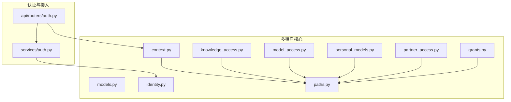
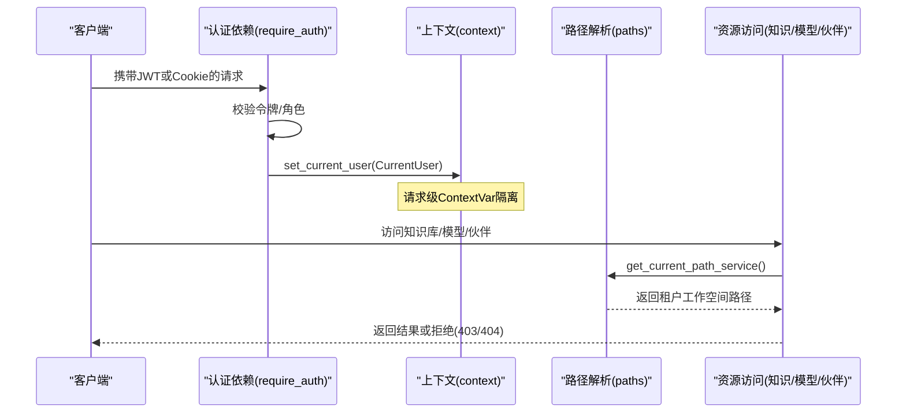
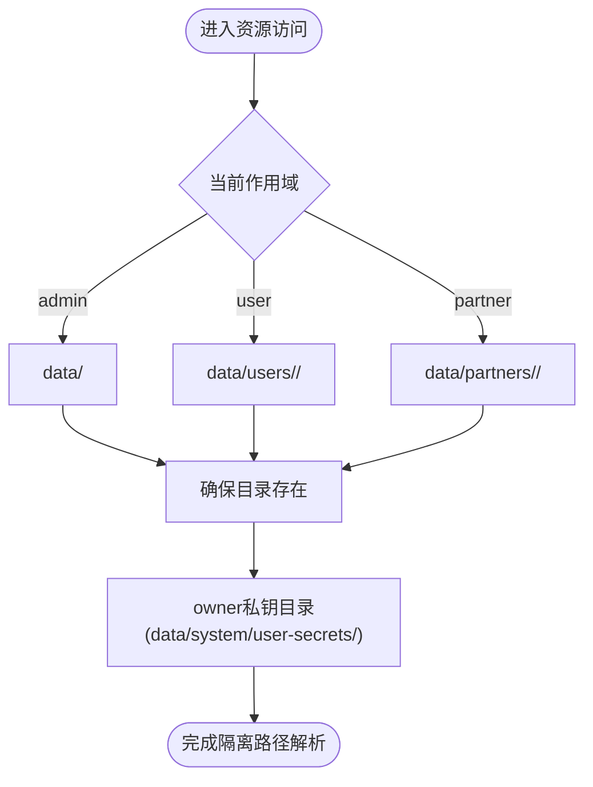
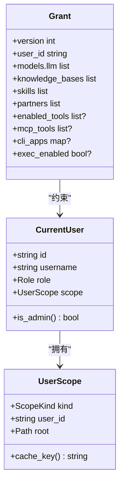
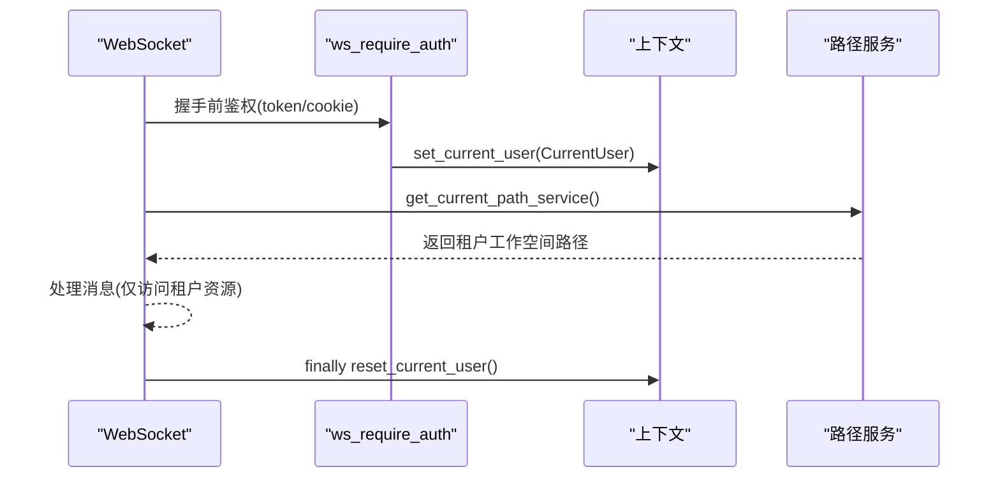
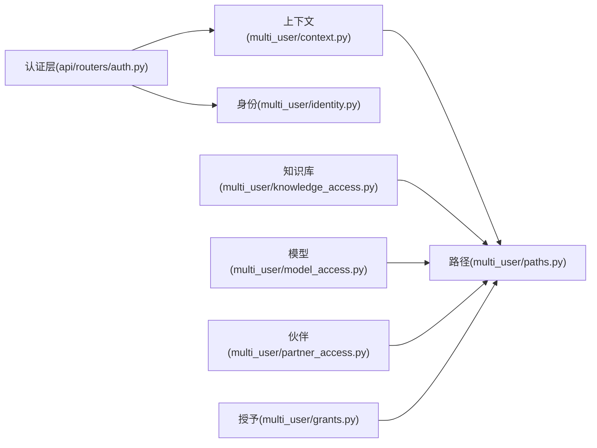

# 多租户隔离

<cite>
**本文引用的文件**
- [multi_user/__init__.py](file://deeptutor/multi_user/__init__.py)
- [multi_user/context.py](file://deeptutor/multi_user/context.py)
- [multi_user/identity.py](file://deeptutor/multi_user/identity.py)
- [multi_user/models.py](file://deeptutor/multi_user/models.py)
- [multi_user/paths.py](file://deeptutor/multi_user/paths.py)
- [multi_user/grants.py](file://deeptutor/multi_user/grants.py)
- [multi_user/knowledge_access.py](file://deeptutor/multi_user/knowledge_access.py)
- [multi_user/model_access.py](file://deeptutor/multi_user/model_access.py)
- [multi_user/personal_models.py](file://deeptutor/multi_user/personal_models.py)
- [multi_user/partner_access.py](file://deeptutor/multi_user/partner_access.py)
- [api/routers/auth.py](file://deeptutor/api/routers/auth.py)
- [services/auth.py](file://deeptutor/services/auth.py)
</cite>

## 目录
1. [简介](#简介)
2. [项目结构](#项目结构)
3. [核心组件](#核心组件)
4. [架构总览](#架构总览)
5. [详细组件分析](#详细组件分析)
6. [依赖关系分析](#依赖关系分析)
7. [性能与资源配额](#性能与资源配额)
8. [故障排查指南](#故障排查指南)
9. [结论](#结论)
10. [附录](#附录)

## 简介
本文件系统性阐述 DeepTutor 在多租户环境下的连接隔离机制，重点围绕“基于 owner 的连接隔离”“用户作用域创建与管理”“权限控制与租户间完全隔离”“会话隔离策略（独立连接上下文与资源分配）”“租户通信限制与安全边界”“租户配置管理（租户特定连接参数与访问控制）”以及“多租户性能隔离与资源配额”展开。方案以请求级上下文、路径隔离、授权授予（grants）、知识库/模型/伙伴等资源的可见性控制为核心，确保不同租户之间的数据、连接与执行环境严格隔离。

## 项目结构
多租户能力集中在 deeptutor/multi_user 包中，并通过 API 路由与认证层集成到服务入口：
- 身份与作用域：models、context、identity、paths
- 资源授权与可见性：grants、knowledge_access、model_access、personal_models、partner_access
- 认证与上下文注入：api/routers/auth.py、services/auth.py

图表来源
- [multi_user/models.py:13-84](file://deeptutor/multi_user/models.py#L13-L84)
- [multi_user/context.py:11-46](file://deeptutor/multi_user/context.py#L11-L46)
- [multi_user/identity.py:26-326](file://deeptutor/multi_user/identity.py#L26-L326)
- [multi_user/paths.py:1-262](file://deeptutor/multi_user/paths.py#L1-L262)
- [multi_user/grants.py:1-138](file://deeptutor/multi_user/grants.py#L1-L138)
- [multi_user/knowledge_access.py:1-282](file://deeptutor/multi_user/knowledge_access.py#L1-L282)
- [multi_user/model_access.py:1-156](file://deeptutor/multi_user/model_access.py#L1-L156)
- [multi_user/personal_models.py:1-143](file://deeptutor/multi_user/personal_models.py#L1-L143)
- [multi_user/partner_access.py:1-84](file://deeptutor/multi_user/partner_access.py#L1-L84)
- [api/routers/auth.py:216-349](file://deeptutor/api/routers/auth.py#L216-L349)
- [services/auth.py:39-61](file://deeptutor/services/auth.py#L39-L61)

章节来源
- [multi_user/__init__.py:1-24](file://deeptutor/multi_user/__init__.py#L1-L24)

## 核心组件
- 当前用户上下文：通过 ContextVar 在请求范围内维护 CurrentUser，提供 set/get/reset 能力，保证每个请求的租户上下文不串扰。
- 身份存储：users.json 与 auth_secret，支持迁移、并发写入保护、角色管理与头像存储。
- 路径与作用域：按 admin/user/partner 划分工作空间根目录，确保文件系统级隔离；提供 owner-secrets 目录用于存放敏感凭据。
- 授权授予（grants）：管理员为普通用户分配模型、知识库、技能、伙伴、工具与执行策略，形成细粒度访问控制。
- 资源可见性：知识库、模型、伙伴等资源均通过 grants + 当前用户角色进行可见性与读写控制。
- 个人绑定模型：普通用户可绑定自身 OAuth 订阅的个人模型，仅在其作用域内生效，不与管理员共享。

章节来源
- [multi_user/context.py:11-46](file://deeptutor/multi_user/context.py#L11-L46)
- [multi_user/identity.py:26-326](file://deeptutor/multi_user/identity.py#L26-L326)
- [multi_user/paths.py:1-262](file://deeptutor/multi_user/paths.py#L1-L262)
- [multi_user/grants.py:1-138](file://deeptutor/multi_user/grants.py#L1-L138)
- [multi_user/knowledge_access.py:1-282](file://deeptutor/multi_user/knowledge_access.py#L1-L282)
- [multi_user/model_access.py:1-156](file://deeptutor/multi_user/model_access.py#L1-L156)
- [multi_user/personal_models.py:1-143](file://deeptutor/multi_user/personal_models.py#L1-L143)

## 架构总览
下图展示从 HTTP/WebSocket 进入后，如何建立并传播租户上下文，并在后续资源访问中强制执行隔离。

图表来源
- [api/routers/auth.py:216-349](file://deeptutor/api/routers/auth.py#L216-L349)
- [multi_user/context.py:11-46](file://deeptutor/multi_user/context.py#L11-L46)
- [multi_user/paths.py:140-162](file://deeptutor/multi_user/paths.py#L140-L162)
- [multi_user/knowledge_access.py:69-151](file://deeptutor/multi_user/knowledge_access.py#L69-L151)
- [multi_user/model_access.py:59-126](file://deeptutor/multi_user/model_access.py#L59-L126)
- [multi_user/partner_access.py:26-47](file://deeptutor/multi_user/partner_access.py#L26-L47)

## 详细组件分析

### 基于 owner 的连接隔离与作用域管理
- 作用域类型：admin、user、partner（合成用户）。每种作用域对应独立的工作空间根目录。
- 路径隔离：
  - 管理员工作空间：data/
  - 普通用户工作空间：data/users/<uid>/
  - 伙伴工作空间：data/partners/<id>/
  - 系统目录：data/system/（账户、授予、审计、索引、owner 私钥）
- Owner 密钥目录：data/system/user-secrets/<owner_id>/，仅 owner 可读，沙箱不可见，避免凭据泄露。
- 作用域创建：首次访问时自动创建所需目录结构，确保幂等与健壮性。

图表来源
- [multi_user/paths.py:1-162](file://deeptutor/multi_user/paths.py#L1-L162)
- [multi_user/paths.py:164-245](file://deeptutor/multi_user/paths.py#L164-L245)

章节来源
- [multi_user/paths.py:1-262](file://deeptutor/multi_user/paths.py#L1-L262)
- [multi_user/models.py:36-65](file://deeptutor/multi_user/models.py#L36-L65)

### 权限控制与租户间完全隔离
- 角色与上下文：CurrentUser 包含 id、username、role、scope；get_current_user_or_none 用于判断是否处于请求上下文。
- 管理员与普通用户：
  - 管理员可访问全部资源，不受 grants 限制。
  - 普通用户必须通过 grants 显式获得模型、知识库、技能、伙伴、工具与执行策略。
- 资源可见性：
  - 知识库：resolve_kb 根据来源前缀与 grants 决定可访问范围；管理员分配的知识库对普通用户只读。
  - 模型：redacted_model_access 合并管理员授予与个人绑定模型，过滤 owner-bound 模型，确保选项一致。
  - 伙伴：visible_partner_cards 与 assert_partner_allowed 限制非管理员只能使用被分配的伙伴。
- 安全边界：
  - 禁止在 grants 中包含敏感字段（如 api_key、secret、password、token、path、base_url），防止凭据外泄。
  - 所有资源访问均经过当前用户上下文与 grants 双重校验，杜绝跨租户越权。

图表来源
- [multi_user/models.py:13-84](file://deeptutor/multi_user/models.py#L13-L84)
- [multi_user/grants.py:16-87](file://deeptutor/multi_user/grants.py#L16-L87)
- [multi_user/model_access.py:59-126](file://deeptutor/multi_user/model_access.py#L59-L126)
- [multi_user/knowledge_access.py:69-151](file://deeptutor/multi_user/knowledge_access.py#L69-L151)
- [multi_user/partner_access.py:26-47](file://deeptutor/multi_user/partner_access.py#L26-L47)

章节来源
- [multi_user/context.py:11-46](file://deeptutor/multi_user/context.py#L11-L46)
- [multi_user/grants.py:1-138](file://deeptutor/multi_user/grants.py#L1-L138)
- [multi_user/knowledge_access.py:1-282](file://deeptutor/multi_user/knowledge_access.py#L1-L282)
- [multi_user/model_access.py:1-156](file://deeptutor/multi_user/model_access.py#L1-L156)
- [multi_user/partner_access.py:1-84](file://deeptutor/multi_user/partner_access.py#L1-L84)

### 会话隔离策略（独立连接上下文与资源分配）
- 请求级上下文：通过 require_auth/ws_require_auth 将 JWT/Cookie 解码为 TokenPayload，再转换为 CurrentUser 并设置到 ContextVar，确保同一进程内并发请求互不干扰。
- 工作空间隔离：每次访问资源时通过 get_current_path_service() 获取当前租户的 PathService，所有文件、知识库、记忆等均落盘至各自目录。
- 凭据隔离：owner 私钥目录 data/system/user-secrets/<owner_id>/ 仅 owner 可写/读，沙箱不可见，避免跨租户凭据泄露。
- 会话生命周期：WebSocket 连接在 accept 前完成鉴权，连接期间保持同一 CurrentUser 上下文；结束时重置 ContextVar。

图表来源
- [api/routers/auth.py:294-325](file://deeptutor/api/routers/auth.py#L294-L325)
- [multi_user/context.py:11-46](file://deeptutor/multi_user/context.py#L11-L46)
- [multi_user/paths.py:140-162](file://deeptutor/multi_user/paths.py#L140-L162)

章节来源
- [api/routers/auth.py:216-349](file://deeptutor/api/routers/auth.py#L216-L349)
- [multi_user/paths.py:140-162](file://deeptutor/multi_user/paths.py#L140-L162)

### 租户间的通信限制与安全边界
- 知识库访问：
  - 管理员可读写自身知识库。
  - 普通用户可通过 grants 读取管理员知识库（只读），无法写入。
  - 未分配的知识库一律不可见。
- 模型选择：
  - 普通用户仅能选择 grants 中的模型与其个人绑定的模型。
  - owner-bound 模型不可通过 grants 共享，必须由本人登录绑定。
- 伙伴使用：
  - 非管理员只能使用被分配的伙伴；伙伴运行于其独立工作空间，不会暴露通道配置给调用者。
- 工具与执行：
  - enabled_tools、mcp_tools、cli_apps、exec_enabled 由 grants 控制；默认 deny-by-default 的策略降低风险。

章节来源
- [multi_user/knowledge_access.py:69-151](file://deeptutor/multi_user/knowledge_access.py#L69-L151)
- [multi_user/model_access.py:59-126](file://deeptutor/multi_user/model_access.py#L59-L126)
- [multi_user/partner_access.py:26-47](file://deeptutor/multi_user/partner_access.py#L26-L47)
- [multi_user/grants.py:16-87](file://deeptutor/multi_user/grants.py#L16-L87)

### 租户配置管理（租户特定的连接参数与访问控制）
- 管理员授予（grants）：
  - 通过 /admin/resources 列出可分配资源，通过 PUT /users/{user_id}/grants 设置。
  - grants 仅承载逻辑 ID，运行时在服务端解析实际资源，避免敏感信息进入 grants。
- 个人模型绑定：
  - 普通用户可在其 own catalog 中绑定 owner-bound 模型（如 Codex OAuth），仅在其作用域内可用。
- 路径与服务：
  - get_owner_path_service() 与 get_current_path_service() 分别用于 owner-keyed 资产与 workspace-keyed 资产。
  - ensure_system_dirs() 初始化系统目录与 owner 私钥目录权限。

章节来源
- [multi_user/grants.py:1-138](file://deeptutor/multi_user/grants.py#L1-L138)
- [multi_user/personal_models.py:1-143](file://deeptutor/multi_user/personal_models.py#L1-L143)
- [multi_user/paths.py:128-245](file://deeptutor/multi_user/paths.py#L128-L245)

## 依赖关系分析
- 认证层依赖 multi_user.context 与 identity，负责将 JWT 转换为 CurrentUser 并设置上下文。
- 资源访问层依赖 paths、grants、model_access、knowledge_access、partner_access，统一依据当前用户与 grants 进行可见性与权限判定。
- 路径服务缓存 per-scope 的 PathService，减少重复构造开销。

图表来源
- [api/routers/auth.py:216-349](file://deeptutor/api/routers/auth.py#L216-L349)
- [multi_user/context.py:11-46](file://deeptutor/multi_user/context.py#L11-L46)
- [multi_user/paths.py:140-162](file://deeptutor/multi_user/paths.py#L140-L162)
- [multi_user/knowledge_access.py:69-151](file://deeptutor/multi_user/knowledge_access.py#L69-L151)
- [multi_user/model_access.py:59-126](file://deeptutor/multi_user/model_access.py#L59-L126)
- [multi_user/partner_access.py:26-47](file://deeptutor/multi_user/partner_access.py#L26-L47)
- [multi_user/grants.py:16-87](file://deeptutor/multi_user/grants.py#L16-L87)

章节来源
- [multi_user/paths.py:140-162](file://deeptutor/multi_user/paths.py#L140-L162)

## 性能与资源配额
- 路径服务缓存：get_path_service_for_scope 按 scope.cache_key 缓存 PathService，避免频繁构造。
- 目录懒创建：ensure_scope_workspace 按需创建租户工作空间目录，减少启动开销。
- 授予归一化：normalize_grant 将历史格式归一化为 v2，提升一致性并减少运行时分支。
- 资源可见性优化：lru_cache 缓存 KnowledgeBaseManager 实例，减少重复初始化。
- 建议的资源配额策略（实践指导）：
  - 结合 exec_enabled 与 mcp_tools/enabled_tools 限制计算与外部工具调用，避免单租户耗尽资源。
  - 通过 grants 限制知识库与模型数量，控制内存与索引规模。
  - 对高频操作（如 RAG 查询）结合后端限流与超时策略，保障整体稳定性。

章节来源
- [multi_user/paths.py:140-162](file://deeptutor/multi_user/paths.py#L140-L162)
- [multi_user/knowledge_access.py:24-42](file://deeptutor/multi_user/knowledge_access.py#L24-L42)
- [multi_user/grants.py:60-87](file://deeptutor/multi_user/grants.py#L60-L87)

## 故障排查指南
- 未认证或令牌无效：
  - 现象：401 Unauthorized。
  - 排查：确认 require_auth 是否正确安装；检查 JWT/Cookie 是否有效；确认 AUTH_ENABLED 配置。
- 无管理员权限：
  - 现象：403 Forbidden。
  - 排查：确认 require_admin 依赖；检查 token 中 role 是否为 admin。
- 知识库不可用：
  - 现象：404 Not Found 或 403 Forbidden。
  - 排查：确认 resolve_kb 的前缀与名称；检查 grants 是否分配；管理员知识库对普通用户只读。
- 模型不可选：
  - 现象：前端无模型选项或选择被拒绝。
  - 排查：检查 redacted_model_access 返回；确认 grants 与 personal models；owner-bound 模型需本人绑定。
- 伙伴不可用：
  - 现象：403 Forbidden。
  - 排查：检查 assigned_partner_ids；确认管理员已分配伙伴。
- 凭据泄露风险：
  - 现象：异常访问 owner 私钥目录。
  - 排查：确认 get_owner_secrets_dir 与 owner_secrets_dir 权限；确保沙箱不挂载 data/system。

章节来源
- [api/routers/auth.py:237-349](file://deeptutor/api/routers/auth.py#L237-L349)
- [multi_user/knowledge_access.py:69-151](file://deeptutor/multi_user/knowledge_access.py#L69-L151)
- [multi_user/model_access.py:59-126](file://deeptutor/multi_user/model_access.py#L59-L126)
- [multi_user/partner_access.py:26-47](file://deeptutor/multi_user/partner_access.py#L26-L47)
- [multi_user/paths.py:211-245](file://deeptutor/multi_user/paths.py#L211-L245)

## 结论
DeepTutor 的多租户隔离通过“请求级上下文 + 路径隔离 + 授予控制 + 资源可见性”的组合，实现了严格的租户间隔离。管理员集中管理资源与授予，普通用户在受限范围内工作；个人绑定模型在不影响管理员的前提下满足个性化需求。配合 owner 私钥目录与沙箱隔离，进一步提升了安全性。建议在部署中结合 grants 与执行策略实施资源配额，确保多租户环境的稳定与公平。

## 附录
- 关键路径约定：
  - 管理员工作空间：data/
  - 普通用户工作空间：data/users/<uid>/
  - 伙伴工作空间：data/partners/<id>/
  - 系统目录：data/system/（auth、grants、audit、indexes、user-secrets）
- 关键函数参考：
  - 上下文：set_current_user、reset_current_user、get_current_user_or_none、user_from_token_payload
  - 路径：ensure_scope_workspace、get_current_path_service、get_owner_path_service、owner_secrets_dir
  - 授予：load_grant、save_grant、validate_grant、empty_grant
  - 资源：resolve_kb、allowed_llm_options、has_capability_access、visible_partner_cards

章节来源
- [multi_user/paths.py:1-262](file://deeptutor/multi_user/paths.py#L1-L262)
- [multi_user/grants.py:1-138](file://deeptutor/multi_user/grants.py#L1-L138)
- [multi_user/knowledge_access.py:1-282](file://deeptutor/multi_user/knowledge_access.py#L1-L282)
- [multi_user/model_access.py:1-156](file://deeptutor/multi_user/model_access.py#L1-L156)
- [multi_user/partner_access.py:1-84](file://deeptutor/multi_user/partner_access.py#L1-L84)
- [multi_user/context.py:11-46](file://deeptutor/multi_user/context.py#L11-L46)