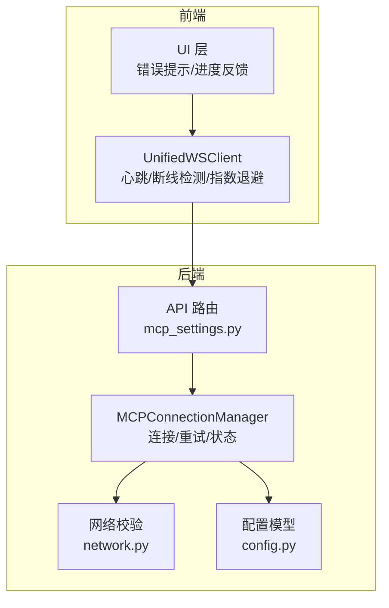
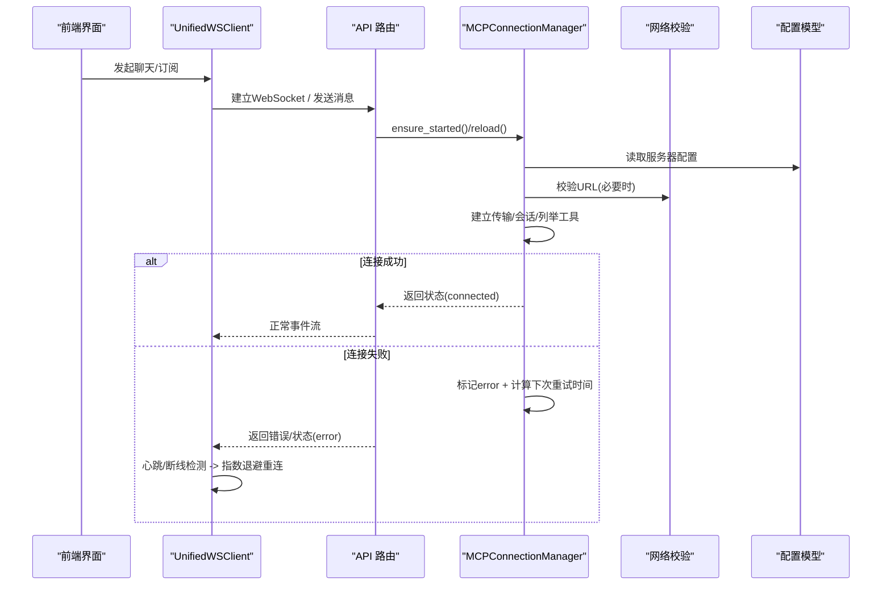
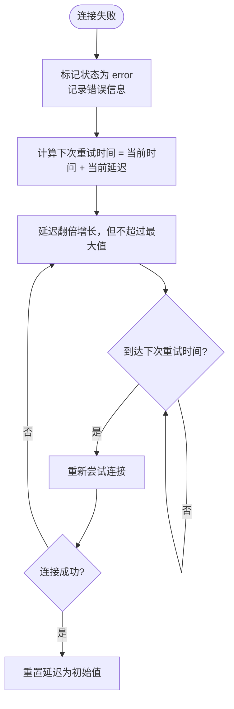
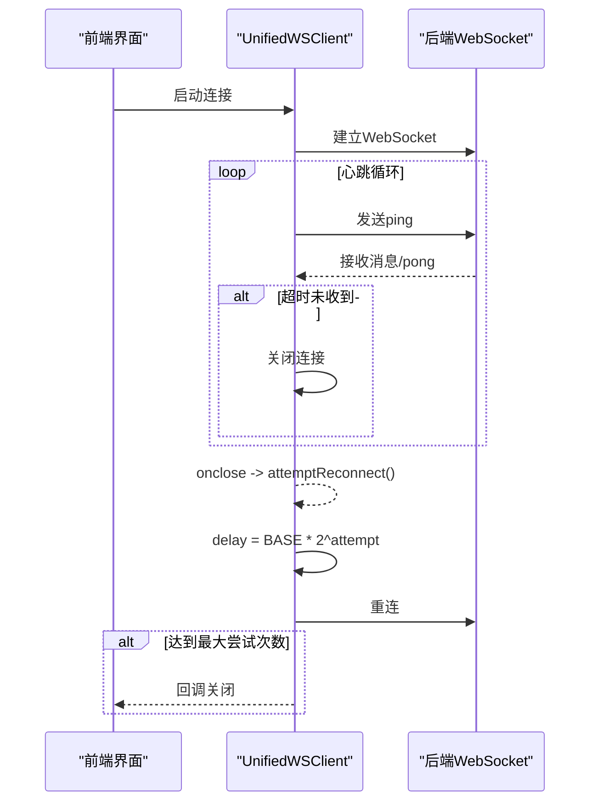
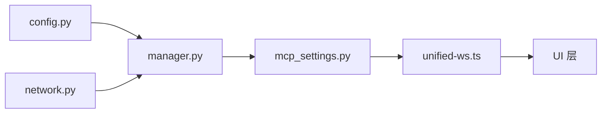

# 自动重连策略

<cite>
**本文引用的文件**
- [manager.py](file://deeptutor/services/mcp/manager.py)
- [network.py](file://deeptutor/services/mcp/network.py)
- [config.py](file://deeptutor/services/mcp/config.py)
- [unified-ws.ts](file://web/lib/unified-ws.ts)
- [mcp-api.ts](file://web/lib/mcp-api.ts)
- [mcp-store.ts](file://web/lib/mcp-store.ts)
- [mcp_settings.py](file://deeptutor/api/routers/mcp_settings.py)
</cite>

## 目录
1. [简介](#简介)
2. [项目结构](#项目结构)
3. [核心组件](#核心组件)
4. [架构总览](#架构总览)
5. [详细组件分析](#详细组件分析)
6. [依赖关系分析](#依赖关系分析)
7. [性能考量](#性能考量)
8. [故障排查指南](#故障排查指南)
9. [结论](#结论)
10. [附录](#附录)

## 简介
本文件系统性梳理 DeepTutor 中 MCP（Model Context Protocol）连接的自动重连策略，覆盖连接失败检测、指数退避算法、重连触发条件、状态管理、配置选项与用户体验优化。内容同时涵盖后端（Python）与前端的实现要点，帮助读者理解从连接建立到断线恢复的完整链路。

## 项目结构
MCP 重连能力由后端连接管理器与前端 WebSocket 客户端共同构成：
- 后端：负责 MCP 服务器连接生命周期、错误分类、指数退避与重试调度。
- 前端：负责统一 WebSocket 心跳、断线检测与指数退避重连，以及面向用户的错误提示与进度反馈。

图表来源
- [unified-ws.ts:152-315](file://web/lib/unified-ws.ts#L152-L315)
- [mcp_settings.py:57-78](file://deeptutor/api/routers/mcp_settings.py#L57-L78)
- [manager.py:216-541](file://deeptutor/services/mcp/manager.py#L216-L541)
- [network.py:69-118](file://deeptutor/services/mcp/network.py#L69-L118)
- [config.py:31-99](file://deeptutor/services/mcp/config.py#L31-L99)

章节来源
- [unified-ws.ts:152-315](file://web/lib/unified-ws.ts#L152-L315)
- [mcp_settings.py:57-78](file://deeptutor/api/routers/mcp_settings.py#L57-L78)
- [manager.py:216-541](file://deeptutor/services/mcp/manager.py#L216-L541)
- [network.py:69-118](file://deeptutor/services/mcp/network.py#L69-L118)
- [config.py:31-99](file://deeptutor/services/mcp/config.py#L31-L99)

## 核心组件
- 后端连接管理器（MCPConnectionManager）
  - 维护每个服务器的连接任务、状态、错误信息、下次重试时间与退避延迟。
  - 在连接失败时记录错误并设置下一次重试时间；成功连接后重置退避。
  - 对工具调用进行临时错误的单次重试。
- 网络校验模块（network.py）
  - 对远程 MCP 服务器 URL 进行安全校验（SSRF 防护），区分管理员部署与用户自建的不同严格度。
- 配置模型（config.py）
  - 定义服务器类型、传输方式、超时、工具白名单/黑名单等。
- 前端统一 WebSocket 客户端（unified-ws.ts）
  - 心跳保活、断线检测、指数退避重连、最大重试次数限制。
- 前端错误描述与展示（mcp-api.ts, mcp-store.ts）
  - 将后端拒绝码映射为用户可读文案，保留关键细节以便指导修复。

章节来源
- [manager.py:197-541](file://deeptutor/services/mcp/manager.py#L197-L541)
- [network.py:69-118](file://deeptutor/services/mcp/network.py#L69-L118)
- [config.py:31-99](file://deeptutor/services/mcp/config.py#L31-L99)
- [unified-ws.ts:152-315](file://web/lib/unified-ws.ts#L152-L315)
- [mcp-api.ts:270-289](file://web/lib/mcp-api.ts#L270-L289)
- [mcp-store.ts:82-120](file://web/lib/mcp-store.ts#L82-L120)

## 架构总览
后端通过连接管理器为每个启用的 MCP 服务器创建独立的任务，负责建立传输、初始化会话、列举工具并注册适配器。连接失败时进入“错误”状态并按指数退避计划重试；成功则重置退避。前端通过统一 WebSocket 保持长连接，心跳异常或关闭时按指数退避尝试重连，最多若干次。

图表来源
- [manager.py:243-263](file://deeptutor/services/mcp/manager.py#L243-L263)
- [manager.py:493-541](file://deeptutor/services/mcp/manager.py#L493-L541)
- [network.py:69-118](file://deeptutor/services/mcp/network.py#L69-L118)
- [unified-ws.ts:259-315](file://web/lib/unified-ws.ts#L259-L315)
- [mcp_settings.py:57-78](file://deeptutor/api/routers/mcp_settings.py#L57-L78)

## 详细组件分析

### 后端：连接失败检测机制
- 网络错误识别
  - 连接阶段捕获超时与各类异常，并通过错误解包函数提取真实原因，避免笼统的“未处理异常组”提示。
  - 对远程传输在连接前执行 URL 安全校验，阻止访问内网/云元数据等危险地址。
- 服务不可用判断
  - 连接超时、DNS解析失败、协议不支持、OAuth 授权缺失等均会被归类为连接失败，并记录具体错误信息。
  - 需要鉴权的错误被特别标记为“等待用户授权”，不触发频繁重试。

章节来源
- [manager.py:518-532](file://deeptutor/services/mcp/manager.py#L518-L532)
- [manager.py:795-842](file://deeptutor/services/mcp/manager.py#L795-L842)
- [network.py:69-118](file://deeptutor/services/mcp/network.py#L69-L118)

### 后端：指数退避算法实现
- 初始延迟时间
  - 首次失败后的重试间隔为固定初始值（秒级）。
- 增长因子与最大延迟
  - 每次失败后延迟翻倍增长，直至达到上限（秒级）。
- 下次重试时间
  - 使用单调时钟计算“下次可重试时间点”，在后续轮次中检查是否到期再尝试。
- 成功连接重置
  - 一旦连接成功，退避延迟重置为初始值，避免长期放大。

图表来源
- [manager.py:534-541](file://deeptutor/services/mcp/manager.py#L534-L541)
- [manager.py:358-370](file://deeptutor/services/mcp/manager.py#L358-L370)

章节来源
- [manager.py:67-69](file://deeptutor/services/mcp/manager.py#L67-L69)
- [manager.py:534-541](file://deeptutor/services/mcp/manager.py#L534-L541)
- [manager.py:358-370](file://deeptutor/services/mcp/manager.py#L358-L370)

### 后端：重连触发条件
- 临时错误处理
  - 工具调用期间遇到管道破裂、连接重置等瞬时错误，会进行一次立即重试。
- 永久错误区分
  - 需要鉴权（如 OAuth 授权缺失）的错误不会频繁重试，而是停留在“等待授权”状态，由用户完成授权后再继续。
  - 其他致命错误（如配置错误、网络不可达）进入错误状态并按退避计划重试。

章节来源
- [manager.py:78-81](file://deeptutor/services/mcp/manager.py#L78-L81)
- [manager.py:420-441](file://deeptutor/services/mcp/manager.py#L420-L441)
- [manager.py:526-532](file://deeptutor/services/mcp/manager.py#L526-L532)

### 后端：重连状态管理
- 重连计数
  - 通过“下次重试时间”隐式体现重试节奏，无需显式计数。
- 最后尝试时间
  - 使用单调时间戳记录“下次可重试时间”，用于判断何时再次尝试。
- 下次重连时间
  - 每次失败后更新该时间，确保退避生效。
- 连接状态
  - 包括 connecting、connected、error、needs_auth、disabled 等，便于 UI 渲染与行为控制。

章节来源
- [manager.py:197-214](file://deeptutor/services/mcp/manager.py#L197-L214)
- [manager.py:358-370](file://deeptutor/services/mcp/manager.py#L358-L370)
- [manager.py:534-541](file://deeptutor/services/mcp/manager.py#L534-L541)

### 前端：指数退避与心跳
- 心跳保活
  - 定期发送 ping，若长时间未收到响应则主动关闭连接以触发重连。
- 指数退避重连
  - 基于基础延迟与重试次数计算下一次连接延迟，最多尝试若干次。
- 最大重试次数
  - 超过上限后停止自动重连，回调上层以通知最终关闭。

图表来源
- [unified-ws.ts:152-156](file://web/lib/unified-ws.ts#L152-L156)
- [unified-ws.ts:259-315](file://web/lib/unified-ws.ts#L259-L315)

章节来源
- [unified-ws.ts:152-156](file://web/lib/unified-ws.ts#L152-L156)
- [unified-ws.ts:259-315](file://web/lib/unified-ws.ts#L259-L315)

### 前端：错误提示与用户体验
- 错误描述映射
  - 将后端拒绝码映射为用户友好的本地化文案，部分错误保留原始细节以便指导修复。
- 行级状态渲染
  - 根据配置启用状态与实际行状态决定显示“禁用/连接中/已连接/错误”。
- 进度反馈
  - 工具调用期间的进度事件通过事件通道上报，使长耗时操作具备可见性。

章节来源
- [mcp-store.ts:82-120](file://web/lib/mcp-store.ts#L82-L120)
- [mcp-api.ts:217-223](file://web/lib/mcp-api.ts#L217-L223)
- [manager.py:157-194](file://deeptutor/services/mcp/manager.py#L157-L194)

## 依赖关系分析
- 后端连接管理器依赖配置模型与网络校验模块，确保连接前的合法性与安全策略。
- 前端统一 WebSocket 客户端依赖 API 路由暴露的连接端点，并在断线时自行管理重连逻辑。
- 前后端通过统一的错误码与状态字段协同呈现用户体验。

图表来源
- [config.py:31-99](file://deeptutor/services/mcp/config.py#L31-L99)
- [network.py:69-118](file://deeptutor/services/mcp/network.py#L69-L118)
- [manager.py:216-541](file://deeptutor/services/mcp/manager.py#L216-L541)
- [mcp_settings.py:57-78](file://deeptutor/api/routers/mcp_settings.py#L57-L78)
- [unified-ws.ts:152-315](file://web/lib/unified-ws.ts#L152-L315)

章节来源
- [config.py:31-99](file://deeptutor/services/mcp/config.py#L31-L99)
- [network.py:69-118](file://deeptutor/services/mcp/network.py#L69-L118)
- [manager.py:216-541](file://deeptutor/services/mcp/manager.py#L216-L541)
- [mcp_settings.py:57-78](file://deeptutor/api/routers/mcp_settings.py#L57-L78)
- [unified-ws.ts:152-315](file://web/lib/unified-ws.ts#L152-L315)

## 性能考量
- 连接任务隔离
  - 每个服务器连接在独立任务中运行，避免阻塞其他服务器。
- 并发连接
  - 新增/变更服务器连接采用并发建立，缩短冷启动时间。
- 空闲范围回收
  - 对多租户场景下的闲置连接进行惰性回收，防止资源累积。
- 心跳与超时
  - 前端心跳周期与超时阈值平衡了连接健康检测与网络开销。
- 指数退避上限
  - 后端退避有上限，避免极端情况下长时间无法恢复。

[本节提供通用指导，不直接分析具体文件]

## 故障排查指南
- 连接超时
  - 检查服务器可达性与 DNS 解析；确认 URL 未被安全策略拦截。
- 需要鉴权
  - 若出现“等待授权”状态，需完成 OAuth 授权流程后再试。
- 工具调用失败
  - 瞬时错误会自动重试一次；若仍失败，查看错误详情并定位服务端问题。
- 前端断线
  - 观察心跳是否正常；若多次重连失败，检查网络与后端 WebSocket 服务。

章节来源
- [manager.py:518-541](file://deeptutor/services/mcp/manager.py#L518-L541)
- [manager.py:420-441](file://deeptutor/services/mcp/manager.py#L420-L441)
- [unified-ws.ts:259-315](file://web/lib/unified-ws.ts#L259-L315)
- [network.py:69-118](file://deeptutor/services/mcp/network.py#L69-L118)

## 结论
DeepTutor 的 MCP 自动重连策略在后端通过指数退避与状态机管理连接生命周期，在前端通过心跳与指数退避保障长连接稳定性。两者协同实现了高可用的连接体验，并在错误分类、用户体验与资源回收方面做了细致设计。建议在生产环境中根据实际网络与服务状况调整心跳间隔、退避参数与最大重试次数，以获得最佳平衡。

[本节总结性内容，不直接分析具体文件]

## 附录
- 配置项参考
  - 服务器类型与传输：stdio/sse/streamableHttp
  - 工具超时：每服务器可配置
  - 工具白名单/黑名单：精确控制可用工具
  - 认证模式：静态头或 OAuth
- 关键常量
  - 后端退避：初始延迟、最大延迟、临时错误集合
  - 前端心跳：间隔、超时、最大重试次数、基础延迟

章节来源
- [config.py:31-99](file://deeptutor/services/mcp/config.py#L31-L99)
- [manager.py:67-81](file://deeptutor/services/mcp/manager.py#L67-L81)
- [unified-ws.ts:152-156](file://web/lib/unified-ws.ts#L152-L156)