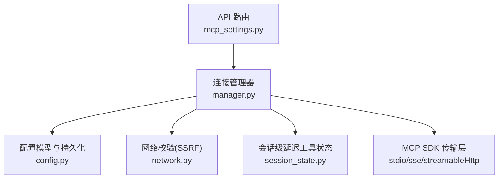
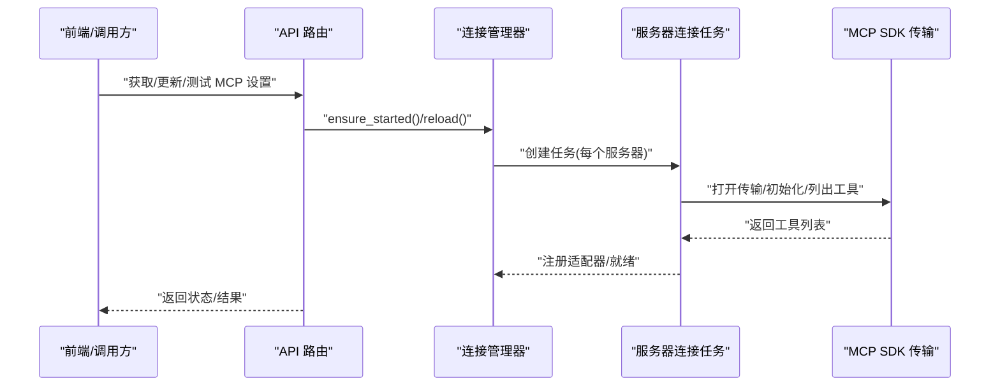
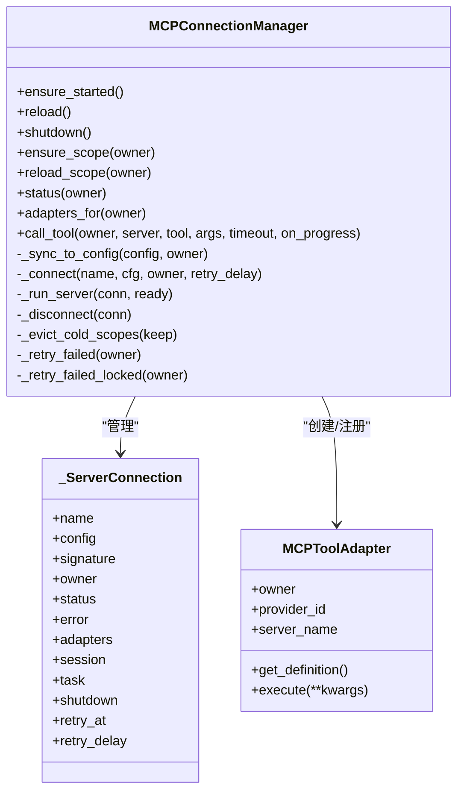
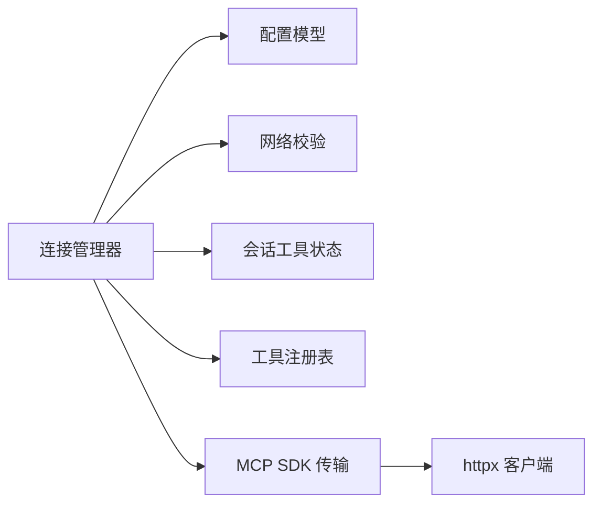

# 连接池管理

<cite>
**本文引用的文件**
- [manager.py](file://deeptutor/services/mcp/manager.py)
- [config.py](file://deeptutor/services/mcp/config.py)
- [network.py](file://deeptutor/services/mcp/network.py)
- [session_state.py](file://deeptutor/services/mcp/session_state.py)
- [mcp_settings.py](file://deeptutor/api/routers/mcp_settings.py)
- [__init__.py](file://deeptutor/services/mcp/__init__.py)
</cite>

## 目录
1. [简介](#简介)
2. [项目结构](#项目结构)
3. [核心组件](#核心组件)
4. [架构总览](#架构总览)
5. [详细组件分析](#详细组件分析)
6. [依赖关系分析](#依赖关系分析)
7. [性能考虑](#性能考虑)
8. [故障诊断指南](#故障诊断指南)
9. [结论](#结论)
10. [附录](#附录)

## 简介
本文件面向 DeepTutor 的 MCP（Model Context Protocol）连接池管理，系统性说明连接对象的创建、配置与生命周期管理；连接复用机制与避免重复连接和资源浪费的策略；连接池大小限制与内存优化；连接状态跟踪与健康检查；以及连接超时、重试与错误处理等调优要点。同时提供监控指标与故障诊断方法，帮助运维与开发者高效定位问题并优化系统稳定性与吞吐。

## 项目结构
MCP 连接池相关代码集中在 services/mcp 模块中，由管理器统一维护进程内所有已配置的 MCP 服务器连接，并通过工具适配器将远端工具暴露为聊天工具。配置通过 Pydantic 模型持久化，网络访问受 SSRF 防护约束，会话级延迟加载的工具清单可被缓存以减少重复开销。

图表来源
- [mcp_settings.py:57-78](file://deeptutor/api/routers/mcp_settings.py#L57-L78)
- [manager.py:216-300](file://deeptutor/services/mcp/manager.py#L216-L300)
- [config.py:31-103](file://deeptutor/services/mcp/config.py#L31-L103)
- [network.py:69-118](file://deeptutor/services/mcp/network.py#L69-L118)
- [session_state.py:23-59](file://deeptutor/services/mcp/session_state.py#L23-L59)

章节来源
- [manager.py:1-863](file://deeptutor/services/mcp/manager.py#L1-L863)
- [config.py:1-163](file://deeptutor/services/mcp/config.py#L1-L163)
- [network.py:1-122](file://deeptutor/services/mcp/network.py#L1-L122)
- [session_state.py:1-60](file://deeptutor/services/mcp/session_state.py#L1-L60)
- [mcp_settings.py:37-133](file://deeptutor/api/routers/mcp_settings.py#L37-L133)
- [__init__.py:1-33](file://deeptutor/services/mcp/__init__.py#L1-L33)

## 核心组件
- 连接管理器：进程单例，负责按“所有者(owner)+服务器名”维度组织连接、任务与状态，提供懒启动、重载、关闭、工具调用与状态查询能力。
- 服务器配置：Pydantic 模型描述传输类型、命令/URL、头信息、工具白名单/黑名单、超时、认证方式等，并提供签名用于热重载时检测变更。
- 网络校验：对远程传输进行 SSRF 防护，区分管理员部署与用户自服务两种安全策略，并在连接时再次校验。
- 会话级延迟工具状态：记录每个会话已加载的延迟工具集合，避免重复加载导致的额外开销。
- API 路由：提供获取/更新/删除/测试 MCP 设置的能力，并在保存后触发连接管理器重载。

章节来源
- [manager.py:216-442](file://deeptutor/services/mcp/manager.py#L216-L442)
- [config.py:31-103](file://deeptutor/services/mcp/config.py#L31-L103)
- [network.py:69-118](file://deeptutor/services/mcp/network.py#L69-L118)
- [session_state.py:23-59](file://deeptutor/services/mcp/session_state.py#L23-L59)
- [mcp_settings.py:57-133](file://deeptutor/api/routers/mcp_settings.py#L57-L133)

## 架构总览
连接池以“每服务器一个连接任务”的方式运行，每个任务持有 AsyncExitStack 管理传输与会话生命周期。管理器在首次调用时懒启动连接，后续仅重试失败且退避到期的连接；支持按 owner 隔离作用域，并对冷作用域进行空闲回收，控制进程内连接总数与内存占用。

图表来源
- [mcp_settings.py:57-78](file://deeptutor/api/routers/mcp_settings.py#L57-L78)
- [manager.py:243-263](file://deeptutor/services/mcp/manager.py#L243-L263)
- [manager.py:493-589](file://deeptutor/services/mcp/manager.py#L493-L589)

## 详细组件分析

### 连接管理器（MCPConnectionManager）
- 职责
  - 维护连接字典（键为 (owner, server_name)），按 owner 粒度加锁避免串行阻塞。
  - 懒启动 ensure_started：首次调用加载配置并建立连接，之后仅重试失败且退避到期的连接。
  - reload：读取最新配置并与当前连接做 diff，仅重启实际变更的服务器。
  - ensure_scope/reload_scope：按用户作用域加载用户配置，必要时重建连接，并记录最近使用时间以便空闲回收。
  - call_tool：执行工具调用，带超时与一次瞬态错误重试，封装进度回调与异常处理。
  - 状态查询 status/adapters_for：供设置界面与调度器使用。
- 生命周期
  - _connect：创建 _ServerConnection，启动后台任务 _run_server，等待 ready 或超时/异常，成功后注册适配器。
  - _run_server：进入 AsyncExitStack，打开传输、创建 ClientSession、initialize、list_tools，构建 MCPToolAdapter 列表，挂起等待 shutdown 事件。
  - _disconnect：注销适配器、触发 shutdown、等待任务结束或取消，清理状态。
- 大小限制与内存优化
  - 最大作用域数：_MAX_OWNER_SCOPES=64，超出时按最近使用时间淘汰最冷的作用域。
  - 空闲 TTL：_SCOPE_IDLE_TTL_S=900s，超过此时间未使用的 owner 将被回收。
  - 冷作用域回收：在新增作用域时触发，断开其所有连接并释放锁与状态。
- 健康检查与重试
  - 连接失败标记 error，记录 retry_at 与指数退避 delay（初始 30s，上限 300s）。
  - 每次 ensure_started/ensure_scope 会尝试重连到期失败的连接。
- 工具适配器
  - MCPToolAdapter：包装为 BaseTool，deferred=true，provider_kind="mcp"，execute 委托给 manager.call_tool。
  - 仅管理员部署的连接（owner=SHARED_OWNER）注册到全局工具注册表；用户作用域的连接通过作用域注册表隔离，避免同名覆盖。

图表来源
- [manager.py:89-154](file://deeptutor/services/mcp/manager.py#L89-L154)
- [manager.py:197-239](file://deeptutor/services/mcp/manager.py#L197-L239)
- [manager.py:243-442](file://deeptutor/services/mcp/manager.py#L243-L442)
- [manager.py:493-589](file://deeptutor/services/mcp/manager.py#L493-L589)

章节来源
- [manager.py:89-154](file://deeptutor/services/mcp/manager.py#L89-L154)
- [manager.py:197-239](file://deeptutor/services/mcp/manager.py#L197-L239)
- [manager.py:243-442](file://deeptutor/services/mcp/manager.py#L243-L442)
- [manager.py:493-589](file://deeptutor/services/mcp/manager.py#L493-L589)
- [manager.py:710-753](file://deeptutor/services/mcp/manager.py#L710-L753)

### 配置模型（MCPServerConfig/MCPConfig）
- 字段与行为
  - type/command/url/headers/tool_timeout/enabled_tools/disabled_tools/auth/catalog_entry/enabled。
  - resolved_type：自动推断传输类型（command→stdio；url 结尾 /sse→sse；否则 streamableHttp）。
  - connection_signature：生成稳定指纹，用于 reload 检测变更（排除 catalog_entry）。
  - tool_allowed：基于 enabled_tools 与 disabled_tools 过滤工具。
- 持久化
  - load_mcp_config/save_mcp_config：原子写入 mcp.json，失败回退为空配置，保证高可用。
- 名称校验
  - 服务器名正则限制，防止非法字符。

章节来源
- [config.py:31-103](file://deeptutor/services/mcp/config.py#L31-L103)
- [config.py:116-153](file://deeptutor/services/mcp/config.py#L116-L153)

### 网络校验（SSRF 防护）
- 策略
  - 管理员部署：允许本地/LAN，但阻止链路本地/云元数据地址与 0.0.0.0/8。
  - 用户自服务（strict=True）：额外阻止环回与私有网段，防止应用进程被恶意 URL 指向内部资源。
- 实现
  - validate_mcp_url/validate_mcp_url_async：解析 scheme、hostname，DNS 解析后检查 IP 是否在阻断列表。
  - 连接前再次校验，避免保存时合法而运行时 DNS 变化导致的安全风险。

章节来源
- [network.py:1-122](file://deeptutor/services/mcp/network.py#L1-L122)

### 会话级延迟工具状态
- 目的
  - 记录会话已加载的延迟工具集合，避免重复加载导致的额外开销。
- 实现
  - 读写 session workspace 下的 loaded_tools.json，多用户安全（路径服务按上下文解析）。
  - 读取失败或格式异常时降级为空集合，不影响主流程。

章节来源
- [session_state.py:23-59](file://deeptutor/services/mcp/session_state.py#L23-L59)

### API 路由集成
- 获取设置：加载配置并触发 ensure_started，返回服务器配置与连接状态。
- 更新设置：校验配置与 URL，原子保存后触发 reload，返回新状态。
- 删除服务器：从配置移除并触发 reload。
- 测试服务器：一次性 probe_server，复用真实连接的校验与安全策略。

章节来源
- [mcp_settings.py:37-133](file://deeptutor/api/routers/mcp_settings.py#L37-L133)

## 依赖关系分析
- 管理器依赖
  - 配置模块：加载/保存配置、生成签名、工具白黑名单。
  - 网络模块：连接前 URL 校验（用户自服务严格模式）。
  - 会话状态：可选地记录已加载工具，减少重复开销。
  - 工具注册表：仅管理员部署的连接注册到全局注册表，用户作用域通过作用域注册表隔离。
- 外部依赖
  - MCP SDK：ClientSession、传输客户端（stdio/sse/streamableHttp）、工具列表与调用。
  - httpx：HTTP 客户端用于 SSE/Streamable HTTP 传输，设置超时与鉴权。

图表来源
- [manager.py:493-708](file://deeptutor/services/mcp/manager.py#L493-L708)
- [config.py:31-103](file://deeptutor/services/mcp/config.py#L31-L103)
- [network.py:69-118](file://deeptutor/services/mcp/network.py#L69-L118)
- [session_state.py:23-59](file://deeptutor/services/mcp/session_state.py#L23-L59)

章节来源
- [manager.py:493-708](file://deeptutor/services/mcp/manager.py#L493-L708)
- [config.py:31-103](file://deeptutor/services/mcp/config.py#L31-L103)
- [network.py:69-118](file://deeptutor/services/mcp/network.py#L69-L118)
- [session_state.py:23-59](file://deeptutor/services/mcp/session_state.py#L23-L59)

## 性能考虑
- 连接复用与避免重复连接
  - 每服务器一个连接任务，复用同一 session；工具适配器复用同一连接，避免重复握手与鉴权。
  - 通过 connection_signature 检测配置变更，仅重启必要连接，降低抖动。
- 大小限制与内存优化
  - 最大作用域数限制（64）与空闲 TTL（900s）结合，及时回收冷作用域，控制进程内存与连接数。
  - 用户作用域不注册到全局工具注册表，避免命名冲突与不必要的注册/注销成本。
- 超时与重试
  - 连接超时：默认 15s，避免长时间阻塞。
  - 工具调用超时：可配置（tool_timeout，范围 1-600s），配合 httpx 的 connect 超时（10s）与整体超时（60s）保障响应性。
  - 瞬态错误重试：对 BrokenPipeError/ConnectionResetError 进行一次重试，提升鲁棒性。
- 进度与可观测性
  - 进度回调将服务器进度转换为 trace 事件，便于追踪长耗时任务的进展。
- 建议
  - 根据业务负载调整 tool_timeout 与连接超时；在高并发场景下关注 _MAX_OWNER_SCOPES 与 _SCOPE_IDLE_TTL_S 的平衡。
  - 对高频工具调用，确保启用延迟工具状态缓存，减少重复加载。

[本节为通用指导，无需特定文件引用]

## 故障诊断指南
- 常见问题定位
  - 连接失败：查看 status 中的 error 字段，describe_connect_failure 会展开异常组并给出可读原因。
  - 需要授权：当检测到 AuthorizationRequired，状态设为 needs_auth，提示交互授权而非自动重试。
  - 瞬态错误：日志记录并重试一次；若仍失败，返回包含异常类型的消息。
  - 超时：连接或工具调用超时会返回明确提示，便于排查网络或服务端性能问题。
- 诊断步骤
  - 使用 API 的测试端点 probe_server 验证连通性与工具列表。
  - 检查配置是否正确（resolved_type、enabled_tools、disabled_tools）。
  - 确认网络校验是否拦截（SSRF 规则），尤其是用户自服务的 strict 模式。
  - 观察连接任务日志，确认 _run_server 是否正常完成 initialize 与 list_tools。
- 恢复策略
  - 修改配置后调用 reload，管理器会 diff 并重启变更服务器。
  - 对失败连接，等待退避到期后自动重试；也可通过 ensure_started/ensure_scope 主动触发。

章节来源
- [manager.py:534-589](file://deeptutor/services/mcp/manager.py#L534-L589)
- [manager.py:755-843](file://deeptutor/services/mcp/manager.py#L755-L843)
- [mcp_settings.py:121-133](file://deeptutor/api/routers/mcp_settings.py#L121-L133)

## 结论
DeepTutor 的 MCP 连接池以“每服务器一任务”的模式实现健壮的生命周期管理，通过懒启动、配置 diff、作用域隔离与空闲回收，有效控制连接数量与内存占用。结合严格的网络校验、合理的超时与重试策略，以及可观测的进度与状态反馈，系统在多租户与高并发场景下具备良好稳定性与可维护性。建议在生产环境中依据负载特征调优超时与回收参数，并结合测试与日志持续优化。

[本节为总结，无需特定文件引用]

## 附录
- 关键常量与阈值
  - 连接超时：15s
  - 工具超时：1-600s（可配置）
  - 最大作用域数：64
  - 空闲 TTL：900s
  - 重试退避：初始 30s，上限 300s
- 传输类型
  - stdio：管理员部署专用
  - sse/streamableHttp：支持 OAuth 与 HTTP 头，需通过 URL 校验
- 工具过滤
  - enabled_tools/disabled_tools 支持通配符与原始/包装名匹配

[本节为补充信息，无需特定文件引用]