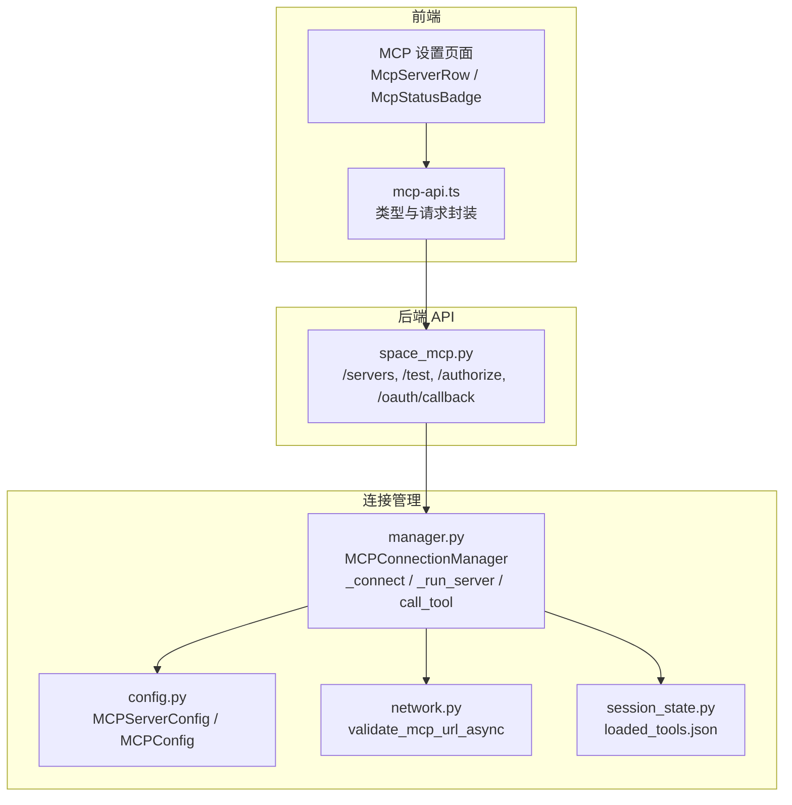
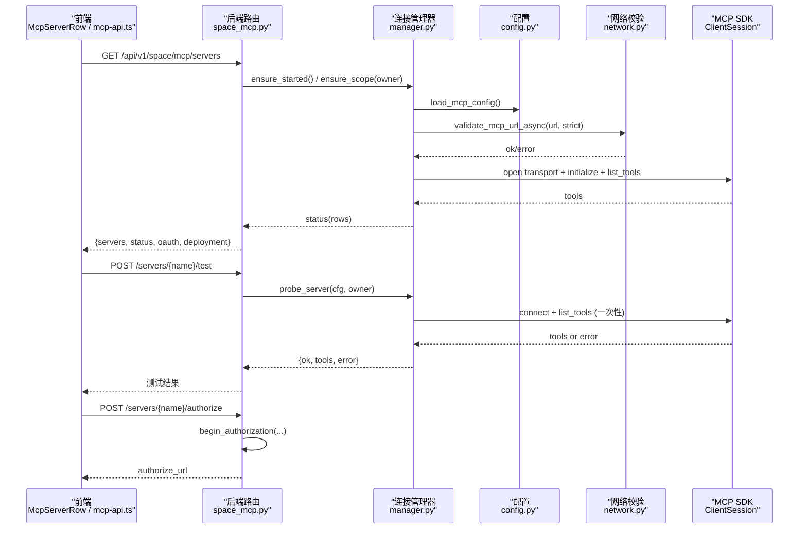
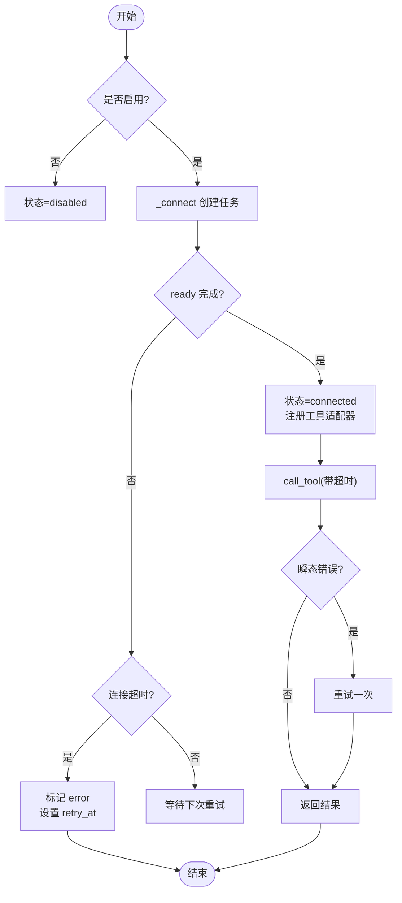
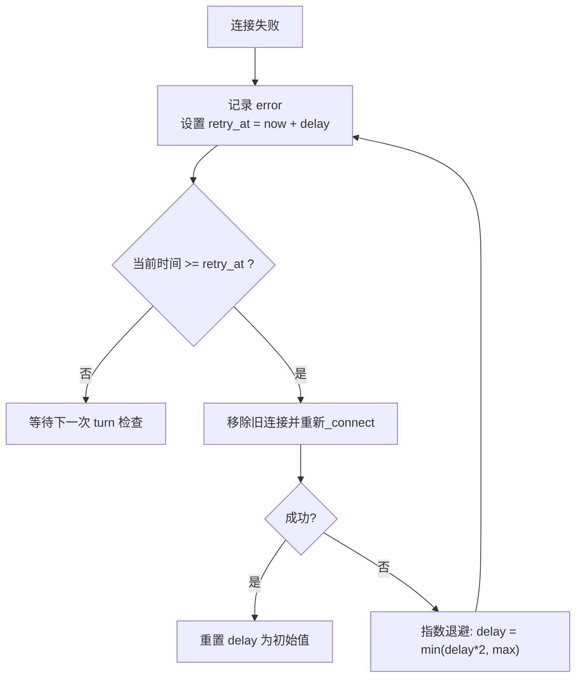
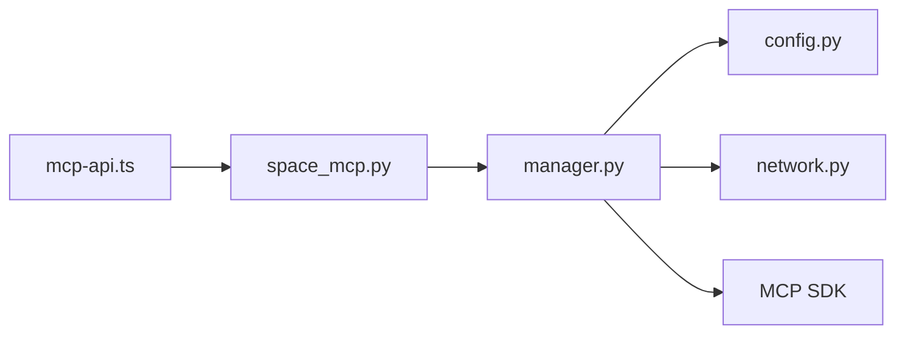

# 连接监控

<cite>
**本文引用的文件**
- [manager.py](file://deeptutor/services/mcp/manager.py)
- [network.py](file://deeptutor/services/mcp/network.py)
- [space_mcp.py](file://deeptutor/api/routers/space_mcp.py)
- [config.py](file://deeptutor/services/mcp/config.py)
- [session_state.py](file://deeptutor/services/mcp/session_state.py)
- [McpServerRow.tsx](file://web/components/mcp/McpServerRow.tsx)
- [McpStatusBadge.tsx](file://web/components/mcp/McpStatusBadge.tsx)
- [mcp-api.ts](file://web/lib/mcp-api.ts)
</cite>

## 目录
1. [简介](#简介)
2. [项目结构](#项目结构)
3. [核心组件](#核心组件)
4. [架构总览](#架构总览)
5. [详细组件分析](#详细组件分析)
6. [依赖关系分析](#依赖关系分析)
7. [性能考量](#性能考量)
8. [故障排查指南](#故障排查指南)
9. [结论](#结论)
10. [附录](#附录)

## 简介
本文件面向 DeepTutor 的 MCP（Model Context Protocol）连接监控系统，聚焦以下目标：
- 连接状态监控：实时跟踪连接的建立、断开与异常状态。
- 性能指标收集：围绕连接延迟、工具调用耗时、错误率等关键指标的统计与分析方法。
- 健康检查机制：定期检测连接质量与自动故障发现（含退避重试）。
- 监控数据可视化：连接状态仪表板、性能趋势图与告警通知的实现思路。
- 监控告警配置：阈值设置、通知渠道与告警级别建议。
- 数据存储与查询接口：历史数据的存储位置与查询方式，支持问题排查与回溯。

## 项目结构
DeepTutor 的 MCP 监控由后端连接管理器、网络校验、API 路由以及前端展示层共同构成：
- 后端连接管理：负责生命周期管理、连接重试、工具适配与状态暴露。
- 网络与安全：对远程地址进行严格校验，防止 SSRF 等风险。
- API 路由：提供服务器列表、测试、OAuth 授权回调等能力，并返回统一的状态视图。
- 前端界面：以行级卡片和状态徽章展示连接状态、工具数量、错误信息，并提供操作入口。

图表来源
- [space_mcp.py:92-135](file://deeptutor/api/routers/space_mcp.py#L92-L135)
- [manager.py:216-298](file://deeptutor/services/mcp/manager.py#L216-L298)
- [config.py:31-103](file://deeptutor/services/mcp/config.py#L31-L103)
- [network.py:69-118](file://deeptutor/services/mcp/network.py#L69-L118)
- [session_state.py:23-59](file://deeptutor/services/mcp/session_state.py#L23-L59)
- [mcp-api.ts:478-530](file://web/lib/mcp-api.ts#L478-L530)

章节来源
- [space_mcp.py:92-135](file://deeptutor/api/routers/space_mcp.py#L92-L135)
- [manager.py:216-298](file://deeptutor/services/mcp/manager.py#L216-L298)
- [config.py:31-103](file://deeptutor/services/mcp/config.py#L31-L103)
- [network.py:69-118](file://deeptutor/services/mcp/network.py#L69-L118)
- [session_state.py:23-59](file://deeptutor/services/mcp/session_state.py#L23-L59)
- [mcp-api.ts:478-530](file://web/lib/mcp-api.ts#L478-L530)

## 核心组件
- 连接管理器（MCPConnectionManager）
  - 职责：维护每个已配置服务器的连接生命周期；按 owner 隔离作用域；提供状态查询、工具调用、重试与优雅关闭。
  - 关键能力：
    - 确保启动与重载：ensure_started/reload，懒加载并在首次 turn 时建立连接。
    - 连接任务：_run_server 持有 AsyncExitStack，完成传输打开、会话初始化、工具列举与注册。
    - 工具调用：call_tool 带超时与一次瞬态错误重试，并将进度事件注入 trace。
    - 状态暴露：status 返回每行的 name、transport、status、error、tools。
- 配置模型（MCPServerConfig / MCPConfig）
  - 职责：描述服务器类型（stdio/sse/streamableHttp）、命令/URL/头、工具白黑名单、超时、认证模式等；提供连接签名用于变更检测。
- 网络校验（validate_mcp_url_async）
  - 职责：在连接前对 URL 进行 scheme、hostname、DNS 解析与地址段拦截（含严格模式），避免 SSRF。
- API 路由（space_mcp.py）
  - 职责：列出用户与部署端服务器、测试连接、发起 OAuth 授权、处理回调；返回统一的状态视图，便于前端渲染。
- 会话状态（session_state.py）
  - 职责：记录每个聊天会话中已加载的延迟工具集合，避免重复加载，提升后续 turn 的性能。
- 前端展示（McpServerRow / McpStatusBadge / mcp-api.ts）
  - 职责：将后端状态映射为“已连接/连接中/错误/需授权/禁用”等标签，显示工具数量、错误提示，并提供编辑、删除、授权等操作。

章节来源
- [manager.py:89-194](file://deeptutor/services/mcp/manager.py#L89-L194)
- [manager.py:216-298](file://deeptutor/services/mcp/manager.py#L216-L298)
- [manager.py:371-441](file://deeptutor/services/mcp/manager.py#L371-L441)
- [config.py:31-103](file://deeptutor/services/mcp/config.py#L31-L103)
- [network.py:69-118](file://deeptutor/services/mcp/network.py#L69-L118)
- [space_mcp.py:92-135](file://deeptutor/api/routers/space_mcp.py#L92-L135)
- [session_state.py:23-59](file://deeptutor/services/mcp/session_state.py#L23-L59)
- [McpServerRow.tsx:25-176](file://web/components/mcp/McpServerRow.tsx#L25-L176)
- [McpStatusBadge.tsx:7-42](file://web/components/mcp/McpStatusBadge.tsx#L7-L42)
- [mcp-api.ts:5-12](file://web/lib/mcp-api.ts#L5-L12)
- [mcp-api.ts:217-223](file://web/lib/mcp-api.ts#L217-L223)

## 架构总览
下图展示了从前端到后端的完整调用链，包括连接建立、工具调用与健康检查的关键路径。

图表来源
- [space_mcp.py:92-135](file://deeptutor/api/routers/space_mcp.py#L92-L135)
- [space_mcp.py:169-205](file://deeptutor/api/routers/space_mcp.py#L169-L205)
- [space_mcp.py:255-271](file://deeptutor/api/routers/space_mcp.py#L255-L271)
- [manager.py:243-263](file://deeptutor/services/mcp/manager.py#L243-L263)
- [manager.py:493-533](file://deeptutor/services/mcp/manager.py#L493-L533)
- [manager.py:755-792](file://deeptutor/services/mcp/manager.py#L755-L792)
- [network.py:108-118](file://deeptutor/services/mcp/network.py#L108-L118)

## 详细组件分析

### 连接状态监控（建立、断开、异常）
- 连接建立流程
  - 通过 ensure_started/ensure_scope 触发连接；按 owner 加锁避免串行化所有转轮。
  - _connect 创建连接任务，等待 ready 或超时；成功后标记 connected 并注册工具适配器。
  - 失败时记录 error 并进入退避重试队列。
- 连接断开流程
  - shutdown 或配置变更导致 _disconnect：取消任务、清理适配器、置为 disabled。
  - 运行中会话异常退出会卸载适配器并标记 error。
- 异常状态
  - 需要授权（needs_auth）：区分于 error，UI 提供“连接”按钮引导 OAuth。
  - 瞬态错误：调用时捕获 BrokenPipeError/ConnectionResetError 并重试一次。
  - 超时：连接与工具调用均设超时保护。

图表来源
- [manager.py:243-263](file://deeptutor/services/mcp/manager.py#L243-L263)
- [manager.py:493-533](file://deeptutor/services/mcp/manager.py#L493-L533)
- [manager.py:542-588](file://deeptutor/services/mcp/manager.py#L542-L588)
- [manager.py:404-441](file://deeptutor/services/mcp/manager.py#L404-L441)

章节来源
- [manager.py:216-298](file://deeptutor/services/mcp/manager.py#L216-L298)
- [manager.py:371-441](file://deeptutor/services/mcp/manager.py#L371-L441)
- [manager.py:493-533](file://deeptutor/services/mcp/manager.py#L493-L533)
- [manager.py:542-588](file://deeptutor/services/mcp/manager.py#L542-L588)

### 性能指标收集（延迟、吞吐量、错误率）
- 连接延迟
  - 连接阶段：_connect 使用固定超时（默认秒级），可据此估算连接耗时；探针 probe_server 也受相同超时约束。
  - 工具调用延迟：call_tool 使用 per-tool 超时，可通过上层埋点记录起止时间计算延迟分布。
- 吞吐量
  - 并发控制：按 owner 粒度加锁，避免跨租户阻塞；冷作用域会被惰性驱逐，限制进程内最大活跃会话数。
  - 工具列表加载：list_tools 仅在连接建立时执行一次，减少重复开销。
- 错误率
  - 分类统计：连接错误（DNS/网络/鉴权）、调用错误（超时/取消/业务异常）、瞬态错误（重试成功/失败）。
  - 观测点：status.rows.error 字段、日志中的警告/异常、trace 中的 tool_progress 事件。

说明
- 当前代码未内置持久化的时序指标库；建议在应用层（如 trace 或日志）采集“连接耗时、调用耗时、错误计数”，再汇聚至监控系统（例如 Prometheus/时序数据库）。

章节来源
- [manager.py:51-81](file://deeptutor/services/mcp/manager.py#L51-L81)
- [manager.py:319-347](file://deeptutor/services/mcp/manager.py#L319-L347)
- [manager.py:404-441](file://deeptutor/services/mcp/manager.py#L404-L441)
- [manager.py:755-792](file://deeptutor/services/mcp/manager.py#L755-L792)

### 健康检查机制（定期检测与自动故障发现）
- 自动重试与退避
  - 失败连接会在后续 turn 中按指数退避重试（初始秒级，上限分钟级），避免永久失效。
  - 每次失败更新 retry_at 与 retry_delay，到期后再尝试。
- 连接保活与驱逐
  - 作用域空闲 TTL 与最大作用域数限制，保证多租户下资源可控。
  - 冷作用域在有新作用域到达时被惰性驱逐，释放连接。
- 安全健康检查
  - 连接前再次校验 URL（含 DNS 解析与地址段拦截），防止保存时合法但连接时非法的情况。

图表来源
- [manager.py:348-370](file://deeptutor/services/mcp/manager.py#L348-L370)
- [manager.py:534-541](file://deeptutor/services/mcp/manager.py#L534-L541)
- [network.py:69-118](file://deeptutor/services/mcp/network.py#L69-L118)

章节来源
- [manager.py:319-370](file://deeptutor/services/mcp/manager.py#L319-L370)
- [manager.py:534-541](file://deeptutor/services/mcp/manager.py#L534-L541)
- [network.py:69-118](file://deeptutor/services/mcp/network.py#L69-L118)

### 监控数据可视化（状态仪表板、趋势图、告警）
- 状态仪表板
  - 后端通过 /servers 返回 servers、status、configured_secrets、oauth、deployment、limits。
  - 前端根据 mcpRowStatus 将 enabled 与后端状态组合为最终显示状态（禁用优先）。
  - McpStatusBadge 将状态映射为“已连接/连接中/错误/需授权/禁用”及对应颜色点。
- 性能趋势图
  - 建议基于 trace 或日志采集“连接耗时、调用耗时、错误计数”，绘制折线/柱状图。
  - 可将 tool_progress 事件作为长任务进度可视化依据。
- 告警通知
  - 当 status 持续为 error 或 needs_auth 超过阈值时触发告警。
  - 结合错误率（单位时间内失败次数/总调用次数）与连接失败率（连接失败次数/连接尝试次数）制定规则。

章节来源
- [space_mcp.py:92-135](file://deeptutor/api/routers/space_mcp.py#L92-L135)
- [mcp-api.ts:217-223](file://web/lib/mcp-api.ts#L217-L223)
- [McpStatusBadge.tsx:7-42](file://web/components/mcp/McpStatusBadge.tsx#L7-L42)
- [manager.py:371-394](file://deeptutor/services/mcp/manager.py#L371-L394)

### 监控告警配置（阈值、渠道、级别）
- 阈值建议
  - 连接失败率：连续 N 次失败或 X 分钟内失败率 > Y%。
  - 工具调用错误率：单位时间错误率 > Z%。
  - 长时间无进展：tool_progress 长时间无更新视为卡住。
- 通知渠道
  - 邮件/IM/短信/系统通知等，按严重级别选择。
- 告警级别
  - 紧急：连接不可用且影响核心功能。
  - 重要：部分工具不可用或频繁失败。
  - 一般：需授权但未阻断流程。

说明
- 具体实现可在现有日志/trace 基础上接入外部告警系统；当前仓库未包含内置告警模块。

[本节为通用指导，不直接分析具体文件]

### 监控数据存储与查询接口（历史分析与排查）
- 存储位置
  - 会话级延迟工具清单：session_state.py 将 loaded_tools 写入会话工作区的 JSON 文件。
  - 服务器配置：config.py 原子写入 mcp.json（管理员范围）。
  - 用户侧配置：user_config 模块（与本文件同包）按用户隔离存储。
- 查询接口
  - 后端：/api/v1/space/mcp/servers 返回当前状态；/api/v1/settings/mcp 返回部署端配置与状态。
  - 前端：mcp-api.ts 提供 getSpaceMcpState/getMcpSettings/testMcpServer 等方法。
- 历史分析
  - 建议将连接/调用指标写入时序数据库或日志聚合平台，以便按时间维度回溯。
  - 结合 session_id 与 server_name 维度，定位特定会话与服务的异常。

章节来源
- [session_state.py:23-59](file://deeptutor/services/mcp/session_state.py#L23-L59)
- [config.py:116-152](file://deeptutor/services/mcp/config.py#L116-L152)
- [space_mcp.py:92-135](file://deeptutor/api/routers/space_mcp.py#L92-L135)
- [mcp-api.ts:478-530](file://web/lib/mcp-api.ts#L478-L530)

## 依赖关系分析
- 组件耦合
  - space_mcp.py 依赖 manager.py 获取状态与执行探测；manager.py 依赖 config.py 读取配置、network.py 做安全校验。
  - 前端 mcp-api.ts 与后端路由保持契约一致（servers/status/oauth 等字段）。
- 外部依赖
  - MCP SDK（mcp.client.sse / streamable_http / stdio）用于建立传输与会话。
  - httpx 用于 HTTP 客户端与超时控制。
- 潜在循环依赖
  - 通过延迟导入（from ... import ...）避免启动时强依赖可选包，降低耦合。

图表来源
- [space_mcp.py:92-135](file://deeptutor/api/routers/space_mcp.py#L92-L135)
- [manager.py:243-263](file://deeptutor/services/mcp/manager.py#L243-L263)
- [manager.py:610-708](file://deeptutor/services/mcp/manager.py#L610-L708)
- [mcp-api.ts:478-530](file://web/lib/mcp-api.ts#L478-L530)

章节来源
- [space_mcp.py:92-135](file://deeptutor/api/routers/space_mcp.py#L92-L135)
- [manager.py:610-708](file://deeptutor/services/mcp/manager.py#L610-L708)
- [mcp-api.ts:478-530](file://web/lib/mcp-api.ts#L478-L530)

## 性能考量
- 连接与调用超时
  - 连接超时与工具调用超时分离，避免短连接阻塞长任务。
- 并发与隔离
  - 按 owner 加锁，避免跨租户串行；冷作用域惰性驱逐，限制最大活跃会话数。
- 工具列表缓存
  - 连接建立后仅一次 list_tools；会话级 loaded_tools 避免重复加载。
- 网络校验
  - DNS 解析放在线程池中执行，避免阻塞事件循环。

[本节为通用指导，不直接分析具体文件]

## 故障排查指南
- 常见问题定位
  - 连接失败：查看 status.rows.error 与日志中的连接失败原因（DNS/网络/鉴权）。
  - 需要授权：状态为 needs_auth 时，引导用户完成 OAuth 授权。
  - 工具调用失败：检查超时、取消、业务异常；关注瞬态错误是否重试成功。
- 诊断步骤
  - 使用 /servers/{name}/test 进行连通性测试，确认配置与凭据。
  - 检查 network 校验是否拒绝（SSRF/私有地址）。
  - 观察 tool_progress 事件，判断长任务是否卡住。
- 恢复策略
  - 修正配置或凭据后，reload_scope 或等待自动重试。
  - 必要时重启服务以清理残留连接。

章节来源
- [space_mcp.py:255-271](file://deeptutor/api/routers/space_mcp.py#L255-L271)
- [manager.py:493-533](file://deeptutor/services/mcp/manager.py#L493-L533)
- [manager.py:404-441](file://deeptutor/services/mcp/manager.py#L404-L441)
- [network.py:69-118](file://deeptutor/services/mcp/network.py#L69-L118)

## 结论
DeepTutor 的 MCP 连接监控以连接管理器为核心，配合网络校验、API 路由与前端展示，实现了连接状态的实时可见性与可操作性的闭环。通过退避重试、作用域隔离与工具列表缓存，系统在多租户场景下具备较好的稳定性与性能。建议在此基础上引入统一的指标采集与告警体系，以进一步提升可观测性与运维效率。

[本节为总结性内容，不直接分析具体文件]

## 附录
- 关键接口速查
  - 获取用户视角状态：GET /api/v1/space/mcp/servers
  - 测试服务器：POST /api/v1/space/mcp/servers/{name}/test
  - 发起授权：POST /api/v1/space/mcp/servers/{name}/authorize
  - 授权回调：GET /api/v1/space/mcp/oauth/callback
- 前端类型与工具
  - mcpRowStatus：将 enabled 与后端状态合并为最终显示状态。
  - normalizeStoreState：规范化后端返回的用户视图。

章节来源
- [space_mcp.py:92-135](file://deeptutor/api/routers/space_mcp.py#L92-L135)
- [space_mcp.py:169-205](file://deeptutor/api/routers/space_mcp.py#L169-L205)
- [mcp-api.ts:217-223](file://web/lib/mcp-api.ts#L217-L223)
- [mcp-api.ts:435-473](file://web/lib/mcp-api.ts#L435-L473)