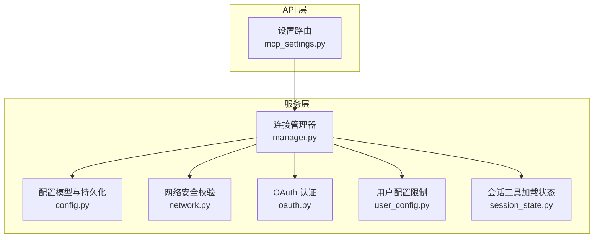
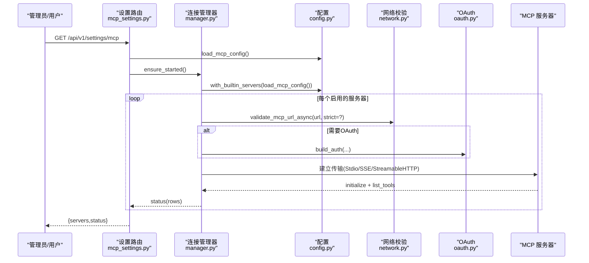
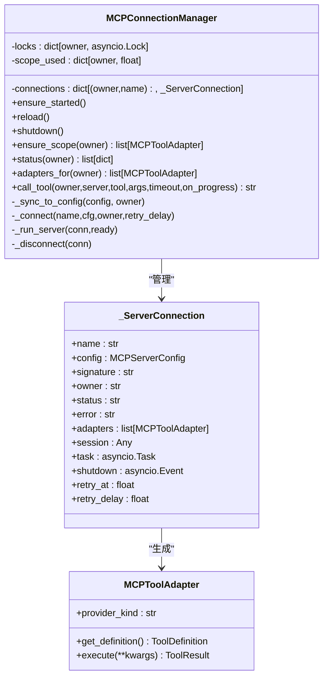
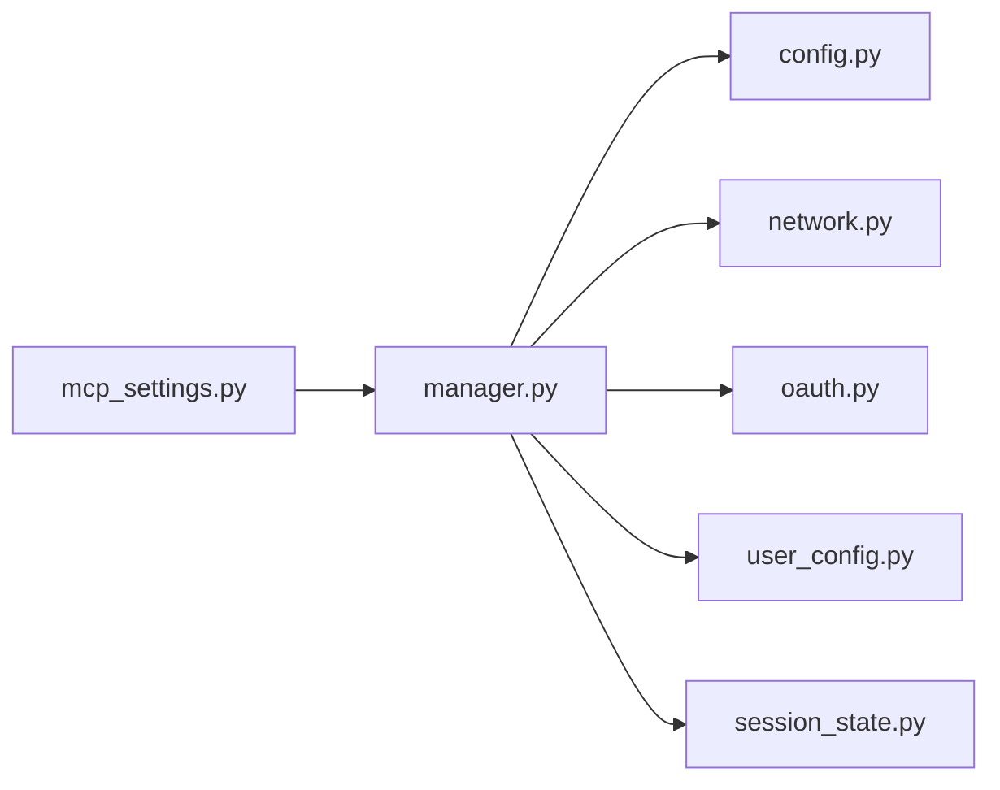

# 连接管理

<cite>
**本文引用的文件**
- [manager.py](file://deeptutor/services/mcp/manager.py)
- [config.py](file://deeptutor/services/mcp/config.py)
- [network.py](file://deeptutor/services/mcp/network.py)
- [oauth.py](file://deeptutor/services/mcp/oauth.py)
- [user_config.py](file://deeptutor/services/mcp/user_config.py)
- [session_state.py](file://deeptutor/services/mcp/session_state.py)
- [mcp_settings.py](file://deeptutor/api/routers/mcp_settings.py)
</cite>

## 目录
1. [简介](#简介)
2. [项目结构](#项目结构)
3. [核心组件](#核心组件)
4. [架构总览](#架构总览)
5. [详细组件分析](#详细组件分析)
6. [依赖关系分析](#依赖关系分析)
7. [性能与资源特性](#性能与资源特性)
8. [故障诊断与日志分析](#故障诊断与日志分析)
9. [最佳实践与常见问题](#最佳实践与常见问题)
10. [结论](#结论)

## 简介
本文件面向 DeepTutor 的 MCP（Model Context Protocol）连接管理子系统，系统性说明连接管理器的工作机制、连接池与复用策略、多租户隔离、自动重连与退避算法、状态监控与指标收集、以及故障诊断与优化建议。目标是帮助开发者与运维人员理解并高效维护该子系统。

## 项目结构
MCP 连接管理位于 services/mcp 模块，配合 API 路由提供配置管理与探测能力；用户侧配置与安全校验由 user_config 与 network 模块负责；OAuth 认证流程由 oauth 模块实现；会话级工具加载状态由 session_state 持久化。

**图表来源**
- [manager.py:216-753](file://deeptutor/services/mcp/manager.py#L216-L753)
- [config.py:31-163](file://deeptutor/services/mcp/config.py#L31-L163)
- [network.py:1-122](file://deeptutor/services/mcp/network.py#L1-L122)
- [oauth.py:1-439](file://deeptutor/services/mcp/oauth.py#L1-L439)
- [user_config.py:1-234](file://deeptutor/services/mcp/user_config.py#L1-L234)
- [session_state.py:1-60](file://deeptutor/services/mcp/session_state.py#L1-L60)
- [mcp_settings.py:1-134](file://deeptutor/api/routers/mcp_settings.py#L1-L134)

**章节来源**
- [manager.py:1-863](file://deeptutor/services/mcp/manager.py#L1-L863)
- [config.py:1-163](file://deeptutor/services/mcp/config.py#L1-L163)
- [network.py:1-122](file://deeptutor/services/mcp/network.py#L1-L122)
- [oauth.py:1-439](file://deeptutor/services/mcp/oauth.py#L1-L439)
- [user_config.py:1-234](file://deeptutor/services/mcp/user_config.py#L1-L234)
- [session_state.py:1-60](file://deeptutor/services/mcp/session_state.py#L1-L60)
- [mcp_settings.py:1-134](file://deeptutor/api/routers/mcp_settings.py#L1-L134)

## 核心组件
- 连接管理器：进程级单例，统一管理所有已配置的 MCP 服务器连接生命周期、工具适配器注册、调用转发、失败重试与资源清理。
- 配置模型：定义服务器传输类型（stdio/sse/streamableHttp）、超时、工具白名单/黑名单、认证方式等，并提供原子持久化。
- 网络守卫：对远程 URL 进行 DNS 解析与地址段拦截，防止 SSRF 攻击；区分管理员部署与自服务场景的安全策略。
- OAuth 认证：为需要 OAuth 的远端 MCP 服务器提供非交互式令牌刷新与交互式授权流程，令牌与客户端注册按用户隔离存储。
- 用户配置：限制每账户可配置的服务数量、禁止 stdio、严格校验 URL，保障多租户安全。
- 会话状态：记录每个聊天会话中已加载的工具列表，避免重复加载，提升性能。

**章节来源**
- [manager.py:89-155](file://deeptutor/services/mcp/manager.py#L89-L155)
- [config.py:31-163](file://deeptutor/services/mcp/config.py#L31-L163)
- [network.py:1-122](file://deeptutor/services/mcp/network.py#L1-L122)
- [oauth.py:1-439](file://deeptutor/services/mcp/oauth.py#L1-L439)
- [user_config.py:1-234](file://deeptutor/services/mcp/user_config.py#L1-L234)
- [session_state.py:1-60](file://deeptutor/services/mcp/session_state.py#L1-L60)

## 架构总览
连接管理器以“每个服务器一个连接任务”的模式运行，使用 AsyncExitStack 管理传输与会话的生命周期。连接通过配置驱动，支持三种传输：stdio（仅管理员）、SSE、streamableHttp。连接成功后列出工具并生成工具适配器，供上层调度执行。

**图表来源**
- [mcp_settings.py:57-78](file://deeptutor/api/routers/mcp_settings.py#L57-L78)
- [manager.py:243-263](file://deeptutor/services/mcp/manager.py#L243-L263)
- [manager.py:493-708](file://deeptutor/services/mcp/manager.py#L493-L708)
- [network.py:69-118](file://deeptutor/services/mcp/network.py#L69-L118)
- [oauth.py:256-281](file://deeptutor/services/mcp/oauth.py#L256-L281)

## 详细组件分析

### 连接管理器（MCPConnectionManager）
- 连接键：以 (owner, server_name) 作为唯一键，确保多租户隔离。
- 生命周期：ensure_started 懒启动，首次调用时同步配置并连接；reload 增量应用变更；shutdown 统一关闭。
- 连接任务：_run_server 为每个服务器创建独立任务，持有 AsyncExitStack，负责打开传输、初始化会话、列举工具、等待关闭事件。
- 工具适配器：将 MCP 工具包装为 BaseTool，deferred 模式延迟加载 schema，并通过全局或作用域注册表暴露。
- 调用路径：call_tool 在连接存在且状态为 connected 时执行，具备一次瞬态错误重试与超时控制。
- 失败处理：连接失败标记 error 并设置下次重试时间；需要授权的服务器标记 needs_auth，不进入退避循环。
- 作用域回收：按 owner 维度维护锁与最近使用时间，冷作用域达到 TTL 或超过上限时被驱逐，释放连接与锁。

**图表来源**
- [manager.py:197-239](file://deeptutor/services/mcp/manager.py#L197-L239)
- [manager.py:216-753](file://deeptutor/services/mcp/manager.py#L216-L753)
- [manager.py:89-155](file://deeptutor/services/mcp/manager.py#L89-L155)

**章节来源**
- [manager.py:216-753](file://deeptutor/services/mcp/manager.py#L216-L753)

### 配置模型与持久化（MCPServerConfig/MCPConfig）
- 传输类型推断：未显式指定 type 时，根据 command/url 后缀自动识别 stdio/sse/streamableHttp。
- 行为控制：tool_timeout、enabled_tools/disabled_tools 控制工具可见性与执行超时。
- 签名指纹：connection_signature 用于 reload 时检测配置变化，排除 catalog_entry 以避免误判。
- 持久化：save_mcp_config 采用临时文件+fsync+原子替换，保证崩溃恢复后配置一致性。

**章节来源**
- [config.py:31-163](file://deeptutor/services/mcp/config.py#L31-L163)

### 网络安全校验（SSRF 防护）
- 基础拦截：阻止 0.0.0.0/8、169.254.0.0/16、fe80::/10 等危险地址段。
- 严格模式：用户自服务场景额外阻止环回与私有网段（127/8、10/8、172.16/12、192.168/16、100.64/10、::1/128、fc00::/7）。
- 异步校验：validate_mcp_url_async 将阻塞 DNS 解析放入线程池，避免阻塞事件循环。

**章节来源**
- [network.py:1-122](file://deeptutor/services/mcp/network.py#L1-L122)

### OAuth 认证流程
- 存储隔离：令牌与客户端注册按 (owner, server) 存储在用户 secrets 树中，沙箱不可访问。
- 非交互模式：连接任务中若需授权，抛出 AuthorizationRequired，使 UI 显示“需要授权”，而非挂起等待。
- 交互流程：begin_authorization 启动授权任务，返回授权 URL；complete_authorization 接收回调完成授权。
- 构建认证：build_auth 返回 httpx.Auth，注入到传输客户端，优先使用 OAuth 认证。

**章节来源**
- [oauth.py:1-439](file://deeptutor/services/mcp/oauth.py#L1-L439)

### 用户配置限制与安全
- 位置隔离：用户配置文件位于 data/system/user-mcp/<owner>.json，不在沙箱挂载路径下。
- 传输限制：拒绝 stdio/command，仅允许 sse/streamableHttp。
- 数量限制：每账户最多 MAX_SERVERS_PER_OWNER 个服务器，超出则拒绝。
- 名称保护：禁止保留前缀（mcp_/cli_），避免工具名冲突。

**章节来源**
- [user_config.py:1-234](file://deeptutor/services/mcp/user_config.py#L1-L234)

### 会话工具加载状态
- 目的：记录会话中已加载的 deferred 工具，后续轮次直接包含 schema，减少重复加载开销。
- 存储：基于会话工作区的 loaded_tools.json，读写异常时降级为空集合。

**章节来源**
- [session_state.py:1-60](file://deeptutor/services/mcp/session_state.py#L1-L60)

## 依赖关系分析
- 连接管理器依赖配置模型、网络校验、OAuth 认证、用户配置限制与工具注册表。
- API 路由依赖连接管理器与配置持久化，提供读取、更新、删除、测试接口。
- 用户配置与网络校验在多租户场景下共同保障安全性。

**图表来源**
- [mcp_settings.py:1-134](file://deeptutor/api/routers/mcp_settings.py#L1-L134)
- [manager.py:216-753](file://deeptutor/services/mcp/manager.py#L216-L753)

**章节来源**
- [mcp_settings.py:1-134](file://deeptutor/api/routers/mcp_settings.py#L1-L134)
- [manager.py:216-753](file://deeptutor/services/mcp/manager.py#L216-L753)

## 性能与资源特性
- 连接池与复用：每个服务器一个连接任务，按 (owner, server_name) 复用；冷作用域按 TTL 与上限驱逐，避免进程内连接数膨胀。
- 工具延迟加载：MCPToolAdapter 默认 deferred，仅在需要时加载 schema，降低初始负载。
- 超时控制：连接建立有固定超时；工具调用支持 per-call timeout；HTTP 传输使用显式 httpx 超时。
- 并发安全：按 owner 维度加锁，避免跨租户串行化；连接任务内部使用 AsyncExitStack 保证资源有序释放。
- 重试与退避：连接失败后指数退避（起始 30s，最大 300s），在后续轮次尝试重连；瞬态传输错误（如 BrokenPipeError、ConnectionResetError）触发一次立即重试。

**章节来源**
- [manager.py:65-82](file://deeptutor/services/mcp/manager.py#L65-L82)
- [manager.py:216-347](file://deeptutor/services/mcp/manager.py#L216-L347)
- [manager.py:404-470](file://deeptutor/services/mcp/manager.py#L404-L470)
- [manager.py:493-541](file://deeptutor/services/mcp/manager.py#L493-L541)

## 故障诊断与日志分析
- 连接状态查询：通过 manager.status(owner) 获取每个服务器的传输类型、状态、错误信息与工具列表。
- 探针测试：probe_server(cfg) 一次性连接并列举工具，用于保存前的连通性验证。
- 常见错误分类：
  - 连接超时：connect timed out after Xs
  - 需要授权：needs_auth（UI 提供 Connect 按钮）
  - 瞬态错误：BrokenPipeError/ConnectionResetError（自动重试一次）
  - 取消/超时：工具调用被取消或超时
- 日志定位：
  - 连接成功/失败：logger.info/error 输出服务器名与工具数量或错误原因
  - 进度上报：progress_reporter 将 MCP 进度转换为 trace 事件，便于前端展示
  - 网络校验失败：URL 非法或解析到受拦截地址段
- 诊断步骤建议：
  1. 检查 mcp_settings 返回的 status 行，确认服务器状态与错误信息
  2. 使用 POST /test 进行探针测试，观察返回 ok/error
  3. 查看后端日志中的连接失败描述（describe_connect_failure）
  4. 对于 OAuth 服务器，确认是否处于 needs_auth 状态并完成授权流程
  5. 检查用户配置是否超限或包含被拒绝的传输类型

**章节来源**
- [manager.py:373-470](file://deeptutor/services/mcp/manager.py#L373-L470)
- [manager.py:755-800](file://deeptutor/services/mcp/manager.py#L755-L800)
- [mcp_settings.py:57-133](file://deeptutor/api/routers/mcp_settings.py#L57-L133)

## 最佳实践与常见问题
- 连接池与复用
  - 合理设置 tool_timeout，避免长耗时工具占用连接过久
  - 利用 deferred 工具与会话状态减少重复加载
  - 关注作用域 TTL 与上限，避免过多租户同时活跃导致内存压力
- 多租户隔离
  - 管理员部署服务器与用户自服务服务器严格分离
  - 用户配置仅允许远程传输，禁止 stdio
  - 使用 (owner, server_name) 键避免工具名冲突
- 自动重连与退避
  - 接受指数退避策略，避免雪崩式重试
  - 对瞬态错误启用一次重试，提高鲁棒性
- 监控与指标
  - 定期拉取 manager.status 绘制连接健康度
  - 关注 needs_auth 比例，及时引导用户完成授权
  - 结合 trace 事件统计工具调用成功率与耗时分布
- 常见问题
  - 连接一直 connecting：检查网络可达性与 DNS 解析，确认未命中拦截网段
  - 工具调用失败：查看错误信息是否为超时、取消或瞬态错误；必要时调整超时或重试策略
  - 用户无法添加服务器：检查是否超过数量限制或使用了被禁止的传输类型

**章节来源**
- [manager.py:216-753](file://deeptutor/services/mcp/manager.py#L216-L753)
- [user_config.py:1-234](file://deeptutor/services/mcp/user_config.py#L1-L234)
- [network.py:1-122](file://deeptutor/services/mcp/network.py#L1-L122)

## 结论
DeepTutor 的 MCP 连接管理子系统通过连接管理器集中化生命周期管理，结合配置模型、网络安全校验、OAuth 认证与用户配置限制，实现了安全、可扩展的多租户连接能力。其连接池复用、作用域回收、指数退避重试与工具延迟加载等机制，在保证稳定性的同时兼顾了性能。通过状态查询、探针测试与日志分析，可有效进行故障诊断与性能调优。建议在生产环境中持续监控连接健康度与授权状态，并根据业务负载调整超时与限流策略。