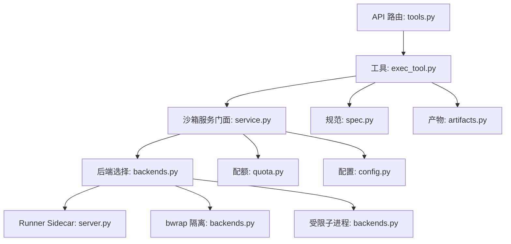
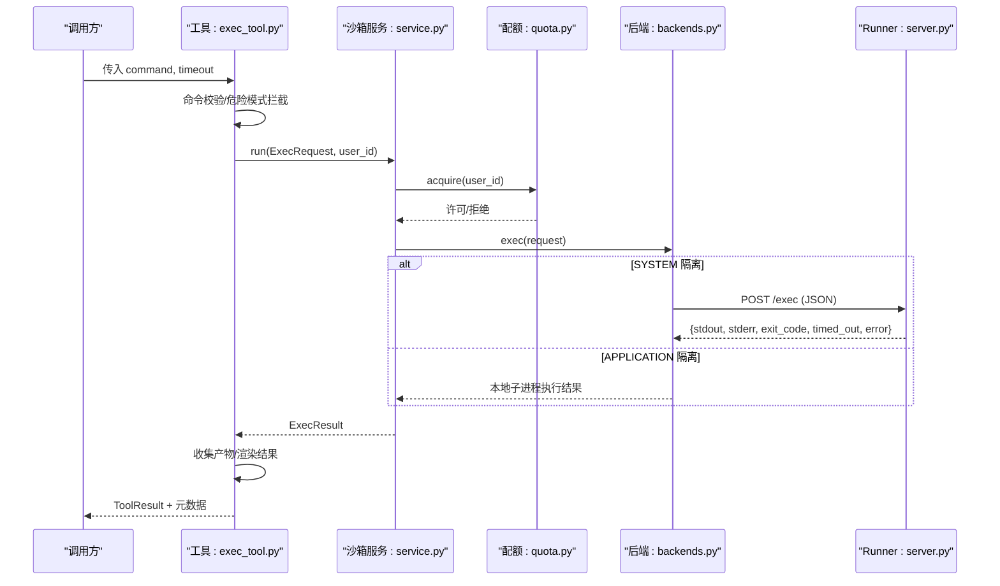
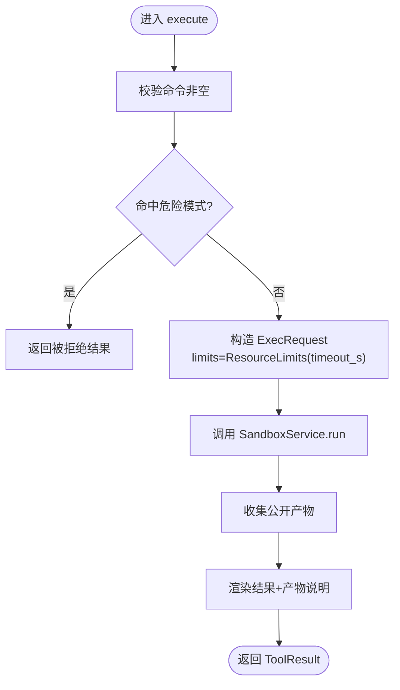
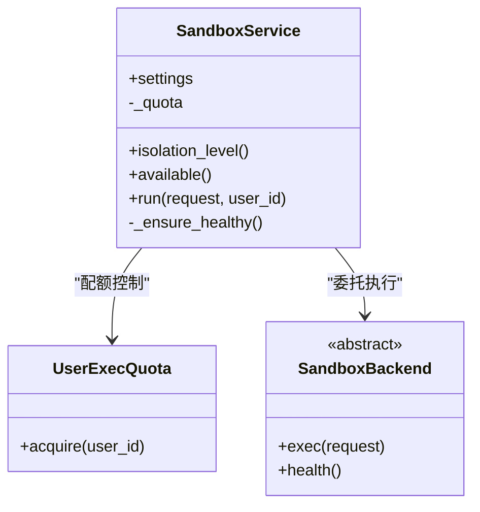
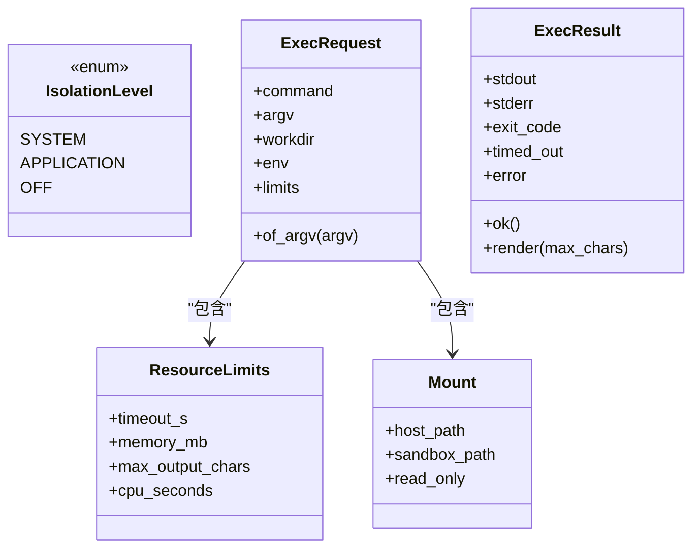
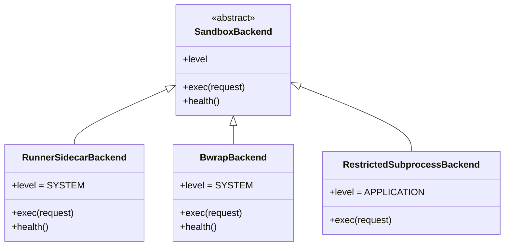
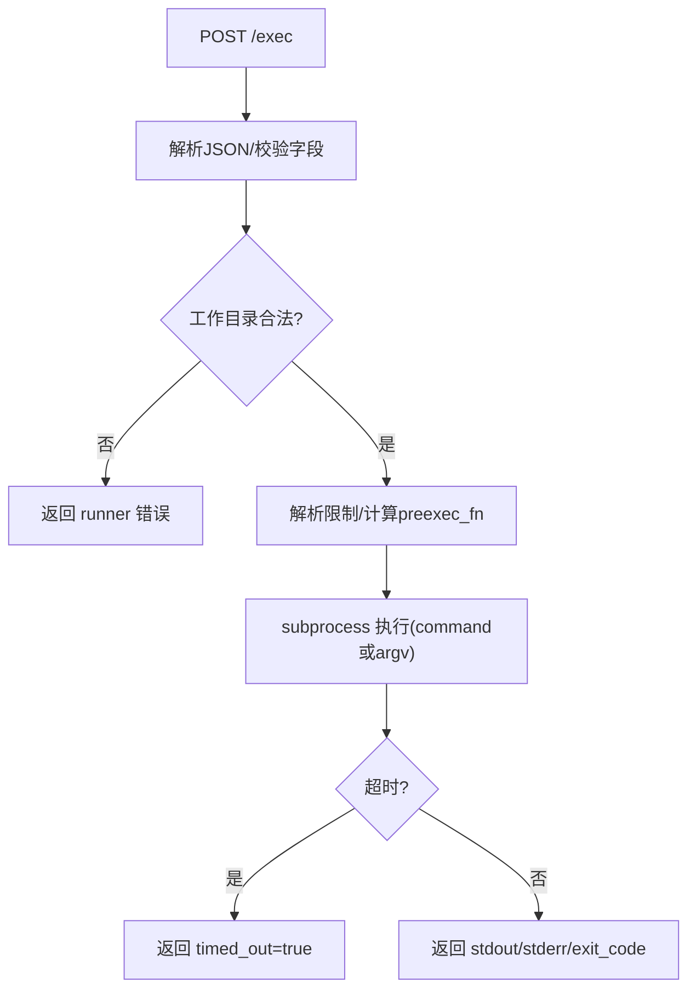
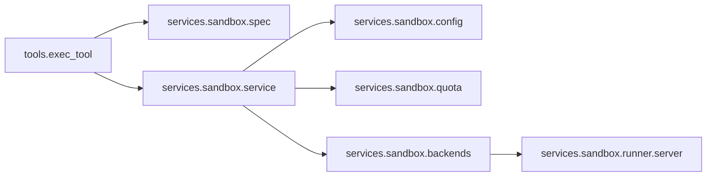
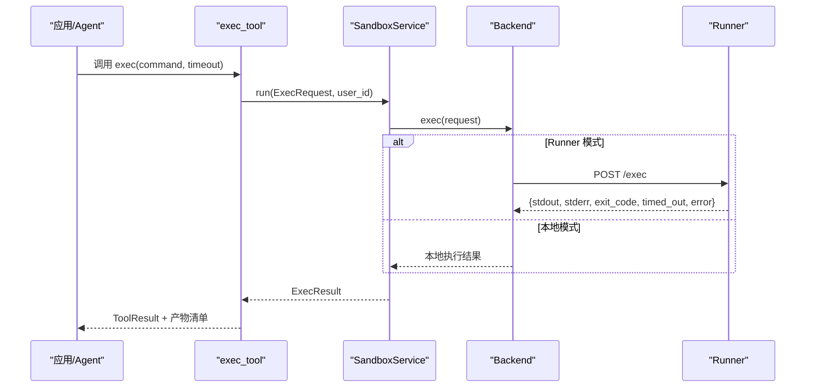

# 代码执行工具

<cite>
**本文引用的文件**
- [exec_tool.py](file://deeptutor/tools/exec_tool.py)
- [service.py](file://deeptutor/services/sandbox/service.py)
- [spec.py](file://deeptutor/services/sandbox/spec.py)
- [backends.py](file://deeptutor/services/sandbox/backends.py)
- [config.py](file://deeptutor/services/sandbox/config.py)
- [quota.py](file://deeptutor/services/sandbox/quota.py)
- [artifacts.py](file://deeptutor/services/sandbox/artifacts.py)
- [server.py](file://deeptutor/services/sandbox/runner/server.py)
- [tools.py](file://deeptutor/api/routers/tools.py)
</cite>

## 目录
1. [简介](#简介)
2. [项目结构](#项目结构)
3. [核心组件](#核心组件)
4. [架构总览](#架构总览)
5. [详细组件分析](#详细组件分析)
6. [依赖关系分析](#依赖关系分析)
7. [性能考虑](#性能考虑)
8. [故障排查指南](#故障排查指南)
9. [结论](#结论)
10. [附录：API参考与使用示例](#附录api参考与使用示例)

## 简介
本文件面向 DeepTutor 的“代码执行工具”，聚焦在安全沙箱中执行用户或智能体生成的命令，支持多种语言（Python、JavaScript、R 等）通过系统 Shell 调用对应解释器或工具链。该能力以“隔离优先”的设计实现：
- 隔离机制：默认通过独立 Runner 容器执行（SYSTEM 级隔离），回退到 Linux bwrap 命名空间隔离，或在受控环境下使用受限子进程（APPLICATION 级隔离）。
- 资源限制：超时、内存、CPU 时间、输出长度上限、并发与速率配额。
- 安全防护：命令白/黑名单、工作目录白名单、环境变量清洗、最小权限运行、请求体大小限制。
- 可观测性：统一结果对象、产物收集与下载链接、错误信息标准化。

## 项目结构
围绕代码执行的关键模块分布如下：
- 工具入口：chat 侧工具定义与参数校验，构造执行请求并渲染结果。
- 沙箱服务门面：后端选择、健康检查、配额控制、策略开关。
- 执行规范：统一的请求/结果类型、隔离级别、资源限制、挂载描述。
- 后端实现：Runner Sidecar（HTTP）、bwrap（Linux 命名空间）、受限子进程（开发回退）。
- 配置与环境：根据环境变量自动选择后端与配额。
- 产物管理：扫描工作区生成可公开访问的产物清单与下载 URL。
- Runner 服务端：最小依赖 HTTP 服务器，实际执行命令并施加资源限制。
- API 路由：列出内置工具元数据（含 exec），供前端设置页展示。

图表来源
- [exec_tool.py:49-153](file://deeptutor/tools/exec_tool.py#L49-L153)
- [service.py:29-95](file://deeptutor/services/sandbox/service.py#L29-L95)
- [backends.py:34-230](file://deeptutor/services/sandbox/backends.py#L34-L230)
- [server.py:178-351](file://deeptutor/services/sandbox/runner/server.py#L178-L351)
- [quota.py:27-75](file://deeptutor/services/sandbox/quota.py#L27-L75)
- [config.py:41-84](file://deeptutor/services/sandbox/config.py#L41-L84)
- [spec.py:16-141](file://deeptutor/services/sandbox/spec.py#L16-L141)
- [artifacts.py:13-119](file://deeptutor/services/sandbox/artifacts.py#L13-L119)
- [tools.py:169-223](file://deeptutor/api/routers/tools.py#L169-L223)

章节来源
- [exec_tool.py:49-153](file://deeptutor/tools/exec_tool.py#L49-L153)
- [service.py:29-95](file://deeptutor/services/sandbox/service.py#L29-L95)
- [backends.py:34-230](file://deeptutor/services/sandbox/backends.py#L34-L230)
- [server.py:178-351](file://deeptutor/services/sandbox/runner/server.py#L178-L351)
- [quota.py:27-75](file://deeptutor/services/sandbox/quota.py#L27-L75)
- [config.py:41-84](file://deeptutor/services/sandbox/config.py#L41-L84)
- [spec.py:16-141](file://deeptutor/services/sandbox/spec.py#L16-L141)
- [artifacts.py:13-119](file://deeptutor/services/sandbox/artifacts.py#L13-L119)
- [tools.py:169-223](file://deeptutor/api/routers/tools.py#L169-L223)

## 核心组件
- 执行工具（ExecTool）
  - 负责接收 LLM 或上层调用的命令与超时参数，进行基础校验与危险模式拦截，构造 ExecRequest 并调用沙箱服务。
  - 将执行结果与产物清单合并为 ToolResult，附带退出码、是否超时、错误信息等元数据。
- 沙箱服务门面（SandboxService）
  - 封装后端选择、健康探测、用户配额、能力开关；对外暴露 run/isolation_level/available。
- 执行规范（spec）
  - 定义 IsolationLevel、ResourceLimits、Mount、ExecRequest、ExecResult 等核心数据结构。
- 后端实现（backends）
  - RunnerSidecarBackend：通过 HTTP 将任务提交到独立 Runner 容器执行（SYSTEM 隔离）。
  - BwrapBackend：在 Linux 上使用 bubblewrap 创建挂载命名空间（SYSTEM 隔离）。
  - RestrictedSubprocessBackend：清理环境变量并限制工作目录的子进程执行（APPLICATION 隔离，仅开发/管理员启用）。
- 配置（config）
  - 根据环境变量决定使用哪种后端与配额上限。
- 配额（quota）
  - 每用户并发与每分钟速率限制，防止滥用与雪崩。
- 产物（artifacts）
  - 扫描工作区，过滤隐藏文件与不可公开路径，生成可下载的产物清单。
- Runner 服务端（server）
  - 最小 HTTP 服务，解析请求、校验工作目录、应用资源限制、执行命令并返回统一响应。
- API 路由（tools）
  - 提供内置工具列表与提示文案，便于前端展示与配置。

章节来源
- [exec_tool.py:49-153](file://deeptutor/tools/exec_tool.py#L49-L153)
- [service.py:29-95](file://deeptutor/services/sandbox/service.py#L29-L95)
- [spec.py:16-141](file://deeptutor/services/sandbox/spec.py#L16-L141)
- [backends.py:34-230](file://deeptutor/services/sandbox/backends.py#L34-L230)
- [config.py:41-84](file://deeptutor/services/sandbox/config.py#L41-L84)
- [quota.py:27-75](file://deeptutor/services/sandbox/quota.py#L27-L75)
- [artifacts.py:13-119](file://deeptutor/services/sandbox/artifacts.py#L13-L119)
- [server.py:178-351](file://deeptutor/services/sandbox/runner/server.py#L178-L351)
- [tools.py:169-223](file://deeptutor/api/routers/tools.py#L169-L223)

## 架构总览
下图展示了从工具调用到实际执行的完整链路，包括隔离、配额、产物与错误处理。

图表来源
- [exec_tool.py:80-153](file://deeptutor/tools/exec_tool.py#L80-L153)
- [service.py:74-95](file://deeptutor/services/sandbox/service.py#L74-L95)
- [backends.py:56-100](file://deeptutor/services/sandbox/backends.py#L56-L100)
- [server.py:178-264](file://deeptutor/services/sandbox/runner/server.py#L178-L264)
- [quota.py:60-75](file://deeptutor/services/sandbox/quota.py#L60-L75)

## 详细组件分析

### 执行工具（ExecTool）
- 职责
  - 接收命令与可选超时；对命令进行基础校验与危险模式匹配（如删除、格式化、关机、用户管理等）。
  - 构建 ExecRequest，注入工作目录、挂载、用户 ID 等上下文（由服务端管线注入）。
  - 调用沙箱服务执行，收集产物并组装 ToolResult。
- 关键行为
  - 超时参数规范化至允许范围。
  - 失败时返回 success=False，并在 metadata 中包含退出码、是否超时、错误信息与产物清单。
- 安全要点
  - 危险命令正则拦截作为纵深防御的第一道防线。
  - 实际隔离由后端保证。

图表来源
- [exec_tool.py:80-153](file://deeptutor/tools/exec_tool.py#L80-L153)
- [artifacts.py:33-119](file://deeptutor/services/sandbox/artifacts.py#L33-L119)

章节来源
- [exec_tool.py:30-153](file://deeptutor/tools/exec_tool.py#L30-L153)
- [artifacts.py:33-119](file://deeptutor/services/sandbox/artifacts.py#L33-L119)

### 沙箱服务门面（SandboxService）
- 职责
  - 初始化后端、健康探测缓存、用户配额。
  - 提供 isolation_level/available/run 接口。
  - 在执行前检查 per-user 策略开关（可禁用 exec）。
- 关键行为
  - 若后端不可用，直接返回错误结果。
  - 配额超限则返回错误结果。
  - 成功时委托后端执行并透传结果。

图表来源
- [service.py:29-95](file://deeptutor/services/sandbox/service.py#L29-L95)
- [quota.py:27-75](file://deeptutor/services/sandbox/quota.py#L27-L75)
- [backends.py:34-44](file://deeptutor/services/sandbox/backends.py#L34-L44)

章节来源
- [service.py:29-95](file://deeptutor/services/sandbox/service.py#L29-L95)
- [quota.py:27-75](file://deeptutor/services/sandbox/quota.py#L27-L75)

### 执行规范（spec）
- 隔离级别
  - SYSTEM：操作系统级隔离（容器/bwrap）。
  - APPLICATION：进程级防护（路径/环境限制）。
  - OFF：无沙箱可用。
- 资源限制
  - 超时秒数、内存上限、最大输出字符数、CPU 秒数。
- 执行请求
  - 同时携带 shell 字符串与 argv 向量，确保新旧 Runner 兼容且避免 shell 注入风险。
- 执行结果
  - 统一 stdout/stderr/exit_code/timed_out/error，并提供 render 方法裁剪输出。

图表来源
- [spec.py:16-141](file://deeptutor/services/sandbox/spec.py#L16-L141)

章节来源
- [spec.py:16-141](file://deeptutor/services/sandbox/spec.py#L16-L141)

### 后端实现（backends）
- RunnerSidecarBackend
  - 通过 HTTP 将请求发送到独立 Runner 容器，超时略大于命令超时以便正确上报超时。
  - 健康检查通过 GET /health。
- BwrapBackend
  - 在 Linux 上以 bwrap 创建隔离命名空间，只读绑定系统目录，按需挂载工作目录与环境变量。
  - 健康检查验证 bwrap 可用并可创建命名空间。
- RestrictedSubprocessBackend
  - 清理环境变量为安全集合，限制 cwd，按 argv/command 执行。
  - 适用于本地开发或管理员授权场景。

图表来源
- [backends.py:34-230](file://deeptutor/services/sandbox/backends.py#L34-L230)

章节来源
- [backends.py:34-230](file://deeptutor/services/sandbox/backends.py#L34-L230)

### Runner 服务端（server）
- 职责
  - 提供 /health 与 /exec 两个端点。
  - 严格校验请求体、工作目录白名单、环境变量与限制参数。
  - 使用 rlimit 限制虚拟内存、CPU 时间与文件描述符数量。
  - 捕获超时与异常，返回统一 JSON。
- 安全要点
  - 工作目录必须在允许的共享工作区根下。
  - 请求体大小限制，避免内存耗尽。
  - 最小化依赖，降低攻击面。

图表来源
- [server.py:178-264](file://deeptutor/services/sandbox/runner/server.py#L178-L264)
- [server.py:296-351](file://deeptutor/services/sandbox/runner/server.py#L296-L351)

章节来源
- [server.py:178-351](file://deeptutor/services/sandbox/runner/server.py#L178-L351)

### 配置与后端选择（config）
- 环境变量
  - DEEPTUTOR_SANDBOX_RUNNER_URL：启用 Runner Sidecar（推荐生产）。
  - DEEPTUTOR_SANDBOX_ALLOW_SUBPROCESS：仅在 Linux 且存在 bwrap 时优先选 bwrap；否则允许受限子进程（需显式开启）。
  - DEEPTUTOR_SANDBOX_MAX_CONCURRENT / MAX_PER_MINUTE：每用户并发与速率上限。
- 选择逻辑
  - 有 Runner URL → RunnerSidecarBackend
  - Linux 且有 bwrap → BwrapBackend
  - 允许子进程 → RestrictedSubprocessBackend
  - 否则无后端（exec 不可用）

章节来源
- [config.py:41-84](file://deeptutor/services/sandbox/config.py#L41-L84)

### 配额（quota）
- 并发限制：每个用户一个信号量，防止过多并发。
- 速率限制：滑动窗口 60 秒内最多执行次数。
- 超限时抛出 QuotaExceeded，服务层将其转为错误结果。

章节来源
- [quota.py:27-75](file://deeptutor/services/sandbox/quota.py#L27-L75)

### 产物管理（artifacts）
- 扫描工作区，跳过隐藏文件与不可公开路径。
- 生成可下载 URL（/api/outputs/...）与 MIME 类型。
- 为模型回复提供“产物清单”文本，便于 UI 自动识别文件名并渲染为可点击链接。

章节来源
- [artifacts.py:13-119](file://deeptutor/services/sandbox/artifacts.py#L13-L119)

### API 路由（tools）
- 提供内置工具列表（包含 exec），用于前端设置页展示与提示文案加载。
- 支持“即将上线”占位工具与用户可切换工具的可见性控制。

章节来源
- [tools.py:169-223](file://deeptutor/api/routers/tools.py#L169-L223)

## 依赖关系分析
- 低耦合分层
  - 工具层仅依赖 spec 与服务门面，不感知具体后端。
  - 服务门面聚合后端、配额与配置，屏蔽差异。
  - 后端各自实现隔离细节，通过统一接口交互。
- 外部依赖
  - Runner Sidecar 使用标准库 http.server，零第三方依赖。
  - 其他后端依赖 asyncio、httpx、shutil 等标准库。
- 潜在循环
  - 工具层延迟导入 services.sandbox 以避免循环导入。

图表来源
- [exec_tool.py:80-118](file://deeptutor/tools/exec_tool.py#L80-L118)
- [service.py:29-95](file://deeptutor/services/sandbox/service.py#L29-L95)
- [backends.py:34-100](file://deeptutor/services/sandbox/backends.py#L34-L100)
- [server.py:178-264](file://deeptutor/services/sandbox/runner/server.py#L178-L264)

章节来源
- [exec_tool.py:80-118](file://deeptutor/tools/exec_tool.py#L80-L118)
- [service.py:29-95](file://deeptutor/services/sandbox/service.py#L29-L95)
- [backends.py:34-100](file://deeptutor/services/sandbox/backends.py#L34-L100)
- [server.py:178-264](file://deeptutor/services/sandbox/runner/server.py#L178-L264)

## 性能考虑
- 超时与输出裁剪
  - 命令超时由 Runner 或后端通信层保障；输出长度按 max_output_chars 裁剪，保留首尾关键信息。
- 资源限制
  - Runner 使用 rlimit 限制虚拟内存与 CPU 时间；容器 cgroup 限制 RSS 作为最终兜底。
- 并发与速率
  - 每用户并发与每分钟速率限制，避免单用户占用过多资源。
- 网络开销
  - Runner Sidecar 模式下，HTTP 超时略大于命令超时，确保能收到超时结果而非连接中断。
- 产物扫描
  - 产物收集限制最大文件数，避免大目录遍历影响性能。

[本节为通用指导，无需特定文件引用]

## 故障排查指南
- 常见错误定位
  - 命令被拒绝：检查危险模式匹配（删除、格式化、关机、用户管理等）。
  - 后端不可用：查看 health 检查结果与 Runner 可达性。
  - 配额超限：检查并发与每分钟速率限制。
  - 工作目录非法：确认 workdir 是否在允许的工作区根下。
  - 请求体过大：检查 Content-Length 与请求内容。
- 诊断步骤
  - 查看 ExecResult.error 与 metadata.timed_out/exit_code。
  - 检查 Runner 日志（stdout 中的 runner: 前缀）。
  - 确认环境变量配置是否正确（Runner URL、是否允许子进程、配额上限）。
  - 验证产物路径是否属于公开输出根目录。

章节来源
- [exec_tool.py:80-153](file://deeptutor/tools/exec_tool.py#L80-L153)
- [service.py:45-95](file://deeptutor/services/sandbox/service.py#L45-L95)
- [server.py:178-351](file://deeptutor/services/sandbox/runner/server.py#L178-L351)
- [quota.py:27-75](file://deeptutor/services/sandbox/quota.py#L27-L75)

## 结论
DeepTutor 的代码执行工具以“隔离优先、纵深防御”为核心，通过多后端适配与严格的资源限制，为多语言脚本执行提供了安全可控的环境。其模块化设计使隔离策略、配额策略与产物管理相互解耦，便于在不同部署形态下灵活切换与扩展。建议在生产环境始终启用 Runner Sidecar 以实现系统级隔离，并结合配额与审计日志进行持续监控与优化。

[本节为总结，无需特定文件引用]

## 附录：API参考与使用示例

### 工具定义与参数
- 名称：exec
- 描述：在隔离沙箱中运行命令并返回输出。适合数据处理、技能脚本与 CLI 工具调用，不建议执行破坏性或系统管理类命令。
- 参数
  - command（string，必填）：要执行的 shell 命令。
  - timeout（integer，可选）：超时秒数（默认值与最大值见实现）。
- 提示文案：可通过工具元数据获取双语提示，帮助模型正确使用。

章节来源
- [exec_tool.py:55-78](file://deeptutor/tools/exec_tool.py#L55-L78)
- [tools.py:169-223](file://deeptutor/api/routers/tools.py#L169-L223)

### 执行请求与结果（内部规范）
- 请求（ExecRequest）
  - command：shell 字符串
  - argv：参数向量（当非空时不使用 shell）
  - workdir：工作目录
  - mounts：挂载列表（主机路径→沙箱路径，只读/读写）
  - env：环境变量
  - limits：资源限制（超时、内存、CPU、输出长度）
- 结果（ExecResult）
  - stdout/stderr：标准输出/错误
  - exit_code：退出码
  - timed_out：是否超时
  - error：运行时错误（非命令失败）
  - ok/render：便捷方法与输出裁剪

章节来源
- [spec.py:16-141](file://deeptutor/services/sandbox/spec.py#L16-L141)

### 使用流程（序列图）

图表来源
- [exec_tool.py:80-153](file://deeptutor/tools/exec_tool.py#L80-L153)
- [service.py:74-95](file://deeptutor/services/sandbox/service.py#L74-L95)
- [backends.py:56-100](file://deeptutor/services/sandbox/backends.py#L56-L100)
- [server.py:178-264](file://deeptutor/services/sandbox/runner/server.py#L178-L264)

### 典型使用场景
- 数据处理脚本：在沙箱中运行 Python/R/JS 脚本处理 CSV/JSON 数据，产出图表或报告文件，并通过产物清单下载。
- 算法验证：快速执行小段代码验证数学公式或算法正确性，限制超时与输出长度，避免长时间阻塞。
- 机器学习模型验证：在隔离环境中安装轻量依赖并运行推理脚本，限制内存与 CPU 时间，产出预测结果文件。
- 自动化测试：对 CLI 工具进行端到端测试，利用工作目录与挂载模拟输入输出。

[本节为概念性说明，无需特定文件引用]

### 沙箱配置选项
- 环境变量
  - DEEPTUTOR_SANDBOX_RUNNER_URL：启用 Runner Sidecar（推荐生产）。
  - DEEPTUTOR_SANDBOX_ALLOW_SUBPROCESS：允许受限子进程（仅开发/管理员）。
  - DEEPTUTOR_SANDBOX_MAX_CONCURRENT：每用户最大并发执行数。
  - DEEPTUTOR_SANDBOX_MAX_PER_MINUTE：每用户每分钟最大执行次数。
- 工作目录白名单（Runner）
  - DEEPTUTOR_RUNNER_ALLOWED_WORKDIRS：限定允许的工作区根路径。
- 端口（Runner）
  - RUNNER_PORT：Runner 监听端口（默认 8900）。

章节来源
- [config.py:41-84](file://deeptutor/services/sandbox/config.py#L41-L84)
- [server.py:152-162](file://deeptutor/services/sandbox/runner/server.py#L152-L162)
- [server.py:354-368](file://deeptutor/services/sandbox/runner/server.py#L354-L368)

### 审计与调试
- 审计日志
  - Runner 将日志输出到 stdout（带 runner: 前缀），便于容器日志采集。
  - 执行结果包含退出码、是否超时与错误信息，可用于上层审计。
- 调试建议
  - 先启用最小命令（如 echo）验证连通性与隔离效果。
  - 逐步放宽限制并观察资源使用情况。
  - 检查产物路径是否可公开访问，必要时调整路径服务策略。

章节来源
- [server.py:296-351](file://deeptutor/services/sandbox/runner/server.py#L296-L351)
- [exec_tool.py:119-153](file://deeptutor/tools/exec_tool.py#L119-L153)