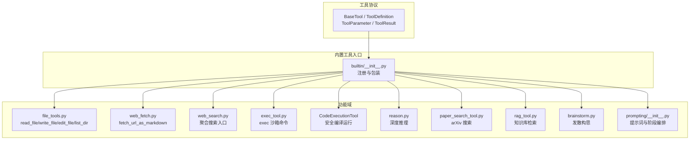
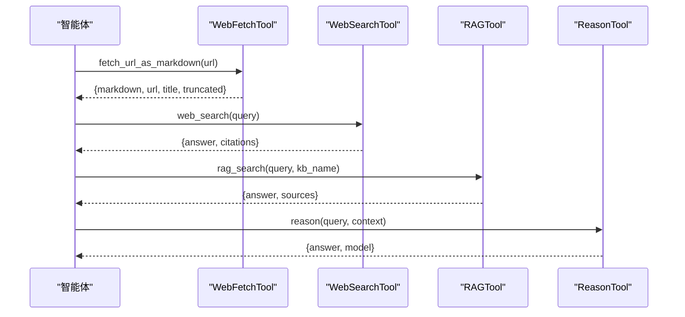
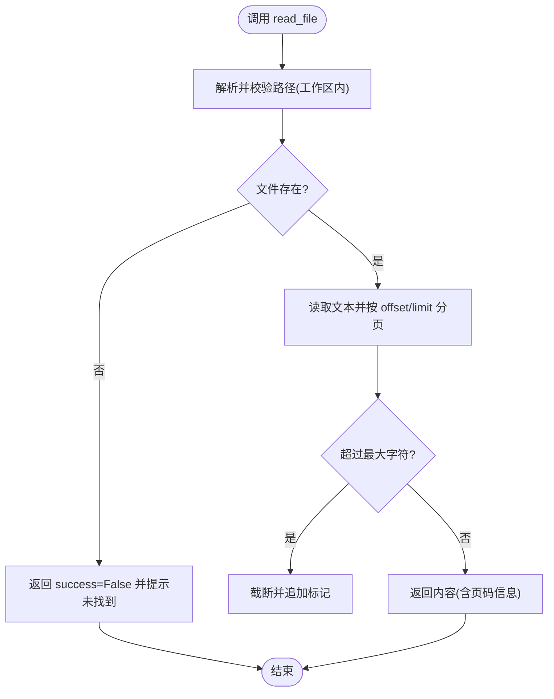
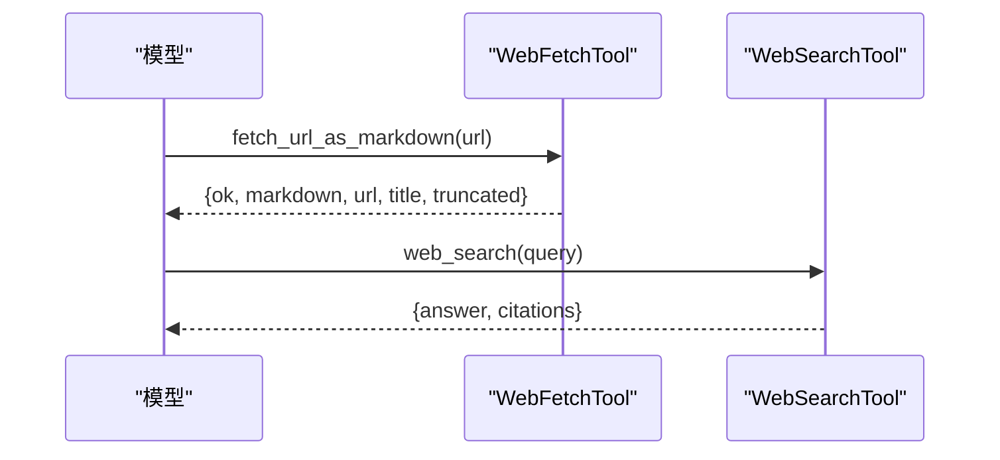
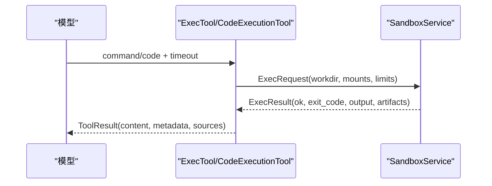
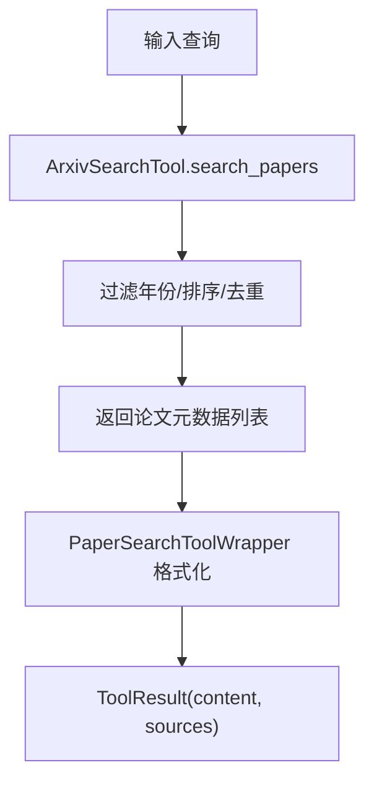
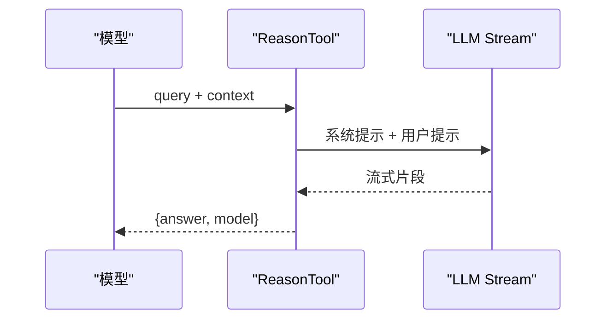
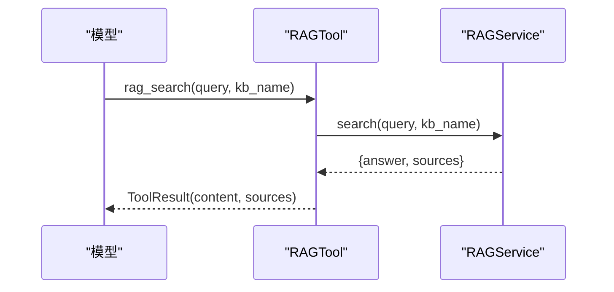
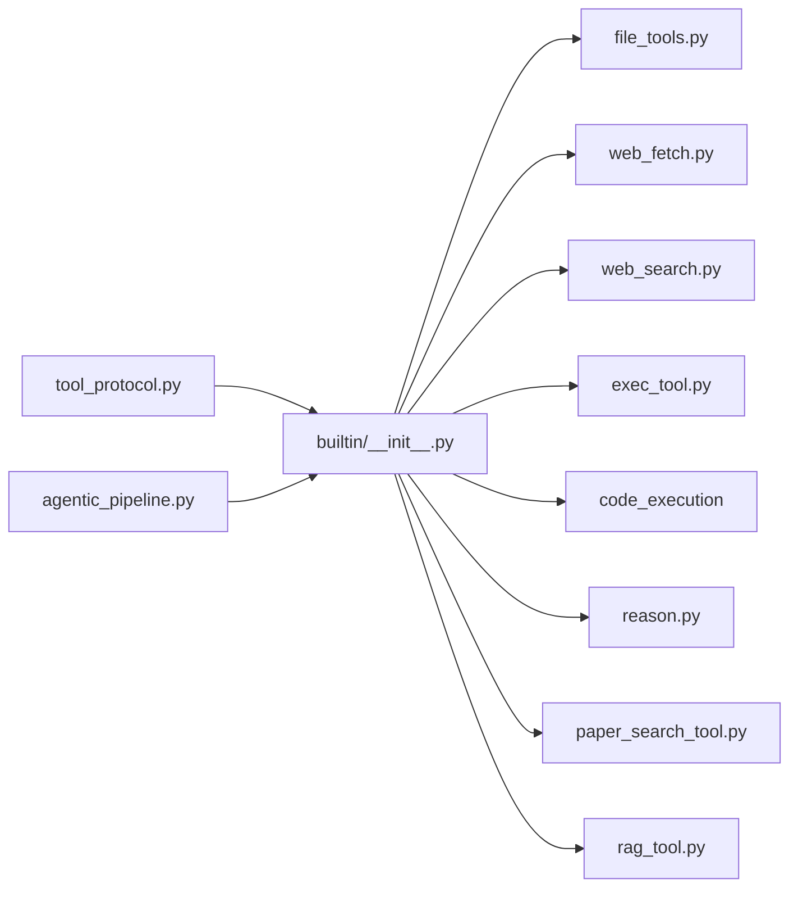

# 内置工具

<cite>
**本文引用的文件**
- [deeptutor/core/tool_protocol.py](file://deeptutor/core/tool_protocol.py)
- [deeptutor/tools/builtin/__init__.py](file://deeptutor/tools/builtin/__init__.py)
- [deeptutor/tools/file_tools.py](file://deeptutor/tools/file_tools.py)
- [deeptutor/tools/web_fetch.py](file://deeptutor/tools/web_fetch.py)
- [deeptutor/tools/web_search.py](file://deeptutor/tools/web_search.py)
- [deeptutor/tools/exec_tool.py](file://deeptutor/tools/exec_tool.py)
- [deeptutor/services/sandbox/__init__.py](file://deeptutor/services/sandbox/__init__.py)
- [deeptutor/tools/reason.py](file://deeptutor/tools/reason.py)
- [deeptutor/tools/paper_search_tool.py](file://deeptutor/tools/paper_search_tool.py)
- [deeptutor/tools/rag_tool.py](file://deeptutor/tools/rag_tool.py)
- [deeptutor/tools/brainstorm.py](file://deeptutor/tools/brainstorm.py)
- [deeptutor/tools/prompting/__init__.py](file://deeptutor/tools/prompting/__init__.py)
- [deeptutor/agents/chat/agentic_pipeline.py](file://deeptutor/agents/chat/agentic_pipeline.py)
</cite>

## 目录
1. [简介](#简介)
2. [项目结构](#项目结构)
3. [核心组件](#核心组件)
4. [架构总览](#架构总览)
5. [详细组件分析](#详细组件分析)
6. [依赖关系分析](#依赖关系分析)
7. [性能与配置](#性能与配置)
8. [故障排除指南](#故障排除指南)
9. [结论](#结论)
10. [附录：API参考速查](#附录api参考速查)

## 简介
本文件系统化梳理 DeepTutor 的内置工具，覆盖文件操作、网络抓取、代码执行沙箱、搜索（网页/论文）、推理与知识检索等能力。每个工具提供参数说明、返回值格式、错误处理要点、常见使用场景与最佳实践，并给出架构图与调用时序图，帮助读者快速上手与安全高效地使用。

## 项目结构
DeepTutor 的工具层采用统一协议抽象，所有工具继承基类并提供定义与执行逻辑；内置工具集中在统一入口注册，并通过提示词与阶段化策略引导模型选择合适工具。

**图表来源**
- [deeptutor/core/tool_protocol.py:16-94](file://deeptutor/core/tool_protocol.py#L16-L94)
- [deeptutor/tools/builtin/__init__.py:43-141](file://deeptutor/tools/builtin/__init__.py#L43-L141)

**章节来源**
- [deeptutor/core/tool_protocol.py:16-94](file://deeptutor/core/tool_protocol.py#L16-L94)
- [deeptutor/tools/builtin/__init__.py:43-141](file://deeptutor/tools/builtin/__init__.py#L43-L141)

## 核心组件
- 工具协议与数据契约
  - BaseTool：所有工具的抽象基类，要求实现 get_definition 与 execute。
  - ToolDefinition/ToolParameter：描述工具名称、描述、参数类型与必填项，支持生成 OpenAI 函数调用 Schema。
  - ToolResult：统一返回体，包含 content、sources（引用来源）、metadata（结构化元数据）、success（是否成功）等。
- 提示词与阶段编排
  - prompting 模块提供 per-tool 提示词加载与多语言渲染，支持“探索/扩展/综合/验证”等阶段组织，辅助模型正确选择工具。
- 运行时装配
  - agentic_pipeline 根据会话上下文组合可用工具集，注入工作区路径、沙箱挂载、语言等参数，控制工具可见性与启用状态。

**章节来源**
- [deeptutor/core/tool_protocol.py:16-94](file://deeptutor/core/tool_protocol.py#L16-L94)
- [deeptutor/core/tool_protocol.py:121-153](file://deeptutor/core/tool_protocol.py#L121-L153)
- [deeptutor/tools/prompting/__init__.py:52-86](file://deeptutor/tools/prompting/__init__.py#L52-L86)
- [deeptutor/agents/chat/agentic_pipeline.py:586-623](file://deeptutor/agents/chat/agentic_pipeline.py#L586-L623)

## 架构总览
下图展示一次典型“联网+检索+推理”的任务流：模型先进行网络抓取或搜索，再结合知识库检索，最后通过推理工具输出结构化答案。

**图表来源**
- [deeptutor/tools/web_fetch.py:72-141](file://deeptutor/tools/web_fetch.py#L72-L141)
- [deeptutor/tools/web_search.py:28-45](file://deeptutor/tools/web_search.py#L28-L45)
- [deeptutor/tools/rag_tool.py:15-51](file://deeptutor/tools/rag_tool.py#L15-L51)
- [deeptutor/tools/reason.py:42-119](file://deeptutor/tools/reason.py#L42-L119)

## 详细组件分析

### 文件操作工具（读写文件、目录管理）
- 工具列表
  - read_file：按行分页读取工作区文本文件，支持 offset/limit。
  - write_file：写入 UTF-8 文本到工作区，自动创建父目录。
  - edit_file：替换旧文本为新文本，支持 replace_all。
  - list_dir：列出工作区目录内容，支持递归与条目上限。
- 关键特性
  - 路径隔离：所有路径在工作区内解析，越界即拒绝。
  - 安全限制：读最大字符截断、写失败回退、编辑时模糊匹配提示。
- 参数与返回
  - 参数见各工具 get_definition 的参数定义。
  - 返回 ToolResult.content 为人类可读结果；success=False 表示错误路径。
- 常见用法
  - 批量处理：list_dir 遍历 + read_file 分段读取 + edit_file 批量替换。
  - 日志/报告生成：write_file 输出结构化文本。

**图表来源**
- [deeptutor/tools/file_tools.py:13-25](file://deeptutor/tools/file_tools.py#L13-L25)
- [deeptutor/tools/file_tools.py:41-106](file://deeptutor/tools/file_tools.py#L41-L106)

**章节来源**
- [deeptutor/tools/file_tools.py:41-106](file://deeptutor/tools/file_tools.py#L41-L106)
- [deeptutor/tools/file_tools.py:109-131](file://deeptutor/tools/file_tools.py#L109-L131)
- [deeptutor/tools/file_tools.py:134-186](file://deeptutor/tools/file_tools.py#L134-L186)
- [deeptutor/tools/file_tools.py:189-262](file://deeptutor/tools/file_tools.py#L189-L262)

### 网络工具（网页抓取、API调用）
- 网页抓取（web_fetch）
  - 仅允许 http/https，拦截私有/环回/链路本地地址，重定向后再次校验。
  - 响应体有硬上限，提取标题与正文，超长截断。
  - 返回 FetchOutcome：ok/markdown/url/title/truncated/error。
- 网页搜索（web_search）
  - 封装搜索服务，支持多种后端（Brave/Tavily/Jina/SearXNG/DuckDuckGo/Perplexity）。
  - 返回 answer 与 citations，便于溯源。
- 典型流程
  - 抓取页面 → 清洗为可读文本 → 作为推理上下文。
  - 搜索聚合多个来源 → 提炼摘要与引用。

**图表来源**
- [deeptutor/tools/web_fetch.py:72-141](file://deeptutor/tools/web_fetch.py#L72-L141)
- [deeptutor/tools/web_search.py:28-45](file://deeptutor/tools/web_search.py#L28-L45)

**章节来源**
- [deeptutor/tools/web_fetch.py:72-141](file://deeptutor/tools/web_fetch.py#L72-L141)
- [deeptutor/tools/web_search.py:28-45](file://deeptutor/tools/web_search.py#L28-L45)

### 代码执行工具（安全沙箱执行）
- exec：在隔离沙箱中执行 shell 命令，带超时与白/黑名单防护。
- code_execution：以语言为维度的安全编译/运行（Python/C/C++），自动写入源码、构建命令、收集产物。
- 安全策略
  - 危险命令模式匹配拦截（如 rm -rf、格式化磁盘等）。
  - 资源限制：超时、输出大小限制。
  - 工作区挂载：仅在 turn 的工作区内读写。
- 返回
  - ToolResult.content 包含 stdout/stderr 与产物摘要；metadata 包含 exit_code/timed_out/artifacts 等。

**图表来源**
- [deeptutor/tools/exec_tool.py:49-153](file://deeptutor/tools/exec_tool.py#L49-L153)
- [deeptutor/tools/builtin/__init__.py:274-447](file://deeptutor/tools/builtin/__init__.py#L274-L447)
- [deeptutor/services/sandbox/__init__.py:1-28](file://deeptutor/services/sandbox/__init__.py#L1-L28)

**章节来源**
- [deeptutor/tools/exec_tool.py:49-153](file://deeptutor/tools/exec_tool.py#L49-L153)
- [deeptutor/tools/builtin/__init__.py:274-447](file://deeptutor/tools/builtin/__init__.py#L274-L447)

### 搜索工具（网络搜索、论文搜索）
- 网页搜索：见“网络工具”。
- 论文搜索（arXiv）
  - ArxivSearchTool：关键词搜索、排序、年份过滤、重试与限流保护。
  - PaperSearchToolWrapper：将 arXiv 结果格式化为易读列表，附带引用来源。
- 适用场景
  - 学术调研、文献综述、前沿技术追踪。

**图表来源**
- [deeptutor/tools/paper_search_tool.py:24-140](file://deeptutor/tools/paper_search_tool.py#L24-L140)
- [deeptutor/tools/builtin/__init__.py:488-565](file://deeptutor/tools/builtin/__init__.py#L488-L565)

**章节来源**
- [deeptutor/tools/paper_search_tool.py:24-140](file://deeptutor/tools/paper_search_tool.py#L24-L140)
- [deeptutor/tools/builtin/__init__.py:488-565](file://deeptutor/tools/builtin/__init__.py#L488-L565)

### 推理工具（逻辑推理、数学计算）
- reason：无状态 LLM 深度推理，适合复杂子问题推导、数学证明、逻辑链整理。
- brainstorm：发散式头脑风暴，生成多条可行方向与简要理由。
- 适用场景
  - 解题步骤拆解、方案对比、风险评估、创意构思。

**图表来源**
- [deeptutor/tools/reason.py:42-119](file://deeptutor/tools/reason.py#L42-L119)
- [deeptutor/tools/builtin/__init__.py:450-485](file://deeptutor/tools/builtin/__init__.py#L450-L485)
- [deeptutor/tools/brainstorm.py:45-104](file://deeptutor/tools/brainstorm.py#L45-L104)

**章节来源**
- [deeptutor/tools/reason.py:42-119](file://deeptutor/tools/reason.py#L42-L119)
- [deeptutor/tools/brainstorm.py:45-104](file://deeptutor/tools/brainstorm.py#L45-L104)

### 知识检索工具（RAG）
- RAGTool：基于已挂载的知识库检索并合成答案，返回 sources 用于溯源。
- KbFilesTool：枚举知识库文档清单与统计，回答“有多少/是否存在某文件”等问题。
- 适用场景
  - 企业知识库问答、课程资料检索、文档定位。

**图表来源**
- [deeptutor/tools/builtin/__init__.py:95-141](file://deeptutor/tools/builtin/__init__.py#L95-L141)
- [deeptutor/tools/rag_tool.py:15-51](file://deeptutor/tools/rag_tool.py#L15-L51)

**章节来源**
- [deeptutor/tools/builtin/__init__.py:95-141](file://deeptutor/tools/builtin/__init__.py#L95-L141)
- [deeptutor/tools/rag_tool.py:15-51](file://deeptutor/tools/rag_tool.py#L15-L51)

## 依赖关系分析
- 工具协议解耦：所有工具通过 BaseTool/ToolDefinition/ToolResult 统一交互，便于扩展与测试。
- 运行时装配：agentic_pipeline 负责根据会话上下文组合工具集，注入工作区、沙箱挂载、语言等。
- 外部依赖
  - 网络：httpx（网页抓取）。
  - 搜索：多种搜索引擎后端（由 services/search 提供）。
  - 沙箱：services.sandbox（隔离执行、配额、产物收集）。
  - 知识库：services.rag（检索与索引）。
  - 论文：arxiv 客户端。

**图表来源**
- [deeptutor/core/tool_protocol.py:16-94](file://deeptutor/core/tool_protocol.py#L16-L94)
- [deeptutor/tools/builtin/__init__.py:43-141](file://deeptutor/tools/builtin/__init__.py#L43-L141)
- [deeptutor/agents/chat/agentic_pipeline.py:586-623](file://deeptutor/agents/chat/agentic_pipeline.py#L586-L623)

**章节来源**
- [deeptutor/core/tool_protocol.py:16-94](file://deeptutor/core/tool_protocol.py#L16-L94)
- [deeptutor/tools/builtin/__init__.py:43-141](file://deeptutor/tools/builtin/__init__.py#L43-L141)
- [deeptutor/agents/chat/agentic_pipeline.py:586-623](file://deeptutor/agents/chat/agentic_pipeline.py#L586-L623)

## 性能与配置
- 网页抓取
  - 响应体上限：MAX_RESPONSE_BYTES（默认 4MB），避免大响应拖垮内存。
  - 文本截断：DEFAULT_MAX_CHARS（默认 50k），可调整。
  - 超时：DEFAULT_TIMEOUT_S（默认 15s）。
- 代码执行
  - 超时：默认 30s，最大 300s；建议根据任务复杂度设置。
  - 输出限制：ResourceLimits.max_output_chars 控制输出长度。
- 搜索
  - 搜索后端与 API Key 在 services/search 配置；可按需切换 provider。
- 知识库
  - RAG 检索可通过 provider 与 kb_base_dir 指定；KbFilesTool 支持 limit 上限。
- 提示词与阶段
  - prompting 模块支持 zh/en 多语言提示词；phase 字段可用于分阶段工具推荐。

[本节为通用指导，不直接分析具体文件]

## 故障排除指南
- 网页抓取失败
  - 检查 URL scheme 是否为 http/https；确认主机非私有/环回地址；关注重定向目标是否被拦截。
  - 若返回 truncated，说明内容过长，可在调用侧增大 max_chars。
- 代码执行被拒
  - 命令命中黑名单将被拒绝；请改用受支持的命令或调整脚本逻辑。
  - 超时或退出码非零：检查命令是否正确、依赖是否齐全；查看 metadata.exit_code/timed_out。
- 搜索无结果
  - 检查 provider 配置与 API Key；尝试更换 provider 或放宽查询条件。
- 知识库检索失败
  - 确认 kb_name 有效且当前用户可访问；必要时使用 KbFilesTool 核对文档清单。
- 权限与工作区
  - 文件工具路径必须位于 turn 工作区内；越界会抛出 PermissionError。

**章节来源**
- [deeptutor/tools/web_fetch.py:90-141](file://deeptutor/tools/web_fetch.py#L90-L141)
- [deeptutor/tools/exec_tool.py:80-118](file://deeptutor/tools/exec_tool.py#L80-L118)
- [deeptutor/tools/file_tools.py:13-25](file://deeptutor/tools/file_tools.py#L13-L25)
- [deeptutor/tools/rag_tool.py:15-51](file://deeptutor/tools/rag_tool.py#L15-L51)

## 结论
DeepTutor 内置工具以统一协议为核心，围绕“安全、可观测、可组合”的原则设计。通过工作区隔离、沙箱执行、严格的主机校验与输出限制，确保工具在开放环境下的安全性；通过提示词与阶段编排，提升模型对工具选择的准确性。建议在实际使用中遵循最小权限原则、合理设置超时与截断阈值，并结合知识库与搜索形成闭环工作流。

[本节为总结性内容，不直接分析具体文件]

## 附录：API参考速查
- 文件操作
  - read_file(path, offset=1, limit=2000) → ToolResult
  - write_file(path, content) → ToolResult
  - edit_file(path, old_text, new_text, replace_all=false) → ToolResult
  - list_dir(path=".", recursive=false, max_entries=200) → ToolResult
- 网络
  - WebFetchTool.fetch_url_as_markdown(url, max_chars=50000, timeout_s=15) → FetchOutcome
  - WebSearchTool.web_search(query) → ToolResult({answer, citations})
- 代码执行
  - ExecTool.exec(command, timeout=30) → ToolResult
  - CodeExecutionTool.code_execution(language, code, stdin="", timeout=30) → ToolResult
- 搜索
  - PaperSearchToolWrapper.paper_search(query, max_results=3, years_limit=3, sort_by="relevance") → ToolResult
- 推理
  - ReasonTool.reason(query, context="", api_key=None, base_url=None, model=None, max_tokens=None, temperature=None) → ToolResult
  - BrainstormTool.brainstorm(topic, context="", ...) → ToolResult
- 知识检索
  - RAGTool.rag(query, kb_name, ...) → ToolResult
  - KbFilesTool.kb_files(kb_name, pattern="", limit=default) → ToolResult

**章节来源**
- [deeptutor/tools/file_tools.py:41-106](file://deeptutor/tools/file_tools.py#L41-L106)
- [deeptutor/tools/file_tools.py:109-131](file://deeptutor/tools/file_tools.py#L109-L131)
- [deeptutor/tools/file_tools.py:134-186](file://deeptutor/tools/file_tools.py#L134-L186)
- [deeptutor/tools/file_tools.py:189-262](file://deeptutor/tools/file_tools.py#L189-L262)
- [deeptutor/tools/web_fetch.py:72-141](file://deeptutor/tools/web_fetch.py#L72-L141)
- [deeptutor/tools/web_search.py:28-45](file://deeptutor/tools/web_search.py#L28-L45)
- [deeptutor/tools/exec_tool.py:49-153](file://deeptutor/tools/exec_tool.py#L49-L153)
- [deeptutor/tools/builtin/__init__.py:274-447](file://deeptutor/tools/builtin/__init__.py#L274-L447)
- [deeptutor/tools/paper_search_tool.py:24-140](file://deeptutor/tools/paper_search_tool.py#L24-L140)
- [deeptutor/tools/builtin/__init__.py:488-565](file://deeptutor/tools/builtin/__init__.py#L488-L565)
- [deeptutor/tools/reason.py:42-119](file://deeptutor/tools/reason.py#L42-L119)
- [deeptutor/tools/builtin/__init__.py:450-485](file://deeptutor/tools/builtin/__init__.py#L450-L485)
- [deeptutor/tools/brainstorm.py:45-104](file://deeptutor/tools/brainstorm.py#L45-L104)
- [deeptutor/tools/builtin/__init__.py:95-141](file://deeptutor/tools/builtin/__init__.py#L95-L141)
- [deeptutor/tools/rag_tool.py:15-51](file://deeptutor/tools/rag_tool.py#L15-L51)