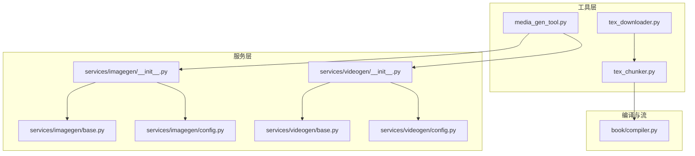
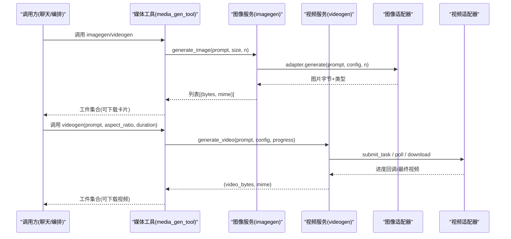
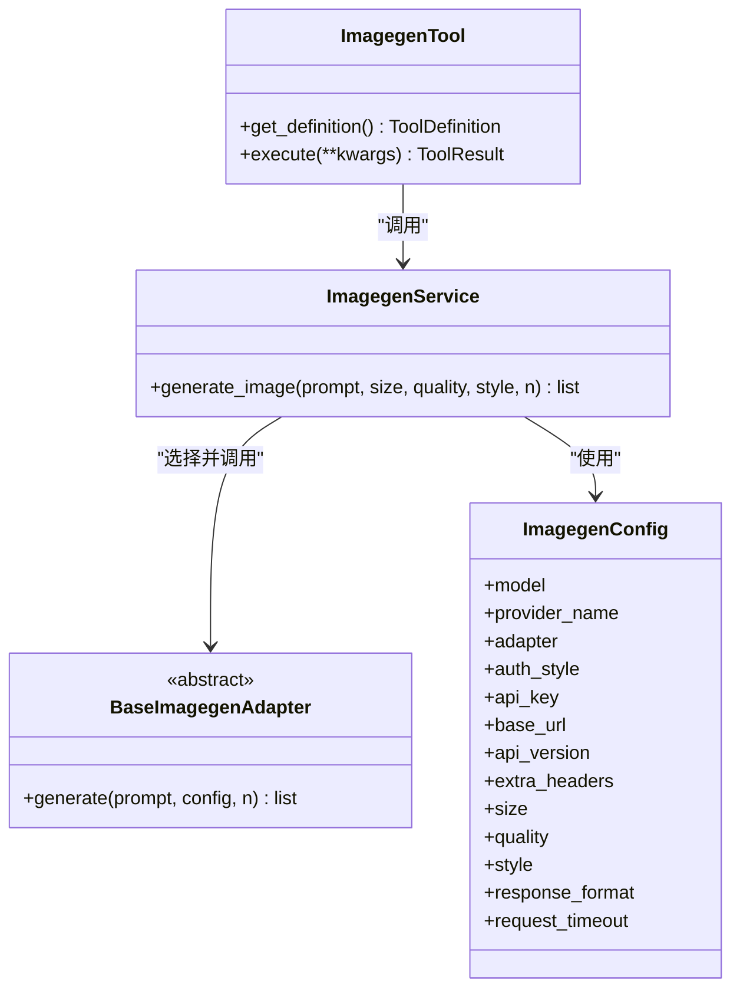
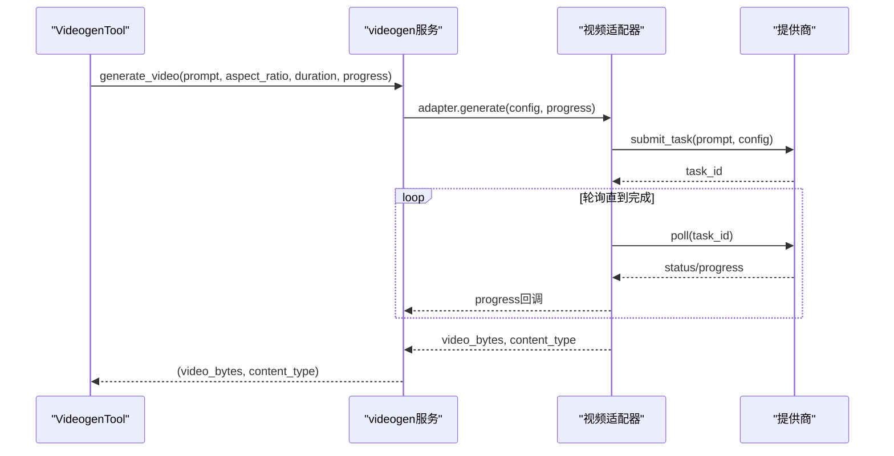
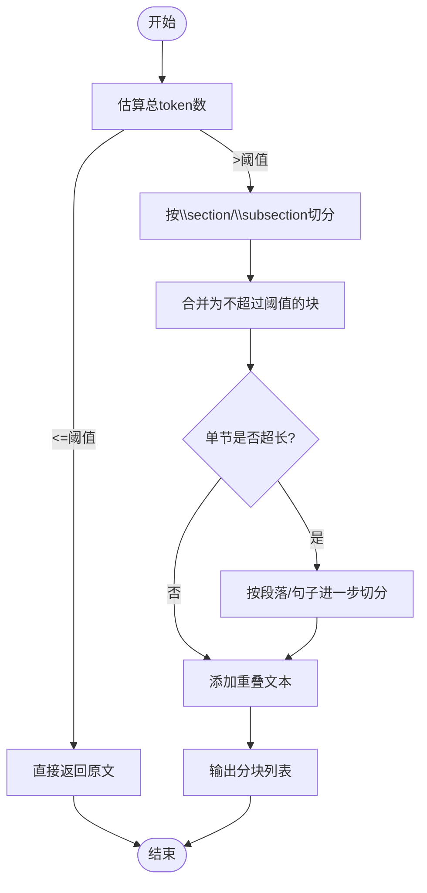
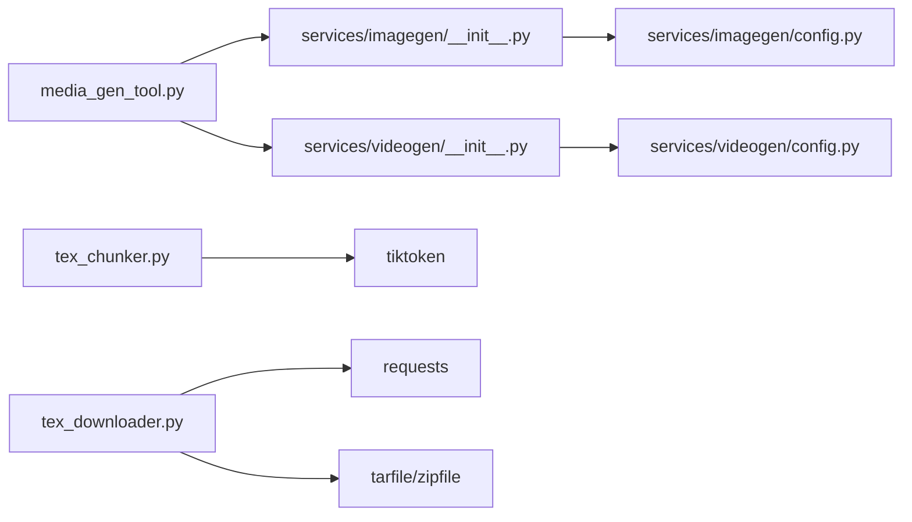

# 媒体处理工具

<cite>
**本文引用的文件**
- [media_gen_tool.py](file://deeptutor/tools/media_gen_tool.py)
- [imagegen/__init__.py](file://deeptutor/services/imagegen/__init__.py)
- [imagegen/base.py](file://deeptutor/services/imagegen/base.py)
- [imagegen/config.py](file://deeptutor/services/imagegen/config.py)
- [videogen/__init__.py](file://deeptutor/services/videogen/__init__.py)
- [videogen/base.py](file://deeptutor/services/videogen/base.py)
- [videogen/config.py](file://deeptutor/services/videogen/config.py)
- [tex_chunker.py](file://deeptutor/tools/tex_chunker.py)
- [tex_downloader.py](file://deeptutor/tools/tex_downloader.py)
- [compiler.py](file://deeptutor/book/compiler.py)
</cite>

## 目录
1. [简介](#简介)
2. [项目结构](#项目结构)
3. [核心组件](#核心组件)
4. [架构总览](#架构总览)
5. [详细组件分析](#详细组件分析)
6. [依赖关系分析](#依赖关系分析)
7. [性能与资源管理](#性能与资源管理)
8. [故障排除指南](#故障排除指南)
9. [结论](#结论)
10. [附录：API参考与使用示例](#附录api参考与使用示例)

## 简介
本文件面向DeepTutor的媒体处理工具，覆盖图像生成、视频制作与LaTeX文档处理三大能力。内容包含：
- 支持的模型与服务：文本转图像、图像增强（通过配置项）、视频合成（异步任务）等
- LaTeX处理能力：从ArXiv下载源码、智能分块、上下文保持
- 完整API参考：参数、质量设置、格式转换选项
- 实际使用场景：教育内容创作、技术文档生成、多媒体演示
- 性能优化与资源管理：并发控制、超时与轮询预算、临时工作区清理
- 批处理与异步能力：批量图片生成、长时视频渲染进度上报
- 常见问题排查：配置缺失、网络异常、超时与配额限制

## 项目结构
媒体处理相关代码主要分布在以下模块：
- 工具层：对外暴露给聊天/编排器的工具接口
  - media_gen_tool.py：图像与视频生成的工具封装
  - tex_chunker.py：LaTeX智能分块
  - tex_downloader.py：LaTeX源码下载与解析
- 服务层：对接不同提供商的适配与配置
  - services/imagegen：文本转图像服务（OpenAI兼容等）
  - services/videogen：文本转视频服务（异步任务提交/轮询/下载）
- 编译与流式输出：book/compiler.py用于书籍页面级编译与流式事件

图表来源
- [media_gen_tool.py:1-262](file://deeptutor/tools/media_gen_tool.py#L1-L262)
- [imagegen/__init__.py:1-48](file://deeptutor/services/imagegen/__init__.py#L1-L48)
- [videogen/__init__.py:1-66](file://deeptutor/services/videogen/__init__.py#L1-L66)
- [imagegen/base.py:1-25](file://deeptutor/services/imagegen/base.py#L1-L25)
- [videogen/base.py:1-43](file://deeptutor/services/videogen/base.py#L1-L43)
- [imagegen/config.py:1-40](file://deeptutor/services/imagegen/config.py#L1-L40)
- [videogen/config.py:1-40](file://deeptutor/services/videogen/config.py#L1-L40)
- [compiler.py:1-200](file://deeptutor/book/compiler.py#L1-L200)

章节来源
- [media_gen_tool.py:1-262](file://deeptutor/tools/media_gen_tool.py#L1-L262)
- [imagegen/__init__.py:1-48](file://deeptutor/services/imagegen/__init__.py#L1-L48)
- [videogen/__init__.py:1-66](file://deeptutor/services/videogen/__init__.py#L1-L66)
- [tex_chunker.py:1-342](file://deeptutor/tools/tex_chunker.py#L1-L342)
- [tex_downloader.py:1-257](file://deeptutor/tools/tex_downloader.py#L1-L257)
- [compiler.py:1-200](file://deeptutor/book/compiler.py#L1-L200)

## 核心组件
- 图像生成工具（ImagegenTool）
  - 将文本提示转换为一张或多张图片，支持尺寸、数量等参数
  - 写入公共工作区并作为附件返回，便于聊天界面展示与引用
- 视频生成工具（VideogenTool）
  - 将文本提示转换为短视频，支持宽高比、时长等参数
  - 长时渲染通过进度回调上报状态，最终产出视频文件
- LaTeX下载器（TexDownloader）
  - 从ArXiv下载论文源码包，自动解压并定位主TeX文件
  - 提供安全解压与错误处理
- LaTeX分块器（TexChunker）
  - 基于章节/段落/句子的多级切分策略，保证上下文连贯
  - 使用tiktoken估算token数，避免超限
- 书籍编译（BookCompiler）
  - 按页组织块生成，支持并发与流式事件，便于前端增量渲染

章节来源
- [media_gen_tool.py:116-180](file://deeptutor/tools/media_gen_tool.py#L116-L180)
- [media_gen_tool.py:183-258](file://deeptutor/tools/media_gen_tool.py#L183-L258)
- [tex_downloader.py:44-132](file://deeptutor/tools/tex_downloader.py#L44-L132)
- [tex_chunker.py:21-164](file://deeptutor/tools/tex_chunker.py#L21-L164)
- [compiler.py:69-190](file://deeptutor/book/compiler.py#L69-L190)

## 架构总览
媒体处理采用“工具层 → 服务层 → 适配器”的分层设计：
- 工具层：定义统一的工具定义与执行流程，负责参数校验、结果包装与工件收集
- 服务层：根据运行时配置选择具体适配器，封装调用细节
- 适配器层：实现与不同提供商的HTTP交互（同步或异步任务）

图表来源
- [media_gen_tool.py:151-180](file://deeptutor/tools/media_gen_tool.py#L151-L180)
- [media_gen_tool.py:217-258](file://deeptutor/tools/media_gen_tool.py#L217-L258)
- [imagegen/__init__.py:17-44](file://deeptutor/services/imagegen/__init__.py#L17-L44)
- [videogen/__init__.py:21-48](file://deeptutor/services/videogen/__init__.py#L21-L48)
- [imagegen/base.py:10-24](file://deeptutor/services/imagegen/base.py#L10-L24)
- [videogen/base.py:15-42](file://deeptutor/services/videogen/base.py#L15-L42)

## 详细组件分析

### 图像生成（Text-to-Image）
- 工具入口：ImagegenTool
  - 参数：prompt（必填）、size（可选WxH）、n（1-4）
  - 行为：校验输入→调用服务→写入工作区→返回工件
- 服务封装：generate_image
  - 解析运行时配置→选择适配器→发起生成→返回多张图
- 适配器抽象：BaseImagegenAdapter
  - 统一接口：generate(prompt, config, n) → [(bytes, mime)]
- 配置项：ImagegenConfig
  - model、provider_name、adapter、auth_style、api_key、base_url、api_version、extra_headers
  - 生成参数：size、quality、style、response_format
  - 超时：request_timeout

图表来源
- [media_gen_tool.py:116-180](file://deeptutor/tools/media_gen_tool.py#L116-L180)
- [imagegen/__init__.py:17-44](file://deeptutor/services/imagegen/__init__.py#L17-L44)
- [imagegen/base.py:10-24](file://deeptutor/services/imagegen/base.py#L10-L24)
- [imagegen/config.py:17-39](file://deeptutor/services/imagegen/config.py#L17-L39)

章节来源
- [media_gen_tool.py:116-180](file://deeptutor/tools/media_gen_tool.py#L116-L180)
- [imagegen/__init__.py:17-44](file://deeptutor/services/imagegen/__init__.py#L17-L44)
- [imagegen/base.py:10-24](file://deeptutor/services/imagegen/base.py#L10-L24)
- [imagegen/config.py:17-39](file://deeptutor/services/imagegen/config.py#L17-L39)

### 视频生成（Text-to-Video）
- 工具入口：VideogenTool
  - 参数：prompt（必填）、aspect_ratio（可选）、duration（可选）
  - 行为：校验输入→调用服务→写入工作区→返回工件；支持进度回调
- 服务封装：generate_video
  - 解析运行时配置→选择适配器→提交任务/轮询/下载→返回视频
- 适配器抽象：BaseVideogenAdapter
  - 统一接口：submit_task、generate（含progress回调）
- 配置项：VideogenConfig
  - model、provider_name、adapter、auth_style、api_key、base_url、api_version、extra_headers
  - 生成参数：aspect_ratio、duration、resolution
  - 轮询预算：request_timeout、poll_interval、poll_timeout

图表来源
- [media_gen_tool.py:183-258](file://deeptutor/tools/media_gen_tool.py#L183-L258)
- [videogen/__init__.py:21-48](file://deeptutor/services/videogen/__init__.py#L21-L48)
- [videogen/base.py:15-42](file://deeptutor/services/videogen/base.py#L15-L42)
- [videogen/config.py:15-39](file://deeptutor/services/videogen/config.py#L15-L39)

章节来源
- [media_gen_tool.py:183-258](file://deeptutor/tools/media_gen_tool.py#L183-L258)
- [videogen/__init__.py:21-48](file://deeptutor/services/videogen/__init__.py#L21-L48)
- [videogen/base.py:15-42](file://deeptutor/services/videogen/base.py#L15-L42)
- [videogen/config.py:15-39](file://deeptutor/services/videogen/config.py#L15-L39)

### LaTeX下载与分块
- TexDownloader
  - 从ArXiv下载e-print压缩包（tar/zip），安全解压，定位主TeX文件（main.tex/paper.tex/manuscript.tex或包含\documentclass的最大文件）
  - 返回路径与内容，便于后续处理
- TexChunker
  - 估算token数（优先使用活动LLM模型的编码，否则回退到cl100k_base）
  - 分块策略：优先按章节切分，过长章节再按段落/句子切分；支持重叠以保持上下文
  - 输出为多个片段，便于分批送入LLM或编译流程

图表来源
- [tex_chunker.py:21-164](file://deeptutor/tools/tex_chunker.py#L21-L164)
- [tex_chunker.py:166-289](file://deeptutor/tools/tex_chunker.py#L166-L289)
- [tex_downloader.py:57-132](file://deeptutor/tools/tex_downloader.py#L57-L132)

章节来源
- [tex_downloader.py:44-132](file://deeptutor/tools/tex_downloader.py#L44-L132)
- [tex_chunker.py:21-164](file://deeptutor/tools/tex_chunker.py#L21-L164)
- [tex_chunker.py:166-289](file://deeptutor/tools/tex_chunker.py#L166-L289)

### 书籍编译与流式输出
- BookCompiler
  - 规划页面（如需要）→逐块生成→持久化→流式事件通知前端
  - 支持并发控制（block_concurrency）与阶段开关（phase）
  - 在每块完成后保存页面JSON，确保中断恢复与增量更新

章节来源
- [compiler.py:45-190](file://deeptutor/book/compiler.py#L45-L190)

## 依赖关系分析
- 工具层依赖服务层：
  - media_gen_tool.py 依赖 services.imagegen 与 services.videogen
- 服务层依赖适配器与配置：
  - imagegen/__init__.py 依赖 adapters 与 config
  - videogen/__init__.py 依赖 adapters 与 config
- 配置驱动行为：
  - ImagegenConfig/VideogenConfig 决定请求头、超时、轮询策略等
- 外部依赖：
  - tiktoken（token估算）
  - requests（ArXiv下载）
  - tarfile/zipfile（安全解压）

图表来源
- [media_gen_tool.py:1-262](file://deeptutor/tools/media_gen_tool.py#L1-L262)
- [imagegen/__init__.py:1-48](file://deeptutor/services/imagegen/__init__.py#L1-L48)
- [videogen/__init__.py:1-66](file://deeptutor/services/videogen/__init__.py#L1-L66)
- [imagegen/config.py:1-40](file://deeptutor/services/imagegen/config.py#L1-L40)
- [videogen/config.py:1-40](file://deeptutor/services/videogen/config.py#L1-L40)
- [tex_chunker.py:1-342](file://deeptutor/tools/tex_chunker.py#L1-L342)
- [tex_downloader.py:1-257](file://deeptutor/tools/tex_downloader.py#L1-L257)

章节来源
- [media_gen_tool.py:1-262](file://deeptutor/tools/media_gen_tool.py#L1-L262)
- [imagegen/__init__.py:1-48](file://deeptutor/services/imagegen/__init__.py#L1-L48)
- [videogen/__init__.py:1-66](file://deeptutor/services/videogen/__init__.py#L1-L66)
- [tex_chunker.py:1-342](file://deeptutor/tools/tex_chunker.py#L1-L342)
- [tex_downloader.py:1-257](file://deeptutor/tools/tex_downloader.py#L1-L257)

## 性能与资源管理
- 并发控制
  - 书籍编译支持 block_concurrency，可在Phase 1之后提升并行度以加速生成
- 超时与轮询预算
  - 图像生成：request_timeout默认较长，避免慢请求被提前中断
  - 视频生成：request_timeout、poll_interval、poll_timeout共同约束单次轮询与整体渲染时间
- 临时工作区与清理
  - 媒体生成使用独立运行目录，避免污染其他任务
  - ArXiv下载使用临时目录并在完成后清理
- 进度上报
  - 视频生成通过progress回调向调用方推送渲染状态，便于前端显示与用户感知
- 批处理
  - 图像生成支持一次请求多张图（n=1-4），减少往返开销
  - LaTeX分块可将大文档拆分为多个片段，配合并发或队列进行批处理

[本节为通用指导，不直接分析具体文件]

## 故障排除指南
- 未配置提供商或服务不可用
  - 现象：抛出GenerationProviderError或返回空结果
  - 处理：检查运行时配置（model、api_key、base_url、adapter），确认服务已启用
- 空提示词
  - 现象：图像/视频服务拒绝空prompt
  - 处理：确保prompt非空且描述清晰
- 网络与超时
  - 现象：下载失败、轮询超时
  - 处理：调整request_timeout、poll_interval、poll_timeout；检查网络连通性与代理设置
- 配额与计费
  - 现象：提供商限流或计费触发
  - 处理：降低并发、增大间隔；使用probe_video验证连接而不触发完整渲染
- 解压安全
  - 现象：TarSlip/ZipSlip风险
  - 处理：使用安全解压过滤，仅允许目标目录内文件

章节来源
- [media_gen_tool.py:151-180](file://deeptutor/tools/media_gen_tool.py#L151-L180)
- [media_gen_tool.py:217-258](file://deeptutor/tools/media_gen_tool.py#L217-L258)
- [imagegen/__init__.py:17-44](file://deeptutor/services/imagegen/__init__.py#L17-L44)
- [videogen/__init__.py:21-48](file://deeptutor/services/videogen/__init__.py#L21-L48)
- [tex_downloader.py:157-180](file://deeptutor/tools/tex_downloader.py#L157-L180)

## 结论
DeepTutor媒体处理工具通过清晰的层次结构与可扩展的适配器设计，提供了稳定的图像与视频生成能力，以及健壮的LaTeX文档处理能力。借助配置驱动的运行时选择、完善的超时与轮询策略、以及流式进度上报，能够满足教育内容创作、技术文档生成与多媒体演示等多种场景需求。建议在生产环境中合理设置并发与超时参数，并结合批处理与异步能力提升吞吐与用户体验。

[本节为总结性内容，不直接分析具体文件]

## 附录：API参考与使用示例

### API参考
- 图像生成（ImagegenTool）
  - 名称：imagegen
  - 参数：
    - prompt: string（必填）
    - size: string（可选，如“1024x1024”）
    - n: integer（可选，1-4，默认1）
  - 返回：工件集合（图片文件），附带元数据（文件名、URL、MIME、大小）
- 视频生成（VideogenTool）
  - 名称：videogen
  - 参数：
    - prompt: string（必填）
    - aspect_ratio: string（可选，如“16:9”）
    - duration: string（可选，秒数，如“5”）
  - 返回：工件集合（视频文件），附带元数据
- LaTeX下载（TexDownloader）
  - 方法：download_arxiv_source(arxiv_url, arxiv_id?)
  - 返回：TexDownloadResult（success、tex_path、tex_content、error）
- LaTeX分块（TexChunker）
  - 方法：split_tex_into_chunks(tex_content, max_tokens=8000, overlap=500)
  - 返回：字符串列表（分块）
- 书籍编译（BookCompiler）
  - 方法：compile_page(book_id, chapter, page, stream, knowledge_bases?, language="en", exploration?)
  - 行为：规划页面、逐块生成、持久化、流式事件

章节来源
- [media_gen_tool.py:116-180](file://deeptutor/tools/media_gen_tool.py#L116-L180)
- [media_gen_tool.py:183-258](file://deeptutor/tools/media_gen_tool.py#L183-L258)
- [tex_downloader.py:57-132](file://deeptutor/tools/tex_downloader.py#L57-L132)
- [tex_chunker.py:90-164](file://deeptutor/tools/tex_chunker.py#L90-L164)
- [compiler.py:88-190](file://deeptutor/book/compiler.py#L88-L190)

### 使用示例（场景）
- 教育内容创作
  - 步骤：使用TexDownloader下载论文源码→TexChunker分块→结合BookCompiler生成讲解页→使用ImagegenTool配图
  - 要点：合理设置max_tokens与overlap，保证上下文连贯；为复杂概念生成示意图
- 技术文档生成
  - 步骤：将技术说明文档分块→调用ImagegenTool生成架构图/流程图→汇总为书籍页面
  - 要点：使用size与quality参数平衡清晰度与生成速度
- 多媒体演示
  - 步骤：编写脚本提示→调用VideogenTool生成短视频→嵌入演示文稿
  - 要点：设置aspect_ratio与duration匹配演示比例；利用进度回调展示渲染状态

[本节为使用指导，不直接分析具体文件]