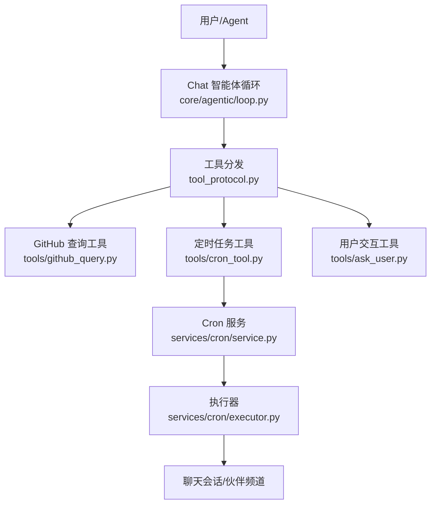
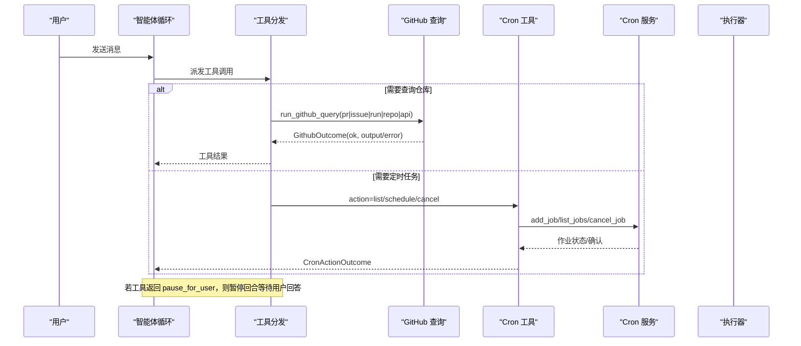
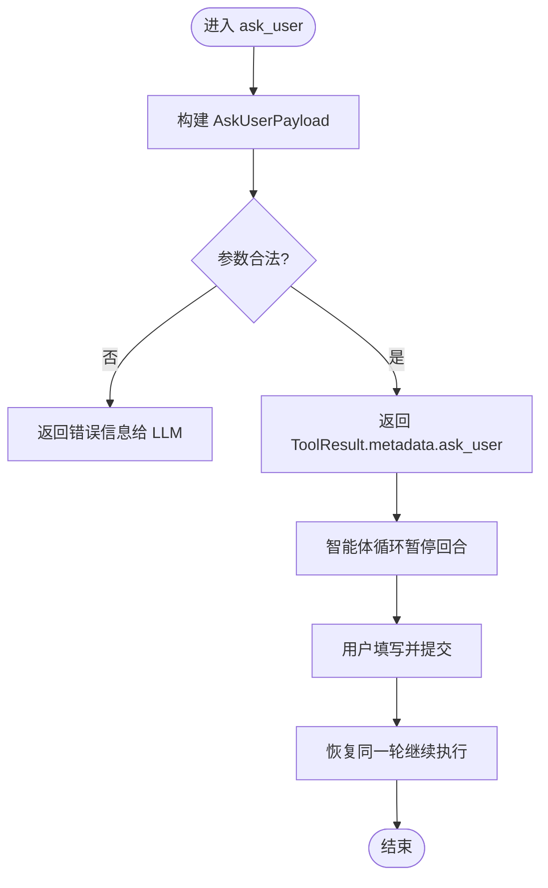
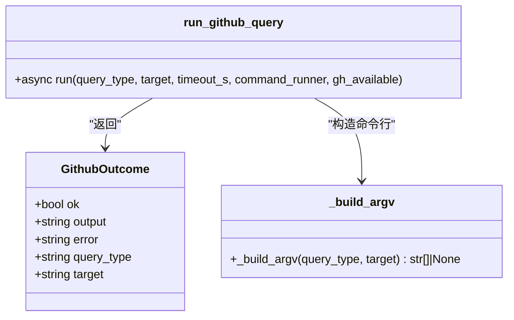
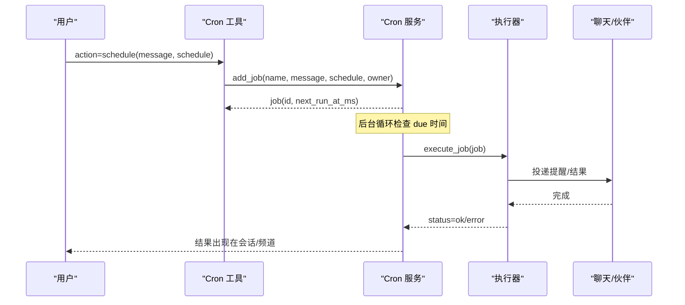
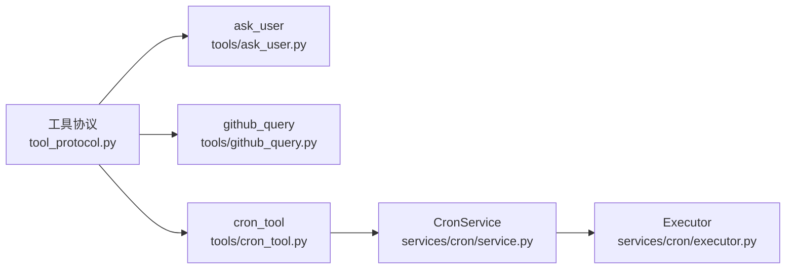

# 实用工具

<cite>
**本文引用的文件**
- [github_query.py](file://deeptutor/tools/github_query.py)
- [cron_tool.py](file://deeptutor/tools/cron_tool.py)
- [service.py](file://deeptutor/services/cron/service.py)
- [executor.py](file://deeptutor/services/cron/executor.py)
- [ask_user.py](file://deeptutor/tools/ask_user.py)
- [tool_protocol.py](file://deeptutor/core/tool_protocol.py)
- [loop.py](file://deeptutor/core/agentic/loop.py)
- [README.md](file://README.md)
- [test_github_query.py](file://tests/tools/test_github_query.py)
</cite>

## 目录
1. [简介](#简介)
2. [项目结构](#项目结构)
3. [核心组件](#核心组件)
4. [架构总览](#架构总览)
5. [详细组件分析](#详细组件分析)
6. [依赖关系分析](#依赖关系分析)
7. [性能与可靠性](#性能与可靠性)
8. [故障排查指南](#故障排查指南)
9. [结论](#结论)
10. [附录：API参考与使用示例](#附录api参考与使用示例)

## 简介
本文件聚焦 DeepTutor 的“实用工具”能力，围绕三类关键辅助功能展开：
- 用户交互：通过 ask_user 实现人机对话与交互式决策，支持结构化问题、选项、多轮澄清。
- GitHub 查询：只读访问代码仓库信息（PR、Issue、Workflow Run、仓库元数据），用于代码审查与协作洞察。
- 定时任务：提供任务调度、执行监控与结果通知，支持一次性、周期性与 cron 表达式，并可将结果投递到聊天会话或伙伴频道。

同时给出完整的 API 参考、配置项、错误处理策略、性能与调试建议，以及自动化工作流、代码审查、项目管理等实际场景示例。

## 项目结构
DeepTutor 的工具层位于 deeptutor/tools，其中与本主题相关的核心文件包括：
- github_query.py：基于 gh CLI 的只读 GitHub 查询封装。
- cron_tool.py：面向用户的定时任务工具入口（list/schedule/cancel）。
- ask_user.py：构建 ask_user 工具的交互载荷，驱动前端渲染问答卡片。
- core/tool_protocol.py：工具协议定义（ToolDefinition、ToolResult、BaseTool 等）。
- core/agentic/loop.py：智能体循环与工具派发、暂停恢复机制。
- services/cron/*：定时任务的持久化服务与执行器。

图表来源
- [loop.py:67-101](file://deeptutor/core/agentic/loop.py#L67-L101)
- [tool_protocol.py:121-154](file://deeptutor/core/tool_protocol.py#L121-L154)
- [github_query.py:66-144](file://deeptutor/tools/github_query.py#L66-L144)
- [cron_tool.py:76-139](file://deeptutor/tools/cron_tool.py#L76-L139)
- [service.py:178-388](file://deeptutor/services/cron/service.py#L178-L388)
- [executor.py:16-195](file://deeptutor/services/cron/executor.py#L16-L195)

章节来源
- [README.md:468-486](file://README.md#L468-L486)

## 核心组件
- 工具协议层：统一描述工具参数、调用方式与返回结果，支持延迟加载与提示词引导。
- 用户交互工具：将 LLM 的结构化问题包装为前端可渲染的问答卡片，支持暂停当前回合等待用户输入。
- GitHub 查询工具：以只读方式调用 gh CLI，限制命令集，避免写入操作，输出截断保护。
- 定时任务工具：封装 add/list/remove 动作，解析 at/every/cron 三种调度类型，持久化存储与执行。

章节来源
- [tool_protocol.py:16-95](file://deeptutor/core/tool_protocol.py#L16-L95)
- [tool_protocol.py:121-154](file://deeptutor/core/tool_protocol.py#L121-L154)
- [ask_user.py:99-138](file://deeptutor/tools/ask_user.py#L99-L138)
- [github_query.py:66-144](file://deeptutor/tools/github_query.py#L66-L144)
- [cron_tool.py:76-139](file://deeptutor/tools/cron_tool.py#L76-L139)

## 架构总览
DeepTutor 的智能体循环在每轮迭代中并行派发工具调用；当工具需要用户参与时，通过 ToolResult.pause_for_user 暂停回合，前端渲染 ask_user 卡片，收集答案后恢复同一轮继续执行。GitHub 查询工具通过受控子进程调用 gh CLI，仅允许只读视图与列表操作。定时任务工具将任务注册到 CronService，由后台调度器按时间触发，并通过 ChatOrchestrator 或伙伴通道投递结果。

图表来源
- [loop.py:92-101](file://deeptutor/core/agentic/loop.py#L92-L101)
- [tool_protocol.py:121-154](file://deeptutor/core/tool_protocol.py#L121-L154)
- [github_query.py:66-144](file://deeptutor/tools/github_query.py#L66-L144)
- [cron_tool.py:76-139](file://deeptutor/tools/cron_tool.py#L76-L139)
- [service.py:227-280](file://deeptutor/services/cron/service.py#L227-L280)

## 详细组件分析

### 用户交互工具（ask_user）
- 目标：让 Agent 在需要澄清或选择时暂停当前回合，向用户展示结构化问题与选项，收集答案后恢复执行。
- 数据结构：AskUserPayload 包含 questions 数组与可选 intro；每个问题有 id、prompt、options、header、multi_select、allow_free_text、placeholder。
- 约束：最多 4 个问题、每个问题最多 8 个选项、字段长度上限、去重与冗余选项过滤。
- 与前端联动：metadata.ask_user 被前端读取并渲染问答卡片，支持批量提交。

图表来源
- [ask_user.py:99-138](file://deeptutor/tools/ask_user.py#L99-L138)
- [tool_protocol.py:121-154](file://deeptutor/core/tool_protocol.py#L121-L154)

章节来源
- [ask_user.py:1-274](file://deeptutor/tools/ask_user.py#L1-L274)
- [tool_protocol.py:121-154](file://deeptutor/core/tool_protocol.py#L121-L154)

### GitHub 查询工具（github_query）
- 目标：安全、只读地获取 GitHub 仓库相关信息，支持 PR、Issue、Workflow Run、仓库元数据及通用 API GET。
- 安全设计：仅构造 view/list 子命令；api 模式固定为 GET；不暴露 close/merge/comment/edit 等写操作。
- 可用性检测：若系统未安装 gh CLI，返回 ok=False 的友好提示，便于 LLM 告知用户。
- 超时与截断：默认 20 秒超时；输出超过 16000 字符会被截断并标注省略。

图表来源
- [github_query.py:49-58](file://deeptutor/tools/github_query.py#L49-L58)
- [github_query.py:66-144](file://deeptutor/tools/github_query.py#L66-L144)
- [github_query.py:152-197](file://deeptutor/tools/github_query.py#L152-L197)

章节来源
- [github_query.py:1-230](file://deeptutor/tools/github_query.py#L1-L230)
- [test_github_query.py:1-141](file://tests/tools/test_github_query.py#L1-L141)

### 定时任务工具与服务（cron_tool + service + executor）
- 工具入口：cron_tool.run_cron_action 支持 action=list/schedule/cancel；schedule 支持 at（一次性）、every_seconds（间隔）、cron_expr（cron 表达式）。
- 服务层：CronService 负责作业持久化（JSON）、调度循环、下次运行时间计算、运行历史保留与清理。
- 执行器：execute_job 根据 owner.kind 决定投递到聊天会话或伙伴频道；失败记录状态与错误；成功时将结果追加到会话或发布到渠道。

图表来源
- [cron_tool.py:76-139](file://deeptutor/tools/cron_tool.py#L76-L139)
- [service.py:118-175](file://deeptutor/services/cron/service.py#L118-L175)
- [service.py:227-280](file://deeptutor/services/cron/service.py#L227-L280)
- [executor.py:16-195](file://deeptutor/services/cron/executor.py#L16-L195)

章节来源
- [cron_tool.py:1-143](file://deeptutor/tools/cron_tool.py#L1-L143)
- [service.py:1-415](file://deeptutor/services/cron/service.py#L1-L415)
- [executor.py:1-199](file://deeptutor/services/cron/executor.py#L1-L199)

## 依赖关系分析
- 工具协议层为所有工具提供统一的参数描述、执行接口与结果格式，确保 LLM 能一致理解与调用。
- ask_user 依赖前端对 metadata.ask_user 的渲染能力，形成“工具→界面→用户→工具恢复”的闭环。
- github_query 依赖外部 gh CLI，通过注入式 command_runner 提升可测试性；默认使用 asyncio.subprocess。
- cron_tool 依赖 CronService 进行持久化与调度；执行器依赖会话存储与伙伴管理器进行结果投递。

图表来源
- [tool_protocol.py:16-95](file://deeptutor/core/tool_protocol.py#L16-L95)
- [cron_tool.py:76-139](file://deeptutor/tools/cron_tool.py#L76-L139)
- [service.py:178-388](file://deeptutor/services/cron/service.py#L178-L388)
- [executor.py:16-195](file://deeptutor/services/cron/executor.py#L16-L195)

章节来源
- [tool_protocol.py:16-95](file://deeptutor/core/tool_protocol.py#L16-L95)
- [cron_tool.py:76-139](file://deeptutor/tools/cron_tool.py#L76-L139)
- [service.py:178-388](file://deeptutor/services/cron/service.py#L178-L388)
- [executor.py:16-195](file://deeptutor/services/cron/executor.py#L16-L195)

## 性能与可靠性
- GitHub 查询
  - 超时控制：默认 20 秒，避免阻塞；超时后会终止子进程并返回错误。
  - 输出截断：最大 16000 字符，防止大响应影响上下文窗口。
  - 只读约束：严格限制命令模板，避免误用导致写入风险。
- 定时任务
  - 调度精度：最小轮询间隔约 0.05 秒，最大不超过 60 秒，兼顾实时性与资源占用。
  - 持久化：JSON 原子替换保存，损坏时自动备份 corrupt 文件，保障可恢复。
  - 执行隔离：执行异常捕获并记录状态与错误，不影响其他作业。
- 用户交互
  - 结构化约束：问题数、选项数、字段长度限制，降低前端渲染压力与歧义。
  - 暂停恢复：在同一轮内暂停与恢复，保持上下文连贯，减少重复解释成本。

[本节为通用指导，不直接分析具体文件]

## 故障排查指南
- GitHub 查询不可用
  - 现象：返回 ok=False 且提示未安装 gh CLI。
  - 处理：在部署环境中安装 gh CLI，或通过 CI/CD 预装；或在设置中禁用该工具。
  - 参考路径：[github_query.py:92-103](file://deeptutor/tools/github_query.py#L92-L103)
- GitHub 查询超时或失败
  - 现象：返回超时错误或退出码非零的错误信息。
  - 处理：检查网络、认证令牌、仓库权限；适当增大超时或限制查询范围。
  - 参考路径：[github_query.py:115-139](file://deeptutor/tools/github_query.py#L115-L139)
- 定时任务无法调度
  - 现象：add_job 报错或 list 为空。
  - 处理：校验 schedule 参数（at/every/cron）；cron 表达式需安装 croniter；检查 owner_key 是否匹配。
  - 参考路径：[cron_tool.py:59-73](file://deeptutor/tools/cron_tool.py#L59-L73)、[service.py:118-175](file://deeptutor/services/cron/service.py#L118-L175)
- 定时任务执行无结果
  - 现象：执行器返回 no answer 或 partner not running。
  - 处理：确认会话存在、伙伴实例运行；检查执行器日志与错误记录。
  - 参考路径：[executor.py:77-120](file://deeptutor/services/cron/executor.py#L77-L120)、[executor.py:123-195](file://deeptutor/services/cron/executor.py#L123-L195)
- 用户交互未显示或卡住
  - 现象：前端未渲染问答卡片或长时间无响应。
  - 处理：检查 metadata.ask_user 是否正确传递；确认前端已订阅 pending_user_input；验证问题与选项格式。
  - 参考路径：[ask_user.py:99-138](file://deeptutor/tools/ask_user.py#L99-L138)、[tool_protocol.py:121-154](file://deeptutor/core/tool_protocol.py#L121-L154)

章节来源
- [github_query.py:92-139](file://deeptutor/tools/github_query.py#L92-L139)
- [cron_tool.py:59-73](file://deeptutor/tools/cron_tool.py#L59-L73)
- [service.py:118-175](file://deeptutor/services/cron/service.py#L118-L175)
- [executor.py:77-195](file://deeptutor/services/cron/executor.py#L77-L195)
- [ask_user.py:99-138](file://deeptutor/tools/ask_user.py#L99-L138)
- [tool_protocol.py:121-154](file://deeptutor/core/tool_protocol.py#L121-L154)

## 结论
DeepTutor 的实用工具围绕“人机对话、代码仓库洞察、定时任务”三大方向，提供了安全、可控、可扩展的能力：
- ask_user 使 Agent 能在复杂决策中主动询问用户，保证交互质量与上下文一致性。
- github_query 以只读方式提供仓库信息，支撑代码审查与协作流程。
- 定时任务工具结合服务与执行器，实现可靠的任务调度与结果投递，适用于提醒、巡检、自动化报告等场景。

配合工具协议层与智能体循环，这些工具能够无缝嵌入聊天、研究、可视化等多种能力，形成端到端的自动化工作流。

[本节为总结性内容，不直接分析具体文件]

## 附录：API参考与使用示例

### 用户交互（ask_user）
- 输入参数
  - questions：数组，每项包含 prompt、options、header、multi_select、allow_free_text、placeholder、id。
  - intro：可选介绍文本。
- 行为
  - 构建 AskUserPayload，返回 ToolResult.metadata.ask_user。
  - 智能体循环暂停回合，前端渲染问答卡片，用户提交后恢复。
- 约束
  - 最多 4 个问题，每个问题最多 8 个选项，字段长度限制，去重与冗余过滤。
- 参考路径
  - [ask_user.py:99-138](file://deeptutor/tools/ask_user.py#L99-L138)
  - [tool_protocol.py:121-154](file://deeptutor/core/tool_protocol.py#L121-L154)

### GitHub 查询（github_query）
- 输入参数
  - query_type：pr | issue | run | repo | api
  - target：owner/repo[#number] 或 URL；api 模式为 gh api 路径
  - timeout_s：可选，默认 20 秒
- 行为
  - 构造只读 gh CLI 命令并执行；返回 GithubOutcome。
  - 输出截断至 16000 字符；超时或失败返回错误信息。
- 参考路径
  - [github_query.py:66-144](file://deeptutor/tools/github_query.py#L66-L144)
  - [github_query.py:152-197](file://deeptutor/tools/github_query.py#L152-L197)
  - [test_github_query.py:100-141](file://tests/tools/test_github_query.py#L100-L141)

### 定时任务（cron_tool + service + executor）
- 输入参数
  - action：list | schedule | cancel
  - schedule：at（ISO 时间）、every_seconds（≥30）、cron_expr（需 croniter）
  - name、message、delete_after_run、tz（cron 模式）
- 行为
  - list：列出当前会话的作业；schedule：添加作业并计算下次运行时间；cancel：取消指定作业。
  - 执行器将结果投递到聊天会话或伙伴频道，并记录运行历史。
- 参考路径
  - [cron_tool.py:76-139](file://deeptutor/tools/cron_tool.py#L76-L139)
  - [service.py:118-175](file://deeptutor/services/cron/service.py#L118-L175)
  - [service.py:227-280](file://deeptutor/services/cron/service.py#L227-L280)
  - [executor.py:16-195](file://deeptutor/services/cron/executor.py#L16-L195)

### 实际使用示例
- 自动化工作流
  - 使用 cron 工具设置周期性任务，例如每天生成知识库健康报告并发送到团队频道。
  - 参考路径：[cron_tool.py:106-139](file://deeptutor/tools/cron_tool.py#L106-L139)、[executor.py:77-120](file://deeptutor/services/cron/executor.py#L77-L120)
- 代码审查
  - 使用 github_query 查看 PR 的状态、检查与评论，辅助评审决策。
  - 参考路径：[github_query.py:152-161](file://deeptutor/tools/github_query.py#L152-L161)
- 项目管理
  - 通过 github_query 列出最近 Workflow Run，监控构建与部署状态。
  - 参考路径：[github_query.py:171-182](file://deeptutor/tools/github_query.py#L171-L182)

### 配置管理与扩展机制
- 工具协议扩展
  - 通过 BaseTool 实现自定义工具，声明 ToolDefinition 与 execute，支持延迟加载与提示词引导。
  - 参考路径：[tool_protocol.py:206-254](file://deeptutor/core/tool_protocol.py#L206-L254)
- 定时任务配置
  - 作业存储在 admin workspace 的 cron/jobs.json；服务启动时加载，修改后自动保存。
  - 参考路径：[service.py:197-224](file://deeptutor/services/cron/service.py#L197-L224)
- GitHub 查询扩展
  - 可通过注入 command_runner 替换执行方式（如代理、缓存），便于测试与定制。
  - 参考路径：[github_query.py:60-63](file://deeptutor/tools/github_query.py#L60-L63)

### 错误处理与异常恢复
- GitHub 查询
  - 未安装 gh CLI：返回 ok=False 并提示安装。
  - 超时：终止子进程并返回超时错误。
  - 非零退出码：提取前几行错误信息返回。
  - 参考路径：[github_query.py:92-139](file://deeptutor/tools/github_query.py#L92-L139)
- 定时任务
  - 执行异常：捕获并记录状态与错误，保留运行历史。
  - 会话不存在：返回错误并跳过执行。
  - 参考路径：[executor.py:77-120](file://deeptutor/services/cron/executor.py#L77-L120)、[executor.py:123-195](file://deeptutor/services/cron/executor.py#L123-L195)
- 用户交互
  - 参数非法：返回错误信息给 LLM，避免中断流程。
  - 参考路径：[ask_user.py:99-138](file://deeptutor/tools/ask_user.py#L99-L138)

### 性能监控与调试工具
- 工具协议与提示词
  - 使用 ToolPromptHints 与 aliases 提供使用指导，帮助 LLM 正确选择工具。
  - 参考路径：[tool_protocol.py:97-118](file://deeptutor/core/tool_protocol.py#L97-L118)
- 定时任务监控
  - CronJobState 记录 last_status、last_error、run_history；可用于仪表盘展示。
  - 参考路径：[service.py:80-115](file://deeptutor/services/cron/service.py#L80-L115)
- GitHub 查询调试
  - 通过 test_github_query 注入 command_runner 验证命令构造与输出处理。
  - 参考路径：[test_github_query.py:21-33](file://tests/tools/test_github_query.py#L21-L33)

章节来源
- [tool_protocol.py:97-118](file://deeptutor/core/tool_protocol.py#L97-L118)
- [service.py:80-115](file://deeptutor/services/cron/service.py#L80-L115)
- [test_github_query.py:21-33](file://tests/tools/test_github_query.py#L21-L33)