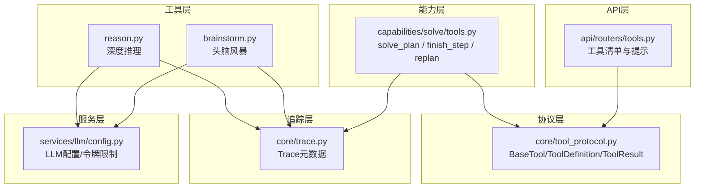
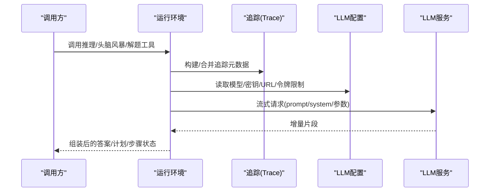
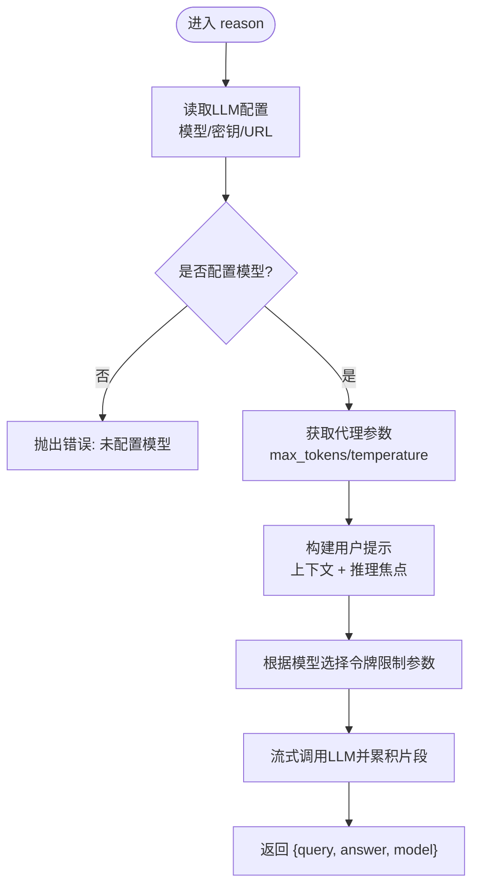
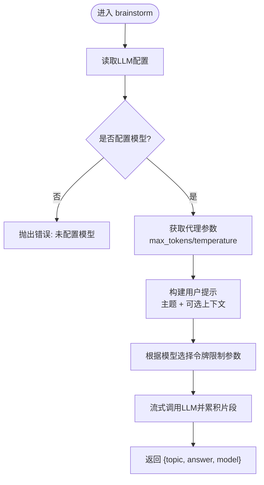
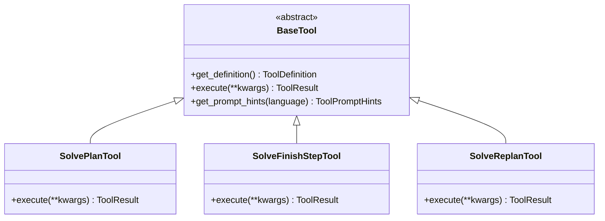
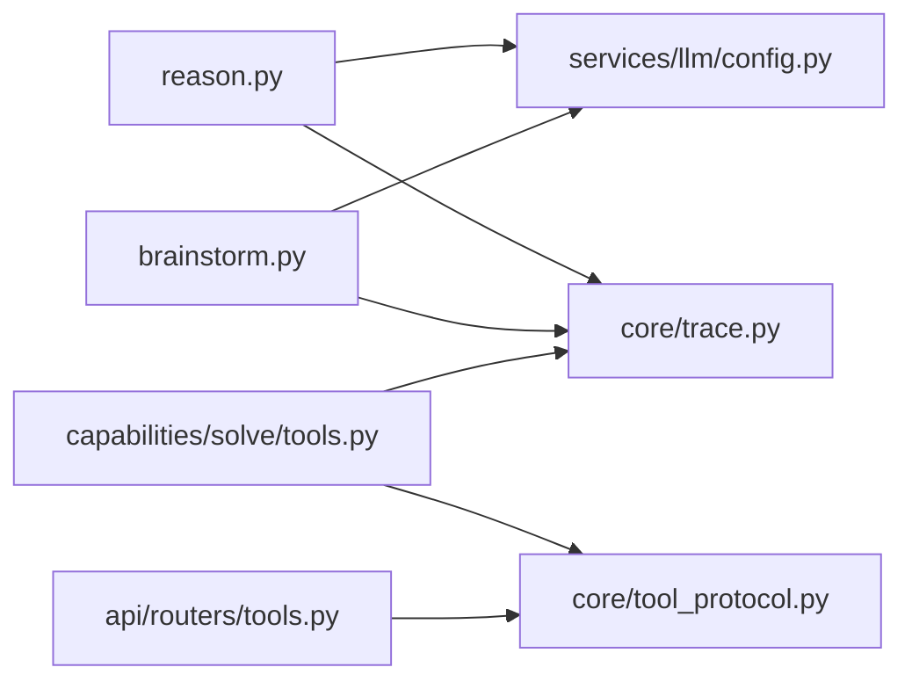

# 推理工具

<cite>
**本文引用的文件**
- [reason.py](file://deeptutor/tools/reason.py)
- [brainstorm.py](file://deeptutor/tools/brainstorm.py)
- [tools.py](file://deeptutor/capabilities/solve/tools.py)
- [tool_protocol.py](file://deeptutor/core/tool_protocol.py)
- [config.py](file://deeptutor/services/llm/config.py)
- [trace.py](file://deeptutor/core/trace.py)
- [tools.py](file://deeptutor/api/routers/tools.py)
</cite>

## 目录
1. [简介](#简介)
2. [项目结构](#项目结构)
3. [核心组件](#核心组件)
4. [架构总览](#架构总览)
5. [详细组件分析](#详细组件分析)
6. [依赖关系分析](#依赖关系分析)
7. [性能考虑](#性能考虑)
8. [故障排查指南](#故障排查指南)
9. [结论](#结论)
10. [附录：API参考与使用示例](#附录api参考与使用示例)

## 简介
本文件面向DeepTutor的“推理工具”能力，聚焦以下目标：
- 逻辑推理、头脑风暴、问题解决等智能推理功能的原理与用法
- 推理引擎的工作机制：问题分解、知识检索、逻辑推导、计划与重规划
- 头脑风暴工具的创意生成流程与输出格式
- 完整的API参考：参数、思维链配置、输出格式、质量评估
- 实际使用示例：复杂问题求解、决策支持、创新思考
- 推理过程的可解释性与透明度控制
- 结果验证方法与置信度评估
- 性能优化建议与最佳实践

## 项目结构
围绕推理能力的代码主要分布在如下位置：
- 工具层：提供无状态LLM调用封装（推理、头脑风暴）
- 能力层：在“解题”能力中挂载计划/完成步骤/重规划工具，形成可追踪的解题骨架
- 协议层：统一的工具定义、参数、结果与提示元数据
- 服务层：LLM配置、模型选择、令牌限制策略
- API层：暴露内置工具清单与提示元信息给前端设置页
- 追踪层：为UI渲染结构化执行时间线提供元数据

**图表来源**
- [reason.py:1-120](file://deeptutor/tools/reason.py#L1-L120)
- [brainstorm.py:1-105](file://deeptutor/tools/brainstorm.py#L1-L105)
- [tools.py:1-292](file://deeptutor/capabilities/solve/tools.py#L1-L292)
- [tool_protocol.py:1-275](file://deeptutor/core/tool_protocol.py#L1-L275)
- [config.py:1-294](file://deeptutor/services/llm/config.py#L1-L294)
- [tools.py:1-223](file://deeptutor/api/routers/tools.py#L1-L223)
- [trace.py:1-91](file://deeptutor/core/trace.py#L1-L91)

**章节来源**
- [reason.py:1-120](file://deeptutor/tools/reason.py#L1-L120)
- [brainstorm.py:1-105](file://deeptutor/tools/brainstorm.py#L1-L105)
- [tools.py:1-292](file://deeptutor/capabilities/solve/tools.py#L1-L292)
- [tool_protocol.py:1-275](file://deeptutor/core/tool_protocol.py#L1-L275)
- [config.py:1-294](file://deeptutor/services/llm/config.py#L1-L294)
- [tools.py:1-223](file://deeptutor/api/routers/tools.py#L1-L223)
- [trace.py:1-91](file://deeptutor/core/trace.py#L1-L91)

## 核心组件
- 深度推理工具：以单轮无状态LLM调用进行严谨的逐步逻辑推导，返回带步骤的推理链与结论。
- 头脑风暴工具：以广度优先方式探索多种可行方向，并给出简要依据，便于快速发散创意。
- 解题工具集：在“解题”会话中自动挂载的计划、完成步骤、重规划工具，用于将复杂问题拆解为有序步骤，并在过程中收敛与回溯。
- 工具协议：统一描述工具的定义、参数、提示元数据与执行结果，确保多端一致。
- LLM配置：集中管理模型、密钥、基地址、并发与速率限制、令牌上限策略等。
- 追踪元数据：为UI提供可渲染的执行阶段、标签、分组等结构化信息。

**章节来源**
- [reason.py:1-120](file://deeptutor/tools/reason.py#L1-L120)
- [brainstorm.py:1-105](file://deeptutor/tools/brainstorm.py#L1-L105)
- [tools.py:1-292](file://deeptutor/capabilities/solve/tools.py#L1-L292)
- [tool_protocol.py:1-275](file://deeptutor/core/tool_protocol.py#L1-L275)
- [config.py:1-294](file://deeptutor/services/llm/config.py#L1-L294)
- [trace.py:1-91](file://deeptutor/core/trace.py#L1-L91)

## 架构总览
推理工具通过“工具协议”抽象出统一的工具接口；具体实现包括深度推理、头脑风暴以及解题流程中的计划/完成/重规划工具。所有工具在执行时均可读取LLM配置，按模型特性选择合适的令牌限制参数，并通过流式调用获取响应。解题工具在会话内维护步骤计划，结合上下文检查点，使推理过程具备可解释性与可控性。

**图表来源**
- [reason.py:42-119](file://deeptutor/tools/reason.py#L42-L119)
- [brainstorm.py:45-104](file://deeptutor/tools/brainstorm.py#L45-L104)
- [tools.py:77-275](file://deeptutor/capabilities/solve/tools.py#L77-L275)
- [config.py:188-282](file://deeptutor/services/llm/config.py#L188-L282)
- [trace.py:14-82](file://deeptutor/core/trace.py#L14-L82)

## 详细组件分析

### 深度推理工具（reason）
- 功能定位：当需要深入分析、逻辑推导或综合已有信息但不需外部工具时，使用该工具进行单轮无状态推理。
- 输入：query（推理焦点）、context（可选背景/计划/观察）、模型相关参数（可回退到全局配置）。
- 处理流程：
  - 解析LLM配置，若未配置则抛出错误
  - 从代理参数中获取max_tokens与temperature默认值
  - 构造用户提示（包含上下文与推理焦点）
  - 根据模型类型选择正确的令牌限制参数
  - 流式调用LLM并拼接结果
- 输出：包含query、answer、model的结构化字典

**图表来源**
- [reason.py:42-119](file://deeptutor/tools/reason.py#L42-L119)
- [config.py:188-282](file://deeptutor/services/llm/config.py#L188-L282)

**章节来源**
- [reason.py:1-120](file://deeptutor/tools/reason.py#L1-L120)
- [config.py:188-282](file://deeptutor/services/llm/config.py#L188-L282)

### 头脑风暴工具（brainstorm）
- 功能定位：对主题进行广度优先探索，生成多个不同角度的可行方向，并为每个方向提供简要理由。
- 输入：topic（主题）、context（可选背景）、模型相关参数（可回退到全局配置）。
- 处理流程：
  - 解析LLM配置，若未配置则抛出错误
  - 从代理参数中获取max_tokens与temperature默认值（温度较高以鼓励发散）
  - 构造用户提示（主题与可选上下文）
  - 根据模型类型选择正确的令牌限制参数
  - 流式调用LLM并拼接结果
- 输出：包含topic、answer、model的结构化字典，answer遵循Markdown结构化的想法列表

**图表来源**
- [brainstorm.py:45-104](file://deeptutor/tools/brainstorm.py#L45-L104)
- [config.py:188-282](file://deeptutor/services/llm/config.py#L188-L282)

**章节来源**
- [brainstorm.py:1-105](file://deeptutor/tools/brainstorm.py#L1-L105)
- [config.py:188-282](file://deeptutor/services/llm/config.py#L188-L282)

### 解题工具集（solve_plan / solve_finish_step / solve_replan）
- 功能定位：在“解题”会话中为聊天循环提供确定性骨架——先制定计划，再逐步完成，必要时重规划。
- 关键行为：
  - solve_plan：要求首先调用，提交分析与有序步骤列表；系统会记录计划并返回下一步
  - solve_finish_step：标记当前步骤完成，附带摘要；系统折叠中间消息以节省上下文，并返回下一步或结束信号
  - solve_replan：当方法受阻或证明错误时替换计划，受预算限制，避免频繁重规划
- 会话与会话ID由服务端注入，模型不直接提供；工具通过会话对象管理步骤与重规划次数

**图表来源**
- [tool_protocol.py:206-254](file://deeptutor/core/tool_protocol.py#L206-L254)
- [tools.py:77-275](file://deeptutor/capabilities/solve/tools.py#L77-L275)

**章节来源**
- [tools.py:1-292](file://deeptutor/capabilities/solve/tools.py#L1-L292)
- [tool_protocol.py:1-275](file://deeptutor/core/tool_protocol.py#L1-L275)

### 工具协议与提示元数据
- ToolParameter/ToolDefinition：描述工具参数与函数调用Schema，兼容OpenAI格式，支持raw_parameters透传
- ToolResult：标准化工具返回，包含内容、来源、元数据、成功标志、终止/暂停控制位
- ToolPromptHints：为动态提示装配提供短描述、使用时机、输入格式、指导语、备注、阶段与别名
- 工具别名与提示：API路由将工具定义与双语提示汇总，供前端设置页展示

**章节来源**
- [tool_protocol.py:16-156](file://deeptutor/core/tool_protocol.py#L16-L156)
- [tool_protocol.py:159-204](file://deeptutor/core/tool_protocol.py#L159-L204)
- [tools.py:34-166](file://deeptutor/api/routers/tools.py#L34-L166)

### LLM配置与令牌限制
- LLMConfig：集中管理模型、密钥、基地址、绑定、提供者模式、额外头、推理努力、上下文窗口、并发与速率限制
- get_llm_config/get_llm_config_async：获取当前作用域或缓存的配置
- get_token_limit_kwargs：根据模型名称选择max_tokens或max_completion_tokens
- 环境变量早期设置：为OpenAI兼容SDK提前注入密钥与基地址

**章节来源**
- [config.py:95-185](file://deeptutor/services/llm/config.py#L95-L185)
- [config.py:188-282](file://deeptutor/services/llm/config.py#L188-L282)

### 追踪与可解释性
- new_call_id/build_trace_metadata/derive_trace_metadata/merge_trace_metadata：为UI渲染结构化执行时间线提供基础
- 工具执行可通过metadata携带trace信息，便于前端展示阶段、标签、分组与角色

**章节来源**
- [trace.py:9-82](file://deeptutor/core/trace.py#L9-L82)

## 依赖关系分析
- 工具层依赖服务层的LLM配置与流式调用；能力层依赖协议层定义的工具接口；API层依赖协议层与国际化元数据；追踪层贯穿各层以增强可解释性。
- 解题工具强依赖会话管理与步骤状态机，确保计划与执行的顺序性与可回溯性。

**图表来源**
- [reason.py:42-119](file://deeptutor/tools/reason.py#L42-L119)
- [brainstorm.py:45-104](file://deeptutor/tools/brainstorm.py#L45-L104)
- [tools.py:77-275](file://deeptutor/capabilities/solve/tools.py#L77-L275)
- [tool_protocol.py:16-204](file://deeptutor/core/tool_protocol.py#L16-L204)
- [config.py:188-282](file://deeptutor/services/llm/config.py#L188-L282)
- [trace.py:14-82](file://deeptutor/core/trace.py#L14-L82)

**章节来源**
- [reason.py:42-119](file://deeptutor/tools/reason.py#L42-L119)
- [brainstorm.py:45-104](file://deeptutor/tools/brainstorm.py#L45-L104)
- [tools.py:77-275](file://deeptutor/capabilities/solve/tools.py#L77-L275)
- [tool_protocol.py:16-204](file://deeptutor/core/tool_protocol.py#L16-L204)
- [config.py:188-282](file://deeptutor/services/llm/config.py#L188-L282)
- [trace.py:14-82](file://deeptutor/core/trace.py#L14-L82)

## 性能考虑
- 合理设置max_tokens与temperature：推理任务通常低温度以保证稳定性；头脑风暴适当提高温度以鼓励多样性
- 使用get_token_limit_kwargs自动适配模型所需的令牌限制字段，避免无效参数导致失败
- 流式调用减少首字节延迟，提升交互体验
- 解题工具通过折叠中间消息与上下文检查点降低上下文膨胀，控制成本
- 并发与速率限制由LLM配置统一管理，避免过载

[本节为通用指导，无需特定文件引用]

## 故障排查指南
- 未配置模型：推理与头脑风暴在未配置模型时会抛出错误，需检查LLM配置或传入显式参数
- 解题工具不可用：若无活跃会话ID，solve工具将返回不可用提示；需在解题会话中调用
- 重规划预算耗尽：replan超过最大次数后将被拒绝，应基于现有结果收尾
- 令牌限制异常：确认模型名称与get_token_limit_kwargs的选择是否匹配
- 追踪信息缺失：确保在工具执行中正确传递trace元数据以便UI渲染

**章节来源**
- [reason.py:71-81](file://deeptutor/tools/reason.py#L71-L81)
- [brainstorm.py:60-69](file://deeptutor/tools/brainstorm.py#L60-L69)
- [tools.py:33-54](file://deeptutor/capabilities/solve/tools.py#L33-L54)
- [tools.py:237-263](file://deeptutor/capabilities/solve/tools.py#L237-L263)
- [config.py:236-282](file://deeptutor/services/llm/config.py#L236-L282)

## 结论
DeepTutor的推理工具通过清晰的工具协议、稳定的LLM配置与灵活的解题流程，实现了从问题分解到逻辑推导再到方案生成的完整闭环。深度推理与头脑风暴分别满足收敛与发散的两种需求；解题工具则在会话内提供可追踪、可控制的计划与执行机制。配合追踪元数据与API提示，系统具备良好的可解释性与用户体验。

[本节为总结，无需特定文件引用]

## 附录：API参考与使用示例

### 深度推理工具（reason）
- 参数
  - query: 推理焦点（必填）
  - context: 背景/计划/观察（可选）
  - api_key/base_url/model/max_tokens/temperature: 可覆盖全局配置
- 输出
  - query: 原始推理焦点
  - answer: 逐步推理链与结论
  - model: 使用的模型名
- 使用示例
  - 复杂问题求解：提供问题与前置计划，让模型进行严谨推导
  - 决策支持：给定约束与目标，要求列出前提与推论步骤
  - 创新思考：在已有方案基础上进行逻辑扩展与风险评估

**章节来源**
- [reason.py:42-119](file://deeptutor/tools/reason.py#L42-L119)

### 头脑风暴工具（brainstorm）
- 参数
  - topic: 主题（必填）
  - context: 背景（可选）
  - api_key/base_url/model/max_tokens/temperature: 可覆盖全局配置
- 输出
  - topic: 原始主题
  - answer: Markdown结构的多个方向与简要理由
  - model: 使用的模型名
- 使用示例
  - 产品方向探索：列出方法、应用、风险、实验等多角度方向
  - 教学方案设计：从不同教学法与评估方式出发提出备选
  - 技术选型对比：从性能、成本、生态等维度发散选项

**章节来源**
- [brainstorm.py:45-104](file://deeptutor/tools/brainstorm.py#L45-L104)

### 解题工具（solve_plan / solve_finish_step / solve_replan）
- solve_plan
  - 参数：analysis（简短分析）、steps（有序步骤数组，每项含goal）
  - 输出：status=planned、步骤映射、下一步指令
- solve_finish_step
  - 参数：step_id（如S1）、summary（步骤结果摘要）
  - 输出：status=step_done、completed、next、all_done、指令
- solve_replan
  - 参数：reason（重规划原因）、steps（新步骤数组）
  - 输出：status=replanned或budget_exhausted、步骤映射、重规划计数
- 使用示例
  - 数学题求解：先制定步骤（如“建立方程—求解—验证”），逐步完成并收敛
  - 工程问题诊断：分步收集证据、假设检验、最终给出修复建议
  - 研究综述：分主题检索、归纳、比较，最后整合结论

**章节来源**
- [tools.py:77-275](file://deeptutor/capabilities/solve/tools.py#L77-L275)

### 工具清单与提示（API）
- 端点：GET /tools
- 返回：内置工具列表、启用状态、双语提示、别名、能力归属
- 用途：前端设置页渲染工具开关与说明，保证文案一致性

**章节来源**
- [tools.py:169-223](file://deeptutor/api/routers/tools.py#L169-L223)

### 思维链配置与可解释性
- 思维链：通过system提示与user提示组织推理步骤；解题工具通过步骤计划与摘要维持可追踪的链条
- 透明度控制：利用追踪元数据标注阶段、标签、分组与角色，便于UI呈现
- 质量评估：
  - 内部校验：步骤完整性、摘要清晰度、重规划预算
  - 外部校验：交叉验证、事实核查、同行评审或二次推理
  - 置信度：结合模型温度、步骤一致性、证据充分性综合判断

**章节来源**
- [reason.py:26-39](file://deeptutor/tools/reason.py#L26-L39)
- [brainstorm.py:15-42](file://deeptutor/tools/brainstorm.py#L15-L42)
- [tools.py:139-203](file://deeptutor/capabilities/solve/tools.py#L139-L203)
- [trace.py:14-82](file://deeptutor/core/trace.py#L14-L82)

### 最佳实践
- 明确问题边界：在context中提供必要背景与约束，减少歧义
- 控制输出长度：合理设置max_tokens，避免过长回答影响效率
- 调整创造性：推理任务低温度，头脑风暴适度提高温度
- 使用解题工具：复杂问题务必先计划，再逐步完成，必要时谨慎重规划
- 利用追踪：为关键步骤添加trace元数据，便于调试与复盘

[本节为通用指导，无需特定文件引用]