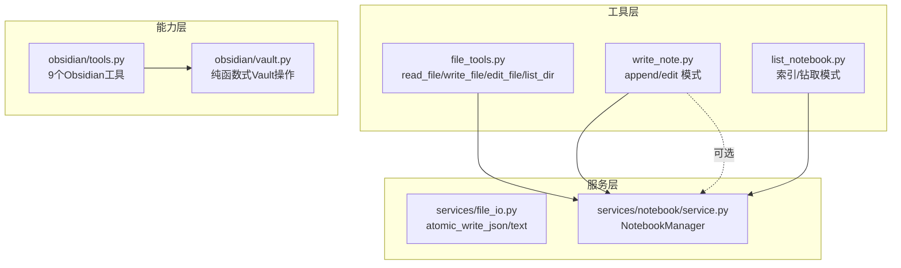
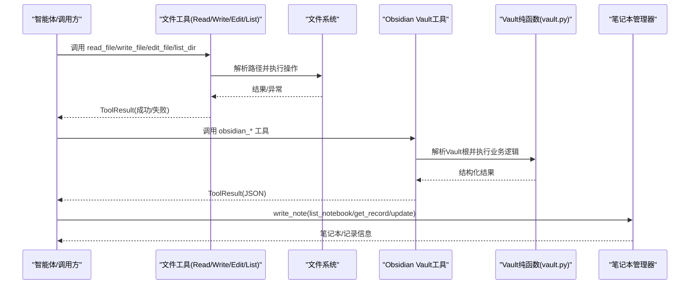
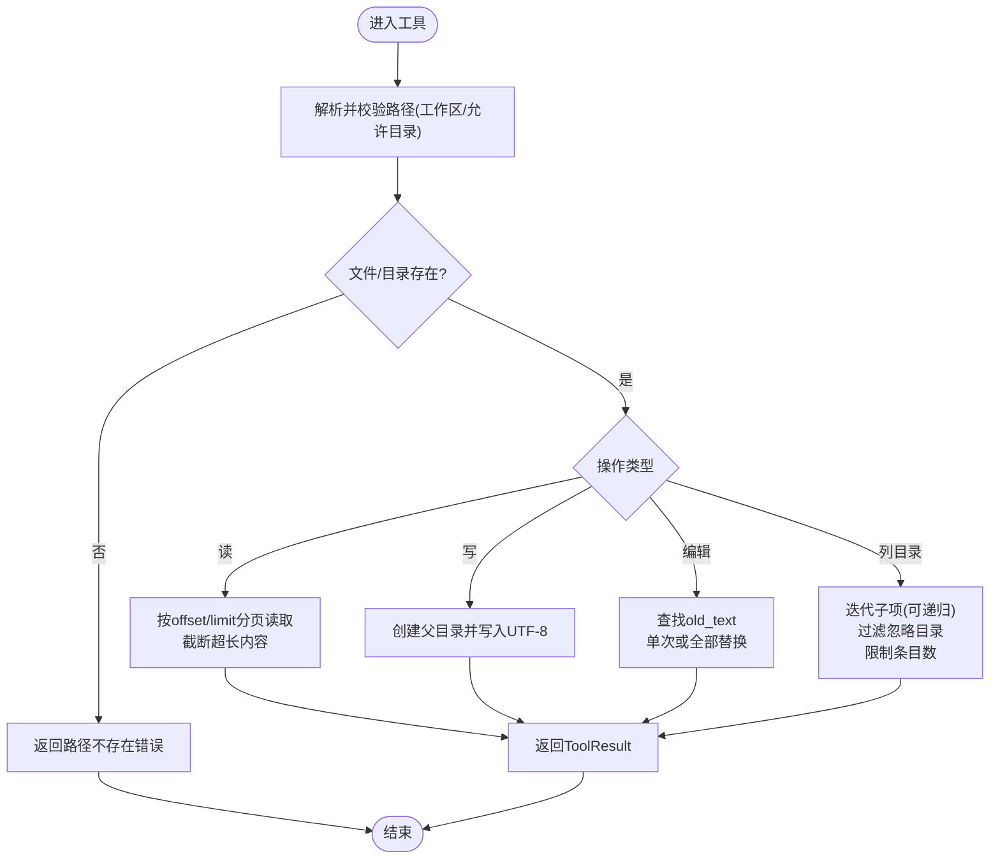
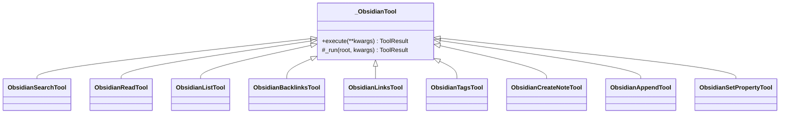
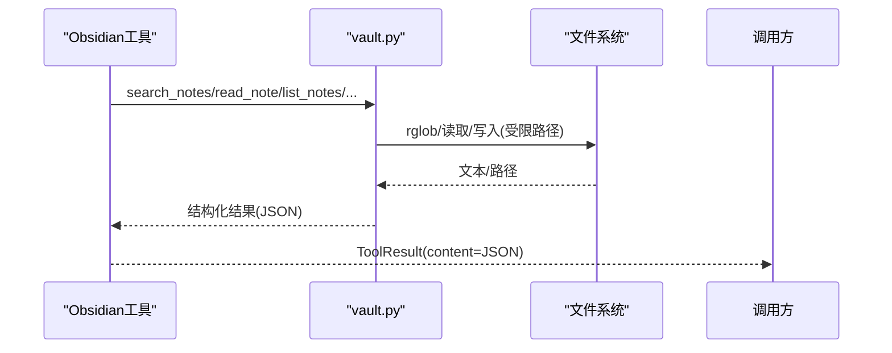
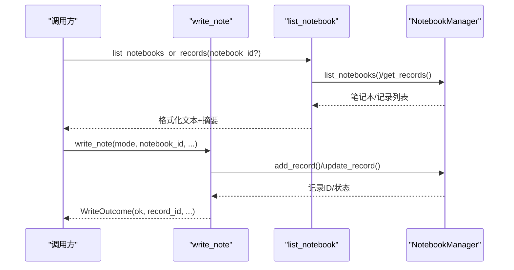
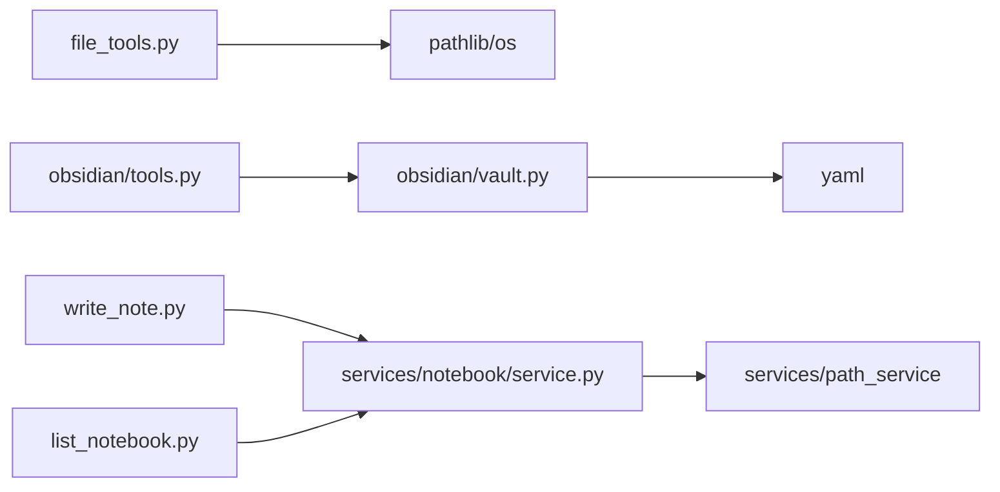

# 文件操作工具

<cite>
**本文引用的文件**
- [deeptutor/tools/file_tools.py](file://deeptutor/tools/file_tools.py)
- [deeptutor/services/file_io.py](file://deeptutor/services/file_io.py)
- [deeptutor/capabilities/obsidian/tools.py](file://deeptutor/capabilities/obsidian/tools.py)
- [deeptutor/capabilities/obsidian/vault.py](file://deeptutor/capabilities/obsidian/vault.py)
- [deeptutor/tools/write_note.py](file://deeptutor/tools/write_note.py)
- [deeptutor/tools/list_notebook.py](file://deeptutor/tools/list_notebook.py)
- [deeptutor/services/notebook/service.py](file://deeptutor/services/notebook/service.py)
</cite>

## 目录
1. [简介](#简介)
2. [项目结构](#项目结构)
3. [核心组件](#核心组件)
4. [架构总览](#架构总览)
5. [详细组件分析](#详细组件分析)
6. [依赖关系分析](#依赖关系分析)
7. [性能考量](#性能考量)
8. [故障排查指南](#故障排查指南)
9. [结论](#结论)
10. [附录：API参考与使用示例](#附录api参考与使用示例)

## 简介
本文件为 DeepTutor 的“文件操作工具”文档，聚焦以下能力：
- 工作区内的文件读写、编辑、删除（通过现有工具组合）
- 目录管理与批量处理（递归遍历、忽略规则、条目上限控制）
- Obsidian 笔记库集成（搜索、读取、列出、前后向链接、标签统计、创建/追加/属性设置）
- 笔记本系统（创建/编辑记录、列表浏览、版本化更新）
- 原子写入服务（JSON/文本），保障并发安全
- 权限与安全：路径白名单、工作区隔离、Vault 根限制
- 常见场景示例：自动化备份、日志分析、配置管理

## 项目结构
DeepTutor 将文件操作能力分层组织：
- 工具层（tools）：面向聊天/智能体的可调用工具，封装参数校验、错误返回与工作区安全
- 能力层（capabilities/obsidian）：Obsidian Vault 的专用工具与纯函数式 vault 操作
- 服务层（services）：跨模块共享的持久化能力（如原子写入、笔记本管理）
- 数据模型（notebook service）：笔记本与记录的存储格式与管理器

图表来源
- [deeptutor/tools/file_tools.py:1-291](file://deeptutor/tools/file_tools.py#L1-L291)
- [deeptutor/capabilities/obsidian/tools.py:1-362](file://deeptutor/capabilities/obsidian/tools.py#L1-L362)
- [deeptutor/capabilities/obsidian/vault.py:1-292](file://deeptutor/capabilities/obsidian/vault.py#L1-L292)
- [deeptutor/services/file_io.py:1-64](file://deeptutor/services/file_io.py#L1-L64)
- [deeptutor/tools/write_note.py:1-466](file://deeptutor/tools/write_note.py#L1-L466)
- [deeptutor/tools/list_notebook.py:1-212](file://deeptutor/tools/list_notebook.py#L1-L212)
- [deeptutor/services/notebook/service.py:1-447](file://deeptutor/services/notebook/service.py#L1-L447)

章节来源
- [deeptutor/tools/file_tools.py:1-291](file://deeptutor/tools/file_tools.py#L1-L291)
- [deeptutor/capabilities/obsidian/tools.py:1-362](file://deeptutor/capabilities/obsidian/tools.py#L1-L362)
- [deeptutor/services/file_io.py:1-64](file://deeptutor/services/file_io.py#L1-L64)
- [deeptutor/tools/write_note.py:1-466](file://deeptutor/tools/write_note.py#L1-L466)
- [deeptutor/tools/list_notebook.py:1-212](file://deeptutor/tools/list_notebook.py#L1-L212)
- [deeptutor/services/notebook/service.py:1-447](file://deeptutor/services/notebook/service.py#L1-L447)

## 核心组件
- 工作区文件工具（read_file、write_file、edit_file、list_dir）：在受控工作区内进行安全的文本文件操作与目录列举，支持分页、递归、忽略目录与条目上限。
- Obsidian 工具集（search/read/list/backlinks/links/tags/create_note/append/set_property）：以 Vault 根为边界，提供对 Markdown 笔记的全文检索、导航与增改（仅追加/新增/属性设置）。
- 笔记本系统（write_note、list_notebook、NotebookManager）：支持 append/edit 两种模式保存对话或摘要；提供笔记本索引与记录列表；管理器负责持久化与统计。
- 原子写入服务（atomic_write_json、atomic_write_text）：在同一目录内临时文件写入后原子替换，避免部分写入导致的损坏。

章节来源
- [deeptutor/tools/file_tools.py:1-291](file://deeptutor/tools/file_tools.py#L1-L291)
- [deeptutor/capabilities/obsidian/tools.py:1-362](file://deeptutor/capabilities/obsidian/tools.py#L1-L362)
- [deeptutor/capabilities/obsidian/vault.py:1-292](file://deeptutor/capabilities/obsidian/vault.py#L1-L292)
- [deeptutor/tools/write_note.py:1-466](file://deeptutor/tools/write_note.py#L1-L466)
- [deeptutor/tools/list_notebook.py:1-212](file://deeptutor/tools/list_notebook.py#L1-L212)
- [deeptutor/services/file_io.py:1-64](file://deeptutor/services/file_io.py#L1-L64)
- [deeptutor/services/notebook/service.py:1-447](file://deeptutor/services/notebook/service.py#L1-L447)

## 架构总览
下图展示从工具到服务的调用链与数据流：

图表来源
- [deeptutor/tools/file_tools.py:1-291](file://deeptutor/tools/file_tools.py#L1-L291)
- [deeptutor/capabilities/obsidian/tools.py:1-362](file://deeptutor/capabilities/obsidian/tools.py#L1-L362)
- [deeptutor/capabilities/obsidian/vault.py:1-292](file://deeptutor/capabilities/obsidian/vault.py#L1-L292)
- [deeptutor/tools/write_note.py:1-466](file://deeptutor/tools/write_note.py#L1-L466)
- [deeptutor/services/notebook/service.py:1-447](file://deeptutor/services/notebook/service.py#L1-L447)

## 详细组件分析

### 工作区文件工具（read_file / write_file / edit_file / list_dir）
- 安全边界：所有路径通过工作区解析函数校验，确保目标位于允许的目录内，防止越权访问。
- read_file：按行分页读取，支持 offset/limit，自动截断超长内容，提示继续读取位置。
- write_file：UTF-8 写入，自动创建父目录。
- edit_file：基于 old_text/new_text 替换，支持 replace_all；当出现多次匹配时给出警告并要求更多上下文或开启全量替换；找不到时尝试相似度匹配并输出差异片段。
- list_dir：支持递归与非递归，内置忽略目录集合（如 .git、node_modules 等），限制最大条目数，返回目录相对路径。

图表来源
- [deeptutor/tools/file_tools.py:13-25](file://deeptutor/tools/file_tools.py#L13-L25)
- [deeptutor/tools/file_tools.py:41-107](file://deeptutor/tools/file_tools.py#L41-L107)
- [deeptutor/tools/file_tools.py:109-131](file://deeptutor/tools/file_tools.py#L109-L131)
- [deeptutor/tools/file_tools.py:134-186](file://deeptutor/tools/file_tools.py#L134-L186)
- [deeptutor/tools/file_tools.py:189-262](file://deeptutor/tools/file_tools.py#L189-L262)

章节来源
- [deeptutor/tools/file_tools.py:13-25](file://deeptutor/tools/file_tools.py#L13-L25)
- [deeptutor/tools/file_tools.py:41-107](file://deeptutor/tools/file_tools.py#L41-L107)
- [deeptutor/tools/file_tools.py:109-131](file://deeptutor/tools/file_tools.py#L109-L131)
- [deeptutor/tools/file_tools.py:134-186](file://deeptutor/tools/file_tools.py#L134-L186)
- [deeptutor/tools/file_tools.py:189-262](file://deeptutor/tools/file_tools.py#L189-L262)

### Obsidian 工具与 Vault 操作
- 工具集：search/read/list/backlinks/links/tags/create_note/append/set_property，统一通过 _ObsidianTool 基类解析 Vault 根并执行，错误归一化为 ToolResult。
- Vault 纯函数：实现 Obsidian 约定（.md、frontmatter YAML、wikilink、标签），提供安全的路径拼接、忽略内部目录、全文搜索、前后向链接、标签统计与只增型写入（create/append/set_property）。

图表来源
- [deeptutor/capabilities/obsidian/tools.py:62-76](file://deeptutor/capabilities/obsidian/tools.py#L62-L76)
- [deeptutor/capabilities/obsidian/tools.py:78-358](file://deeptutor/capabilities/obsidian/tools.py#L78-L358)

图表来源
- [deeptutor/capabilities/obsidian/tools.py:78-358](file://deeptutor/capabilities/obsidian/tools.py#L78-L358)
- [deeptutor/capabilities/obsidian/vault.py:47-125](file://deeptutor/capabilities/obsidian/vault.py#L47-L125)
- [deeptutor/capabilities/obsidian/vault.py:130-275](file://deeptutor/capabilities/obsidian/vault.py#L130-L275)

章节来源
- [deeptutor/capabilities/obsidian/tools.py:1-362](file://deeptutor/capabilities/obsidian/tools.py#L1-L362)
- [deeptutor/capabilities/obsidian/vault.py:1-292](file://deeptutor/capabilities/obsidian/vault.py#L1-L292)

### 笔记本系统（write_note / list_notebook / NotebookManager）
- write_note：支持 append 与 edit 两种模式。append 默认保存真实对话转录（可指定包含最近N轮或全部），也支持代理直接撰写内容；edit 模式需已知 record_id 并至少修改 title/content/summary 之一。
- list_notebook：索引模式列出用户笔记本（id/name/description/record_count/updated_at），钻取模式列出某笔记本内记录（按创建时间倒序，限制渲染数量）。
- NotebookManager：维护 notebooks_index.json 与各 notebook.json，提供创建/更新/删除笔记本与记录的增删改查、统计与引用解析。

图表来源
- [deeptutor/tools/write_note.py:61-143](file://deeptutor/tools/write_note.py#L61-L143)
- [deeptutor/tools/write_note.py:150-257](file://deeptutor/tools/write_note.py#L150-L257)
- [deeptutor/tools/write_note.py:276-363](file://deeptutor/tools/write_note.py#L276-L363)
- [deeptutor/tools/list_notebook.py:49-177](file://deeptutor/tools/list_notebook.py#L49-L177)
- [deeptutor/services/notebook/service.py:154-427](file://deeptutor/services/notebook/service.py#L154-L427)

章节来源
- [deeptutor/tools/write_note.py:1-466](file://deeptutor/tools/write_note.py#L1-L466)
- [deeptutor/tools/list_notebook.py:1-212](file://deeptutor/tools/list_notebook.py#L1-L212)
- [deeptutor/services/notebook/service.py:1-447](file://deeptutor/services/notebook/service.py#L1-L447)

### 原子写入服务
- atomic_write_json：将字典序列化为 UTF-8 JSON，写入同目录临时文件后原子替换目标文件，必要时 fsync。
- atomic_write_text：将文本以相同方式原子写入，保证并发安全与一致性。

章节来源
- [deeptutor/services/file_io.py:12-60](file://deeptutor/services/file_io.py#L12-L60)

## 依赖关系分析
- file_tools 依赖工作区路径解析与基础 Path API，不依赖外部服务，适合通用文件操作。
- obsidian tools 依赖 vault 纯函数，后者仅依赖 pathlib、yaml 与正则表达式，便于测试与复用。
- write_note 与 list_notebook 依赖 NotebookManager，后者通过路径服务定位笔记本目录并维护索引与数据文件。
- 各工具均通过统一的 ToolDefinition/ToolResult 协议暴露能力，便于被智能体调度。

图表来源
- [deeptutor/tools/file_tools.py:1-291](file://deeptutor/tools/file_tools.py#L1-L291)
- [deeptutor/capabilities/obsidian/tools.py:1-362](file://deeptutor/capabilities/obsidian/tools.py#L1-L362)
- [deeptutor/capabilities/obsidian/vault.py:1-292](file://deeptutor/capabilities/obsidian/vault.py#L1-L292)
- [deeptutor/tools/write_note.py:1-466](file://deeptutor/tools/write_note.py#L1-L466)
- [deeptutor/tools/list_notebook.py:1-212](file://deeptutor/tools/list_notebook.py#L1-L212)
- [deeptutor/services/notebook/service.py:1-447](file://deeptutor/services/notebook/service.py#L1-L447)

章节来源
- [同上各文件:1-291](file://deeptutor/tools/file_tools.py#L1-L291)

## 性能考量
- 读取大文件：read_file 支持分页与字符上限截断，避免一次性加载超大内容导致内存压力。
- 目录遍历：list_dir 支持递归与忽略目录，并提供 max_entries 限制，防止大量条目阻塞。
- Obsidian 搜索：search_notes 逐文件扫描并按 limit 截断，适合中大型 Vault；如需更高性能建议结合外部索引。
- 原子写入：临时文件+replace 的方式减少锁竞争，但频繁小写入可能带来 I/O 开销，批量化写入可降低开销。
- 笔记本渲染：list_notebook 对笔记本与记录数量有渲染上限，避免上下文窗口溢出。

[本节为通用指导，无需特定文件来源]

## 故障排查指南
- 路径越权：若抛出“路径不在允许的工作区”，检查传入路径是否超出 allowed_dir；确认 workspace 与 allowed_dir 配置正确。
- 文件不存在：read_file/edit_file 会返回“文件未找到”；确认路径拼写与大小写。
- 编辑失败：edit_file 找不到 old_text 时会尝试相似度匹配并输出差异；若仍失败，增加上下文或启用 replace_all。
- Obsidian 无连接：若工具返回“当前回合未连接 Vault”，说明该回合未挂载 Obsidian 能力；需在能力层选择 Obsidian 作为知识库。
- Vault 路径逃逸：vault 的安全拼接会拒绝跳出 Vault 根的路径；检查相对路径是否正确。
- 笔记本为空：list_notebook 索引模式返回“尚无笔记本”；先创建笔记本或使用已有 notebook_id。
- 记录不存在：edit 模式需要有效的 record_id；先用 list_notebook 获取可用 ID。

章节来源
- [deeptutor/tools/file_tools.py:13-25](file://deeptutor/tools/file_tools.py#L13-L25)
- [deeptutor/tools/file_tools.py:66-107](file://deeptutor/tools/file_tools.py#L66-L107)
- [deeptutor/tools/file_tools.py:152-186](file://deeptutor/tools/file_tools.py#L152-L186)
- [deeptutor/capabilities/obsidian/tools.py:39-73](file://deeptutor/capabilities/obsidian/tools.py#L39-L73)
- [deeptutor/capabilities/obsidian/vault.py:55-61](file://deeptutor/capabilities/obsidian/vault.py#L55-L61)
- [deeptutor/tools/list_notebook.py:72-126](file://deeptutor/tools/list_notebook.py#L72-L126)
- [deeptutor/tools/write_note.py:276-363](file://deeptutor/tools/write_note.py#L276-L363)

## 结论
DeepTutor 的文件操作工具提供了安全、可控且可扩展的文件与笔记管理能力：
- 工作区工具满足通用文本文件的读写与目录浏览需求，具备强安全边界与批量处理能力。
- Obsidian 工具集为知识管理提供强大的搜索、导航与增量写入能力，严格限制在 Vault 根内。
- 笔记本系统通过 append/edit 模式灵活保存对话与摘要，配合列表浏览与统计，形成完整的版本化管理闭环。
- 原子写入服务保障并发安全，适合关键配置与元数据的持久化。
建议在复杂场景中结合多种工具协同工作，充分利用分页、限制与忽略策略，以获得稳定高效的体验。

[本节为总结性内容，无需特定文件来源]

## 附录：API参考与使用示例

### 工作区文件工具 API
- read_file
  - 参数：path（工作区内路径）、offset（起始行号，1-indexed）、limit（最大行数）
  - 返回：ToolResult，content 为带行号的文本片段，末尾提示剩余行数或结束标记
  - 错误：路径不存在、非文件、偏移越界、权限错误
- write_file
  - 参数：path、content（UTF-8 文本）
  - 返回：ToolResult，成功时返回写入字节数与文件名
  - 错误：权限错误、写入异常
- edit_file
  - 参数：path、old_text、new_text、replace_all（布尔）
  - 返回：ToolResult，成功时返回编辑结果
  - 错误：文件不存在、old_text 未找到（含相似度提示）、权限错误
- list_dir
  - 参数：path（目录）、recursive（是否递归）、max_entries（最大条目数）
  - 返回：ToolResult，content 为相对路径列表，可能附带截断提示
  - 错误：目录不存在、非目录、权限错误

章节来源
- [deeptutor/tools/file_tools.py:41-107](file://deeptutor/tools/file_tools.py#L41-L107)
- [deeptutor/tools/file_tools.py:109-131](file://deeptutor/tools/file_tools.py#L109-L131)
- [deeptutor/tools/file_tools.py:134-186](file://deeptutor/tools/file_tools.py#L134-L186)
- [deeptutor/tools/file_tools.py:189-262](file://deeptutor/tools/file_tools.py#L189-L262)

### Obsidian 工具 API
- obsidian_search
  - 参数：query、limit（默认20）
  - 返回：ToolResult(JSON)，包含查询、命中数与结果（path/snippet）
- obsidian_read
  - 参数：note（名称或路径）
  - 返回：ToolResult(JSON)，包含 path/frontmatter/body
- obsidian_list
  - 参数：folder（可选）、limit（默认200）
  - 返回：ToolResult(JSON)，包含 folder/count/notes
- obsidian_backlinks
  - 参数：note
  - 返回：ToolResult(JSON)，包含 note/count/backlinks
- obsidian_links
  - 参数：note
  - 返回：ToolResult(JSON)，包含 note/count/links
- obsidian_tags
  - 参数：limit（默认200）
  - 返回：ToolResult(JSON)，包含 count/tags
- obsidian_create_note
  - 参数：path、content、properties（可选 frontmatter）
  - 返回：ToolResult(JSON)，status=path
- obsidian_append
  - 参数：note、content
  - 返回：ToolResult(JSON)，status=path
- obsidian_set_property
  - 参数：note、key、value
  - 返回：ToolResult(JSON)，status=path/key

章节来源
- [deeptutor/capabilities/obsidian/tools.py:78-358](file://deeptutor/capabilities/obsidian/tools.py#L78-L358)
- [deeptutor/capabilities/obsidian/vault.py:130-275](file://deeptutor/capabilities/obsidian/vault.py#L130-L275)

### 笔记本系统 API
- write_note
  - 参数：mode（append/edit）、notebook_id、record_id（edit 必需）、title、content、turns_to_include（整数或'all'）、note（摘要）
  - 返回：WriteOutcome（ok/mode/record_id/notebook_id/notebook_name/error）
- list_notebooks_or_records
  - 参数：notebook_id（空则索引模式）
  - 返回：ListOutcome（ok/text/error/summary）
- NotebookManager
  - create_notebook(name, description, color, icon) -> dict
  - list_notebooks() -> list[dict]
  - get_notebook(id) -> dict|None
  - update_notebook(id, name?, description?, color?, icon?) -> dict|None
  - delete_notebook(id) -> bool
  - add_record(notebook_ids, record_type, title, user_query, output, summary?, metadata?, kb_name?) -> dict
  - get_records(notebook_id, record_ids?) -> list[dict]
  - get_record(notebook_id, record_id) -> dict|None
  - update_record(notebook_id, record_id, title?, summary?, user_query?, output?, metadata?, kb_name?) -> dict|None
  - remove_record(notebook_id, record_id) -> bool
  - get_statistics() -> dict

章节来源
- [deeptutor/tools/write_note.py:61-143](file://deeptutor/tools/write_note.py#L61-L143)
- [deeptutor/tools/write_note.py:150-257](file://deeptutor/tools/write_note.py#L150-L257)
- [deeptutor/tools/write_note.py:276-363](file://deeptutor/tools/write_note.py#L276-L363)
- [deeptutor/tools/list_notebook.py:49-177](file://deeptutor/tools/list_notebook.py#L49-L177)
- [deeptutor/services/notebook/service.py:154-427](file://deeptutor/services/notebook/service.py#L154-L427)

### 原子写入服务 API
- atomic_write_json(path, payload)
  - 作用：原子写入 UTF-8 JSON，避免部分写入
- atomic_write_text(path, text)
  - 作用：原子写入 UTF-8 文本

章节来源
- [deeptutor/services/file_io.py:12-60](file://deeptutor/services/file_io.py#L12-L60)

### 实际使用示例（场景化指引）
- 自动化文件备份
  - 步骤：list_dir 递归扫描源目录 -> 对每个文件 read_file -> 计算哈希/时间戳 -> write_file 写入备份目录（保持相对路径）
  - 注意：使用 ignore 规则跳过缓存目录；对大文件采用分页读取与分块写入
- 日志分析
  - 步骤：list_dir 获取日志文件 -> read_file 分页读取 -> 筛选关键字/正则 -> 汇总统计 -> write_file 输出报告
  - 注意：限制 max_entries 与 limit，避免上下文溢出
- 配置管理
  - 步骤：read_file 读取配置文件 -> 解析/合并 -> atomic_write_json 原子写入新配置
  - 注意：使用 atomic_write_json 保证并发安全；失败回滚由原子替换机制保证

[本节为概念性示例，无需特定文件来源]

### 安全性与权限控制
- 工作区隔离：所有文件工具通过工作区解析函数校验路径，确保只能访问允许的目录范围。
- Vault 根限制：Obsidian 工具仅在注入的 Vault 根下操作，任何试图逃逸的路径将被拒绝。
- 最小权限原则：工具仅暴露必要参数与功能，避免直接暴露底层文件系统接口。
- 原子写入：关键配置与元数据使用原子写入，降低并发写入风险。

章节来源
- [deeptutor/tools/file_tools.py:13-25](file://deeptutor/tools/file_tools.py#L13-L25)
- [deeptutor/capabilities/obsidian/vault.py:55-61](file://deeptutor/capabilities/obsidian/vault.py#L55-L61)
- [deeptutor/services/file_io.py:12-60](file://deeptutor/services/file_io.py#L12-L60)