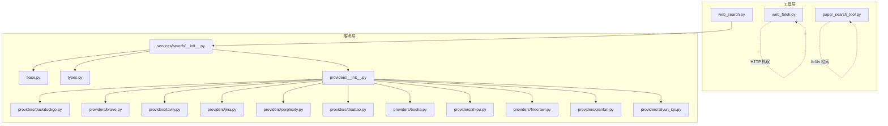
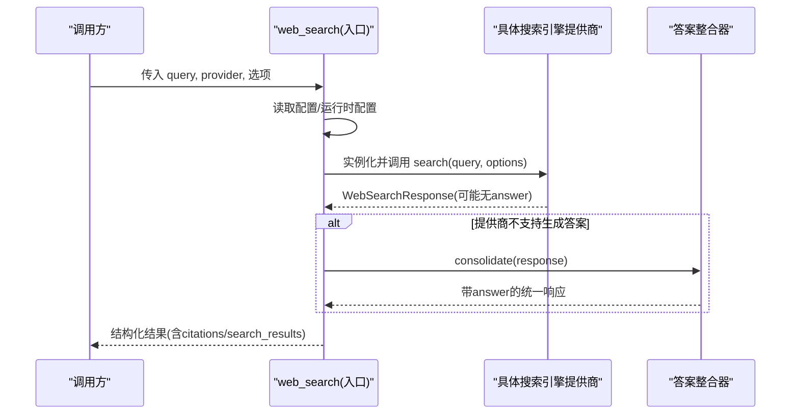
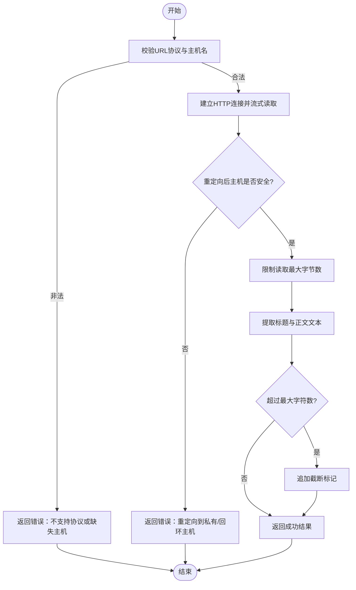
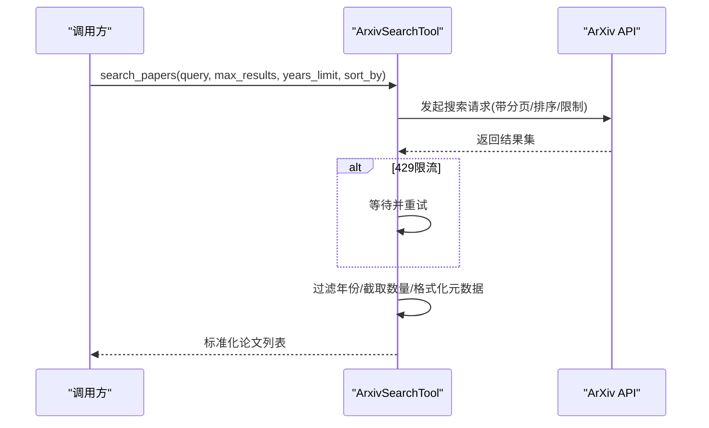
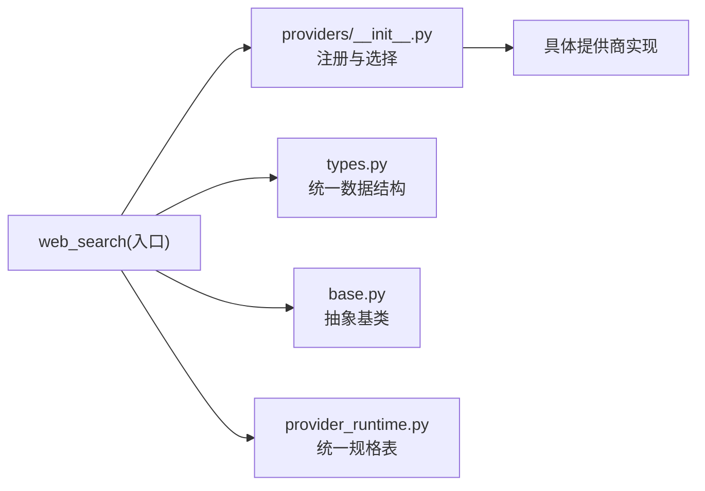

# 网络工具

<cite>
**本文引用的文件**
- [deeptutor/tools/web_search.py](file://deeptutor/tools/web_search.py)
- [deeptutor/services/search/__init__.py](file://deeptutor/services/search/__init__.py)
- [deeptutor/services/search/base.py](file://deeptutor/services/search/base.py)
- [deeptutor/services/search/types.py](file://deeptutor/services/search/types.py)
- [deeptutor/services/search/providers/__init__.py](file://deeptutor/services/search/providers/__init__.py)
- [deeptutor/services/search/providers/doubao.py](file://deeptutor/services/search/providers/doubao.py)
- [deeptutor/services/search/providers/bocha.py](file://deeptutor/services/search/providers/bocha.py)
- [deeptutor/services/search/providers/zhipu.py](file://deeptutor/services/search/providers/zhipu.py)
- [deeptutor/services/search/providers/firecrawl.py](file://deeptutor/services/search/providers/firecrawl.py)
- [deeptutor/services/search/providers/qianfan.py](file://deeptutor/services/search/providers/qianfan.py)
- [deeptutor/services/search/providers/aliyun_iqs.py](file://deeptutor/services/search/providers/aliyun_iqs.py)
- [deeptutor/services/search/providers/duckduckgo.py](file://deeptutor/services/search/providers/duckduckgo.py)
- [deeptutor/services/search/providers/brave.py](file://deeptutor/services/search/providers/brave.py)
- [deeptutor/services/search/providers/tavily.py](file://deeptutor/services/search/providers/tavily.py)
- [deeptutor/services/search/providers/jina.py](file://deeptutor/services/search/providers/jina.py)
- [deeptutor/services/search/providers/perplexity.py](file://deeptutor/services/search/providers/perplexity.py)
- [deeptutor/services/config/provider_runtime.py](file://deeptutor/services/config/provider_runtime.py)
- [deeptutor/tools/web_fetch.py](file://deeptutor/tools/web_fetch.py)
- [deeptutor/tools/paper_search_tool.py](file://deeptutor/tools/paper_search_tool.py)
</cite>

## 更新摘要
**所做更改**
- 新增六个搜索引擎提供商：Doubao（豆包）、Bocha（博查）、Zhipu（智谱）、Firecrawl、Qianfan（百度千帆）、Aliyun IQS（阿里云）
- 重构网络搜索提供商层，采用统一规格表管理
- 增强搜索失败时的回退机制和可靠性
- 更新提供商注册表和配置系统

## 目录
1. [简介](#简介)
2. [项目结构](#项目结构)
3. [核心组件](#核心组件)
4. [架构总览](#架构总览)
5. [详细组件分析](#详细组件分析)
6. [依赖关系分析](#依赖关系分析)
7. [性能与可靠性](#性能与可靠性)
8. [故障排查指南](#故障排查指南)
9. [结论](#结论)
10. [附录：API参考与使用示例](#附录api参考与使用示例)

## 简介
本章节面向DeepTutor的网络工具能力，覆盖网页抓取、网络搜索、论文检索三大功能。文档重点说明HTTP请求处理、网页内容提取、搜索引擎集成（Brave、Tavily、Jina、Perplexity、DuckDuckGo、SearXNG等），以及新增的六个中国本土搜索引擎提供商（Doubao、Bocha、Zhipu、Firecrawl、Qianfan、Aliyun IQS）；并提供完整的API参考、错误码与处理策略、超时重试与代理配置、反爬虫应对与最佳实践，以及信息收集、竞品分析、学术研究等实际场景的使用示例。

## 项目结构
网络工具由"工具层"和"服务层"组成：
- 工具层：对外暴露的入口函数与封装类，如 web_search、web_fetch、paper_search_tool。
- 服务层：统一抽象与多搜索引擎实现，包括基础抽象、类型定义、提供商注册与选择、各搜索引擎的具体实现。

图表来源
- [deeptutor/tools/web_search.py:1-69](file://deeptutor/tools/web_search.py#L1-L69)
- [deeptutor/services/search/__init__.py:1-262](file://deeptutor/services/search/__init__.py#L1-L262)
- [deeptutor/services/search/base.py:1-90](file://deeptutor/services/search/base.py#L1-L90)
- [deeptutor/services/search/types.py:1-115](file://deeptutor/services/search/types.py#L1-L115)
- [deeptutor/services/search/providers/__init__.py:1-216](file://deeptutor/services/search/providers/__init__.py#L1-L216)

章节来源
- [deeptutor/tools/web_search.py:1-69](file://deeptutor/tools/web_search.py#L1-L69)
- [deeptutor/services/search/__init__.py:1-262](file://deeptutor/services/search/__init__.py#L1-L262)

## 核心组件
- 网页抓取工具（web_fetch）
  - 提供异步入口 fetch_url_as_markdown，支持URL校验、安全限制（仅http/https、禁止私有/回环地址）、响应体大小上限、可读文本提取、截断标记。
  - 默认超时、User-Agent、最大重定向次数等参数可配置。
- 网络搜索服务（web_search）
  - 统一入口，负责读取配置、解析运行时配置、选择并实例化搜索引擎提供商、执行搜索、对不支持答案生成的提供商自动进行结果整合（模板或LLM）。
  - 支持输出持久化与日志记录。
- 论文检索工具（paper_search_tool）
  - 基于ArXiv客户端，支持查询、排序、时间过滤、重试与超时控制，返回标准化元数据与引用格式。

章节来源
- [deeptutor/tools/web_fetch.py:1-263](file://deeptutor/tools/web_fetch.py#L1-L263)
- [deeptutor/services/search/__init__.py:111-218](file://deeptutor/services/search/__init__.py#L111-L218)
- [deeptutor/tools/paper_search_tool.py:1-208](file://deeptutor/tools/paper_search_tool.py#L1-L208)

## 架构总览
网络搜索采用"统一接口 + 多提供商"的插件化架构：
- 所有提供商继承 BaseSearchProvider，实现 search 方法，返回统一的 WebSearchResponse。
- providers/__init__.py 维护提供商注册表，提供 get_provider、list_providers、get_available_providers 等管理接口。
- services/search/__init__.py 的 web_search 函数负责配置加载、提供商选择、调用与结果整合。
- 新增的统一规格表管理所有提供商的配置和元数据。

图表来源
- [deeptutor/services/search/__init__.py:111-218](file://deeptutor/services/search/__init__.py#L111-L218)
- [deeptutor/services/search/base.py:20-70](file://deeptutor/services/search/base.py#L20-L70)
- [deeptutor/services/search/providers/__init__.py:27-84](file://deeptutor/services/search/providers/__init__.py#L27-L84)

## 详细组件分析

### 网页抓取（web_fetch）
- 安全策略
  - 仅允许 http/https 协议。
  - 拒绝私有/回环/链路本地等多播/保留/未指定IP，包含DNS解析后的最终目标检查，防止重定向攻击。
- 资源保护
  - 响应体流式读取并限制最大字节数，避免大文件占用内存。
  - 提取文本后按字符数截断，并附加截断标记。
- 内容提取
  - 简单HTML清洗：移除脚本/样式、标签、实体解码、空白规范化，标题提取。
- HTTP配置
  - 默认超时、User-Agent、最大重定向次数。
  - 可通过 client_factory 注入自定义客户端以适配代理或TLS策略。

图表来源
- [deeptutor/tools/web_fetch.py:72-141](file://deeptutor/tools/web_fetch.py#L72-L141)
- [deeptutor/tools/web_fetch.py:149-202](file://deeptutor/tools/web_fetch.py#L149-L202)
- [deeptutor/tools/web_fetch.py:205-255](file://deeptutor/tools/web_fetch.py#L205-L255)

章节来源
- [deeptutor/tools/web_fetch.py:1-263](file://deeptutor/tools/web_fetch.py#L1-L263)

### 网络搜索（web_search）
- 提供商选择与配置
  - 从主配置与运行时配置中解析当前提供商、API Key、Base URL、最大结果数、代理等。
  - 对需要API Key的提供商（如 Brave、Tavily、Jina、Perplexity、Serper）进行校验；缺失时降级或报错。
- 搜索执行与整合
  - 通过 get_provider 获取具体提供商实例并调用 search。
  - 若提供商不支持生成答案（supports_answer=False），则自动进入 AnswerConsolidator 进行模板或LLM整合。
- 结果输出
  - 统一为 WebSearchResponse.to_dict() 的结构化字典，包含 timestamp、query、provider、answer、citations、search_results、usage、metadata 等。
  - 可选将结果保存到文件。

图表来源
- [deeptutor/services/search/base.py:20-70](file://deeptutor/services/search/base.py#L20-L70)
- [deeptutor/services/search/providers/duckduckgo.py:13-69](file://deeptutor/services/search/providers/duckduckgo.py#L13-L69)
- [deeptutor/services/search/providers/brave.py:15-81](file://deeptutor/services/search/providers/brave.py#L15-L81)
- [deeptutor/services/search/providers/tavily.py:26-166](file://deeptutor/services/search/providers/tavily.py#L26-L166)
- [deeptutor/services/search/providers/jina.py:29-166](file://deeptutor/services/search/providers/jina.py#L29-L166)
- [deeptutor/services/search/providers/perplexity.py:21-154](file://deeptutor/services/search/providers/perplexity.py#L21-L154)
- [deeptutor/services/search/providers/doubao.py:31-167](file://deeptutor/services/search/providers/doubao.py#L31-L167)
- [deeptutor/services/search/providers/bocha.py:25-133](file://deeptutor/services/search/providers/bocha.py#L25-L133)
- [deeptutor/services/search/providers/zhipu.py:28-143](file://deeptutor/services/search/providers/zhipu.py#L28-L143)
- [deeptutor/services/search/providers/firecrawl.py:26-137](file://deeptutor/services/search/providers/firecrawl.py#L26-L137)
- [deeptutor/services/search/providers/qianfan.py:33-150](file://deeptutor/services/search/providers/qianfan.py#L33-L150)
- [deeptutor/services/search/providers/aliyun_iqs.py:41-164](file://deeptutor/services/search/providers/aliyun_iqs.py#L41-L164)

章节来源
- [deeptutor/services/search/__init__.py:111-218](file://deeptutor/services/search/__init__.py#L111-L218)
- [deeptutor/services/search/providers/__init__.py:27-84](file://deeptutor/services/search/providers/__init__.py#L27-L84)

### 新增搜索引擎提供商详解

#### Doubao（豆包）
- 特点：基于火山引擎Ark Responses API，支持内置web_search工具，可直接生成答案
- 独特优势：可访问字节跳动自有语料库（头条新闻、抖音、墨迹天气等）
- 参数：支持sources参数控制搜索源，model参数可自定义模型版本

#### Bocha（博查）
- 特点：中国托管的AI应用专用搜索引擎，返回标准SERP结果
- 特色：支持时间范围过滤（noLimit、oneDay、oneWeek、oneMonth、oneYear）
- 适用场景：需要高质量中文搜索结果的应用

#### Zhipu（智谱）
- 特点：智谱GLM独立搜索端点，返回排名结果而非模型生成答案
- 灵活配置：支持多种搜索引擎后端（search_std、search_pro、search_pro_sogou、search_pro_quark）
- 内容控制：支持content_size参数控制返回内容量

#### Firecrawl
- 特点：搜索与页面抓取一体化，可选择性抓取完整页面Markdown内容
- 专业领域：支持github、research、pdf、developer等专业分类
- 成本考量：抓取功能按页计费，需按需启用

#### Qianfan（百度千帆）
- 特点：百度官方搜索端点，非直接爬取baidu.com
- 企业级：支持safe_search内容过滤，多种编辑模式
- 兼容性：保持与原始API的ID映射，便于追踪引用

#### Aliyun IQS（阿里云信息查询服务）
- 特点：统一HTTP入口，支持语义重排序
- 垂直领域：支持金融、法律、医疗、互联网等行业语料优化
- 丰富内容：返回页面主体内容和评分信息

章节来源
- [deeptutor/services/search/providers/doubao.py:1-167](file://deeptutor/services/search/providers/doubao.py#L1-L167)
- [deeptutor/services/search/providers/bocha.py:1-133](file://deeptutor/services/search/providers/bocha.py#L1-L133)
- [deeptutor/services/search/providers/zhipu.py:1-143](file://deeptutor/services/search/providers/zhipu.py#L1-L143)
- [deeptutor/services/search/providers/firecrawl.py:1-137](file://deeptutor/services/search/providers/firecrawl.py#L1-L137)
- [deeptutor/services/search/providers/qianfan.py:1-150](file://deeptutor/services/search/providers/qianfan.py#L1-L150)
- [deeptutor/services/search/providers/aliyun_iqs.py:1-164](file://deeptutor/services/search/providers/aliyun_iqs.py#L1-L164)

### 论文检索（ArXiv）
- 功能要点
  - 支持查询关键词、排序（相关性/日期）、年份限制、最大结果数。
  - 使用 arxiv.Client 进行异步等待与超时控制，针对429限流进行重试。
  - 返回标准化元数据：标题、作者、年份、摘要、URL、ArXiv ID、发布时间；并提供引用格式化与ID提取工具。
- 错误处理
  - 超时、HTTP错误、异常均被捕获并记录日志，返回空列表以避免中断上层流程。

图表来源
- [deeptutor/tools/paper_search_tool.py:24-140](file://deeptutor/tools/paper_search_tool.py#L24-L140)

章节来源
- [deeptutor/tools/paper_search_tool.py:1-208](file://deeptutor/tools/paper_search_tool.py#L1-L208)

## 依赖关系分析
- 提供商注册与发现
  - providers/__init__.py 维护 _PROVIDERS 字典，通过装饰器 register_provider 完成注册。
  - 提供 list_providers、get_available_providers、get_providers_info、get_default_provider 等管理接口。
- 配置与运行时解析
  - services/search/__init__.py 中的 web_search 会读取主配置与运行时配置，决定启用状态、提供商、API Key、Base URL、最大结果数、代理等。
- 类型契约
  - types.py 定义了 Citation、SearchResult、WebSearchResponse，确保所有提供商返回一致的数据结构。
- 统一规格表
  - 新的配置系统通过 SEARCH_PROVIDERS 字典统一管理所有提供商的元数据和配置要求。

图表来源
- [deeptutor/services/search/providers/__init__.py:27-84](file://deeptutor/services/search/providers/__init__.py#L27-L84)
- [deeptutor/services/search/__init__.py:111-218](file://deeptutor/services/search/__init__.py#L111-L218)
- [deeptutor/services/search/types.py:12-115](file://deeptutor/services/search/types.py#L12-L115)
- [deeptutor/services/search/base.py:20-70](file://deeptutor/services/search/base.py#L20-L70)
- [deeptutor/services/config/provider_runtime.py:100-112](file://deeptutor/services/config/provider_runtime.py#L100-L112)

章节来源
- [deeptutor/services/search/providers/__init__.py:1-216](file://deeptutor/services/search/providers/__init__.py#L1-L216)
- [deeptutor/services/search/__init__.py:1-262](file://deeptutor/services/search/__init__.py#L1-L262)
- [deeptutor/services/search/types.py:1-115](file://deeptutor/services/search/types.py#L1-L115)
- [deeptutor/services/search/base.py:1-90](file://deeptutor/services/search/base.py#L1-L90)
- [deeptutor/services/config/provider_runtime.py:100-1360](file://deeptutor/services/config/provider_runtime.py#L100-L1360)

## 性能与可靠性
- 超时与重试
  - 网页抓取：默认超时秒数、最大重定向次数、响应体大小上限。
  - 论文检索：异步等待超时、429限流重试、异常捕获。
  - 搜索引擎：各提供商支持 timeout 参数；部分提供商（如Tavily、Jina、Perplexity）具备更丰富的超时与深度选项。
- 代理配置
  - 通过 BaseSearchProvider.proxy 传递至底层HTTP客户端；web_search 会将运行时配置的 proxy 注入到 provider_kwargs。
- 反爬与合规
  - 设置合理的 User-Agent；遵循提供商速率限制；必要时使用代理与重试退避；避免高频请求与大规模抓取。
- 资源保护
  - 网页抓取限制响应体大小与文本长度，避免内存溢出；流式读取降低峰值内存占用。
- 增强的回退机制
  - 当首选提供商不可用时，系统会自动尝试其他已配置的提供商，最后回退到免费的DuckDuckGo。
  - 回退过程记录详细的失败原因和使用情况。

[本节为通用指导，不直接分析具体文件]

## 故障排查指南
- 常见错误与处理
  - 不支持的URL协议或缺失主机：web_fetch 返回错误信息，建议检查输入URL。
  - 重定向到私有/回环主机：安全拦截，需确认目标站点合法性。
  - 搜索引擎API Key缺失：web_search 在需要API Key的提供商下抛出错误或降级到可用提供商（如DuckDuckGo）。
  - 搜索引擎HTTP错误：各提供商在非200状态码时抛出异常，需检查网络、凭据与配额。
  - ArXiv限流或超时：记录警告并返回空结果，建议稍后重试或降低并发。
- 调试建议
  - 开启 verbose 模式查看查询与答案摘要、引用数量。
  - 检查 providers_info 与 available_providers，确认提供商状态与可用性。
  - 对于Jina/Tavily/Perplexity，关注 usage/metadata 字段以定位性能与成本问题。
- 新增提供商特定问题
  - Doubao：检查ARK_API_KEY环境变量，确认模型ID有效性。
  - Bocha：验证freshness参数格式，确保在允许的时间范围内。
  - Zhipu：注意查询长度限制（70字符），选择合适的搜索引擎后端。
  - Firecrawl：谨慎使用scrape功能，避免高额费用。
  - Qianfan：确认search_recency_filter参数值，检查safe_search设置。
  - Aliyun IQS：验证industry参数，理解重排序功能的性能影响。

章节来源
- [deeptutor/tools/web_fetch.py:72-141](file://deeptutor/tools/web_fetch.py#L72-L141)
- [deeptutor/services/search/__init__.py:111-218](file://deeptutor/services/search/__init__.py#L111-L218)
- [deeptutor/tools/paper_search_tool.py:84-110](file://deeptutor/tools/paper_search_tool.py#L84-L110)
- [deeptutor/services/search/providers/doubao.py:31-167](file://deeptutor/services/search/providers/doubao.py#L31-L167)
- [deeptutor/services/search/providers/bocha.py:25-133](file://deeptutor/services/search/providers/bocha.py#L25-L133)
- [deeptutor/services/search/providers/zhipu.py:28-143](file://deeptutor/services/search/providers/zhipu.py#L28-L143)
- [deeptutor/services/search/providers/firecrawl.py:26-137](file://deeptutor/services/search/providers/firecrawl.py#L26-L137)
- [deeptutor/services/search/providers/qianfan.py:33-150](file://deeptutor/services/search/providers/qianfan.py#L33-L150)
- [deeptutor/services/search/providers/aliyun_iqs.py:41-164](file://deeptutor/services/search/providers/aliyun_iqs.py#L41-L164)

## 结论
DeepTutor的网络工具提供了安全可靠的网页抓取、灵活多样的网络搜索与专业的论文检索能力。通过统一的抽象与提供商注册机制，系统具备良好的扩展性与可维护性。新增的六个中国本土搜索引擎提供商进一步增强了系统的本地化能力和搜索质量。结合超时、重试、代理与反爬策略，以及增强的回退机制，可在多种业务场景中稳定运行。建议在生产环境中合理配置提供商凭据与限制参数，并结合日志与监控持续优化性能与成本。

[本节为总结，不直接分析具体文件]

## 附录：API参考与使用示例

### 网页抓取（web_fetch）
- 入口函数
  - fetch_url_as_markdown(url, max_chars=DEFAULT_MAX_CHARS, timeout_s=DEFAULT_TIMEOUT_S, user_agent=DEFAULT_USER_AGENT, client_factory=None, host_validator=None) -> FetchOutcome
- 关键参数
  - url：待抓取的URL（仅支持http/https）。
  - max_chars：提取文本的最大字符数，超出将被截断并附加标记。
  - timeout_s：HTTP请求超时秒数。
  - user_agent：请求头User-Agent。
  - client_factory：自定义httpx.AsyncClient工厂，便于注入代理或TLS策略。
  - host_validator：主机校验函数，用于拒绝私有/回环主机。
- 返回值
  - FetchOutcome：包含 ok、markdown、url、title、truncated、error 字段。
- 使用示例
  - 信息收集：抓取公开博客或文档页面，提取标题与正文，用于知识整理。
  - 竞品分析：抓取竞品官网产品页，对比功能描述与定价信息。
  - 学术研究：抓取arXiv摘要页或技术报告，辅助文献调研。

章节来源
- [deeptutor/tools/web_fetch.py:72-141](file://deeptutor/tools/web_fetch.py#L72-L141)
- [deeptutor/tools/web_fetch.py:149-202](file://deeptutor/tools/web_fetch.py#L149-L202)
- [deeptutor/tools/web_fetch.py:205-255](file://deeptutor/tools/web_fetch.py#L205-L255)

### 网络搜索（web_search）
- 入口函数
  - web_search(query, output_dir=None, verbose=False, provider=None, consolidation_custom_template=None, consolidation_llm_model=None, **provider_kwargs) -> dict
- 关键参数
  - query：搜索关键词。
  - output_dir：可选的输出目录，用于保存搜索结果JSON。
  - verbose：是否输出详细日志。
  - provider：指定提供商名称（如 brave、tavily、jina、perplexity、duckduckgo、searxng、doubao、bocha、zhipu、firecrawl、qianfan、aliyun_iqs）。
  - consolidation_custom_template / consolidation_llm_model：当提供商不支持生成答案时，用于模板或LLM整合。
  - provider_kwargs：提供商特定参数（如 api_key、max_results、proxy、base_url、timeout、include_answer、include_raw_content、days、include_domains、exclude_domains、model、system_prompt 等）。
- 返回结构（WebSearchResponse.to_dict）
  - timestamp、query、model、provider、answer、response.content/role/finish_reason、usage、citations、search_results、metadata。
- 使用示例
  - 信息收集：使用 DuckDuckGo 快速检索公开信息；或使用 Tavily/Jina 获取更丰富内容与答案。
  - 竞品分析：使用 Brave/Serper 获取结构化SERP结果，结合领域过滤与时间范围筛选。
  - 学术研究：使用 Perplexity 获取AI驱动的答案与引用；或使用 ArXiv 工具检索预印本。
  - 中文搜索：使用 Doubao、Bocha、Zhipu、Qianfan、Aliyun IQS 获取高质量的中文搜索结果。

章节来源
- [deeptutor/services/search/__init__.py:111-218](file://deeptutor/services/search/__init__.py#L111-L218)
- [deeptutor/services/search/types.py:47-115](file://deeptutor/services/search/types.py#L47-L115)
- [deeptutor/services/search/providers/duckduckgo.py:23-69](file://deeptutor/services/search/providers/duckduckgo.py#L23-L69)
- [deeptutor/services/search/providers/brave.py:26-81](file://deeptutor/services/search/providers/brave.py#L26-L81)
- [deeptutor/services/search/providers/tavily.py:37-166](file://deeptutor/services/search/providers/tavily.py#L37-L166)
- [deeptutor/services/search/providers/jina.py:40-166](file://deeptutor/services/search/providers/jina.py#L40-L166)
- [deeptutor/services/search/providers/perplexity.py:48-154](file://deeptutor/services/search/providers/perplexity.py#L48-L154)
- [deeptutor/services/search/providers/doubao.py:31-167](file://deeptutor/services/search/providers/doubao.py#L31-L167)
- [deeptutor/services/search/providers/bocha.py:25-133](file://deeptutor/services/search/providers/bocha.py#L25-L133)
- [deeptutor/services/search/providers/zhipu.py:28-143](file://deeptutor/services/search/providers/zhipu.py#L28-L143)
- [deeptutor/services/search/providers/firecrawl.py:26-137](file://deeptutor/services/search/providers/firecrawl.py#L26-L137)
- [deeptutor/services/search/providers/qianfan.py:33-150](file://deeptutor/services/search/providers/qianfan.py#L33-L150)
- [deeptutor/services/search/providers/aliyun_iqs.py:41-164](file://deeptutor/services/search/providers/aliyun_iqs.py#L41-L164)

### 论文检索（ArXiv）
- 入口类与方法
  - ArxivSearchTool.search_papers(query, max_results=3, years_limit=3, sort_by="relevance") -> list[dict]
  - format_paper_citation(paper) -> str
  - extract_arxiv_id_from_url(url) -> str | None
- 关键参数
  - query：搜索关键词。
  - max_results：返回论文数量上限（内部会放大抓取并裁剪）。
  - years_limit：最近N年限制，None表示不限制。
  - sort_by：排序方式（relevance/date）。
- 返回结构
  - 每篇论文包含 title、authors、year、abstract、url、arxiv_id、published。
- 使用示例
  - 学术研究：检索某主题的最新预印本，按相关性或日期排序，过滤年份，生成引用格式。

章节来源
- [deeptutor/tools/paper_search_tool.py:24-140](file://deeptutor/tools/paper_search_tool.py#L24-L140)
- [deeptutor/tools/paper_search_tool.py:142-175](file://deeptutor/tools/paper_search_tool.py#L142-L175)

### 搜索引擎与策略
- 支持的搜索引擎
  - Brave：独立索引，付费层级，适合高质量SERP。
  - Tavily：研究导向，支持答案与全文内容、图片、时间/域名过滤。
  - Jina：免费层级，返回清理后的文本与图片摘要，适合内容提取。
  - Perplexity：AI驱动搜索，自带答案与引用，附带用量与成本信息。
  - DuckDuckGo：零配置，无需API Key，适合快速检索。
  - SearXNG：自托管实例，需提供 base_url。
  - Doubao：AI驱动搜索，支持字节跳动自有语料库，可生成答案。
  - Bocha：中国托管搜索引擎，专为AI应用设计，支持时间过滤。
  - Zhipu：智谱GLM搜索，多种后端选择，支持内容大小控制。
  - Firecrawl：搜索与抓取一体化，支持专业领域分类。
  - Qianfan：百度千帆搜索，企业级功能，支持内容过滤。
  - Aliyun IQS：阿里云信息查询服务，支持语义重排序和行业优化。
- 搜索策略建议
  - 根据需求选择提供商：需要答案选Perplexity/Doubao/Tavily；需要全文内容选Jina/Firecrawl；需要结构化SERP选Brave/Serper；零配置选DuckDuckGo；企业内网选SearXNG；中文搜索选Bocha/Zhipu/Qianfan/Aliyun IQS。
  - 合理使用过滤条件：topic、days、include/exclude domains，提升结果相关性。
  - 控制并发与频率：遵守提供商速率限制，必要时使用代理与重试退避。
  - 利用回退机制：配置多个提供商以确保搜索服务的可靠性。

章节来源
- [deeptutor/services/search/providers/__init__.py:170-205](file://deeptutor/services/search/providers/__init__.py#L170-L205)
- [deeptutor/services/config/provider_runtime.py:100-112](file://deeptutor/services/config/provider_runtime.py#L100-L112)
- [deeptutor/services/search/providers/tavily.py:37-166](file://deeptutor/services/search/providers/tavily.py#L37-L166)
- [deeptutor/services/search/providers/jina.py:40-166](file://deeptutor/services/search/providers/jina.py#L40-L166)
- [deeptutor/services/search/providers/perplexity.py:48-154](file://deeptutor/services/search/providers/perplexity.py#L48-L154)
- [deeptutor/services/search/providers/brave.py:26-81](file://deeptutor/services/search/providers/brave.py#L26-L81)
- [deeptutor/services/search/providers/duckduckgo.py:23-69](file://deeptutor/services/search/providers/duckduckgo.py#L23-L69)
- [deeptutor/services/search/providers/doubao.py:31-167](file://deeptutor/services/search/providers/doubao.py#L31-L167)
- [deeptutor/services/search/providers/bocha.py:25-133](file://deeptutor/services/search/providers/bocha.py#L25-L133)
- [deeptutor/services/search/providers/zhipu.py:28-143](file://deeptutor/services/search/providers/zhipu.py#L28-L143)
- [deeptutor/services/search/providers/firecrawl.py:26-137](file://deeptutor/services/search/providers/firecrawl.py#L26-L137)
- [deeptutor/services/search/providers/qianfan.py:33-150](file://deeptutor/services/search/providers/qianfan.py#L33-L150)
- [deeptutor/services/search/providers/aliyun_iqs.py:41-164](file://deeptutor/services/search/providers/aliyun_iqs.py#L41-L164)