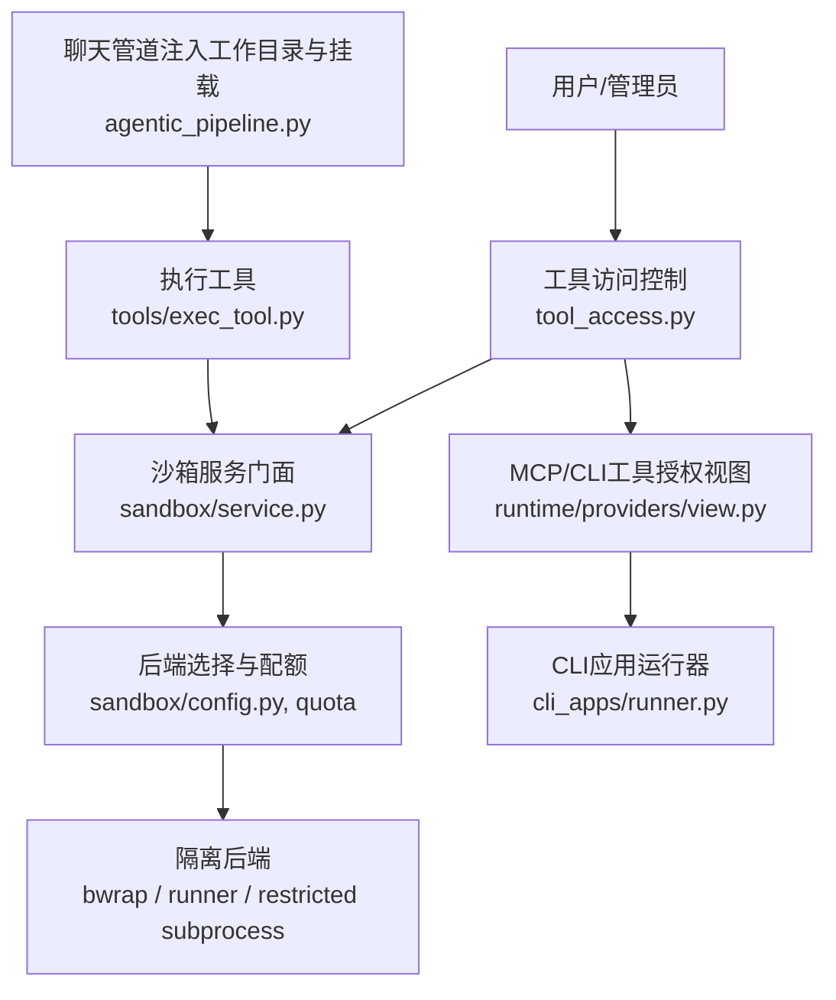
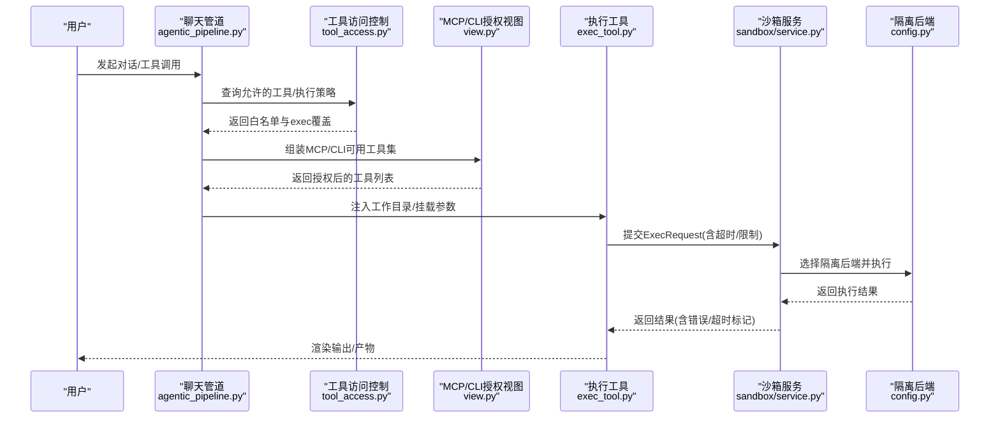
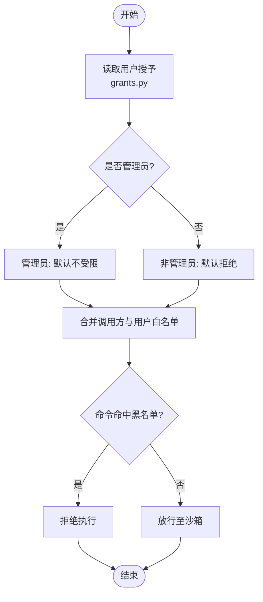
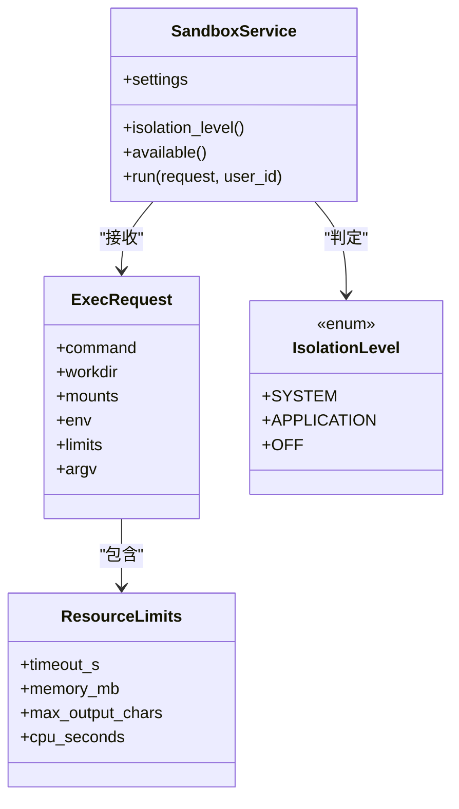
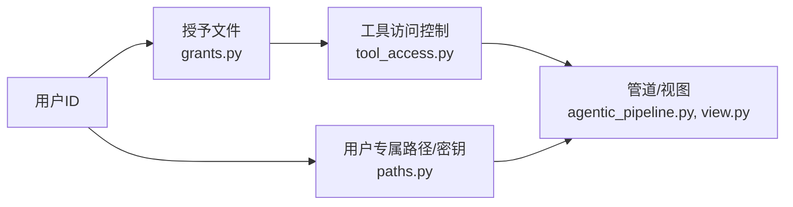
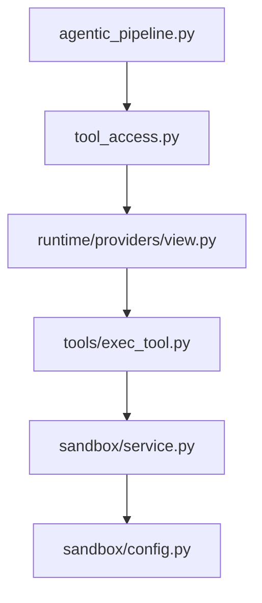

# 安全策略配置

<cite>
**本文引用的文件**
- [deeptutor/multi_user/tool_access.py](file://deeptutor/multi_user/tool_access.py)
- [deeptutor/multi_user/grants.py](file://deeptutor/multi_user/grants.py)
- [deeptutor/tools/exec_tool.py](file://deeptutor/tools/exec_tool.py)
- [deeptutor/services/sandbox/service.py](file://deeptutor/services/sandbox/service.py)
- [deeptutor/services/sandbox/config.py](file://deeptutor/services/sandbox/config.py)
- [deeptutor/services/sandbox/spec.py](file://deeptutor/services/sandbox/spec.py)
- [deeptutor/agents/chat/agentic_pipeline.py](file://deeptutor/agents/chat/agentic_pipeline.py)
- [deeptutor/runtime/providers/view.py](file://deeptutor/runtime/providers/view.py)
- [deeptutor/services/cli_apps/provider.py](file://deeptutor/services/cli_apps/provider.py)
- [deeptutor/services/cli_apps/runner.py](file://deeptutor/services/cli_apps/runner.py)
- [tests/api/test_tool_options.py](file://tests/api/test_tool_options.py)
- [tests/core/test_builtin_tools.py](file://tests/core/test_builtin_tools.py)
</cite>

## 目录
1. [简介](#简介)
2. [项目结构](#项目结构)
3. [核心组件](#核心组件)
4. [架构总览](#架构总览)
5. [详细组件分析](#详细组件分析)
6. [依赖关系分析](#依赖关系分析)
7. [性能与资源限制](#性能与资源限制)
8. [故障排查指南](#故障排查指南)
9. [结论](#结论)
10. [附录：场景化配置示例](#附录：场景化配置示例)

## 简介
本文件面向DeepTutor的安全策略配置，覆盖工具执行策略、网络访问策略（通过MCP与CLI应用间接暴露）以及资源使用策略。重点说明：
- 如何配置工具白名单/黑名单（内置工具、MCP工具、CLI应用）
- 执行策略开关（exec_enabled）、超时与资源限制
- 多租户下的策略隔离机制
- 策略验证与热重载机制
- 开发、测试、生产环境的差异化推荐配置

## 项目结构
与安全策略相关的代码主要分布在以下模块：
- 用户授权与工具访问控制：multi_user/tool_access.py、multi_user/grants.py
- 沙箱执行与服务门面：services/sandbox/*
- 工具与管道集成：tools/exec_tool.py、agents/chat/agentic_pipeline.py
- MCP与CLI应用授权视图：runtime/providers/view.py、services/cli_apps/*
- 相关测试用例：tests/api/test_tool_options.py、tests/core/test_builtin_tools.py

图表来源
- [deeptutor/multi_user/tool_access.py:44-113](file://deeptutor/multi_user/tool_access.py#L44-L113)
- [deeptutor/services/sandbox/service.py:29-95](file://deeptutor/services/sandbox/service.py#L29-L95)
- [deeptutor/services/sandbox/config.py:41-84](file://deeptutor/services/sandbox/config.py#L41-L84)
- [deeptutor/runtime/providers/view.py:117-130](file://deeptutor/runtime/providers/view.py#L117-L130)
- [deeptutor/services/cli_apps/runner.py:72-88](file://deeptutor/services/cli_apps/runner.py#L72-L88)
- [deeptutor/agents/chat/agentic_pipeline.py:943-967](file://deeptutor/agents/chat/agentic_pipeline.py#L943-L967)
- [deeptutor/tools/exec_tool.py:80-118](file://deeptutor/tools/exec_tool.py#L80-L118)

章节来源
- [deeptutor/multi_user/tool_access.py:1-114](file://deeptutor/multi_user/tool_access.py#L1-L114)
- [deeptutor/services/sandbox/service.py:1-133](file://deeptutor/services/sandbox/service.py#L1-L133)
- [deeptutor/services/sandbox/config.py:1-93](file://deeptutor/services/sandbox/config.py#L1-L93)
- [deeptutor/tools/exec_tool.py:1-125](file://deeptutor/tools/exec_tool.py#L1-L125)
- [deeptutor/agents/chat/agentic_pipeline.py:943-967](file://deeptutor/agents/chat/agentic_pipeline.py#L943-L967)
- [deeptutor/runtime/providers/view.py:117-130](file://deeptutor/runtime/providers/view.py#L117-L130)
- [deeptutor/services/cli_apps/runner.py:72-124](file://deeptutor/services/cli_apps/runner.py#L72-L124)

## 核心组件
- 工具访问控制（tool_access）
  - 提供按用户的工具白名单解析：可选内置工具、MCP工具、CLI应用ID白名单，以及exec_enabled的每用户覆盖。
  - 提供白名单合并逻辑，支持“调用方范围”和“用户范围”的交集计算。
- 授予策略（grants）
  - 定义v2授予结构，包含enabled_tools、mcp_tools、cli_apps、exec_enabled等字段；默认对非管理员采用“拒绝默认”的策略。
- 沙箱服务（sandbox service）
  - 统一入口，负责健康检查、隔离级别判定、配额控制、执行调度。
  - 在run前再次校验exec_override，确保即使绕过上层也能受控。
- 执行工具（exec_tool）
  - 将模型生成的命令封装为ExecRequest，设置超时和资源限制，并调用沙箱服务执行。
  - 内置命令黑名单防护，避免危险指令。
- 聊天管道（agentic_pipeline）
  - 为exec与CLI应用注入工作目录与只读/读写挂载，保证输出可被后续处理与公开访问。
- MCP/CLI授权视图（runtime/providers/view.py）
  - 基于授予与拥有者池，决定最终可用的MCP工具集合；CLI应用通过app id授权，并在视图层扩大可用工具名集合。
- CLI运行器（cli_apps/runner.py）
  - 构造最小环境（PATH、HOME等），以argv方式构建ExecRequest，避免shell元字符风险。

章节来源
- [deeptutor/multi_user/tool_access.py:44-113](file://deeptutor/multi_user/tool_access.py#L44-L113)
- [deeptutor/multi_user/grants.py:16-44](file://deeptutor/multi_user/grants.py#L16-L44)
- [deeptutor/services/sandbox/service.py:29-95](file://deeptutor/services/sandbox/service.py#L29-L95)
- [deeptutor/tools/exec_tool.py:80-118](file://deeptutor/tools/exec_tool.py#L80-L118)
- [deeptutor/agents/chat/agentic_pipeline.py:943-967](file://deeptutor/agents/chat/agentic_pipeline.py#L943-L967)
- [deeptutor/runtime/providers/view.py:117-130](file://deeptutor/runtime/providers/view.py#L117-L130)
- [deeptutor/services/cli_apps/runner.py:72-124](file://deeptutor/services/cli_apps/runner.py#L72-L124)

## 架构总览
下图展示了从用户请求到工具执行的完整安全路径，包括策略读取、权限判定、沙箱隔离与资源限制。

图表来源
- [deeptutor/agents/chat/agentic_pipeline.py:943-967](file://deeptutor/agents/chat/agentic_pipeline.py#L943-L967)
- [deeptutor/multi_user/tool_access.py:44-113](file://deeptutor/multi_user/tool_access.py#L44-L113)
- [deeptutor/runtime/providers/view.py:117-130](file://deeptutor/runtime/providers/view.py#L117-L130)
- [deeptutor/tools/exec_tool.py:80-118](file://deeptutor/tools/exec_tool.py#L80-L118)
- [deeptutor/services/sandbox/service.py:29-95](file://deeptutor/services/sandbox/service.py#L29-L95)
- [deeptutor/services/sandbox/config.py:41-84](file://deeptutor/services/sandbox/config.py#L41-L84)

## 详细组件分析

### 工具白名单与黑名单
- 内置工具白名单
  - enabled_tools：若为None表示遵循部署默认（全部可用），[]表示禁用所有，具体列表为显式白名单。
  - 由tool_access.allowed_optional_tools()读取当前用户授予，并在工具列表与UI中过滤。
- MCP工具白名单
  - mcp_tools：非管理员缺失时为拒绝默认；管理员为None表示不受限。
  - 由tool_access.allowed_mcp_tools()读取，并与调用方范围的过滤器取交集。
- CLI应用白名单
  - cli_apps：按应用id授权，非管理员缺失时为拒绝默认；管理员为None表示不受限。
  - 由tool_access.allowed_cli_apps()读取，并在CLI提供者中结合用户偏好进行交集。
- 黑名单
  - exec工具内置命令黑名单（deny patterns），拦截危险命令。
  - 授予校验禁止在grant中携带敏感字段（如api_key、secret、password、token、path、base_url）。

图表来源
- [deeptutor/multi_user/grants.py:16-44](file://deeptutor/multi_user/grants.py#L16-L44)
- [deeptutor/multi_user/tool_access.py:44-113](file://deeptutor/multi_user/tool_access.py#L44-L113)
- [deeptutor/tools/exec_tool.py:85-91](file://deeptutor/tools/exec_tool.py#L85-L91)

章节来源
- [deeptutor/multi_user/tool_access.py:44-113](file://deeptutor/multi_user/tool_access.py#L44-L113)
- [deeptutor/multi_user/grants.py:16-44](file://deeptutor/multi_user/grants.py#L16-L44)
- [deeptutor/tools/exec_tool.py:85-91](file://deeptutor/tools/exec_tool.py#L85-L91)
- [tests/api/test_tool_options.py:117-132](file://tests/api/test_tool_options.py#L117-L132)

### 执行策略与资源限制
- exec_enabled
  - 部署级策略由沙箱后端隔离级别决定；每用户可通过exec_enabled覆盖：None跟随部署策略，False强制拒绝，True仅在具备SYSTEM隔离时生效。
  - 在沙箱服务run前再次校验exec_override，确保任何直达路径均受控。
- 超时与资源限制
  - ResourceLimits包含timeout_s、memory_mb、max_output_chars、cpu_seconds。
  - exec工具将用户传入的timeout限制在[1, _MAX_TIMEOUT]区间；CLI运行器对超时进行有界化处理。
- 隔离级别
  - IsolationLevel：system/application/off。普通用户仅当backend达到system时才开放exec；application为管理员可选；off表示不可用。

图表来源
- [deeptutor/services/sandbox/service.py:29-95](file://deeptutor/services/sandbox/service.py#L29-L95)
- [deeptutor/services/sandbox/spec.py:16-41](file://deeptutor/services/sandbox/spec.py#L16-L41)
- [deeptutor/services/sandbox/spec.py:52-96](file://deeptutor/services/sandbox/spec.py#L52-L96)

章节来源
- [deeptutor/services/sandbox/service.py:29-95](file://deeptutor/services/sandbox/service.py#L29-L95)
- [deeptutor/services/sandbox/spec.py:16-41](file://deeptutor/services/sandbox/spec.py#L16-L41)
- [deeptutor/services/sandbox/config.py:41-84](file://deeptutor/services/sandbox/config.py#L41-L84)
- [deeptutor/tools/exec_tool.py:105-118](file://deeptutor/tools/exec_tool.py#L105-L118)
- [deeptutor/services/cli_apps/runner.py:72-98](file://deeptutor/services/cli_apps/runner.py#L72-L98)

### 多租户策略隔离
- 授予存储与加载
  - 每个用户独立的授予文件，空授予默认拒绝MCP与CLI应用；管理员不受限。
  - 授予规范化与校验防止敏感信息泄露。
- 路径与密钥隔离
  - owner_secrets_dir确保密钥目录权限严格，且沙箱不应看到这些目录。
- 工具访问上下文
  - tool_access通过当前用户上下文读取授予，实现按用户隔离。

图表来源
- [deeptutor/multi_user/grants.py:55-112](file://deeptutor/multi_user/grants.py#L55-L112)
- [deeptutor/multi_user/tool_access.py:36-42](file://deeptutor/multi_user/tool_access.py#L36-L42)
- [deeptutor/multi_user/paths.py:211-233](file://deeptutor/multi_user/paths.py#L211-L233)

章节来源
- [deeptutor/multi_user/grants.py:55-112](file://deeptutor/multi_user/grants.py#L55-L112)
- [deeptutor/multi_user/tool_access.py:36-42](file://deeptutor/multi_user/tool_access.py#L36-L42)
- [deeptutor/multi_user/paths.py:211-233](file://deeptutor/multi_user/paths.py#L211-L233)

### 网络访问策略（MCP与CLI）
- MCP工具
  - 通过runtime/providers/view.py中的authorize_mcp_tools，结合用户授予与拥有者池，决定最终可用工具集合。
  - 测试断言CLI工具不得出现在MCP工具列表中，避免误授权。
- CLI应用
  - 通过cli_apps.provider与runner，以app id授权，并以argv方式执行，避免shell解析风险。
  - 运行器注入最小环境变量，PATH指向应用bin目录，HOME指向临时目录，降低外部依赖面。

章节来源
- [deeptutor/runtime/providers/view.py:117-130](file://deeptutor/runtime/providers/view.py#L117-L130)
- [tests/api/test_tool_options.py:117-132](file://tests/api/test_tool_options.py#L117-L132)
- [deeptutor/services/cli_apps/provider.py:194-216](file://deeptutor/services/cli_apps/provider.py#L194-L216)
- [deeptutor/services/cli_apps/runner.py:101-124](file://deeptutor/services/cli_apps/runner.py#L101-L124)

### 策略验证与热重载
- 启动时配置校验
  - API主程序在启动阶段进行配置一致性校验，发现不一致会抛出异常并记录日志。
- 运行时设置服务
  - RuntimeSettingsService负责系统/认证等JSON配置的加载、保存与环境变量覆盖；支持导出环境变量供进程使用。
- 沙箱服务重置
  - reset_sandbox_service用于测试或配置重载后清理缓存的服务实例，使新配置生效。

章节来源
- [deeptutor/api/main.py:74-82](file://deeptutor/api/main.py#L74-L82)
- [deeptutor/services/config/runtime_settings.py:309-378](file://deeptutor/services/config/runtime_settings.py#L309-L378)
- [deeptutor/services/config/runtime_settings.py:548-585](file://deeptutor/services/config/runtime_settings.py#L548-L585)
- [deeptutor/services/sandbox/service.py:108-112](file://deeptutor/services/sandbox/service.py#L108-L112)

## 依赖关系分析
- 松耦合设计
  - 工具访问控制独立于执行细节，仅返回白名单与覆盖策略。
  - 沙箱服务抽象出后端选择与健康探测，便于替换与扩展。
- 关键依赖链
  - agentic_pipeline → tool_access → runtime/providers/view → exec_tool → sandbox/service → config/build_backend
- 潜在循环与规避
  - 工具模块延迟导入services以避免循环依赖（见exec_tool注释）。

图表来源
- [deeptutor/agents/chat/agentic_pipeline.py:943-967](file://deeptutor/agents/chat/agentic_pipeline.py#L943-L967)
- [deeptutor/multi_user/tool_access.py:44-113](file://deeptutor/multi_user/tool_access.py#L44-L113)
- [deeptutor/runtime/providers/view.py:117-130](file://deeptutor/runtime/providers/view.py#L117-L130)
- [deeptutor/tools/exec_tool.py:80-118](file://deeptutor/tools/exec_tool.py#L80-L118)
- [deeptutor/services/sandbox/service.py:29-95](file://deeptutor/services/sandbox/service.py#L29-L95)
- [deeptutor/services/sandbox/config.py:41-84](file://deeptutor/services/sandbox/config.py#L41-L84)

章节来源
- [deeptutor/agents/chat/agentic_pipeline.py:943-967](file://deeptutor/agents/chat/agentic_pipeline.py#L943-L967)
- [deeptutor/multi_user/tool_access.py:44-113](file://deeptutor/multi_user/tool_access.py#L44-L113)
- [deeptutor/runtime/providers/view.py:117-130](file://deeptutor/runtime/providers/view.py#L117-L130)
- [deeptutor/tools/exec_tool.py:80-118](file://deeptutor/tools/exec_tool.py#L80-L118)
- [deeptutor/services/sandbox/service.py:29-95](file://deeptutor/services/sandbox/service.py#L29-L95)
- [deeptutor/services/sandbox/config.py:41-84](file://deeptutor/services/sandbox/config.py#L41-L84)

## 性能与资源限制
- 并发与速率限制
  - 每用户最大并发与每分钟最大运行次数通过环境变量配置，并由沙箱服务的配额模块保障。
- 超时与输出限制
  - 超时上限与输出字符上限在ResourceLimits中定义，exec工具与CLI运行器分别进行边界保护。
- 隔离级别影响
  - SYSTEM隔离提供更强的安全性但可能带来额外开销；APPLICATION隔离适合管理员本地开发；OFF则完全禁用执行。

章节来源
- [deeptutor/services/sandbox/config.py:35-63](file://deeptutor/services/sandbox/config.py#L35-L63)
- [deeptutor/services/sandbox/spec.py:33-41](file://deeptutor/services/sandbox/spec.py#L33-L41)
- [deeptutor/tools/exec_tool.py:105-118](file://deeptutor/tools/exec_tool.py#L105-L118)
- [deeptutor/services/cli_apps/runner.py:72-98](file://deeptutor/services/cli_apps/runner.py#L72-L98)

## 故障排查指南
- 执行被拒绝
  - 检查exec_enabled是否为False或被部署策略拒绝；确认当前用户授予是否存在。
  - 查看沙箱服务健康状态与隔离级别，确认后端可用。
- 命令被拦截
  - 检查命令是否命中内置黑名单；调整命令以避免触发规则。
- 工具不可见
  - 确认MCP工具是否在用户授予的mcp_tools白名单中；CLI应用是否在cli_apps白名单中。
- 配置未生效
  - 重启服务或调用reset_sandbox_service以重新加载配置；检查RuntimeSettingsService的环境变量覆盖。

章节来源
- [deeptutor/services/sandbox/service.py:45-95](file://deeptutor/services/sandbox/service.py#L45-L95)
- [deeptutor/tools/exec_tool.py:85-91](file://deeptutor/tools/exec_tool.py#L85-L91)
- [deeptutor/multi_user/tool_access.py:55-86](file://deeptutor/multi_user/tool_access.py#L55-L86)
- [deeptutor/services/sandbox/service.py:108-112](file://deeptutor/services/sandbox/service.py#L108-L112)

## 结论
DeepTutor的安全策略框架通过“授予+访问控制+沙箱隔离+资源限制”的多层机制，确保工具执行的安全性、可控性与可观测性。建议在多租户环境中坚持“默认拒绝”的原则，明确授予MCP与CLI工具的访问范围，并结合部署形态选择合适的隔离级别与资源限制。

## 附录：场景化配置示例
- 开发环境
  - 隔离级别：APPLICATION（允许受限子进程），exec_enabled跟随部署策略。
  - 资源限制：适当放宽超时与内存，便于调试。
  - 工具白名单：启用常用内置工具与必要MCP工具。
- 测试环境
  - 隔离级别：SYSTEM（容器或命名空间隔离），确保测试环境与宿主隔离。
  - 资源限制：中等限制，避免测试任务占用过多资源。
  - 工具白名单：仅启用测试所需工具，关闭不必要的MCP与CLI应用。
- 生产环境
  - 隔离级别：SYSTEM，严格隔离。
  - 资源限制：保守限制并发、超时与输出大小。
  - 工具白名单：最小化原则，仅授予业务必需工具；CLI应用按app id精确授权。

章节来源
- [deeptutor/services/sandbox/config.py:41-84](file://deeptutor/services/sandbox/config.py#L41-L84)
- [deeptutor/multi_user/tool_access.py:44-113](file://deeptutor/multi_user/tool_access.py#L44-L113)
- [deeptutor/services/cli_apps/runner.py:72-124](file://deeptutor/services/cli_apps/runner.py#L72-L124)
- [tests/core/test_builtin_tools.py:228-260](file://tests/core/test_builtin_tools.py#L228-L260)