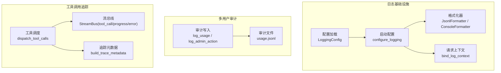
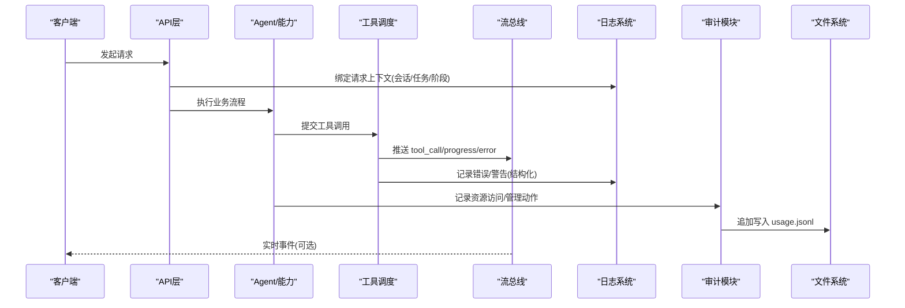
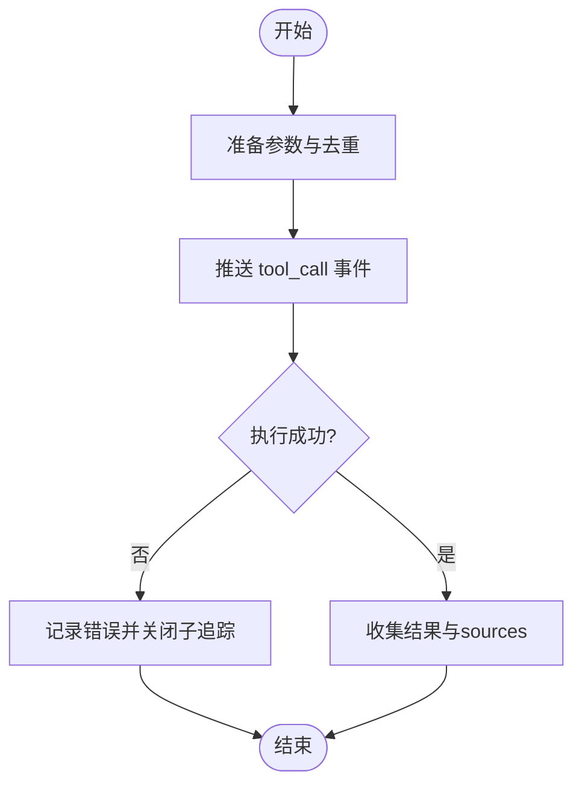
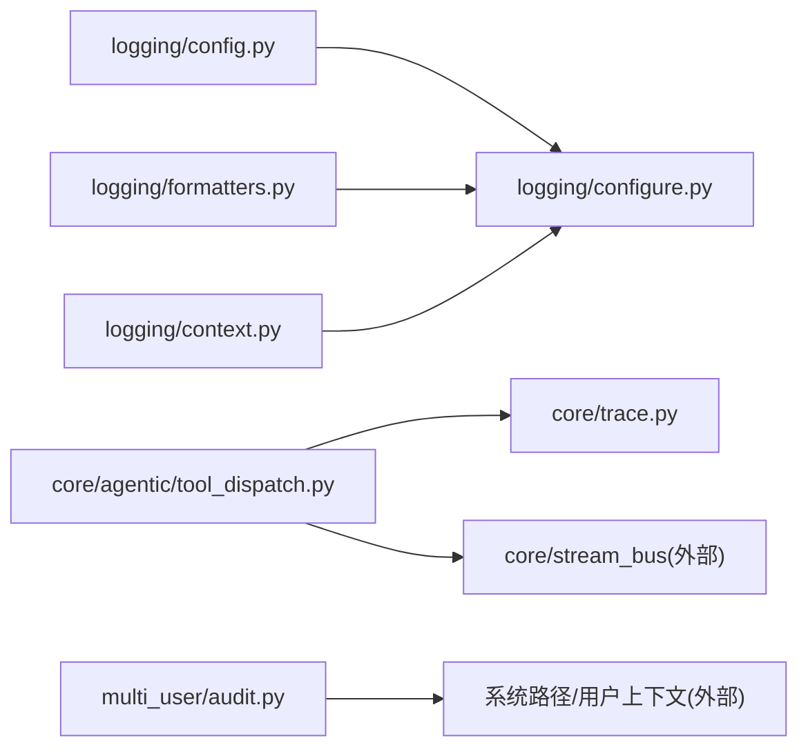

# 审计日志记录

<cite>
**本文引用的文件**
- [deeptutor/logging/config.py](file://deeptutor/logging/config.py)
- [deeptutor/logging/configure.py](file://deeptutor/logging/configure.py)
- [deeptutor/logging/context.py](file://deeptutor/logging/context.py)
- [deeptutor/logging/formatters.py](file://deeptutor/logging/formatters.py)
- [deeptutor/multi_user/audit.py](file://deeptutor/multi_user/audit.py)
- [deeptutor/core/agentic/tool_dispatch.py](file://deeptutor/core/agentic/tool_dispatch.py)
- [deeptutor/core/trace.py](file://deeptutor/core/trace.py)
- [tests/core/agentic/test_tool_dispatch_events.py](file://tests/core/agentic/test_tool_dispatch_events.py)
</cite>

## 目录
1. [简介](#简介)
2. [项目结构](#项目结构)
3. [核心组件](#核心组件)
4. [架构总览](#架构总览)
5. [详细组件分析](#详细组件分析)
6. [依赖关系分析](#依赖关系分析)
7. [性能考虑](#性能考虑)
8. [故障排查指南](#故障排查指南)
9. [结论](#结论)
10. [附录](#附录)

## 简介
本文件面向DeepTutor的审计与可观测性需求，系统化说明工具调用审计机制、结构化日志格式、分类与存储策略、配置与保留策略、查询与分析能力、安全事件检测与合规审计要点，以及敏感信息脱敏与传输安全的实践建议。文档基于仓库中现有实现进行梳理，并给出可扩展的实践指引。

## 项目结构
DeepTutor在“日志基础设施”和“多用户审计”两个层面提供审计能力：
- 日志基础设施：负责全局日志级别、输出目标（控制台/文件）、结构化JSON行格式、请求级上下文注入等。
- 多用户审计：针对资源访问与管理员操作，持久化到系统根目录下的专用审计文件。

图表来源
- [deeptutor/logging/config.py:9-17](file://deeptutor/logging/config.py#L9-L17)
- [deeptutor/logging/configure.py:37-77](file://deeptutor/logging/configure.py#L37-L77)
- [deeptutor/logging/formatters.py:26-49](file://deeptutor/logging/formatters.py#L26-L49)
- [deeptutor/logging/context.py:10-39](file://deeptutor/logging/context.py#L10-L39)
- [deeptutor/multi_user/audit.py:13-80](file://deeptutor/multi_user/audit.py#L13-L80)
- [deeptutor/core/agentic/tool_dispatch.py:78-152](file://deeptutor/core/agentic/tool_dispatch.py#L78-L152)
- [deeptutor/core/trace.py:14-41](file://deeptutor/core/trace.py#L14-L41)

章节来源
- [deeptutor/logging/config.py:9-17](file://deeptutor/logging/config.py#L9-L17)
- [deeptutor/logging/configure.py:37-77](file://deeptutor/logging/configure.py#L37-L77)
- [deeptutor/logging/formatters.py:26-49](file://deeptutor/logging/formatters.py#L26-L49)
- [deeptutor/logging/context.py:10-39](file://deeptutor/logging/context.py#L10-L39)
- [deeptutor/multi_user/audit.py:13-80](file://deeptutor/multi_user/audit.py#L13-L80)
- [deeptutor/core/agentic/tool_dispatch.py:78-152](file://deeptutor/core/agentic/tool_dispatch.py#L78-L152)
- [deeptutor/core/trace.py:14-41](file://deeptutor/core/trace.py#L14-L41)

## 核心组件
- 日志配置与启动
  - 通过配置对象定义日志级别、是否输出到控制台/文件、日志目录、轮转大小与备份数量。
  - 启动时安装控制台与文件处理器，统一使用结构化JSON行格式，并桥接第三方日志库。
- 请求级日志上下文
  - 以上下文变量绑定请求ID、会话ID、任务ID、阶段等信息，所有日志自动携带这些字段。
- 结构化日志格式
  - JSON行包含时间戳、级别、日志器名、消息、异常堆栈（可选）以及上下文对象。
- 多用户审计
  - 普通用户对受管资源的访问记录；管理员写操作的执行者、目标与摘要记录。
  - 写入系统根目录下的专用JSON行文件，失败不中断业务请求。
- 工具调用追踪
  - 为每次工具调用生成唯一子追踪ID，并通过流总线推送tool_call/progress/error事件，前端可渲染调用时序。

章节来源
- [deeptutor/logging/config.py:9-49](file://deeptutor/logging/config.py#L9-L49)
- [deeptutor/logging/configure.py:37-77](file://deeptutor/logging/configure.py#L37-L77)
- [deeptutor/logging/context.py:10-39](file://deeptutor/logging/context.py#L10-L39)
- [deeptutor/logging/formatters.py:26-49](file://deeptutor/logging/formatters.py#L26-L49)
- [deeptutor/multi_user/audit.py:13-80](file://deeptutor/multi_user/audit.py#L13-L80)
- [deeptutor/core/agentic/tool_dispatch.py:78-152](file://deeptutor/core/agentic/tool_dispatch.py#L78-L152)
- [deeptutor/core/trace.py:14-41](file://deeptutor/core/trace.py#L14-L41)

## 架构总览
下图展示从请求进入、上下文绑定、工具调用、到日志与审计落盘的完整链路。

图表来源
- [deeptutor/logging/context.py:25-39](file://deeptutor/logging/context.py#L25-L39)
- [deeptutor/core/agentic/tool_dispatch.py:125-152](file://deeptutor/core/agentic/tool_dispatch.py#L125-L152)
- [deeptutor/core/agentic/tool_dispatch.py:436-588](file://deeptutor/core/agentic/tool_dispatch.py#L436-L588)
- [deeptutor/multi_user/audit.py:19-80](file://deeptutor/multi_user/audit.py#L19-L80)
- [deeptutor/logging/configure.py:52-71](file://deeptutor/logging/configure.py#L52-L71)

## 详细组件分析

### 日志配置与输出
- 配置项
  - level：日志级别（如INFO）。
  - console_output/file_output：是否输出到控制台/文件。
  - log_dir：日志目录。
  - max_bytes/backup_count：文件轮转大小与备份数。
- 启动行为
  - 设置根日志器级别为DEBUG，按配置添加控制台与文件处理器。
  - 文件处理器采用轮转写入，统一使用JSON行格式。
  - 安装日志桥接到第三方日志框架，便于统一采集。

章节来源
- [deeptutor/logging/config.py:9-49](file://deeptutor/logging/config.py#L9-L49)
- [deeptutor/logging/configure.py:37-77](file://deeptutor/logging/configure.py#L37-L77)

### 结构化日志格式
- JSON行字段
  - timestamp：UTC时间戳。
  - level：日志级别。
  - logger：日志器名称。
  - message：消息文本。
  - exception：异常堆栈（存在时）。
  - context：请求级上下文（如request_id、session_id、task_id、stage等）。
- 上下文注入
  - 通过上下文管理器将请求相关字段绑定到当前线程/协程上下文，所有日志自动携带。

章节来源
- [deeptutor/logging/formatters.py:26-49](file://deeptutor/logging/formatters.py#L26-L49)
- [deeptutor/logging/context.py:10-39](file://deeptutor/logging/context.py#L10-L39)

### 多用户审计记录
- 两类记录
  - 普通用户资源访问：记录时间、用户ID、用户名、资源类型、资源ID、动作及扩展字段。
  - 管理员写操作：记录执行者ID/用户名/角色、动作、目标用户ID（可选）、变更摘要（可选）。
- 存储策略
  - 写入系统根目录下专用JSON行文件，失败静默忽略，确保不影响主流程。
- 适用场景
  - 合规审计、访问统计、管理员操作追溯。

章节来源
- [deeptutor/multi_user/audit.py:13-80](file://deeptutor/multi_user/audit.py#L13-L80)

### 工具调用审计与追踪
- 并行调度与去重
  - 限制并发上限，合并重复调用，避免重复副作用与UI重复展示。
- 子追踪与事件
  - 每个工具调用生成独立call_id，推送到流总线的事件包含tool_call/progress/error状态。
  - 错误路径会关闭子追踪并标记error状态，保证前端时序一致。
- 参数过滤
  - 对外暴露的参数会剔除服务器注入的私有键，避免不可序列化或敏感内容泄露。
- 测试保障
  - 单元测试验证事件可被严格JSON序列化，且仅包含必要参数键。

图表来源
- [deeptutor/core/agentic/tool_dispatch.py:78-152](file://deeptutor/core/agentic/tool_dispatch.py#L78-L152)
- [deeptutor/core/agentic/tool_dispatch.py:436-588](file://deeptutor/core/agentic/tool_dispatch.py#L436-L588)
- [tests/core/agentic/test_tool_dispatch_events.py:138-152](file://tests/core/agentic/test_tool_dispatch_events.py#L138-L152)

章节来源
- [deeptutor/core/agentic/tool_dispatch.py:78-152](file://deeptutor/core/agentic/tool_dispatch.py#L78-L152)
- [deeptutor/core/agentic/tool_dispatch.py:436-588](file://deeptutor/core/agentic/tool_dispatch.py#L436-L588)
- [tests/core/agentic/test_tool_dispatch_events.py:138-152](file://tests/core/agentic/test_tool_dispatch_events.py#L138-L152)

### 追踪元数据模型
- 统一元数据构建
  - call_id、phase、label、call_kind为核心字段，支持trace_id/role/group/kind等扩展。
- 派生与合并
  - 支持在事件传播过程中派生新元数据或合并额外字段，保持追踪一致性。

章节来源
- [deeptutor/core/trace.py:14-82](file://deeptutor/core/trace.py#L14-L82)

## 依赖关系分析
- 日志子系统内部依赖
  - configure依赖config与formatters，context通过ContextFilter注入上下文。
- 工具调度对追踪与流的依赖
  - 依赖trace生成call_id与元数据，依赖stream_bus推送事件。
- 审计模块对系统与用户的依赖
  - 依赖多用户上下文获取当前用户，依赖系统路径服务确定审计文件位置。

图表来源
- [deeptutor/logging/configure.py:37-77](file://deeptutor/logging/configure.py#L37-L77)
- [deeptutor/core/agentic/tool_dispatch.py:78-152](file://deeptutor/core/agentic/tool_dispatch.py#L78-L152)
- [deeptutor/core/trace.py:14-41](file://deeptutor/core/trace.py#L14-L41)
- [deeptutor/multi_user/audit.py:13-80](file://deeptutor/multi_user/audit.py#L13-L80)

章节来源
- [deeptutor/logging/configure.py:37-77](file://deeptutor/logging/configure.py#L37-L77)
- [deeptutor/core/agentic/tool_dispatch.py:78-152](file://deeptutor/core/agentic/tool_dispatch.py#L78-L152)
- [deeptutor/core/trace.py:14-41](file://deeptutor/core/trace.py#L14-L41)
- [deeptutor/multi_user/audit.py:13-80](file://deeptutor/multi_user/audit.py#L13-L80)

## 性能考虑
- 异步与并发
  - 工具调用并行执行，限制最大并发数，避免资源争用。
- I/O健壮性
  - 审计写入失败不中断请求，降低审计对主流程的影响。
- 日志轮转
  - 文件日志按大小轮转并保留若干备份，控制磁盘占用。
- 事件最小化
  - 对外推送的工具参数剔除私有键，减少不必要的数据体积。

[本节为通用指导，无需特定文件引用]

## 故障排查指南
- 无法写入审计文件
  - 检查系统根目录是否存在且可写；确认ensure_system_dirs已执行；关注异常被吞掉的语义，必要时增加外围监控。
- 日志未输出到文件
  - 检查配置中的file_output开关与日志目录权限；确认configure_logging已调用。
- 工具调用无事件或事件不完整
  - 检查并发上限与去重逻辑；查看错误分支是否正确关闭子追踪；确认事件可被JSON序列化。
- 上下文缺失
  - 确认在请求入口处绑定了必要的上下文字段（如session_id、task_id、stage）。

章节来源
- [deeptutor/multi_user/audit.py:19-26](file://deeptutor/multi_user/audit.py#L19-L26)
- [deeptutor/logging/configure.py:52-71](file://deeptutor/logging/configure.py#L52-L71)
- [deeptutor/core/agentic/tool_dispatch.py:436-588](file://deeptutor/core/agentic/tool_dispatch.py#L436-L588)
- [tests/core/agentic/test_tool_dispatch_events.py:138-152](file://tests/core/agentic/test_tool_dispatch_events.py#L138-L152)

## 结论
DeepTutor的审计与日志体系由“结构化日志基础设施 + 多用户审计 + 工具调用追踪”三部分构成：日志提供统一的格式与上下文，审计聚焦资源访问与管理操作的可追溯性，工具调用追踪提供细粒度的执行时序与错误定位。结合合理的配置、保留策略与后续的外部采集/分析管道，可满足安全事件检测与合规审计的基本需求。

[本节为总结性内容，无需特定文件引用]

## 附录

### 日志与审计数据结构速查
- 结构化日志（JSON行）
  - 字段：timestamp、level、logger、message、exception（可选）、context（含request_id/session_id/task_id/stage等）
- 普通用户资源访问
  - 字段：time、user_id、username、resource_type、resource_id、action、extra（可选）
- 管理员写操作
  - 字段：time、actor_id、actor_username、actor_role、action、target_user_id（可选）、summary（可选）
- 工具调用事件（流事件）
  - 字段：type=tool_call/progress/error；metadata包含call_id/phase/label/call_kind/trace_*等；args为对外可见参数

章节来源
- [deeptutor/logging/formatters.py:26-49](file://deeptutor/logging/formatters.py#L26-L49)
- [deeptutor/multi_user/audit.py:29-80](file://deeptutor/multi_user/audit.py#L29-L80)
- [deeptutor/core/agentic/tool_dispatch.py:125-152](file://deeptutor/core/agentic/tool_dispatch.py#L125-L152)
- [deeptutor/core/trace.py:14-41](file://deeptutor/core/trace.py#L14-L41)

### 配置项与保留策略
- 日志级别：通过配置对象的level字段设置。
- 输出目标：console_output/file_output控制控制台与文件输出。
- 日志目录：log_dir指定日志存放路径。
- 轮转策略：max_bytes与backup_count控制文件大小与备份数量。
- 审计文件：位于系统根目录下的专用JSON行文件，按行追加。

章节来源
- [deeptutor/logging/config.py:9-49](file://deeptutor/logging/config.py#L9-L49)
- [deeptutor/logging/configure.py:52-71](file://deeptutor/logging/configure.py#L52-L71)
- [deeptutor/multi_user/audit.py:13-26](file://deeptutor/multi_user/audit.py#L13-L26)

### 安全与合规要点
- 敏感信息脱敏
  - 工具调用对外参数剔除私有键；错误消息避免回显敏感细节。
- 传输加密
  - 建议在网关/代理层启用TLS，保护日志与审计数据的传输安全。
- 访问控制
  - 审计文件应限制读写权限，仅允许受信任进程或服务账户访问。
- 合规审计
  - 利用结构化字段（时间、用户、资源、动作）进行检索与报表生成，满足审计要求。

[本节为通用指导，无需特定文件引用]