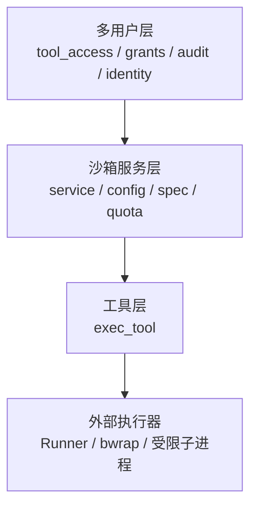
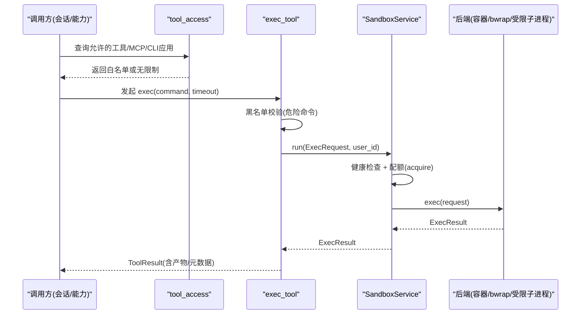
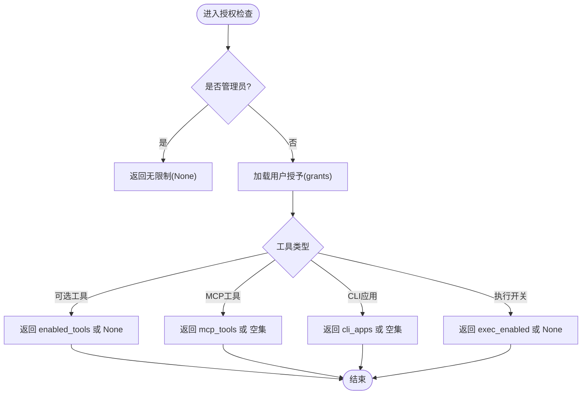
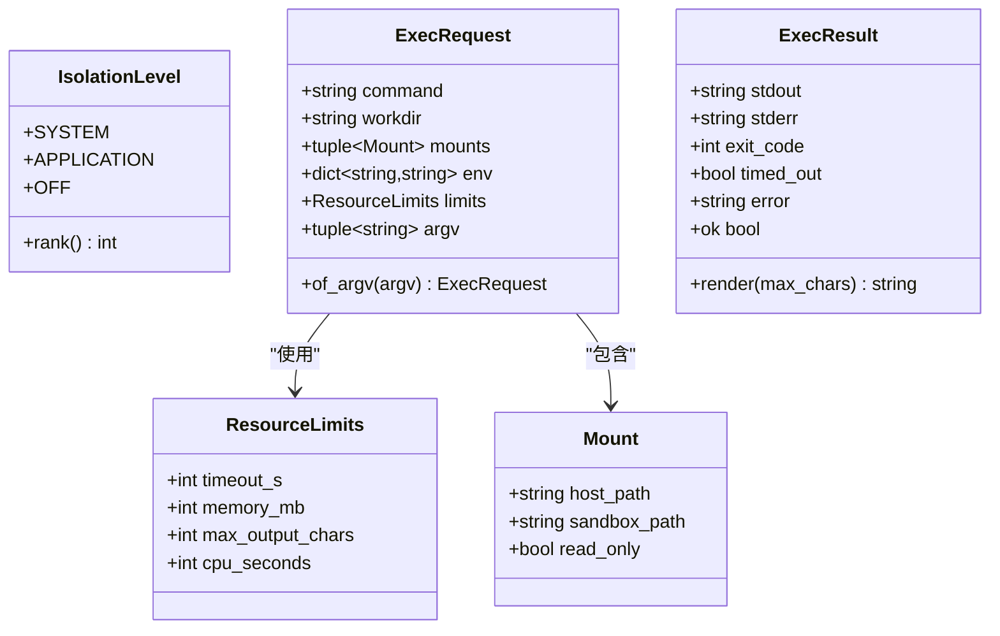
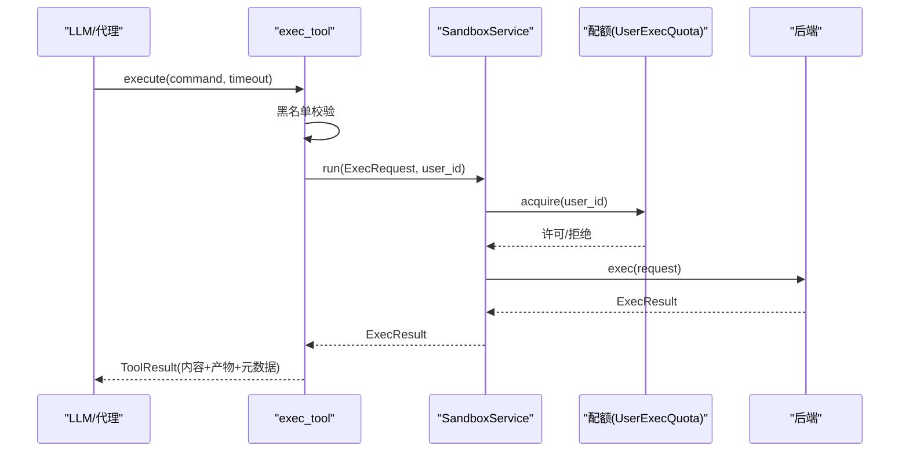
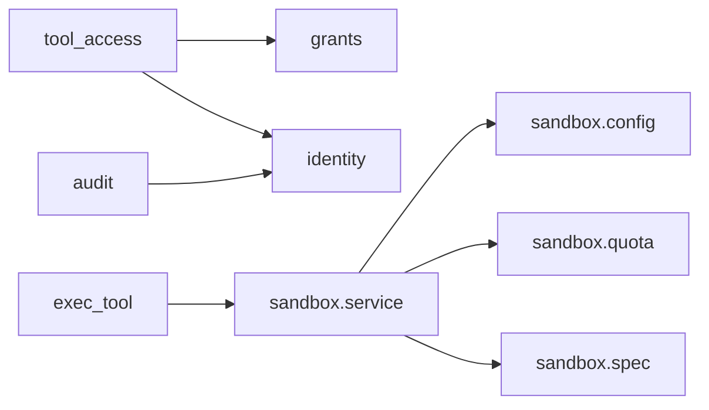

# 工具安全与权限

<cite>
**本文引用的文件**
- [deeptutor/multi_user/tool_access.py](file://deeptutor/multi_user/tool_access.py)
- [deeptutor/multi_user/grants.py](file://deeptutor/multi_user/grants.py)
- [deeptutor/multi_user/audit.py](file://deeptutor/multi_user/audit.py)
- [deeptutor/multi_user/identity.py](file://deeptutor/multi_user/identity.py)
- [deeptutor/services/sandbox/service.py](file://deeptutor/services/sandbox/service.py)
- [deeptutor/services/sandbox/config.py](file://deeptutor/services/sandbox/config.py)
- [deeptutor/services/sandbox/spec.py](file://deeptutor/services/sandbox/spec.py)
- [deeptutor/services/sandbox/quota.py](file://deeptutor/services/sandbox/quota.py)
- [deeptutor/tools/exec_tool.py](file://deeptutor/tools/exec_tool.py)
</cite>

## 目录
1. [简介](#简介)
2. [项目结构](#项目结构)
3. [核心组件](#核心组件)
4. [架构总览](#架构总览)
5. [详细组件分析](#详细组件分析)
6. [依赖关系分析](#依赖关系分析)
7. [性能与安全考量](#性能与安全考量)
8. [故障排查指南](#故障排查指南)
9. [结论](#结论)
10. [附录](#附录)

## 简介
本文件系统性阐述 DeepTutor 的工具安全与权限模型，覆盖以下主题：
- 基于角色的访问控制（RBAC）与基于能力的权限管理（能力白名单、MCP/CLI 应用授权、执行开关）
- 工具执行的沙箱环境：文件系统隔离、网络访问控制、资源限制
- 多用户环境下的权限隔离机制与数据隔离
- 敏感操作的审批流程与审计日志记录
- 工具安全策略配置：白名单、黑名单、执行限制
- 工具调用的安全最佳实践：输入验证、输出过滤、异常处理
- 安全漏洞检测与防护方法
- 安全事件响应与恢复流程

## 项目结构
围绕“工具安全与权限”的关键代码分布在多用户层、沙箱服务层与工具层：
- 多用户层：身份、授权、授予（grants）、审计日志
- 沙箱服务层：后端选择、配额、请求/结果规范、健康检查
- 工具层：可执行命令工具（exec），内置防御性黑名单

图表来源
- [deeptutor/multi_user/tool_access.py:1-114](file://deeptutor/multi_user/tool_access.py#L1-L114)
- [deeptutor/services/sandbox/service.py:1-133](file://deeptutor/services/sandbox/service.py#L1-L133)
- [deeptutor/services/sandbox/config.py:1-93](file://deeptutor/services/sandbox/config.py#L1-L93)
- [deeptutor/tools/exec_tool.py:1-157](file://deeptutor/tools/exec_tool.py#L1-L157)

章节来源
- [deeptutor/multi_user/tool_access.py:1-114](file://deeptutor/multi_user/tool_access.py#L1-L114)
- [deeptutor/services/sandbox/service.py:1-133](file://deeptutor/services/sandbox/service.py#L1-L133)
- [deeptutor/services/sandbox/config.py:1-93](file://deeptutor/services/sandbox/config.py#L1-L93)
- [deeptutor/tools/exec_tool.py:1-157](file://deeptutor/tools/exec_tool.py#L1-L157)

## 核心组件
- 能力与角色授权
  - 通过 grants 定义非管理员用户的逻辑资源授予（模型、知识库、技能、合作伙伴、工具白名单、MCP 工具、CLI 应用、执行开关）。
  - tool_access 提供当前用户的能力查询接口，用于在运行时对工具列表与执行进行拦截。
- 沙箱执行服务
  - service 封装后端选择、健康检查、配额控制与执行入口；spec 定义隔离级别、请求/结果模型；config 决定后端类型；quota 实现并发与速率限制。
- 工具 exec
  - exec_tool 构建 ExecRequest，注入工作目录与挂载点，调用沙箱服务执行，并对危险命令进行黑名单拦截。
- 审计与身份
  - audit 记录普通用户对受管资源的访问与管理员写操作；identity 维护用户、角色与认证密钥。

章节来源
- [deeptutor/multi_user/grants.py:1-138](file://deeptutor/multi_user/grants.py#L1-L138)
- [deeptutor/multi_user/tool_access.py:1-114](file://deeptutor/multi_user/tool_access.py#L1-L114)
- [deeptutor/services/sandbox/service.py:1-133](file://deeptutor/services/sandbox/service.py#L1-L133)
- [deeptutor/services/sandbox/spec.py:1-142](file://deeptutor/services/sandbox/spec.py#L1-L142)
- [deeptutor/services/sandbox/config.py:1-93](file://deeptutor/services/sandbox/config.py#L1-L93)
- [deeptutor/services/sandbox/quota.py:1-79](file://deeptutor/services/sandbox/quota.py#L1-L79)
- [deeptutor/tools/exec_tool.py:1-157](file://deeptutor/tools/exec_tool.py#L1-L157)
- [deeptutor/multi_user/audit.py:1-81](file://deeptutor/multi_user/audit.py#L1-L81)
- [deeptutor/multi_user/identity.py:1-326](file://deeptutor/multi_user/identity.py#L1-L326)

## 架构总览
DeepTutor 将“谁可以调用什么工具”和“工具如何安全执行”解耦为两层：
- 授权层（多用户层）：根据用户角色与授予（grants）决定工具可见性与执行许可
- 执行层（沙箱服务）：以隔离级别、配额与后端能力保障执行安全

图表来源
- [deeptutor/multi_user/tool_access.py:1-114](file://deeptutor/multi_user/tool_access.py#L1-L114)
- [deeptutor/tools/exec_tool.py:1-157](file://deeptutor/tools/exec_tool.py#L1-L157)
- [deeptutor/services/sandbox/service.py:1-133](file://deeptutor/services/sandbox/service.py#L1-L133)
- [deeptutor/services/sandbox/config.py:1-93](file://deeptutor/services/sandbox/config.py#L1-L93)

## 详细组件分析

### 基于角色的访问控制（RBAC）与能力授权
- 角色与身份
  - 用户角色分为 admin 与 user；admin 拥有系统工作区且不受授予限制。
  - 身份存储支持迁移、环境变量注入与原子写入，避免并发注册竞态导致的首个用户自动成为管理员。
- 授予（Grants）
  - 非管理员用户的授予包含：模型、知识库、技能、合作伙伴、enabled_tools、mcp_tools、cli_apps、exec_enabled。
  - 工具白名单语义：None=默认（池内全部可用），[]表示不可用，具体列表为显式白名单。
  - MCP 工具与 CLI 应用默认拒绝（deny-by-default），需管理员显式授予名称。
  - exec_enabled 为三态：None 跟随部署策略，False 始终拒绝，True 仅在具备 SYSTEM 隔离时生效。
- 能力查询
  - allowed_optional_tools / allowed_mcp_tools / allowed_cli_apps / exec_override 提供当前上下文的能力集合。
  - combine_whitelists 用于合并调用方范围与用户范围的白名单。

图表来源
- [deeptutor/multi_user/tool_access.py:1-114](file://deeptutor/multi_user/tool_access.py#L1-L114)
- [deeptutor/multi_user/grants.py:1-138](file://deeptutor/multi_user/grants.py#L1-L138)

章节来源
- [deeptutor/multi_user/identity.py:1-326](file://deeptutor/multi_user/identity.py#L1-L326)
- [deeptutor/multi_user/grants.py:1-138](file://deeptutor/multi_user/grants.py#L1-L138)
- [deeptutor/multi_user/tool_access.py:1-114](file://deeptutor/multi_user/tool_access.py#L1-L114)

### 沙箱执行环境与隔离
- 隔离级别
  - IsolationLevel：SYSTEM（操作系统级隔离）、APPLICATION（进程内守卫）、OFF（不可用）。
  - 普通用户仅当达到 SYSTEM 隔离时才暴露 shell 执行；APPLICATION 仅限管理员启用。
- 后端选择
  - 优先使用 Runner Sidecar（Docker 部署）；其次 Linux + bwrap；再次允许时使用受限子进程；否则不可用。
- 执行请求与结果
  - ExecRequest 支持 command 与 argv 两种形式，强制一致性校验；Mount 控制只读/读写挂载；ResourceLimits 限制超时、内存、CPU、输出长度。
  - ExecResult 统一渲染输出并截断过长内容，标记超时与错误。
- 配额与并发
  - UserExecQuota 提供每用户并发上限与滑动窗口速率限制，防止滥用与资源饥饿。

图表来源
- [deeptutor/services/sandbox/spec.py:1-142](file://deeptutor/services/sandbox/spec.py#L1-L142)

章节来源
- [deeptutor/services/sandbox/spec.py:1-142](file://deeptutor/services/sandbox/spec.py#L1-L142)
- [deeptutor/services/sandbox/config.py:1-93](file://deeptutor/services/sandbox/config.py#L1-L93)
- [deeptutor/services/sandbox/quota.py:1-79](file://deeptutor/services/sandbox/quota.py#L1-L79)

### 工具调用链与执行流程（exec）
- 输入校验与黑名单
  - 命令必须非空；匹配危险模式（如 rm -rf、格式化磁盘、关机、修改用户等）直接拒绝。
- 参数注入与执行
  - 由管道注入 _sandbox_user_id/_sandbox_workdir/_sandbox_mounts；timeout 限制在默认与最大值之间。
  - 构造 ExecRequest 并通过 SandboxService.run 执行，受健康检查与配额保护。
- 结果处理
  - 收集公开产物（artifacts），渲染输出并附加元数据（退出码、超时、沙箱错误、产物清单）。

图表来源
- [deeptutor/tools/exec_tool.py:1-157](file://deeptutor/tools/exec_tool.py#L1-L157)
- [deeptutor/services/sandbox/service.py:1-133](file://deeptutor/services/sandbox/service.py#L1-L133)
- [deeptutor/services/sandbox/quota.py:1-79](file://deeptutor/services/sandbox/quota.py#L1-L79)

章节来源
- [deeptutor/tools/exec_tool.py:1-157](file://deeptutor/tools/exec_tool.py#L1-L157)
- [deeptutor/services/sandbox/service.py:1-133](file://deeptutor/services/sandbox/service.py#L1-L133)

### 多用户隔离与数据边界
- 路径与资源隔离
  - 每个用户的工作目录与产物通过 Mount 映射到沙箱内部，默认只读挂载宿主路径，降低越权风险。
- 授予与可见性
  - 非管理员用户未授予的 MCP 工具与 CLI 应用在 UI 与加载阶段均不可见/不可用。
- 审计与追踪
  - 普通用户对受管资源的访问会记录审计日志；管理员写操作单独记录，便于追溯。

章节来源
- [deeptutor/services/sandbox/spec.py:1-142](file://deeptutor/services/sandbox/spec.py#L1-L142)
- [deeptutor/multi_user/tool_access.py:1-114](file://deeptutor/multi_user/tool_access.py#L1-L114)
- [deeptutor/multi_user/audit.py:1-81](file://deeptutor/multi_user/audit.py#L1-L81)

### 敏感操作审批与审计日志
- 审批流程建议
  - 新增/修改授予（grants）应走管理员审批；变更前后记录摘要（summary）以便审计。
  - 开启/关闭 exec_enabled 应作为高敏操作，结合审计日志与告警。
- 审计日志
  - log_usage：记录普通用户对受管资源的访问（时间、用户、资源类型/ID、动作、扩展信息）。
  - log_admin_action：记录管理员写操作（动作、目标用户、摘要）。

章节来源
- [deeptutor/multi_user/grants.py:1-138](file://deeptutor/multi_user/grants.py#L1-L138)
- [deeptutor/multi_user/audit.py:1-81](file://deeptutor/multi_user/audit.py#L1-L81)

### 工具安全策略配置（白名单、黑名单、执行限制）
- 白名单
  - enabled_tools：用户可切换工具的白名单；None=默认，[]表示禁用，具体列表为显式白名单。
  - mcp_tools/cli_apps：默认拒绝，需管理员显式授予名称。
- 黑名单
  - exec_tool 内置危险命令正则黑名单，阻止明显破坏性指令。
- 执行限制
  - ResourceLimits：超时、内存、CPU、输出字符上限。
  - 配额：并发与每分钟次数限制，防止滥用。
  - 隔离级别：仅 SYSTEM 隔离向普通用户开放 shell 执行；APPLICATION 仅限管理员。

章节来源
- [deeptutor/multi_user/tool_access.py:1-114](file://deeptutor/multi_user/tool_access.py#L1-L114)
- [deeptutor/multi_user/grants.py:1-138](file://deeptutor/multi_user/grants.py#L1-L138)
- [deeptutor/tools/exec_tool.py:1-157](file://deeptutor/tools/exec_tool.py#L1-L157)
- [deeptutor/services/sandbox/spec.py:1-142](file://deeptutor/services/sandbox/spec.py#L1-L142)
- [deeptutor/services/sandbox/quota.py:1-79](file://deeptutor/services/sandbox/quota.py#L1-L79)
- [deeptutor/services/sandbox/config.py:1-93](file://deeptutor/services/sandbox/config.py#L1-L93)

### 工具调用的安全最佳实践
- 输入验证
  - 命令非空、长度与字符集限制；严格解析 argv，避免 shell 元字符注入。
- 输出过滤
  - 使用 ExecResult.render 限制输出长度，避免大输出影响模型与前端。
- 异常处理
  - 沙箱健康检查失败时返回明确错误；配额超限返回友好提示；黑名单命中直接拒绝。
- 最小权限原则
  - 默认 deny-by-default；仅授予必要工具与 MCP/CLI 应用；exec_enabled 谨慎开启。

章节来源
- [deeptutor/tools/exec_tool.py:1-157](file://deeptutor/tools/exec_tool.py#L1-L157)
- [deeptutor/services/sandbox/service.py:1-133](file://deeptutor/services/sandbox/service.py#L1-L133)
- [deeptutor/services/sandbox/spec.py:1-142](file://deeptutor/services/sandbox/spec.py#L1-L142)

### 安全漏洞检测与防护
- 静态与动态防护
  - 黑名单正则快速阻断高危命令；隔离级别确保即使绕过也限制在沙箱内。
  - 配额与并发限制抵御 DoS 与资源耗尽攻击。
- 配置安全
  - 授予中禁止携带敏感字段（api_key、secret、password、token、path、base_url），防止泄露。
- 运行期监控
  - 审计日志持续记录访问与管理员操作；健康检查与告警及时发现后端不可用。

章节来源
- [deeptutor/multi_user/grants.py:1-138](file://deeptutor/multi_user/grants.py#L1-L138)
- [deeptutor/services/sandbox/service.py:1-133](file://deeptutor/services/sandbox/service.py#L1-L133)
- [deeptutor/multi_user/audit.py:1-81](file://deeptutor/multi_user/audit.py#L1-L81)

### 安全事件响应与恢复流程
- 检测
  - 配额超限、黑名单命中、后端不健康、审计异常均可触发告警。
- 响应
  - 临时收紧授予（减少工具/MCP/CLI 白名单，关闭 exec_enabled）。
  - 暂停受影响会话，回滚可疑产物。
- 恢复
  - 修复配置后逐步放开权限；复核审计日志确认无残留风险。

章节来源
- [deeptutor/services/sandbox/service.py:1-133](file://deeptutor/services/sandbox/service.py#L1-L133)
- [deeptutor/multi_user/audit.py:1-81](file://deeptutor/multi_user/audit.py#L1-L81)

## 依赖关系分析

图表来源
- [deeptutor/multi_user/tool_access.py:1-114](file://deeptutor/multi_user/tool_access.py#L1-L114)
- [deeptutor/multi_user/grants.py:1-138](file://deeptutor/multi_user/grants.py#L1-L138)
- [deeptutor/multi_user/identity.py:1-326](file://deeptutor/multi_user/identity.py#L1-L326)
- [deeptutor/tools/exec_tool.py:1-157](file://deeptutor/tools/exec_tool.py#L1-L157)
- [deeptutor/services/sandbox/service.py:1-133](file://deeptutor/services/sandbox/service.py#L1-L133)
- [deeptutor/services/sandbox/config.py:1-93](file://deeptutor/services/sandbox/config.py#L1-L93)
- [deeptutor/services/sandbox/quota.py:1-79](file://deeptutor/services/sandbox/quota.py#L1-L79)
- [deeptutor/services/sandbox/spec.py:1-142](file://deeptutor/services/sandbox/spec.py#L1-L142)
- [deeptutor/multi_user/audit.py:1-81](file://deeptutor/multi_user/audit.py#L1-L81)

章节来源
- [deeptutor/multi_user/tool_access.py:1-114](file://deeptutor/multi_user/tool_access.py#L1-L114)
- [deeptutor/services/sandbox/service.py:1-133](file://deeptutor/services/sandbox/service.py#L1-L133)

## 性能与安全考量
- 性能
  - 配额采用轻量并发信号量与滑动窗口，适合单容器部署；多副本需迁移至共享存储。
  - 输出截断与产物收集控制内存与带宽占用。
- 安全
  - 默认 deny-by-default 的授予策略；SYSTEM 隔离优先；黑名单与隔离双重防护。
  - 审计日志不影响主流程，保证可用性。

[本节为通用指导，不直接分析具体文件]

## 故障排查指南
- 无法执行 exec
  - 检查隔离级别是否为 OFF；确认后端健康；查看 per-user exec_enabled 与部署策略。
- 配额超限
  - 调整并发与每分钟次数限制；排查会话是否存在循环调用。
- 命令被拒绝
  - 核对黑名单规则；修正命令以避免触发危险模式。
- 工具不可见/不可加载
  - 检查 granted 中的 enabled_tools/mcp_tools/cli_apps；确认管理员已授予。

章节来源
- [deeptutor/services/sandbox/service.py:1-133](file://deeptutor/services/sandbox/service.py#L1-L133)
- [deeptutor/services/sandbox/quota.py:1-79](file://deeptutor/services/sandbox/quota.py#L1-L79)
- [deeptutor/tools/exec_tool.py:1-157](file://deeptutor/tools/exec_tool.py#L1-L157)
- [deeptutor/multi_user/tool_access.py:1-114](file://deeptutor/multi_user/tool_access.py#L1-L114)

## 结论
DeepTutor 通过 RBAC 与能力授予实现细粒度工具访问控制，并以沙箱隔离、配额限制与审计日志保障执行安全。遵循默认拒绝、最小权限与纵深防御原则，可在多用户环境下有效隔离数据与操作，同时提供完善的策略配置与事件响应能力。

[本节为总结，不直接分析具体文件]

## 附录
- 关键环境变量（沙箱）
  - DEEPTUTOR_SANDBOX_RUNNER_URL：启用 Runner Sidecar
  - DEEPTUTOR_SANDBOX_ALLOW_SUBPROCESS：启用受限子进程（仅 APPLICATION 隔离）
  - DEEPTUTOR_SANDBOX_MAX_CONCURRENT：每用户最大并发
  - DEEPTUTOR_SANDBOX_MAX_PER_MINUTE：每用户每分钟最大执行次数
- 授予字段说明
  - enabled_tools：可选工具白名单
  - mcp_tools：MCP 工具白名单（默认拒绝）
  - cli_apps：CLI 应用白名单（默认拒绝）
  - exec_enabled：执行开关（三态）

章节来源
- [deeptutor/services/sandbox/config.py:1-93](file://deeptutor/services/sandbox/config.py#L1-L93)
- [deeptutor/multi_user/grants.py:1-138](file://deeptutor/multi_user/grants.py#L1-L138)