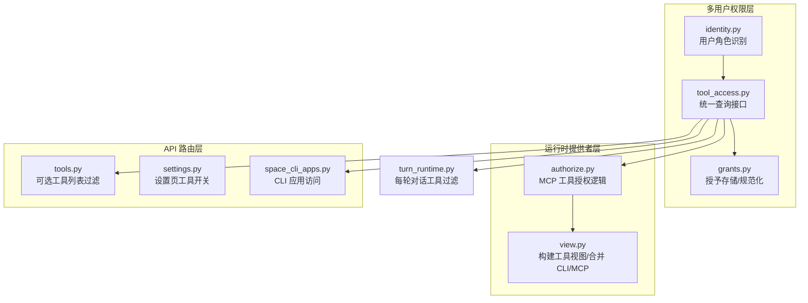
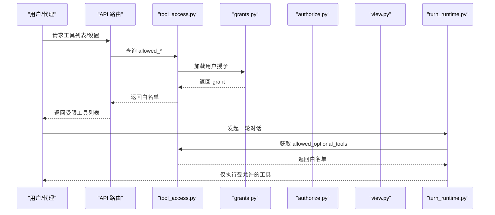
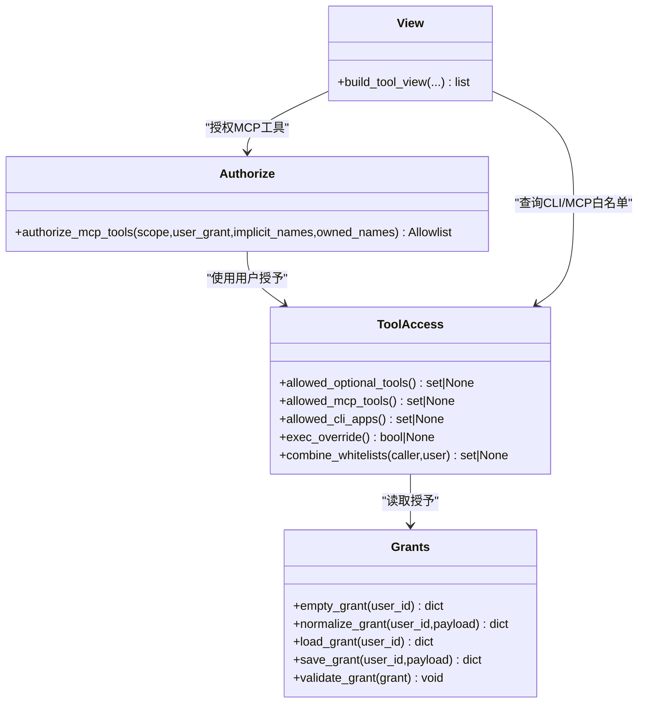

# 工具访问控制

<cite>
**本文引用的文件**
- [deeptutor/multi_user/tool_access.py](file://deeptutor/multi_user/tool_access.py)
- [deeptutor/multi_user/grants.py](file://deeptutor/multi_user/grants.py)
- [deeptutor/runtime/providers/authorize.py](file://deeptutor/runtime/providers/authorize.py)
- [deeptutor/runtime/providers/view.py](file://deeptutor/runtime/providers/view.py)
- [deeptutor/api/routers/tools.py](file://deeptutor/api/routers/tools.py)
- [deeptutor/api/routers/settings.py](file://deeptutor/api/routers/settings.py)
- [deeptutor/api/routers/space_cli_apps.py](file://deeptutor/api/routers/space_cli_apps.py)
- [deeptutor/services/session/turn_runtime.py](file://deeptutor/services/session/turn_runtime.py)
- [tests/multi_user/test_tool_access.py](file://tests/multi_user/test_tool_access.py)
</cite>

## 目录
1. [简介](#简介)
2. [项目结构](#项目结构)
3. [核心组件](#核心组件)
4. [架构总览](#架构总览)
5. [详细组件分析](#详细组件分析)
6. [依赖关系分析](#依赖关系分析)
7. [性能考虑](#性能考虑)
8. [故障排查指南](#故障排查指南)
9. [结论](#结论)
10. [附录](#附录)

## 简介
本文件系统性说明 DeepTutor 的基于角色的访问控制（RBAC）在“工具访问控制”上的实现，覆盖：
- 用户权限模型与默认拒绝策略
- 三类工具的白名单管理：allowed_optional_tools、allowed_mcp_tools、allowed_cli_apps
- 管理员与普通用户的权限差异及权限继承规则
- 配置用户工具权限的方法（启用/禁用特定工具、MCP 工具授权、CLI 应用访问控制）
- 权限检查的实现原理与最佳实践
- 权限冲突解决与权限提升机制

## 项目结构
围绕工具访问控制的关键代码分布在多用户权限层、运行时提供者层以及 API 路由层：
- 多用户权限层：负责读取当前用户上下文、加载并规范化用户授予（grant），提供统一的工具访问查询接口。
- 运行时提供者层：将用户授予与调用上下文结合，计算最终可被看见和调用的工具集合。
- API 路由层：暴露设置与工具列表等接口，并在 UI 侧过滤展示的工具。

图表来源
- [deeptutor/multi_user/tool_access.py:1-114](file://deeptutor/multi_user/tool_access.py#L1-L114)
- [deeptutor/multi_user/grants.py:16-87](file://deeptutor/multi_user/grants.py#L16-L87)
- [deeptutor/runtime/providers/authorize.py:1-67](file://deeptutor/runtime/providers/authorize.py#L1-L67)
- [deeptutor/runtime/providers/view.py:200-242](file://deeptutor/runtime/providers/view.py#L200-L242)
- [deeptutor/api/routers/tools.py:214-216](file://deeptutor/api/routers/tools.py#L214-L216)
- [deeptutor/api/routers/settings.py:327-330](file://deeptutor/api/routers/settings.py#L327-L330)
- [deeptutor/api/routers/space_cli_apps.py:36-99](file://deeptutor/api/routers/space_cli_apps.py#L36-L99)
- [deeptutor/services/session/turn_runtime.py:782-784](file://deeptutor/services/session/turn_runtime.py#L782-L784)

章节来源
- [deeptutor/multi_user/tool_access.py:1-114](file://deeptutor/multi_user/tool_access.py#L1-L114)
- [deeptutor/multi_user/grants.py:16-87](file://deeptutor/multi_user/grants.py#L16-L87)
- [deeptutor/runtime/providers/authorize.py:1-67](file://deeptutor/runtime/providers/authorize.py#L1-L67)
- [deeptutor/runtime/providers/view.py:200-242](file://deeptutor/runtime/providers/view.py#L200-L242)
- [deeptutor/api/routers/tools.py:214-216](file://deeptutor/api/routers/tools.py#L214-L216)
- [deeptutor/api/routers/settings.py:327-330](file://deeptutor/api/routers/settings.py#L327-L330)
- [deeptutor/api/routers/space_cli_apps.py:36-99](file://deeptutor/api/routers/space_cli_apps.py#L36-L99)
- [deeptutor/services/session/turn_runtime.py:782-784](file://deeptutor/services/session/turn_runtime.py#L782-L784)

## 核心组件
- 统一工具访问查询接口
  - allowed_optional_tools：内置可选工具的白名单，None 表示不受限（跟随默认），集合表示显式白名单。
  - allowed_mcp_tools：MCP（延迟）工具名称白名单；非管理员缺失字段时默认为空集（默认拒绝）。
  - allowed_cli_apps：已安装 CLI 应用 id 白名单；非管理员缺失字段时默认为空集（默认拒绝）。
  - exec_override：执行能力覆盖位，叠加部署级执行策略。
  - combine_whitelists：两个可选白名单的交集合并（None 表示不受限）。
- 授予（Grant）存储与规范化
  - empty_grant：定义 v2 授予结构，包含 enabled_tools、mcp_tools、cli_apps、exec_enabled 等字段。
  - normalize_grant：将任意版本/格式的授予归一化为 v2 结构，并对工具列表进行清洗。
  - load/save_grant：从系统 grants 目录读写用户授予，保存前校验禁止敏感字段。
- 运行时授权
  - authorize_mcp_tools：按工具名对 MCP 工具进行授权，结合 caller 白名单、用户授予、资源隐式持有与用户自配服务器所有权。
  - view.py：构建工具视图，合并 CLI 应用与 MCP 工具，处理独占知识能力的场景。
- API 路由与 UI 过滤
  - tools.py/settings.py：根据 allowed_optional_tools 过滤设置页与工具列表。
  - space_cli_apps.py：根据 allowed_cli_apps 控制 CLI 应用可见性与调用。
- 会话轮次执行
  - turn_runtime.py：每轮对话中对 tools 载荷进行过滤，确保仅允许受控工具参与推理。

章节来源
- [deeptutor/multi_user/tool_access.py:44-104](file://deeptutor/multi_user/tool_access.py#L44-L104)
- [deeptutor/multi_user/grants.py:16-87](file://deeptutor/multi_user/grants.py#L16-L87)
- [deeptutor/runtime/providers/authorize.py:26-63](file://deeptutor/runtime/providers/authorize.py#L26-L63)
- [deeptutor/runtime/providers/view.py:200-242](file://deeptutor/runtime/providers/view.py#L200-L242)
- [deeptutor/api/routers/tools.py:214-216](file://deeptutor/api/routers/tools.py#L214-L216)
- [deeptutor/api/routers/settings.py:327-330](file://deeptutor/api/routers/settings.py#L327-L330)
- [deeptutor/api/routers/space_cli_apps.py:36-99](file://deeptutor/api/routers/space_cli_apps.py#L36-L99)
- [deeptutor/services/session/turn_runtime.py:782-784](file://deeptutor/services/session/turn_runtime.py#L782-L784)

## 架构总览
DeepTutor 的工具访问控制采用“默认拒绝 + 显式授权”的安全基线，并通过三层协同完成：
- 身份与授予层：识别当前用户角色（管理员/普通用户），加载其授予（grant）并规范化。
- 授权决策层：依据不同工具类型采取不同的授权策略（按工具名、按应用 id、按资源持有/所有权）。
- 执行与展示层：在 API 返回与每轮对话中严格过滤工具，保证 UI 与执行一致。

图表来源
- [deeptutor/api/routers/tools.py:214-216](file://deeptutor/api/routers/tools.py#L214-L216)
- [deeptutor/api/routers/settings.py:327-330](file://deeptutor/api/routers/settings.py#L327-L330)
- [deeptutor/multi_user/tool_access.py:44-104](file://deeptutor/multi_user/tool_access.py#L44-L104)
- [deeptutor/multi_user/grants.py:16-87](file://deeptutor/multi_user/grants.py#L16-L87)
- [deeptutor/runtime/providers/authorize.py:26-63](file://deeptutor/runtime/providers/authorize.py#L26-L63)
- [deeptutor/runtime/providers/view.py:200-242](file://deeptutor/runtime/providers/view.py#L200-L242)
- [deeptutor/services/session/turn_runtime.py:782-784](file://deeptutor/services/session/turn_runtime.py#L782-L784)

## 详细组件分析

### 用户权限模型与默认拒绝策略
- 管理员：不携带授予（grant 为 None），所有工具访问均不受限。
- 普通用户：若授予缺失对应字段，则遵循默认拒绝：
  - mcp_tools 缺失 => 空集（无法发现或加载部署级 MCP 工具）
  - cli_apps 缺失 => 空集（无法运行第三方 CLI 应用）
  - enabled_tools 缺失 => 不受限（遵循默认池）
- 执行能力覆盖：exec_enabled 为三态（None/True/False），叠加部署级策略。

章节来源
- [deeptutor/multi_user/tool_access.py:36-41](file://deeptutor/multi_user/tool_access.py#L36-L41)
- [deeptutor/multi_user/tool_access.py:55-86](file://deeptutor/multi_user/tool_access.py#L55-L86)
- [deeptutor/multi_user/grants.py:16-44](file://deeptutor/multi_user/grants.py#L16-L44)
- [tests/multi_user/test_tool_access.py:69-80](file://tests/multi_user/test_tool_access.py#L69-L80)

### 工具白名单管理与三种工具类型策略
- 可选内置工具（enabled_tools）
  - 语义：None=不受限；[] 表示无；列表为显式白名单。
  - 使用点：设置页与工具列表过滤、每轮对话工具载荷过滤。
- MCP 工具（mcp_tools）
  - 语义：按工具名授权；非管理员缺失字段为空集（默认拒绝）。
  - 授权逻辑：结合调用方白名单、用户授予、资源隐式持有与用户自配服务器所有权。
- CLI 应用（cli_apps）
  - 语义：按应用 id 授权；非管理员缺失字段为空集（默认拒绝）。
  - 使用点：CLI 应用提供商与空间 CLI 路由。

章节来源
- [deeptutor/multi_user/tool_access.py:44-86](file://deeptutor/multi_user/tool_access.py#L44-L86)
- [deeptutor/runtime/providers/authorize.py:26-63](file://deeptutor/runtime/providers/authorize.py#L26-L63)
- [deeptutor/runtime/providers/view.py:200-242](file://deeptutor/runtime/providers/view.py#L200-L242)
- [deeptutor/api/routers/space_cli_apps.py:36-99](file://deeptutor/api/routers/space_cli_apps.py#L36-L99)

### 权限继承与组合规则
- 调用方白名单与用户授予的组合：通过 combine_whitelists 取交集（任一为 None 表示不受限）。
- MCP 授权链：caller_whitelist -> narrow(user_grant) -> widen(owned_names) -> widen(implicit_names)。
- 独占知识能力：替换工具面，仅保留与资源绑定的工具，避免额外工具暴露。

章节来源
- [deeptutor/multi_user/tool_access.py:98-104](file://deeptutor/multi_user/tool_access.py#L98-L104)
- [deeptutor/runtime/providers/authorize.py:48-63](file://deeptutor/runtime/providers/authorize.py#L48-L63)
- [deeptutor/runtime/providers/view.py:209-210](file://deeptutor/runtime/providers/view.py#L209-L210)

### 管理员与普通用户的权限差异
- 管理员：grant 为 None，所有工具访问不受限；不参与白名单限制。
- 普通用户：遵循授予中的白名单；缺失字段按默认拒绝处理（尤其是 MCP 与 CLI）。

章节来源
- [deeptutor/multi_user/tool_access.py:36-41](file://deeptutor/multi_user/tool_access.py#L36-L41)
- [deeptutor/multi_user/tool_access.py:55-86](file://deeptutor/multi_user/tool_access.py#L55-L86)
- [tests/multi_user/test_tool_access.py:69-80](file://tests/multi_user/test_tool_access.py#L69-L80)

### 配置用户工具权限的方法
- 启用/禁用特定内置工具：修改 granted.enabled_tools（列表或 None）。
- MCP 工具授权：在 granted.mcp_tools 中列出允许的工具名；缺失即拒绝。
- CLI 应用访问控制：在 granted.cli_apps 中列出允许的应用 id；缺失即拒绝。
- 执行能力覆盖：设置 granted.exec_enabled（True/False/None）。

章节来源
- [deeptutor/multi_user/grants.py:16-44](file://deeptutor/multi_user/grants.py#L16-L44)
- [deeptutor/multi_user/grants.py:60-87](file://deeptutor/multi_user/grants.py#L60-L87)
- [deeptutor/multi_user/tool_access.py:44-95](file://deeptutor/multi_user/tool_access.py#L44-L95)

### 权限检查的实现原理
- 统一入口：tool_access.py 提供 allowed_* 函数，读取当前用户授予并返回白名单。
- 运行时授权：authorize.py 将用户授予与调用上下文结合，生成最终允许的工具集合。
- 视图构建：view.py 将 CLI 与 MCP 工具合并，考虑独占能力与所有权。
- 执行过滤：turn_runtime.py 在每轮对话中过滤 tools 载荷，确保仅执行受允许工具。

章节来源
- [deeptutor/multi_user/tool_access.py:44-104](file://deeptutor/multi_user/tool_access.py#L44-L104)
- [deeptutor/runtime/providers/authorize.py:26-63](file://deeptutor/runtime/providers/authorize.py#L26-L63)
- [deeptutor/runtime/providers/view.py:200-242](file://deeptutor/runtime/providers/view.py#L200-L242)
- [deeptutor/services/session/turn_runtime.py:782-784](file://deeptutor/services/session/turn_runtime.py#L782-L784)

### 最佳实践
- 始终显式授权 MCP 与 CLI 工具：避免依赖默认值导致意外开放。
- 最小权限原则：为每个用户只授予必要的工具与功能。
- 分离关注点：保持 MCP 与 CLI 的授权字段独立，避免混用导致误授权。
- 审计与验证：保存授予前进行校验，防止敏感信息泄露。

章节来源
- [deeptutor/multi_user/grants.py:115-133](file://deeptutor/multi_user/grants.py#L115-L133)
- [deeptutor/runtime/providers/authorize.py:1-16](file://deeptutor/runtime/providers/authorize.py#L1-L16)

### 权限冲突解决与权限提升机制
- 冲突解决：通过 combine_whitelists 取交集，确保更严格的限制生效。
- 权限提升：管理员 grant 为 None，绕过所有白名单限制；普通用户无法自行提升权限。
- 独占能力：当存在独占知识能力时，工具面被替换，仅保留与资源绑定的工具，避免越权。

章节来源
- [deeptutor/multi_user/tool_access.py:98-104](file://deeptutor/multi_user/tool_access.py#L98-L104)
- [deeptutor/multi_user/tool_access.py:36-41](file://deeptutor/multi_user/tool_access.py#L36-L41)
- [deeptutor/runtime/providers/authorize.py:48-52](file://deeptutor/runtime/providers/authorize.py#L48-L52)

## 依赖关系分析
- tool_access.py 依赖 grants.py 加载用户授予，依赖 identity.py 识别当前用户角色。
- runtime/providers/authorize.py 依赖 allowlist 与 scope，结合用户授予与调用上下文进行授权。
- runtime/providers/view.py 整合 CLI 与 MCP 工具，调用 tool_access 与 provider 逻辑。
- API 路由依赖 tool_access 进行 UI 与数据层面的工具过滤。

图表来源
- [deeptutor/multi_user/tool_access.py:44-104](file://deeptutor/multi_user/tool_access.py#L44-L104)
- [deeptutor/multi_user/grants.py:16-87](file://deeptutor/multi_user/grants.py#L16-L87)
- [deeptutor/runtime/providers/authorize.py:26-63](file://deeptutor/runtime/providers/authorize.py#L26-L63)
- [deeptutor/runtime/providers/view.py:200-242](file://deeptutor/runtime/providers/view.py#L200-L242)

章节来源
- [deeptutor/multi_user/tool_access.py:44-104](file://deeptutor/multi_user/tool_access.py#L44-L104)
- [deeptutor/multi_user/grants.py:16-87](file://deeptutor/multi_user/grants.py#L16-L87)
- [deeptutor/runtime/providers/authorize.py:26-63](file://deeptutor/runtime/providers/authorize.py#L26-L63)
- [deeptutor/runtime/providers/view.py:200-242](file://deeptutor/runtime/providers/view.py#L200-L242)

## 性能考虑
- 工具视图构建是同步且轻量：CLI 工具视图读取少量 JSON 文件，避免超时与阻塞。
- 授权决策集中在必要路径：仅在工具列表与每轮对话关键路径进行白名单计算。
- 建议：避免在高频路径重复加载授予；可使用缓存或批量查询优化。

[本节为通用指导，无需具体文件引用]

## 故障排查指南
- 现象：MCP 工具不可见或不可加载
  - 检查：非管理员用户是否未授予 mcp_tools；若缺失则为空集（默认拒绝）。
  - 定位：查看 allowed_mcp_tools 返回值与 authorize_mcp_tools 的输入。
- 现象：CLI 应用无法运行
  - 检查：是否未在 granted.cli_apps 中授权；缺失即为空集（默认拒绝）。
  - 定位：查看 space_cli_apps 路由与 allowed_cli_apps 返回值。
- 现象：内置工具开关无效
  - 检查：enabled_tools 是否为列表或 None；确认 normalize_grant 是否正确清洗。
  - 定位：查看 settings/tools 路由与 turn_runtime 过滤逻辑。
- 现象：管理员仍受限
  - 检查：确认当前用户角色为 admin；管理员 grant 为 None，不应受限。
  - 定位：查看 _current_grant 与 identity 解析。

章节来源
- [deeptutor/multi_user/tool_access.py:55-86](file://deeptutor/multi_user/tool_access.py#L55-L86)
- [deeptutor/api/routers/space_cli_apps.py:36-99](file://deeptutor/api/routers/space_cli_apps.py#L36-L99)
- [deeptutor/api/routers/tools.py:214-216](file://deeptutor/api/routers/tools.py#L214-L216)
- [deeptutor/services/session/turn_runtime.py:782-784](file://deeptutor/services/session/turn_runtime.py#L782-L784)
- [deeptutor/multi_user/tool_access.py:36-41](file://deeptutor/multi_user/tool_access.py#L36-L41)

## 结论
DeepTutor 的工具访问控制以“默认拒绝 + 显式授权”为核心，通过多用户授予层、运行时授权层与执行展示层的协同，实现对三类工具（可选内置工具、MCP 工具、CLI 应用）的精细化管控。管理员拥有不受限权限，普通用户需明确授权；通过组合与继承规则，确保权限冲突得到安全收敛。建议在部署中遵循最小权限原则，显式授权高风险工具，并持续审计授予内容。

[本节为总结性内容，无需具体文件引用]

## 附录
- 授予字段说明
  - enabled_tools：内置可选工具白名单（None/[]/列表）
  - mcp_tools：MCP 工具名白名单（缺失=空集）
  - cli_apps：CLI 应用 id 白名单（缺失=空集）
  - exec_enabled：执行能力覆盖（None/True/False）
- 相关测试用例
  - 管理员不受限、普通用户默认拒绝、授予归一化与往返一致性等。

章节来源
- [deeptutor/multi_user/grants.py:16-44](file://deeptutor/multi_user/grants.py#L16-L44)
- [tests/multi_user/test_tool_access.py:29-66](file://tests/multi_user/test_tool_access.py#L29-L66)
- [tests/multi_user/test_tool_access.py:69-104](file://tests/multi_user/test_tool_access.py#L69-L104)