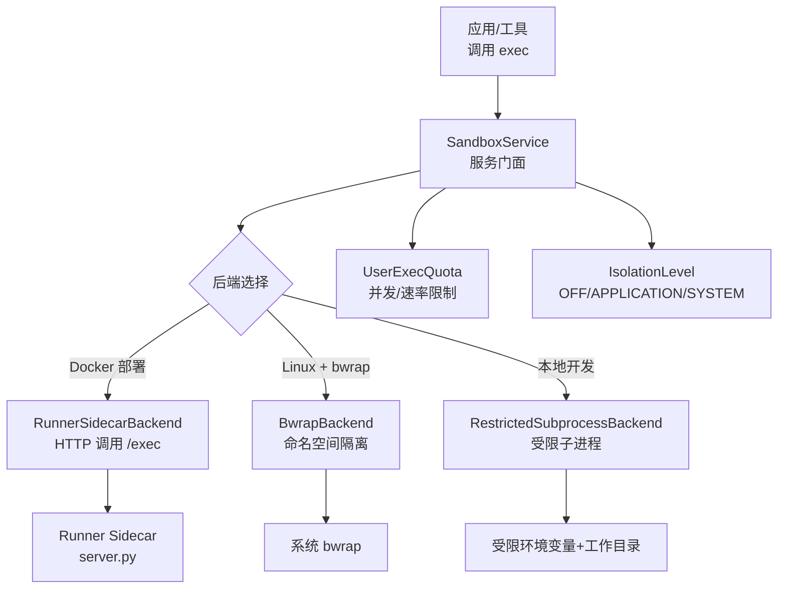
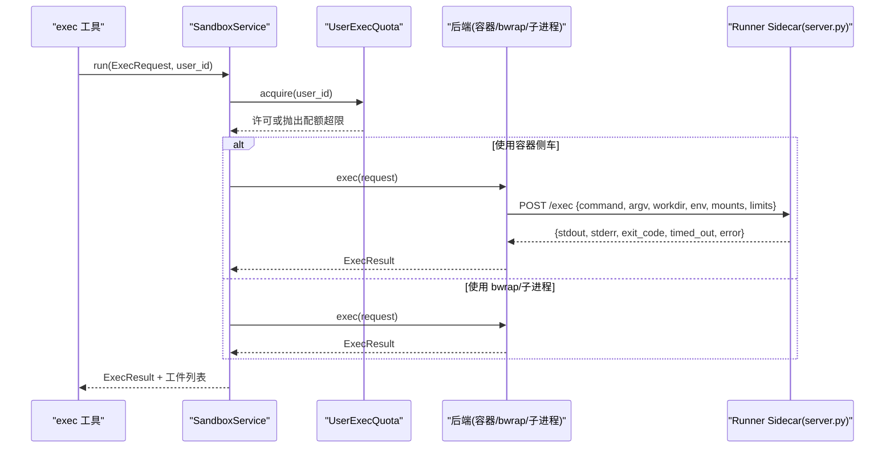
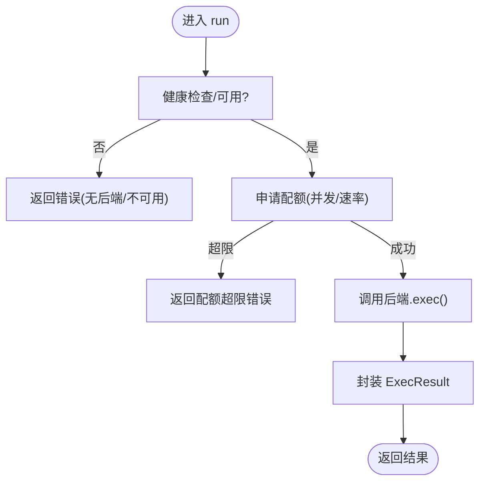
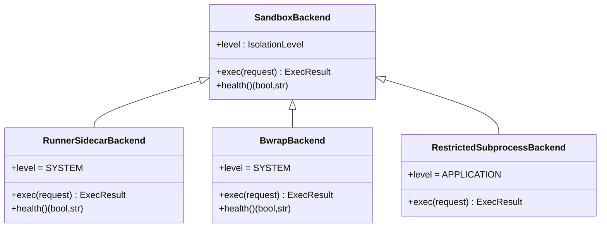
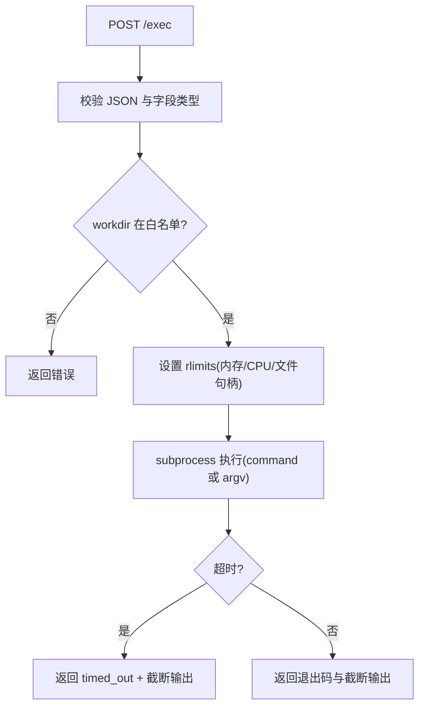
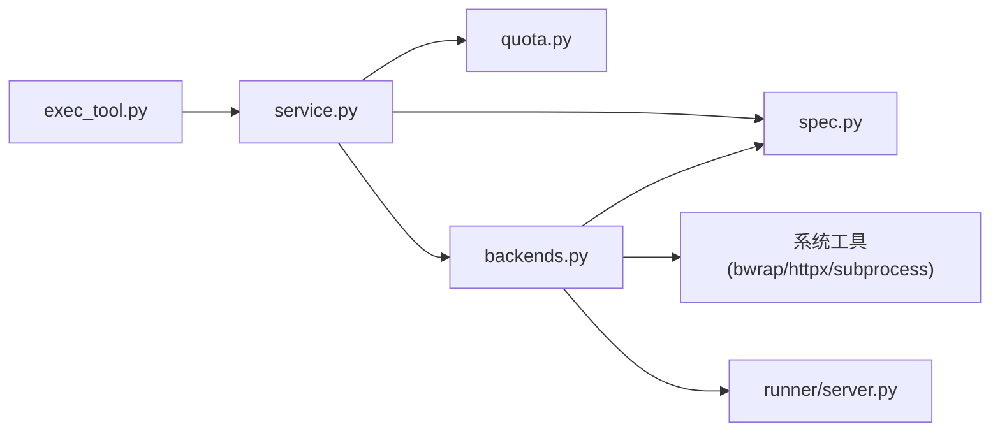

# 沙箱隔离环境

<cite>
**本文引用的文件**
- [service.py](file://deeptutor/services/sandbox/service.py)
- [config.py](file://deeptutor/services/sandbox/config.py)
- [backends.py](file://deeptutor/services/sandbox/backends.py)
- [spec.py](file://deeptutor/services/sandbox/spec.py)
- [quota.py](file://deeptutor/services/sandbox/quota.py)
- [artifacts.py](file://deeptutor/services/sandbox/artifacts.py)
- [server.py](file://deeptutor/services/sandbox/runner/server.py)
- [exec_tool.py](file://deeptutor/tools/exec_tool.py)
</cite>

## 目录
1. [简介](#简介)
2. [项目结构](#项目结构)
3. [核心组件](#核心组件)
4. [架构总览](#架构总览)
5. [详细组件分析](#详细组件分析)
6. [依赖关系分析](#依赖关系分析)
7. [性能考虑](#性能考虑)
8. [故障排除指南](#故障排除指南)
9. [结论](#结论)
10. [附录](#附录)

## 简介
本文件系统性说明 DeepTutor 的代码执行沙箱机制，覆盖文件系统隔离、网络访问控制与资源限制策略；详述配置项（CPU 时间、内存上限、磁盘配额、网络规则）；阐述生命周期管理（启动、执行监控、资源回收）；给出从开发宽松到生产严格的安全策略配置建议；并提供性能优化与故障排除方法，以及安全漏洞防护与资源滥用检测机制。

## 项目结构
沙箱子系统位于 services/sandbox，采用“服务门面 + 后端抽象 + 请求/结果规范 + 配额”的分层设计：
- 服务门面：对外提供统一入口、健康检查、用户级配额与能力判定
- 后端抽象：支持三种隔离方式（容器侧车、bwrap 命名空间、受限子进程）
- 规范定义：统一的执行请求、结果、资源限制与挂载描述
- 配额：并发与速率限制，防止单用户滥用
- 工件收集：将受控输出暴露为可下载产物
- Runner 侧车：独立 HTTP 服务，真正执行不受信命令并施加资源限制

图表来源
- [service.py:29-95](file://deeptutor/services/sandbox/service.py#L29-L95)
- [config.py:66-84](file://deeptutor/services/sandbox/config.py#L66-L84)
- [backends.py:47-206](file://deeptutor/services/sandbox/backends.py#L47-L206)
- [server.py:178-264](file://deeptutor/services/sandbox/runner/server.py#L178-L264)

章节来源
- [service.py:29-95](file://deeptutor/services/sandbox/service.py#L29-L95)
- [config.py:66-84](file://deeptutor/services/sandbox/config.py#L66-L84)

## 核心组件
- SandboxService：统一入口，负责后端选择、健康探测、用户配额、能力判定与执行调度
- 后端抽象：
  - RunnerSidecarBackend：通过 HTTP 将执行委托给独立 runner 容器，提供 SYSTEM 级隔离
  - BwrapBackend：在 Linux 上使用 bubblewrap 创建挂载/会话等命名空间，提供 SYSTEM 级隔离
  - RestrictedSubprocessBackend：仅清理环境变量与工作目录，属于 APPLICATION 级隔离，仅限管理员本地开发启用
- ExecRequest/ExecResult/ResourceLimits/Mount：跨模块共享的不可变数据模型，确保前后端一致
- UserExecQuota：按用户的并发与速率限制，保护系统不被单用户拖垮
- artifacts：扫描工作区产出，生成安全的公开下载链接
- Runner server：最小化 HTTP 服务，执行命令并施加资源限制，返回标准化结果

章节来源
- [service.py:29-95](file://deeptutor/services/sandbox/service.py#L29-L95)
- [backends.py:34-206](file://deeptutor/services/sandbox/backends.py#L34-L206)
- [spec.py:33-141](file://deeptutor/services/sandbox/spec.py#L33-L141)
- [quota.py:27-75](file://deeptutor/services/sandbox/quota.py#L27-L75)
- [artifacts.py:33-73](file://deeptutor/services/sandbox/artifacts.py#L33-L73)
- [server.py:178-264](file://deeptutor/services/sandbox/runner/server.py#L178-L264)

## 架构总览
下图展示一次典型执行的生命周期：工具构建请求 → 服务门面校验与配额 → 后端执行 → 结果渲染与工件发现。

图表来源
- [service.py:74-95](file://deeptutor/services/sandbox/service.py#L74-L95)
- [backends.py:56-100](file://deeptutor/services/sandbox/backends.py#L56-L100)
- [server.py:178-264](file://deeptutor/services/sandbox/runner/server.py#L178-L264)
- [quota.py:60-75](file://deeptutor/services/sandbox/quota.py#L60-L75)

## 详细组件分析

### 服务门面与能力门控
- 健康探测：缓存后端可用性，避免重复探测
- 隔离级别：根据后端实际能力返回 OFF/APPLICATION/SYSTEM，驱动上层是否开放 exec 能力
- 执行入口：先检查用户执行权限，再申请配额，最后委派后端执行；失败不抛异常，统一以 ExecResult.error 上报

图表来源
- [service.py:45-95](file://deeptutor/services/sandbox/service.py#L45-L95)
- [quota.py:60-75](file://deeptutor/services/sandbox/quota.py#L60-L75)

章节来源
- [service.py:45-95](file://deeptutor/services/sandbox/service.py#L45-L95)

### 后端实现与隔离级别
- RunnerSidecarBackend：SYSTEM 隔离，通过 HTTP 将命令提交到独立容器执行；连接超时与响应体大小受控
- BwrapBackend：SYSTEM 隔离，基于 bubblewrap 建立只读系统目录绑定、临时 tmpfs、可选工作目录与环境变量注入；健康检查会尝试运行一个最小命令验证命名空间可用
- RestrictedSubprocessBackend：APPLICATION 隔离，仅清理环境变量与工作目录，不操作系统级隔离；需显式开启

图表来源
- [backends.py:34-206](file://deeptutor/services/sandbox/backends.py#L34-L206)

章节来源
- [backends.py:47-206](file://deeptutor/services/sandbox/backends.py#L47-L206)

### 请求/结果与资源限制
- ExecRequest：同时携带 command 与 argv，保证新旧版本兼容；argv 优先且无 shell 解析，避免元字符风险
- ResourceLimits：timeout_s、memory_mb、cpu_seconds、max_output_chars；后端尽力而为地实施
- Mount：host_path -> sandbox_path 的映射，read_only 默认只读
- ExecResult：统一输出 stdout/stderr/exit_code/timed_out/error，并提供 render 裁剪输出长度

章节来源
- [spec.py:33-141](file://deeptutor/services/sandbox/spec.py#L33-L141)

### 配额与并发/速率限制
- 并发限制：每个用户维护一个信号量，防止过多执行同时运行
- 速率限制：滑动窗口 60 秒内最多允许 N 次执行
- 超限时返回明确错误，避免饥饿其他用户

章节来源
- [quota.py:27-75](file://deeptutor/services/sandbox/quota.py#L27-L75)

### 工件收集与安全暴露
- collect_public_artifacts：仅收集位于公共输出根下的文件，跳过隐藏目录，限制数量
- 渲染提示：将生成的工件以清单形式返回，便于 UI 自动识别并转为可下载卡片

章节来源
- [artifacts.py:33-100](file://deeptutor/services/sandbox/artifacts.py#L33-L100)

### Runner 侧车：真正的执行边界
- 最小 HTTP 服务：仅实现 /health 与 /exec
- 输入校验：严格校验 command/argv/workdir/env/mounts/limits，拒绝非法请求
- 工作目录白名单：workdir 必须在允许的共享工作区根下
- 资源限制：
  - 超时：subprocess timeout
  - 内存：RLIMIT_AS（虚拟地址空间）作为二次防护，cgroup 限制为主
  - CPU：RLIMIT_CPU（CPU 秒），超出则终止
  - 文件描述符：RLIMIT_NOFILE 限制
- 输出裁剪：对 stdout/stderr 进行 head+tail 截断，避免大输出打满内存
- 安全加固：容器内非 root、drop capabilities、只读根文件系统（由部署配置保障）

图表来源
- [server.py:178-264](file://deeptutor/services/sandbox/runner/server.py#L178-L264)

章节来源
- [server.py:178-264](file://deeptutor/services/sandbox/runner/server.py#L178-L264)

### 工具集成与防御纵深
- exec 工具：在调用沙箱前进行黑名单模式匹配，拦截明显破坏性命令
- 管道注入：_sandbox_* 参数由服务端注入，LLM 无法伪造
- 工件与元数据：返回退出码、是否超时、沙箱错误与工件清单，便于上层处理

章节来源
- [exec_tool.py:30-153](file://deeptutor/tools/exec_tool.py#L30-L153)

## 依赖关系分析
- 服务门面依赖后端与配额；后端依赖 spec 与系统工具（bwrap/httpx/subprocess）
- Runner 侧车仅依赖标准库，降低攻击面
- 工具层通过服务门面间接依赖沙箱，避免循环导入

图表来源
- [exec_tool.py:80-153](file://deeptutor/tools/exec_tool.py#L80-L153)
- [service.py:29-95](file://deeptutor/services/sandbox/service.py#L29-L95)
- [backends.py:47-206](file://deeptutor/services/sandbox/backends.py#L47-L206)
- [server.py:178-264](file://deeptutor/services/sandbox/runner/server.py#L178-L264)

章节来源
- [exec_tool.py:80-153](file://deeptutor/tools/exec_tool.py#L80-L153)
- [service.py:29-95](file://deeptutor/services/sandbox/service.py#L29-L95)
- [backends.py:47-206](file://deeptutor/services/sandbox/backends.py#L47-L206)
- [server.py:178-264](file://deeptutor/services/sandbox/runner/server.py#L178-L264)

## 性能考虑
- 首选容器侧车：将不受信代码移出主进程，减少主进程崩溃与资源泄漏风险
- 合理设置超时与输出上限：避免长尾任务与超大输出阻塞队列
- 限制并发与速率：结合业务峰值调整 per-user 并发与每分钟次数
- 利用只读挂载：减少写放大与竞争
- 复用健康探测：避免频繁探测导致额外开销
- Runner 侧车资源限制：配合 cgroup 与 rlimit，双重保障

[本节为通用指导，无需特定文件引用]

## 故障排除指南
- 后端不可用
  - 现象：返回“无后端/不可用”或 health 失败
  - 排查：确认 DEEPTUTOR_SANDBOX_RUNNER_URL 指向可达 runner；或在 Linux 上安装 bwrap；或本地开发设置 DEEPTUTOR_SANDBOX_ALLOW_SUBPROCESS=1
- Runner 不可达
  - 现象：runner unavailable
  - 排查：检查容器端口、网络连通性与 /health 响应
- bwrap 不可用
  - 现象：bwrap not found / 命名空间不可用
  - 排查：安装 bwrap；确认内核与 seccomp 允许 unprivileged namespaces
- 工作目录越界
  - 现象：workdir 不在允许根下被拒绝
  - 排查：调整 DEEPTUTOR_RUNNER_ALLOWED_WORKDIRS 或修正 workdir
- 配额超限
  - 现象：并发或速率限制触发
  - 排查：调高 per-user 并发/速率上限，或优化任务排队与重试
- 输出过大
  - 现象：输出被截断
  - 排查：增大 max_output_chars；或拆分任务

章节来源
- [service.py:45-95](file://deeptutor/services/sandbox/service.py#L45-L95)
- [backends.py:102-173](file://deeptutor/services/sandbox/backends.py#L102-L173)
- [server.py:152-175](file://deeptutor/services/sandbox/runner/server.py#L152-L175)
- [quota.py:60-75](file://deeptutor/services/sandbox/quota.py#L60-L75)

## 结论
DeepTutor 的沙箱通过“服务门面 + 多后端 + 规范 + 配额”的分层设计，实现了从开发到生产的灵活安全策略切换。容器侧车提供最强隔离，bwrap 适用于裸机 Linux，受限子进程用于本地调试。通过严格的输入校验、工作目录白名单、资源限制与工件白名单，有效降低安全风险。建议生产环境强制使用容器侧车，并结合 cgroup 与系统级策略实现强隔离。

[本节为总结，无需特定文件引用]

## 附录

### 配置选项与环境变量
- 后端选择
  - DEEPTUTOR_SANDBOX_RUNNER_URL：设置后启用容器侧车后端（SYSTEM 隔离）
  - 未设置且在 Linux 且存在 bwrap：启用 bwrap 后端（SYSTEM 隔离）
  - DEEPTUTOR_SANDBOX_ALLOW_SUBPROCESS=1：启用受限子进程后端（APPLICATION 隔离，仅本地开发）
- 配额
  - DEEPTUTOR_SANDBOX_MAX_CONCURRENT：每用户最大并发执行数
  - DEEPTUTOR_SANDBOX_MAX_PER_MINUTE：每用户每分钟最大执行次数
- Runner 侧车
  - DEEPTUTOR_RUNNER_ALLOWED_WORKDIRS：允许的工作区根路径（冒号分隔）
  - RUNNER_PORT：侧车监听端口
- 资源限制（随请求传入）
  - timeout_s：执行超时（秒）
  - memory_mb：内存上限（MB，软限制，主靠 cgroup）
  - cpu_seconds：CPU 时间上限（秒）
  - max_output_chars：输出字符上限

章节来源
- [config.py:32-63](file://deeptutor/services/sandbox/config.py#L32-L63)
- [server.py:72-84](file://deeptutor/services/sandbox/runner/server.py#L72-L84)
- [server.py:152-162](file://deeptutor/services/sandbox/runner/server.py#L152-L162)
- [spec.py:33-41](file://deeptutor/services/sandbox/spec.py#L33-L41)

### 安全策略矩阵（建议）
- 开发环境（宽松）
  - 后端：RestrictedSubprocessBackend（需显式开启）
  - 隔离级别：APPLICATION
  - 配额：较高并发与速率
  - 网络：允许出站（谨慎）
- 测试环境（中等）
  - 后端：bwrap（Linux）或受限子进程
  - 隔离级别：SYSTEM（bwrap）或 APPLICATION（子进程）
  - 配额：适中
  - 网络：按需放行
- 生产环境（严格）
  - 后端：RunnerSidecarBackend（必须）
  - 隔离级别：SYSTEM
  - 配额：保守并发与速率
  - 网络：默认禁止出站，必要时白名单

[本节为概念性建议，无需特定文件引用]

### 生命周期管理
- 启动
  - 服务门面初始化时根据环境变量选择后端
  - Runner 侧车作为独立进程/容器启动，暴露 /health 与 /exec
- 执行监控
  - 健康探测缓存，周期性失效后重新探测
  - 执行过程受超时、资源限制与配额约束
- 资源回收
  - 子进程结束后释放句柄与内存
  - Runner 侧车通过 rlimit/cgroup 回收资源
  - 配额租约在上下文结束时释放

章节来源
- [service.py:29-95](file://deeptutor/services/sandbox/service.py#L29-L95)
- [backends.py:152-173](file://deeptutor/services/sandbox/backends.py#L152-L173)
- [server.py:109-149](file://deeptutor/services/sandbox/runner/server.py#L109-L149)
- [quota.py:50-75](file://deeptutor/services/sandbox/quota.py#L50-L75)

### 安全漏洞防护与资源滥用检测
- 输入校验与白名单
  - 严格校验请求字段类型与范围
  - workdir 必须在允许根下
- 命令黑名单
  - 工具层对危险命令模式进行拦截
- 隔离与最小权限
  - 容器侧车非 root、drop capabilities、只读根文件系统
  - bwrap 只读绑定系统目录，tmpfs 隔离 /tmp
- 资源限制
  - 超时、内存、CPU、文件句柄上限
  - 输出大小限制，避免内存耗尽
- 配额与审计
  - 并发与速率限制，防止单用户滥用
  - 返回元数据（退出码、超时、错误、工件）便于追踪

章节来源
- [exec_tool.py:30-91](file://deeptutor/tools/exec_tool.py#L30-L91)
- [backends.py:117-150](file://deeptutor/services/sandbox/backends.py#L117-L150)
- [server.py:152-175](file://deeptutor/services/sandbox/runner/server.py#L152-L175)
- [quota.py:27-75](file://deeptutor/services/sandbox/quota.py#L27-L75)