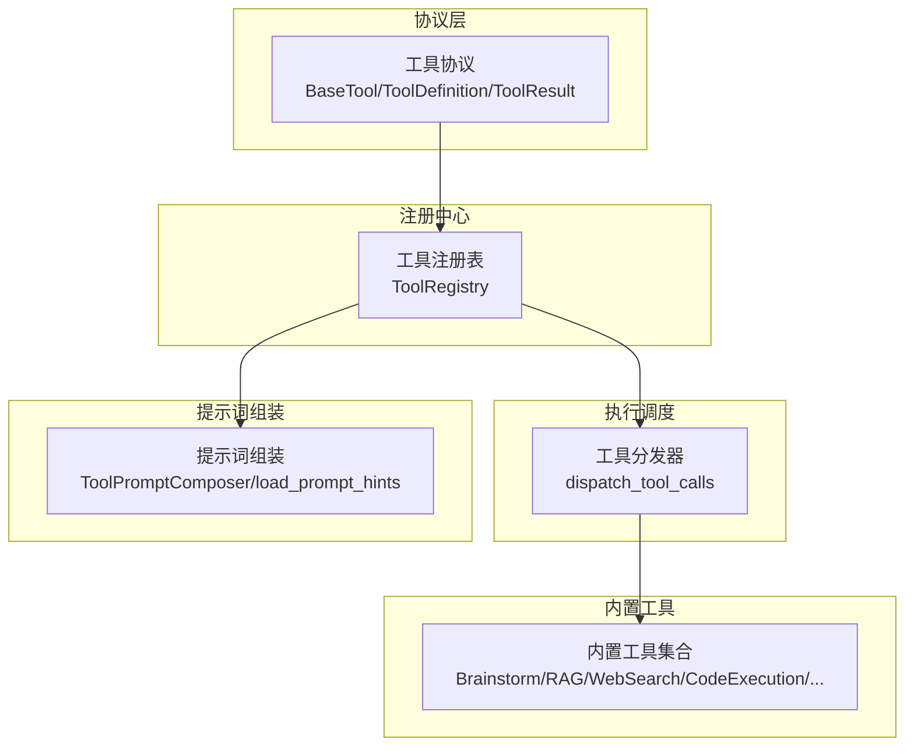
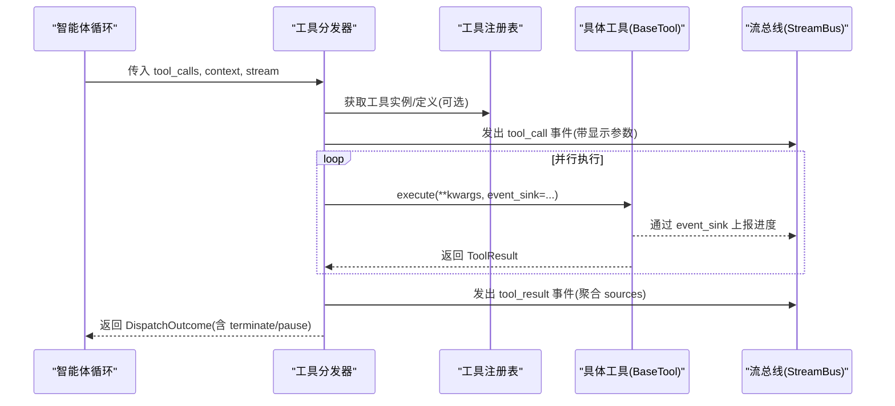
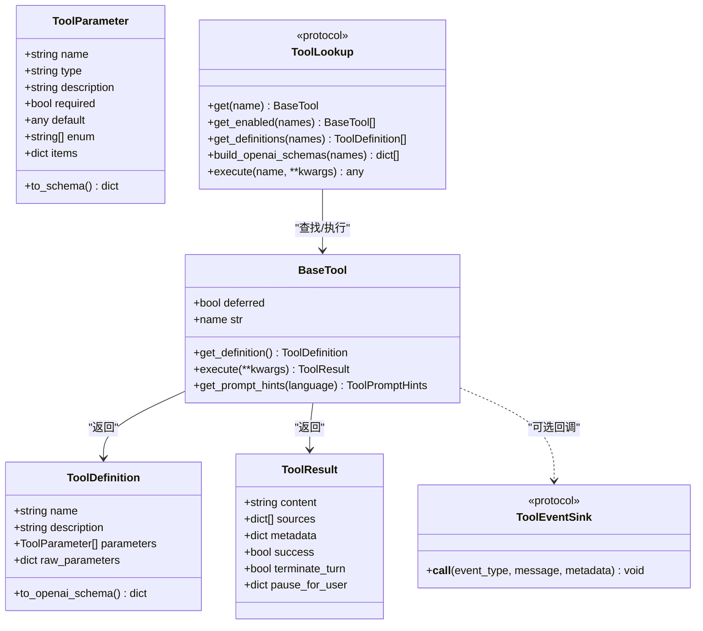
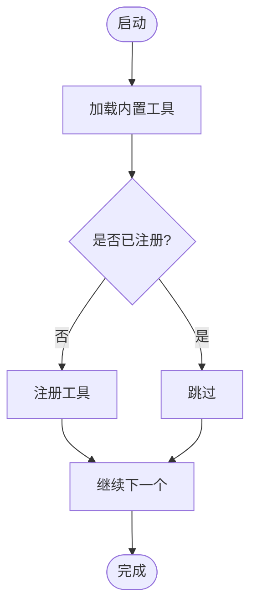
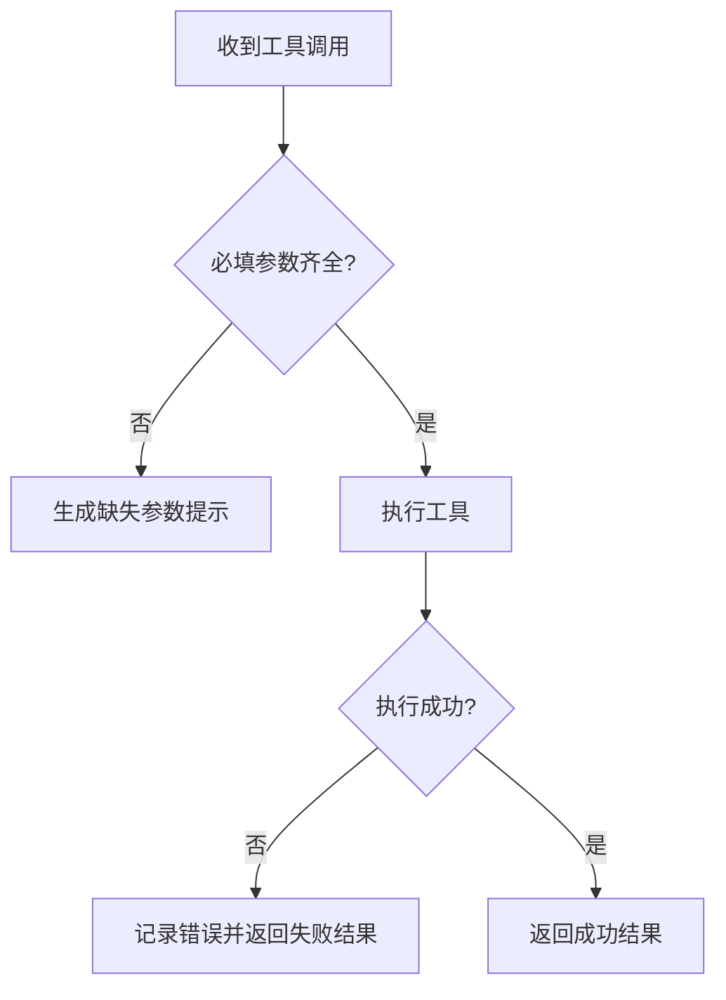
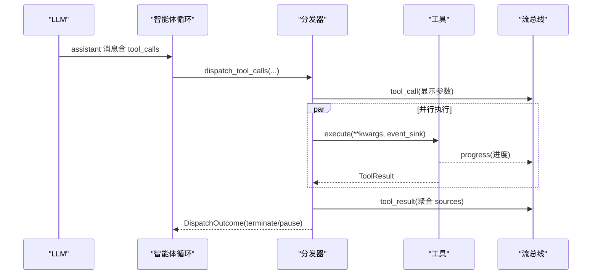
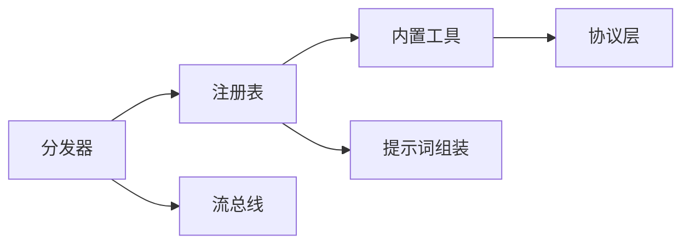

# 工具架构设计

<cite>
**本文引用的文件**
- [tool_protocol.py](file://deeptutor/core/tool_protocol.py)
- [tool_registry.py](file://deeptutor/runtime/registry/tool_registry.py)
- [__init__.py（内置工具）](file://deeptutor/tools/builtin/__init__.py)
- [__init__.py（工具层入口）](file://deeptutor/tools/__init__.py)
- [tool_dispatch.py](file://deeptutor/core/agentic/tool_dispatch.py)
- [__init__.py（智能体原语）](file://deeptutor/core/agentic/__init__.py)
- [__init__.py（提示词组装）](file://deeptutor/tools/prompting/__init__.py)
</cite>

## 目录
1. [简介](#简介)
2. [项目结构](#项目结构)
3. [核心组件](#核心组件)
4. [架构总览](#架构总览)
5. [详细组件分析](#详细组件分析)
6. [依赖关系分析](#依赖关系分析)
7. [性能考虑](#性能考虑)
8. [故障排查指南](#故障排查指南)
9. [结论](#结论)
10. [附录](#附录)

## 简介
本文件系统性阐述 DeepTutor 工具系统的架构设计与实现要点，覆盖工具协议定义、注册与发现机制、生命周期管理、类型系统与参数校验、错误处理策略、与智能体循环的集成方式（含异步调用与流式响应）、性能优化策略（缓存与资源管理），以及扩展点说明。文档通过架构图与数据流图帮助读者理解各组件间的交互关系。

## 项目结构
DeepTutor 的工具系统由“协议层 + 注册中心 + 执行调度 + 内置工具集 + 提示词组装”构成：
- 协议层：定义工具元数据、参数、结果、事件回调等统一接口。
- 注册中心：集中发现、管理所有工具（内置与插件），提供查询、列表、OpenAI Schema 生成与执行入口。
- 执行调度：在智能体循环中并行分发工具调用，维护子追踪、去重、缺失参数拦截、暂停/终止信号聚合。
- 内置工具集：实现具体业务能力（RAG、网络搜索、代码执行、论文检索、记忆读写等）。
- 提示词组装：按语言加载工具使用提示，支持分阶段、别名、表格等格式输出，辅助 LLM 决策。



图表来源
- [tool_protocol.py:16-275](file://deeptutor/core/tool_protocol.py#L16-L275)
- [tool_registry.py:21-154](file://deeptutor/runtime/registry/tool_registry.py#L21-L154)
- [tool_dispatch.py:78-207](file://deeptutor/core/agentic/tool_dispatch.py#L78-L207)
- [__init__.py（内置工具）:43-800](file://deeptutor/tools/builtin/__init__.py#L43-L800)
- [__init__.py（提示词组装）:52-231](file://deeptutor/tools/prompting/__init__.py#L52-L231)

章节来源
- [tool_protocol.py:16-275](file://deeptutor/core/tool_protocol.py#L16-L275)
- [tool_registry.py:21-154](file://deeptutor/runtime/registry/tool_registry.py#L21-L154)
- [tool_dispatch.py:78-207](file://deeptutor/core/agentic/tool_dispatch.py#L78-L207)
- [__init__.py（内置工具）:43-800](file://deeptutor/tools/builtin/__init__.py#L43-L800)
- [__init__.py（提示词组装）:52-231](file://deeptutor/tools/prompting/__init__.py#L52-L231)

## 核心组件
- 工具协议
  - BaseTool：抽象基类，要求实现 get_definition 与 execute；支持 deferred 延迟披露；name 属性来自定义。
  - ToolParameter / ToolDefinition：描述函数调用参数与 OpenAI 兼容 schema。
  - ToolResult：标准化返回体，包含 content、sources、metadata、success、terminate_turn、pause_for_user。
  - ToolEventSink：工具内部进度流式上报回调。
  - ToolLookup：只读注册表视图，暴露 get/get_enabled/get_definitions/build_openai_schemas/list_tools/execute 等能力。
- 工具注册中心
  - ToolRegistry：单例式全局注册表，负责加载内置工具、别名解析、定义与提示文本生成、OpenAI Schema 构建、统一执行入口。
- 工具分发器
  - dispatch_tool_calls：并行执行工具调用，去重、缺失参数拦截、子追踪、暂停/终止信号聚合，产出 DispatchOutcome。
  - execute_tool_call：单个工具的完整执行流程，封装 event_sink、状态流转、异常处理与结果归一化。
- 内置工具
  - 以 BaseTool 子类形式实现，如 RAGTool、WebSearchTool、CodeExecutionTool、PaperSearchToolWrapper、GeoGebraAnalysisTool、ReadSourceTool、ReadMemoryTool、WriteMemoryTool 等。
- 提示词组装
  - load_prompt_hints：按语言从 YAML 加载工具使用提示（短描述、适用场景、输入格式、指导原则、阶段、别名）。
  - ToolPromptComposer/compose_prompt_text：将提示组装为 list/table/phased/aliases 等格式，供系统提示注入。

章节来源
- [tool_protocol.py:16-275](file://deeptutor/core/tool_protocol.py#L16-L275)
- [tool_registry.py:21-154](file://deeptutor/runtime/registry/tool_registry.py#L21-L154)
- [tool_dispatch.py:78-207](file://deeptutor/core/agentic/tool_dispatch.py#L78-L207)
- [__init__.py（内置工具）:43-800](file://deeptutor/tools/builtin/__init__.py#L43-L800)
- [__init__.py（提示词组装）:52-231](file://deeptutor/tools/prompting/__init__.py#L52-L231)

## 架构总览
下图展示工具从注册到调用的端到端流程，以及与智能体循环的集成。



图表来源
- [tool_dispatch.py:78-207](file://deeptutor/core/agentic/tool_dispatch.py#L78-L207)
- [tool_dispatch.py:436-588](file://deeptutor/core/agentic/tool_dispatch.py#L436-L588)
- [tool_registry.py:128-141](file://deeptutor/runtime/registry/tool_registry.py#L128-L141)
- [tool_protocol.py:159-204](file://deeptutor/core/tool_protocol.py#L159-L204)

## 详细组件分析

### 工具协议与类型系统
- 参数类型系统
  - ToolParameter 支持 string/integer/boolean/number/array/object，数组类型强制 items 以避免严格提供商（Gemini/Anthropic）报错。
  - ToolDefinition 支持 raw_parameters 透传上游 JSON Schema（适配 MCP 等适配器），否则基于 parameters 构建 OpenAI function-calling schema。
- 结果模型
  - ToolResult 承载内容、引用来源、结构化元数据、成功标志、终止轮次与用户暂停信号。
- 事件回调
  - ToolEventSink 允许工具在执行过程中推送进度事件，便于前端实时反馈与追踪。
- 工具标识
  - provider_identity 用于区分内置与外部提供者（mcp/cli），便于 UI 与追踪标注。



图表来源
- [tool_protocol.py:16-275](file://deeptutor/core/tool_protocol.py#L16-L275)

章节来源
- [tool_protocol.py:16-275](file://deeptutor/core/tool_protocol.py#L16-L275)

### 注册机制与发现过程
- 注册流程
  - ToolRegistry.load_builtins 遍历 BUILTIN_TOOL_TYPES 实例化工具并注册，忽略重复名称与实例化失败。
  - register/unregister 支持动态增删（MCP 重载时使用）。
- 发现与查询
  - get/get_enabled/get_definitions/list_tools 提供不同粒度的工具发现。
  - build_openai_schemas 直接生成 OpenAI function-calling schema，供 LLM 选择工具。
  - build_prompt_text 结合提示词组装，生成面向 LLM 的工具使用指南。
- 别名解析
  - _resolve_request 支持 TOOL_ALIASES 映射，合并默认参数，避免名称冲突。



图表来源
- [tool_registry.py:33-60](file://deeptutor/runtime/registry/tool_registry.py#L33-L60)

章节来源
- [tool_registry.py:21-154](file://deeptutor/runtime/registry/tool_registry.py#L21-L154)

### 生命周期管理与调用流程
- 生命周期
  - 注册期：load_builtins 实例化并注册；支持运行时 unregister。
  - 发现期：get/get_enabled/get_definitions 按需发现。
  - 调用期：registry.execute -> tool.execute，返回 ToolResult。
  - 结束期：分发器收集 sources、tool_messages 与 terminate/pause 信号，交由智能体循环处理。
- 调用序列
  - 智能体循环调用分发器，分发器并行执行工具，维护子追踪与事件流，最终汇总结果。

```mermaid
sequenceDiagram
participant Loop as "智能体循环"
participant Reg as "工具注册表"
participant Tool as "工具实例"
participant Bus as "流总线"
Loop->>Reg : execute(tool_name, **kwargs)
Reg->>Tool : execute(**kwargs, event_sink=...)
Tool-->>Bus : 进度事件(event_sink)
Tool-->>Reg : ToolResult
Reg-->>Loop : ToolResult
Loop->>Loop : 根据 terminate/pause 控制迭代
```

图表来源
- [tool_registry.py:128-141](file://deeptutor/runtime/registry/tool_registry.py#L128-L141)
- [tool_dispatch.py:436-588](file://deeptutor/core/agentic/tool_dispatch.py#L436-L588)

章节来源
- [tool_registry.py:128-141](file://deeptutor/runtime/registry/tool_registry.py#L128-L141)
- [tool_dispatch.py:436-588](file://deeptutor/core/agentic/tool_dispatch.py#L436-L588)

### 参数验证与错误处理
- 参数验证
  - 分发器在调用前进行缺失必填参数检查，若缺失则提前拒绝并返回合成失败结果，避免进入工具内部。
  - 工具自身也可对参数做二次校验（例如 RAGTool 要求非空 query/kb_name）。
- 错误处理
  - execute_tool_call 捕获异常，关闭子追踪行状态为 error，并返回结构化错误信息。
  - 对于未知工具名或定义构建失败，走统一异常路径，保证前端状态一致。
  - ToolResult.success 标记显式失败路径，LLM 仍可读取 content（通常为错误消息）。



图表来源
- [tool_dispatch.py:279-343](file://deeptutor/core/agentic/tool_dispatch.py#L279-L343)
- [tool_dispatch.py:507-588](file://deeptutor/core/agentic/tool_dispatch.py#L507-L588)
- [__init__.py（内置工具）:114-141](file://deeptutor/tools/builtin/__init__.py#L114-L141)

章节来源
- [tool_dispatch.py:279-343](file://deeptutor/core/agentic/tool_dispatch.py#L279-L343)
- [tool_dispatch.py:507-588](file://deeptutor/core/agentic/tool_dispatch.py#L507-L588)
- [__init__.py（内置工具）:114-141](file://deeptutor/tools/builtin/__init__.py#L114-L141)

### 与智能体循环的集成（异步与流式）
- 异步并行
  - 分发器使用 asyncio.gather 并行执行工具调用，限制最大并发数（MAX_PARALLEL_TOOL_CALLS），防止过载。
  - 同一批次内重复调用会被检测并短路为占位结果，保持 OpenAI tool-call/message 配对一致性。
- 流式响应
  - 每个工具调用拥有独立子追踪，通过 event_sink 持续上报进度，前端可实时渲染。
  - 分发器在开始与结束时分别发送 running/complete/error 状态，确保 UI 行为正确。
- 暂停与终止
  - ToolResult.pause_for_user 使循环暂停等待用户回复，resume 后替换该条 tool 消息继续迭代。
  - ToolResult.terminate_turn 指示本轮结束，作为助手最终产物。



图表来源
- [tool_dispatch.py:78-207](file://deeptutor/core/agentic/tool_dispatch.py#L78-L207)
- [tool_dispatch.py:436-588](file://deeptutor/core/agentic/tool_dispatch.py#L436-L588)
- [tool_protocol.py:121-167](file://deeptutor/core/tool_protocol.py#L121-L167)

章节来源
- [tool_dispatch.py:78-207](file://deeptutor/core/agentic/tool_dispatch.py#L78-L207)
- [tool_dispatch.py:436-588](file://deeptutor/core/agentic/tool_dispatch.py#L436-L588)
- [tool_protocol.py:121-167](file://deeptutor/core/tool_protocol.py#L121-L167)

### 性能优化策略
- 并发控制
  - MAX_PARALLEL_TOOL_CALLS 限制并行度，避免资源争用与后端限流。
- 去重与短路
  - 同批次重复调用被识别并短路，减少冗余计算与 UI 重复渲染。
- 延迟披露
  - 工具可通过 deferred 标记延迟加载完整 schema，减少初始上下文开销。
- 沙箱隔离与资源限制
  - CodeExecutionTool 通过沙箱服务执行代码，设置超时与资源限制，避免长时间占用。
- 缓存与复用
  - 注册表为进程级单例，避免重复实例化；提示词组装复用 composer 实例。

章节来源
- [tool_dispatch.py:47-48](file://deeptutor/core/agentic/tool_dispatch.py#L47-L48)
- [tool_dispatch.py:210-242](file://deeptutor/core/agentic/tool_dispatch.py#L210-L242)
- [tool_protocol.py:212-232](file://deeptutor/core/tool_protocol.py#L212-L232)
- [__init__.py（内置工具）:274-447](file://deeptutor/tools/builtin/__init__.py#L274-L447)
- [tool_registry.py:144-154](file://deeptutor/runtime/registry/tool_registry.py#L144-L154)

### 扩展点与新增工具类型
- 新增内置工具
  - 继承 BaseTool，实现 get_definition 与 execute；可选择性实现 get_prompt_hints 以提供使用提示。
  - 在 BUILTIN_TOOL_TYPES 中添加新工具类型，以便自动加载。
- 插件工具
  - 通过 ToolRegistry.unregister/register 动态管理；provider_identity 可用于区分外部来源。
- 自定义参数与 Schema
  - 使用 ToolParameter 声明参数；如需复杂 JSON Schema，可使用 ToolDefinition.raw_parameters 透传。
- 流式与追踪
  - 利用 event_sink 上报进度；分发器会自动包装 event_sink 并关联子追踪。
- 提示词与别名
  - 在 tools/prompting/hints 下添加 YAML 文件，配置 short_description、when_to_use、input_format、phase、aliases 等。

章节来源
- [tool_protocol.py:206-254](file://deeptutor/core/tool_protocol.py#L206-L254)
- [tool_registry.py:33-60](file://deeptutor/runtime/registry/tool_registry.py#L33-L60)
- [tool_dispatch.py:436-588](file://deeptutor/core/agentic/tool_dispatch.py#L436-L588)
- [__init__.py（提示词组装）:52-231](file://deeptutor/tools/prompting/__init__.py#L52-L231)

## 依赖关系分析
- 模块耦合
  - 分发器依赖注册表与流总线；注册表依赖内置工具类型与提示词组装；内置工具依赖协议层与服务（如沙箱、RAG、记忆存储）。
- 外部依赖
  - OpenAI function-calling schema 生成；MCP/CLI 工具通过 provider_identity 标注来源。
- 潜在循环
  - 工具层入口采用懒加载避免循环导入；智能体原语通过 __getattr__ 延迟导入子模块。



图表来源
- [tool_dispatch.py:78-207](file://deeptutor/core/agentic/tool_dispatch.py#L78-L207)
- [tool_registry.py:21-154](file://deeptutor/runtime/registry/tool_registry.py#L21-L154)
- [__init__.py（智能体原语）:22-79](file://deeptutor/core/agentic/__init__.py#L22-L79)

章节来源
- [tool_dispatch.py:78-207](file://deeptutor/core/agentic/tool_dispatch.py#L78-L207)
- [tool_registry.py:21-154](file://deeptutor/runtime/registry/tool_registry.py#L21-L154)
- [__init__.py（智能体原语）:22-79](file://deeptutor/core/agentic/__init__.py#L22-L79)

## 性能考虑
- 并发与限流：合理设置 MAX_PARALLEL_TOOL_CALLS，避免后端限流与资源耗尽。
- 去重与短路：减少重复调用，提升吞吐。
- 延迟披露：降低初始上下文大小，提高首响速度。
- 沙箱隔离：代码执行限制超时与资源，保障稳定性。
- 缓存与复用：注册表单例、提示词 composer 复用，减少初始化成本。

[本节为通用性能建议，不直接分析具体文件]

## 故障排查指南
- 常见错误
  - 未知工具名：分发器会抛出 KeyError，需检查工具是否已注册或名称是否正确。
  - 缺少必填参数：分发器会在调用前拦截并返回合成失败结果，查看缺失字段提示。
  - 工具执行异常：execute_tool_call 捕获异常并关闭子追踪状态为 error，查看错误信息与日志。
- 定位方法
  - 查看 tool_call 与 tool_result 事件，确认参数与结果。
  - 检查 event_sink 进度事件，定位工具内部卡点。
  - 核对 ToolResult.success 与 metadata 中的 error 字段。

章节来源
- [tool_dispatch.py:279-343](file://deeptutor/core/agentic/tool_dispatch.py#L279-L343)
- [tool_dispatch.py:507-588](file://deeptutor/core/agentic/tool_dispatch.py#L507-L588)

## 结论
DeepTutor 工具系统通过清晰的协议定义、集中化的注册中心、高效的并行分发器与完善的流式追踪，实现了可扩展、高性能、易观测的工具生态。开发者可基于 BaseTool 快速扩展新工具，并通过提示词与别名机制引导 LLM 正确使用。系统在参数校验、错误处理、并发控制与资源隔离方面提供了稳健保障，适合复杂智能体场景下的工具编排与执行。

## 附录
- 关键入口
  - 工具层入口：tools/__init__.py 提供懒导出，避免循环依赖。
  - 智能体原语：core/agentic/__init__.py 暴露 run_agentic_loop、dispatch_tool_calls 等核心能力。
- 参考路径
  - 协议定义：core/tool_protocol.py
  - 注册中心：runtime/registry/tool_registry.py
  - 分发器：core/agentic/tool_dispatch.py
  - 内置工具：tools/builtin/__init__.py
  - 提示词：tools/prompting/__init__.py