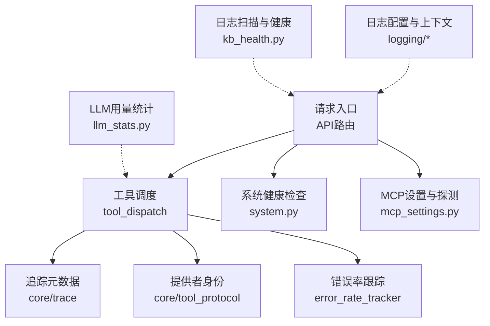
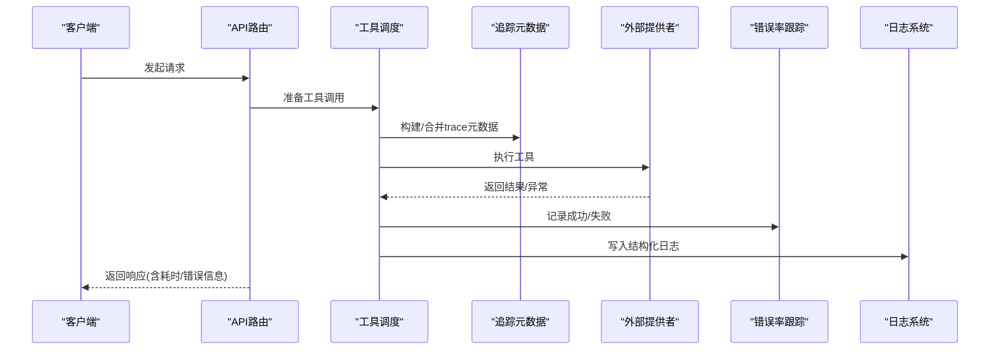
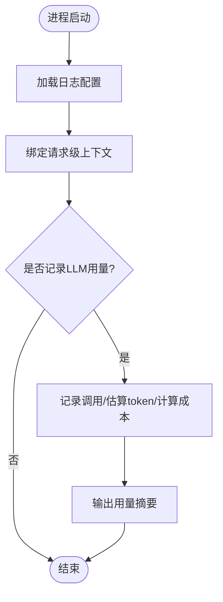
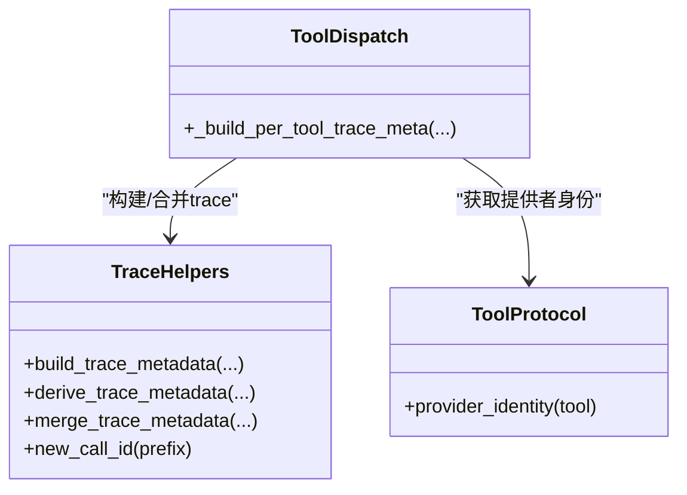
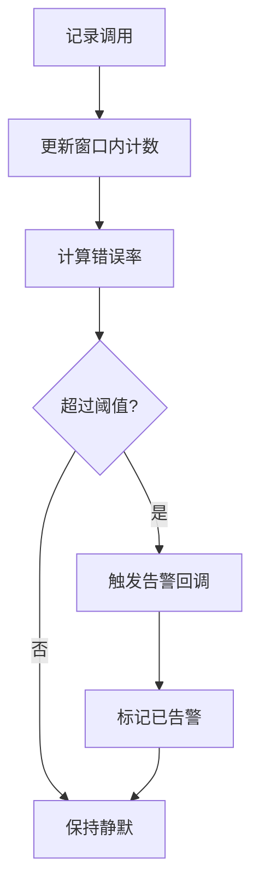
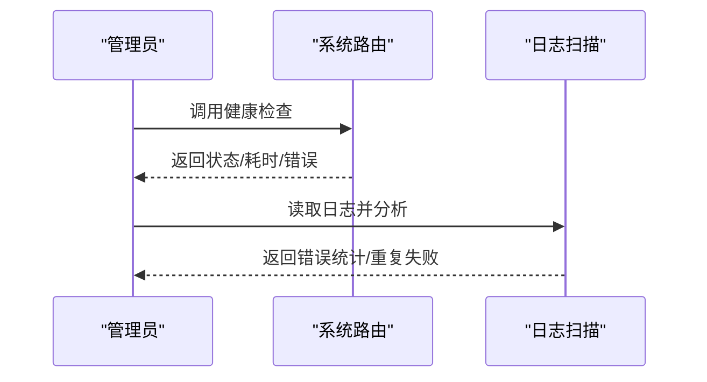
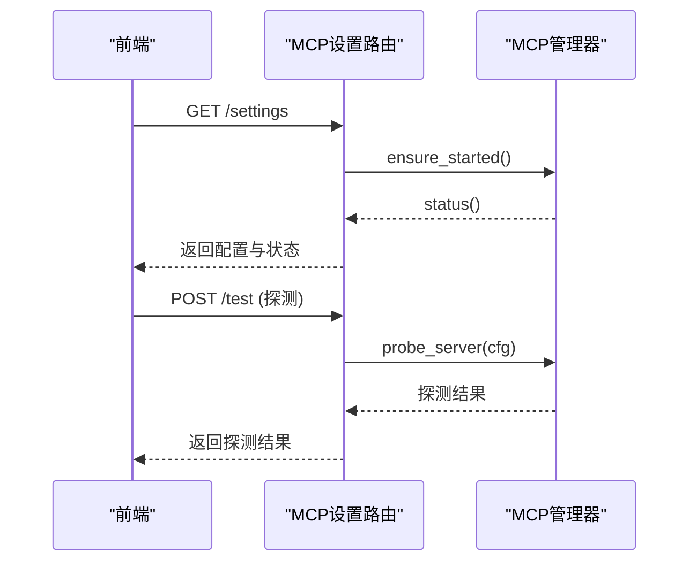
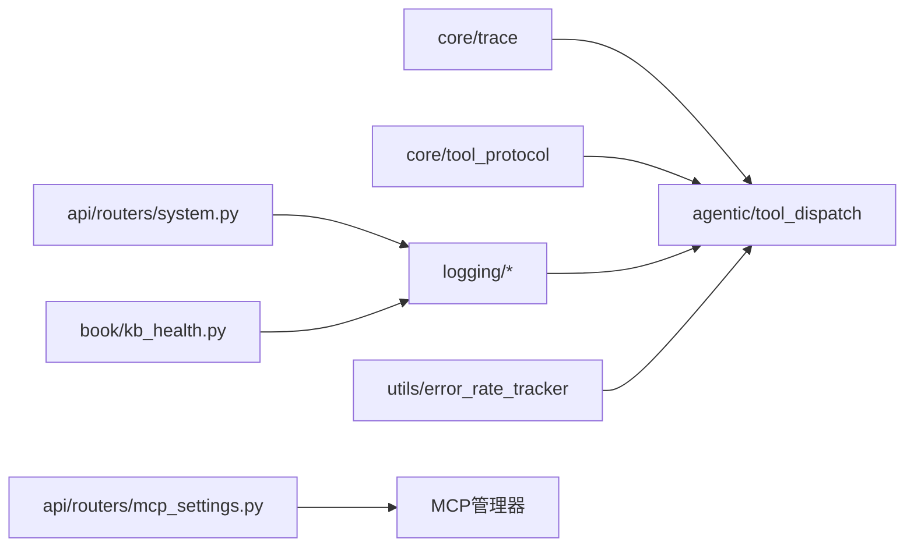

# 工具监控与调试

<cite>
**本文引用的文件**
- [deeptutor/logging/__init__.py](file://deeptutor/logging/__init__.py)
- [deeptutor/logging/config.py](file://deeptutor/logging/config.py)
- [deeptutor/logging/context.py](file://deeptutor/logging/context.py)
- [deeptutor/logging/stats/llm_stats.py](file://deeptutor/logging/stats/llm_stats.py)
- [deeptutor/core/trace.py](file://deeptutor/core/trace.py)
- [deeptutor/core/agentic/tool_dispatch.py](file://deeptutor/core/agentic/tool_dispatch.py)
- [deeptutor/core/tool_protocol.py](file://deeptutor/core/tool_protocol.py)
- [deeptutor/utils/error_rate_tracker.py](file://deeptutor/utils/error_rate_tracker.py)
- [deeptutor/book/kb_health.py](file://deeptutor/book/kb_health.py)
- [deeptutor/api/routers/system.py](file://deeptutor/api/routers/system.py)
- [deeptutor/api/routers/mcp_settings.py](file://deeptutor/api/routers/mcp_settings.py)
- [tests/core/agentic/test_tool_provider_trace.py](file://tests/core/agentic/test_tool_provider_trace.py)
</cite>

## 目录
1. [简介](#简介)
2. [项目结构](#项目结构)
3. [核心组件](#核心组件)
4. [架构总览](#架构总览)
5. [详细组件分析](#详细组件分析)
6. [依赖关系分析](#依赖关系分析)
7. [性能考量](#性能考量)
8. [故障排查指南](#故障排查指南)
9. [结论](#结论)
10. [附录](#附录)

## 简介
本文件面向DeepTutor的工具监控与调试，系统性说明如何采集性能指标、追踪错误、记录日志、定位慢查询与性能瓶颈、可视化调用链路、配置告警规则、监控资源使用，以及常见问题排查与调优实践。文档基于仓库中的日志、追踪、统计、错误率跟踪与API路由等实现进行梳理，帮助读者在不深入源码的情况下也能快速上手。

## 项目结构
围绕“工具监控与调试”的关键代码分布在以下模块：
- 日志与上下文：logging（配置、上下文、LLM用量统计）
- 追踪元数据：core/trace（统一的trace元数据构建与合并）
- 工具调度与溯源：core/agentic/tool_dispatch（为每个工具调用生成独立trace）、core/tool_protocol（外部提供者身份识别）
- 错误率与告警：utils/error_rate_tracker（滑动窗口错误率与阈值告警）
- 健康检查与日志扫描：book/kb_health（从日志中统计失败与重复错误）
- API诊断端点：api/routers/system.py、api/routers/mcp_settings.py（连通性测试、状态查询）

图表来源
- [deeptutor/core/agentic/tool_dispatch.py:371-403](file://deeptutor/core/agentic/tool_dispatch.py#L371-L403)
- [deeptutor/core/trace.py:14-82](file://deeptutor/core/trace.py#L14-L82)
- [deeptutor/core/tool_protocol.py:256-274](file://deeptutor/core/tool_protocol.py#L256-L274)
- [deeptutor/utils/error_rate_tracker.py:14-112](file://deeptutor/utils/error_rate_tracker.py#L14-L112)
- [deeptutor/logging/config.py:9-49](file://deeptutor/logging/config.py#L9-L49)
- [deeptutor/logging/context.py:10-40](file://deeptutor/logging/context.py#L10-L40)
- [deeptutor/logging/stats/llm_stats.py:68-194](file://deeptutor/logging/stats/llm_stats.py#L68-L194)
- [deeptutor/book/kb_health.py:262-308](file://deeptutor/book/kb_health.py#L262-L308)
- [deeptutor/api/routers/system.py:127-322](file://deeptutor/api/routers/system.py#L127-L322)
- [deeptutor/api/routers/mcp_settings.py:57-133](file://deeptutor/api/routers/mcp_settings.py#L57-L133)

章节来源
- [deeptutor/logging/config.py:9-49](file://deeptutor/logging/config.py#L9-L49)
- [deeptutor/logging/context.py:10-40](file://deeptutor/logging/context.py#L10-L40)
- [deeptutor/core/trace.py:14-82](file://deeptutor/core/trace.py#L14-L82)
- [deeptutor/core/agentic/tool_dispatch.py:371-403](file://deeptutor/core/agentic/tool_dispatch.py#L371-L403)
- [deeptutor/core/tool_protocol.py:256-274](file://deeptutor/core/tool_protocol.py#L256-L274)
- [deeptutor/utils/error_rate_tracker.py:14-112](file://deeptutor/utils/error_rate_tracker.py#L14-L112)
- [deeptutor/book/kb_health.py:262-308](file://deeptutor/book/kb_health.py#L262-L308)
- [deeptutor/api/routers/system.py:127-322](file://deeptutor/api/routers/system.py#L127-L322)
- [deeptutor/api/routers/mcp_settings.py:57-133](file://deeptutor/api/routers/mcp_settings.py#L57-L133)

## 核心组件
- 日志与上下文
  - 日志配置：支持级别、控制台/文件输出、日志目录、轮转大小与备份数量，默认从主配置加载。
  - 请求级上下文：通过contextvars绑定request_id、turn_id、session_id、task_id、capability、stage、sink等字段，便于跨层关联日志。
- 追踪元数据
  - 提供统一方法构建/派生/合并trace元数据，包含call_id、phase、label、call_kind、trace_id、trace_role、trace_group、trace_kind等，用于前端CallTracePanel渲染。
- 工具调度与提供者身份
  - 为每个工具调用分配独立的call_id，并在元数据中标注外部提供者类型与ID（如mcp/cli），使UI能准确显示具体服务或应用。
- 错误率跟踪与告警
  - 滑动窗口统计各provider的错误率，超过阈值触发告警回调（可集成熔断器）。
- 健康检查与日志扫描
  - 从日志文件中解析操作与消息，统计错误条目、重复失败等，辅助发现知识图谱/编译相关异常。
- API诊断端点
  - 系统健康检查返回响应时间与错误信息；MCP设置接口提供状态查询与连接探测。

章节来源
- [deeptutor/logging/config.py:9-49](file://deeptutor/logging/config.py#L9-L49)
- [deeptutor/logging/context.py:10-40](file://deeptutor/logging/context.py#L10-L40)
- [deeptutor/core/trace.py:14-82](file://deeptutor/core/trace.py#L14-L82)
- [deeptutor/core/agentic/tool_dispatch.py:371-403](file://deeptutor/core/agentic/tool_dispatch.py#L371-L403)
- [deeptutor/core/tool_protocol.py:256-274](file://deeptutor/core/tool_protocol.py#L256-L274)
- [deeptutor/utils/error_rate_tracker.py:14-112](file://deeptutor/utils/error_rate_tracker.py#L14-L112)
- [deeptutor/book/kb_health.py:262-308](file://deeptutor/book/kb_health.py#L262-L308)
- [deeptutor/api/routers/system.py:127-322](file://deeptutor/api/routers/system.py#L127-L322)
- [deeptutor/api/routers/mcp_settings.py:57-133](file://deeptutor/api/routers/mcp_settings.py#L57-L133)

## 架构总览
下图展示一次工具调用的端到端监控链路：从API入口进入，工具调度阶段生成trace元数据并标注提供者身份，执行过程中记录错误率，最终通过日志与健康检查汇总问题。

图表来源
- [deeptutor/core/agentic/tool_dispatch.py:371-403](file://deeptutor/core/agentic/tool_dispatch.py#L371-L403)
- [deeptutor/core/trace.py:14-82](file://deeptutor/core/trace.py#L14-L82)
- [deeptutor/core/tool_protocol.py:256-274](file://deeptutor/core/tool_protocol.py#L256-L274)
- [deeptutor/utils/error_rate_tracker.py:14-112](file://deeptutor/utils/error_rate_tracker.py#L14-L112)
- [deeptutor/logging/config.py:9-49](file://deeptutor/logging/config.py#L9-L49)
- [deeptutor/logging/context.py:10-40](file://deeptutor/logging/context.py#L10-L40)
- [deeptutor/api/routers/system.py:127-322](file://deeptutor/api/routers/system.py#L127-L322)

## 详细组件分析

### 日志与上下文
- 日志配置
  - 可从主配置加载级别、输出目标、日志目录、轮转策略等，便于在生产环境集中管理。
- 请求级上下文
  - 通过bind_log_context将request_id、turn_id、session_id、task_id、capability、stage、sink等字段注入到当前上下文，所有日志自动携带这些键，便于跨模块关联。
- LLM用量统计
  - 提供LLMStats记录每次调用的模型、提示词/补全token数、成本估算，并输出摘要，便于成本与性能分析。

图表来源
- [deeptutor/logging/config.py:9-49](file://deeptutor/logging/config.py#L9-L49)
- [deeptutor/logging/context.py:10-40](file://deeptutor/logging/context.py#L10-L40)
- [deeptutor/logging/stats/llm_stats.py:68-194](file://deeptutor/logging/stats/llm_stats.py#L68-L194)

章节来源
- [deeptutor/logging/config.py:9-49](file://deeptutor/logging/config.py#L9-L49)
- [deeptutor/logging/context.py:10-40](file://deeptutor/logging/context.py#L10-L40)
- [deeptutor/logging/stats/llm_stats.py:68-194](file://deeptutor/logging/stats/llm_stats.py#L68-L194)

### 追踪元数据与工具调用链路
- 统一元数据构建
  - build_trace_metadata/derive_trace_metadata/merge_trace_metadata确保trace字段一致且可扩展。
- 每工具独立trace
  - 工具调度为每个工具调用生成新的call_id，并标注phase、label、call_kind、trace_role、trace_group等，便于前端分开展示。
- 提供者身份标注
  - provider_identity提取外部工具的kind与provider_id（如mcp/cli及具体服务名），避免名称歧义。

图表来源
- [deeptutor/core/trace.py:14-82](file://deeptutor/core/trace.py#L14-L82)
- [deeptutor/core/agentic/tool_dispatch.py:371-403](file://deeptutor/core/agentic/tool_dispatch.py#L371-L403)
- [deeptutor/core/tool_protocol.py:256-274](file://deeptutor/core/tool_protocol.py#L256-L274)

章节来源
- [deeptutor/core/trace.py:14-82](file://deeptutor/core/trace.py#L14-L82)
- [deeptutor/core/agentic/tool_dispatch.py:371-403](file://deeptutor/core/agentic/tool_dispatch.py#L371-L403)
- [deeptutor/core/tool_protocol.py:256-274](file://deeptutor/core/tool_protocol.py#L256-L274)
- [tests/core/agentic/test_tool_provider_trace.py:81-113](file://tests/core/agentic/test_tool_provider_trace.py#L81-L113)

### 错误率跟踪与告警
- 滑动窗口统计
  - ErrorRateTracker按provider维护时间窗口内的总调用与错误次数，实时计算错误率。
- 阈值告警
  - 当错误率超过阈值时触发告警回调（可选集成熔断器），避免重复告警。
- 全局接口
  - 提供record_provider_call、get_provider_error_rate、check_provider_threshold等便捷函数。

图表来源
- [deeptutor/utils/error_rate_tracker.py:14-112](file://deeptutor/utils/error_rate_tracker.py#L14-L112)

章节来源
- [deeptutor/utils/error_rate_tracker.py:14-112](file://deeptutor/utils/error_rate_tracker.py#L14-L112)

### 健康检查与日志扫描
- 系统健康检查
  - 系统路由在异常路径中记录response_time_ms与错误信息，便于快速定位连通性问题。
- 日志扫描
  - kb_health从日志中解析操作与消息，统计错误条目、重复失败等，辅助发现知识图谱/编译相关异常。

图表来源
- [deeptutor/api/routers/system.py:127-322](file://deeptutor/api/routers/system.py#L127-L322)
- [deeptutor/book/kb_health.py:262-308](file://deeptutor/book/kb_health.py#L262-L308)

章节来源
- [deeptutor/api/routers/system.py:127-322](file://deeptutor/api/routers/system.py#L127-L322)
- [deeptutor/book/kb_health.py:262-308](file://deeptutor/book/kb_health.py#L262-L308)

### MCP设置与探测
- 获取/更新/删除MCP服务器配置，并触发管理器重载。
- 提供测试端点对MCP服务器进行连通性探测，便于快速验证配置正确性。

图表来源
- [deeptutor/api/routers/mcp_settings.py:57-133](file://deeptutor/api/routers/mcp_settings.py#L57-L133)

章节来源
- [deeptutor/api/routers/mcp_settings.py:57-133](file://deeptutor/api/routers/mcp_settings.py#L57-L133)

## 依赖关系分析
- 低耦合高内聚
  - 追踪元数据与工具调度解耦，通过统一的元数据结构传递上下文。
  - 错误率跟踪独立于业务逻辑，仅关注成功/失败与时间戳。
- 外部依赖
  - 日志系统、配置系统、路径服务被日志模块间接依赖。
  - MCP管理器在设置路由中被调用以重载配置与探测连接。

图表来源
- [deeptutor/core/trace.py:14-82](file://deeptutor/core/trace.py#L14-L82)
- [deeptutor/core/agentic/tool_dispatch.py:371-403](file://deeptutor/core/agentic/tool_dispatch.py#L371-L403)
- [deeptutor/core/tool_protocol.py:256-274](file://deeptutor/core/tool_protocol.py#L256-L274)
- [deeptutor/logging/config.py:9-49](file://deeptutor/logging/config.py#L9-L49)
- [deeptutor/utils/error_rate_tracker.py:14-112](file://deeptutor/utils/error_rate_tracker.py#L14-L112)
- [deeptutor/api/routers/system.py:127-322](file://deeptutor/api/routers/system.py#L127-L322)
- [deeptutor/api/routers/mcp_settings.py:57-133](file://deeptutor/api/routers/mcp_settings.py#L57-L133)
- [deeptutor/book/kb_health.py:262-308](file://deeptutor/book/kb_health.py#L262-L308)

章节来源
- [deeptutor/core/trace.py:14-82](file://deeptutor/core/trace.py#L14-L82)
- [deeptutor/core/agentic/tool_dispatch.py:371-403](file://deeptutor/core/agentic/tool_dispatch.py#L371-L403)
- [deeptutor/core/tool_protocol.py:256-274](file://deeptutor/core/tool_protocol.py#L256-L274)
- [deeptutor/logging/config.py:9-49](file://deeptutor/logging/config.py#L9-L49)
- [deeptutor/utils/error_rate_tracker.py:14-112](file://deeptutor/utils/error_rate_tracker.py#L14-L112)
- [deeptutor/api/routers/system.py:127-322](file://deeptutor/api/routers/system.py#L127-L322)
- [deeptutor/api/routers/mcp_settings.py:57-133](file://deeptutor/api/routers/mcp_settings.py#L57-L133)
- [deeptutor/book/kb_health.py:262-308](file://deeptutor/book/kb_health.py#L262-L308)

## 性能考量
- 慢查询识别
  - 利用系统健康检查的response_time_ms字段评估外部服务连通性与延迟。
  - 结合LLMStats统计token与成本，识别高开销调用。
- 性能瓶颈分析
  - 通过trace元数据的phase与label区分规划、执行、流式输出等阶段，定位耗时环节。
  - 使用错误率跟踪识别频繁失败的provider，必要时启用熔断或降级。
- 优化建议
  - 合理设置日志级别与轮转策略，避免I/O成为瓶颈。
  - 对高频外部调用增加重试与超时控制，减少长尾延迟。
  - 对大文本输入/输出进行压缩或分页处理，降低网络与内存压力。

[本节为通用指导，不直接分析具体文件]

## 故障排查指南
- 常见症状与定位
  - 工具调用无trace事件：检查工具调度是否正确生成call_id与trace元数据，确认provider_identity能正确解析外部提供者。
  - 外部服务不可用：通过系统健康检查与MCP测试端点验证连通性，查看返回的response_time_ms与错误信息。
  - 日志无法读取：kb_health在读取日志失败时会记录警告，检查日志路径与权限。
- 步骤化排查
  - 确认日志上下文已绑定（request_id、turn_id等），确保跨模块日志可关联。
  - 检查错误率是否超过阈值，必要时调整阈值或接入熔断器。
  - 若涉及MCP，先验证配置与URL有效性，再执行探测。
- 参考实现位置
  - 追踪元数据构建与合并：[deeptutor/core/trace.py:14-82](file://deeptutor/core/trace.py#L14-L82)
  - 工具调度与提供者身份：[deeptutor/core/agentic/tool_dispatch.py:371-403](file://deeptutor/core/agentic/tool_dispatch.py#L371-L403)、[deeptutor/core/tool_protocol.py:256-274](file://deeptutor/core/tool_protocol.py#L256-L274)
  - 错误率跟踪与告警：[deeptutor/utils/error_rate_tracker.py:14-112](file://deeptutor/utils/error_rate_tracker.py#L14-L112)
  - 健康检查与日志扫描：[deeptutor/api/routers/system.py:127-322](file://deeptutor/api/routers/system.py#L127-L322)、[deeptutor/book/kb_health.py:262-308](file://deeptutor/book/kb_health.py#L262-L308)
  - MCP设置与探测：[deeptutor/api/routers/mcp_settings.py:57-133](file://deeptutor/api/routers/mcp_settings.py#L57-L133)

章节来源
- [deeptutor/core/trace.py:14-82](file://deeptutor/core/trace.py#L14-L82)
- [deeptutor/core/agentic/tool_dispatch.py:371-403](file://deeptutor/core/agentic/tool_dispatch.py#L371-L403)
- [deeptutor/core/tool_protocol.py:256-274](file://deeptutor/core/tool_protocol.py#L256-L274)
- [deeptutor/utils/error_rate_tracker.py:14-112](file://deeptutor/utils/error_rate_tracker.py#L14-L112)
- [deeptutor/api/routers/system.py:127-322](file://deeptutor/api/routers/system.py#L127-L322)
- [deeptutor/book/kb_health.py:262-308](file://deeptutor/book/kb_health.py#L262-L308)
- [deeptutor/api/routers/mcp_settings.py:57-133](file://deeptutor/api/routers/mcp_settings.py#L57-L133)

## 结论
DeepTutor通过统一的追踪元数据、结构化日志、错误率跟踪与健康检查，构建了完整的工具监控与调试体系。借助这些能力，可以快速定位慢查询与性能瓶颈，可视化调用链路，及时告警异常，并为资源监控与调优提供数据基础。建议在关键路径上持续完善trace与日志埋点，结合错误率阈值与熔断机制，提升系统的可观测性与稳定性。

[本节为总结，不直接分析具体文件]

## 附录
- 配置告警规则建议
  - 错误率阈值：根据业务容忍度设定（如0.5%~5%），并结合滑动窗口大小（如60秒）平衡灵敏度与稳定性。
  - 告警回调：可接入熔断器或通知系统，实现自动隔离与人工介入。
- 资源监控建议
  - 内存占用：关注大对象与流式处理的累积，定期清理与限制缓冲大小。
  - CPU使用率：识别CPU密集型任务，考虑异步化或并行化。
  - 网络连接数：监控外部服务连接池与超时设置，避免连接泄漏。
- 最佳实践
  - 在工具调度阶段统一生成trace元数据，确保前后端一致性。
  - 对外部调用增加超时、重试与熔断，提升鲁棒性。
  - 使用LLMStats统计token与成本，优化提示词与响应长度。

[本节为通用指导，不直接分析具体文件]