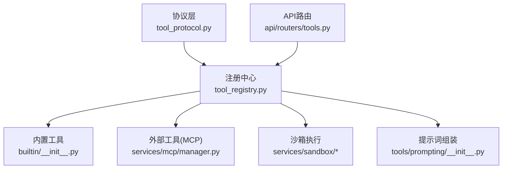
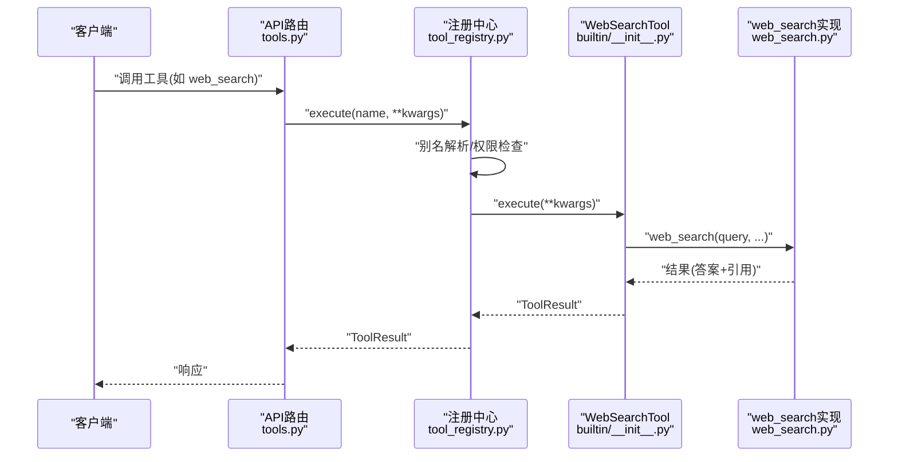
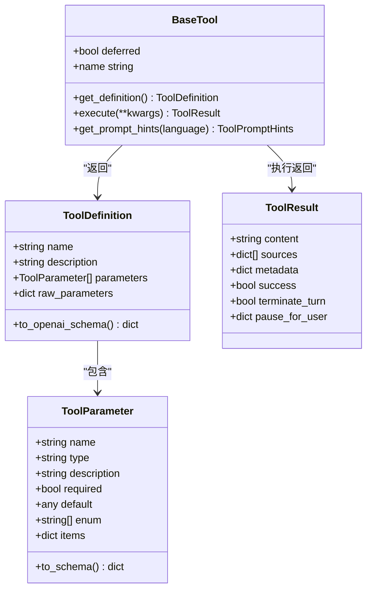
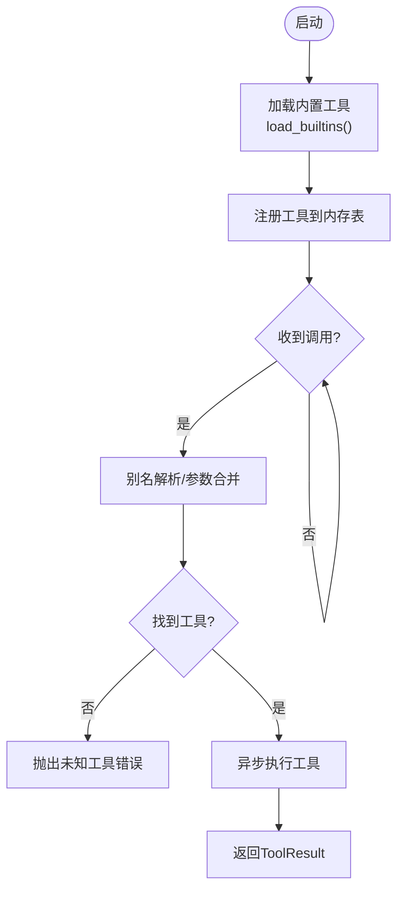
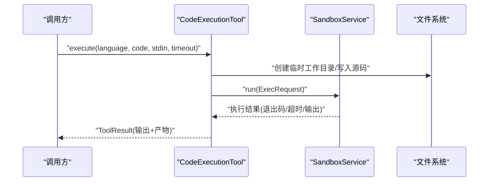
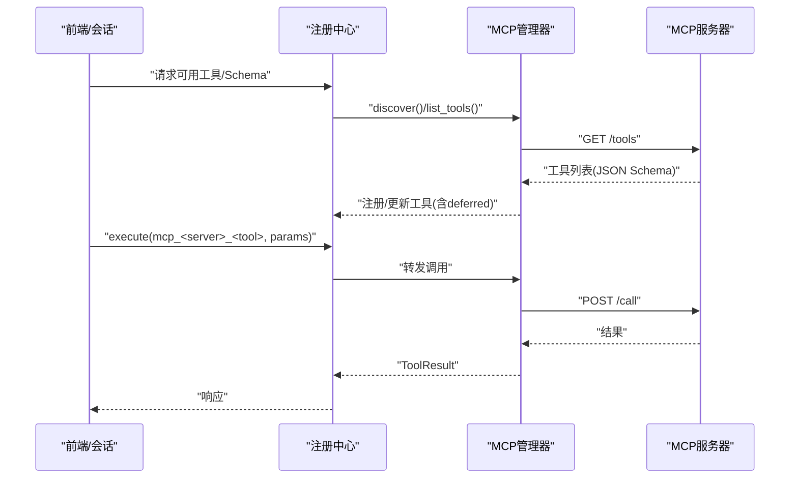
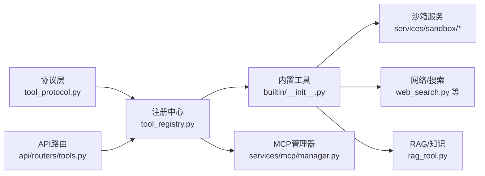

# 工具系统

<cite>
**本文引用的文件**
- [deeptutor/core/tool_protocol.py](file://deeptutor/core/tool_protocol.py)
- [deeptutor/tools/builtin/__init__.py](file://deeptutor/tools/builtin/__init__.py)
- [deeptutor/runtime/registry/tool_registry.py](file://deeptutor/runtime/registry/tool_registry.py)
- [deeptutor/services/mcp/manager.py](file://deeptutor/services/mcp/manager.py)
- [deeptutor/services/sandbox/artifacts.py](file://deeptutor/services/sandbox/artifacts.py)
- [deeptutor/services/sandbox/__init__.py](file://deeptutor/services/sandbox/__init__.py)
- [deeptutor/api/routers/tools.py](file://deeptutor/api/routers/tools.py)
- [deeptutor/tools/prompting/__init__.py](file://deeptutor/tools/prompting/__init__.py)
- [deeptutor/tools/web_search.py](file://deeptutor/tools/web_search.py)
- [deeptutor/tools/rag_tool.py](file://deeptutor/tools/rag_tool.py)
- [deeptutor/tools/exec_tool.py](file://deeptutor/tools/exec_tool.py)
- [deeptutor/tools/file_tools.py](file://deeptutor/tools/file_tools.py)
- [deeptutor/tools/reason.py](file://deeptutor/tools/reason.py)
- [deeptutor/tools/paper_search_tool.py](file://deeptutor/tools/paper_search_tool.py)
- [deeptutor/tools/web_fetch.py](file://deeptutor/tools/web_fetch.py)
- [deeptutor/tools/brainstorm.py](file://deeptutor/tools/brainstorm.py)
- [deeptutor/tools/write_note.py](file://deeptutor/tools/write_note.py)
- [deeptutor/tools/list_notebook.py](file://deeptutor/tools/list_notebook.py)
- [deeptutor/tools/github_query.py](file://deeptutor/tools/github_query.py)
- [deeptutor/tools/cron_tool.py](file://deeptutor/tools/cron_tool.py)
- [deeptutor/tools/media_gen_tool.py](file://deeptutor/tools/media_gen_tool.py)
- [deeptutor/tools/partner_memory.py](file://deeptutor/tools/partner_memory.py)
- [deeptutor/tools/tex_chunker.py](file://deeptutor/tools/tex_chunker.py)
- [deeptutor/tools/tex_downloader.py](file://deeptutor/tools/tex_downloader.py)
- [deeptutor/tools/solve_tool.py](file://deeptutor/tools/solve_tool.py)
- [deeptutor/tools/mastery_tool.py](file://deeptutor/tools/mastery_tool.py)
- [deeptutor/tools/ask_user.py](file://deeptutor/tools/ask_user.py)
</cite>

## 目录
1. [简介](#简介)
2. [项目结构](#项目结构)
3. [核心组件](#核心组件)
4. [架构总览](#架构总览)
5. [详细组件分析](#详细组件分析)
6. [依赖关系分析](#依赖关系分析)
7. [性能考虑](#性能考虑)
8. [故障排查指南](#故障排查指南)
9. [结论](#结论)
10. [附录](#附录)

## 简介
本文件面向DeepTutor的工具系统，系统性说明工具的注册机制、发现过程与调用框架；详解内置工具（文件操作、网络请求、代码执行、搜索等）的功能边界与使用方式；阐述权限控制、沙箱安全与资源限制；解释MCP服务器集成与外部工具调用；介绍参数校验、错误处理与日志记录；提供自定义工具开发指南（协议定义与接口规范）；展示工具组合与高级应用场景；并给出性能监控与调试方法。

## 项目结构
工具系统围绕“协议层—注册中心—内置实现—运行时调度—外部集成”分层组织：
- 协议层：统一工具描述、参数Schema、结果结构与事件回调。
- 注册中心：集中管理工具生命周期、别名解析、提示词组装与OpenAI函数调用Schema生成。
- 内置实现：文件、搜索、推理、RAG、代码执行、媒体生成、记忆读写等能力。
- 运行时调度：API路由暴露工具能力，结合会话上下文与权限进行调用。
- 外部集成：通过MCP服务发现与调用外部工具，支持延迟加载与分组。

图表来源
- [deeptutor/core/tool_protocol.py:16-203](file://deeptutor/core/tool_protocol.py#L16-L203)
- [deeptutor/runtime/registry/tool_registry.py:21-153](file://deeptutor/runtime/registry/tool_registry.py#L21-L153)
- [deeptutor/tools/builtin/__init__.py:43-800](file://deeptutor/tools/builtin/__init__.py#L43-L800)
- [deeptutor/services/mcp/manager.py:1-200](file://deeptutor/services/mcp/manager.py#L1-L200)
- [deeptutor/api/routers/tools.py:1-200](file://deeptutor/api/routers/tools.py#L1-L200)
- [deeptutor/services/sandbox/artifacts.py:1-200](file://deeptutor/services/sandbox/artifacts.py#L1-L200)
- [deeptutor/tools/prompting/__init__.py:1-200](file://deeptutor/tools/prompting/__init__.py#L1-L200)

章节来源
- [deeptutor/core/tool_protocol.py:16-203](file://deeptutor/core/tool_protocol.py#L16-L203)
- [deeptutor/runtime/registry/tool_registry.py:21-153](file://deeptutor/runtime/registry/tool_registry.py#L21-L153)
- [deeptutor/tools/builtin/__init__.py:43-800](file://deeptutor/tools/builtin/__init__.py#L43-L800)

## 核心组件
- 工具协议
  - ToolParameter/ToolDefinition：声明工具名称、描述、参数Schema（支持JSON Schema直传），可转换为OpenAI函数调用格式。
  - ToolResult：统一返回体，包含内容、来源引用、元数据、成功标志、终止回合或暂停等待用户输入等。
  - BaseTool：抽象基类，要求实现get_definition与execute，支持deferred延迟披露。
  - ToolLookup：只读视图，提供获取工具实例、定义、提示文本、构建OpenAI Schema与执行入口。
  - provider_identity：标识工具来源（mcp/cli/内置）。

- 注册中心
  - ToolRegistry：单例式注册表，负责加载内置工具、别名解析、列出工具、构建Schema与提示文本、执行工具。
  - load_builtins：从BUILTIN_TOOL_TYPES实例化并注册所有内置工具。
  - execute：位置参数name避免与工具参数冲突，统一分发到具体工具执行。

- 内置工具（部分）
  - RAGTool：检索知识库片段，附带来源引用。
  - WebSearchTool：网络搜索并汇总结果与引用。
  - CodeExecutionTool：在沙箱中编译运行代码（Python/C/C++），输出stdout/stderr与产物。
  - ReasonTool：针对复杂子问题发起深度推理。
  - PaperSearchToolWrapper：arXiv论文检索。
  - GeoGebraAnalysisTool：数学题图理解与GeoGebra指令生成。
  - ReadSourceTool/ReadMemoryTool/WriteMemoryTool：读取附件全文、读写用户长期偏好。

章节来源
- [deeptutor/core/tool_protocol.py:16-203](file://deeptutor/core/tool_protocol.py#L16-L203)
- [deeptutor/runtime/registry/tool_registry.py:21-153](file://deeptutor/runtime/registry/tool_registry.py#L21-L153)
- [deeptutor/tools/builtin/__init__.py:43-800](file://deeptutor/tools/builtin/__init__.py#L43-L800)

## 架构总览
工具调用主流程（以Web搜索为例）：

图表来源
- [deeptutor/api/routers/tools.py:1-200](file://deeptutor/api/routers/tools.py#L1-L200)
- [deeptutor/runtime/registry/tool_registry.py:128-141](file://deeptutor/runtime/registry/tool_registry.py#L128-L141)
- [deeptutor/tools/builtin/__init__.py:234-271](file://deeptutor/tools/builtin/__init__.py#L234-L271)
- [deeptutor/tools/web_search.py:1-200](file://deeptutor/tools/web_search.py#L1-L200)

## 详细组件分析

### 工具协议与数据结构
- ToolParameter：支持基础类型、数组、枚举、items等，to_schema用于生成属性Schema。
- ToolDefinition：支持raw_parameters透传上游JSON Schema，to_openai_schema生成OpenAI函数调用格式。
- ToolResult：content为LLM可见文本；sources为引用行；metadata携带结构化信息；success标记失败；terminate_turn/pause_for_user控制回合流。
- BaseTool：deferred用于渐进披露；get_prompt_hints默认返回简短描述。
- ToolLookup：对外暴露只读能力，屏蔽注册细节。

图表来源
- [deeptutor/core/tool_protocol.py:16-203](file://deeptutor/core/tool_protocol.py#L16-L203)

章节来源
- [deeptutor/core/tool_protocol.py:16-203](file://deeptutor/core/tool_protocol.py#L16-L203)

### 工具注册与发现
- 注册中心职责：
  - 加载内置工具：load_builtins遍历BUILTIN_TOOL_TYPES并实例化注册。
  - 别名解析：_resolve_request将别名映射到真实工具名并合并默认参数。
  - 列表与定义：list_tools/get_definitions/build_openai_schemas。
  - 提示文本：build_prompt_text基于工具提示组装。
  - 执行：execute按名称定位工具并异步执行。

- 延迟工具：BaseTool.deferred=true时，不在首轮工具列表中直接暴露，需按需加载（常用于MCP工具）。

图表来源
- [deeptutor/runtime/registry/tool_registry.py:21-153](file://deeptutor/runtime/registry/tool_registry.py#L21-L153)

章节来源
- [deeptutor/runtime/registry/tool_registry.py:21-153](file://deeptutor/runtime/registry/tool_registry.py#L21-L153)

### 内置工具详解

#### 文件操作
- 文件列举/清单：KbFilesTool用于列出知识库文档、计数与过滤，返回结构化元数据。
- 笔记写入：write_note工具用于持久化笔记。
- 笔记本列表：list_notebook工具用于列举笔记本条目。
- TeX处理：tex_chunker/tex_downloader/read_tex_file用于TeX文件分块与下载读取。

章节来源
- [deeptutor/tools/builtin/__init__.py:144-231](file://deeptutor/tools/builtin/__init__.py#L144-L231)
- [deeptutor/tools/write_note.py:1-200](file://deeptutor/tools/write_note.py#L1-L200)
- [deeptutor/tools/list_notebook.py:1-200](file://deeptutor/tools/list_notebook.py#L1-L200)
- [deeptutor/tools/tex_chunker.py:1-200](file://deeptutor/tools/tex_chunker.py#L1-L200)
- [deeptutor/tools/tex_downloader.py:1-200](file://deeptutor/tools/tex_downloader.py#L1-L200)

#### 网络请求
- WebSearchTool：网络搜索，返回摘要与引用。
- WebFetchTool：抓取网页内容。
- GitHub查询：github_query工具用于GitHub仓库/PR等查询。

章节来源
- [deeptutor/tools/builtin/__init__.py:234-271](file://deeptutor/tools/builtin/__init__.py#L234-L271)
- [deeptutor/tools/web_fetch.py:1-200](file://deeptutor/tools/web_fetch.py#L1-L200)
- [deeptutor/tools/github_query.py:1-200](file://deeptutor/tools/github_query.py#L1-L200)

#### 代码执行
- CodeExecutionTool：在沙箱内编译运行Python/C/C++代码，支持stdin输入、超时限制，产出stdout/stderr与产物文件。
- 底层ExecTool：通用命令执行封装，配合沙箱服务隔离执行。

图表来源
- [deeptutor/tools/builtin/__init__.py:274-447](file://deeptutor/tools/builtin/__init__.py#L274-L447)
- [deeptutor/tools/exec_tool.py:1-200](file://deeptutor/tools/exec_tool.py#L1-L200)
- [deeptutor/services/sandbox/__init__.py:1-200](file://deeptutor/services/sandbox/__init__.py#L1-L200)
- [deeptutor/services/sandbox/artifacts.py:1-200](file://deeptutor/services/sandbox/artifacts.py#L1-L200)

章节来源
- [deeptutor/tools/builtin/__init__.py:274-447](file://deeptutor/tools/builtin/__init__.py#L274-L447)
- [deeptutor/tools/exec_tool.py:1-200](file://deeptutor/tools/exec_tool.py#L1-L200)
- [deeptutor/services/sandbox/artifacts.py:1-200](file://deeptutor/services/sandbox/artifacts.py#L1-L200)

#### 搜索与知识检索
- RAGTool：检索知识库片段，附带来源引用，支持并行多KB检索。
- PaperSearchToolWrapper：arXiv预印本检索，返回元数据与摘要。
- WebSearchTool：通用网络搜索。

章节来源
- [deeptutor/tools/builtin/__init__.py:95-141](file://deeptutor/tools/builtin/__init__.py#L95-L141)
- [deeptutor/tools/builtin/__init__.py:488-565](file://deeptutor/tools/builtin/__init__.py#L488-L565)
- [deeptutor/tools/rag_tool.py:1-200](file://deeptutor/tools/rag_tool.py#L1-L200)
- [deeptutor/tools/paper_search_tool.py:1-200](file://deeptutor/tools/paper_search_tool.py#L1-L200)

#### 推理与创意
- ReasonTool：对复杂子问题进行深度推理。
- BrainstormTool：主题发散与方案罗列。

章节来源
- [deeptutor/tools/builtin/__init__.py:450-485](file://deeptutor/tools/builtin/__init__.py#L450-L485)
- [deeptutor/tools/reason.py:1-200](file://deeptutor/tools/reason.py#L1-L200)
- [deeptutor/tools/brainstorm.py:1-200](file://deeptutor/tools/brainstorm.py#L1-L200)

#### 多媒体与可视化
- MediaGenTool：图像/视频生成。
- GeoGebraAnalysisTool：数学题图理解与GeoGebra指令生成。

章节来源
- [deeptutor/tools/media_gen_tool.py:1-200](file://deeptutor/tools/media_gen_tool.py#L1-L200)
- [deeptutor/tools/builtin/__init__.py:568-674](file://deeptutor/tools/builtin/__init__.py#L568-L674)

#### 记忆与偏好
- ReadMemoryTool/WriteMemoryTool：读取/写入用户长期偏好与学习摘要。
- PartnerMemory：伙伴侧记忆读写。

章节来源
- [deeptutor/tools/builtin/__init__.py:741-800](file://deeptutor/tools/builtin/__init__.py#L741-L800)
- [deeptutor/tools/partner_memory.py:1-200](file://deeptutor/tools/partner_memory.py#L1-L200)

#### 其他实用工具
- AskUser：交互式询问用户，支持暂停回合。
- CronTool：定时任务触发。
- SolveTool/MasteryTool：解题与掌握度评估。

章节来源
- [deeptutor/tools/ask_user.py:1-200](file://deeptutor/tools/ask_user.py#L1-L200)
- [deeptutor/tools/cron_tool.py:1-200](file://deeptutor/tools/cron_tool.py#L1-L200)
- [deeptutor/tools/solve_tool.py:1-200](file://deeptutor/tools/solve_tool.py#L1-L200)
- [deeptutor/tools/mastery_tool.py:1-200](file://deeptutor/tools/mastery_tool.py#L1-L200)

### MCP服务器集成与外部工具调用
- MCP管理器：负责MCP服务器配置、连接、工具发现与调用，支持OAuth与网络重试。
- 延迟加载：MCP工具通常设置deferred=true，按需加载完整Schema，减少首轮负载。
- 工具分组与命名：provider_identity区分工具来源，便于UI展示与追踪。

图表来源
- [deeptutor/services/mcp/manager.py:1-200](file://deeptutor/services/mcp/manager.py#L1-L200)
- [deeptutor/core/tool_protocol.py:256-274](file://deeptutor/core/tool_protocol.py#L256-L274)
- [deeptutor/runtime/registry/tool_registry.py:45-47](file://deeptutor/runtime/registry/tool_registry.py#L45-L47)

章节来源
- [deeptutor/services/mcp/manager.py:1-200](file://deeptutor/services/mcp/manager.py#L1-L200)
- [deeptutor/core/tool_protocol.py:256-274](file://deeptutor/core/tool_protocol.py#L256-L274)

### 权限控制、沙箱安全与资源限制
- 权限控制：注册中心在执行前可进行别名解析与启用集合过滤；API路由层结合会话上下文与多用户访问策略限制工具可用性。
- 沙箱安全：代码执行通过SandboxService隔离执行，限制CPU/内存/时间，仅允许挂载白名单路径，产物收集受控。
- 资源限制：CodeExecutionTool对timeout进行上下限钳制；RAG/KbFiles对limit进行上限保护；网络请求具备重试与超时策略。

章节来源
- [deeptutor/tools/builtin/__init__.py:347-447](file://deeptutor/tools/builtin/__init__.py#L347-L447)
- [deeptutor/services/sandbox/__init__.py:1-200](file://deeptutor/services/sandbox/__init__.py#L1-L200)
- [deeptutor/tools/builtin/__init__.py:189-231](file://deeptutor/tools/builtin/__init__.py#L189-L231)

### 参数验证、错误处理与日志记录
- 参数验证：各工具在execute入口处校验必填参数与取值范围（如RAG query/kb_name、CodeExecution language/timeout）。
- 错误处理：异常捕获后返回ToolResult(success=False)，保留错误信息与上下文；网络/外部服务降级返回友好消息。
- 日志记录：模块级logger记录关键步骤与异常堆栈；执行链路可通过trace与stream事件上报进度。

章节来源
- [deeptutor/tools/builtin/__init__.py:114-141](file://deeptutor/tools/builtin/__init__.py#L114-L141)
- [deeptutor/tools/builtin/__init__.py:347-447](file://deeptutor/tools/builtin/__init__.py#L347-L447)
- [deeptutor/tools/builtin/__init__.py:520-565](file://deeptutor/tools/builtin/__init__.py#L520-L565)

### 自定义工具开发指南
- 协议定义：继承BaseTool，实现get_definition与execute；如需延迟披露，设置deferred=true。
- 参数Schema：使用ToolParameter声明参数类型、是否必填、枚举与items；或直接使用raw_parameters透传上游JSON Schema。
- 返回结果：构造ToolResult，填充content/sources/metadata；必要时设置success=false或pause_for_user。
- 注册与发现：通过注册中心register或交由MCP适配器自动注册；确保名称唯一。
- 提示词：可选实现get_prompt_hints以提供使用指导与别名。

章节来源
- [deeptutor/core/tool_protocol.py:206-254](file://deeptutor/core/tool_protocol.py#L206-L254)
- [deeptutor/runtime/registry/tool_registry.py:36-59](file://deeptutor/runtime/registry/tool_registry.py#L36-L59)
- [deeptutor/tools/prompting/__init__.py:1-200](file://deeptutor/tools/prompting/__init__.py#L1-L200)

### 工具组合与高级应用场景
- 组合模式：RAG检索→Reason推理→CodeExecution验证→MediaGen生成可视化；或WebSearch→PaperSearch→WriteNote归档。
- 渐进披露：首轮仅暴露轻量工具，按需加载MCP工具，降低首包大小与模型负担。
- 多源融合：同时调用多个KB的RAG与WebSearch，聚合结果并去重，形成综合回答。

[本节为概念性说明，不直接分析具体文件]

## 依赖关系分析
工具系统的关键依赖关系如下：
- 协议层被注册中心与所有工具实现依赖。
- 注册中心依赖内置工具与MCP管理器。
- 内置工具依赖具体服务（沙箱、搜索、RAG、媒体生成等）。
- API路由依赖注册中心暴露工具能力。

图表来源
- [deeptutor/core/tool_protocol.py:16-203](file://deeptutor/core/tool_protocol.py#L16-L203)
- [deeptutor/runtime/registry/tool_registry.py:21-153](file://deeptutor/runtime/registry/tool_registry.py#L21-L153)
- [deeptutor/tools/builtin/__init__.py:43-800](file://deeptutor/tools/builtin/__init__.py#L43-L800)
- [deeptutor/services/mcp/manager.py:1-200](file://deeptutor/services/mcp/manager.py#L1-L200)
- [deeptutor/api/routers/tools.py:1-200](file://deeptutor/api/routers/tools.py#L1-L200)
- [deeptutor/services/sandbox/artifacts.py:1-200](file://deeptutor/services/sandbox/artifacts.py#L1-L200)
- [deeptutor/tools/web_search.py:1-200](file://deeptutor/tools/web_search.py#L1-L200)
- [deeptutor/tools/rag_tool.py:1-200](file://deeptutor/tools/rag_tool.py#L1-L200)

章节来源
- [deeptutor/runtime/registry/tool_registry.py:21-153](file://deeptutor/runtime/registry/tool_registry.py#L21-L153)
- [deeptutor/tools/builtin/__init__.py:43-800](file://deeptutor/tools/builtin/__init__.py#L43-L800)

## 性能考虑
- 延迟加载：MCP工具deferred=true，减少首轮Schema体积与模型上下文压力。
- 并行调用：RAG支持多KB并行检索；网络请求具备并发与重试优化。
- 资源限制：代码执行限制超时与输出长度；文件列举限制最大条目数。
- 产物裁剪：代码执行仅公开非敏感产物，避免冗余传输。

[本节提供一般性指导，不直接分析具体文件]

## 故障排查指南
- 常见错误
  - 未知工具：注册中心未找到工具名，检查别名与注册流程。
  - 参数缺失：工具execute入口校验失败，检查必填参数与类型。
  - 沙箱执行失败：超时/权限/路径挂载问题，检查ResourceLimits与Mount配置。
  - 外部服务不可用：网络/速率限制导致降级，查看ToolResult.success与metadata中的错误信息。
- 调试方法
  - 日志：模块logger记录异常堆栈；开启更细粒度日志观察执行链路。
  - 追踪：利用ToolResult.metadata与stream事件跟踪中间状态。
  - 单元测试：针对工具execute编写用例，覆盖边界条件与异常分支。

章节来源
- [deeptutor/runtime/registry/tool_registry.py:128-141](file://deeptutor/runtime/registry/tool_registry.py#L128-L141)
- [deeptutor/tools/builtin/__init__.py:114-141](file://deeptutor/tools/builtin/__init__.py#L114-L141)
- [deeptutor/tools/builtin/__init__.py:347-447](file://deeptutor/tools/builtin/__init__.py#L347-L447)
- [deeptutor/tools/builtin/__init__.py:520-565](file://deeptutor/tools/builtin/__init__.py#L520-L565)

## 结论
DeepTutor工具系统通过统一的协议与注册中心，实现了内置与外部工具的标准化接入与调度。内置工具覆盖文件、网络、代码执行、搜索、推理、多媒体与记忆等场景；MCP集成支持动态发现与延迟加载；沙箱与资源限制保障安全可控；完善的参数校验、错误处理与日志体系提升可维护性与可观测性。开发者可依据协议快速扩展自定义工具，并通过组合调用实现复杂工作流。

[本节为总结性内容，不直接分析具体文件]

## 附录
- 常用工具速查
  - 文件：KbFilesTool、write_note、list_notebook、tex_*系列
  - 网络：web_search、web_fetch、github_query
  - 代码：code_execution、exec_tool
  - 搜索：rag、paper_search、web_search
  - 推理：reason、brainstorm
  - 多媒体：media_gen、geogebra_analysis
  - 记忆：read_memory、write_memory、partner_memory
  - 交互：ask_user、cron_tool、solve_tool、mastery_tool

[本节为参考性内容，不直接分析具体文件]