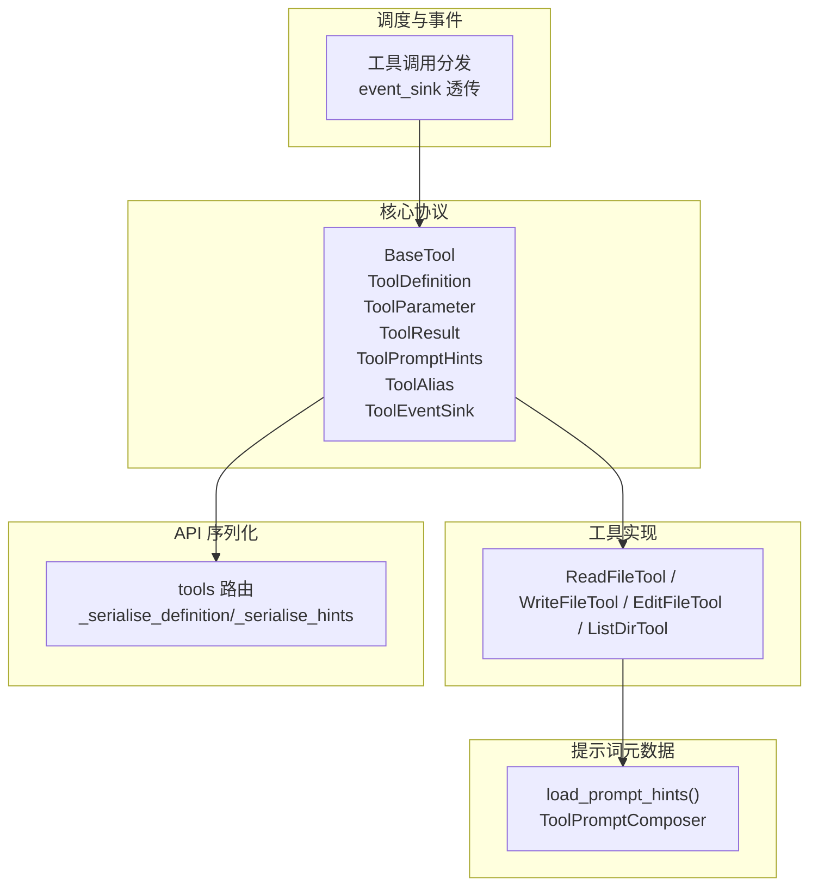
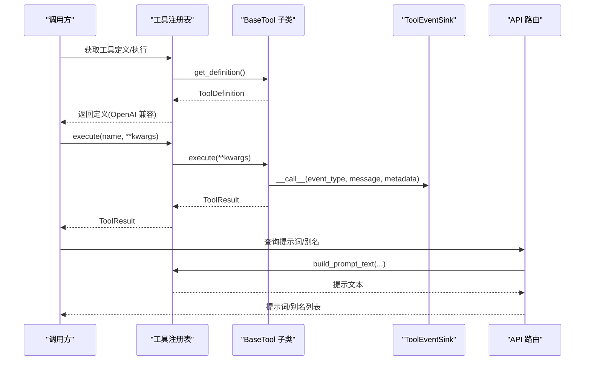
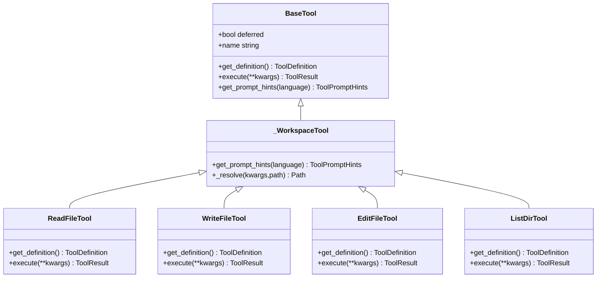
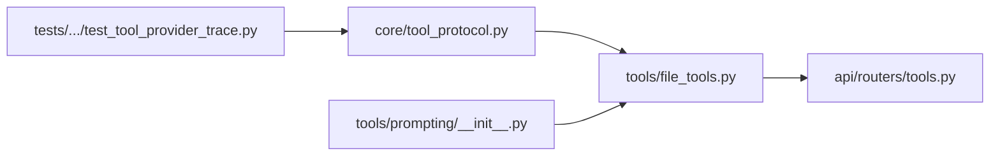

# 工具协议基础

<cite>
**本文引用的文件**
- [deeptutor/core/tool_protocol.py](file://deeptutor/core/tool_protocol.py)
- [deeptutor/tools/file_tools.py](file://deeptutor/tools/file_tools.py)
- [deeptutor/tools/prompting/__init__.py](file://deeptutor/tools/prompting/__init__.py)
- [deeptutor/api/routers/tools.py](file://deeptutor/api/routers/tools.py)
- [tests/core/agentic/test_tool_provider_trace.py](file://tests/core/agentic/test_tool_provider_trace.py)
</cite>

## 目录
1. [简介](#简介)
2. [项目结构](#项目结构)
3. [核心组件](#核心组件)
4. [架构总览](#架构总览)
5. [详细组件分析](#详细组件分析)
6. [依赖关系分析](#依赖关系分析)
7. [性能考虑](#性能考虑)
8. [故障排查指南](#故障排查指南)
9. [结论](#结论)
10. [附录：实现示例与最佳实践](#附录：实现示例与最佳实践)

## 简介
本文件面向希望基于 DeepTutor 工具协议开发自定义工具的开发者，系统性阐述 BaseTool 抽象类的设计理念、核心职责与实现要求；详解 ToolParameter、ToolDefinition、ToolResult、ToolPromptHints、ToolAlias 等核心数据结构的用途与字段；说明参数类型校验、默认值与必需性标记的机制；解释异步事件流处理接口 ToolEventSink；并提供完整示例路径与常见错误、最佳实践建议。

## 项目结构
工具协议定义位于 core 层，具体工具实现在 tools 层，提示词元数据通过 prompting 模块加载并渲染，API 路由负责将协议对象序列化为前端可用的结构。测试覆盖工具调度的关键流程。

图表来源
- [deeptutor/core/tool_protocol.py:16-204](file://deeptutor/core/tool_protocol.py#L16-L204)
- [deeptutor/tools/file_tools.py:28-262](file://deeptutor/tools/file_tools.py#L28-L262)
- [deeptutor/tools/prompting/__init__.py:52-227](file://deeptutor/tools/prompting/__init__.py#L52-L227)
- [deeptutor/api/routers/tools.py:94-129](file://deeptutor/api/routers/tools.py#L94-L129)

章节来源
- [deeptutor/core/tool_protocol.py:16-204](file://deeptutor/core/tool_protocol.py#L16-L204)
- [deeptutor/tools/file_tools.py:28-262](file://deeptutor/tools/file_tools.py#L28-L262)
- [deeptutor/tools/prompting/__init__.py:52-227](file://deeptutor/tools/prompting/__init__.py#L52-L227)
- [deeptutor/api/routers/tools.py:94-129](file://deeptutor/api/routers/tools.py#L94-L129)

## 核心组件
- BaseTool：所有工具的抽象基类，强制实现 get_definition 与 execute，提供 name 属性与可选的 deferred 标志，以及默认的 get_prompt_hints 行为。
- ToolParameter：描述单个参数的 JSON Schema 片段，支持 type、description、required、default、enum、items（数组项 schema）。
- ToolDefinition：工具元数据，包含 name、description、parameters 或 raw_parameters（原始 JSON Schema），可转换为 OpenAI function-calling 格式。
- ToolResult：工具执行结果的标准封装，包含 content、sources、metadata、success、terminate_turn、pause_for_user。
- ToolPromptHints：用于生成用户友好提示词的元数据，包括 short_description、when_to_use、input_format、guideline、note、phase、aliases。
- ToolAlias：工具别名/子模式，用于在提示中展示不同入口或阶段用法。
- ToolEventSink：异步回调接口，供工具在执行过程中推送内部进度事件。

章节来源
- [deeptutor/core/tool_protocol.py:16-204](file://deeptutor/core/tool_protocol.py#L16-L204)

## 架构总览
工具协议采用“协议定义 + 工具实现 + 提示词元数据 + API 序列化”的分层设计：
- 协议层（core）：定义统一的工具契约与数据结构。
- 实现层（tools）：继承 BaseTool，实现 get_definition 与 execute，必要时重写 get_prompt_hints。
- 提示词层（prompting）：从 YAML 加载 per-tool 提示词元数据，并按语言/阶段/别名进行组合。
- API 层（api/routers）：将 ToolDefinition 与 ToolPromptHints 序列化为前端可用结构。
- 调度层：在工具调用时注入 event_sink，使工具可异步上报进度。

图表来源
- [deeptutor/core/tool_protocol.py:206-254](file://deeptutor/core/tool_protocol.py#L206-L254)
- [deeptutor/tools/prompting/__init__.py:52-227](file://deeptutor/tools/prompting/__init__.py#L52-L227)
- [deeptutor/api/routers/tools.py:94-129](file://deeptutor/api/routers/tools.py#L94-L129)
- [tests/core/agentic/test_tool_provider_trace.py:40-48](file://tests/core/agentic/test_tool_provider_trace.py#L40-L48)

## 详细组件分析

### BaseTool 抽象类
- 设计理念：统一工具契约，屏蔽底层差异，确保每个工具都能被系统发现、描述、执行与提示。
- 核心职责：
  - get_definition：返回 ToolDefinition，声明工具名称、描述与参数 schema。
  - execute：异步执行逻辑，返回 ToolResult。
  - name：由 get_definition().name 派生，保证一致性。
  - deferred：延迟披露工具 schema，减少初始上下文负载。
  - get_prompt_hints：默认返回仅含 short_description 的提示元数据，子类可重写以加载更丰富的提示。
- 实现要求：
  - 必须实现 get_definition 与 execute。
  - 若需多语言/分阶段提示，请重写 get_prompt_hints 并使用 load_prompt_hints。

章节来源
- [deeptutor/core/tool_protocol.py:206-254](file://deeptutor/core/tool_protocol.py#L206-L254)

### ToolParameter、ToolDefinition、ToolResult
- ToolParameter：
  - 字段：name、type、description、required、default、enum、items。
  - to_schema：生成 JSON Schema 片段；当 type="array" 且 items 为 None 时回退为字符串数组，保证兼容性。
- ToolDefinition：
  - 字段：name、description、parameters、raw_parameters。
  - to_openai_schema：优先使用 raw_parameters（保持上游 JSON Schema 完整性），否则基于 parameters 构建 OpenAI function-calling 结构。
- ToolResult：
  - 字段：content、sources、metadata、success、terminate_turn、pause_for_user。
  - 语义：success=False 表示失败但允许 LLM 读取 content；terminate_turn 终止本轮；pause_for_user 暂停等待用户输入。

章节来源
- [deeptutor/core/tool_protocol.py:16-157](file://deeptutor/core/tool_protocol.py#L16-L157)

### ToolPromptHints 与 ToolAlias
- ToolPromptHints：
  - 字段：short_description、when_to_use、input_format、guideline、note、phase、aliases。
  - 作用：驱动 UI 与 LLM 的工具选择与使用指导，支持按 phase 分组与别名映射。
- ToolAlias：
  - 字段：name、description、input_format、when_to_use、phase。
  - 作用：为同一工具暴露多个“子模式”，便于在不同阶段或场景下引导模型调用。
- 提示词加载与渲染：
  - load_prompt_hints：按语言从 YAML 加载 per-tool 提示词，支持 zh/en 回退。
  - ToolPromptComposer：提供 list、list_with_usage、table、aliases、phased 等多种渲染格式。

章节来源
- [deeptutor/core/tool_protocol.py:97-119](file://deeptutor/core/tool_protocol.py#L97-L119)
- [deeptutor/tools/prompting/__init__.py:52-227](file://deeptutor/tools/prompting/__init__.py#L52-L227)
- [deeptutor/api/routers/tools.py:111-129](file://deeptutor/api/routers/tools.py#L111-L129)

### ToolEventSink 接口
- 作用：工具在执行过程中异步上报进度事件，便于 UI 实时反馈与追踪。
- 签名：__call__(event_type: str, message: str = "", metadata: dict | None = None) -> None。
- 使用方式：在 execute 中接收 event_sink（通常由调度层注入），按需调用以推送中间状态。

章节来源
- [deeptutor/core/tool_protocol.py:159-167](file://deeptutor/core/tool_protocol.py#L159-L167)
- [tests/core/agentic/test_tool_provider_trace.py:40-48](file://tests/core/agentic/test_tool_provider_trace.py#L40-L48)

### 典型工具实现：文件操作工具族
- ReadFileTool/WriteFileTool/EditFileTool/ListDirTool：
  - 均继承自 _WorkspaceTool（进一步继承 BaseTool），实现 get_definition 与 execute。
  - 参数定义清晰，包含 required/default/type/description。
  - execute 中处理权限校验、路径解析、异常捕获，并返回 ToolResult。
  - 重写 get_prompt_hints 以加载外部 YAML 提示词。

图表来源
- [deeptutor/core/tool_protocol.py:206-254](file://deeptutor/core/tool_protocol.py#L206-L254)
- [deeptutor/tools/file_tools.py:28-262](file://deeptutor/tools/file_tools.py#L28-L262)

章节来源
- [deeptutor/tools/file_tools.py:28-262](file://deeptutor/tools/file_tools.py#L28-L262)

## 依赖关系分析
- 工具实现依赖 core 协议（BaseTool、ToolDefinition、ToolParameter、ToolResult）。
- 提示词元数据依赖 prompting 模块加载 YAML 并渲染。
- API 路由依赖协议对象进行序列化，输出给前端。
- 调度层在调用 execute 时注入 event_sink，使工具可异步上报事件。

图表来源
- [deeptutor/core/tool_protocol.py:16-204](file://deeptutor/core/tool_protocol.py#L16-L204)
- [deeptutor/tools/file_tools.py:28-262](file://deeptutor/tools/file_tools.py#L28-L262)
- [deeptutor/tools/prompting/__init__.py:52-227](file://deeptutor/tools/prompting/__init__.py#L52-L227)
- [deeptutor/api/routers/tools.py:94-129](file://deeptutor/api/routers/tools.py#L94-L129)
- [tests/core/agentic/test_tool_provider_trace.py:40-48](file://tests/core/agentic/test_tool_provider_trace.py#L40-L48)

章节来源
- [deeptutor/core/tool_protocol.py:16-204](file://deeptutor/core/tool_protocol.py#L16-L204)
- [deeptutor/tools/file_tools.py:28-262](file://deeptutor/tools/file_tools.py#L28-L262)
- [deeptutor/tools/prompting/__init__.py:52-227](file://deeptutor/tools/prompting/__init__.py#L52-L227)
- [deeptutor/api/routers/tools.py:94-129](file://deeptutor/api/routers/tools.py#L94-L129)
- [tests/core/agentic/test_tool_provider_trace.py:40-48](file://tests/core/agentic/test_tool_provider_trace.py#L40-L48)

## 性能考虑
- 延迟披露（deferred）：对非核心工具设置 deferred=True，可减少初始上下文长度，按需加载 schema。
- 参数 schema 优化：尽量使用精确的 type、enum、items，避免过宽泛的 object，降低 LLM 误用概率。
- 大结果截断：在 execute 中对超长内容进行合理截断与提示（如分页、省略号），避免阻塞传输。
- 事件流：使用 ToolEventSink 推送细粒度进度，提升用户体验与可观测性。

[本节为通用指导，不直接分析具体文件]

## 故障排查指南
- 参数缺失或类型错误：
  - 检查 ToolParameter.required 与 type 配置是否正确。
  - 参考文件操作工具的错误分支，确保对非法输入给出明确 ToolResult。
- 路径越权：
  - 工作区工具应严格校验路径是否在允许的 workspace/allowed_dir 范围内，防止逃逸。
- 事件未触发：
  - 确认 execute 是否接收并使用了 event_sink；调度层会注入该参数。
- 提示词为空：
  - 检查 YAML 是否存在对应 tool_name 的 hints 文件，并确保语言回退策略生效。

章节来源
- [deeptutor/tools/file_tools.py:13-25](file://deeptutor/tools/file_tools.py#L13-L25)
- [deeptutor/tools/file_tools.py:66-106](file://deeptutor/tools/file_tools.py#L66-L106)
- [deeptutor/tools/file_tools.py:120-131](file://deeptutor/tools/file_tools.py#L120-L131)
- [deeptutor/tools/file_tools.py:152-186](file://deeptutor/tools/file_tools.py#L152-L186)
- [deeptutor/tools/file_tools.py:230-262](file://deeptutor/tools/file_tools.py#L230-L262)
- [tests/core/agentic/test_tool_provider_trace.py:40-48](file://tests/core/agentic/test_tool_provider_trace.py#L40-L48)

## 结论
DeepTutor 工具协议通过清晰的抽象与数据结构，实现了工具的统一描述、执行与提示能力。BaseTool 强制规范了工具的最小实现集，ToolParameter/ToolDefinition/ToolResult 提供了完整的元数据与结果契约，ToolPromptHints/ToolAlias 增强了用户交互体验，ToolEventSink 支持异步事件流。遵循本文档的最佳实践，可以快速构建稳定、可观测、易用的工具。

[本节为总结，不直接分析具体文件]

## 附录：实现示例与最佳实践

### 如何正确实现一个基础工具类
- 步骤概览：
  - 继承 BaseTool。
  - 实现 get_definition：定义 name、description、parameters（或使用 raw_parameters）。
  - 实现 execute：解析参数、执行业务逻辑、返回 ToolResult。
  - 可选：重写 get_prompt_hints 以加载 YAML 提示词。
  - 可选：在 execute 中使用 event_sink 推送进度。
- 参考实现路径：
  - 文件读取工具：[ReadFileTool.get_definition:45-64](file://deeptutor/tools/file_tools.py#L45-L64)、[ReadFileTool.execute:66-106](file://deeptutor/tools/file_tools.py#L66-L106)
  - 文件写入工具：[WriteFileTool.get_definition:110-118](file://deeptutor/tools/file_tools.py#L110-L118)、[WriteFileTool.execute:120-131](file://deeptutor/tools/file_tools.py#L120-L131)
  - 文件编辑工具：[EditFileTool.get_definition:135-150](file://deeptutor/tools/file_tools.py#L135-L150)、[EditFileTool.execute:152-186](file://deeptutor/tools/file_tools.py#L152-L186)
  - 目录列举工具：[ListDirTool.get_definition:203-228](file://deeptutor/tools/file_tools.py#L203-L228)、[ListDirTool.execute:230-262](file://deeptutor/tools/file_tools.py#L230-L262)
  - 提示词加载：[load_prompt_hints:52-86](file://deeptutor/tools/prompting/__init__.py#L52-L86)

### 参数定义与验证要点
- 必填与默认值：
  - 使用 ToolParameter.required 与 default 表达约束。
  - 对于数组类型，务必提供 items，或在 to_schema 中回退为字符串数组。
- 枚举与类型：
  - 使用 enum 限制取值范围，type 使用标准 JSON Schema 类型。
- 参考路径：
  - [ToolParameter.to_schema:37-44](file://deeptutor/core/tool_protocol.py#L37-L44)
  - [ToolDefinition.to_openai_schema:63-94](file://deeptutor/core/tool_protocol.py#L63-L94)

### 执行逻辑与结果返回
- 成功与失败：
  - success=True 表示成功；False 表示失败，但仍可返回 content 作为错误信息。
- 控制流程：
  - terminate_turn 用于真正结束本轮；pause_for_user 用于暂停等待用户输入。
- 参考路径：
  - [ToolResult 字段与语义:121-157](file://deeptutor/core/tool_protocol.py#L121-L157)

### 异步事件流处理
- 使用 event_sink：
  - 在 execute 中接收 event_sink（由调度层注入），调用 __call__ 推送事件。
- 参考路径：
  - [ToolEventSink 接口:159-167](file://deeptutor/core/tool_protocol.py#L159-L167)
  - [调度层传递 event_sink:40-48](file://tests/core/agentic/test_tool_provider_trace.py#L40-L48)

### 常见错误与建议
- 忘记实现 get_definition 或 execute：会导致无法被发现或执行。
- 参数 schema 不完整：可能导致 LLM 调用失败或行为不可控。
- 未处理权限与异常：可能引发安全或稳定性问题。
- 未使用 event_sink：影响可观测性与用户体验。
- 建议：
  - 始终返回明确的 ToolResult，包含 content 与 success。
  - 对长输出进行截断与分页提示。
  - 使用 YAML 管理提示词，便于多语言与迭代。

章节来源
- [deeptutor/core/tool_protocol.py:16-204](file://deeptutor/core/tool_protocol.py#L16-L204)
- [deeptutor/tools/file_tools.py:28-262](file://deeptutor/tools/file_tools.py#L28-L262)
- [deeptutor/tools/prompting/__init__.py:52-227](file://deeptutor/tools/prompting/__init__.py#L52-L227)
- [tests/core/agentic/test_tool_provider_trace.py:40-48](file://tests/core/agentic/test_tool_provider_trace.py#L40-L48)