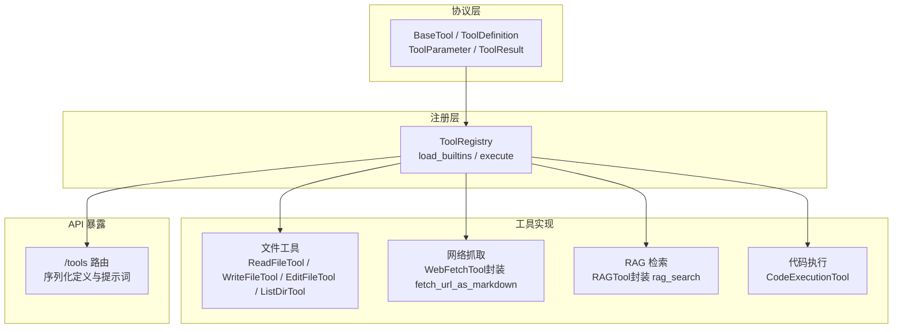
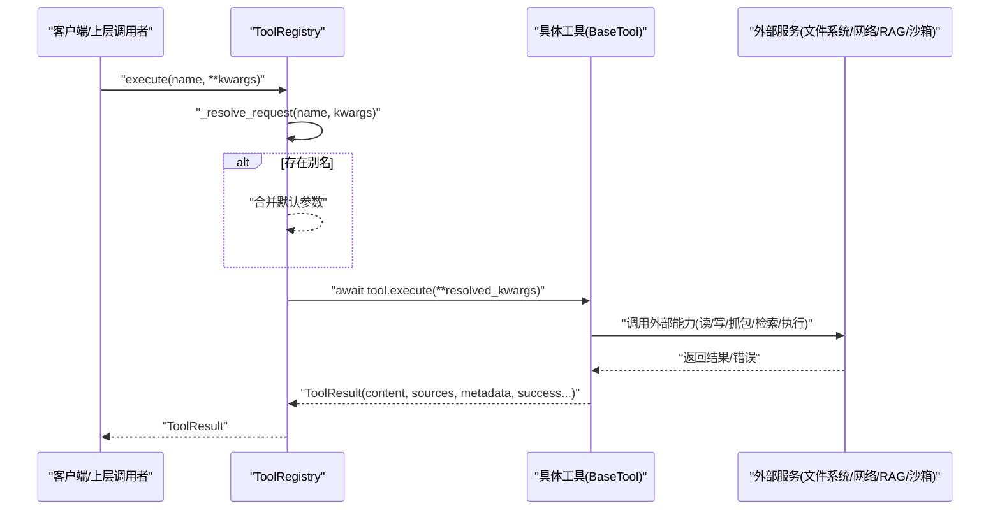
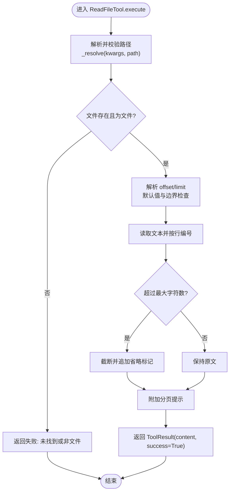
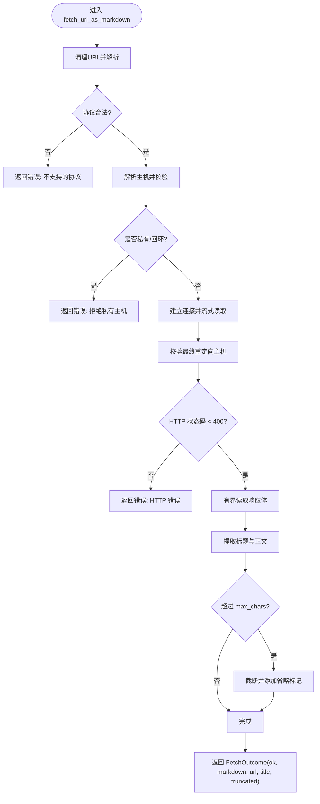
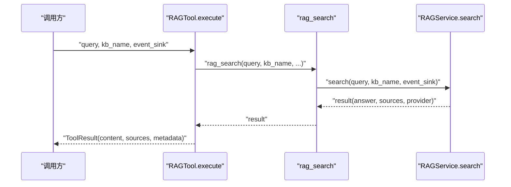
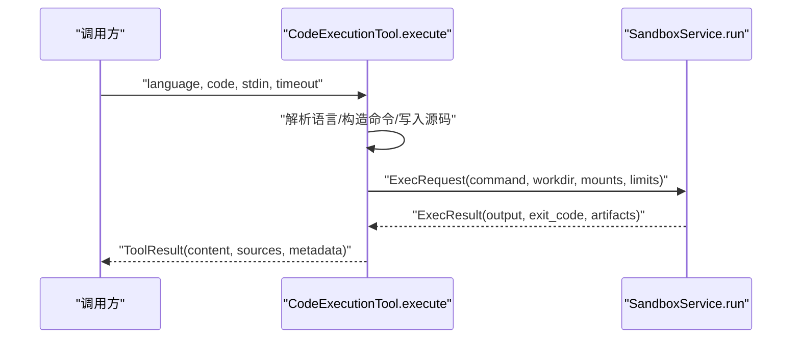
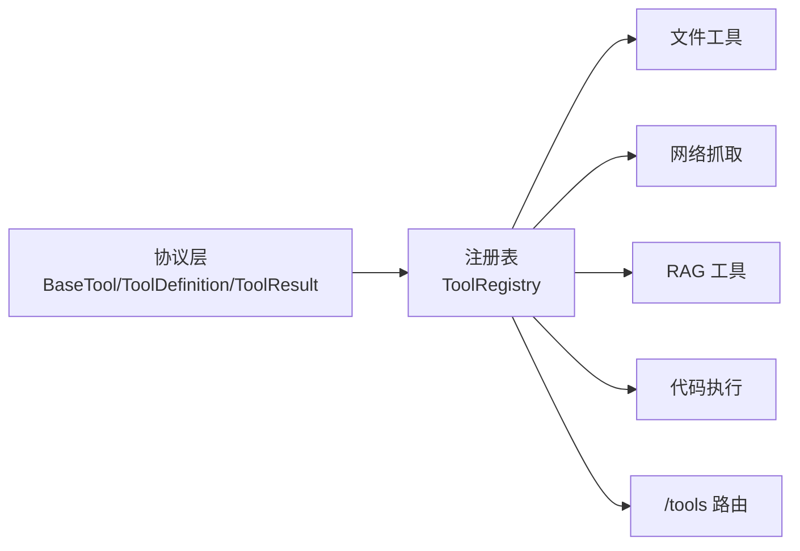

# 工具开发流程

<cite>
**本文引用的文件**
- [tool_protocol.py](file://deeptutor/core/tool_protocol.py)
- [tool_registry.py](file://deeptutor/runtime/registry/tool_registry.py)
- [__init__.py（内置工具）](file://deeptutor/tools/builtin/__init__.py)
- [file_tools.py](file://deeptutor/tools/file_tools.py)
- [web_fetch.py](file://deeptutor/tools/web_fetch.py)
- [rag_tool.py](file://deeptutor/tools/rag_tool.py)
- [tools.py（API 路由）](file://deeptutor/api/routers/tools.py)
- [test_file_tools.py](file://tests/tools/test_file_tools.py)
- [test_web_fetch.py](file://tests/tools/test_web_fetch.py)
</cite>

## 目录
1. [简介](#简介)
2. [项目结构](#项目结构)
3. [核心组件](#核心组件)
4. [架构总览](#架构总览)
5. [详细组件分析](#详细组件分析)
6. [依赖关系分析](#依赖关系分析)
7. [性能考虑](#性能考虑)
8. [故障排查指南](#故障排查指南)
9. [结论](#结论)
10. [附录](#附录)

## 简介
本指南面向希望在 DeepTutor 中开发“工具”的工程师，覆盖从需求分析到上线的全流程：如何界定工具边界与接口、如何基于 BaseTool 实现工具、如何注册到系统、如何进行测试与调试，以及从简单到复杂的示例实践。文档同时提供代码级架构图与流程图，帮助读者快速定位关键实现位置并理解数据与控制流。

## 项目结构
DeepTutor 的工具体系围绕统一协议与集中式注册表构建：
- 协议层：定义工具元数据、参数 Schema、执行结果与提示词线索等基础类型。
- 注册层：集中发现、管理、查询与执行工具，支持别名与延迟加载。
- 工具实现：内置工具按功能域组织，如文件操作、网络抓取、RAG 检索、代码执行等。
- API 暴露：通过 REST 路由将工具定义与提示词线索序列化给前端或外部调用方。
- 测试：针对具体工具的单元测试，采用隔离与模拟策略避免真实 I/O。

**图示来源**
- [tool_protocol.py:16-254](file://deeptutor/core/tool_protocol.py#L16-L254)
- [tool_registry.py:21-154](file://deeptutor/runtime/registry/tool_registry.py#L21-L154)
- [__init__.py（内置工具）:43-447](file://deeptutor/tools/builtin/__init__.py#L43-L447)
- [file_tools.py:28-291](file://deeptutor/tools/file_tools.py#L28-L291)
- [web_fetch.py:55-141](file://deeptutor/tools/web_fetch.py#L55-L141)
- [rag_tool.py:15-77](file://deeptutor/tools/rag_tool.py#L15-L77)
- [tools.py（API 路由）:94-133](file://deeptutor/api/routers/tools.py#L94-L133)

**章节来源**
- [tool_protocol.py:16-254](file://deeptutor/core/tool_protocol.py#L16-L254)
- [tool_registry.py:21-154](file://deeptutor/runtime/registry/tool_registry.py#L21-L154)
- [__init__.py（内置工具）:43-447](file://deeptutor/tools/builtin/__init__.py#L43-L447)
- [file_tools.py:28-291](file://deeptutor/tools/file_tools.py#L28-L291)
- [web_fetch.py:55-141](file://deeptutor/tools/web_fetch.py#L55-L141)
- [rag_tool.py:15-77](file://deeptutor/tools/rag_tool.py#L15-L77)
- [tools.py（API 路由）:94-133](file://deeptutor/api/routers/tools.py#L94-L133)

## 核心组件
- 工具协议
  - BaseTool：所有工具的抽象基类，要求实现 get_definition 与 execute，并提供 name 属性与可选的 deferred 标记用于渐进式披露。
  - ToolDefinition / ToolParameter：描述工具名称、说明与参数 Schema，支持生成 OpenAI function-calling 格式。
  - ToolResult：标准化返回体，包含内容、来源、元数据、成功标志、终止回合与用户暂停信号。
  - ToolPromptHints / ToolAlias：为提示词组装提供短描述、使用场景、输入格式、阶段与别名。
- 工具注册表
  - ToolRegistry：集中管理工具实例，支持注册/注销、别名解析、批量获取定义、构建 OpenAI Schema、构建提示词文本与执行工具。
  - load_builtins：自动实例化并注册所有内置工具类型。
  - execute：以位置参数接收工具名，避免与工具参数冲突；内部完成别名解析与执行。
- 内置工具族
  - 文件工具：read_file、write_file、edit_file、list_dir，均受工作区路径白名单保护。
  - 网络抓取：web_fetch，严格限制协议、主机范围、响应大小与内容截断。
  - RAG 检索：rag 工具封装 rag_search，负责知识库访问与结果溯源。
  - 代码执行：code_execution，在沙箱内编译运行代码片段，收集产物与输出。
- API 暴露
  - /tools 路由将工具定义与提示词线索序列化为前端可用的结构，便于动态展示与选择。

**章节来源**
- [tool_protocol.py:16-254](file://deeptutor/core/tool_protocol.py#L16-L254)
- [tool_registry.py:21-154](file://deeptutor/runtime/registry/tool_registry.py#L21-L154)
- [__init__.py（内置工具）:43-447](file://deeptutor/tools/builtin/__init__.py#L43-L447)
- [file_tools.py:28-291](file://deeptutor/tools/file_tools.py#L28-L291)
- [web_fetch.py:55-141](file://deeptutor/tools/web_fetch.py#L55-L141)
- [rag_tool.py:15-77](file://deeptutor/tools/rag_tool.py#L15-L77)
- [tools.py（API 路由）:94-133](file://deeptutor/api/routers/tools.py#L94-L133)

## 架构总览
下图展示了从请求到工具执行的端到端流程，包括注册、别名解析、执行与结果返回。

**图示来源**
- [tool_registry.py:61-141](file://deeptutor/runtime/registry/tool_registry.py#L61-L141)
- [tool_protocol.py:206-254](file://deeptutor/core/tool_protocol.py#L206-L254)

**章节来源**
- [tool_registry.py:61-141](file://deeptutor/runtime/registry/tool_registry.py#L61-L141)
- [tool_protocol.py:206-254](file://deeptutor/core/tool_protocol.py#L206-L254)

## 详细组件分析

### 文件操作工具（read/write/edit/list）
- 设计要点
  - 统一继承 _WorkspaceTool，确保路径解析与安全校验（仅允许在工作区白名单内）。
  - 参数 Schema 明确 path、offset、limit、recursive、max_entries 等，保证 LLM 可安全调用。
  - 错误处理：文件不存在、非文件/目录、权限拒绝、超出偏移、内容截断等均有友好提示。
- 关键流程（读取文件）

**图示来源**
- [file_tools.py:13-25](file://deeptutor/tools/file_tools.py#L13-L25)
- [file_tools.py:41-107](file://deeptutor/tools/file_tools.py#L41-L107)

**章节来源**
- [file_tools.py:13-25](file://deeptutor/tools/file_tools.py#L13-L25)
- [file_tools.py:41-107](file://deeptutor/tools/file_tools.py#L41-L107)
- [file_tools.py:109-187](file://deeptutor/tools/file_tools.py#L109-L187)
- [file_tools.py:189-263](file://deeptutor/tools/file_tools.py#L189-L263)

### 网络抓取工具（web_fetch）
- 设计要点
  - 协议白名单：仅允许 http/https。
  - 主机白名单：拒绝私有/回环/链路本地地址，并在重定向后再次校验。
  - 资源保护：响应体上限、内容截断、超时控制、User-Agent 标识。
  - 可读性提取：剥离脚本/样式标签、解码常见实体、标题提取与 Markdown 化。
- 关键流程（抓取 URL）

**图示来源**
- [web_fetch.py:72-141](file://deeptutor/tools/web_fetch.py#L72-L141)
- [web_fetch.py:149-202](file://deeptutor/tools/web_fetch.py#L149-L202)
- [web_fetch.py:205-255](file://deeptutor/tools/web_fetch.py#L205-L255)

**章节来源**
- [web_fetch.py:72-141](file://deeptutor/tools/web_fetch.py#L72-L141)
- [web_fetch.py:149-202](file://deeptutor/tools/web_fetch.py#L149-L202)
- [web_fetch.py:205-255](file://deeptutor/tools/web_fetch.py#L205-L255)

### RAG 检索工具（rag）
- 设计要点
  - 强制 kb_name：由用户在会话中选择的知识库，禁止默认回退。
  - 多用户安全：当未显式指定 kb_base_dir 时，通过 resolve_for_rag 进行资源解析。
  - 结果溯源：内置工具将检索来源转换为 sources，便于 UI 展示引用。
- 调用链

**图示来源**
- [__init__.py（内置工具）:95-141](file://deeptutor/tools/builtin/__init__.py#L95-L141)
- [rag_tool.py:15-51](file://deeptutor/tools/rag_tool.py#L15-L51)

**章节来源**
- [__init__.py（内置工具）:95-141](file://deeptutor/tools/builtin/__init__.py#L95-L141)
- [rag_tool.py:15-51](file://deeptutor/tools/rag_tool.py#L15-L51)

### 代码执行工具（code_execution）
- 设计要点
  - 语言映射：python/c/cpp，支持别名。
  - 工作目录隔离：每次执行创建独立子目录，避免并发冲突。
  - 沙箱执行：通过 ExecRequest + ResourceLimits 控制超时与输出大小。
  - 产物收集：排除源码/二进制/临时文件，仅暴露程序生成的公开产物。
- 调用链

**图示来源**
- [__init__.py（内置工具）:274-447](file://deeptutor/tools/builtin/__init__.py#L274-L447)

**章节来源**
- [__init__.py（内置工具）:274-447](file://deeptutor/tools/builtin/__init__.py#L274-L447)

### 工具注册机制
- 内置工具加载
  - ToolRegistry.load_builtins 遍历 BUILTIN_TOOL_TYPES，实例化并注册每个工具。
  - 若实例化失败，记录警告并继续加载其他工具，提高鲁棒性。
- 别名与扩展
  - 通过 TOOL_ALIASES 支持工具名映射与默认参数注入。
  - 可通过 register/unregister 动态增删工具（例如 MCP 重载场景）。
- 全局访问
  - get_tool_registry 提供单例式访问，首次调用时自动加载内置工具。

**章节来源**
- [tool_registry.py:21-154](file://deeptutor/runtime/registry/tool_registry.py#L21-L154)
- [__init__.py（内置工具）:43-447](file://deeptutor/tools/builtin/__init__.py#L43-L447)

### 工具测试策略
- 文件工具测试
  - 使用临时目录模拟工作区，验证读写、分页、递归列举与越权路径拦截。
  - 断言成功标志、内容片段与文件实际落盘内容。
- 网络抓取测试
  - 通过 StubAsyncClient 与 StubResponse 模拟网络 I/O，避免真实 DNS/HTTP。
  - 覆盖协议拒绝、私有主机拒绝、HTML 提取、截断与 HTTP 错误传播。
- 通用原则
  - 异步测试：使用 pytest.mark.asyncio。
  - 隔离外部依赖：通过注入 client_factory/host_validator 等参数替换真实实现。
  - 断言结构化结果：对 ToolResult/FetchOutcome 的字段进行精确断言。

**章节来源**
- [test_file_tools.py:1-61](file://tests/tools/test_file_tools.py#L1-L61)
- [test_web_fetch.py:1-184](file://tests/tools/test_web_fetch.py#L1-L184)

### 工具调试技巧
- 日志记录
  - 工具实现中使用标准 logging 模块记录关键步骤与异常堆栈，便于问题定位。
  - 注册表在注册/实例化工具时输出调试日志。
- 错误追踪
  - ToolResult.success 与 content 字段承载失败原因，上层可据此展示用户友好信息。
  - web_fetch 将网络错误封装为 FetchOutcome.error，避免异常冒泡。
- 性能分析
  - 网络抓取使用流式读取与字节上限，防止大响应占用内存。
  - 文件读取支持分页与字符上限，避免一次性加载超大文件。
  - 代码执行通过 ResourceLimits 控制超时与输出大小，保障稳定性。

**章节来源**
- [tool_registry.py:36-59](file://deeptutor/runtime/registry/tool_registry.py#L36-L59)
- [web_fetch.py:149-202](file://deeptutor/tools/web_fetch.py#L149-L202)
- [file_tools.py:41-107](file://deeptutor/tools/file_tools.py#L41-L107)
- [__init__.py（内置工具）:274-447](file://deeptutor/tools/builtin/__init__.py#L274-L447)

## 依赖关系分析
- 组件耦合
  - 工具实现依赖协议层（BaseTool/ToolDefinition/ToolResult），与注册表解耦。
  - 注册表依赖内置工具类型列表与别名配置，不感知具体实现细节。
  - API 路由依赖注册表提供的定义与提示词线索，进行序列化输出。
- 直接/间接依赖
  - 文件工具依赖路径解析与文件系统。
  - 网络抓取依赖 httpx 与主机校验逻辑。
  - RAG 工具依赖知识库访问与检索服务。
  - 代码执行依赖沙箱服务与产物收集。
- 外部集成点
  - 文件系统、HTTP 客户端、RAG 服务、沙箱执行环境。
- 接口契约
  - 所有工具必须遵循 BaseTool 的 get_definition 与 execute 契约。
  - 返回 ToolResult，确保上层统一处理成功/失败与元数据。

**图示来源**
- [tool_protocol.py:16-254](file://deeptutor/core/tool_protocol.py#L16-L254)
- [tool_registry.py:21-154](file://deeptutor/runtime/registry/tool_registry.py#L21-L154)
- [file_tools.py:28-291](file://deeptutor/tools/file_tools.py#L28-L291)
- [web_fetch.py:55-141](file://deeptutor/tools/web_fetch.py#L55-L141)
- [rag_tool.py:15-77](file://deeptutor/tools/rag_tool.py#L15-L77)
- [__init__.py（内置工具）:274-447](file://deeptutor/tools/builtin/__init__.py#L274-L447)
- [tools.py（API 路由）:94-133](file://deeptutor/api/routers/tools.py#L94-L133)

**章节来源**
- [tool_protocol.py:16-254](file://deeptutor/core/tool_protocol.py#L16-L254)
- [tool_registry.py:21-154](file://deeptutor/runtime/registry/tool_registry.py#L21-L154)
- [file_tools.py:28-291](file://deeptutor/tools/file_tools.py#L28-L291)
- [web_fetch.py:55-141](file://deeptutor/tools/web_fetch.py#L55-L141)
- [rag_tool.py:15-77](file://deeptutor/tools/rag_tool.py#L15-L77)
- [__init__.py（内置工具）:274-447](file://deeptutor/tools/builtin/__init__.py#L274-L447)
- [tools.py（API 路由）:94-133](file://deeptutor/api/routers/tools.py#L94-L133)

## 性能考虑
- 网络抓取
  - 流式读取与字节上限，避免大响应导致内存膨胀。
  - 超时与重定向限制，减少长时间阻塞与潜在攻击面。
- 文件操作
  - 分页读取与字符上限，控制单次返回体积。
  - 忽略敏感目录与缓存目录，减少无用遍历。
- 代码执行
  - 沙箱隔离与资源限制，防止恶意或低效代码影响系统稳定性。
  - 产物过滤，仅暴露必要输出，降低传输开销。
- 注册与查找
  - 别名解析与去重，避免重复实例化与无效调用。
  - 延迟加载（deferred）工具，按需加载完整 Schema，减少初始负载。

[本节为通用指导，不直接分析具体文件]

## 故障排查指南
- 常见问题
  - 未知工具名：注册表中不存在该工具，检查是否已正确注册或别名是否正确。
  - 路径越权：文件工具拒绝访问工作区外路径，确认传入路径在白名单内。
  - 网络错误：web_fetch 返回结构化错误，检查协议、主机与 HTTP 状态码。
  - RAG 不可用：知识库不可访问或未授权，确认 kb_name 与权限。
  - 代码执行失败：检查语言别名、命令模板与沙箱配置。
- 调试建议
  - 启用日志：查看注册表与工具实现的日志输出。
  - 单元测试：复用现有测试模式，使用临时目录与 Mock 客户端隔离外部依赖。
  - 断言结果：关注 ToolResult.success 与 content 中的错误信息。

**章节来源**
- [tool_registry.py:128-141](file://deeptutor/runtime/registry/tool_registry.py#L128-L141)
- [file_tools.py:13-25](file://deeptutor/tools/file_tools.py#L13-L25)
- [web_fetch.py:72-141](file://deeptutor/tools/web_fetch.py#L72-L141)
- [rag_tool.py:15-51](file://deeptutor/tools/rag_tool.py#L15-L51)
- [__init__.py（内置工具）:274-447](file://deeptutor/tools/builtin/__init__.py#L274-L447)

## 结论
DeepTutor 的工具体系以统一协议与集中注册为核心，提供了安全、可扩展且易于测试的工具开发范式。通过 BaseTool 抽象、ToolRegistry 管理与丰富的内置工具实现，开发者可以快速构建从文件操作、网络抓取到 RAG 检索与代码执行的多样化能力。结合严格的参数 Schema、错误处理与测试策略，能够确保工具在生产环境中的稳定性与可维护性。

[本节为总结性内容，不直接分析具体文件]

## 附录
- 开发清单（建议）
  - 明确工具边界与职责，避免过度耦合。
  - 定义清晰的参数 Schema，标注必填项与默认值。
  - 实现 get_definition 与 execute，返回标准化的 ToolResult。
  - 注册工具至 ToolRegistry，必要时提供别名与默认参数。
  - 编写单元测试，覆盖正常路径、边界条件与错误分支。
  - 使用日志记录关键步骤与异常，便于问题定位。
  - 审查安全性：路径白名单、协议与主机限制、资源上限。
  - 评估性能：分页、截断、超时与流式处理。
- 质量保证建议
  - 代码审查重点：协议一致性、错误处理完整性、安全性与性能。
  - 持续集成：自动化测试覆盖关键路径，阻断回归风险。
  - 文档更新：同步工具定义、提示词线索与使用示例。

[本节为通用指导，不直接分析具体文件]