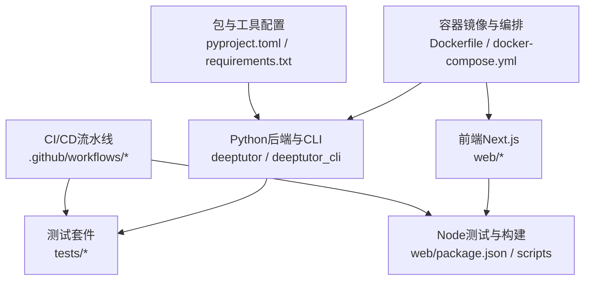
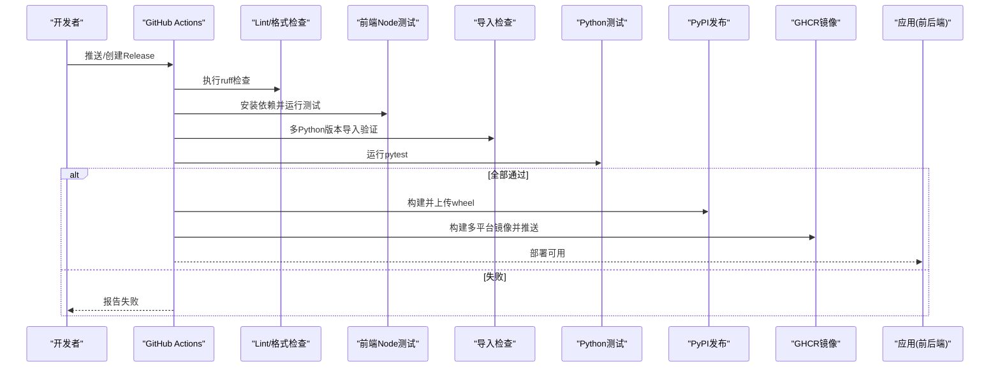
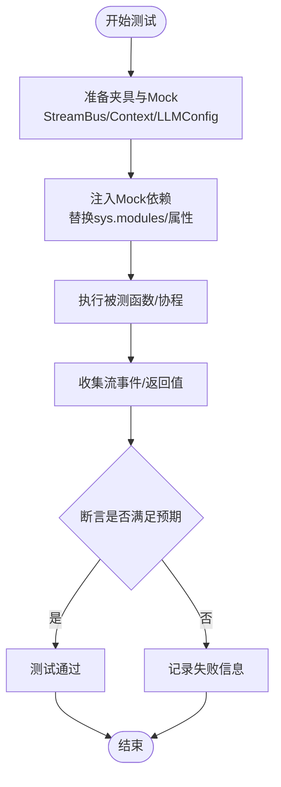
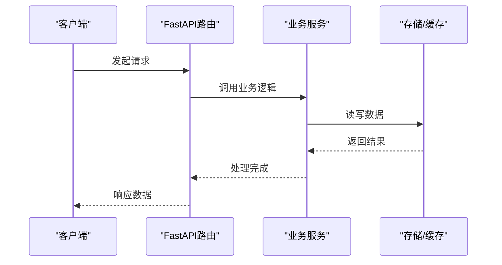
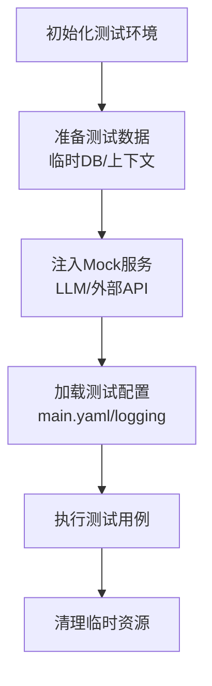
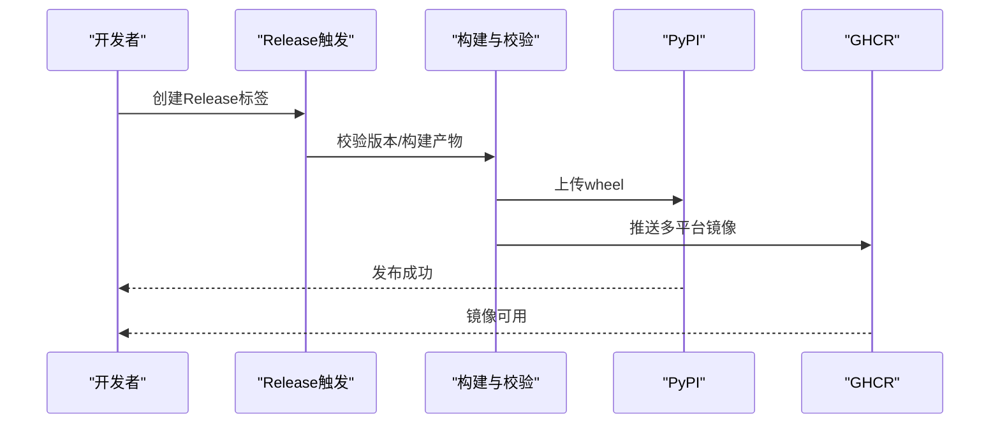
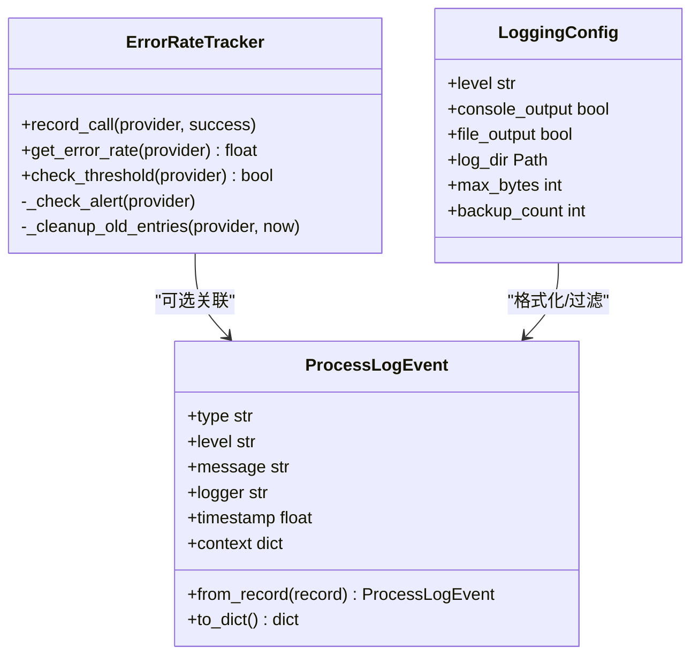
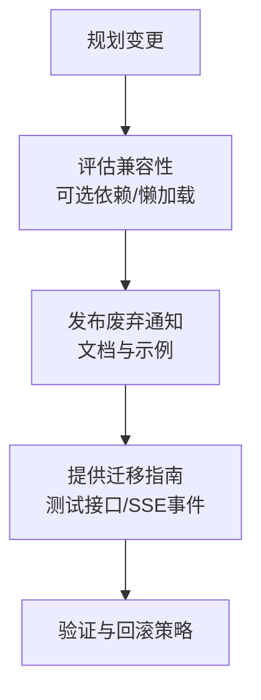
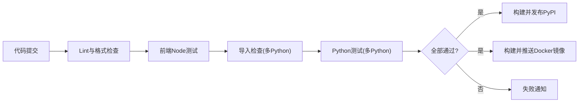
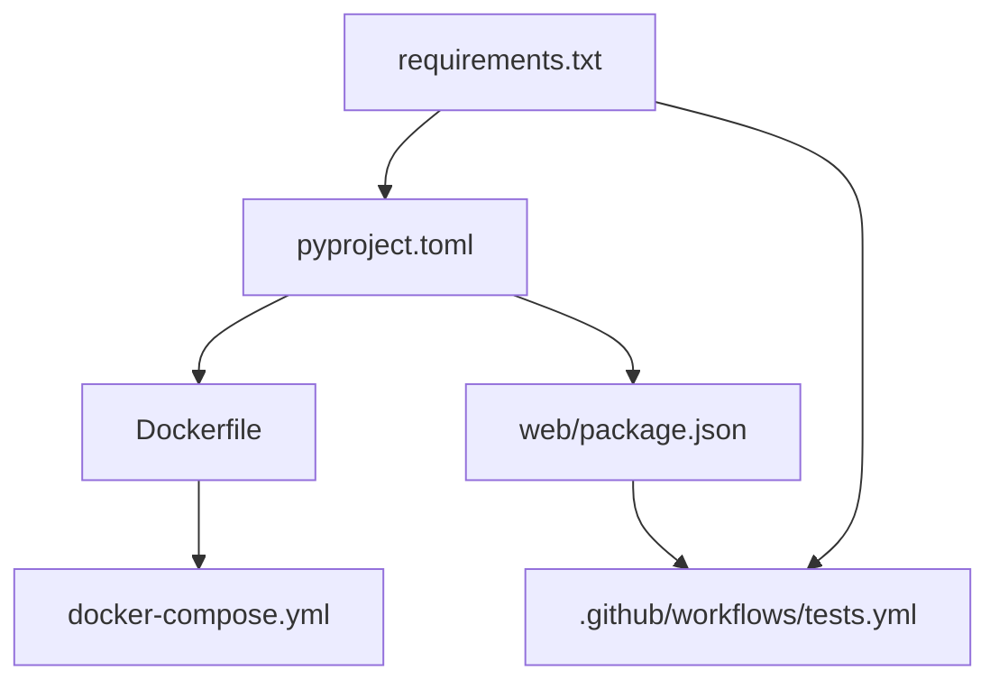

# 工具测试与部署

<cite>
**本文引用的文件**
- [README.md](file://README.md)
- [pyproject.toml](file://pyproject.toml)
- [tests/conftest.py](file://tests/conftest.py)
- [tests/core/test_builtin_tools.py](file://tests/core/test_builtin_tools.py)
- [tests/core/test_capabilities_runtime.py](file://tests/core/test_capabilities_runtime.py)
- [.github/workflows/tests.yml](file://.github/workflows/tests.yml)
- [.github/workflows/docker-release.yml](file://.github/workflows/docker-release.yml)
- [.github/workflows/pypi-release.yml](file://.github/workflows/pypi-release.yml)
- [Dockerfile](file://Dockerfile)
- [docker-compose.yml](file://docker-compose.yml)
- [requirements.txt](file://requirements.txt)
- [deeptutor/utils/error_rate_tracker.py](file://deeptutor/utils/error_rate_tracker.py)
- [deeptutor/logging/config.py](file://deeptutor/logging/config.py)
- [deeptutor/logging/process_stream.py](file://deeptutor/logging/process_stream.py)
- [deeptutor/api/routers/settings.py](file://deeptutor/api/routers/settings.py)
</cite>

## 目录
1. [简介](#简介)
2. [项目结构](#项目结构)
3. [核心组件](#核心组件)
4. [架构总览](#架构总览)
5. [详细组件分析](#详细组件分析)
6. [依赖关系分析](#依赖关系分析)
7. [性能考虑](#性能考虑)
8. [故障排查指南](#故障排查指南)
9. [结论](#结论)
10. [附录](#附录)

## 简介
本指南面向DeepTutor工具的测试与部署，覆盖单元测试、集成测试、端到端与API测试、性能测试、测试环境搭建、打包分发与版本管理、监控与日志收集、维护更新策略以及CI/CD流水线配置。内容基于仓库现有实现与配置，提供可操作的实践建议与可视化图示，帮助团队在本地与CI中稳定地构建、测试与发布产品。

## 项目结构
DeepTutor采用多语言、多模块的工程组织：
- Python后端与CLI位于deeptutor与deeptutor_cli；
- 前端Next.js应用位于web；
- 测试集中在tests目录，按功能域划分；
- CI/CD通过.github/workflows定义；
- 容器化由Dockerfile与docker-compose.yml编排；
- 包管理与开发工具配置集中于pyproject.toml；
- 运行时依赖清单在requirements.txt及requirements子目录。

**图表来源**
- [pyproject.toml:213-235](file://pyproject.toml#L213-L235)
- [.github/workflows/tests.yml:31-78](file://.github/workflows/tests.yml#L31-L78)
- [Dockerfile:17-164](file://Dockerfile#L17-L164)
- [docker-compose.yml:21-100](file://docker-compose.yml#L21-L100)

**章节来源**
- [README.md:202-448](file://README.md#L202-L448)
- [pyproject.toml:213-235](file://pyproject.toml#L213-L235)
- [.github/workflows/tests.yml:31-78](file://.github/workflows/tests.yml#L31-L78)
- [Dockerfile:17-164](file://Dockerfile#L17-L164)
- [docker-compose.yml:21-100](file://docker-compose.yml#L21-L100)

## 核心组件
- 测试框架与夹具：pytest + pytest-asyncio，根conftest提供统一夹具与隔离保护（如防止写入真实用户密钥树）。
- 导入检查与多Python版本矩阵：CI对import进行快速验证，再运行完整测试集。
- 前端Node测试：在web目录下执行npm脚本。
- 容器化：多阶段构建，生产镜像包含前后端，supervisord管理进程，健康检查与端口暴露。
- 包发布：PyPI发布流程校验版本号并构建wheel；Docker发布生成多平台镜像至GHCR。
- 监控与日志：错误率追踪器、日志配置加载、进程日志事件捕获。

**章节来源**
- [tests/conftest.py:1-195](file://tests/conftest.py#L1-L195)
- [.github/workflows/tests.yml:79-180](file://.github/workflows/tests.yml#L79-L180)
- [Dockerfile:101-164](file://Dockerfile#L101-L164)
- [.github/workflows/pypi-release.yml:28-155](file://.github/workflows/pypi-release.yml#L28-L155)
- [.github/workflows/docker-release.yml:21-73](file://.github/workflows/docker-release.yml#L21-L73)
- [deeptutor/utils/error_rate_tracker.py:14-111](file://deeptutor/utils/error_rate_tracker.py#L14-L111)
- [deeptutor/logging/config.py:9-50](file://deeptutor/logging/config.py#L9-L50)
- [deeptutor/logging/process_stream.py:17-49](file://deeptutor/logging/process_stream.py#L17-L49)

## 架构总览
从代码到制品的端到端流程如下：
- 开发者提交代码触发CI；
- CI执行lint、前端Node测试、导入检查、Python测试；
- 成功通过后，release触发PyPI与Docker镜像发布；
- 运行时通过Docker或compose启动，supervisord管理前后端进程；
- 运行时日志与错误率指标用于监控与排障。

**图表来源**
- [.github/workflows/tests.yml:31-180](file://.github/workflows/tests.yml#L31-L180)
- [.github/workflows/pypi-release.yml:28-155](file://.github/workflows/pypi-release.yml#L28-L155)
- [.github/workflows/docker-release.yml:21-73](file://.github/workflows/docker-release.yml#L21-L73)

## 详细组件分析

### 单元测试：编写方法与最佳实践
- 使用pytest与pytest-asyncio组织异步测试；通过conftest提供共享夹具，例如StreamBus、UnifiedContext、SQLiteSessionStore、Fake LLM配置等。
- 外部依赖mock：通过unittest.mock与monkeypatch替换sys.modules中的模块，避免真实网络或文件系统访问，确保测试隔离与可重复性。
- 断言验证：结合流式事件收集与上下文对象，验证能力运行结果与事件序列。

**图表来源**
- [tests/conftest.py:97-195](file://tests/conftest.py#L97-L195)
- [tests/core/test_builtin_tools.py:28-54](file://tests/core/test_builtin_tools.py#L28-L54)
- [tests/core/test_capabilities_runtime.py:25-58](file://tests/core/test_capabilities_runtime.py#L25-L58)

**章节来源**
- [tests/conftest.py:1-195](file://tests/conftest.py#L1-L195)
- [tests/core/test_builtin_tools.py:28-54](file://tests/core/test_builtin_tools.py#L28-L54)
- [tests/core/test_capabilities_runtime.py:25-58](file://tests/core/test_capabilities_runtime.py#L25-L58)

### 集成测试：端到端、API与性能
- API测试：针对路由与认证、CORS、工具选项、会话截断等进行请求级验证；可通过FastAPI TestClient或直接HTTP调用。
- 端到端测试：结合前端Node测试与后端服务，模拟用户操作路径，验证页面交互与服务响应一致性。
- 性能测试：关注大知识库检索、RAG管道初始化、流式输出与WebSocket连接稳定性；可在CI中引入压测脚本或在本地使用工具进行基准测试。

**图表来源**
- [tests/api/*.py](file://tests/api/test_auth_contextvar.py)
- [deeptutor/api/routers/settings.py:1240-1276](file://deeptutor/api/routers/settings.py#L1240-L1276)

**章节来源**
- [tests/api/test_auth_contextvar.py](file://tests/api/test_auth_contextvar.py)
- [tests/api/test_cors_settings.py](file://tests/api/test_cors_settings.py)
- [tests/api/test_unified_ws_turn_runtime.py](file://tests/api/test_unified_ws_turn_runtime.py)
- [deeptutor/api/routers/settings.py:1240-1276](file://deeptutor/api/routers/settings.py#L1240-L1276)

### 测试环境搭建：数据、模拟服务与配置
- 测试数据：使用临时数据库路径与内存上下文，避免污染真实工作区；conftest提供最小与丰富上下文夹具。
- 模拟服务：通过Mock与fake_llm_config模拟LLM行为，屏蔽外部依赖。
- 测试配置：在CI中创建最小main.yaml以设置logging级别与系统语言，保证测试环境一致。

**图表来源**
- [tests/conftest.py:108-155](file://tests/conftest.py#L108-L155)
- [.github/workflows/tests.yml:165-179](file://.github/workflows/tests.yml#L165-L179)

**章节来源**
- [tests/conftest.py:108-155](file://tests/conftest.py#L108-L155)
- [.github/workflows/tests.yml:165-179](file://.github/workflows/tests.yml#L165-L179)

### 部署流程：打包、分发与版本管理
- 包构建：使用pyproject.toml声明依赖与脚本入口；构建wheel并校验元数据。
- 版本管理：release tag与__version__.py严格匹配，确保发布版本一致。
- 分发渠道：PyPI发布wheel；Docker镜像多平台构建并推送到GHCR。

**图表来源**
- [.github/workflows/pypi-release.yml:28-155](file://.github/workflows/pypi-release.yml#L28-L155)
- [.github/workflows/docker-release.yml:21-73](file://.github/workflows/docker-release.yml#L21-L73)
- [pyproject.toml:237-263](file://pyproject.toml#L237-L263)

**章节来源**
- [.github/workflows/pypi-release.yml:28-155](file://.github/workflows/pypi-release.yml#L28-L155)
- [.github/workflows/docker-release.yml:21-73](file://.github/workflows/docker-release.yml#L21-L73)
- [pyproject.toml:237-263](file://pyproject.toml#L237-L263)

### 监控与日志收集：性能指标、错误统计与使用分析
- 错误率追踪：按provider滑动窗口统计错误率，超过阈值触发告警回调（可与熔断器集成）。
- 日志配置：从main.yaml加载日志级别、输出目标与轮转策略；支持控制台与文件输出。
- 进程日志事件：将日志记录转换为结构化事件，便于流式传输与分析。

**图表来源**
- [deeptutor/utils/error_rate_tracker.py:14-111](file://deeptutor/utils/error_rate_tracker.py#L14-L111)
- [deeptutor/logging/config.py:9-50](file://deeptutor/logging/config.py#L9-L50)
- [deeptutor/logging/process_stream.py:17-49](file://deeptutor/logging/process_stream.py#L17-L49)

**章节来源**
- [deeptutor/utils/error_rate_tracker.py:14-111](file://deeptutor/utils/error_rate_tracker.py#L14-L111)
- [deeptutor/logging/config.py:9-50](file://deeptutor/logging/config.py#L9-L50)
- [deeptutor/logging/process_stream.py:17-49](file://deeptutor/logging/process_stream.py#L17-L49)

### 维护与更新策略：向后兼容、废弃通知与迁移指南
- 向后兼容：通过可选依赖与懒加载避免破坏性升级影响；对不兼容的Python版本进行限制与提示。
- 废弃通知：在配置与API层提供测试与调试接口，便于逐步迁移与灰度发布。
- 迁移指南：利用settings路由提供的服务测试SSE接口，观察运行状态与事件流，辅助迁移决策。

**图表来源**
- [pyproject.toml:213-235](file://pyproject.toml#L213-L235)
- [deeptutor/api/routers/settings.py:1240-1276](file://deeptutor/api/routers/settings.py#L1240-L1276)

**章节来源**
- [pyproject.toml:213-235](file://pyproject.toml#L213-L235)
- [deeptutor/api/routers/settings.py:1240-1276](file://deeptutor/api/routers/settings.py#L1240-L1276)

### CI/CD流水线配置示例：自动化测试、质量与安全扫描
- 自动化测试：lint、前端Node测试、导入检查、Python测试矩阵。
- 质量与安全：启用ruff检查与格式校验；Bandit安全扫描在pyproject中配置；Safety依赖漏洞扫描在dev依赖中声明。
- 发布流水线：release触发PyPI与Docker镜像构建与发布。

**图表来源**
- [.github/workflows/tests.yml:31-180](file://.github/workflows/tests.yml#L31-L180)
- [.github/workflows/pypi-release.yml:28-155](file://.github/workflows/pypi-release.yml#L28-L155)
- [.github/workflows/docker-release.yml:21-73](file://.github/workflows/docker-release.yml#L21-L73)
- [pyproject.toml:458-473](file://pyproject.toml#L458-L473)

**章节来源**
- [.github/workflows/tests.yml:31-180](file://.github/workflows/tests.yml#L31-L180)
- [.github/workflows/pypi-release.yml:28-155](file://.github/workflows/pypi-release.yml#L28-L155)
- [.github/workflows/docker-release.yml:21-73](file://.github/workflows/docker-release.yml#L21-L73)
- [pyproject.toml:458-473](file://pyproject.toml#L458-L473)

## 依赖关系分析
- 运行时依赖：requirements.txt聚合server/partners等依赖；pyproject.toml定义可选依赖与开发工具。
- 前端依赖：web目录下的package.json与lock文件；CI中缓存npm依赖加速构建。
- 容器依赖：Dockerfile多阶段构建，分离前端构建、Python基础镜像与生产镜像；supervisord管理进程。

**图表来源**
- [requirements.txt:1-23](file://requirements.txt#L1-L23)
- [pyproject.toml:213-235](file://pyproject.toml#L213-L235)
- [Dockerfile:17-164](file://Dockerfile#L17-L164)
- [docker-compose.yml:21-100](file://docker-compose.yml#L21-L100)
- [.github/workflows/tests.yml:56-78](file://.github/workflows/tests.yml#L56-L78)

**章节来源**
- [requirements.txt:1-23](file://requirements.txt#L1-L23)
- [pyproject.toml:213-235](file://pyproject.toml#L213-L235)
- [Dockerfile:17-164](file://Dockerfile#L17-L164)
- [docker-compose.yml:21-100](file://docker-compose.yml#L21-L100)
- [.github/workflows/tests.yml:56-78](file://.github/workflows/tests.yml#L56-L78)

## 性能考虑
- 大知识库检索：FAISS向量存储替代暴力扫描，提升查询性能；注意索引重建时的版本化与回滚策略。
- 流式输出与WebSocket：调整uvicorn的ws-max-size与keep-alive超时，避免大附件上传被截断或连接过早关闭。
- 内存与资源：容器内设置malloc参数与cgroup限制，runner侧边车限制PID与内存，保障稳定性。

[本节为通用指导，无需特定文件引用]

## 故障排查指南
- 导入失败：检查requirements与pyproject依赖版本；在CI中查看导入检查步骤输出。
- 测试写入真实数据：确认conftest的自动守卫未被绕过；必要时重定向paths.SYSTEM_ROOT与ADMIN_WORKSPACE_ROOT。
- 服务测试SSE：通过settings路由的测试接口获取事件流，定位服务启动与运行状态。
- 日志与错误率：查看日志级别与文件输出；使用错误率追踪器识别异常provider。

**章节来源**
- [.github/workflows/tests.yml:79-126](file://.github/workflows/tests.yml#L79-L126)
- [tests/conftest.py:17-90](file://tests/conftest.py#L17-L90)
- [deeptutor/api/routers/settings.py:1240-1276](file://deeptutor/api/routers/settings.py#L1240-L1276)
- [deeptutor/logging/config.py:25-50](file://deeptutor/logging/config.py#L25-L50)
- [deeptutor/utils/error_rate_tracker.py:33-67](file://deeptutor/utils/error_rate_tracker.py#L33-L67)

## 结论
DeepTutor提供了完善的测试与部署基础设施：pytest驱动的单元与集成测试、CI矩阵化的导入与测试流程、容器化的一体化构建与发布、以及运行时监控与日志体系。遵循本指南的实践，可以在本地与CI中高效地进行质量保证、版本发布与运维监控，确保工具的稳定交付与持续演进。

## 附录
- 本地启动：参考README中的安装与启动说明，选择合适的方式（PyPI、源码、Docker、CLI-only）。
- 配置管理：data/user/settings下的JSON/YAML文件控制运行时行为；通过Settings页面或CLI进行编辑。
- 扩展能力：通过可选依赖按需启用Partners、Matrix、Math Animator等功能。

**章节来源**
- [README.md:202-448](file://README.md#L202-L448)