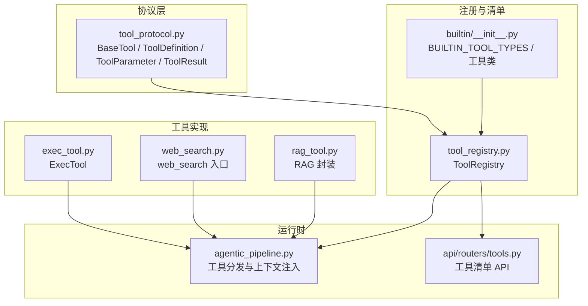
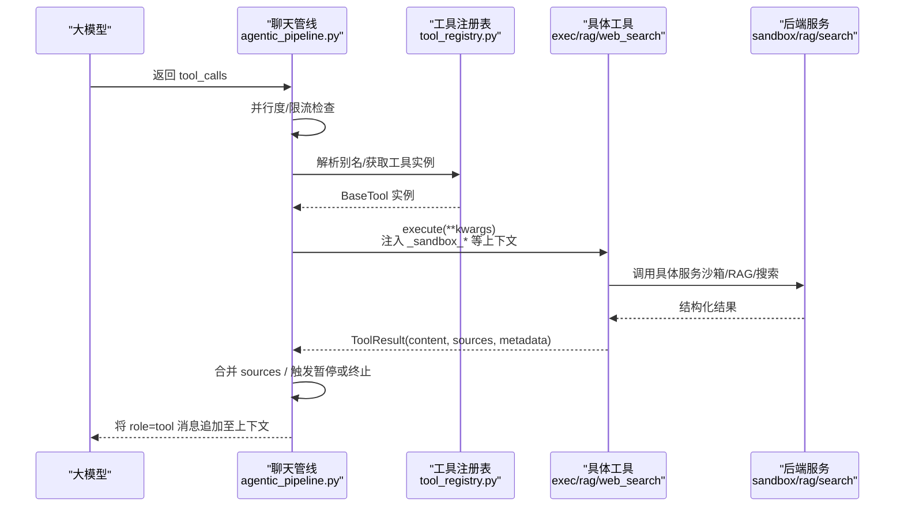
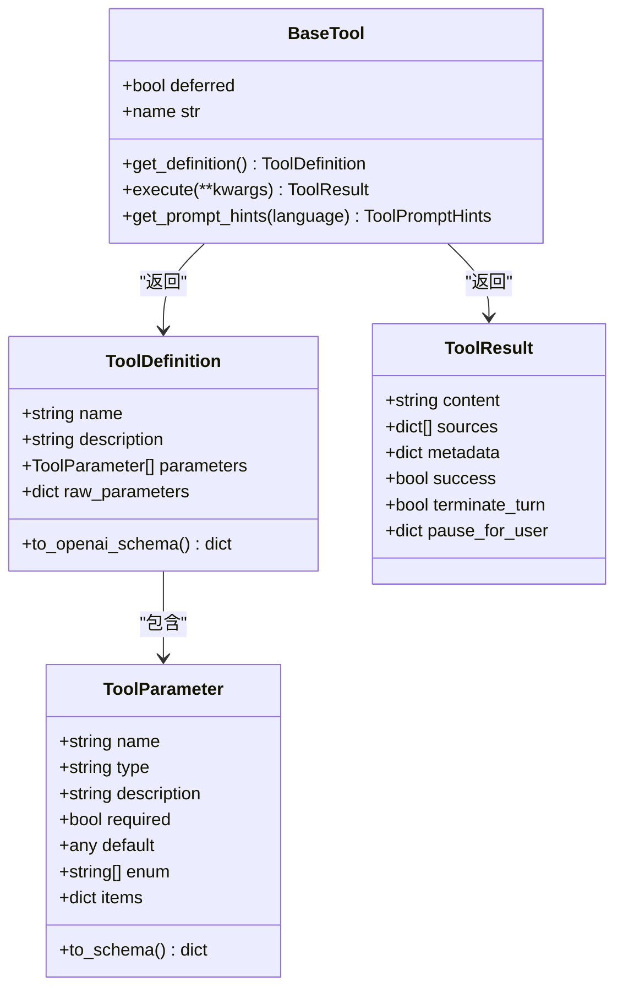
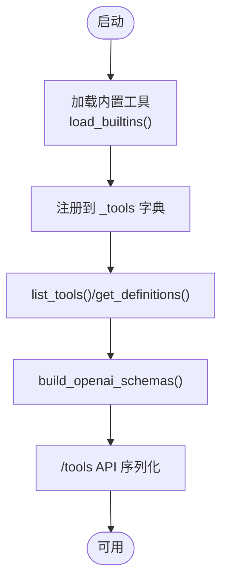
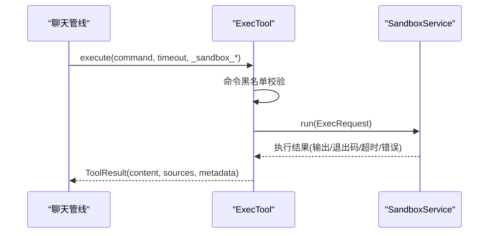
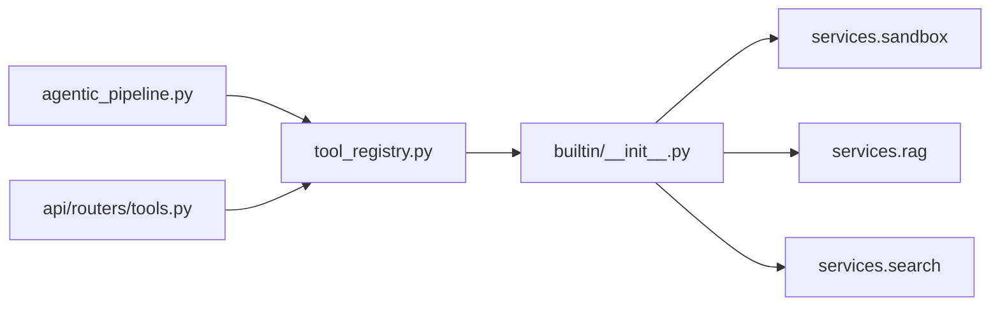

# 自定义工具开发

<cite>
**本文引用的文件**
- [deeptutor/core/tool_protocol.py](file://deeptutor/core/tool_protocol.py)
- [deeptutor/runtime/registry/tool_registry.py](file://deeptutor/runtime/registry/tool_registry.py)
- [deeptutor/tools/builtin/__init__.py](file://deeptutor/tools/builtin/__init__.py)
- [deeptutor/tools/exec_tool.py](file://deeptutor/tools/exec_tool.py)
- [deeptutor/tools/web_search.py](file://deeptutor/tools/web_search.py)
- [deeptutor/tools/rag_tool.py](file://deeptutor/tools/rag_tool.py)
- [deeptutor/api/routers/tools.py](file://deeptutor/api/routers/tools.py)
- [deeptutor/agents/chat/agentic_pipeline.py](file://deeptutor/agents/chat/agentic_pipeline.py)
- [tests/tools/test_rag_tool.py](file://tests/tools/test_rag_tool.py)
- [tests/tools/test_web_search.py](file://tests/tools/test_web_search.py)
</cite>

## 目录
1. [简介](#简介)
2. [项目结构](#项目结构)
3. [核心组件](#核心组件)
4. [架构总览](#架构总览)
5. [详细组件分析](#详细组件分析)
6. [依赖关系分析](#依赖关系分析)
7. [性能考虑](#性能考虑)
8. [故障排查指南](#故障排查指南)
9. [结论](#结论)
10. [附录](#附录)

## 简介
本指南面向希望在 DeepTutor 中开发“自定义工具”的工程师与研究者。内容覆盖：
- 工具协议规范、接口定义与实现要求
- 如何创建新工具类（必需方法与可选扩展点）
- 参数定义、类型校验与默认值设置
- 权限控制与安全（沙箱限制、资源访问控制）
- 从简单文本处理到复杂 AI 服务集成的完整示例
- 测试方法（单元与集成）
- 文档生成与提示词编写
- 组合使用与高级特性（异步、流式响应）
- 调试技巧与性能优化建议

## 项目结构
DeepTutor 的工具体系围绕“协议层 + 注册表 + 内置工具 + 运行时调度”组织：
- 协议层：统一抽象 BaseTool、ToolDefinition、ToolParameter、ToolResult 等，确保所有工具对外一致。
- 注册表：集中发现、管理、查询工具，并生成 OpenAI function-calling schema 与提示词。
- 内置工具：以类形式提供具体能力（如 RAG、Web 搜索、代码执行等）。
- 运行时调度：聊天管线在每轮对话中解析模型返回的工具调用，分发执行并聚合结果。

**图表来源**
- [deeptutor/core/tool_protocol.py:16-254](file://deeptutor/core/tool_protocol.py#L16-L254)
- [deeptutor/runtime/registry/tool_registry.py:21-154](file://deeptutor/runtime/registry/tool_registry.py#L21-L154)
- [deeptutor/tools/builtin/__init__.py:43-141](file://deeptutor/tools/builtin/__init__.py#L43-L141)
- [deeptutor/tools/exec_tool.py:49-157](file://deeptutor/tools/exec_tool.py#L49-L157)
- [deeptutor/tools/web_search.py:1-69](file://deeptutor/tools/web_search.py#L1-L69)
- [deeptutor/tools/rag_tool.py:15-51](file://deeptutor/tools/rag_tool.py#L15-L51)
- [deeptutor/agents/chat/agentic_pipeline.py:820-853](file://deeptutor/agents/chat/agentic_pipeline.py#L820-L853)
- [deeptutor/api/routers/tools.py:169-223](file://deeptutor/api/routers/tools.py#L169-L223)

**章节来源**
- [deeptutor/core/tool_protocol.py:16-254](file://deeptutor/core/tool_protocol.py#L16-L254)
- [deeptutor/runtime/registry/tool_registry.py:21-154](file://deeptutor/runtime/registry/tool_registry.py#L21-L154)
- [deeptutor/tools/builtin/__init__.py:43-141](file://deeptutor/tools/builtin/__init__.py#L43-L141)
- [deeptutor/agents/chat/agentic_pipeline.py:820-853](file://deeptutor/agents/chat/agentic_pipeline.py#L820-L853)
- [deeptutor/api/routers/tools.py:169-223](file://deeptutor/api/routers/tools.py#L169-L223)

## 核心组件
- 工具协议
  - BaseTool：所有工具的抽象基类，必须实现 get_definition 与 execute；支持 deferred 延迟加载与 prompt hints。
  - ToolDefinition / ToolParameter：描述工具名称、说明、参数列表与 JSON Schema 转换。
  - ToolResult：标准化返回体，包含 content、sources、metadata、success、终止/暂停控制字段。
  - ToolLookup：只读视图，供上层消费工具集合与执行。
- 注册表
  - ToolRegistry：单例式注册中心，负责加载内置工具、别名解析、schema 构建、提示词组装与执行分发。
- 内置工具
  - 通过 BUILTIN_TOOL_TYPES 暴露，每个工具类继承 BaseTool，并在 execute 中调用具体服务。
- 运行时调度
  - 聊天管线在每轮对话中收集模型的工具调用，进行并发/限流、上下文注入、错误处理与结果回传。

**章节来源**
- [deeptutor/core/tool_protocol.py:16-254](file://deeptutor/core/tool_protocol.py#L16-L254)
- [deeptutor/runtime/registry/tool_registry.py:21-154](file://deeptutor/runtime/registry/tool_registry.py#L21-L154)
- [deeptutor/tools/builtin/__init__.py:43-141](file://deeptutor/tools/builtin/__init__.py#L43-L141)
- [deeptutor/agents/chat/agentic_pipeline.py:820-853](file://deeptutor/agents/chat/agentic_pipeline.py#L820-L853)

## 架构总览
下图展示从“模型调用工具”到“工具执行与结果回传”的端到端流程，包括上下文注入、并发控制与流式事件。

**图表来源**
- [deeptutor/agents/chat/agentic_pipeline.py:820-853](file://deeptutor/agents/chat/agentic_pipeline.py#L820-L853)
- [deeptutor/runtime/registry/tool_registry.py:128-141](file://deeptutor/runtime/registry/tool_registry.py#L128-L141)
- [deeptutor/tools/exec_tool.py:80-157](file://deeptutor/tools/exec_tool.py#L80-L157)
- [deeptutor/tools/rag_tool.py:15-51](file://deeptutor/tools/rag_tool.py#L15-L51)
- [deeptutor/tools/web_search.py:28-69](file://deeptutor/tools/web_search.py#L28-L69)

## 详细组件分析

### 工具协议与接口
- 参数定义
  - ToolParameter：name、type、description、required、default、enum、items（数组项 schema）。to_schema 可转换为 JSON Schema 属性。
  - ToolDefinition：name、description、parameters/raw_parameters；to_openai_schema 输出 OpenAI function-calling 格式。
- 返回值
  - ToolResult：content、sources、metadata、success、terminate_turn、pause_for_user。
- 扩展点
  - deferred：标记延迟加载工具，初始不进入工具列表，按需加载。
  - get_prompt_hints：为动态提示词装配提供短描述、用法、输入格式、阶段等信息。

**图表来源**
- [deeptutor/core/tool_protocol.py:16-254](file://deeptutor/core/tool_protocol.py#L16-L254)

**章节来源**
- [deeptutor/core/tool_protocol.py:16-254](file://deeptutor/core/tool_protocol.py#L16-L254)

### 工具注册与清单
- ToolRegistry
  - load_builtins：遍历 BUILTIN_TOOL_TYPES 实例化并注册。
  - get/get_enabled/get_definitions/build_openai_schemas：按名查找、批量获取定义与 schema。
  - execute：位置参数 name，避免与同名参数冲突；内部解析别名后调用工具。
- 清单 API
  - GET /tools：列出内置工具、是否可切换、当前启用状态、多语言提示词与别名，用于前端设置页渲染。

**图表来源**
- [deeptutor/runtime/registry/tool_registry.py:49-127](file://deeptutor/runtime/registry/tool_registry.py#L49-L127)
- [deeptutor/api/routers/tools.py:169-223](file://deeptutor/api/routers/tools.py#L169-L223)

**章节来源**
- [deeptutor/runtime/registry/tool_registry.py:21-154](file://deeptutor/runtime/registry/tool_registry.py#L21-L154)
- [deeptutor/api/routers/tools.py:169-223](file://deeptutor/api/routers/tools.py#L169-L223)

### 内置工具示例：代码执行（ExecTool）
- 安全策略
  - 命令黑名单正则匹配，拦截危险操作。
  - 通过 services.sandbox 运行，具备 OS 级隔离与配额限制。
- 参数与行为
  - command：必填；timeout：默认与上限限制。
  - 工作目录由管道注入（_sandbox_workdir），产物作为 artifacts 暴露。
- 典型调用链
  - 管道注入上下文 → ExecTool.execute → sandbox.run → 结果渲染与 artifacts 收集。

**图表来源**
- [deeptutor/tools/exec_tool.py:49-157](file://deeptutor/tools/exec_tool.py#L49-L157)
- [deeptutor/agents/chat/agentic_pipeline.py:924-941](file://deeptutor/agents/chat/agentic_pipeline.py#L924-L941)

**章节来源**
- [deeptutor/tools/exec_tool.py:49-157](file://deeptutor/tools/exec_tool.py#L49-L157)

### 内置工具示例：RAG 检索（RAGTool）
- 职责
  - 对指定知识库执行检索并合成答案；严格校验 query 与 kb_name。
  - 通过 multi_user.knowledge_access 解析用户可访问的知识库路径。
- 数据流
  - RAGTool.execute → rag_tool.rag_search → RAGService.search → 返回 answer/sources/metadata。
- 提示词与来源
  - 通过 _rag_sources 将检索来源标准化为 sources，便于引用溯源。

```mermaid
sequenceDiagram
participant Tool as "RAGTool"
participant Mod as "rag_tool.py"
participant Svc as "RAGService"
Tool->>Mod : rag_search(query, kb_name, event_sink, ...)
Mod->>Mod : 校验 query/kb_name
Mod->>Svc : search(...)
Svc-->>Mod : {answer, sources, provider, ...}
Mod-->>Tool : dict
Tool-->>Tool : 构造 ToolResult(content, sources, metadata)
```

**图表来源**
- [deeptutor/tools/builtin/__init__.py:95-141](file://deeptutor/tools/builtin/__init__.py#L95-L141)
- [deeptutor/tools/rag_tool.py:15-51](file://deeptutor/tools/rag_tool.py#L15-L51)

**章节来源**
- [deeptutor/tools/builtin/__init__.py:95-141](file://deeptutor/tools/builtin/__init__.py#L95-L141)
- [deeptutor/tools/rag_tool.py:15-51](file://deeptutor/tools/rag_tool.py#L15-L51)

### 内置工具示例：网络搜索（WebSearchTool）
- 入口
  - web_search.py 仅做再导出，实际逻辑在 services.search。
- 提供者管理
  - 支持多个搜索提供者，提供 list_providers/get_provider 等能力。
- 类型与契约
  - Citation/SearchResult/WebSearchResponse 等类型保证前后端一致性。

**章节来源**
- [deeptutor/tools/web_search.py:1-69](file://deeptutor/tools/web_search.py#L1-L69)

### 工具提示词与文档生成
- 提示词来源
  - 每个工具可通过 get_prompt_hints 返回 short_description、when_to_use、input_format、guideline、note、phase、aliases。
  - 内置工具统一通过 _PromptHintsMixin 加载 YAML 提示词。
- 清单 API 输出
  - /tools 返回双语提示词与别名，前端据此渲染设置页与帮助文案。

**章节来源**
- [deeptutor/tools/builtin/__init__.py:36-41](file://deeptutor/tools/builtin/__init__.py#L36-L41)
- [deeptutor/api/routers/tools.py:94-166](file://deeptutor/api/routers/tools.py#L94-L166)

### 权限控制与安全
- 沙箱隔离
  - exec/code_execution 通过 services.sandbox 执行，具备进程/资源隔离与超时限制。
  - 命令黑名单作为纵深防御，阻止明显破坏性指令。
- 资源访问控制
  - RAG 通过 multi_user.knowledge_access.resolve_for_rag 解析用户可访问的知识库路径。
  - kb_files 工具读取 manifest 时同样受权限约束。
- 工具可见性与开关
  - 部分工具为“即将上线”占位，不参与运行时注册；可切换工具受用户授权与全局配置控制。

**章节来源**
- [deeptutor/tools/exec_tool.py:30-43](file://deeptutor/tools/exec_tool.py#L30-L43)
- [deeptutor/tools/rag_tool.py:36-43](file://deeptutor/tools/rag_tool.py#L36-L43)
- [deeptutor/api/routers/tools.py:61-87](file://deeptutor/api/routers/tools.py#L61-L87)

### 异步与流式响应
- 工具执行均为 async，支持并发与背压控制。
- ToolEventSink：工具可在执行过程中推送进度事件（如检索进度、外部调用状态）。
- 聊天管线对 tool_calls 进行并发限制与错误收敛，并将中间结果与 sources 合并到消息流。

**章节来源**
- [deeptutor/core/tool_protocol.py:159-167](file://deeptutor/core/tool_protocol.py#L159-L167)
- [deeptutor/agents/chat/agentic_pipeline.py:820-853](file://deeptutor/agents/chat/agentic_pipeline.py#L820-L853)

## 依赖关系分析
- 松耦合设计
  - 协议层与实现解耦：工具只需遵循 BaseTool 契约，无需感知注册表细节。
  - 注册表集中管理生命周期与元数据，避免循环导入（工具内部服务依赖延迟导入）。
- 关键依赖链
  - 聊天管线 → 工具注册表 → 工具实例 → 后端服务（sandbox/rag/search/memory 等）。
  - API 路由 → 注册表 → 工具定义与提示词 → 前端设置页。

**图表来源**
- [deeptutor/agents/chat/agentic_pipeline.py:820-853](file://deeptutor/agents/chat/agentic_pipeline.py#L820-L853)
- [deeptutor/runtime/registry/tool_registry.py:21-154](file://deeptutor/runtime/registry/tool_registry.py#L21-L154)
- [deeptutor/tools/builtin/__init__.py:43-141](file://deeptutor/tools/builtin/__init__.py#L43-L141)
- [deeptutor/api/routers/tools.py:169-223](file://deeptutor/api/routers/tools.py#L169-L223)

**章节来源**
- [deeptutor/runtime/registry/tool_registry.py:21-154](file://deeptutor/runtime/registry/tool_registry.py#L21-L154)
- [deeptutor/tools/builtin/__init__.py:43-141](file://deeptutor/tools/builtin/__init__.py#L43-L141)

## 性能考虑
- 并发与限流
  - 聊天管线对 tool_calls 进行并发限制，避免过载。
- 延迟加载
  - 外部工具（MCP/CLI）采用 deferred 机制，按需加载 schema，减少首屏开销。
- I/O 与阻塞
  - 工具内耗时任务应使用异步或线程池（如 asyncio.to_thread）避免阻塞事件循环。
- 资源限制
  - 代码执行与 shell 命令均受 sandbox 超时与输出长度限制，防止资源滥用。
- 缓存与复用
  - RAG/搜索等服务可结合提供者实现缓存策略，减少重复请求。

[本节为通用指导，不直接分析具体文件]

## 故障排查指南
- 常见问题定位
  - 工具未找到：检查 ToolRegistry 是否已加载内置工具，或名称是否存在别名映射。
  - 参数校验失败：确认 ToolParameter 的 required/type/default 与调用方传入一致。
  - 权限不足：RAG/kb_files 需确认用户对该知识库的访问权限。
  - 沙箱执行失败：检查命令黑名单、超时、工作目录挂载与产物可见性。
- 日志与追踪
  - 注册与实例化异常会在注册表中记录警告；聊天管线在准备 deferred 工具失败时会降级为空视图。
- 测试用例参考
  - RAG 工具：验证 provider 归一化、已知/未知 provider 行为、必填参数校验。
  - Web 搜索：验证提供者列表、类型契约、废弃/未知提供者抛出异常。

**章节来源**
- [deeptutor/runtime/registry/tool_registry.py:49-59](file://deeptutor/runtime/registry/tool_registry.py#L49-L59)
- [deeptutor/agents/chat/agentic_pipeline.py:473-501](file://deeptutor/agents/chat/agentic_pipeline.py#L473-L501)
- [tests/tools/test_rag_tool.py:20-124](file://tests/tools/test_rag_tool.py#L20-L124)
- [tests/tools/test_web_search.py:21-140](file://tests/tools/test_web_search.py#L21-L140)

## 结论
DeepTutor 的工具体系以清晰的协议、集中的注册与安全的运行时调度为核心，既保证了可扩展性，又兼顾了安全性与可观测性。开发者只需遵循 BaseTool 契约，即可快速实现从简单文本处理到复杂 AI 服务集成的各类工具，并通过统一的清单 API 与提示词系统融入前端与工作流。

[本节为总结性内容，不直接分析具体文件]

## 附录

### 从零开始开发一个自定义工具（步骤清单）
- 定义工具类
  - 继承 BaseTool，实现 get_definition（声明 name/description/parameters）与 execute（返回 ToolResult）。
  - 如需延迟加载，设置 deferred = True。
- 参数与校验
  - 使用 ToolParameter 声明参数类型、是否必填、默认值与枚举。
  - 在 execute 中对关键参数做前置校验，必要时抛出 ValueError。
- 集成后端服务
  - 在 execute 中调用 services.* 完成实际业务逻辑（如 sandbox/rag/search）。
  - 将外部服务的 sources 与 metadata 映射到 ToolResult。
- 注册与暴露
  - 将工具类加入 BUILTIN_TOOL_TYPES 或通过插件机制注册。
  - 如需提示词，提供 get_prompt_hints 或 YAML 提示词文件。
- 测试
  - 单元测试：校验参数、异常路径与返回结构。
  - 集成测试：模拟外部服务，验证端到端流程。
- 文档与 UI
  - 通过 /tools API 暴露定义与提示词，前端自动渲染设置页与帮助信息。

**章节来源**
- [deeptutor/core/tool_protocol.py:206-254](file://deeptutor/core/tool_protocol.py#L206-L254)
- [deeptutor/tools/builtin/__init__.py:43-141](file://deeptutor/tools/builtin/__init__.py#L43-L141)
- [deeptutor/api/routers/tools.py:169-223](file://deeptutor/api/routers/tools.py#L169-L223)

### 示例：简单文本处理工具
- 目标：对输入文本进行清洗与摘要。
- 关键点
  - 参数：text（必填）、max_length（可选，整数，默认值）。
  - 执行：调用文本处理服务，返回 ToolResult(content, metadata)。
  - 提示词：short_description、when_to_use、input_format。
- 测试要点
  - 空输入、超长输入、非法类型等边界情况。

[本节为概念性示例，不直接分析具体文件]

### 示例：复杂 AI 服务集成（RAG）
- 目标：基于用户选择的知识库检索并生成答案。
- 关键点
  - 参数：query（必填）、kb_name（必填）。
  - 执行：rag_tool.rag_search → RAGService.search。
  - 来源：将检索来源标准化为 sources，便于引用。
- 测试要点
  - 必填参数校验、不可用知识库、provider 归一化。

**章节来源**
- [deeptutor/tools/rag_tool.py:15-51](file://deeptutor/tools/rag_tool.py#L15-L51)
- [tests/tools/test_rag_tool.py:105-124](file://tests/tools/test_rag_tool.py#L105-L124)

### 调试技巧
- 打印 ToolResult.metadata 以查看中间状态。
- 在工具内部捕获异常并返回 success=False 的 ToolResult，便于上层继续流转。
- 利用聊天管线的 trace 与 sources 字段定位数据来源与执行路径。

**章节来源**
- [deeptutor/core/tool_protocol.py:121-157](file://deeptutor/core/tool_protocol.py#L121-L157)
- [deeptutor/agents/chat/agentic_pipeline.py:820-853](file://deeptutor/agents/chat/agentic_pipeline.py#L820-L853)

### 性能优化建议
- 使用异步 I/O，避免阻塞事件循环。
- 合理设置超时与最大输出长度，防止长尾请求拖慢整体吞吐。
- 对重复计算或远程调用引入缓存。
- 使用 deferred 工具减少首屏 schema 体积。

[本节为通用指导，不直接分析具体文件]