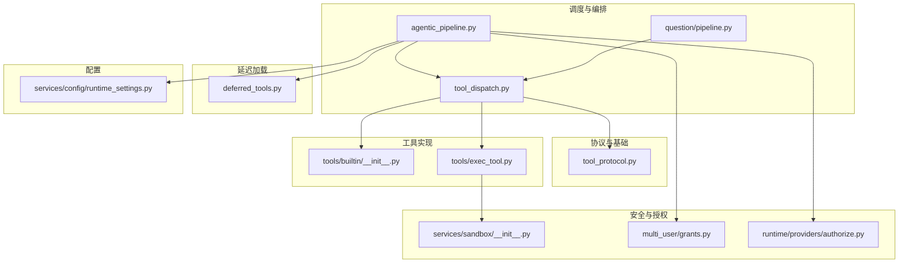
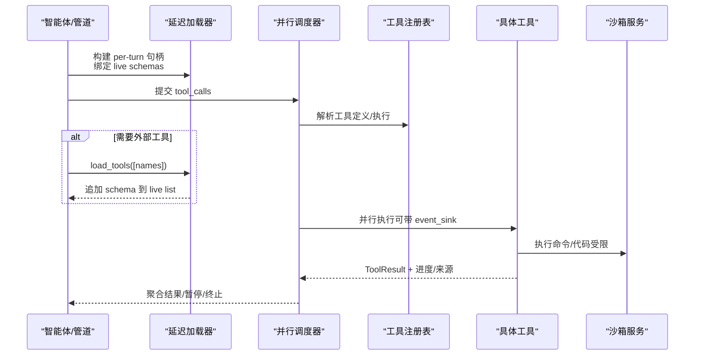
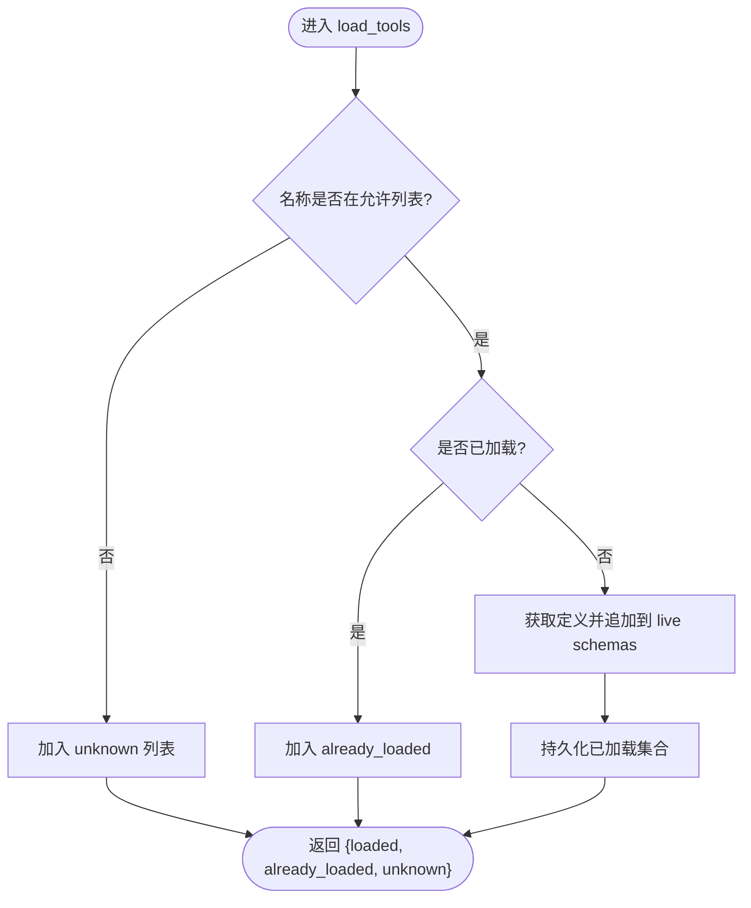
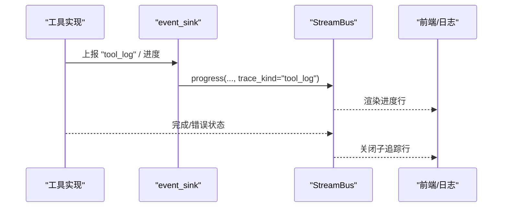
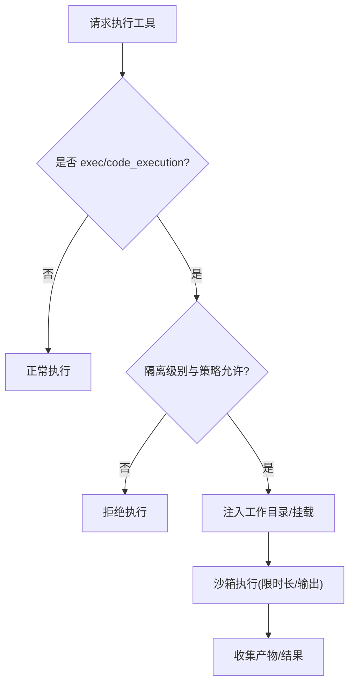
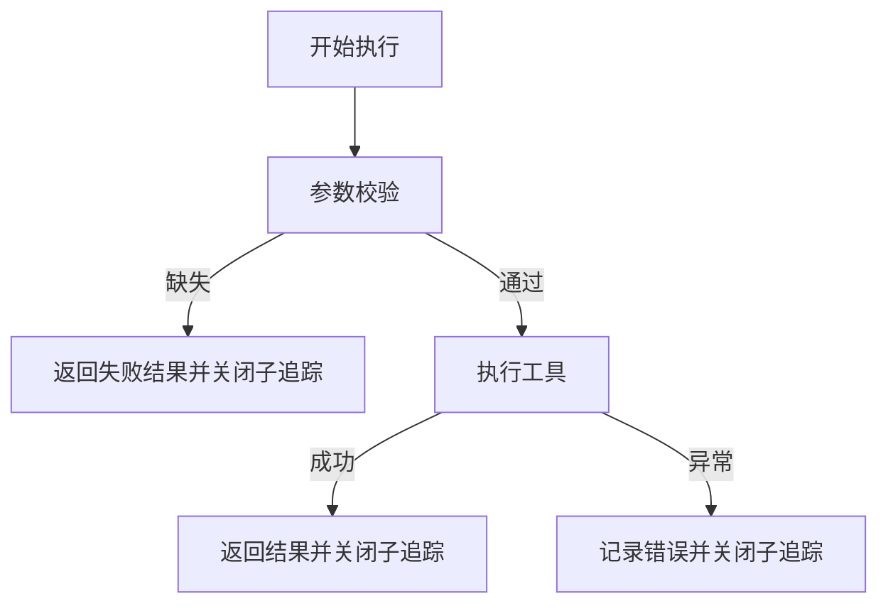
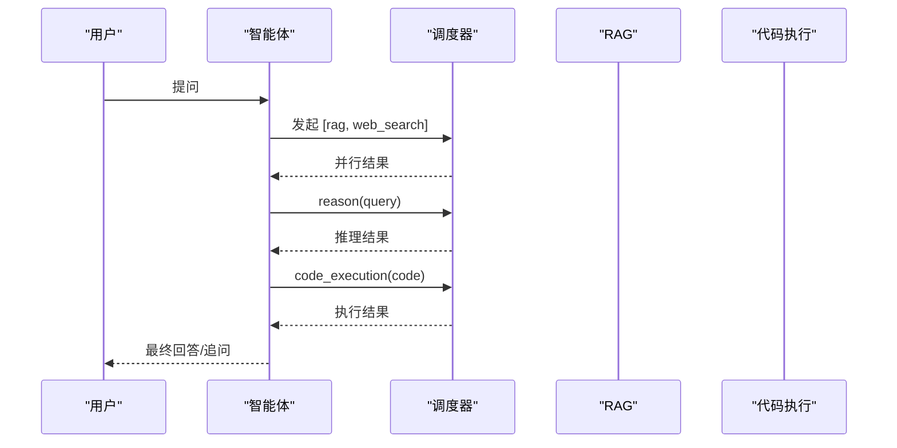
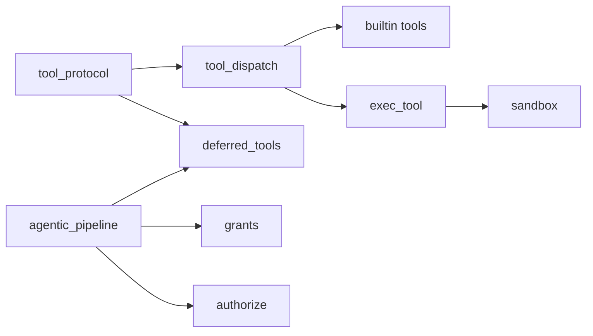

# 高级工具特性

<cite>
**本文引用的文件**
- [deferred_tools.py](file://deeptutor/runtime/registry/deferred_tools.py)
- [tool_protocol.py](file://deeptutor/core/tool_protocol.py)
- [tool_dispatch.py](file://deeptutor/core/agentic/tool_dispatch.py)
- [builtin/__init__.py](file://deeptutor/tools/builtin/__init__.py)
- [exec_tool.py](file://deeptutor/tools/exec_tool.py)
- [sandbox/__init__.py](file://deeptutor/services/sandbox/__init__.py)
- [agentic_pipeline.py](file://deeptutor/agents/chat/agentic_pipeline.py)
- [grants.py](file://deeptutor/multi_user/grants.py)
- [authorize.py](file://deeptutor/runtime/providers/authorize.py)
- [pipeline.py](file://deeptutor/agents/question/pipeline.py)
- [runtime_settings.py](file://deeptutor/services/config/runtime_settings.py)
</cite>

## 目录
1. [简介](#简介)
2. [项目结构](#项目结构)
3. [核心组件](#核心组件)
4. [架构总览](#架构总览)
5. [详细组件分析](#详细组件分析)
6. [依赖关系分析](#依赖关系分析)
7. [性能考量](#性能考量)
8. [故障排查指南](#故障排查指南)
9. [结论](#结论)
10. [附录](#附录)

## 简介
本文件面向希望深入掌握“高级工具特性”的开发者与集成方，系统阐述以下主题：
- 延迟加载工具（deferred tools）的概念、动机与使用方式
- 通过 load_tools 机制按需加载工具定义
- 工具的组合模式：链式调用、并行执行、条件分支
- 异步处理与流式响应：ToolEventSink 的使用与进度上报
- 权限控制与沙箱隔离：资源访问限制与安全策略
- 配置管理：运行时配置与环境变量
- 错误处理与重试：异常捕获、降级与恢复
- 复杂业务场景示例：多步骤工作流与状态管理

## 项目结构
围绕“工具”的核心代码分布在如下模块：
- 协议与基础类型：工具定义、结果、事件回调、注册表视图等
- 调度器：并行执行、去重、子追踪、暂停/终止信号聚合
- 延迟加载：按会话/轮次维护已加载的工具集合，动态追加 schema
- 内置工具：RAG、搜索、代码执行、知识清单等
- 沙箱：命令执行隔离、配额、挂载目录
- 授权与许可：用户/伙伴维度的工具白名单与 MCP 工具授权
- 管道与编排：聊天/问答管道在每轮准备上下文、注入参数、分发工具调用



图表来源
- [tool_dispatch.py:78-207](file://deeptutor/core/agentic/tool_dispatch.py#L78-L207)
- [deferred_tools.py:55-187](file://deeptutor/runtime/registry/deferred_tools.py#L55-L187)
- [agentic_pipeline.py:459-582](file://deeptutor/agents/chat/agentic_pipeline.py#L459-L582)
- [sandbox/__init__.py:1-28](file://deeptutor/services/sandbox/__init__.py#L1-L28)
- [grants.py:16-44](file://deeptutor/multi_user/grants.py#L16-L44)
- [authorize.py:40-66](file://deeptutor/runtime/providers/authorize.py#L40-L66)
- [runtime_settings.py:309-342](file://deeptutor/services/config/runtime_settings.py#L309-L342)

章节来源
- [tool_dispatch.py:78-207](file://deeptutor/core/agentic/tool_dispatch.py#L78-L207)
- [deferred_tools.py:55-187](file://deeptutor/runtime/registry/deferred_tools.py#L55-L187)
- [agentic_pipeline.py:459-582](file://deeptutor/agents/chat/agentic_pipeline.py#L459-L582)

## 核心组件
- 工具协议与生命周期
  - BaseTool 提供 get_definition 与 execute；支持 deferred 标记以启用延迟加载
  - ToolDefinition/ToolParameter 描述函数调用 schema；ToolResult 承载内容、来源、元数据、暂停/终止信号
  - ToolEventSink 是工具内部向调度层上报进度的异步回调
  - ToolLookup 是只读注册表视图，供调度与延迟加载读取工具能力

- 并行调度器
  - dispatch_tool_calls 将 LLM 返回的 tool_calls 并行执行，限制最大并发数
  - 自动检测并折叠重复调用（含 ask_user 的特殊规则）
  - 为每个工具调用建立独立子追踪，统一上报运行/完成/错误状态
  - 收集 sources、tool_messages，并聚合 pause/terminate 信号

- 延迟加载工具
  - 默认不暴露外部工具（如 MCP/CLI）的完整 schema，仅展示精简清单
  - 模型通过 load_tools 传入精确名称，DeferredToolLoader 校验允许列表后追加 schema
  - 已加载名称跨轮次持久化，避免重复加载

- 沙箱与执行
  - exec/code_execution 等工具通过沙箱服务执行命令或代码片段，带超时与输出限制
  - 管道侧注入 _sandbox_* 私有参数，确保工作目录与挂载受控

- 授权与许可
  - grants 定义 enabled_tools、mcp_tools、cli_apps、exec_enabled 等许可项
  - authorize 根据调用者身份（普通用户/伙伴/管理员）与资源范围计算最终允许集

- 配置管理
  - RuntimeSettingsService 集中管理运行时设置与环境变量覆盖，导出到进程环境

章节来源
- [tool_protocol.py:16-275](file://deeptutor/core/tool_protocol.py#L16-L275)
- [tool_dispatch.py:78-207](file://deeptutor/core/agentic/tool_dispatch.py#L78-L207)
- [deferred_tools.py:55-187](file://deeptutor/runtime/registry/deferred_tools.py#L55-L187)
- [exec_tool.py:1-125](file://deeptutor/tools/exec_tool.py#L1-L125)
- [sandbox/__init__.py:1-28](file://deeptutor/services/sandbox/__init__.py#L1-L28)
- [grants.py:16-44](file://deeptutor/multi_user/grants.py#L16-L44)
- [authorize.py:40-66](file://deeptutor/runtime/providers/authorize.py#L40-L66)
- [runtime_settings.py:309-342](file://deeptutor/services/config/runtime_settings.py#L309-L342)

## 架构总览
下图展示了从管道到调度器、再到工具与沙箱的端到端流程，以及延迟加载如何按需扩展工具表面。



图表来源
- [agentic_pipeline.py:459-582](file://deeptutor/agents/chat/agentic_pipeline.py#L459-L582)
- [deferred_tools.py:111-187](file://deeptutor/runtime/registry/deferred_tools.py#L111-L187)
- [tool_dispatch.py:78-207](file://deeptutor/core/agentic/tool_dispatch.py#L78-L207)
- [exec_tool.py:85-125](file://deeptutor/tools/exec_tool.py#L85-L125)
- [sandbox/__init__.py:1-28](file://deeptutor/services/sandbox/__init__.py#L1-L28)

## 详细组件分析

### 延迟加载工具与 load_tools 机制
- 设计动机
  - 减少初始 schema 体积，提升弱模型的工具选择质量
  - 外部工具（MCP/CLI）按需加载，保持最小暴露面
- 关键行为
  - render_deferred_tools_manifest 生成系统提示中的“扩展工具”清单
  - DeferredToolLoader 维护 per-session 已加载集合，支持 allowed 白名单过滤
  - bind_live_schemas 将当前轮次的 tool_schemas 列表绑定到 loader，load 时直接追加 schema
  - 失败/未知名称不会污染已加载集合，且会记录日志



图表来源
- [deferred_tools.py:55-187](file://deeptutor/runtime/registry/deferred_tools.py#L55-L187)

章节来源
- [deferred_tools.py:55-187](file://deeptutor/runtime/registry/deferred_tools.py#L55-L187)

### 工具组合模式：链式、并行、条件分支
- 链式调用
  - 由上层循环驱动：一次迭代中工具产出作为下一轮输入，典型如 RAG→总结→追问
- 并行执行
  - 调度器对同一批 tool_calls 并发执行，上限可控（默认最大并发数）
  - 自动去重：相同工具+规范化参数视为重复；ask_user 在同一批次内严格去重
- 条件分支
  - 通过 pause_for_user 实现交互式分支：遇到需要用户确认的问题时暂停，等待回复后继续
  - 通过 terminate_turn 结束本轮：工具输出即最终产物

```mermaid
sequenceDiagram
participant Loop as "智能体循环"
participant Disp as "调度器"
participant T1 as "工具A"
participant T2 as "工具B"
participant T3 as "工具C"
Loop->>Disp : 提交 [A,B,C]
Disp->>T1 : 并行执行
Disp->>T2 : 并行执行
Disp->>T3 : 并行执行
T2-->>Disp : pause_for_user=...
Disp-->>Loop : 聚合结果 + pause=true
Note over Loop : 等待用户回复后恢复该轮
Loop->>Disp : 携带用户答案继续
```

图表来源
- [tool_dispatch.py:78-207](file://deeptutor/core/agentic/tool_dispatch.py#L78-L207)
- [tool_dispatch.py:591-674](file://deeptutor/core/agentic/tool_dispatch.py#L591-L674)

章节来源
- [tool_dispatch.py:78-207](file://deeptutor/core/agentic/tool_dispatch.py#L78-L207)
- [tool_dispatch.py:591-674](file://deeptutor/core/agentic/tool_dispatch.py#L591-L674)

### 异步处理与流式响应（ToolEventSink）
- 工具内部可通过 event_sink 上报中间进度，调度器将其映射为子追踪的 call_status/tool_log 事件
- 对于检索类工具，调度器还会注入 retrieve 变体元数据，使 UI 显示“查询中/完成/失败”
- 空消息会被丢弃，避免无意义刷屏



图表来源
- [tool_dispatch.py:436-588](file://deeptutor/core/agentic/tool_dispatch.py#L436-L588)

章节来源
- [tool_dispatch.py:436-588](file://deeptutor/core/agentic/tool_dispatch.py#L436-L588)

### 权限控制与沙箱隔离
- 权限控制
  - grants 定义 enabled_tools、mcp_tools、cli_apps、exec_enabled 等许可
  - authorize 根据 caller 身份（普通用户/伙伴/管理员）与资源范围计算最终允许集
  - 管道在执行 exec/code_execution 前检查隔离级别与策略，必要时拒绝执行
- 沙箱隔离
  - exec/code_execution 通过沙箱服务执行，限制超时、输出大小与工作目录
  - 管道注入 _sandbox_workdir/_sandbox_mounts，保证每次任务有独立工作空间



图表来源
- [agentic_pipeline.py:557-582](file://deeptutor/agents/chat/agentic_pipeline.py#L557-L582)
- [grants.py:16-44](file://deeptutor/multi_user/grants.py#L16-L44)
- [authorize.py:40-66](file://deeptutor/runtime/providers/authorize.py#L40-L66)
- [exec_tool.py:85-125](file://deeptutor/tools/exec_tool.py#L85-L125)

章节来源
- [agentic_pipeline.py:557-582](file://deeptutor/agents/chat/agentic_pipeline.py#L557-L582)
- [grants.py:16-44](file://deeptutor/multi_user/grants.py#L16-L44)
- [authorize.py:40-66](file://deeptutor/runtime/providers/authorize.py#L40-L66)
- [exec_tool.py:85-125](file://deeptutor/tools/exec_tool.py#L85-L125)

### 配置管理：运行时配置与环境变量
- RuntimeSettingsService 集中加载 JSON 配置与进程环境变量，提供统一的设置访问接口
- 可将运行时设置导出为环境变量，便于下游进程消费
- 工具与服务在启动/初始化阶段读取所需配置，避免硬编码

章节来源
- [runtime_settings.py:309-342](file://deeptutor/services/config/runtime_settings.py#L309-L342)
- [runtime_settings.py:1038-1063](file://deeptutor/services/config/runtime_settings.py#L1038-L1063)

### 错误处理与重试机制
- 缺失参数短路：调度器在调用前校验必填参数，若缺失则直接返回结构化失败结果，并关闭子追踪
- 异常捕获：execute_tool_call 捕获异常，写入 call_status=error，并返回友好错误信息
- 去重保护：重复 tool_calls 被折叠为占位结果，避免 UI 重复与副作用重复触发
- 重试策略
  - 调度层未内置通用重试；可在上层（如问答管道）对特定工具调用进行重试封装
  - 对网络/第三方服务，建议在工具或服务层实现退避重试



图表来源
- [tool_dispatch.py:279-343](file://deeptutor/core/agentic/tool_dispatch.py#L279-L343)
- [tool_dispatch.py:546-588](file://deeptutor/core/agentic/tool_dispatch.py#L546-L588)

章节来源
- [tool_dispatch.py:279-343](file://deeptutor/core/agentic/tool_dispatch.py#L279-L343)
- [tool_dispatch.py:546-588](file://deeptutor/core/agentic/tool_dispatch.py#L546-L588)

### 复杂业务场景示例：多步骤工作流与状态管理
- 典型流程：检索（rag）→ 推理（reason）→ 代码验证（code_execution）→ 总结/追问
- 状态管理
  - 通过 pause_for_user 保存交互点，等待用户补充信息后恢复
  - 通过 terminate_turn 将某一步骤的输出作为本轮最终产物
- 并行优化
  - 多个独立的检索/搜索可并行执行，缩短端到端时延
  - 去重机制避免重复调用造成资源浪费



图表来源
- [builtin/__init__.py:95-141](file://deeptutor/tools/builtin/__init__.py#L95-L141)
- [builtin/__init__.py:234-271](file://deeptutor/tools/builtin/__init__.py#L234-L271)
- [builtin/__init__.py:274-447](file://deeptutor/tools/builtin/__init__.py#L274-L447)
- [tool_dispatch.py:78-207](file://deeptutor/core/agentic/tool_dispatch.py#L78-L207)

章节来源
- [builtin/__init__.py:95-141](file://deeptutor/tools/builtin/__init__.py#L95-L141)
- [builtin/__init__.py:234-271](file://deeptutor/tools/builtin/__init__.py#L234-L271)
- [builtin/__init__.py:274-447](file://deeptutor/tools/builtin/__init__.py#L274-L447)
- [tool_dispatch.py:78-207](file://deeptutor/core/agentic/tool_dispatch.py#L78-L207)

## 依赖关系分析
- 低耦合协议层
  - tool_protocol 定义工具契约，被调度器、延迟加载、工具实现共同依赖
- 调度器为核心枢纽
  - 依赖注册表、流总线、追踪工具；向上承接管道，向下驱动工具
- 延迟加载与授权
  - 延迟加载依赖注册表与 MCP 会话状态；授权依赖用户/伙伴/管理员上下文
- 沙箱与工具
  - exec/code_execution 强依赖沙箱服务；管道负责注入工作目录与挂载



图表来源
- [tool_protocol.py:16-275](file://deeptutor/core/tool_protocol.py#L16-L275)
- [tool_dispatch.py:78-207](file://deeptutor/core/agentic/tool_dispatch.py#L78-L207)
- [deferred_tools.py:55-187](file://deeptutor/runtime/registry/deferred_tools.py#L55-L187)
- [exec_tool.py:85-125](file://deeptutor/tools/exec_tool.py#L85-L125)
- [sandbox/__init__.py:1-28](file://deeptutor/services/sandbox/__init__.py#L1-L28)
- [agentic_pipeline.py:459-582](file://deeptutor/agents/chat/agentic_pipeline.py#L459-L582)
- [grants.py:16-44](file://deeptutor/multi_user/grants.py#L16-L44)
- [authorize.py:40-66](file://deeptutor/runtime/providers/authorize.py#L40-L66)

章节来源
- [tool_protocol.py:16-275](file://deeptutor/core/tool_protocol.py#L16-L275)
- [tool_dispatch.py:78-207](file://deeptutor/core/agentic/tool_dispatch.py#L78-L207)
- [deferred_tools.py:55-187](file://deeptutor/runtime/registry/deferred_tools.py#L55-L187)
- [exec_tool.py:85-125](file://deeptutor/tools/exec_tool.py#L85-L125)
- [sandbox/__init__.py:1-28](file://deeptutor/services/sandbox/__init__.py#L1-L28)
- [agentic_pipeline.py:459-582](file://deeptutor/agents/chat/agentic_pipeline.py#L459-L582)
- [grants.py:16-44](file://deeptutor/multi_user/grants.py#L16-L44)
- [authorize.py:40-66](file://deeptutor/runtime/providers/authorize.py#L40-L66)

## 性能考量
- 并行度控制：默认限制单次批次的最大并行工具调用数，防止资源争用
- 去重优化：折叠重复 tool_calls，减少无效开销
- 延迟加载：减小初始 schema，提高模型选择效率
- 流式进度：通过 event_sink 上报中间状态，降低前端等待焦虑
- 沙箱限制：超时与输出长度限制，避免长时间占用与内存膨胀

[本节为通用指导，无需引用具体文件]

## 故障排查指南
- 工具未执行
  - 检查是否命中“缺少必填参数”的短路路径
  - 确认工具名是否存在于注册表且未被授权策略拒绝
- 进度不显示
  - 确认工具是否正确调用 event_sink，且消息非空
  - 检查调度器是否处于具备 status_meta 的路径（否则进度会被丢弃）
- 执行被拒绝
  - 检查 exec/code_execution 的隔离级别与策略
  - 核对 grants 中的 enabled_tools/exec_enabled 与 authorize 的计算结果
- 重复调用导致 UI 异常
  - 观察是否出现重复 tool_calls；调度器会自动折叠，但需关注上游逻辑

章节来源
- [tool_dispatch.py:279-343](file://deeptutor/core/agentic/tool_dispatch.py#L279-L343)
- [tool_dispatch.py:436-588](file://deeptutor/core/agentic/tool_dispatch.py#L436-L588)
- [agentic_pipeline.py:557-582](file://deeptutor/agents/chat/agentic_pipeline.py#L557-L582)
- [grants.py:16-44](file://deeptutor/multi_user/grants.py#L16-L44)
- [authorize.py:40-66](file://deeptutor/runtime/providers/authorize.py#L40-L66)

## 结论
本系统通过“协议抽象 + 并行调度 + 延迟加载 + 沙箱隔离 + 授权策略 + 流式进度”的组合，提供了高可扩展、安全可控、用户体验友好的工具执行框架。开发者可基于此快速构建复杂的多步骤工作流，并在保证安全的前提下充分利用外部能力。

[本节为总结性内容，无需引用具体文件]

## 附录
- 常用工具参考
  - RAG 检索：用于从知识库检索相关段落并附带来源
  - 网络搜索：获取互联网摘要与引用
  - 代码执行：在沙箱中编译/运行代码片段，支持 Python/C/C++
  - 知识清单：列出知识库文档及统计信息
- 最佳实践
  - 尽量将独立任务并行化，减少串行等待
  - 对可能失败的远程调用增加重试与降级
  - 使用延迟加载减少模型负担
  - 通过 event_sink 提供有意义的进度反馈
  - 谨慎使用 exec/code_execution，遵循最小权限原则

[本节为补充说明，无需引用具体文件]