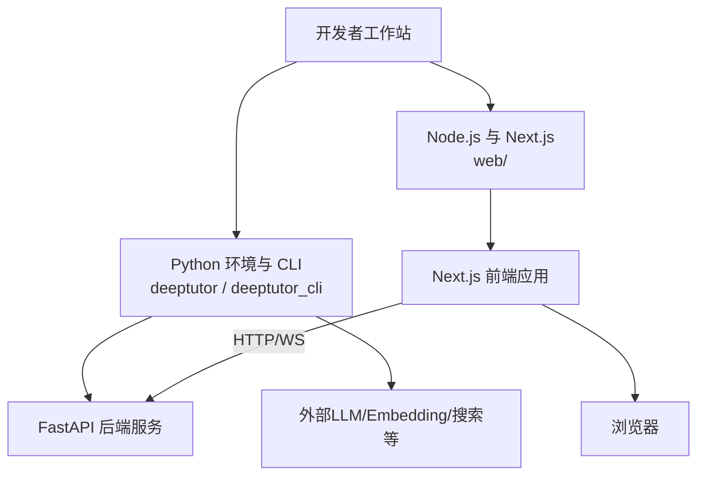
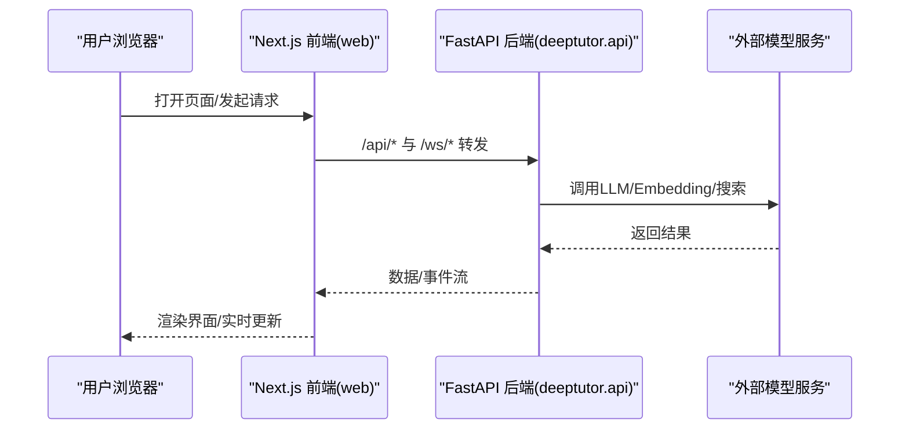
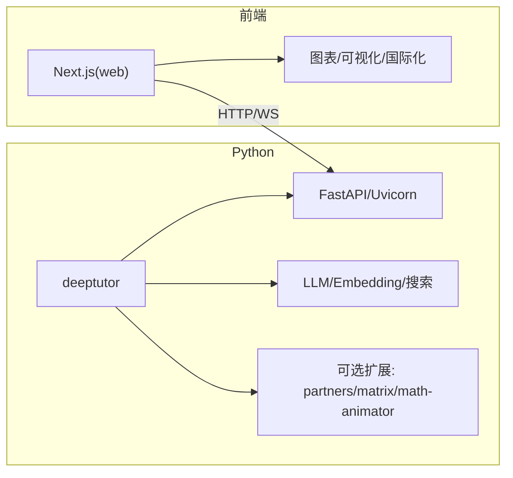

# 开发指南

<cite>
**本文引用的文件**
- [README.md](file://README.md)
- [CONTRIBUTING.md](file://CONTRIBUTING.md)
- [pyproject.toml](file://pyproject.toml)
- [requirements.txt](file://requirements.txt)
- [.pre-commit-config.yaml](file://.pre-commit-config.yaml)
- [scripts/start_web.py](file://scripts/start_web.py)
- [scripts/start_backend.bat](file://scripts/start_backend.bat)
- [web/package.json](file://web/package.json)
- [web/eslint.config.mjs](file://web/eslint.config.mjs)
- [docker-compose.dev.yml](file://docker-compose.dev.yml)
- [.github/workflows/tests.yml](file://.github/workflows/tests.yml)
- [.github/pull_request_template.md](file://.github/pull_request_template.md)
</cite>

## 目录
1. [简介](#简介)
2. [项目结构](#项目结构)
3. [核心组件](#核心组件)
4. [架构总览](#架构总览)
5. [详细组件分析](#详细组件分析)
6. [依赖关系分析](#依赖关系分析)
7. [性能考虑](#性能考虑)
8. [故障排查指南](#故障排查指南)
9. [结论](#结论)
10. [附录](#附录)

## 简介
本指南面向DeepTutor的开发者，覆盖从环境搭建、IDE与调试配置，到代码规范、Git工作流、提交流程、工具脚本使用、新功能/修复提交PR、常见问题与解决方案、性能优化与重构建议，以及社区贡献最佳实践。内容基于仓库中的配置文件、脚本与工作流，确保可操作且与项目一致。

## 项目结构
DeepTutor采用前后端分离与多模块组织：
- Python后端与CLI：deeptutor、deeptutor_cli、scripts
- Next.js前端：web（含测试、构建脚本与国际化）
- 配置与打包：pyproject.toml、requirements/*、Docker相关
- 质量与CI：.pre-commit-config.yaml、.github/workflows/tests.yml

图表来源
- [scripts/start_web.py:14-35](file://scripts/start_web.py#L14-L35)
- [scripts/start_backend.bat:20-24](file://scripts/start_backend.bat#L20-L24)
- [web/package.json:5-21](file://web/package.json#L5-L21)

章节来源
- [README.md:202-246](file://README.md#L202-L246)
- [README.md:289-365](file://README.md#L289-L365)
- [README.md:680-755](file://README.md#L680-L755)

## 核心组件
- 启动器与运行模式
  - 通过脚本统一入口启动Web应用或仅后端；支持--dev启用前端HMR。
- 前端工程
  - 基于Next.js，提供开发、构建、测试、审计与i18n检查脚本。
- 质量门禁
  - pre-commit钩子集成Ruff/Prettier/detect-secrets/Bandit/Mypy等。
- CI流水线
  - 在push/PR时执行Lint、Web Node Tests、Import Check、Python Tests并汇总结果。

章节来源
- [scripts/start_web.py:17-35](file://scripts/start_web.py#L17-L35)
- [web/package.json:5-21](file://web/package.json#L5-L21)
- [.pre-commit-config.yaml:12-107](file://.pre-commit-config.yaml#L12-L107)
- [.github/workflows/tests.yml:31-203](file://.github/workflows/tests.yml#L31-L203)

## 架构总览
下图展示本地开发时的典型调用链：浏览器访问前端，前端通过代理转发至后端；后端调度能力、工具与外部服务。

图表来源
- [README.md:305-329](file://README.md#L305-L329)
- [scripts/start_web.py:14-35](file://scripts/start_web.py#L14-L35)
- [scripts/start_backend.bat:20-24](file://scripts/start_backend.bat#L20-L24)

## 详细组件分析

### 开发环境搭建
- 版本要求
  - Python 3.11–3.13（推荐），Node.js 20+（完整应用）或 22 LTS（源码开发）。
- 安装路径
  - PyPI一键安装：适合快速体验。
  - 源码安装：适合开发与调试，需同时安装前后端依赖。
  - Docker：单容器部署，便于隔离与复用。
  - CLI Only：无需Web UI，适合自动化与脚本化场景。
- 初始化与启动
  - 使用命令创建/更新运行时配置，随后启动后端与前端；--dev开启前端热重载。
- 可选扩展
  - partners/matrix/math-animator/dev等可选依赖按需安装。

章节来源
- [README.md:202-246](file://README.md#L202-L246)
- [README.md:289-365](file://README.md#L289-L365)
- [README.md:368-405](file://README.md#L368-L405)
- [README.md:431-448](file://README.md#L431-L448)
- [pyproject.toml:8-21](file://pyproject.toml#L8-L21)

### IDE与调试设置
- Python
  - 使用虚拟环境激活后，直接运行后端模块或CLI入口进行调试。
  - 可通过断点调试FastAPI路由与服务逻辑。
- 前端
  - 使用npm脚本启动开发服务器，支持HMR；可在浏览器中调试网络请求与状态。
- 联合调试
  - 使用--dev启动前端开发服务器，后端保持默认端口；浏览器仅访问前端，/api/*与/ws/*由前端代理转发。

章节来源
- [scripts/start_web.py:17-35](file://scripts/start_web.py#L17-L35)
- [scripts/start_backend.bat:20-24](file://scripts/start_backend.bat#L20-L24)
- [web/package.json:5-13](file://web/package.json#L5-L13)
- [README.md:305-329](file://README.md#L305-L329)

### 代码规范与编码标准
- Python
  - 类型注解、f-string、PEP 8风格；函数职责单一。
  - 文档字符串遵循Google风格；新增模块/类/公共函数需补充docstring。
- 前端
  - Prettier格式化TS/JS/CSS/JSON/YAML/MD等；ESLint规则与i18n插件约束UI文本。
- 安全扫描
  - detect-secrets基线用于避免误报；Bandit扫描安全问题；Mypy静态类型检查（逐步收紧）。
- 提交前检查
  - pre-commit自动执行ruff/ruff-format/prettier/detect-secrets/bandit/mypy等。

章节来源
- [CONTRIBUTING.md:149-180](file://CONTRIBUTING.md#L149-L180)
- [.pre-commit-config.yaml:12-107](file://.pre-commit-config.yaml#L12-L107)
- [web/eslint.config.mjs:1-22](file://web/eslint.config.mjs#L1-L22)
- [pyproject.toml:265-473](file://pyproject.toml#L265-L473)

### Git工作流程与分支管理
- 分支策略
  - dev：常规开发分支，可能包含破坏性变更。
  - multi-user：多租户/多用户特性分支。
  - main：稳定发布分支，禁止直接提交PR。
- 分支选择
  - 新功能/重构/API变更/通用修复→dev
  - 多用户/权限/协作/共享工作区→multi-user
- 贡献流程
  - Fork → clone → 同步目标分支 → 创建feature分支 → 本地验证(pre-commit) → 提交PR到目标分支。

章节来源
- [CONTRIBUTING.md:32-86](file://CONTRIBUTING.md#L32-L86)

### 代码审查与提交流程
- PR模板
  - 描述变更、关联Issue、受影响模块、检查清单与附加说明。
- 检查项
  - 阅读并遵循贡献指南；遵循编码规范；运行pre-commit；补充测试；更新文档；无新安全风险。
- CI门禁
  - Lint与格式检查、Web Node Tests、Import Check、Python Tests全部通过后合并。

章节来源
- [.github/pull_request_template.md:1-40](file://.github/pull_request_template.md#L1-L40)
- [.github/workflows/tests.yml:31-203](file://.github/workflows/tests.yml#L31-L203)

### 开发工具与脚本使用
- 启动Web应用
  - 使用脚本统一入口，支持--home指定工作空间根目录，--dev启用前端HMR。
- Windows后端启动
  - 批处理脚本激活虚拟环境并启动后端服务。
- 前端脚本
  - 开发、构建、测试、性能检查、i18n校验与品牌图标构建等。
- Docker开发
  - 使用开发覆盖文件挂载源码实现前后端热重载，数据目录映射到本地。

章节来源
- [scripts/start_web.py:17-35](file://scripts/start_web.py#L17-L35)
- [scripts/start_backend.bat:1-25](file://scripts/start_backend.bat#L1-L25)
- [web/package.json:5-21](file://web/package.json#L5-L21)
- [docker-compose.dev.yml:1-52](file://docker-compose.dev.yml#L1-L52)

### 添加新功能、修复Bug与提交PR
- 步骤
  - 从目标分支(dev或multi-user)拉取最新代码。
  - 创建功能分支feature/your-feature-name。
  - 实现功能/修复，遵循编码规范与安全最佳实践。
  - 运行pre-commit检查并修复问题。
  - 提交PR至目标分支，填写模板信息，等待CI与审查。
- 注意事项
  - 不要直接提交到main；必要时附带测试与文档更新。

章节来源
- [CONTRIBUTING.md:64-86](file://CONTRIBUTING.md#L64-L86)
- [.github/pull_request_template.md:1-40](file://.github/pull_request_template.md#L1-L40)

### 常见问题与解决方案
- 前端开发服务器卡住
  - 停止已打印的PID；若实际无Next.js进程，删除锁文件后重试。
- 依赖冲突
  - 前端依赖变更使用legacy-peer-deps刷新lock文件并提交package.json与lock文件。
- 环境变量与配置
  - 项目根.env不作为应用配置；运行时配置位于data/user/settings/*.json。
- Docker连接宿主模型服务
  - 使用host.docker.internal或host networking方式暴露宿主机服务地址。

章节来源
- [README.md:272-284](file://README.md#L272-L284)
- [README.md:338-363](file://README.md#L338-L363)
- [README.md:431-448](file://README.md#L431-L448)

### 性能优化与代码重构建议
- 知识检索
  - 大知识库建议使用FAISS向量存储替代全量扫描，提升查询性能。
- 资源限制
  - 合理设置每阶段token限制与缓存上限，避免内存膨胀。
- 重构原则
  - 小函数、单一职责；将复杂逻辑拆分为独立模块；优先使用异步IO与流式处理。
- 前端性能
  - 使用构建产物与按需加载；关注路由预算与包体积；利用HMR加速迭代。

章节来源
- [pyproject.toml:47-53](file://pyproject.toml#L47-L53)
- [README.md:140-142](file://README.md#L140-L142)
- [web/package.json:11-13](file://web/package.json#L11-L13)

### 社区贡献指导与最佳实践
- 沟通渠道
  - Discord、飞书群、微信群与Issues讨论。
- 贡献起点
  - 关注good first issue标签的任务，评论表明正在处理。
- 安全与合规
  - 上传大小限制、多重校验与文件名清洗；子进程调用禁用shell；跨平台路径使用pathlib；关键脚本LF换行。

章节来源
- [CONTRIBUTING.md:1-23](file://CONTRIBUTING.md#L1-L23)
- [CONTRIBUTING.md:204-217](file://CONTRIBUTING.md#L204-L217)

## 依赖关系分析
- Python依赖
  - 核心运行时、可选扩展（partners、matrix、math-animator、parse-*）、开发工具（dev/all）。
- 前端依赖
  - Next.js生态、图表与可视化库、国际化与样式框架。
- 质量工具
  - Ruff、Prettier、detect-secrets、Bandit、Mypy、pytest等。

图表来源
- [pyproject.toml:21-71](file://pyproject.toml#L21-L71)
- [pyproject.toml:76-235](file://pyproject.toml#L76-L235)
- [web/package.json:23-61](file://web/package.json#L23-L61)

章节来源
- [pyproject.toml:21-235](file://pyproject.toml#L21-L235)
- [web/package.json:23-61](file://web/package.json#L23-L61)
- [requirements.txt:1-23](file://requirements.txt#L1-L23)

## 性能考虑
- 后端
  - 使用FAISS向量存储提升检索效率；控制缓存与并发；合理设置日志级别减少I/O开销。
- 前端
  - 使用构建产物与按需加载；监控路由预算；避免不必要的重渲染。
- 容器化
  - 单容器简化网络；只暴露必要端口；持久化数据卷保证重启不丢失。

[本节为通用指导，不直接分析具体文件]

## 故障排查指南
- 启动失败
  - 检查虚拟环境是否激活；确认端口未被占用；查看后端日志输出。
- 前端无法连接后端
  - 确认代理转发规则；检查CORS与API base配置；在Docker中使用host.docker.internal访问宿主服务。
- 依赖冲突
  - 使用legacy-peer-deps刷新前端依赖；清理node_modules后重新安装。
- 预提交失败
  - 根据提示修复格式与lint问题；必要时更新secrets基线。

章节来源
- [scripts/start_backend.bat:12-24](file://scripts/start_backend.bat#L12-L24)
- [README.md:305-329](file://README.md#L305-L329)
- [README.md:272-284](file://README.md#L272-L284)
- [.pre-commit-config.yaml:66-107](file://.pre-commit-config.yaml#L66-L107)

## 结论
DeepTutor提供了完善的开发工具链与质量门禁，配合清晰的分支策略与提交流程，使团队协作高效可控。遵循本指南的环境搭建、规范与流程，可以快速上手并持续贡献高质量代码。

## 附录
- 常用命令速查
  - 启动Web应用：使用脚本入口并选择--dev模式。
  - 启动后端：Windows下使用批处理脚本。
  - 前端开发：使用npm脚本启动开发服务器。
  - 运行测试：执行pytest与前端Node测试。
  - 预提交检查：运行pre-commit对所有文件进行检查。

章节来源
- [scripts/start_web.py:17-35](file://scripts/start_web.py#L17-L35)
- [scripts/start_backend.bat:20-24](file://scripts/start_backend.bat#L20-L24)
- [web/package.json:5-21](file://web/package.json#L5-L21)
- [.pre-commit-config.yaml:12-107](file://.pre-commit-config.yaml#L12-L107)