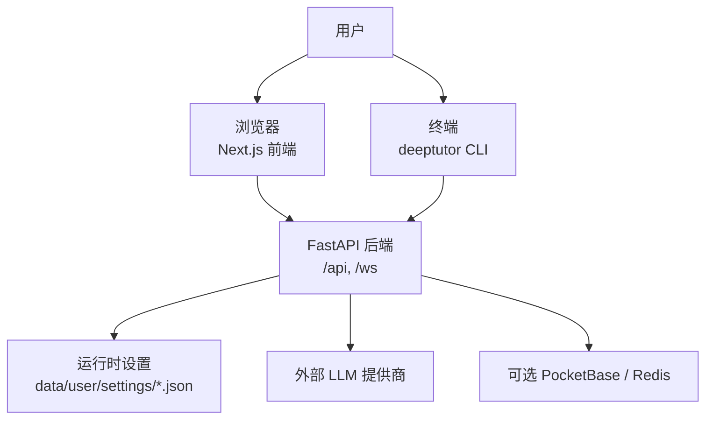
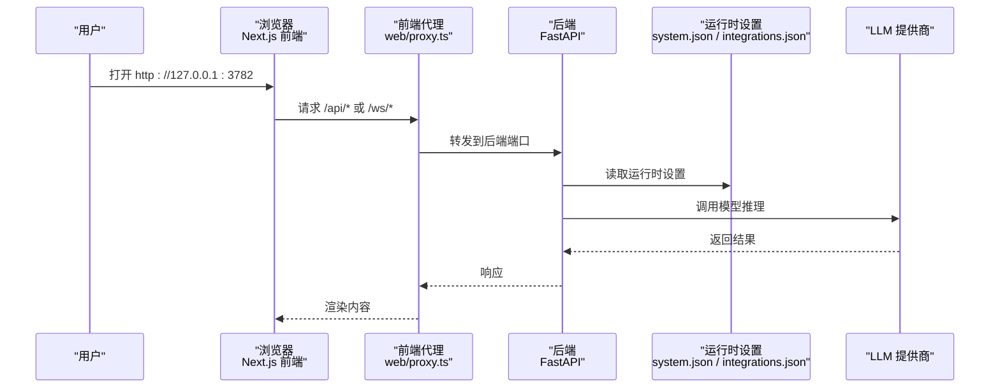
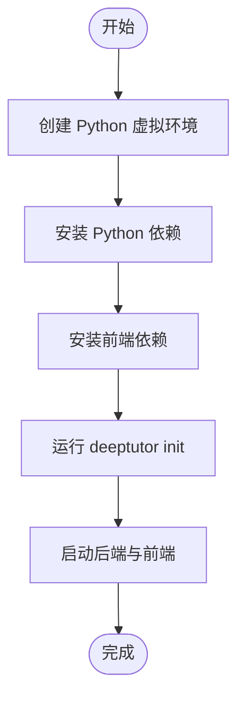
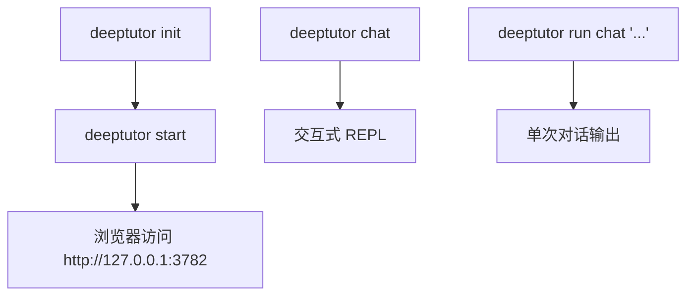
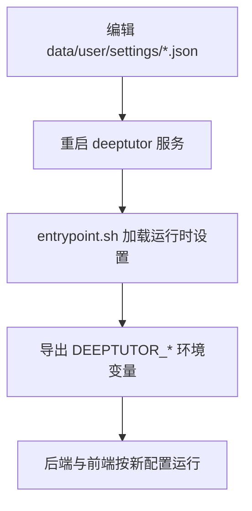
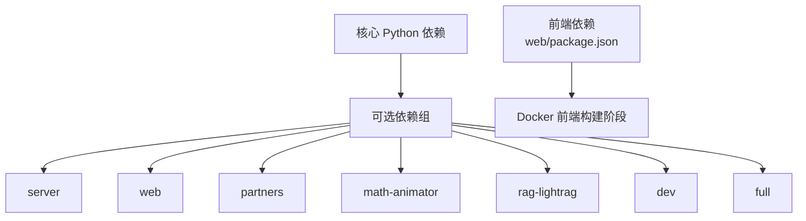

# 快速开始

<cite>
**本文引用的文件**   
- [README.md](file://README.md)
- [assets/README/README_CN.md](file://assets/README/README_CN.md)
- [pyproject.toml](file://pyproject.toml)
- [requirements.txt](file://requirements.txt)
- [Dockerfile](file://Dockerfile)
- [compose.yaml](file://compose.yaml)
- [deeptutor_cli/main.py](file://deeptutor_cli/main.py)
- [scripts/start_web.py](file://scripts/start_web.py)
- [scripts/docker_compose.py](file://scripts/docker_compose.py)
- [deeptutor/services/config/runtime_settings.py](file://deeptutor/services/config/runtime_settings.py)
</cite>

## 目录
1. [简介](#简介)
2. [项目结构](#项目结构)
3. [核心组件](#核心组件)
4. [架构总览](#架构总览)
5. [详细组件分析](#详细组件分析)
6. [依赖分析](#依赖分析)
7. [性能与运行建议](#性能与运行建议)
8. [故障排除指南](#故障排除指南)
9. [结论](#结论)

## 简介
本指南面向首次接触 DeepTutor 的用户，目标是让你在最短时间内完成环境准备、安装依赖、初始化配置并成功启动 Web 界面或 CLI。你可以选择以下三种方式之一：
- Docker 一键体验完整应用（推荐）
- PyPI 安装完整 Web 应用与 CLI
- 源码开发模式

DeepTutor 提供智能体原生的学习工作区，支持对话、研究、创作、练习、知识库、记忆、技能、MCP 服务、多语言模型提供商等能力；Web 前端通过 Next.js 提供可视化界面，后端使用 FastAPI 暴露 API，CLI 则提供终端交互和机器可读输出。

**章节来源**
- [assets/README/README_CN.md:54-64](file://assets/README/README_CN.md#L54-L64)

## 项目结构
仓库采用“后端 + 前端 + CLI + 文档 + 容器化”的多模块组织方式：
- `deeptutor/`：Python 后端、智能体、能力、服务、运行时、配置、日志、工具等核心代码
- `deeptutor_cli/`：命令行入口与命令注册
- `web/`：Next.js 前端应用
- `scripts/`：启动脚本、Docker Compose 辅助脚本、更新脚本等
- `packaging/deeptutor-cli/`：CLI 发行包元数据
- `requirements/`：按功能划分的 Python 依赖分组
- `Dockerfile` / `compose.yaml`：容器镜像与 Compose 编排
- `pyproject.toml`：Python 项目元数据、可选依赖、构建与工具链配置
- `assets/README/README_CN.md`：中文用户手册与快速开始说明

**图表来源**
- [Dockerfile:253-333](file://Dockerfile#L253-L333)
- [compose.yaml:67-206](file://compose.yaml#L67-L206)
- [deeptutor_cli/main.py:77-149](file://deeptutor_cli/main.py#L77-L149)

**章节来源**
- [assets/README/README_CN.md:122-159](file://assets/README/README_CN.md#L122-L159)
- [pyproject.toml:8-50](file://pyproject.toml#L8-L50)

## 核心组件
- **后端**：FastAPI 应用，负责会话、智能体循环、工具调用、RAG、知识库、记忆、权限、设置加载、WebSocket 通信等。
- **前端**：Next.js 应用，提供聊天、知识库、笔记本、书籍、学习路径、设置、个性化等界面。
- **CLI**：基于 Typer 的命令集合，支持交互式聊天、单次能力运行、模块管理、Provider 登录、知识库管理、会话管理等。
- **运行时设置**：以 JSON/YAML 形式保存在 `data/user/settings/`，包括系统设置、认证、集成、模型目录、Agent 配置等。
- **容器化**：Docker 镜像包含前后端，Compose 可拉起后端、前端、Redis、PocketBase 等服务。

**章节来源**
- [deeptutor_cli/main.py:30-74](file://deeptutor_cli/main.py#L30-L74)
- [Dockerfile:17-180](file://Dockerfile#L17-L180)
- [compose.yaml:67-206](file://compose.yaml#L67-L206)
- [deeptutor/services/config/runtime_settings.py:565-602](file://deeptutor/services/config/runtime_settings.py#L565-L602)

## 架构总览
下图展示典型本地部署中各组件的交互关系：浏览器访问前端，前端通过代理转发到后端 API 与 WebSocket；CLI 直接调用后端能力；运行时设置从 `data/user/settings` 加载；可选的 PocketBase 与 Redis 作为认证与协调服务。

**图表来源**
- [Dockerfile:317-333](file://Dockerfile#L317-L333)
- [compose.yaml:137-206](file://compose.yaml#L137-L206)
- [scripts/docker_compose.py:45-71](file://scripts/docker_compose.py#L45-L71)

## 详细组件分析

### 环境准备
#### Python 版本要求
- 项目声明 Python 版本范围为 `>=3.11,<3.15`。
- 推荐使用 Python 3.11–3.14，以匹配 CI 与 Docker 环境。

**章节来源**
- [pyproject.toml:12-16](file://pyproject.toml#L12-L16)
- [assets/README/README_CN.md:107-125](file://assets/README/README_CN.md#L107-L125)

#### Node.js 环境
- PyPI 完整安装要求 Node.js 20.9+。
- 源码开发建议使用 Node.js 22 LTS，以匹配 CI 与 Docker 构建阶段。
- Docker 构建阶段使用 Node 22.23.4-slim 进行前端构建。

**章节来源**
- [assets/README/README_CN.md:107-125](file://assets/README/README_CN.md#L107-L125)
- [Dockerfile:23-51](file://Dockerfile#L23-L51)

#### Docker 与 Podman
- Docker：可直接运行官方镜像，映射前端端口 3782 与后端端口 8001。
- Podman Compose：仓库提供 `compose.yaml`，支持 rootless、只读根文件系统、UID/GID 映射、健康检查与网络隔离。
- Compose 默认服务包括 Redis、可选 PocketBase、DeepTutor 主服务。

**章节来源**
- [assets/README/README_CN.md:89-101](file://assets/README/README_CN.md#L89-L101)
- [compose.yaml:1-63](file://compose.yaml#L1-L63)
- [compose.yaml:67-206](file://compose.yaml#L67-L206)

### 本地开发环境搭建
#### 依赖安装
- PyPI 完整安装：`python -m pip install -U "deeptutor[full]"`
- 源码安装：克隆仓库后创建虚拟环境，安装 `requirements/full.txt`，再安装 editable 包，最后安装前端依赖。

**图表来源**
- [assets/README/README_CN.md:122-139](file://assets/README/README_CN.md#L122-L139)
- [pyproject.toml:52-94](file://pyproject.toml#L52-L94)

**章节来源**
- [assets/README/README_CN.md:107-139](file://assets/README/README_CN.md#L107-L139)
- [pyproject.toml:8-50](file://pyproject.toml#L8-L50)

#### 数据库与持久化
- 单用户模式默认使用 SQLite 与文件系统存储，无需额外数据库。
- 多用户部署可选择 PocketBase 作为认证与存储 sidecar，或通过外部用户存储集成。
- 数据目录位于 `data/`，包括管理员工作区、用户工作区、Partner 工作区、系统凭证、知识库、记忆、日志等。

**章节来源**
- [assets/README/README_CN.md:484-506](file://assets/README/README_CN.md#L484-L506)
- [compose.yaml:85-127](file://compose.yaml#L85-L127)

#### 前端构建
- Docker 构建阶段执行 `npm run build`，生成 Next.js standalone 输出。
- 源码开发可使用 `deeptutor start --dev` 启动 Next.js 开发服务器。

**章节来源**
- [Dockerfile:49-51](file://Dockerfile#L49-L51)
- [Dockerfile:593-618](file://Dockerfile#L593-L618)

### 基本运行命令与使用示例
#### CLI 工具
- 初始化配置：`deeptutor init`
- 启动 Web 应用：`deeptutor start`
- 仅启动后端：`deeptutor serve`
- 交互式聊天：`deeptutor chat`
- 单次能力运行：`deeptutor run <capability> "<message>"`

**图表来源**
- [deeptutor_cli/main.py:77-149](file://deeptutor_cli/main.py#L77-L149)
- [assets/README/README_CN.md:508-597](file://assets/README/README_CN.md#L508-L597)

**章节来源**
- [deeptutor_cli/main.py:77-149](file://deeptutor_cli/main.py#L77-L149)
- [assets/README/README_CN.md:508-597](file://assets/README/README_CN.md#L508-L597)

#### Web 界面访问
- Docker 运行后访问 `http://127.0.0.1:3782`。
- PyPI 安装后由 `deeptutor start` 自动打开浏览器或打印 URL。
- 源码开发模式下可通过 `--dev` 启用前端热重载。

**章节来源**
- [assets/README/README_CN.md:107-139](file://assets/README/README_CN.md#L107-L139)
- [scripts/start_web.py:17-35](file://scripts/start_web.py#L17-L35)

### 常见配置选项与环境变量
- 运行时设置文件：
  - `data/user/settings/system.json`：系统端口、后端工作进程数、CORS、附件大小、沙箱策略等
  - `data/user/settings/auth.json`：认证开关、用户名密码哈希、Cookie 安全策略等
  - `data/user/settings/integrations.json`：PocketBase、外部服务地址等
  - `data/user/settings/model_catalog.json`：LLM 提供商与模型目录
  - `data/user/settings/main.yaml`：运行时 YAML 配置
- 重要环境变量（容器入口会忽略部分旧名称并从 JSON 重新导出）：
  - `BACKEND_PORT`、`FRONTEND_PORT`
  - `DEEPTUTOR_API_BASE_URL`、`DEEPTUTOR_AUTH_ENABLED`
  - `AUTH_ENABLED`、`POCKETBASE_URL`、`POCKETBASE_EXTERNAL_URL`
  - `DEEPTUTOR_WORKSPACE_ROOT`、`DEEPTUTOR_WORKSPACE_ALLOWED_ROOTS`
  - `PUID`、`PGID`（容器内运行时用户 UID/GID）
  - `DEEPTUTOR_CHAT_ENGINE`、`DEEPTUTOR_EXTRAS`、`DEEPTUTOR_APT_PACKAGES`

**图表来源**
- [Dockerfile:337-521](file://Dockerfile#L337-L521)
- [compose.yaml:178-189](file://compose.yaml#L178-L189)

**章节来源**
- [Dockerfile:337-521](file://Dockerfile#L337-L521)
- [compose.yaml:178-189](file://compose.yaml#L178-L189)
- [deeptutor/services/config/runtime_settings.py:565-602](file://deeptutor/services/config/runtime_settings.py#L565-L602)

## 依赖分析
- Python 依赖由 `pyproject.toml` 定义，核心依赖包括 OpenAI SDK、HTTP 客户端、Pydantic、Typer、Rich、Markdown-it-py、MCP、Loguru 等。
- 可选依赖通过 `[tool.deeptutor.optional-dependencies]` 分组，如 `server`、`web`、`partners`、`math-animator`、`rag-lightrag`、`guard`、`dev`、`full` 等。
- 前端依赖在 `web/package.json` 中管理，Docker 构建阶段使用 `npm ci --legacy-peer-deps`。
- 容器镜像分阶段构建：前端构建器、Node 运行时、Python 基础镜像、生产镜像、开发镜像。

**图表来源**
- [pyproject.toml:19-94](file://pyproject.toml#L19-L94)
- [Dockerfile:23-51](file://Dockerfile#L23-L51)

**章节来源**
- [pyproject.toml:19-94](file://pyproject.toml#L19-L94)
- [requirements.txt:1-3](file://requirements.txt#L1-L3)

## 性能与运行建议
- 后端工作进程数：可通过 `system.json` 的 `backend_workers` 调整；开发模式建议单进程以避免 reload 冲突。
- WebSocket 帧大小：根据附件策略动态计算，避免大附件被 uvicorn 默认限制截断。
- Keep-Alive 超时：前后端保持一致，减少空闲连接竞争导致的 ECONNRESET。
- 内存与资源限制：Compose 支持 pids_limit、mem_limit、cpus，但需 cgroup v2 主机支持。
- 沙箱执行：默认启用受限子进程后端；生产部署可通过 exec 沙箱 runner 侧车增强安全性。

**章节来源**
- [Dockerfile:282-313](file://Dockerfile#L282-L313)
- [compose.yaml:207-220](file://compose.yaml#L207-L220)

## 故障排除指南
- 端口占用或无法访问：
  - 确认 `system.json` 中的 `backend_port` 与 `frontend_port` 未被占用。
  - Docker 下确保映射端口正确，例如 `-p 127.0.0.1:3782:3782`。
- 数据目录权限错误：
  - 容器内运行时用户为 `deeptutor`（UID 1000），若宿主机挂载目录所有者不同，请设置 `PUID`/`PGID` 或使用 rootless keep-id。
  - Compose 使用 bind mount 而非命名卷，避免 UID 映射导致的权限问题。
- 认证与集成未生效：
  - 修改 `auth.json` 或 `integrations.json` 后需重启服务。
  - PocketBase 需设置 `integrations.pocketbase_url` 并在 Compose 中启用对应服务。
- 前端代理无法连接后端：
  - 检查 `DEEPTUTOR_API_BASE_URL` 是否正确导出。
  - 浏览器代理重写 `/api/*` 与 `/ws/*` 依赖运行时设置，非构建时注入。
- CLI 命令报错或缺少依赖：
  - 使用 `deeptutor module list` 查看已安装与启用的模块。
  - 缺少 server/web 模块时，运行 `deeptutor module install server web`。
- Docker 构建失败：
  - 确保 Node.js 版本满足要求，网络可用，缓存目录可写。
  - 前端构建阶段使用 `npm ci --legacy-peer-deps`，必要时清理 `node_modules` 与 `.next`。

**章节来源**
- [compose.yaml:164-189](file://compose.yaml#L164-L189)
- [Dockerfile:337-521](file://Dockerfile#L337-L521)
- [deeptutor_cli/main.py:163-223](file://deeptutor_cli/main.py#L163-L223)

## 结论
通过本指南，你应该已经完成了 DeepTutor 的环境准备、依赖安装、配置初始化与服务启动。你可以：
- 使用 Docker 快速体验完整 Web 应用
- 使用 PyPI 安装完整应用与 CLI
- 使用源码模式进行开发与调试
- 通过 CLI 进行交互式聊天与单次能力运行
- 通过 Web 界面探索聊天、知识库、笔记本、书籍、学习路径、个性化与设置

如需进一步定制，请参考运行时设置文件、环境变量与 Compose 配置；遇到问题时可参考故障排除指南定位端口、权限、认证与代理相关问题。