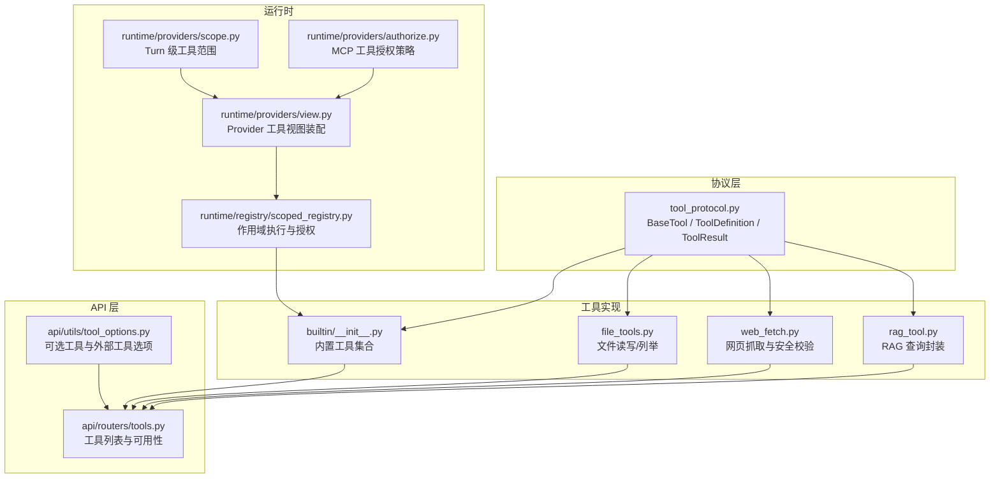
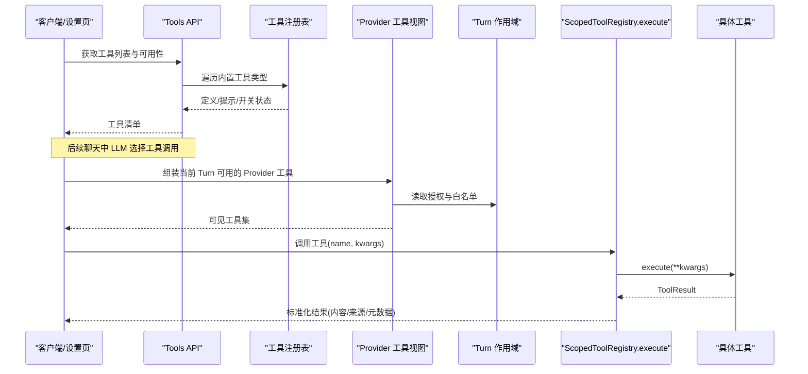
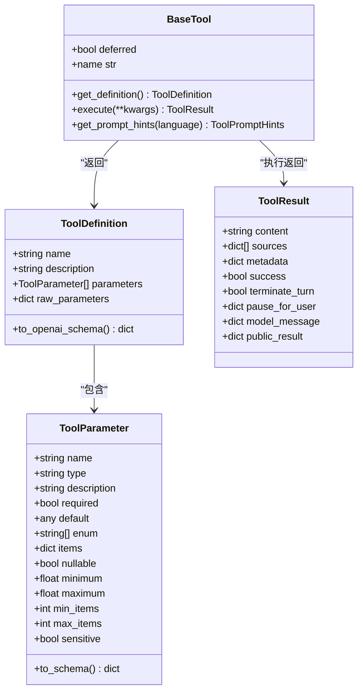
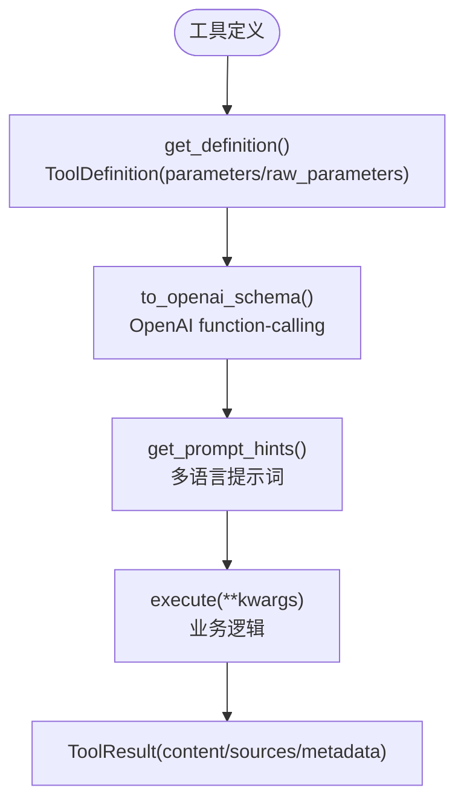
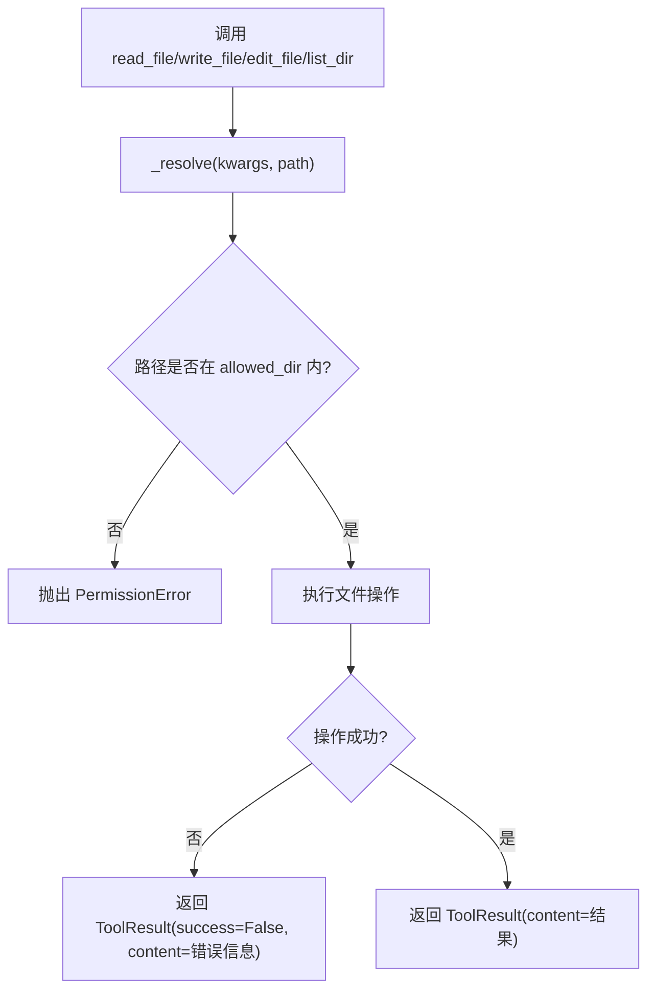
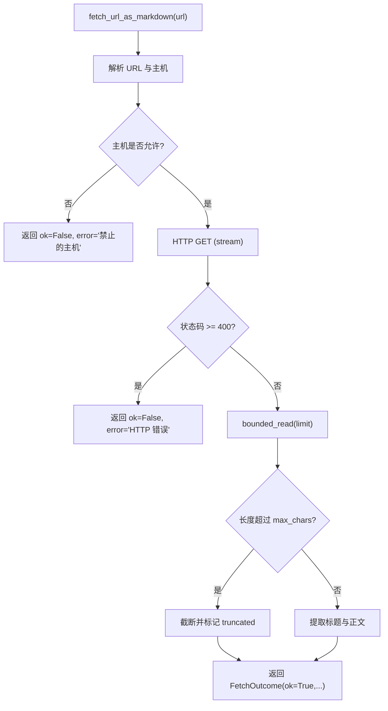
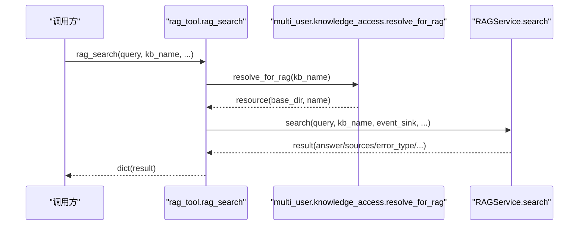
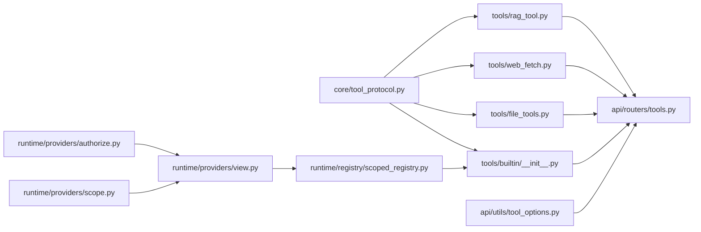
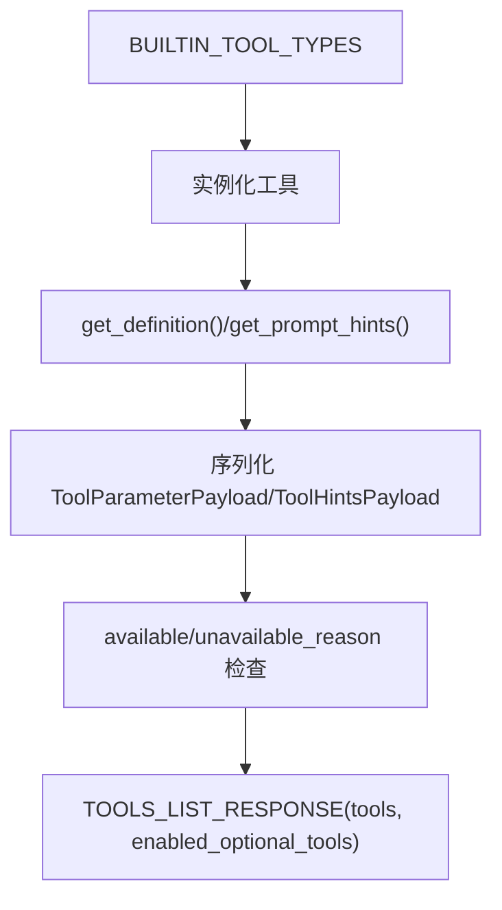

# 工具函数扩展

<cite>
**本文引用的文件**   
- [deeptutor/core/tool_protocol.py](file://deeptutor/core/tool_protocol.py)
- [deeptutor/tools/builtin/__init__.py](file://deeptutor/tools/builtin/__init__.py)
- [deeptutor/tools/file_tools.py](file://deeptutor/tools/file_tools.py)
- [deeptutor/tools/web_fetch.py](file://deeptutor/tools/web_fetch.py)
- [deeptutor/tools/rag_tool.py](file://deeptutor/tools/rag_tool.py)
- [deeptutor/api/routers/tools.py](file://deeptutor/api/routers/tools.py)
- [deeptutor/runtime/registry/scoped_registry.py](file://deeptutor/runtime/registry/scoped_registry.py)
- [deeptutor/runtime/providers/view.py](file://deeptutor/runtime/providers/view.py)
- [deeptutor/runtime/providers/scope.py](file://deeptutor/runtime/providers/scope.py)
- [deeptutor/runtime/providers/authorize.py](file://deeptutor/runtime/providers/authorize.py)
- [deeptutor/api/utils/tool_options.py](file://deeptutor/api/utils/tool_options.py)
</cite>

## 目录
1. [引言](#引言)
2. [项目结构](#项目结构)
3. [核心组件](#核心组件)
4. [架构总览](#架构总览)
5. [详细组件分析](#详细组件分析)
6. [依赖关系分析](#依赖关系分析)
7. [性能与优化](#性能与优化)
8. [安全与输入校验](#安全与输入校验)
9. [异步、流式响应与进度反馈](#异步流式响应与进度反馈)
10. [注册流程与配置选项](#注册流程与配置选项)
11. [开发模板与示例](#开发模板与示例)
12. [故障排查指南](#故障排查指南)
13. [结论](#结论)

## 引言
本指南面向希望为 DeepTutor 构建自定义工具函数的开发者。文档从系统协议、注册机制、执行路径、错误处理、安全性、性能优化到完整开发模板，逐步说明如何编写可被聊天智能体调用的工具函数扩展。重点包括：
- 工具接口规范：参数定义、返回值格式、提示词元数据。
- 注册与发现：内置工具、能力工具、外部 MCP/CLI 工具的可见性与授权。
- 执行与结果：ToolResult 语义、来源引用、暂停交互、模型私有消息。
- 安全与资源限制：工作区路径隔离、网络请求白名单、大小与超时限制。
- 异步与流式：事件回调、进度反馈、长任务可视化。
- 配置与可用性：用户开关、运行时可用性检查、多语言提示。

## 项目结构
DeepTutor 的工具体系围绕 `core/tool_protocol` 协议展开，内置工具集中在 `tools/builtin`，具体领域工具位于 `tools/*`，API 层提供工具列表与可用性查询，运行时通过作用域注册表控制工具可见性与执行权限。

**图表来源**
- [deeptutor/core/tool_protocol.py:16-330](file://deeptutor/core/tool_protocol.py#L16-L330)
- [deeptutor/tools/builtin/__init__.py:1-800](file://deeptutor/tools/builtin/__init__.py#L1-L800)
- [deeptutor/tools/file_tools.py:1-292](file://deeptutor/tools/file_tools.py#L1-L292)
- [deeptutor/tools/web_fetch.py:1-364](file://deeptutor/tools/web_fetch.py#L1-L364)
- [deeptutor/tools/rag_tool.py:1-111](file://deeptutor/tools/rag_tool.py#L1-L111)
- [deeptutor/api/routers/tools.py:1-269](file://deeptutor/api/routers/tools.py#L1-L269)
- [deeptutor/runtime/registry/scoped_registry.py:32-175](file://deeptutor/runtime/registry/scoped_registry.py#L32-L175)
- [deeptutor/runtime/providers/view.py:71-115](file://deeptutor/runtime/providers/view.py#L71-L115)
- [deeptutor/runtime/providers/scope.py:1-18](file://deeptutor/runtime/providers/scope.py#L1-L18)
- [deeptutor/runtime/providers/authorize.py:40-66](file://deeptutor/runtime/providers/authorize.py#L40-L66)
- [deeptutor/api/utils/tool_options.py:1-29](file://deeptutor/api/utils/tool_options.py#L1-L29)

**章节来源**
- [deeptutor/core/tool_protocol.py:16-330](file://deeptutor/core/tool_protocol.py#L16-L330)
- [deeptutor/tools/builtin/__init__.py:1-800](file://deeptutor/tools/builtin/__init__.py#L1-L800)
- [deeptutor/api/routers/tools.py:1-269](file://deeptutor/api/routers/tools.py#L1-L269)
- [deeptutor/runtime/registry/scoped_registry.py:32-175](file://deeptutor/runtime/registry/scoped_registry.py#L32-L175)

## 核心组件
本节聚焦工具协议与关键数据结构，它们是自定义工具必须遵循的契约。

- BaseTool：所有工具的抽象基类，要求实现 `get_definition()` 与 `execute()`；支持延迟加载（deferred）和提示词元数据（get_prompt_hints）。
- ToolDefinition：描述工具名称、描述、参数列表或原始 JSON Schema，并生成 OpenAI function-calling 兼容的结构。
- ToolParameter：单个参数的类型、是否必填、默认值、枚举、数组项 schema、数值/数组边界、敏感字段标记等。
- ToolResult：统一返回结构，包含内容、来源引用、结构化元数据、成功标志、终止轮次、暂停交互、模型私有消息、公开结果投影等。
- ToolEventSink：工具内部用于流式上报进度的异步回调接口。
- ToolLookup：只读工具注册表视图，提供获取工具、构建 schema、执行工具等方法。

这些组件共同定义了“工具是什么”“如何被 LLM 调用”“如何返回结果”。

**章节来源**
- [deeptutor/core/tool_protocol.py:16-330](file://deeptutor/core/tool_protocol.py#L16-L330)

## 架构总览
工具的生命周期分为三个阶段：
1. 定义与注册：工具类继承 BaseTool，声明 ToolDefinition；内置工具由 builtin 模块集中管理，外部工具通过 Provider 视图装配。
2. 发现与展示：API 层列出工具定义、提示词、可用性与用户开关状态；前端据此渲染设置页与 composer。
3. 执行与结果：运行时根据 Turn 的作用域与授权策略决定工具是否可见，并通过 ScopedToolRegistry 执行；结果以 ToolResult 形式回传，供聊天循环、流式事件与 UI 消费。

**图表来源**
- [deeptutor/api/routers/tools.py:215-269](file://deeptutor/api/routers/tools.py#L215-L269)
- [deeptutor/runtime/providers/view.py:71-115](file://deeptutor/runtime/providers/view.py#L71-L115)
- [deeptutor/runtime/providers/scope.py:1-18](file://deeptutor/runtime/providers/scope.py#L1-L18)
- [deeptutor/runtime/registry/scoped_registry.py:137-162](file://deeptutor/runtime/registry/scoped_registry.py#L137-L162)

**章节来源**
- [deeptutor/api/routers/tools.py:215-269](file://deeptutor/api/routers/tools.py#L215-L269)
- [deeptutor/runtime/providers/view.py:71-115](file://deeptutor/runtime/providers/view.py#L71-L115)
- [deeptutor/runtime/registry/scoped_registry.py:137-162](file://deeptutor/runtime/registry/scoped_registry.py#L137-L162)

## 详细组件分析

### 工具协议与数据结构
- BaseTool：
  - deferred：延迟加载工具，初始不暴露完整 schema，按需加载。
  - get_definition()：返回 ToolDefinition。
  - execute(**kwargs)：异步执行，返回 ToolResult。
  - get_prompt_hints(language)：返回提示词元数据，便于动态组装系统提示。
- ToolDefinition：
  - name/description：工具标识与描述。
  - parameters/raw_parameters：结构化参数或原始 JSON Schema。
  - to_openai_schema()：生成 OpenAI function-calling 兼容结构。
- ToolParameter：
  - type/required/default/enum/items/minimum/maximum/min_items/max_items：约束参数类型与取值范围。
  - sensitive：在 trace 中隐藏敏感参数值。
  - nullable：允许 null 值，避免严格 provider 拒绝。
- ToolResult：
  - content：LLM 看到的工具输出文本。
  - sources：来源引用行，用于溯源。
  - metadata：自由结构，可用于 UI 提示或下游逻辑。
  - success：显式失败路径。
  - terminate_turn/pause_for_user：控制聊天轮次结束或暂停等待用户输入。
  - model_message/public_result：模型私有上下文与公开结果投影。

**图表来源**
- [deeptutor/core/tool_protocol.py:16-330](file://deeptutor/core/tool_protocol.py#L16-L330)

**章节来源**
- [deeptutor/core/tool_protocol.py:16-330](file://deeptutor/core/tool_protocol.py#L16-L330)

### 内置工具集合与提示词
- builtin/__init__.py 集中管理大量内置工具，如 brainstorm、rag、kb_files、knowledge_frontier、web_search、reason、paper_search 等。
- 每个工具继承 BaseTool，实现 get_definition 与 execute；多数工具使用 _PromptHintsMixin 加载多语言提示词。
- rag 工具对视觉证据、PDF 页面裁剪、资产 ID 等进行严格校验，并将来源引用注入 sources。
- web_search 将搜索结果转换为 ToolResult，附带 citations。

**图表来源**
- [deeptutor/tools/builtin/__init__.py:40-72](file://deeptutor/tools/builtin/__init__.py#L40-L72)
- [deeptutor/tools/builtin/__init__.py:167-450](file://deeptutor/tools/builtin/__init__.py#L167-L450)
- [deeptutor/tools/builtin/__init__.py:501-577](file://deeptutor/tools/builtin/__init__.py#L501-L577)
- [deeptutor/tools/builtin/__init__.py:680-717](file://deeptutor/tools/builtin/__init__.py#L680-L717)

**章节来源**
- [deeptutor/tools/builtin/__init__.py:1-800](file://deeptutor/tools/builtin/__init__.py#L1-L800)

### 文件操作工具
- ReadFileTool/WriteFileTool/EditFileTool/ListDirTool 均继承 _WorkspaceTool，确保路径在工作区内解析。
- 路径解析器 `_resolve_workspace_path` 强制目标路径必须在允许的 workspace 目录下，防止越权访问。
- 读取时进行分页、最大字符截断；写入/编辑时捕获 PermissionError 与通用异常，返回 ToolResult(success=False)。
- ListDirTool 忽略常见缓存/构建目录，限制条目数量，避免过大输出。

**图表来源**
- [deeptutor/tools/file_tools.py:13-25](file://deeptutor/tools/file_tools.py#L13-L25)
- [deeptutor/tools/file_tools.py:41-106](file://deeptutor/tools/file_tools.py#L41-L106)
- [deeptutor/tools/file_tools.py:109-131](file://deeptutor/tools/file_tools.py#L109-L131)
- [deeptutor/tools/file_tools.py:134-186](file://deeptutor/tools/file_tools.py#L134-L186)
- [deeptutor/tools/file_tools.py:189-263](file://deeptutor/tools/file_tools.py#L189-L263)

**章节来源**
- [deeptutor/tools/file_tools.py:1-292](file://deeptutor/tools/file_tools.py#L1-L292)

### 网络请求工具
- web_fetch.py 提供 fetch_url_as_markdown，负责 HTTP 抓取、重定向校验、响应大小限制、编码检测与可读文本提取。
- 安全策略：
  - 仅允许 http/https 方案。
  - 拒绝私有/环回/链路本地 IP 与主机名。
  - 限制最大响应字节数与最大字符数。
  - 手动跟随重定向并在每次跳转前校验目标 URL。
- 输出 FetchOutcome，ok=True 时包含 markdown/url/title/truncated；ok=False 时包含 error。

**图表来源**
- [deeptutor/tools/web_fetch.py:74-162](file://deeptutor/tools/web_fetch.py#L74-L162)
- [deeptutor/tools/web_fetch.py:178-221](file://deeptutor/tools/web_fetch.py#L178-L221)
- [deeptutor/tools/web_fetch.py:224-240](file://deeptutor/tools/web_fetch.py#L224-L240)
- [deeptutor/tools/web_fetch.py:313-356](file://deeptutor/tools/web_fetch.py#L313-L356)

**章节来源**
- [deeptutor/tools/web_fetch.py:1-364](file://deeptutor/tools/web_fetch.py#L1-L364)

### RAG 查询工具
- rag_tool.py 封装 RAGService，提供 rag_search/initialize/delete 等能力。
- rag_search 接收 query/kb_name/provider/kb_base_dir/event_sink，校验非空后通过 multi-user 知识访问解析 kb_base_dir，再调用 service.search。
- event_sink 支持上游服务流式进度上报。

**图表来源**
- [deeptutor/tools/rag_tool.py:15-51](file://deeptutor/tools/rag_tool.py#L15-L51)

**章节来源**
- [deeptutor/tools/rag_tool.py:1-111](file://deeptutor/tools/rag_tool.py#L1-L111)

## 依赖关系分析
- 协议依赖：所有工具依赖 core/tool_protocol 提供的 BaseTool、ToolDefinition、ToolResult。
- 内置工具依赖：builtin/__init__.py 聚合多种工具，部分工具依赖 services.rag、services.workspace、multi_user.knowledge_access 等。
- API 依赖：tools router 依赖 i18n、settings、builtin 元数据，序列化工具定义与提示词。
- 运行时依赖：scoped_registry 提供执行入口，view 装配 Provider 工具，scope 与 authorize 决定授权策略。

**图表来源**
- [deeptutor/core/tool_protocol.py:16-330](file://deeptutor/core/tool_protocol.py#L16-L330)
- [deeptutor/tools/builtin/__init__.py:1-800](file://deeptutor/tools/builtin/__init__.py#L1-L800)
- [deeptutor/tools/file_tools.py:1-292](file://deeptutor/tools/file_tools.py#L1-L292)
- [deeptutor/tools/web_fetch.py:1-364](file://deeptutor/tools/web_fetch.py#L1-L364)
- [deeptutor/tools/rag_tool.py:1-111](file://deeptutor/tools/rag_tool.py#L1-L111)
- [deeptutor/api/routers/tools.py:1-269](file://deeptutor/api/routers/tools.py#L1-L269)
- [deeptutor/runtime/registry/scoped_registry.py:32-175](file://deeptutor/runtime/registry/scoped_registry.py#L32-L175)
- [deeptutor/runtime/providers/view.py:71-115](file://deeptutor/runtime/providers/view.py#L71-L115)
- [deeptutor/runtime/providers/scope.py:1-18](file://deeptutor/runtime/providers/scope.py#L1-L18)
- [deeptutor/runtime/providers/authorize.py:40-66](file://deeptutor/runtime/providers/authorize.py#L40-L66)
- [deeptutor/api/utils/tool_options.py:1-29](file://deeptutor/api/utils/tool_options.py#L1-L29)

**章节来源**
- [deeptutor/runtime/registry/scoped_registry.py:32-175](file://deeptutor/runtime/registry/scoped_registry.py#L32-L175)
- [deeptutor/runtime/providers/view.py:71-115](file://deeptutor/runtime/providers/view.py#L71-L115)
- [deeptutor/runtime/providers/scope.py:1-18](file://deeptutor/runtime/providers/scope.py#L1-L18)
- [deeptutor/runtime/providers/authorize.py:40-66](file://deeptutor/runtime/providers/authorize.py#L40-L66)

## 性能与优化
- 文件大小与行数限制：ReadFileTool 限制最大字符数与默认行数，避免大文件阻塞。
- 目录列举上限：ListDirTool 限制条目数量，忽略缓存目录，减少输出体积。
- 网络响应限制：web_fetch.py 限制最大响应字节与最大字符数，避免内存膨胀。
- 并行与线程池：RAG 与 KB 清单等操作使用 asyncio.to_thread 将阻塞 I/O 移出事件循环。
- 摘要与压缩：聊天管线对工具结果进行 LLM 摘要，减少上下文占用。
- 缓存策略：RAG 服务与知识库索引可复用；可视资产存储按 KB 目录组织，避免重复加载。

建议：
- 对耗时操作使用异步或线程池。
- 对大输出进行分页与截断。
- 对网络请求设置超时与大小限制。
- 对频繁查询引入缓存或去重。
- 对日志与 trace 控制粒度，避免泄露敏感信息。

[本节为通用指导，不直接分析具体文件]

## 安全与输入校验
- 工作区路径隔离：_resolve_workspace_path 强制路径在 allowed_dir 内，否则抛出 PermissionError。
- 网络白名单：web_fetch.py 拒绝私有/环回/链路本地 IP，阻止内网探测。
- 重定向防护：手动跟随重定向并在每次跳转前校验目标 URL。
- 参数校验：RAG 工具要求非空 query 与 kb_name；RAG 视觉选择器严格校验 page/region 等。
- 敏感字段：ToolParameter.sensitive 可在 trace 中隐藏参数值。
- 授权控制：ScopedToolRegistry 对未授权的外部工具返回 ToolResult(success=False)，并记录日志。

最佳实践：
- 始终对用户输入进行类型与范围校验。
- 对文件系统与网络 I/O 设置最小权限与上限。
- 对敏感参数使用 sensitive 标记。
- 对外部工具启用 allowlist 与 scope 控制。

**章节来源**
- [deeptutor/tools/file_tools.py:13-25](file://deeptutor/tools/file_tools.py#L13-L25)
- [deeptutor/tools/web_fetch.py:74-162](file://deeptutor/tools/web_fetch.py#L74-L162)
- [deeptutor/tools/builtin/__init__.py:120-164](file://deeptutor/tools/builtin/__init__.py#L120-L164)
- [deeptutor/runtime/registry/scoped_registry.py:137-162](file://deeptutor/runtime/registry/scoped_registry.py#L137-L162)

## 异步、流式响应与进度反馈
- ToolEventSink：工具可通过该回调上报事件类型、消息与元数据，供上层流式总线消费。
- RAG 工具支持 event_sink，使上游服务能推送进度。
- 聊天管线对工具结果进行流式摘要，将思考片段推送到 stream.thinking，并在 trace 中显示子节点状态。
- StreamBus 提供 tool_call 与 tool_result 辅助方法，记录调用与结果事件。

建议：
- 长任务工具应定期调用 event_sink 上报进度。
- 对 UI 友好的进度消息应包含 stage 与 metadata。
- 对失败路径及时上报 error 事件，便于前端展示。

**章节来源**
- [deeptutor/core/tool_protocol.py:214-222](file://deeptutor/core/tool_protocol.py#L214-L222)
- [deeptutor/tools/rag_tool.py:15-51](file://deeptutor/tools/rag_tool.py#L15-L51)
- [tests/agents/question/test_pipeline.py:957-1039](file://tests/agents/question/test_pipeline.py#L957-L1039)

## 注册流程与配置选项
- 内置工具注册：builtin/__init__.py 集中定义工具类，API 层遍历 BUILTIN_TOOL_TYPES 实例化并序列化。
- 用户开关：USER_TOGGLEABLE_TOOL_NAMES 控制哪些工具可由用户在设置页切换；enabled_optional_tools 反映当前启用集合。
- 运行时可用性：_runtime_availability 检查 web_search 的配置与凭据，返回 available/unavailable_reason。
- 外部工具：Provider 工具视图装配 MCP/CLI 工具，依据 scope 与 authorize 策略决定是否可见与可执行。
- 工具选项：tool_options.py 提供 tools/builtin_tools/mcp_tools 列表，支持多语言描述与分组。

**图表来源**
- [deeptutor/api/routers/tools.py:215-269](file://deeptutor/api/routers/tools.py#L215-L269)
- [deeptutor/api/routers/tools.py:196-212](file://deeptutor/api/routers/tools.py#L196-L212)

**章节来源**
- [deeptutor/api/routers/tools.py:1-269](file://deeptutor/api/routers/tools.py#L1-L269)
- [deeptutor/api/utils/tool_options.py:1-29](file://deeptutor/api/utils/tool_options.py#L1-L29)

## 开发模板与示例
以下为开发自定义工具的步骤与要点（不展示代码内容，仅提供路径参考）：

- 定义工具类：
  - 继承 BaseTool。
  - 实现 get_definition()，返回 ToolDefinition，包含 name/description/parameters。
  - 实现 execute(**kwargs)，返回 ToolResult。
  - 可选：重写 get_prompt_hints(language) 返回 ToolPromptHints。
  - 可选：设置 deferred = True 以延迟加载。

- 参数设计：
  - 使用 ToolParameter 定义类型、必填、默认值、枚举、数组项 schema、数值/数组边界。
  - 对敏感参数设置 sensitive = True。
  - 对可选参数设置 nullable = True，避免严格 provider 拒绝。

- 错误处理：
  - 捕获特定异常（如 PermissionError），返回 ToolResult(success=False, content=错误信息)。
  - 对通用异常进行兜底处理，避免进程崩溃。

- 异步与流式：
  - 对耗时操作使用 asyncio.to_thread 或 async 函数。
  - 如需进度反馈，使用 event_sink 上报事件。

- 注册与可见性：
  - 若为内置工具，加入 builtin/__init__.py 的工具集合。
  - 若需用户开关，加入 USER_TOGGLEABLE_TOOL_NAMES。
  - 若为外部工具，通过 Provider 视图装配并按 scope/authorize 控制。

- 示例参考：
  - 文件操作：[file_tools.py:41-106](file://deeptutor/tools/file_tools.py#L41-L106)
  - 网络请求：[web_fetch.py:74-162](file://deeptutor/tools/web_fetch.py#L74-L162)
  - RAG 查询：[rag_tool.py:15-51](file://deeptutor/tools/rag_tool.py#L15-L51)
  - 内置工具集合：[builtin/__init__.py:40-72](file://deeptutor/tools/builtin/__init__.py#L40-L72)

**章节来源**
- [deeptutor/core/tool_protocol.py:261-308](file://deeptutor/core/tool_protocol.py#L261-L308)
- [deeptutor/tools/file_tools.py:41-106](file://deeptutor/tools/file_tools.py#L41-L106)
- [deeptutor/tools/web_fetch.py:74-162](file://deeptutor/tools/web_fetch.py#L74-L162)
- [deeptutor/tools/rag_tool.py:15-51](file://deeptutor/tools/rag_tool.py#L15-L51)
- [deeptutor/tools/builtin/__init__.py:40-72](file://deeptutor/tools/builtin/__init__.py#L40-L72)

## 故障排查指南
- 工具不可用：
  - 检查 API 层 available/unavailable_reason，确认配置与凭据。
  - 检查用户开关 enabled_optional_tools 与权限 granted。
- 工具执行失败：
  - 查看 ToolResult.success 与 content，定位业务错误。
  - 检查 ScopedToolRegistry 是否因授权拒绝工具。
- 路径越权：
  - 检查 _resolve_workspace_path 是否抛出 PermissionError。
- 网络请求失败：
  - 检查 URL scheme、主机白名单、重定向限制与响应大小。
- 流式进度缺失：
  - 确认 event_sink 是否正确传入与调用。
  - 检查 StreamBus 是否记录 tool_call/tool_result 事件。

**章节来源**
- [deeptutor/api/routers/tools.py:196-212](file://deeptutor/api/routers/tools.py#L196-L212)
- [deeptutor/runtime/registry/scoped_registry.py:137-162](file://deeptutor/runtime/registry/scoped_registry.py#L137-L162)
- [deeptutor/tools/file_tools.py:103-106](file://deeptutor/tools/file_tools.py#L103-L106)
- [deeptutor/tools/web_fetch.py:94-155](file://deeptutor/tools/web_fetch.py#L94-L155)

## 结论
通过遵循 BaseTool 协议、合理设计 ToolDefinition 与 ToolResult、实施严格的安全与资源限制、利用异步与流式机制提升用户体验，并结合注册与授权框架实现可控的工具生态，开发者可以快速构建功能强大且安全的工具函数扩展。建议在开发过程中重视参数校验、错误处理、进度反馈与性能优化，确保工具在不同场景下稳定可靠。