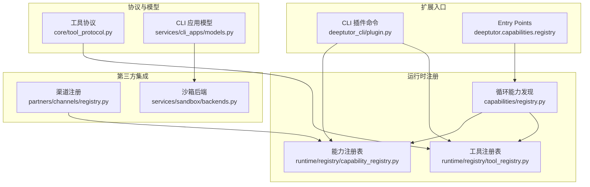
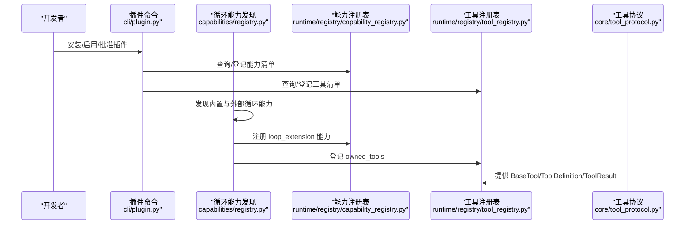
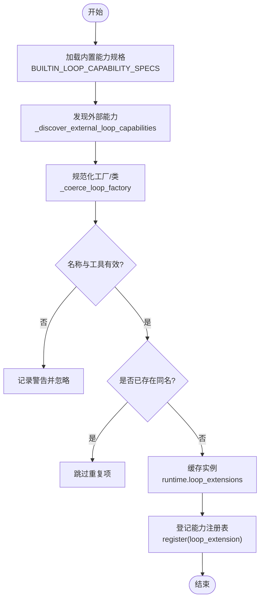
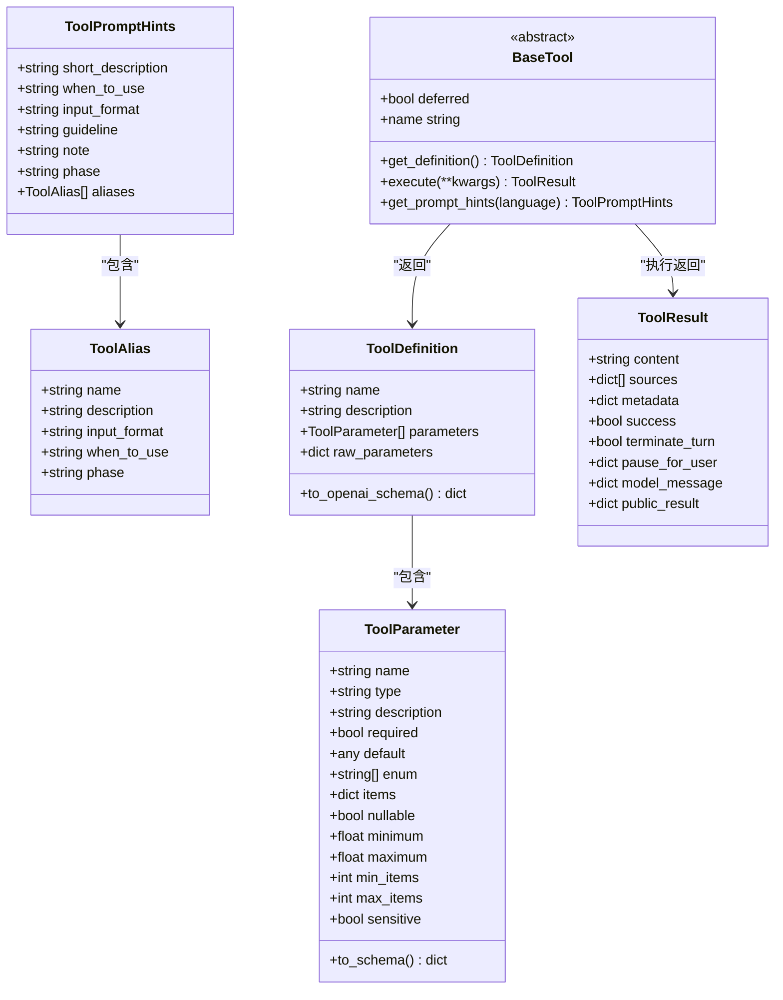
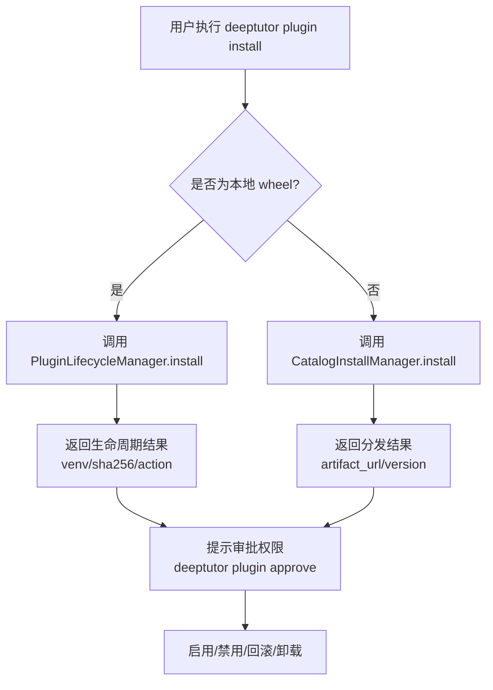
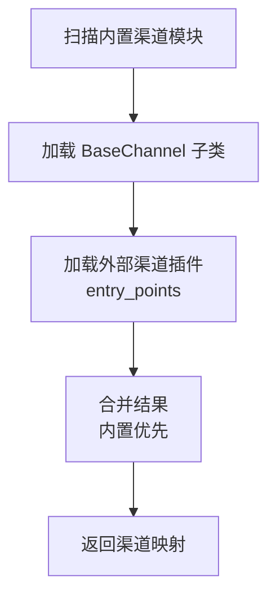
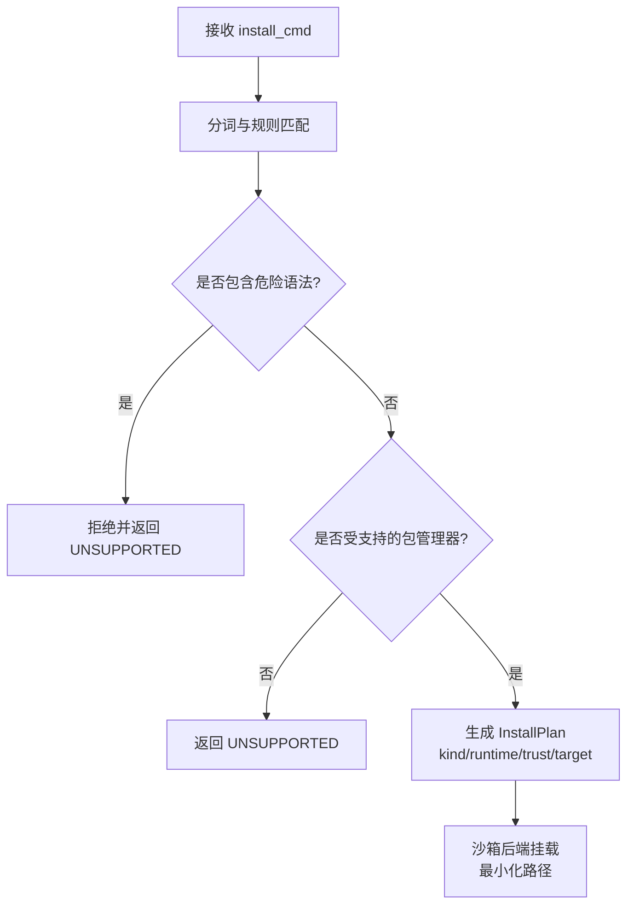
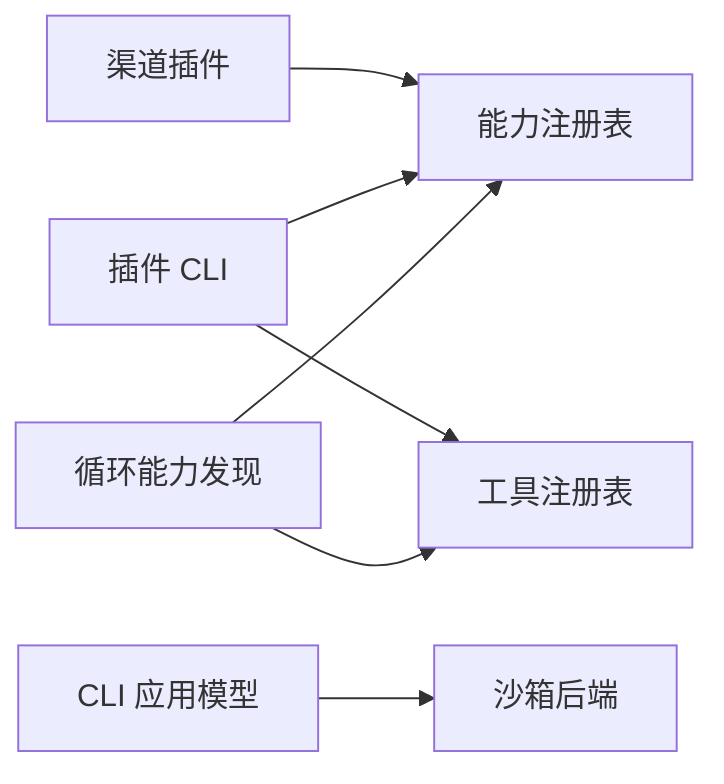

# 扩展开发

<cite>
**本文引用的文件**   
- [deeptutor/capabilities/registry.py](file://deeptutor/capabilities/registry.py)
- [deeptutor/core/tool_protocol.py](file://deeptutor/core/tool_protocol.py)
- [deeptutor_cli/plugin.py](file://deeptutor_cli/plugin.py)
- [deeptutor/partners/channels/registry.py](file://deeptutor/partners/channels/registry.py)
- [deeptutor/plugins/registry.py](file://deeptutor/plugins/registry.py)
- [deeptutor/runtime/registry/capability_registry.py](file://deeptutor/runtime/registry/capability_registry.py)
- [deeptutor/runtime/registry/tool_registry.py](file://deeptutor/runtime/registry/tool_registry.py)
- [deeptutor/services/cli_apps/models.py](file://deeptutor/services/cli_apps/models.py)
- [deeptutor/services/sandbox/backends.py](file://deeptutor/services/sandbox/backends.py)
</cite>

## 目录
1. [简介](#简介)
2. [项目结构](#项目结构)
3. [核心组件](#核心组件)
4. [架构总览](#架构总览)
5. [详细组件分析](#详细组件分析)
6. [依赖关系分析](#依赖关系分析)
7. [性能考虑](#性能考虑)
8. [故障排查指南](#故障排查指南)
9. [结论](#结论)
10. [附录](#附录)

## 简介
本指南面向希望为 DeepTutor 开发自定义能力、工具函数与第三方集成的开发者。文档围绕插件系统架构、注册机制与生命周期管理展开，提供能力开发框架、工具开发规范与提供商集成指南，并覆盖测试策略、打包发布、版本管理、安全性与权限控制、资源隔离、调试技巧与性能优化建议，帮助开发者快速理解并实现可扩展的 DeepTutor 功能。

## 项目结构
DeepTutor 的扩展体系由多个层次组成：
- 能力层：以“循环扩展”形式暴露给聊天智能体，声明拥有的工具集合与激活条件。
- 工具层：统一的 BaseTool 协议定义工具元数据、参数模式与执行结果。
- 注册中心：能力与工具的运行时注册表，支持内置与外部发现。
- 插件系统：通过 CLI 命令安装、启用、批准权限、回滚与卸载插件包。
- 第三方集成：渠道（Channel）与 CLI 应用等扩展点，支持外部插件与沙箱隔离。

**图示来源**
- [deeptutor_cli/plugin.py:21-305](file://deeptutor_cli/plugin.py#L21-L305)
- [deeptutor/capabilities/registry.py:22-58](file://deeptutor/capabilities/registry.py#L22-L58)
- [deeptutor/runtime/registry/capability_registry.py](file://deeptutor/runtime/registry/capability_registry.py)
- [deeptutor/runtime/registry/tool_registry.py](file://deeptutor/runtime/registry/tool_registry.py)
- [deeptutor/core/tool_protocol.py:261-330](file://deeptutor/core/tool_protocol.py#L261-L330)
- [deeptutor/partners/channels/registry.py:50-61](file://deeptutor/partners/channels/registry.py#L50-L61)
- [deeptutor/services/cli_apps/models.py:167-199](file://deeptutor/services/cli_apps/models.py#L167-L199)
- [deeptutor/services/sandbox/backends.py:152-181](file://deeptutor/services/sandbox/backends.py#L152-L181)

**章节来源**
- [deeptutor_cli/plugin.py:21-305](file://deeptutor_cli/plugin.py#L21-L305)
- [deeptutor/capabilities/registry.py:22-58](file://deeptutor/capabilities/registry.py#L22-L58)
- [deeptutor/core/tool_protocol.py:261-330](file://deeptutor/core/tool_protocol.py#L261-L330)
- [deeptutor/partners/channels/registry.py:50-61](file://deeptutor/partners/channels/registry.py#L50-L61)
- [deeptutor/services/cli_apps/models.py:167-199](file://deeptutor/services/cli_apps/models.py#L167-L199)
- [deeptutor/services/sandbox/backends.py:152-181](file://deeptutor/services/sandbox/backends.py#L152-L181)

## 核心组件
- 循环能力发现与注册：负责加载内置与外部循环能力，校验名称一致性，缓存实例，并向能力注册表登记。
- 工具协议：定义工具参数、定义、别名、提示、事件投影、结果与抽象基类，统一工具对外契约。
- 插件 CLI：提供列出、查看、搜索、安装、启用、批准、禁用、回滚与卸载插件的命令。
- 渠道插件：扫描内置渠道模块并通过 entry points 发现外部渠道插件。
- CLI 应用模型：对安装命令进行严格解析与信任评估，限制危险操作。
- 沙箱后端：检测 Python 运行环境路径，为受管虚拟环境提供最小化挂载。

**章节来源**
- [deeptutor/capabilities/registry.py:28-58](file://deeptutor/capabilities/registry.py#L28-L58)
- [deeptutor/core/tool_protocol.py:16-124](file://deeptutor/core/tool_protocol.py#L16-L124)
- [deeptutor/core/tool_protocol.py:261-330](file://deeptutor/core/tool_protocol.py#L261-L330)
- [deeptutor_cli/plugin.py:21-305](file://deeptutor_cli/plugin.py#L21-L305)
- [deeptutor/partners/channels/registry.py:27-61](file://deeptutor/partners/channels/registry.py#L27-L61)
- [deeptutor/services/cli_apps/models.py:167-199](file://deeptutor/services/cli_apps/models.py#L167-L199)
- [deeptutor/services/sandbox/backends.py:152-181](file://deeptutor/services/sandbox/backends.py#L152-L181)

## 架构总览
下图展示从 CLI 到运行时注册的完整扩展流程，包括能力发现、工具协议与插件生命周期。

**图示来源**
- [deeptutor_cli/plugin.py:21-305](file://deeptutor_cli/plugin.py#L21-L305)
- [deeptutor/capabilities/registry.py:115-187](file://deeptutor/capabilities/registry.py#L115-L187)
- [deeptutor/runtime/registry/capability_registry.py](file://deeptutor/runtime/registry/capability_registry.py)
- [deeptutor/runtime/registry/tool_registry.py](file://deeptutor/runtime/registry/tool_registry.py)
- [deeptutor/core/tool_protocol.py:261-330](file://deeptutor/core/tool_protocol.py#L261-L330)

## 详细组件分析

### 循环能力与插件发现
- 内置能力规格：使用 LoopCapabilitySpec 描述 name 与 class_path，创建时校验 extension.name 与描述一致。
- 外部能力发现：通过 load_entry_point_group 读取 canonical 与 legacy 两组 entry points，兼容旧组名并给出弃用警告。
- 实例缓存：all_loop_capabilities 在上下文 runtime.loop_extensions 中缓存实例，避免重复构造；同时向能力注册表登记 manifest 与 factory。
- 激活过滤：active_loop_capabilities 根据 is_active(context) 筛选可用能力；exclusive_tools 用于互斥工具场景。

**图示来源**
- [deeptutor/capabilities/registry.py:28-58](file://deeptutor/capabilities/registry.py#L28-L58)
- [deeptutor/capabilities/registry.py:86-144](file://deeptutor/capabilities/registry.py#L86-L144)
- [deeptutor/capabilities/registry.py:159-187](file://deeptutor/capabilities/registry.py#L159-L187)

**章节来源**
- [deeptutor/capabilities/registry.py:28-58](file://deeptutor/capabilities/registry.py#L28-L58)
- [deeptutor/capabilities/registry.py:86-144](file://deeptutor/capabilities/registry.py#L86-L144)
- [deeptutor/capabilities/registry.py:159-187](file://deeptutor/capabilities/registry.py#L159-L187)

### 工具协议与开发规范
- 参数与模式：ToolParameter 支持类型、枚举、范围、数组 items、可空与敏感字段；to_schema 生成 JSON Schema 属性。
- 工具定义：ToolDefinition 支持 raw_parameters 透传上游 JSON Schema，to_openai_schema 输出 OpenAI function-calling 格式。
- 工具别名与提示：ToolAlias 与 ToolPromptHints 用于动态提示组装与引导模型何时使用工具。
- 执行结果：ToolResult 包含 content、sources、metadata、success、terminate_turn、pause_for_user、model_message、public_result。
- 抽象基类：BaseTool 要求实现 get_definition 与 execute，并提供 deferred 延迟披露、get_prompt_hints、name 属性。
- 提供者身份：provider_identity 提取 (kind, provider_id)，用于追踪 MCP/CLI 工具来源。

**图示来源**
- [deeptutor/core/tool_protocol.py:16-124](file://deeptutor/core/tool_protocol.py#L16-L124)
- [deeptutor/core/tool_protocol.py:138-149](file://deeptutor/core/tool_protocol.py#L138-L149)
- [deeptutor/core/tool_protocol.py:166-209](file://deeptutor/core/tool_protocol.py#L166-L209)
- [deeptutor/core/tool_protocol.py:261-330](file://deeptutor/core/tool_protocol.py#L261-L330)

**章节来源**
- [deeptutor/core/tool_protocol.py:16-124](file://deeptutor/core/tool_protocol.py#L16-L124)
- [deeptutor/core/tool_protocol.py:138-149](file://deeptutor/core/tool_protocol.py#L138-L149)
- [deeptutor/core/tool_protocol.py:166-209](file://deeptutor/core/tool_protocol.py#L166-L209)
- [deeptutor/core/tool_protocol.py:261-330](file://deeptutor/core/tool_protocol.py#L261-L330)

### 插件系统与生命周期管理
- 列表与详情：plugin list/info 显示工具、能力与插件包的清单与详细信息。
- 状态与搜索：plugin state/search 展示已安装/目录状态与官方目录检索。
- 安装流程：plugin install 支持本地 wheel 或目录版本，返回 venv 路径与下一步审批提示。
- 权限审批：plugin approve 批准插件声明的权限，更新状态。
- 启用/禁用：plugin enable/disable 控制插件可用性。
- 回滚/卸载：plugin rollback/uninstall 管理插件版本与清理。

**图示来源**
- [deeptutor_cli/plugin.py:183-262](file://deeptutor_cli/plugin.py#L183-L262)
- [deeptutor_cli/plugin.py:264-305](file://deeptutor_cli/plugin.py#L264-L305)

**章节来源**
- [deeptutor_cli/plugin.py:21-305](file://deeptutor_cli/plugin.py#L21-L305)

### 第三方集成与渠道插件
- 内置渠道发现：通过 pkgutil 扫描 deeptutor.partners.channels 包，排除内部模块。
- 外部渠道插件：通过 entry_points(group="deeptutor.partners.channels") 加载类对象，失败时记录警告。
- 优先级规则：内置渠道优先于外部插件，防止同名覆盖。

**图示来源**
- [deeptutor/partners/channels/registry.py:27-47](file://deeptutor/partners/channels/registry.py#L27-L47)
- [deeptutor/partners/channels/registry.py:50-61](file://deeptutor/partners/channels/registry.py#L50-L61)

**章节来源**
- [deeptutor/partners/channels/registry.py:27-61](file://deeptutor/partners/channels/registry.py#L27-L61)

### CLI 应用与沙箱隔离
- 安装计划解析：plan_install 对 install_cmd 做严格词法匹配，拒绝管道、重定向、cd、&& 等危险组合，仅允许受支持的包管理器形式。
- 信任评估：将应用标记为第三方信任等级，结合运行时类型（如 Node）进行安全约束。
- 沙箱挂载：SandboxBackend 检测 base_prefix/base_exec_prefix 与运行时根目录，为受管 venv 提供最小化挂载，减少宿主文件系统暴露面。

**图示来源**
- [deeptutor/services/cli_apps/models.py:167-199](file://deeptutor/services/cli_apps/models.py#L167-L199)
- [deeptutor/services/sandbox/backends.py:152-181](file://deeptutor/services/sandbox/backends.py#L152-L181)

**章节来源**
- [deeptutor/services/cli_apps/models.py:167-199](file://deeptutor/services/cli_apps/models.py#L167-L199)
- [deeptutor/services/sandbox/backends.py:152-181](file://deeptutor/services/sandbox/backends.py#L152-L181)

## 依赖关系分析
- 能力注册与工具注册解耦：循环能力发现只负责发现与实例化，最终通过能力注册表登记 manifest 与 factory；工具所有权通过 owned_tools 映射到能力。
- 插件 CLI 与运行时注册表交互：CLI 命令直接查询/操作能力与工具注册表，确保 UI 与 CLI 视图一致。
- 外部插件入口点：循环能力与渠道插件均通过 entry points 发现，保持扩展点稳定。
- 沙箱与 CLI 应用：CLI 应用安装计划与安全策略驱动沙箱挂载，降低风险。

**图示来源**
- [deeptutor/capabilities/registry.py:159-187](file://deeptutor/capabilities/registry.py#L159-L187)
- [deeptutor_cli/plugin.py:21-305](file://deeptutor_cli/plugin.py#L21-L305)
- [deeptutor/partners/channels/registry.py:50-61](file://deeptutor/partners/channels/registry.py#L50-L61)
- [deeptutor/services/cli_apps/models.py:167-199](file://deeptutor/services/cli_apps/models.py#L167-L199)
- [deeptutor/services/sandbox/backends.py:152-181](file://deeptutor/services/sandbox/backends.py#L152-L181)

**章节来源**
- [deeptutor/capabilities/registry.py:159-187](file://deeptutor/capabilities/registry.py#L159-L187)
- [deeptutor_cli/plugin.py:21-305](file://deeptutor_cli/plugin.py#L21-L305)
- [deeptutor/partners/channels/registry.py:50-61](file://deeptutor/partners/channels/registry.py#L50-L61)
- [deeptutor/services/cli_apps/models.py:167-199](file://deeptutor/services/cli_apps/models.py#L167-L199)
- [deeptutor/services/sandbox/backends.py:152-181](file://deeptutor/services/sandbox/backends.py#L152-L181)

## 性能考虑
- 能力实例缓存：all_loop_capabilities 使用上下文级缓存避免重复构造，提升多轮对话性能。
- 延迟工具披露：BaseTool.deferred 可将工具 schema 延迟加载，减少初始提示长度与模型负载。
- 外部能力发现缓存：_discover_external_loop_capabilities 使用 @cache 缓存发现结果，避免重复 entry points 扫描。
- 最小化挂载：沙箱后端仅挂载必要 Python 运行时路径，降低 I/O 与内存占用。

[本节为通用指导，不直接分析具体文件]

## 故障排查指南
- 循环能力名称漂移：当 extension.name 与 LoopCapabilitySpec.name 不一致时会抛出异常，检查类名与描述一致性。
- 外部能力无效：_coerce_loop_factory 会忽略无效的类或工厂，查看日志警告并修正 entry points 导出。
- 渠道插件加载失败：外部渠道插件导入异常会被记录警告，确认依赖与类继承是否正确。
- 插件安装错误：PluginLifecycleError/PluginDistributionError 会打印错误信息，检查 wheel SHA-256 与网络超时设置。
- 权限未批准：安装后需执行 approve 才能启用，否则插件处于未批准状态。

**章节来源**
- [deeptutor/capabilities/registry.py:35-44](file://deeptutor/capabilities/registry.py#L35-L44)
- [deeptutor/capabilities/registry.py:115-144](file://deeptutor/capabilities/registry.py#L115-L144)
- [deeptutor/partners/channels/registry.py:50-61](file://deeptutor/partners/channels/registry.py#L50-L61)
- [deeptutor_cli/plugin.py:183-262](file://deeptutor_cli/plugin.py#L183-L262)

## 结论
DeepTutor 的扩展体系以稳定的协议与注册中心为核心，通过循环能力、工具协议与插件生命周期管理，为开发者提供了清晰的扩展路径。遵循本文档的开发规范与最佳实践，可以在保证安全与性能的前提下，快速实现自定义能力、工具与第三方集成。

[本节为总结性内容，不直接分析具体文件]

## 附录
- 能力开发框架要点
  - 实现 LoopExtension 接口，声明 owned_tools 与 is_active。
  - 通过 entry points 注册到 EXTENSIONS_GROUP 或 LOOP_CAPABILITIES_GROUP（后者已弃用）。
  - 在 all_loop_capabilities 中被发现并缓存，随后向能力注册表登记。
- 工具开发规范要点
  - 继承 BaseTool，实现 get_definition 与 execute。
  - 使用 ToolParameter 精确描述参数模式，必要时使用 raw_parameters。
  - 通过 ToolResult 返回结构化结果，合理使用 pause_for_user 与 public_result。
- 第三方集成指南
  - 渠道插件通过 entry points 暴露 BaseChannel 子类。
  - CLI 应用安装命令需符合 plan_install 的安全规则。
  - 使用沙箱后端进行最小化挂载与资源隔离。
- 测试策略
  - 针对能力激活逻辑、工具 schema 与执行结果编写单元测试。
  - 验证 entry points 发现与缓存行为。
  - 模拟插件安装与权限审批流程。
- 打包发布与版本管理
  - 使用 wheel 打包插件，提供 SHA-256 校验。
  - 通过 catalog 发布与安装，支持版本选择与回滚。
- 安全性与权限控制
  - 插件必须经过 approve 步骤，明确权限声明。
  - CLI 应用安装命令严格白名单校验，拒绝危险语法。
  - 沙箱挂载最小化路径，限制文件系统访问。
- 调试技巧与性能优化
  - 查看循环能力发现日志与警告信息。
  - 使用 deferred 工具减少提示开销。
  - 利用能力实例缓存与外部能力发现缓存提升性能。

[本节为补充说明，不直接分析具体文件]