# 插件系统架构

<cite>
**本文引用的文件**   
- [plugins.py](file://deeptutor/api/routers/plugins.py)
- [plugin.py](file://deeptutor_cli/plugin.py)
- [manifest.py](file://deeptutor/plugins/manifest.py)
- [loader.py](file://deeptutor/plugins/loader.py)
- [registry.py](file://deeptutor/plugins/registry.py)
- [lifecycle.py](file://deeptutor/plugins/lifecycle.py)
- [runtime.py](file://deeptutor/plugins/runtime.py)
- [distribution.py](file://deeptutor/plugins/distribution.py)
- [frontend.py](file://deeptutor/plugins/frontend.py)
- [catalog.py](file://deeptutor/plugins/catalog.py)
</cite>

## 目录
1. [引言](#引言)
2. [项目结构](#项目结构)
3. [核心组件](#核心组件)
4. [架构总览](#架构总览)
5. [详细组件分析](#详细组件分析)
6. [依赖关系分析](#依赖关系分析)
7. [性能与资源限制](#性能与资源限制)
8. [故障排查指南](#故障排查指南)
9. [结论](#结论)
10. [附录：清单格式与开发规范](#附录清单格式与开发规范)

## 引言
本文件系统性阐述 DeepTutor 插件系统的整体设计、核心组件与实现细节，覆盖插件发现、加载、生命周期管理、清单与元数据、权限与安全沙箱、版本管理与兼容性检查、调试与日志、以及前端页面扩展。目标是帮助开发者理解设计理念并构建高质量的可插拔扩展。

## 项目结构
DeepTutor 的插件体系围绕“清单驱动 + 隔离环境 + 受控运行时”展开：
- 清单与元数据：定义插件身份、能力、权限、依赖与兼容性。
- 注册表与状态：只读发现已安装插件与官方目录，维护启用/禁用与审批状态。
- 生命周期：在独立虚拟环境中安装、回滚、卸载插件包。
- 运行时：以子进程方式执行插件代码，严格校验协议、权限与输出边界。
- 分发与目录：从本地或经审核的官方目录下载并验证 wheel 工件。
- 前端页面：对托管插件的前端静态资源进行白名单与尺寸校验。
- API 与 CLI：提供 HTTP 接口与命令行工具用于安装、审批、启停与查询。

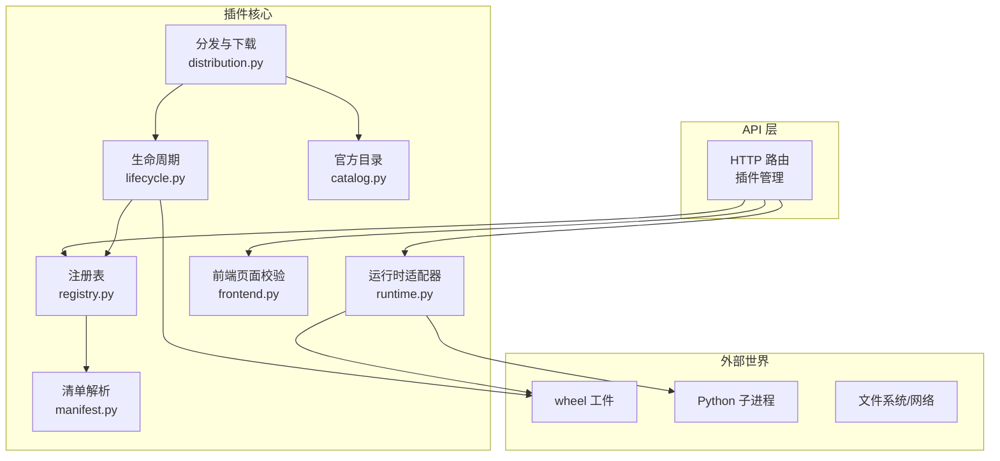

**图示来源**
- [plugins.py:16-35](file://deeptutor/api/routers/plugins.py#L16-L35)
- [manifest.py:24-59](file://deeptutor/plugins/manifest.py#L24-L59)
- [registry.py:159-174](file://deeptutor/plugins/registry.py#L159-L174)
- [lifecycle.py:50-70](file://deeptutor/plugins/lifecycle.py#L50-L70)
- [runtime.py:65-109](file://deeptutor/plugins/runtime.py#L65-L109)
- [distribution.py:142-201](file://deeptutor/plugins/distribution.py#L142-L201)
- [catalog.py:107-138](file://deeptutor/plugins/catalog.py#L107-L138)
- [frontend.py:52-69](file://deeptutor/plugins/frontend.py#L52-L69)

**章节来源**
- [plugins.py:1-417](file://deeptutor/api/routers/plugins.py#L1-L417)
- [manifest.py:1-540](file://deeptutor/plugins/manifest.py#L1-L540)
- [registry.py:1-659](file://deeptutor/plugins/registry.py#L1-L659)
- [lifecycle.py:1-469](file://deeptutor/plugins/lifecycle.py#L1-L469)
- [runtime.py:1-813](file://deeptutor/plugins/runtime.py#L1-L813)
- [distribution.py:1-210](file://deeptutor/plugins/distribution.py#L1-L210)
- [frontend.py:1-159](file://deeptutor/plugins/frontend.py#L1-L159)
- [catalog.py:1-388](file://deeptutor/plugins/catalog.py#L1-L388)

## 核心组件
- 清单模型与校验器：负责解析和校验插件清单 JSON，约束 ID、版本、权限、依赖、扩展点与兼容性。
- 注册表：读取已安装分布与官方目录，合并启用/禁用与审批状态，计算兼容性，生成统一记录。
- 生命周期管理器：创建隔离 venv，按清单依赖安装 wheel，记录历史并支持回滚与卸载。
- 运行时适配器：通过子进程调用插件模块，校验请求/响应契约、权限声明与流式事件。
- 分发管理器：从官方目录解析条目，安全下载并校验 wheel，再交由生命周期安装。
- 前端页面处理器：校验托管插件的前端清单与资源白名单、大小与路径安全。
- API 路由与 CLI：暴露安装、审批、启用/禁用、状态查询、插件页面与 HTTP 路由转发。

**章节来源**
- [manifest.py:67-141](file://deeptutor/plugins/manifest.py#L67-L141)
- [registry.py:159-275](file://deeptutor/plugins/registry.py#L159-L275)
- [lifecycle.py:50-174](file://deeptutor/plugins/lifecycle.py#L50-L174)
- [runtime.py:65-109](file://deeptutor/plugins/runtime.py#L65-L109)
- [distribution.py:142-201](file://deeptutor/plugins/distribution.py#L142-L201)
- [frontend.py:52-109](file://deeptutor/plugins/frontend.py#L52-L109)
- [plugins.py:168-386](file://deeptutor/api/routers/plugins.py#L168-L386)
- [plugin.py:21-305](file://deeptutor_cli/plugin.py#L21-L305)

## 架构总览
插件系统采用“清单驱动 + 隔离执行 + 受控入口”的分层架构：
- 清单层：描述插件身份、能力、权限、依赖、兼容性与扩展点。
- 注册层：聚合已安装与官方目录中的插件，计算状态（可用/待审批/已启用/不兼容/弃用）。
- 生命周期层：在独立环境中安装/回滚/卸载，保留历史快照。
- 运行层：以子进程方式执行插件，严格校验协议、权限与输出边界。
- 分发层：仅允许从官方目录下载经过审核的 wheel，并进行完整性校验。
- 前端层：对托管插件的前端资源进行白名单与尺寸校验，并通过受限 CSP 返回。

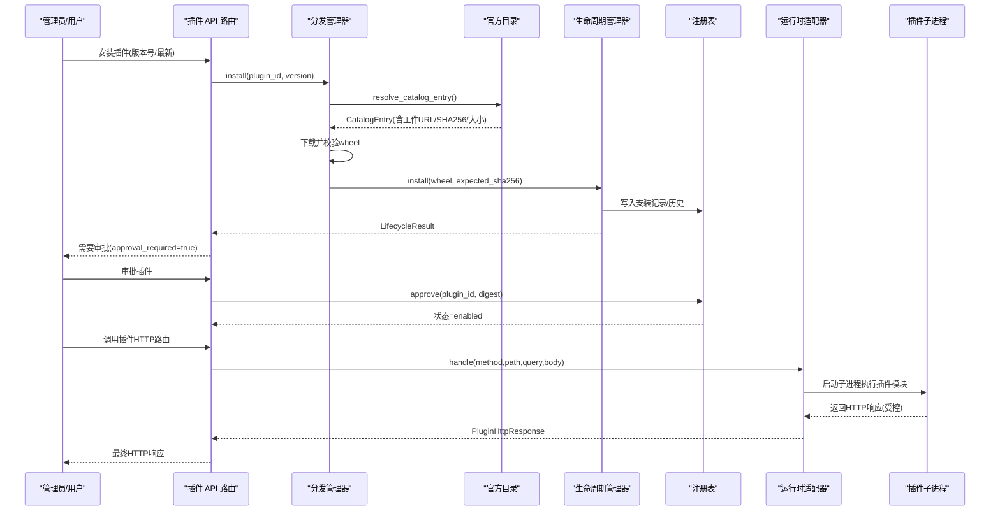

**图示来源**
- [plugins.py:345-376](file://deeptutor/api/routers/plugins.py#L345-L376)
- [distribution.py:154-201](file://deeptutor/plugins/distribution.py#L154-L201)
- [catalog.py:177-215](file://deeptutor/plugins/catalog.py#L177-L215)
- [lifecycle.py:72-174](file://deeptutor/plugins/lifecycle.py#L72-L174)
- [registry.py:224-266](file://deeptutor/plugins/registry.py#L224-L266)
- [runtime.py:277-320](file://deeptutor/plugins/runtime.py#L277-L320)

## 详细组件分析

### 清单与元数据模型
- 清单根对象包含 schema_version、id、name、version、description_i18n、author、license、homepage、source_url、compatibility、permissions、dependencies、extensions。
- 扩展点类型包括 capability、loop_capability、tool、reading_extension、visualizer、http_route、frontend_page、persistence_schema、app_connector。
- 权限作用域包括 reading、learning_events、network、models、storage、ui；每个作用域可声明具体值列表。
- 兼容性要求 DeepTutor 版本范围与各扩展点的 API 版本上限。
- 校验器拒绝未知字段，并对 URL、语言标签、路径、方法、操作 ID 等进行严格正则与语义校验。

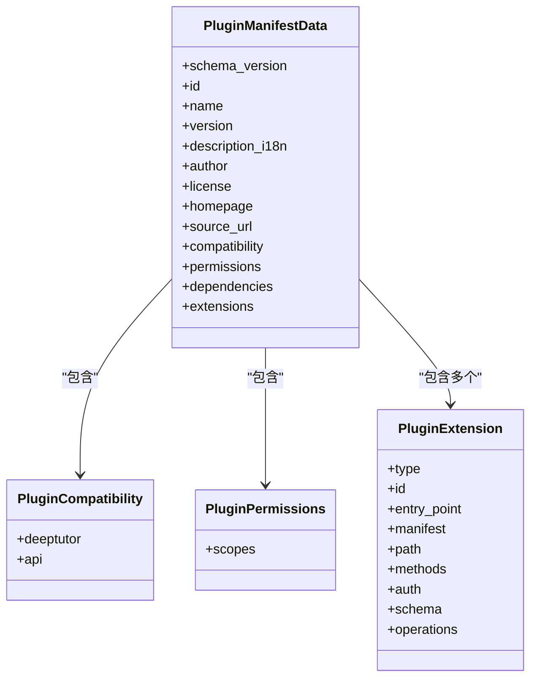

**图示来源**
- [manifest.py:67-141](file://deeptutor/plugins/manifest.py#L67-L141)
- [manifest.py:256-292](file://deeptutor/plugins/manifest.py#L256-L292)
- [manifest.py:324-403](file://deeptutor/plugins/manifest.py#L324-L403)

**章节来源**
- [manifest.py:24-59](file://deeptutor/plugins/manifest.py#L24-L59)
- [manifest.py:144-228](file://deeptutor/plugins/manifest.py#L144-L228)
- [manifest.py:256-403](file://deeptutor/plugins/manifest.py#L256-L403)

### 插件发现与加载
- 旧式 entry point 发现：通过 `deeptutor.plugins` 组扫描，将 callable/class/实例转换为轻量 Manifest，并可选择性实例化 TurnCapability。
- 新式托管插件：由注册表从已安装分布与官方目录中读取清单，不直接导入第三方模块，避免副作用。
- 入口点保护：对 legacy 扩展点增加 `entry_point_can_load` 与 `guard_entry_point_loaded`，确保只有已启用且审批通过的扩展才能被加载。

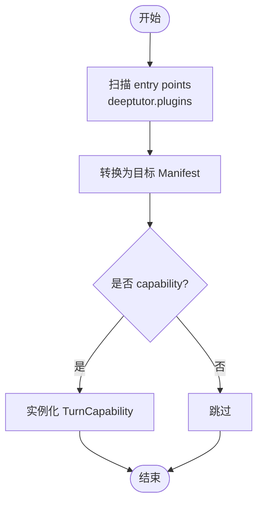

**图示来源**
- [loader.py:42-60](file://deeptutor/plugins/loader.py#L42-L60)
- [loader.py:63-106](file://deeptutor/plugins/loader.py#L63-L106)
- [runtime.py:590-615](file://deeptutor/plugins/runtime.py#L590-L615)

**章节来源**
- [loader.py:1-165](file://deeptutor/plugins/loader.py#L1-L165)
- [runtime.py:555-615](file://deeptutor/plugins/runtime.py#L555-L615)

### 注册表与状态管理
- 记录类型：PluginRecord 表示一个插件的统一视图，包含 manifest、catalog_entry、installation、status、error 等。
- 状态来源：合并本地已安装分布与官方目录，结合 disabled 列表与 approval_digest 判定 enabled/disabled/incompatible/approval-required/deprecated/broken。
- 原子写：使用事务包装的状态文件，保证并发安全与一致性。

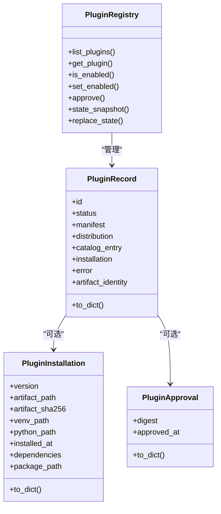

**图示来源**
- [registry.py:61-157](file://deeptutor/plugins/registry.py#L61-L157)
- [registry.py:159-275](file://deeptutor/plugins/registry.py#L159-L275)

**章节来源**
- [registry.py:159-444](file://deeptutor/plugins/registry.py#L159-L444)
- [registry.py:446-524](file://deeptutor/plugins/registry.py#L446-L524)

### 生命周期与环境隔离
- 安装流程：校验 wheel SHA-256，解压清单，创建临时 venv，使用 pip 安装依赖与工件，原子替换目标 venv，提交安装记录到状态。
- 回滚：基于历史记录恢复上一个版本，校验工件完整性，更新状态并移除当前 approval。
- 卸载：清理状态与插件目录。
- 安全：限制 wheel 大小、清单大小、禁止危险路径与符号链接，强制二进制安装，隔离环境变量。

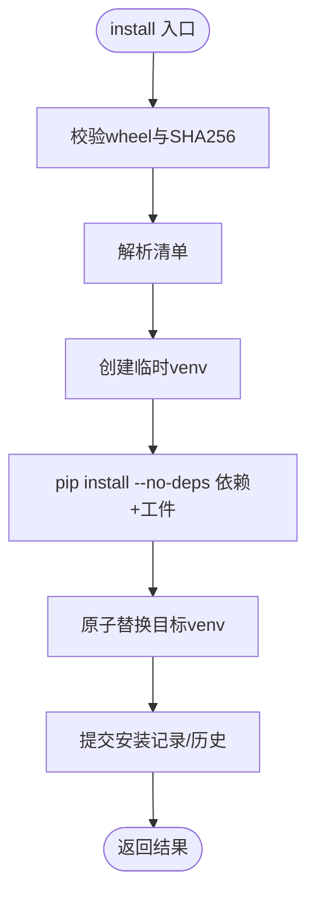

**图示来源**
- [lifecycle.py:72-174](file://deeptutor/plugins/lifecycle.py#L72-L174)
- [lifecycle.py:293-347](file://deeptutor/plugins/lifecycle.py#L293-L347)

**章节来源**
- [lifecycle.py:50-174](file://deeptutor/plugins/lifecycle.py#L50-L174)
- [lifecycle.py:176-249](file://deeptutor/plugins/lifecycle.py#L176-L249)
- [lifecycle.py:293-461](file://deeptutor/plugins/lifecycle.py#L293-L461)

### 运行时与子进程隔离
- 工作客户端：以子进程方式调用插件模块，发送 JSON 请求，接收 JSON 响应或 NDJSON 流。
- 协议校验：严格校验返回值结构、错误字段、权限声明、HTTP 状态码与头白名单。
- 流式处理：限制流大小、行数、超时，并在取消时终止整个进程树。
- 能力/工具适配：封装为 TurnCapability/BaseTool，供上层编排。

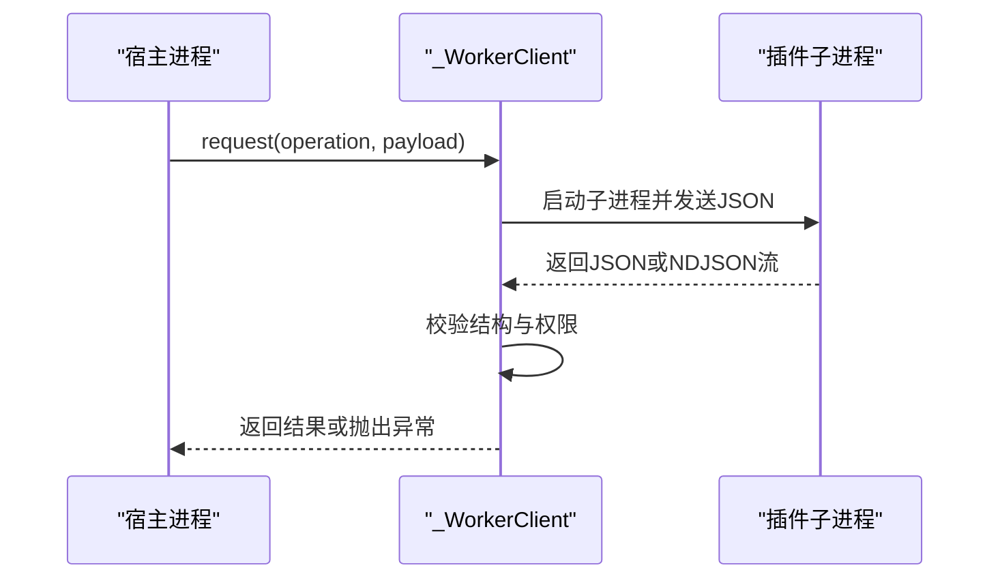

**图示来源**
- [runtime.py:65-109](file://deeptutor/plugins/runtime.py#L65-L109)
- [runtime.py:124-220](file://deeptutor/plugins/runtime.py#L124-L220)
- [runtime.py:236-320](file://deeptutor/plugins/runtime.py#L236-L320)

**章节来源**
- [runtime.py:65-220](file://deeptutor/plugins/runtime.py#L65-L220)
- [runtime.py:236-388](file://deeptutor/plugins/runtime.py#L236-L388)
- [runtime.py:497-540](file://deeptutor/plugins/runtime.py#L497-L540)

### 分发与官方目录
- 目录结构：本地 catalog.json 作为只读索引，条目包含工件 kind、requirement、sha256、url、size_bytes、platform_tags。
- 解析策略：支持 latest 与指定版本，默认选择稳定版，可显式允许弃用版本。
- 下载校验：禁止重定向，校验 Content-Length、实际大小与 SHA-256，限制最大体积。
- 安装衔接：下载完成后交由生命周期管理器安装，并再次校验清单与目录快照的一致性。

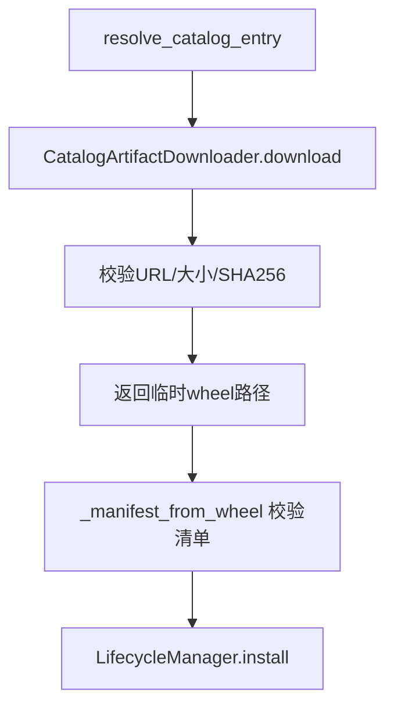

**图示来源**
- [catalog.py:177-215](file://deeptutor/plugins/catalog.py#L177-L215)
- [distribution.py:55-139](file://deeptutor/plugins/distribution.py#L55-L139)
- [distribution.py:142-201](file://deeptutor/plugins/distribution.py#L142-L201)

**章节来源**
- [catalog.py:107-138](file://deeptutor/plugins/catalog.py#L107-L138)
- [catalog.py:177-305](file://deeptutor/plugins/catalog.py#L177-L305)
- [distribution.py:55-201](file://deeptutor/plugins/distribution.py#L55-L201)

### 前端页面扩展
- 前端清单：声明 entry 与 assets 白名单，限制数量、大小与后缀。
- 资源解析：校验路径合法性、禁止符号链接、限制单文件与总体大小，确保不逃逸包根。
- 安全响应：设置严格的 CSP、跨源策略与权限策略，防止恶意脚本与敏感权限滥用。

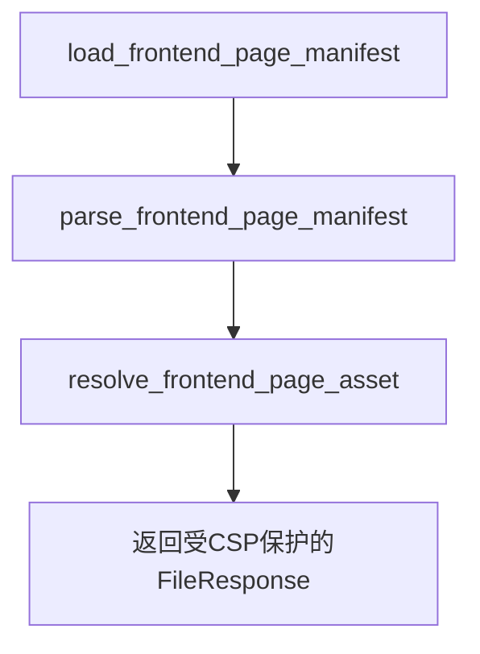

**图示来源**
- [frontend.py:52-109](file://deeptutor/plugins/frontend.py#L52-L109)
- [plugins.py:399-413](file://deeptutor/api/routers/plugins.py#L399-L413)

**章节来源**
- [frontend.py:1-159](file://deeptutor/plugins/frontend.py#L1-L159)
- [plugins.py:184-232](file://deeptutor/api/routers/plugins.py#L184-L232)

### API 与 CLI 控制面
- HTTP API：列出扩展、查询状态/信息、安装/审批/启用/禁用/回滚/卸载，转发插件 HTTP 路由。
- CLI：提供 list/info/state/search/show/install/rollback/uninstall/enable/disable 命令，便于运维与审计。
- 认证与授权：所有管理接口需认证，部分需管理员权限；插件路由支持 public/authenticated/admin 三种策略。

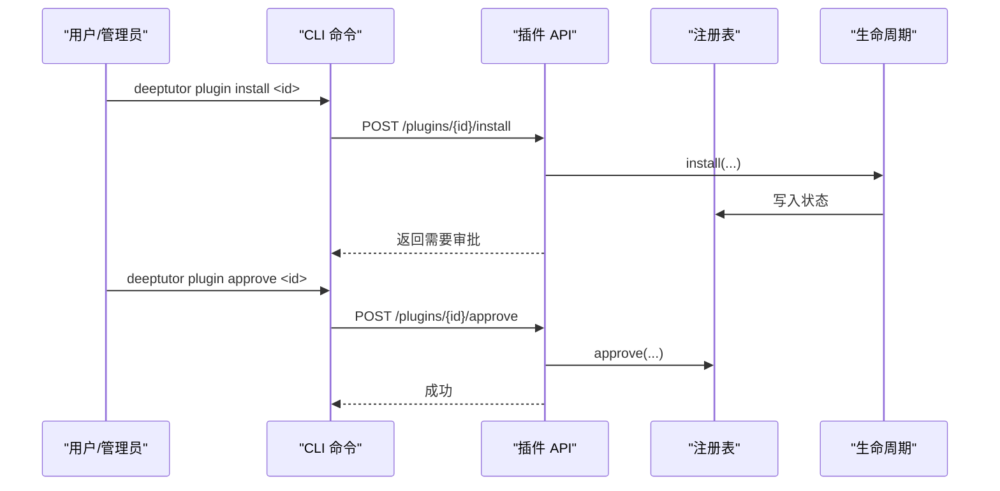

**图示来源**
- [plugins.py:299-376](file://deeptutor/api/routers/plugins.py#L299-L376)
- [plugin.py:183-292](file://deeptutor_cli/plugin.py#L183-L292)

**章节来源**
- [plugins.py:168-386](file://deeptutor/api/routers/plugins.py#L168-L386)
- [plugin.py:21-305](file://deeptutor_cli/plugin.py#L21-L305)

## 依赖关系分析
- 清单层依赖 packaging 库进行版本与需求解析。
- 注册表依赖官方目录与已安装分布，但不导入第三方模块，避免副作用。
- 生命周期依赖 subprocess 与 venv/pip，严格隔离环境与依赖。
- 运行时依赖 asyncio/subprocess 与进程树销毁工具，保障资源回收。
- 分发依赖 httpx 进行安全下载，禁止重定向并校验内容长度与哈希。
- 前端页面依赖路径与文件大小校验，配合 API 的安全响应头。

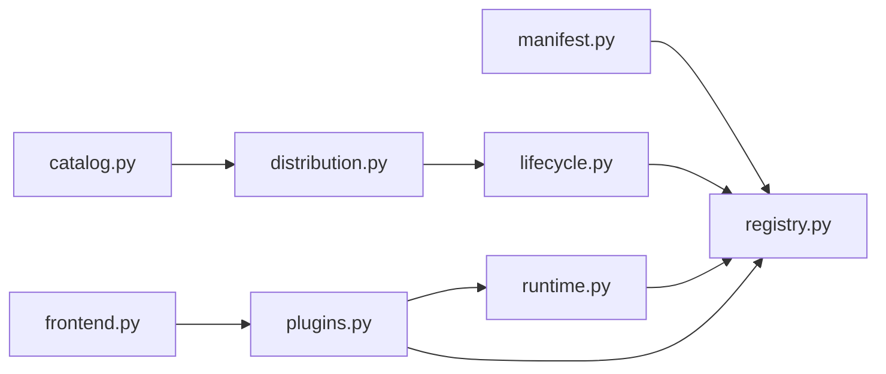

**图示来源**
- [manifest.py:19-23](file://deeptutor/plugins/manifest.py#L19-L23)
- [registry.py:22-38](file://deeptutor/plugins/registry.py#L22-L38)
- [distribution.py:15-24](file://deeptutor/plugins/distribution.py#L15-L24)
- [runtime.py:31-40](file://deeptutor/plugins/runtime.py#L31-L40)
- [plugins.py:16-35](file://deeptutor/api/routers/plugins.py#L16-L35)
- [frontend.py:1-10](file://deeptutor/plugins/frontend.py#L1-L10)

**章节来源**
- [manifest.py:1-59](file://deeptutor/plugins/manifest.py#L1-L59)
- [registry.py:1-38](file://deeptutor/plugins/registry.py#L1-L38)
- [distribution.py:1-24](file://deeptutor/plugins/distribution.py#L1-L24)
- [runtime.py:1-40](file://deeptutor/plugins/runtime.py#L1-L40)
- [plugins.py:1-35](file://deeptutor/api/routers/plugins.py#L1-L35)
- [frontend.py:1-10](file://deeptutor/plugins/frontend.py#L1-L10)

## 性能与资源限制
- 清单与目录：目录缓存、去重与排序，避免重复解析。
- 安装过程：限制 wheel 与清单大小，限制 pip 安装超时，避免无限等待。
- 运行时：限制请求体大小、流大小、stderr 大小、进程输出缓冲与超时，必要时终止进程树。
- 前端资源：限制资产数量、单文件与总体大小，禁止符号链接与越界路径。
- API：限制插件请求体大小，限制 JSON 头部白名单。

[本节为通用指导，无需特定文件引用]

## 故障排查指南
- 清单解析失败：检查 schema_version、id 命名、版本语义、URL 与权限作用域是否合法。
- 兼容性不匹配：确认 DeepTutor 版本与扩展点 API 版本是否在清单声明范围内。
- 审批失败：确认 approval_digest 与当前清单/工件一致，若工件变更需重新审批。
- 安装失败：查看插件安装日志，检查 wheel SHA-256、依赖解析与 venv 创建。
- 运行时错误：检查插件模块入口、协议返回结构、权限声明与 HTTP 响应状态/头白名单。
- 前端页面错误：检查前端清单 entry/assets 白名单、路径与大小限制。

**章节来源**
- [manifest.py:144-228](file://deeptutor/plugins/manifest.py#L144-L228)
- [registry.py:436-444](file://deeptutor/plugins/registry.py#L436-L444)
- [registry.py:224-266](file://deeptutor/plugins/registry.py#L224-L266)
- [lifecycle.py:72-174](file://deeptutor/plugins/lifecycle.py#L72-L174)
- [runtime.py:221-234](file://deeptutor/plugins/runtime.py#L221-L234)
- [runtime.py:520-540](file://deeptutor/plugins/runtime.py#L520-L540)
- [frontend.py:52-109](file://deeptutor/plugins/frontend.py#L52-L109)

## 结论
DeepTutor 插件系统通过严格的清单校验、隔离的环境与受控的运行时，实现了高安全性与高可扩展性的插件生态。官方目录与工件签名确保了供应链安全，生命周期管理提供了稳定的版本控制与回滚能力，API 与 CLI 提供了完整的运维体验。遵循本文档的设计与最佳实践，开发者可以构建高质量、可插拔且安全的扩展。

[本节为总结性内容，无需特定文件引用]

## 附录：清单格式与开发规范

### 清单字段说明
- schema_version：固定为 `deeptutor.plugin/v1`。
- id：小写反向域名风格标识符。
- name/version：人类可读名称与语义化版本。
- description_i18n：多语言描述，至少包含英文。
- author/license/homepage/source_url：作者、许可证与链接信息。
- compatibility.deeptutor：DeepTutor 版本范围。
- compatibility.api：各扩展点要求的 API 版本。
- permissions：权限作用域及具体值列表。
- dependencies：PEP 508 名称+版本依赖数组。
- extensions：扩展点数组，不同类型有不同必填字段。

**章节来源**
- [manifest.py:144-228](file://deeptutor/plugins/manifest.py#L144-L228)
- [manifest.py:256-403](file://deeptutor/plugins/manifest.py#L256-L403)

### 扩展点类型与关键约束
- capability/loop_capability/tool/reading_extension：需声明 entry_point。
- visualizer：需声明 manifest（前端清单）。
- http_route：需声明 entry_point、path、methods、auth。
- frontend_page：可声明 path、auth、manifest。
- persistence_schema/app_connector：声明 operations。

**章节来源**
- [manifest.py:324-403](file://deeptutor/plugins/manifest.py#L324-L403)

### 权限与作用域
- 作用域：reading、learning_events、network、models、storage、ui。
- ui.sandboxed-iframe：当声明 executable frontend_page 时必须包含。
- 运行时校验：插件子进程返回的权限必须是被批准的子集。

**章节来源**
- [manifest.py:43-52](file://deeptutor/plugins/manifest.py#L43-L52)
- [manifest.py:207-212](file://deeptutor/plugins/manifest.py#L207-L212)
- [runtime.py:221-234](file://deeptutor/plugins/runtime.py#L221-L234)

### 开发最佳实践
- 明确声明依赖与兼容性，避免隐式行为。
- 最小权限原则，仅申请必要的作用域与值。
- 使用官方目录发布，确保工件可追溯与可审计。
- 在插件内部实现健壮的错误处理与日志输出。
- 前端页面遵循白名单与大小限制，避免绕过沙箱。

[本节为通用指导，无需特定文件引用]