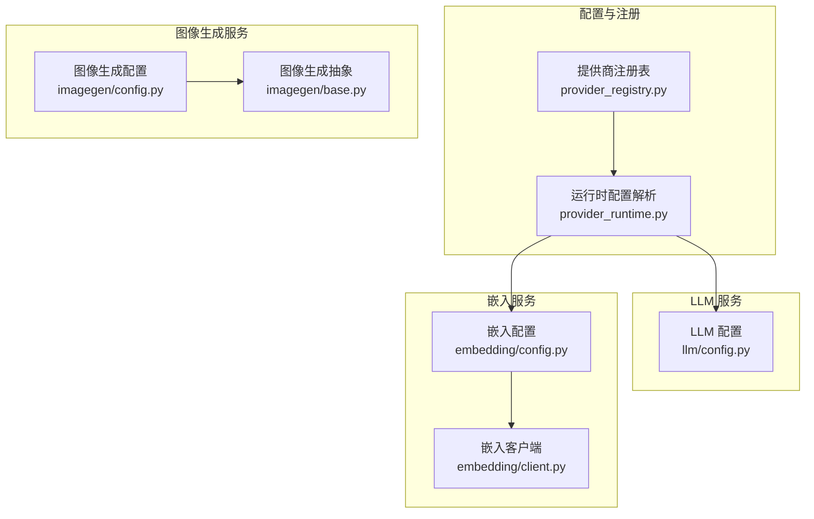
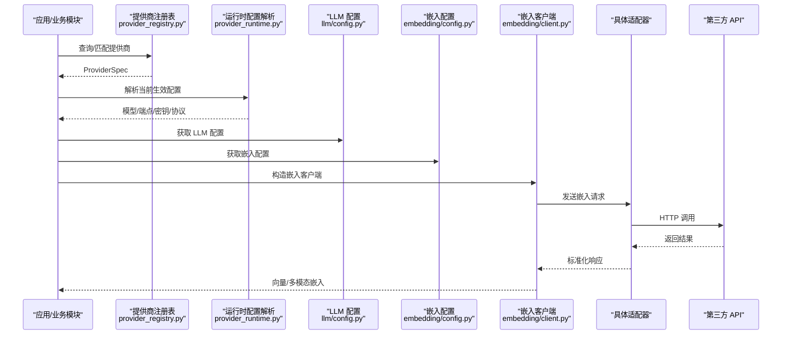
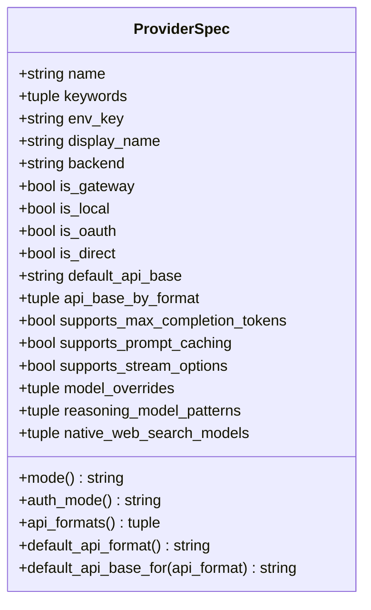
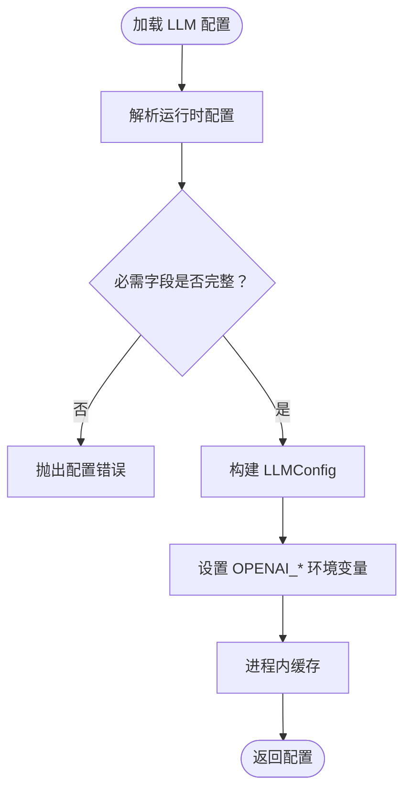
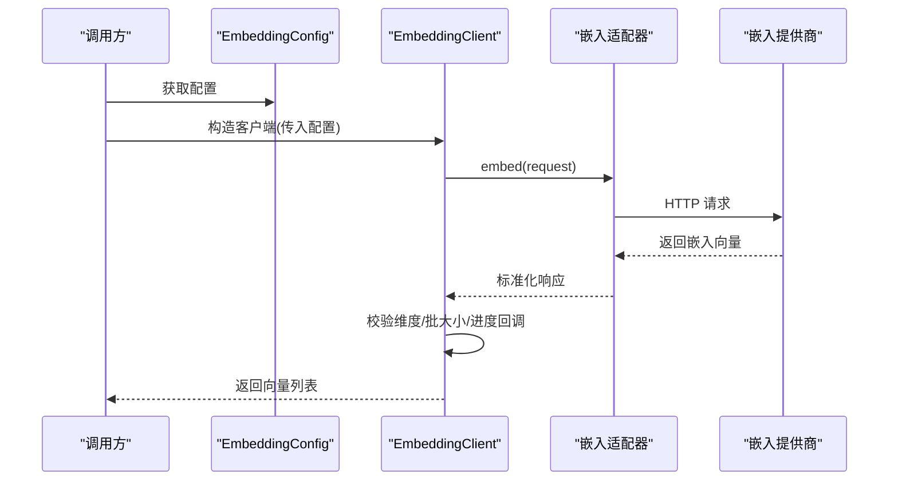
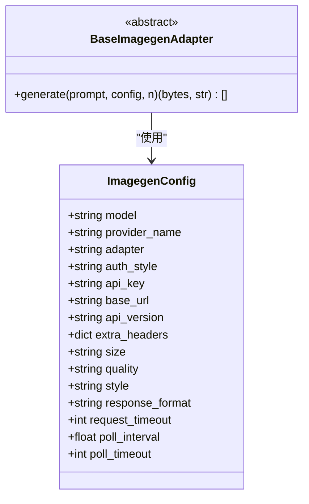
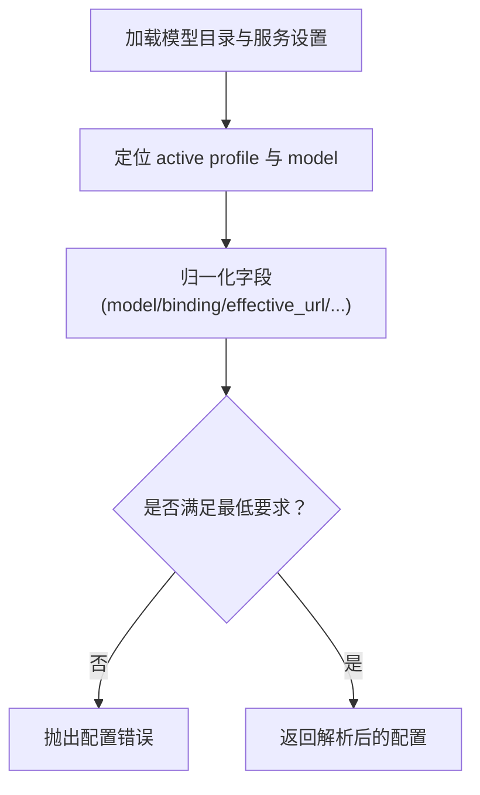
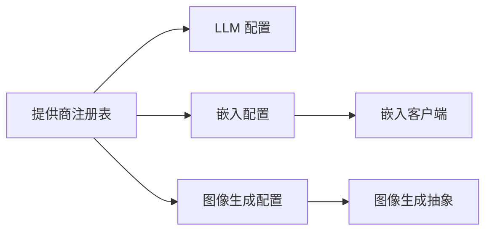
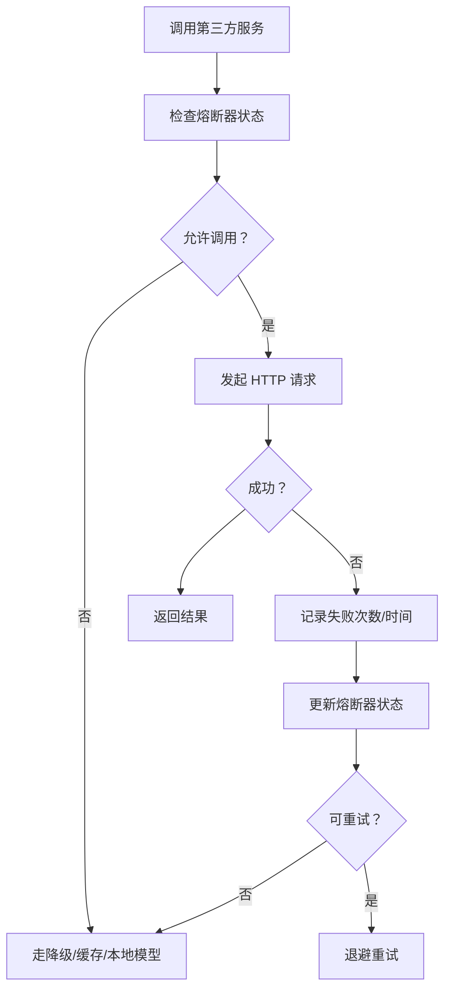

# 第三方服务集成

<cite>
**本文引用的文件**   
- [deeptutor/services/provider_registry.py](file://deeptutor/services/provider_registry.py)
- [deeptutor/services/llm/config.py](file://deeptutor/services/llm/config.py)
- [deeptutor/services/embedding/config.py](file://deeptutor/services/embedding/config.py)
- [deeptutor/services/embedding/client.py](file://deeptutor/services/embedding/client.py)
- [deeptutor/services/imagegen/base.py](file://deeptutor/services/imagegen/base.py)
- [deeptutor/services/imagegen/config.py](file://deeptutor/services/imagegen/config.py)
- [deeptutor/services/config/provider_runtime.py](file://deeptutor/services/config/provider_runtime.py)
- [deeptutor/utils/network/circuit_breaker.py](file://deeptutor/utils/network/circuit_breaker.py)
</cite>

## 目录
1. [引言](#引言)
2. [项目结构](#项目结构)
3. [核心组件](#核心组件)
4. [架构总览](#架构总览)
5. [详细组件分析](#详细组件分析)
6. [依赖关系分析](#依赖关系分析)
7. [性能与成本](#性能与成本)
8. [故障排查指南](#故障排查指南)
9. [结论](#结论)
10. [附录：集成模板与最佳实践](#附录集成模板与最佳实践)

## 引言
本指南面向需要在 DeepTutor 平台中集成外部 LLM、嵌入模型和图像生成等第三方服务的开发者。文档围绕以下目标展开：
- 提供商注册机制与发现规则
- 认证配置、端点解析与连接管理
- 文本生成、向量搜索（嵌入）、图像处理三类服务的集成模板
- 配置管理、错误重试、超时处理与负载均衡策略
- 性能监控、使用统计与成本控制方法
- 测试策略、模拟服务与故障恢复机制

DeepTutor 通过“提供商注册表 + 运行时配置解析 + 适配器”的分层设计，将上层业务逻辑与具体第三方 API 解耦，使新增或替换提供商时只需修改声明式配置或少量适配代码。

## 项目结构
与第三方服务集成相关的核心目录与文件如下：
- 提供商注册与路由：`deeptutor/services/provider_registry.py`
- LLM 配置与上下文：`deeptutor/services/llm/config.py`
- 嵌入模型配置与客户端：`deeptutor/services/embedding/config.py`、`deeptutor/services/embedding/client.py`
- 图像生成抽象与配置：`deeptutor/services/imagegen/base.py`、`deeptutor/services/imagegen/config.py`
- 运行时配置解析（LLM/Embedding）：`deeptutor/services/config/provider_runtime.py`
- 熔断器（通用可靠性工具）：`deeptutor/utils/network/circuit_breaker.py`

**图表来源**
- [deeptutor/services/provider_registry.py:1-120](file://deeptutor/services/provider_registry.py#L1-L120)
- [deeptutor/services/config/provider_runtime.py:1204-1222](file://deeptutor/services/config/provider_runtime.py#L1204-L1222)
- [deeptutor/services/llm/config.py:110-150](file://deeptutor/services/llm/config.py#L110-L150)
- [deeptutor/services/embedding/config.py:13-31](file://deeptutor/services/embedding/config.py#L13-L31)
- [deeptutor/services/embedding/client.py:39-117](file://deeptutor/services/embedding/client.py#L39-L117)
- [deeptutor/services/imagegen/base.py:10-24](file://deeptutor/services/imagegen/base.py#L10-L24)
- [deeptutor/services/imagegen/config.py:17-38](file://deeptutor/services/imagegen/config.py#L17-L38)

**章节来源**
- [deeptutor/services/provider_registry.py:1-120](file://deeptutor/services/provider_registry.py#L1-L120)
- [deeptutor/services/config/provider_runtime.py:1204-1222](file://deeptutor/services/config/provider_runtime.py#L1204-L1222)
- [deeptutor/services/llm/config.py:110-150](file://deeptutor/services/llm/config.py#L110-L150)
- [deeptutor/services/embedding/config.py:13-31](file://deeptutor/services/embedding/config.py#L13-L31)
- [deeptutor/services/embedding/client.py:39-117](file://deeptutor/services/embedding/client.py#L39-L117)
- [deeptutor/services/imagegen/base.py:10-24](file://deeptutor/services/imagegen/base.py#L10-L24)
- [deeptutor/services/imagegen/config.py:17-38](file://deeptutor/services/imagegen/config.py#L17-L38)

## 核心组件
- 提供商注册表 ProviderSpec：集中定义所有支持的第三方提供商元数据、默认端点、鉴权方式、协议格式选择、能力标志等。新增提供商需在此注册。
- 运行时配置解析：从模型目录与服务设置中解析出当前生效的 provider、model、base_url、api_key、wire_api/api_format 等。
- LLM 配置 LLMConfig：封装一次调用所需的模型、密钥、端点、并发、速率限制、推理参数等。
- 嵌入配置 EmbeddingConfig 与客户端 EmbeddingClient：统一接入不同嵌入提供商，支持批量、多模态、维度校验、请求间隔控制。
- 图像生成抽象 BaseImagegenAdapter 与配置 ImagegenConfig：为文本到图像生成提供统一接口与可配置项。

**章节来源**
- [deeptutor/services/provider_registry.py:18-120](file://deeptutor/services/provider_registry.py#L18-L120)
- [deeptutor/services/llm/config.py:110-150](file://deeptutor/services/llm/config.py#L110-L150)
- [deeptutor/services/embedding/config.py:13-31](file://deeptutor/services/embedding/config.py#L13-L31)
- [deeptutor/services/embedding/client.py:39-117](file://deeptutor/services/embedding/client.py#L39-L117)
- [deeptutor/services/imagegen/base.py:10-24](file://deeptutor/services/imagegen/base.py#L10-L24)
- [deeptutor/services/imagegen/config.py:17-38](file://deeptutor/services/imagegen/config.py#L17-L38)

## 架构总览
下图展示从配置到调用的整体流程：用户或系统通过“提供商注册表”确定后端类型，再由“运行时配置解析”得到最终端点与鉴权信息，最后由对应适配器发起 HTTP 调用。

**图表来源**
- [deeptutor/services/provider_registry.py:208-734](file://deeptutor/services/provider_registry.py#L208-L734)
- [deeptutor/services/config/provider_runtime.py:1204-1222](file://deeptutor/services/config/provider_runtime.py#L1204-L1222)
- [deeptutor/services/llm/config.py:193-255](file://deeptutor/services/llm/config.py#L193-L255)
- [deeptutor/services/embedding/config.py:50-114](file://deeptutor/services/embedding/config.py#L50-L114)
- [deeptutor/services/embedding/client.py:88-117](file://deeptutor/services/embedding/client.py#L88-L117)

## 详细组件分析

### 提供商注册与发现
- ProviderSpec 字段说明：
  - name/keywords/env_key/display_name/backend：标识、别名、环境变量键、显示名、后端实现类。
  - is_gateway/is_local/is_oauth/is_direct：模式标记，决定鉴权与检测策略。
  - default_api_base/api_base_by_format：默认端点与按协议格式区分的端点。
  - supports_*：能力开关，如流式选项、提示缓存、最大完成 token 等。
  - model_overrides/reasoning_model_patterns/native_web_search_models：模型级覆盖与行为开关。
- PROVIDERS 列表顺序即优先级；网关优先，标准提供商次之，本地部署再次。
- 辅助函数：
  - canonical_provider_name：规范化名称与别名映射。
  - find_by_name：按名称查找规格。
  - wire_api_for_provider/api_format_for_provider：在 OpenAI 兼容后端上选择 wire protocol 或 API 格式。

**图表来源**
- [deeptutor/services/provider_registry.py:18-120](file://deeptutor/services/provider_registry.py#L18-L120)

**章节来源**
- [deeptutor/services/provider_registry.py:18-120](file://deeptutor/services/provider_registry.py#L18-L120)
- [deeptutor/services/provider_registry.py:208-734](file://deeptutor/services/provider_registry.py#L208-L734)
- [deeptutor/services/provider_registry.py:761-800](file://deeptutor/services/provider_registry.py#L761-L800)

### LLM 配置与初始化
- LLMConfig 封装了模型、密钥、端点、绑定、协议格式、并发与速率限制等。
- 初始化阶段会尝试根据当前配置设置 OPENAI_* 环境变量，以兼容需要读取环境变量的 SDK。
- get_llm_config 提供进程内缓存与 scoped 上下文变量，避免重复解析。
- uses_max_completion_tokens/get_token_limit_kwargs 用于在新旧模型间自动切换 max_tokens 参数。

**图表来源**
- [deeptutor/services/llm/config.py:90-107](file://deeptutor/services/llm/config.py#L90-L107)
- [deeptutor/services/llm/config.py:193-255](file://deeptutor/services/llm/config.py#L193-L255)
- [deeptutor/services/llm/config.py:283-329](file://deeptutor/services/llm/config.py#L283-L329)

**章节来源**
- [deeptutor/services/llm/config.py:110-150](file://deeptutor/services/llm/config.py#L110-L150)
- [deeptutor/services/llm/config.py:177-191](file://deeptutor/services/llm/config.py#L177-L191)
- [deeptutor/services/llm/config.py:193-255](file://deeptutor/services/llm/config.py#L193-L255)
- [deeptutor/services/llm/config.py:283-329](file://deeptutor/services/llm/config.py#L283-L329)

### 嵌入模型集成
- EmbeddingConfig：包含模型、密钥、端点、绑定、维度、批大小、延迟、超时等。
- get_embedding_config：从模型目录与服务设置中解析并校验 embedding 配置，确保 effective_url 与 api_key 有效。
- EmbeddingClient：
  - 根据 binding 选择适配器，构造请求参数。
  - 对批量请求进行节流与跨线程锁保护，避免并发死锁。
  - 按提供商上限裁剪 batch_size，保证索引稳定性。
  - 校验返回向量维度一致性，防止混用不同维度模型。
  - 支持多模态内容嵌入（若提供商支持）。

**图表来源**
- [deeptutor/services/embedding/config.py:50-114](file://deeptutor/services/embedding/config.py#L50-L114)
- [deeptutor/services/embedding/client.py:88-117](file://deeptutor/services/embedding/client.py#L88-L117)
- [deeptutor/services/embedding/client.py:118-218](file://deeptutor/services/embedding/client.py#L118-L218)
- [deeptutor/services/embedding/client.py:232-290](file://deeptutor/services/embedding/client.py#L232-L290)

**章节来源**
- [deeptutor/services/embedding/config.py:13-31](file://deeptutor/services/embedding/config.py#L13-L31)
- [deeptutor/services/embedding/config.py:50-114](file://deeptutor/services/embedding/config.py#L50-L114)
- [deeptutor/services/embedding/client.py:39-117](file://deeptutor/services/embedding/client.py#L39-L117)
- [deeptutor/services/embedding/client.py:118-218](file://deeptutor/services/embedding/client.py#L118-L218)
- [deeptutor/services/embedding/client.py:232-290](file://deeptutor/services/embedding/client.py#L232-L290)

### 图像生成服务
- BaseImagegenAdapter：定义统一的异步 generate 接口，返回字节与 MIME 类型。
- ImagegenConfig：封装模型、提供商、鉴权风格、端点、版本、额外头、尺寸/质量/风格/响应格式、超时与轮询参数。
- 该抽象允许通过更换 base_url、api_key、model 来对接多种图像生成后端（例如 OpenAI DALL·E/gpt-image、火山引擎 Seedream 及兼容网关）。

**图表来源**
- [deeptutor/services/imagegen/base.py:10-24](file://deeptutor/services/imagegen/base.py#L10-L24)
- [deeptutor/services/imagegen/config.py:17-38](file://deeptutor/services/imagegen/config.py#L17-L38)

**章节来源**
- [deeptutor/services/imagegen/base.py:10-24](file://deeptutor/services/imagegen/base.py#L10-L24)
- [deeptutor/services/imagegen/config.py:17-38](file://deeptutor/services/imagegen/config.py#L17-L38)

### 运行时配置解析（LLM/Embedding）
- resolve_embedding_runtime_config：从模型目录与服务设置中解析出 embedding 的 active profile/model，并归一化为 ResolvedEmbeddingConfig。
- 当未设置 active embedding model 或未解析出 effective endpoint 时抛出明确错误，引导用户在设置界面配置。

**图表来源**
- [deeptutor/services/config/provider_runtime.py:1204-1222](file://deeptutor/services/config/provider_runtime.py#L1204-L1222)

**章节来源**
- [deeptutor/services/config/provider_runtime.py:1204-1222](file://deeptutor/services/config/provider_runtime.py#L1204-L1222)

## 依赖关系分析
- 提供商注册表是单一事实源，LLM/Embedding/ImageGen 的配置与路由都依赖它。
- LLM 配置在导入时会尝试设置 OPENAI_* 环境变量，以便下游 SDK 直接读取。
- 嵌入客户端依赖运行时配置解析与适配器注册表，同时内置批大小裁剪、维度校验与跨线程节流。
- 图像生成服务通过抽象接口与配置对象解耦具体实现。

**图表来源**
- [deeptutor/services/provider_registry.py:208-734](file://deeptutor/services/provider_registry.py#L208-L734)
- [deeptutor/services/llm/config.py:90-107](file://deeptutor/services/llm/config.py#L90-L107)
- [deeptutor/services/embedding/config.py:50-114](file://deeptutor/services/embedding/config.py#L50-L114)
- [deeptutor/services/embedding/client.py:88-117](file://deeptutor/services/embedding/client.py#L88-L117)
- [deeptutor/services/imagegen/config.py:17-38](file://deeptutor/services/imagegen/config.py#L17-L38)
- [deeptutor/services/imagegen/base.py:10-24](file://deeptutor/services/imagegen/base.py#L10-L24)

**章节来源**
- [deeptutor/services/provider_registry.py:208-734](file://deeptutor/services/provider_registry.py#L208-L734)
- [deeptutor/services/llm/config.py:90-107](file://deeptutor/services/llm/config.py#L90-L107)
- [deeptutor/services/embedding/config.py:50-114](file://deeptutor/services/embedding/config.py#L50-L114)
- [deeptutor/services/embedding/client.py:88-117](file://deeptutor/services/embedding/client.py#L88-L117)
- [deeptutor/services/imagegen/config.py:17-38](file://deeptutor/services/imagegen/config.py#L17-L38)
- [deeptutor/services/imagegen/base.py:10-24](file://deeptutor/services/imagegen/base.py#L10-L24)

## 性能与成本
- 批处理与节流
  - 嵌入客户端按提供商上限裁剪 batch_size，避免超限失败。
  - 全局跨线程锁与单调时间戳控制请求间隔，降低突发流量。
- 超时与轮询
  - 图像生成配置提供 request_timeout、poll_interval、poll_timeout，适合长耗时任务。
- 并发与速率
  - LLM 配置包含 max_concurrency 与 requests_per_minute，便于限流与资源控制。
- 成本控制建议
  - 合理设置批大小与并发，避免过度消耗配额。
  - 针对昂贵模型启用缓存或降级策略（例如先小模型后大模型）。
  - 使用提供商的 streaming 与 prompt caching 能力（由 ProviderSpec 的能力标志驱动）。

[本节为通用指导，不直接分析具体文件]

## 故障排查指南
- 配置缺失或无效
  - LLM：未设置 active model 或未解析出 effective endpoint 会抛出配置错误。
  - Embedding：未设置 effective endpoint 或 api_key 会抛出配置错误。
- 端点与鉴权
  - 嵌入客户端会在构造时校验 endpoint 合法性，若检测到隐藏路径拼接问题会给出明确提示。
- 向量维度不一致
  - 嵌入客户端在多批次返回中检测维度不一致，立即报错并提示重新索引。
- 熔断与恢复
  - 可使用 CircuitBreaker 对提供商调用进行熔断保护，避免雪崩。

**图表来源**
- [deeptutor/utils/network/circuit_breaker.py:13-42](file://deeptutor/utils/network/circuit_breaker.py#L13-L42)

**章节来源**
- [deeptutor/services/llm/config.py:193-255](file://deeptutor/services/llm/config.py#L193-L255)
- [deeptutor/services/embedding/config.py:85-114](file://deeptutor/services/embedding/config.py#L85-L114)
- [deeptutor/services/embedding/client.py:88-117](file://deeptutor/services/embedding/client.py#L88-L117)
- [deeptutor/services/embedding/client.py:177-196](file://deeptutor/services/embedding/client.py#L177-L196)
- [deeptutor/utils/network/circuit_breaker.py:13-42](file://deeptutor/utils/network/circuit_breaker.py#L13-L42)

## 结论
DeepTutor 通过“注册表 + 运行时配置 + 适配器”的三层架构，实现了第三方服务的稳定、可扩展与可观测集成。开发者只需在注册表中声明新提供商，并在设置中配置 profile/model，即可无缝接入文本生成、嵌入与图像生成等服务。结合批处理、节流、熔断与超时控制，可在高负载与不稳定网络环境下保持系统稳健运行。

[本节为总结性内容，不直接分析具体文件]

## 附录：集成模板与最佳实践

### 文本生成（LLM）集成模板
- 步骤
  - 在提供商注册表中确认或新增 ProviderSpec。
  - 在设置中选择 active profile 与 model，确保 effective_url 与 api_key 已配置。
  - 使用 LLMConfig 获取配置，必要时设置 OPENAI_* 环境变量以兼容 SDK。
  - 根据模型特性选择 max_tokens 或 max_completion_tokens。
- 关键要点
  - 使用 ProviderSpec 的能力标志启用流式与提示缓存。
  - 通过 LLMConfig 的并发与速率限制控制资源占用。

**章节来源**
- [deeptutor/services/provider_registry.py:208-734](file://deeptutor/services/provider_registry.py#L208-L734)
- [deeptutor/services/llm/config.py:110-150](file://deeptutor/services/llm/config.py#L110-L150)
- [deeptutor/services/llm/config.py:283-329](file://deeptutor/services/llm/config.py#L283-L329)

### 向量搜索（嵌入）集成模板
- 步骤
  - 在设置中配置 embedding profile 与 model，确保 effective_url 与 api_key 有效。
  - 使用 EmbeddingConfig 获取配置，并通过 EmbeddingClient 发起嵌入请求。
  - 根据提供商上限调整 batch_size，避免超限。
  - 如需多模态，确认提供商支持后再调用 embed_contents。
- 关键要点
  - 使用全局跨线程锁与请求间隔控制，避免并发死锁与突发流量。
  - 校验返回向量维度一致性，防止混用不同维度模型。

**章节来源**
- [deeptutor/services/embedding/config.py:50-114](file://deeptutor/services/embedding/config.py#L50-L114)
- [deeptutor/services/embedding/client.py:88-117](file://deeptutor/services/embedding/client.py#L88-L117)
- [deeptutor/services/embedding/client.py:118-218](file://deeptutor/services/embedding/client.py#L118-L218)
- [deeptutor/services/embedding/client.py:232-290](file://deeptutor/services/embedding/client.py#L232-L290)

### 图像处理集成模板
- 步骤
  - 使用 ImagegenConfig 配置模型、提供商、端点、鉴权风格与生成参数。
  - 实现 BaseImagegenAdapter 的 generate 方法，对接具体图像生成后端。
  - 设置合理的 request_timeout、poll_interval、poll_timeout，适应长耗时任务。
- 关键要点
  - 通过更换 base_url、api_key、model 快速切换不同图像生成提供商。
  - 使用响应格式（url/b64_json）与尺寸/质量/风格参数优化输出。

**章节来源**
- [deeptutor/services/imagegen/config.py:17-38](file://deeptutor/services/imagegen/config.py#L17-L38)
- [deeptutor/services/imagegen/base.py:10-24](file://deeptutor/services/imagegen/base.py#L10-L24)

### 错误重试、超时与负载均衡
- 错误重试
  - 对可重试错误（如 429/5xx）实施指数退避重试。
  - 使用熔断器在错误率过高时快速失败，避免雪崩。
- 超时处理
  - 为每次请求设置合理超时；对长耗时任务（如图生图）使用轮询与超时控制。
- 负载均衡
  - 对同一提供商的多 key 或多 endpoint 进行轮询或加权分配。
  - 结合 ProviderSpec 的 mode 与 capability 选择最优后端。

**章节来源**
- [deeptutor/utils/network/circuit_breaker.py:13-42](file://deeptutor/utils/network/circuit_breaker.py#L13-L42)
- [deeptutor/services/imagegen/config.py:35-38](file://deeptutor/services/imagegen/config.py#L35-L38)

### 性能监控、使用统计与成本控制
- 监控指标
  - 请求成功率、延迟分布、错误码分布、并发数、速率限制触发次数。
- 使用统计
  - 记录各提供商/模型的调用次数、token 用量、图像生成次数。
- 成本控制
  - 按模型分层定价，优先使用低成本模型完成简单任务。
  - 启用流式与缓存减少重复计算。
  - 对高频场景引入本地模型或缓存层。

[本节为通用指导，不直接分析具体文件]

### 测试策略、模拟服务与故障恢复
- 单元测试
  - 对配置解析、适配器选择、批大小裁剪、维度校验进行断言。
- 集成测试
  - 使用沙箱或 Mock 第三方 API，验证端到端流程。
- 故障恢复
  - 在熔断器打开时切换到备用提供商或本地模型。
  - 对不可恢复错误进行告警与人工介入。

[本节为通用指导，不直接分析具体文件]