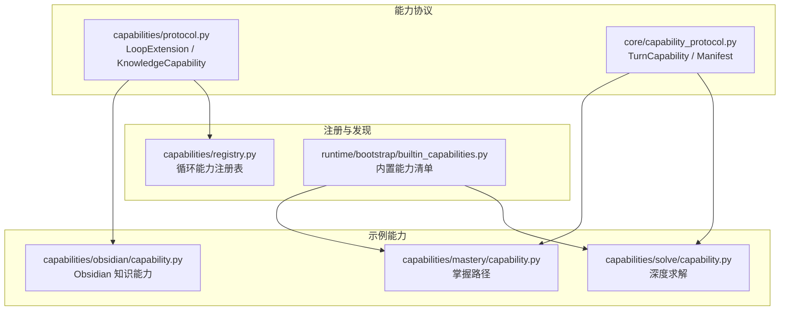
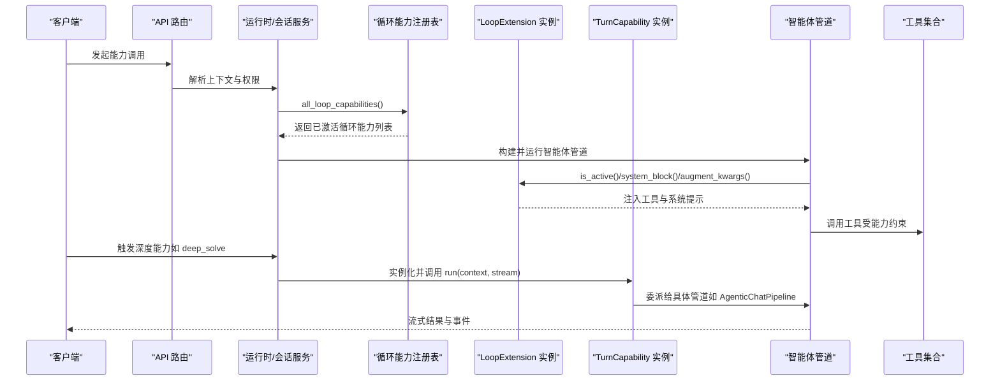
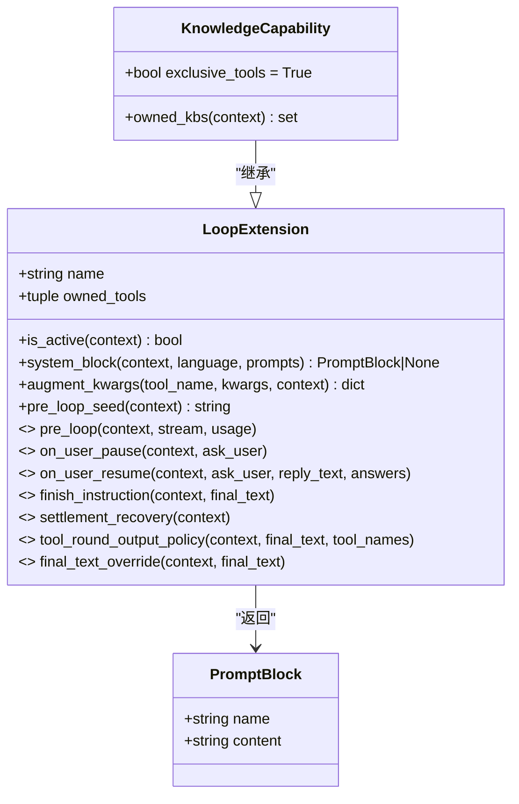
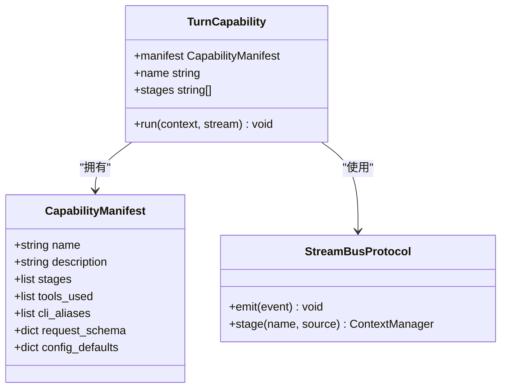
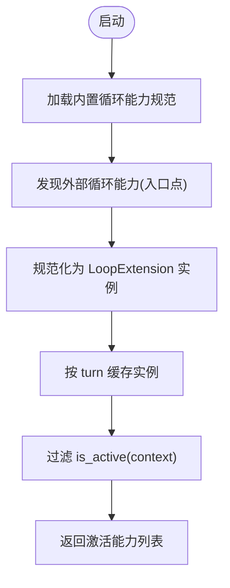
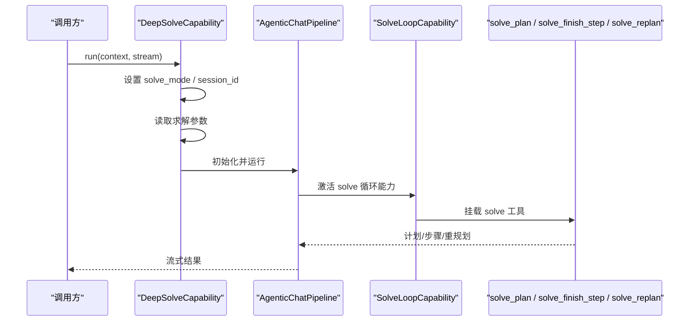
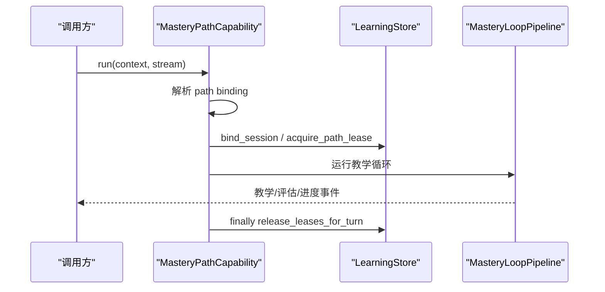
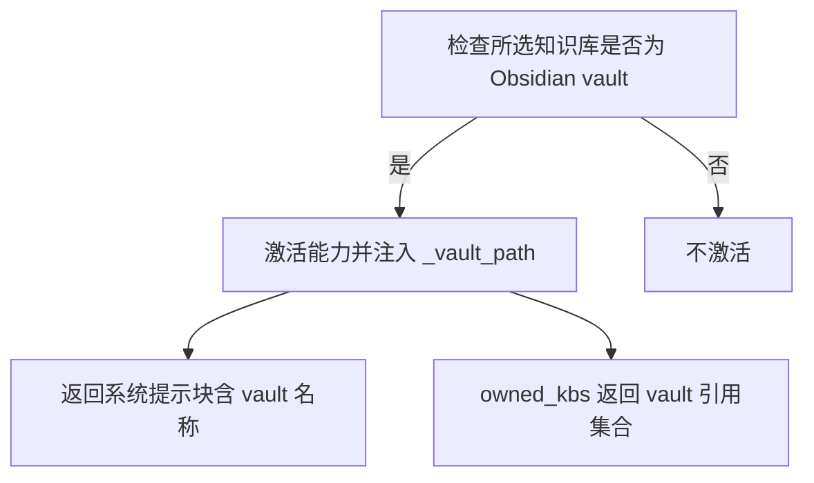
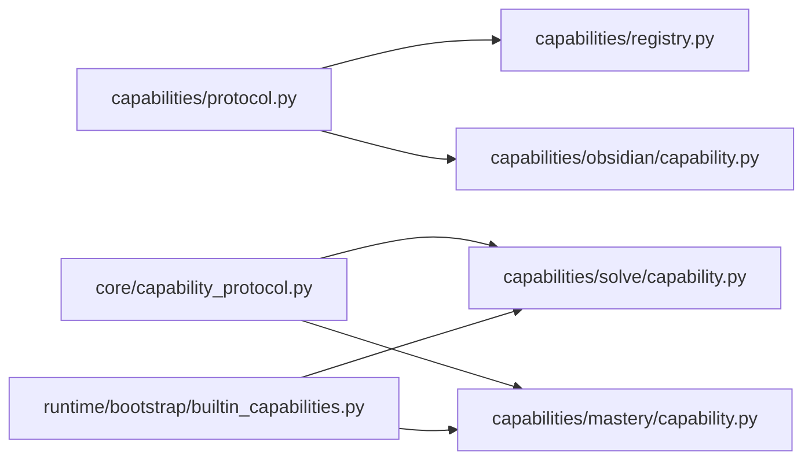

# 自定义能力开发

<cite>
**本文引用的文件**   
- [协议定义](file://deeptutor/capabilities/protocol.py)
- [循环能力注册表](file://deeptutor/capabilities/registry.py)
- [能力协议与基类](file://deeptutor/core/capability_protocol.py)
- [内置能力清单视图](file://deeptutor/runtime/bootstrap/builtin_capabilities.py)
- [深度求解能力](file://deeptutor/capabilities/solve/capability.py)
- [掌握路径能力](file://deeptutor/capabilities/mastery/capability.py)
- [Obsidian 知识能力](file://deeptutor/capabilities/obsidian/capability.py)
- [能力访问控制](file://deeptutor/multi_user/model_access.py)
- [资源授权常量](file://deeptutor/multi_user/grants.py)
- [深度求解能力测试](file://tests/capabilities/test_solve_capability.py)
- [Obsidian 能力测试](file://tests/capabilities/test_obsidian_capability.py)
</cite>

## 目录
1. [引言](#引言)
2. [项目结构](#项目结构)
3. [核心组件](#核心组件)
4. [架构总览](#架构总览)
5. [详细组件分析](#详细组件分析)
6. [依赖关系分析](#依赖关系分析)
7. [性能考虑](#性能考虑)
8. [故障排查指南](#故障排查指南)
9. [结论](#结论)
10. [附录：能力开发模板与示例](#附录能力开发模板与示例)

## 引言
本指南面向希望为 DeepTutor 开发“自定义能力”的开发者。内容覆盖两类扩展点：
- 对话循环能力（Loop Extension）：在聊天智能体循环中挂载工具、注入系统提示、参与单轮决策，适合聊天增强、领域工具集、知识域独占模式等场景。
- 深度能力（Turn Capability）：以多阶段流水线形式执行“深度模式”，如深度求解、掌握路径教学、研究、可视化等。

你将学到：
- 能力接口定义、生命周期钩子、参数校验与错误处理
- 能力的注册机制、外部插件发现、依赖注入与配置管理
- 安全与权限控制、资源隔离最佳实践
- 测试策略、调试技巧与性能优化方法
- 可直接复用的能力开发模板与示例路径

## 项目结构
DeepTutor 的能力体系围绕两个核心协议展开：
- 对话循环能力协议：位于 capabilities/protocol.py，定义 LoopExtension、KnowledgeCapability、PromptBlock 等。
- 深度能力协议：位于 core/capability_protocol.py，定义 TurnCapability、CapabilityManifest、StreamBusProtocol 等。
- 循环能力注册与发现：capabilities/registry.py 负责内置与外部循环能力的发现、实例化与缓存。
- 内置能力清单：runtime/bootstrap/builtin_capabilities.py 提供 import-free 的内置能力声明与 manifest 构造。

**图示来源**
- [协议定义:1-188](file://deeptutor/capabilities/protocol.py#L1-L188)
- [能力协议与基类:1-103](file://deeptutor/core/capability_protocol.py#L1-L103)
- [循环能力注册表:1-223](file://deeptutor/capabilities/registry.py#L1-L223)
- [内置能力清单视图:1-49](file://deeptutor/runtime/bootstrap/builtin_capabilities.py#L1-L49)

**章节来源**
- [协议定义:1-188](file://deeptutor/capabilities/protocol.py#L1-L188)
- [能力协议与基类:1-103](file://deeptutor/core/capability_protocol.py#L1-L103)
- [循环能力注册表:1-223](file://deeptutor/capabilities/registry.py#L1-L223)
- [内置能力清单视图:1-49](file://deeptutor/runtime/bootstrap/builtin_capabilities.py#L1-L49)

## 核心组件
- LoopExtension：对话循环扩展点，允许能力在聊天智能体循环中贡献 owned_tools、system_block、augment_kwargs、pre_loop_seed 等；可选 pre_loop、on_user_pause/on_user_resume、finish_instruction、settlement_recovery 等钩子。
- KnowledgeCapability：基于 LoopExtension 的知识域独占能力基类，设置 exclusive_tools=True，替换工具表面而非叠加。
- TurnCapability：深度能力抽象基类，要求实现 manifest 与 run(context, stream)，并通过 StreamBusProtocol 输出事件。
- CapabilityManifest：描述能力的静态元数据，包括名称、描述、阶段、使用工具、CLI 别名、请求 schema、默认配置等。
- StreamBusProtocol：最小输出端口，支持 emit 事件与 stage 上下文管理器。

这些组件共同构成 DeepTutor 的“能力层”，将业务逻辑与底层 LLM 调用解耦，使能力可插拔、可测试、可治理。

**章节来源**
- [协议定义:30-174](file://deeptutor/capabilities/protocol.py#L30-L174)
- [能力协议与基类:33-82](file://deeptutor/core/capability_protocol.py#L33-L82)

## 架构总览
下图展示从用户请求到能力执行的端到端流程，以及循环能力与深度能力如何协作。

**图示来源**
- [循环能力注册表:159-208](file://deeptutor/capabilities/registry.py#L159-L208)
- [深度求解能力:62-84](file://deeptutor/capabilities/solve/capability.py#L62-L84)
- [协议定义:108-137](file://deeptutor/capabilities/protocol.py#L108-L137)

## 详细组件分析

### 对话循环能力（LoopExtension）
- 关键属性与方法
  - name：能力标识
  - owned_tools：能力拥有的工具名元组
  - is_active(context)：判断是否在当前轮次激活
  - system_block(context, language, prompts)：返回 PromptBlock 注入系统提示
  - augment_kwargs(tool_name, kwargs, context)：为能力工具注入私有参数
  - pre_loop_seed(context)：追加初始用户消息种子文本
- 可选钩子
  - pre_loop(context, stream, usage)：首次 LLM 调用前执行一次预扫描
  - on_user_pause/on_user_resume：用户交互暂停/恢复时提交状态
  - finish_instruction(context, final_text)：阻止最终轮次完成，允许再一轮工具调用
  - settlement_recovery(context)：在结算限制下允许受限工具轮次
  - tool_round_output_policy/final_text_override：保留公开答案同时隐藏协议内文

**图示来源**
- [协议定义:30-174](file://deeptutor/capabilities/protocol.py#L30-L174)

**章节来源**
- [协议定义:30-174](file://deeptutor/capabilities/protocol.py#L30-L174)

### 深度能力（TurnCapability）
- 必须实现
  - manifest：CapabilityManifest，描述能力元数据
  - run(context, stream)：执行完整能力流水线，通过 stream.stage 标注阶段
- 辅助属性
  - name：来自 manifest.name
  - stages：来自 manifest.stages

典型用法：
- 设置上下文标记（如 solve_mode、mastery_mode）
- 读取配置参数（如 max_rounds、temperature）
- 委派给具体管道（如 AgenticChatPipeline、MasteryLoopPipeline）
- 通过 StreamBusProtocol 输出阶段事件

**图示来源**
- [能力协议与基类:33-82](file://deeptutor/core/capability_protocol.py#L33-L82)

**章节来源**
- [能力协议与基类:33-82](file://deeptutor/core/capability_protocol.py#L33-L82)

### 能力注册与发现机制
- 内置循环能力规范：BUILTIN_LOOP_CAPABILITY_SPECS 从模块清单加载 loops 条目，生成 LoopCapabilitySpec。
- 外部循环能力发现：通过 entry points 组 deeptutor.extensions（兼容旧组 deeptutor.loop_capabilities），支持类或工厂函数，统一转换为 LoopExtension 实例。
- 实例缓存：all_loop_capabilities(context) 按 turn 创建实例，并在 context.runtime.loop_extensions 中缓存；若被撤销则清理。
- 激活过滤：active_loop_capabilities(context) 仅返回 is_active(context) 为真的能力。
- 独占能力检测：any_exclusive_capability_active(context) 用于决定工具组合是否采用“独占模式”。

**图示来源**
- [循环能力注册表:50-65](file://deeptutor/capabilities/registry.py#L50-L65)
- [循环能力注册表:115-152](file://deeptutor/capabilities/registry.py#L115-L152)
- [循环能力注册表:159-208](file://deeptutor/capabilities/registry.py#L159-L208)

**章节来源**
- [循环能力注册表:50-65](file://deeptutor/capabilities/registry.py#L50-L65)
- [循环能力注册表:115-152](file://deeptutor/capabilities/registry.py#L115-L152)
- [循环能力注册表:159-208](file://deeptutor/capabilities/registry.py#L159-L208)

### 示例能力一：深度求解（DeepSolve）
- 类型：TurnCapability
- 行为要点
  - 设置 solve_mode 与 solve_session_id
  - 读取求解参数（max_rounds、temperature、max_tokens、max_replans）
  - 委派给 AgenticChatPipeline 执行标准智能体聊天管道
- 相关测试验证了会话 ID 解析、工具所有权、预算限制与步骤推进

**图示来源**
- [深度求解能力:62-84](file://deeptutor/capabilities/solve/capability.py#L62-L84)
- [深度求解能力测试:29-53](file://tests/capabilities/test_solve_capability.py#L29-L53)

**章节来源**
- [深度求解能力:62-84](file://deeptutor/capabilities/solve/capability.py#L62-L84)
- [深度求解能力测试:29-53](file://tests/capabilities/test_solve_capability.py#L29-L53)

### 示例能力二：掌握路径（MasteryPath）
- 类型：TurnCapability
- 行为要点
  - 设置 mastery_mode 与 mastery_path_id
  - 管理学习路径租约（bind_session、acquire_path_lease、release_leases_for_turn）
  - 委派给 MasteryLoopPipeline 执行教学循环
- 适用场景：自适应教学、问答评估、间隔重复

**图示来源**
- [掌握路径能力:56-99](file://deeptutor/capabilities/mastery/capability.py#L56-L99)

**章节来源**
- [掌握路径能力:56-99](file://deeptutor/capabilities/mastery/capability.py#L56-L99)

### 示例能力三：Obsidian 知识能力
- 类型：KnowledgeCapability（继承自 LoopExtension）
- 行为要点
  - 当所选知识库为 Obsidian vault 时激活
  - 独占工具表面（exclusive_tools=True），仅提供 Obsidian 工具
  - 注入 _vault_path 私有参数，防止路径穿越
  - 返回系统提示块，包含 vault 名称
  - owned_kbs 排除 vault 引用，避免与 rag 冲突

**图示来源**
- [Obsidian 知识能力:25-73](file://deeptutor/capabilities/obsidian/capability.py#L25-L73)
- [Obsidian 能力测试:124-147](file://tests/capabilities/test_obsidian_capability.py#L124-L147)

**章节来源**
- [Obsidian 知识能力:25-73](file://deeptutor/capabilities/obsidian/capability.py#L25-L73)
- [Obsidian 能力测试:124-147](file://tests/capabilities/test_obsidian_capability.py#L124-L147)

## 依赖关系分析
- 能力协议与实现
  - LoopExtension/KnowledgeCapability 由 capabilities/protocol.py 定义
  - TurnCapability/CapabilityManifest 由 core/capability_protocol.py 定义
- 注册与发现
  - capabilities/registry.py 负责循环能力的发现、实例化与缓存
  - runtime/bootstrap/builtin_capabilities.py 提供内置能力清单与 manifest 构造
- 示例能力依赖
  - DeepSolveCapability 依赖 AgenticChatPipeline 与求解参数配置
  - MasteryPathCapability 依赖 LearningStore 与 MasteryLoopPipeline
  - ObsidianCapability 依赖 vault 绑定与工具命名空间

**图示来源**
- [协议定义:1-188](file://deeptutor/capabilities/protocol.py#L1-L188)
- [能力协议与基类:1-103](file://deeptutor/core/capability_protocol.py#L1-L103)
- [循环能力注册表:1-223](file://deeptutor/capabilities/registry.py#L1-L223)
- [内置能力清单视图:1-49](file://deeptutor/runtime/bootstrap/builtin_capabilities.py#L1-L49)
- [深度求解能力:62-84](file://deeptutor/capabilities/solve/capability.py#L62-L84)
- [掌握路径能力:56-99](file://deeptutor/capabilities/mastery/capability.py#L56-L99)
- [Obsidian 知识能力:25-73](file://deeptutor/capabilities/obsidian/capability.py#L25-L73)

**章节来源**
- [协议定义:1-188](file://deeptutor/capabilities/protocol.py#L1-L188)
- [能力协议与基类:1-103](file://deeptutor/core/capability_protocol.py#L1-L103)
- [循环能力注册表:1-223](file://deeptutor/capabilities/registry.py#L1-L223)
- [内置能力清单视图:1-49](file://deeptutor/runtime/bootstrap/builtin_capabilities.py#L1-L49)
- [深度求解能力:62-84](file://deeptutor/capabilities/solve/capability.py#L62-L84)
- [掌握路径能力:56-99](file://deeptutor/capabilities/mastery/capability.py#L56-L99)
- [Obsidian 知识能力:25-73](file://deeptutor/capabilities/obsidian/capability.py#L25-L73)

## 性能考虑
- 循环能力实例缓存：all_loop_capabilities(context) 对每个 turn 创建并缓存实例，减少重复实例化开销。
- 外部能力发现缓存：_discover_external_loop_capabilities 使用 @cache 缓存发现结果，避免重复解析 entry points。
- 工具组合优化：exclusive 模式下减少不必要的内置工具挂载，降低模型上下文与工具调度成本。
- 流式输出：TurnCapability 通过 StreamBusProtocol 的 stage 上下文管理器分阶段输出，避免一次性大对象传输。
- 配置读取容错：示例能力在读取配置失败时使用默认值，避免阻塞主流程。

[本节为通用指导，无需特定文件引用]

## 故障排查指南
- 能力未激活
  - 检查 is_active(context) 的实现是否正确（例如 Obsidian 需要 vault 绑定）。
  - 确认 knowledge_bases 选择与能力期望一致。
- 工具未被挂载或参数缺失
  - 检查 owned_tools 与 augment_kwargs 是否针对目标工具注入私有参数（如 _vault_path、_solve_session_id）。
  - 确保能力注册表正确发现并实例化该能力。
- 独占模式导致工具丢失
  - 确认 any_exclusive_capability_active(context) 为真时，工具组合会移除 chat 内置工具；如需保留 KB 相关工具，需遵循 compose_enabled_tools 的规则。
- 权限拒绝
  - 使用 has_capability_access(capability, user_id) 检查用户是否具备能力访问权限。
  - 结合 grants.py 中的 LEARNING_CAPABILITIES 等常量进行策略对齐。

**章节来源**
- [Obsidian 能力测试:124-147](file://tests/capabilities/test_obsidian_capability.py#L124-L147)
- [深度求解能力测试:29-53](file://tests/capabilities/test_solve_capability.py#L29-L53)
- [能力访问控制:187-199](file://deeptutor/multi_user/model_access.py#L187-L199)
- [资源授权常量:22-26](file://deeptutor/multi_user/grants.py#L22-L26)

## 结论
DeepTutor 的能力体系通过清晰的协议分层与注册机制，使开发者可以以最小代价扩展对话循环与深度能力。建议：
- 优先实现 LoopExtension 以复用聊天工具表面，或在必要时使用 KnowledgeCapability 实现知识域独占。
- 使用 TurnCapability 组织复杂的多阶段流水线，并通过 StreamBusProtocol 输出结构化事件。
- 严格遵循权限与资源隔离策略，避免越权访问与数据泄露。
- 借助现有测试用例作为参考，完善边界条件与错误处理。

[本节为总结性内容，无需特定文件引用]

## 附录：能力开发模板与示例
- 对话循环能力模板
  - 定义 name 与 owned_tools
  - 实现 is_active、system_block、augment_kwargs、pre_loop_seed
  - 可选实现 pre_loop、on_user_pause/on_user_resume、finish_instruction、settlement_recovery
  - 参考路径：[协议定义:30-174](file://deeptutor/capabilities/protocol.py#L30-L174)
- 深度能力模板
  - 定义 manifest（name、description、stages、tools_used、request_schema、config_defaults）
  - 实现 run(context, stream)，使用 stream.stage 标注阶段
  - 参考路径：[能力协议与基类:33-82](file://deeptutor/core/capability_protocol.py#L33-L82)
- 示例能力参考
  - 深度求解：[深度求解能力:62-84](file://deeptutor/capabilities/solve/capability.py#L62-L84)
  - 掌握路径：[掌握路径能力:56-99](file://deeptutor/capabilities/mastery/capability.py#L56-L99)
  - Obsidian 知识能力：[Obsidian 知识能力:25-73](file://deeptutor/capabilities/obsidian/capability.py#L25-L73)
- 注册与发现
  - 内置能力清单：[内置能力清单视图:17-40](file://deeptutor/runtime/bootstrap/builtin_capabilities.py#L17-L40)
  - 循环能力注册表：[循环能力注册表:159-208](file://deeptutor/capabilities/registry.py#L159-L208)
- 测试与调试
  - 深度求解能力测试：[深度求解能力测试:29-53](file://tests/capabilities/test_solve_capability.py#L29-L53)
  - Obsidian 能力测试：[Obsidian 能力测试:124-147](file://tests/capabilities/test_obsidian_capability.py#L124-L147)

[本节为模板与示例指引，无需额外图示]