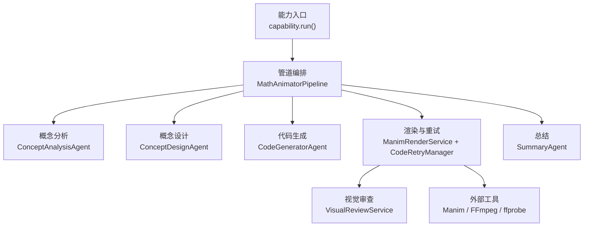
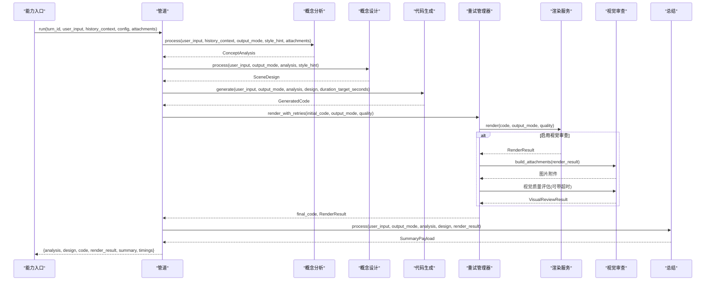
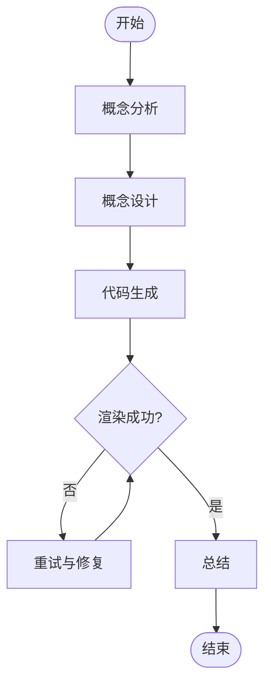
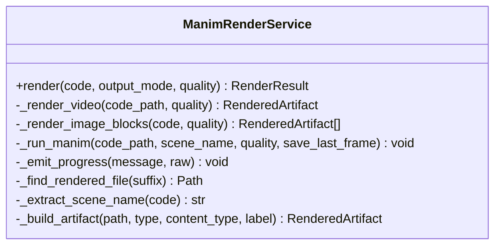
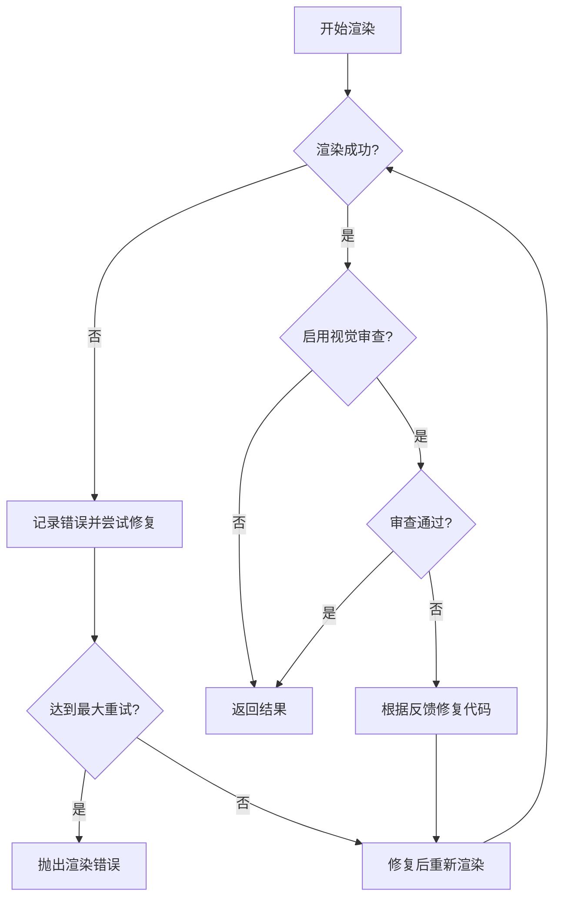
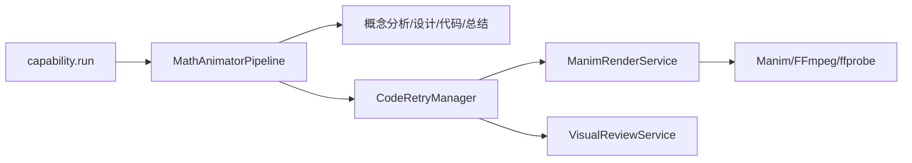

# 动画生成管道

<cite>
**本文引用的文件**
- [pipeline.py](file://deeptutor/agents/math_animator/pipeline.py)
- [capability.py](file://deeptutor/agents/math_animator/capability.py)
- [request_config.py](file://deeptutor/agents/math_animator/request_config.py)
- [renderer.py](file://deeptutor/agents/math_animator/renderer.py)
- [models.py](file://deeptutor/agents/math_animator/models.py)
- [retry_manager.py](file://deeptutor/agents/math_animator/retry_manager.py)
- [visual_review.py](file://deeptutor/agents/math_animator/visual_review.py)
- [duration_utils.py](file://deeptutor/agents/math_animator/duration_utils.py)
- [utils.py](file://deeptutor/agents/math_animator/utils.py)
- [concept_analysis_agent.py](file://deeptutor/agents/math_animator/agents/concept_analysis_agent.py)
</cite>

## 目录
1. [简介](#简介)
2. [项目结构](#项目结构)
3. [核心组件](#核心组件)
4. [架构总览](#架构总览)
5. [详细组件分析](#详细组件分析)
6. [依赖关系分析](#依赖关系分析)
7. [性能考量](#性能考量)
8. [故障排查指南](#故障排查指南)
9. [结论](#结论)
10. [附录：API使用示例与最佳实践](#附录api使用示例与最佳实践)

## 简介
本文件面向数学动画师能力（Math Animator）的端到端生成管道，围绕 MathAnimatorPipeline 的核心编排逻辑展开，覆盖概念分析、概念设计、代码生成、渲染与总结的完整流程。文档重点说明：
- 各阶段的数据流转与依赖关系
- 请求配置系统 MathAnimatorRequestConfig 的作用与选项
- 性能计时机制与错误处理策略
- 与外部服务（Manim、FFmpeg/ffprobe、LLM）的集成方式及异步处理模式
- 完整的调用路径与返回值结构，便于上层能力或API接入

## 项目结构
数学动画师能力位于 agents/math_animator 目录下，核心由“能力入口 + 管道编排 + 渲染服务 + 重试管理 + 视觉审查 + 数据模型”构成。能力入口负责装配上下文、流式进度与追踪；管道负责串联各阶段；渲染服务负责调用 Manim 产出视频或图片；重试管理器负责失败修复与重绘；视觉审查服务从视频中抽帧并构造附件供视觉质量评估；数据模型统一描述中间产物与结果。

图表来源
- [capability.py:41-226](file://deeptutor/agents/math_animator/capability.py#L41-L226)
- [pipeline.py:213-277](file://deeptutor/agents/math_animator/pipeline.py#L213-L277)
- [renderer.py:35-69](file://deeptutor/agents/math_animator/renderer.py#L35-L69)
- [retry_manager.py:21-157](file://deeptutor/agents/math_animator/retry_manager.py#L21-L157)
- [visual_review.py:17-52](file://deeptutor/agents/math_animator/visual_review.py#L17-L52)

章节来源
- [capability.py:41-226](file://deeptutor/agents/math_animator/capability.py#L41-L226)
- [pipeline.py:213-277](file://deeptutor/agents/math_animator/pipeline.py#L213-L277)

## 核心组件
- MathAnimatorPipeline：编排概念分析、概念设计、代码生成、渲染与总结五个阶段，并在每个阶段前后记录耗时，最终汇总返回分析、设计、代码、渲染结果、总结与计时。
- MathAnimatorRequestConfig：校验并承载输出模式（video/image）、质量（low/medium/high）与风格提示（style_hint）。
- ManimRenderService：将生成的 Python/Manim 代码写入工作区，调用 Manim 渲染为视频或图片，并封装为 RenderResult。
- CodeRetryManager：在渲染失败或视觉审查不通过时，触发代码修复并重试，支持超时控制与最大重试次数。
- VisualReviewService：对视频抽取关键帧，或将图片直接作为附件，用于视觉质量评估。
- 数据模型：ConceptAnalysis、SceneDesign、GeneratedCode、RenderedArtifact、RenderResult、VisualReviewResult 等，贯穿各阶段数据契约。

章节来源
- [pipeline.py:25-277](file://deeptutor/agents/math_animator/pipeline.py#L25-L277)
- [request_config.py:10-32](file://deeptutor/agents/math_animator/request_config.py#L10-L32)
- [renderer.py:35-69](file://deeptutor/agents/math_animator/renderer.py#L35-L69)
- [retry_manager.py:21-157](file://deeptutor/agents/math_animator/retry_manager.py#L21-L157)
- [visual_review.py:17-52](file://deeptutor/agents/math_animator/visual_review.py#L17-L52)
- [models.py:8-83](file://deeptutor/agents/math_animator/models.py#L8-L83)

## 架构总览
能力入口 capability.run 负责：
- 检查可选依赖 manim 是否可用
- 解析 LLM 配置与请求配置
- 构建 MathAnimatorPipeline 并注入 trace 回调
- 分阶段执行并上报进度与结果
- 将最终结果通过 emit_capability_result 输出

管道 run 方法按顺序执行：
- 概念分析 → 概念设计 → 代码生成 → 渲染（含重试）→ 总结
- 每步记录耗时，最终返回包含 analysis/design/code/render_result/summary/timings 的结构化结果

图表来源
- [capability.py:41-226](file://deeptutor/agents/math_animator/capability.py#L41-L226)
- [pipeline.py:213-277](file://deeptutor/agents/math_animator/pipeline.py#L213-L277)
- [retry_manager.py:43-157](file://deeptutor/agents/math_animator/retry_manager.py#L43-L157)
- [renderer.py:52-69](file://deeptutor/agents/math_animator/renderer.py#L52-L69)
- [visual_review.py:31-52](file://deeptutor/agents/math_animator/visual_review.py#L31-L52)

## 详细组件分析

### 管道编排：MathAnimatorPipeline
- 初始化：创建概念分析、概念设计、代码生成、总结与可选的视觉审查代理，并设置统一的 trace 回调。
- 阶段接口：
  - run_analysis：传入用户输入、历史上下文、请求配置与附件，返回概念分析结果。
  - run_design：基于分析结果与风格提示，生成场景设计方案。
  - run_code_generation：结合分析、设计与目标时长（从用户输入与风格提示中解析），生成 Manim 代码。
  - run_render：创建渲染服务，必要时构建视觉审查回调，并通过重试管理器完成渲染与修复循环。
  - run_summary：综合分析、设计与渲染结果，生成面向用户的总结文本。
- 整体 run：顺序执行上述阶段，记录每阶段耗时，最终聚合返回。

图表来源
- [pipeline.py:84-211](file://deeptutor/agents/math_animator/pipeline.py#L84-L211)
- [pipeline.py:213-277](file://deeptutor/agents/math_animator/pipeline.py#L213-L277)

章节来源
- [pipeline.py:25-277](file://deeptutor/agents/math_animator/pipeline.py#L25-L277)

### 请求配置：MathAnimatorRequestConfig
- 字段：
  - output_mode：视频或图片模式
  - quality：低/中/高三种渲染质量
  - style_hint：风格提示，影响分析与代码生成
- 校验：validate_math_animator_request_config 对空值、类型与字段合法性进行校验，并提供清晰的错误信息。

章节来源
- [request_config.py:10-32](file://deeptutor/agents/math_animator/request_config.py#L10-L32)

### 渲染服务：ManimRenderService
- 工作区：按 turn_id 隔离 source/artifacts/media/meta 目录。
- 渲染流程：
  - 视频模式：提取场景类名，调用 Manim 渲染 mp4，复制最终产物到 artifacts。
  - 图片模式：要求代码中包含特定锚点块，逐个渲染为 png。
- 进程管理：使用 subprocess.Popen 配合线程读取 stdout/stderr，通过 asyncio.Queue 回传至事件循环，实现跨平台兼容与实时进度上报。
- 错误处理：渲染失败抛出 ManimRenderError，并裁剪错误消息长度。

图表来源
- [renderer.py:35-243](file://deeptutor/agents/math_animator/renderer.py#L35-L243)

章节来源
- [renderer.py:35-243](file://deeptutor/agents/math_animator/renderer.py#L35-L243)

### 重试管理：CodeRetryManager
- 目标：在渲染失败或视觉审查不通过时，自动修复代码并重试。
- 行为：
  - 最多重试 N 次，每次尝试前上报状态。
  - 若启用视觉审查，先渲染再评估，未通过则构造修复提示并调用修复回调。
  - 捕获非可重试环境错误（如缺少 LaTeX），直接抛出明确错误。
  - 修复与审查均支持超时保护，避免长时间阻塞。
- 输出：返回最终代码与包含重试历史的 RenderResult。

图表来源
- [retry_manager.py:43-157](file://deeptutor/agents/math_animator/retry_manager.py#L43-L157)

章节来源
- [retry_manager.py:21-157](file://deeptutor/agents/math_animator/retry_manager.py#L21-L157)

### 视觉审查：VisualReviewService
- 功能：为视觉质量评估准备附件。
  - 图片模式：直接使用渲染产物。
  - 视频模式：使用 ffprobe 探测时长，选择关键时间点用 ffmpeg 抽取帧。
- 输出：Attachment 列表，包含 base64 编码的图片内容，供视觉审查代理消费。

章节来源
- [visual_review.py:17-141](file://deeptutor/agents/math_animator/visual_review.py#L17-L141)

### 数据模型：models
- ConceptAnalysis：学习目标、数学焦点、视觉目标、叙事步骤、参考使用、输出意图。
- SceneDesign：标题、场景大纲、视觉风格、动画备注、图片计划、代码约束。
- GeneratedCode：生成的 Manim 代码与理由。
- RenderedArtifact：渲染产物元数据（类型、URL、文件名、MIME、标签）。
- RenderResult：输出模式、产物列表、源码路径、质量、重试次数与历史、可选视觉审查结果。
- VisualReviewResult：是否通过、摘要、问题列表、建议修复、审查帧数。
- RetryAttempt：重试次数与错误信息。

章节来源
- [models.py:8-83](file://deeptutor/agents/math_animator/models.py#L8-L83)

### 辅助工具
- duration_utils.parse_target_duration_seconds：从用户输入与风格提示中提取目标时长（秒/分钟），用于指导代码生成。
- utils.slugify_filename/trim_error_message/build_repair_error_message：文件名清理、错误消息裁剪、针对常见错误的修复提示增强。

章节来源
- [duration_utils.py:17-36](file://deeptutor/agents/math_animator/duration_utils.py#L17-L36)
- [utils.py:10-45](file://deeptutor/agents/math_animator/utils.py#L10-L45)

## 依赖关系分析
- 能力入口依赖：
  - 管道：MathAnimatorPipeline
  - 配置：MathAnimatorRequestConfig
  - LLM 配置：get_llm_config
  - 流式通道：StreamBus（上报阶段进度、思考流、错误）
- 管道依赖：
  - 各阶段代理：ConceptAnalysisAgent、ConceptDesignAgent、CodeGeneratorAgent、SummaryAgent、VisualReviewAgent（可选）
  - 渲染：ManimRenderService
  - 重试：CodeRetryManager
  - 视觉审查：VisualReviewService（可选）
  - 工具：duration_utils、utils
- 渲染服务依赖：
  - 外部工具：Manim（Python 模块）、FFmpeg/ffprobe（命令行工具）
  - 路径服务：path_service（隔离工作区）
- 重试管理依赖：
  - 渲染服务与视觉审查回调
  - 修复回调：由管道注入的代码修复函数（内部调用 CodeGeneratorAgent.repair）

图表来源
- [capability.py:41-226](file://deeptutor/agents/math_animator/capability.py#L41-L226)
- [pipeline.py:213-277](file://deeptutor/agents/math_animator/pipeline.py#L213-L277)
- [renderer.py:35-69](file://deeptutor/agents/math_animator/renderer.py#L35-L69)
- [retry_manager.py:43-157](file://deeptutor/agents/math_animator/retry_manager.py#L43-L157)
- [visual_review.py:31-52](file://deeptutor/agents/math_animator/visual_review.py#L31-L52)

章节来源
- [capability.py:41-226](file://deeptutor/agents/math_animator/capability.py#L41-L226)
- [pipeline.py:213-277](file://deeptutor/agents/math_animator/pipeline.py#L213-L277)

## 性能考量
- 阶段计时：能力入口与管道分别在阶段前后记录耗时，最终汇总到 timings，便于定位瓶颈。
- 渲染并发：渲染过程使用线程读取子进程输出并通过队列同步到事件循环，避免阻塞主循环。
- 超时保护：视觉审查与代码修复均设置超时，防止长时间卡死。
- 质量与时长：quality 影响渲染速度与质量；duration_target_seconds 可用于引导代码生成控制动画时长。
- 资源隔离：按 turn_id 隔离工作区，避免多任务冲突。

[本节提供通用指导，无需具体文件引用]

## 故障排查指南
- 缺少可选依赖：
  - 现象：能力入口启动时报错提示需要安装 math-animator 依赖。
  - 处理：安装 manim 及相关依赖。
- 渲染失败（Manim 错误）：
  - 现象：渲染抛出自定义错误，包含裁剪后的 stderr。
  - 处理：查看错误消息，必要时调整代码或安装 LaTeX。
- 非可重试环境错误：
  - 现象：检测到本地缺失 LaTeX 等环境问题时，直接抛出明确错误。
  - 处理：安装 LaTeX 或避免在代码中使用 Tex/MathTex。
- 视觉审查超时：
  - 现象：审查阶段超过设定时间。
  - 处理：降低复杂度或缩短视频时长，或调整超时参数。
- 修复超时：
  - 现象：代码修复阶段超过设定时间。
  - 处理：简化提示词或减少复杂逻辑，确保修复回调快速响应。

章节来源
- [capability.py:41-47](file://deeptutor/agents/math_animator/capability.py#L41-L47)
- [renderer.py:194-201](file://deeptutor/agents/math_animator/renderer.py#L194-L201)
- [retry_manager.py:129-134](file://deeptutor/agents/math_animator/retry_manager.py#L129-L134)
- [retry_manager.py:74-77](file://deeptutor/agents/math_animator/retry_manager.py#L74-L77)
- [retry_manager.py:148-151](file://deeptutor/agents/math_animator/retry_manager.py#L148-L151)

## 结论
数学动画师管道以 MathAnimatorPipeline 为核心，将概念分析、设计、代码生成、渲染与总结串联成稳定可靠的流水线。通过请求配置、重试管理与视觉审查，系统在保证质量的同时具备较强的容错能力。借助流式进度与追踪回调，上层能力可以实时感知阶段状态与中间结果，便于构建友好的交互体验。

[本节为总结性内容，无需具体文件引用]

## 附录：API使用示例与最佳实践
- 调用入口
  - 通过能力入口 capability.run 传入 UnifiedContext（包含用户消息、会话ID、语言、配置覆盖等）与 StreamBus。
  - 能力入口会解析 LLM 配置与请求配置，构建管道并执行。
- 请求配置
  - 使用 validate_math_animator_request_config 校验并生成 MathAnimatorRequestConfig。
  - 推荐设置：output_mode（video/image）、quality（low/medium/high）、style_hint（简短风格描述）。
- 阶段调用与返回值
  - 概念分析：返回 ConceptAnalysis，包含学习目标、数学焦点、视觉目标等。
  - 概念设计：返回 SceneDesign，包含标题、大纲、风格、动画备注等。
  - 代码生成：返回 GeneratedCode，包含 Manim 代码与理由。
  - 渲染：返回 RenderResult，包含产物列表、源码路径、质量、重试历史与可选视觉审查结果。
  - 总结：返回 SummaryPayload，包含总结文本、关键点等。
- 进度与追踪
  - 通过 StreamBus 上报阶段进度、思考流与错误。
  - 渲染与重试过程中，on_retry、on_render_progress、on_retry_status 回调用于实时反馈。
- 外部服务集成
  - Manim：用于渲染视频或图片，需安装 manim 包。
  - FFmpeg/ffprobe：用于视频时长探测与帧抽取，需安装对应命令行工具。
- 异步处理模式
  - 所有阶段均为异步函数，使用 async/await 与事件循环。
  - 渲染过程通过线程与队列实现子进程输出的实时流式上报。

章节来源
- [capability.py:41-226](file://deeptutor/agents/math_animator/capability.py#L41-L226)
- [request_config.py:18-32](file://deeptutor/agents/math_animator/request_config.py#L18-L32)
- [pipeline.py:84-211](file://deeptutor/agents/math_animator/pipeline.py#L84-L211)
- [renderer.py:52-69](file://deeptutor/agents/math_animator/renderer.py#L52-L69)
- [retry_manager.py:43-157](file://deeptutor/agents/math_animator/retry_manager.py#L43-L157)
- [visual_review.py:31-52](file://deeptutor/agents/math_animator/visual_review.py#L31-L52)
- [models.py:8-83](file://deeptutor/agents/math_animator/models.py#L8-L83)