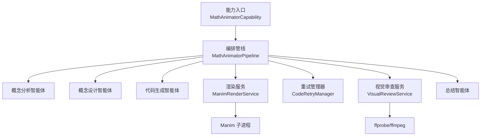
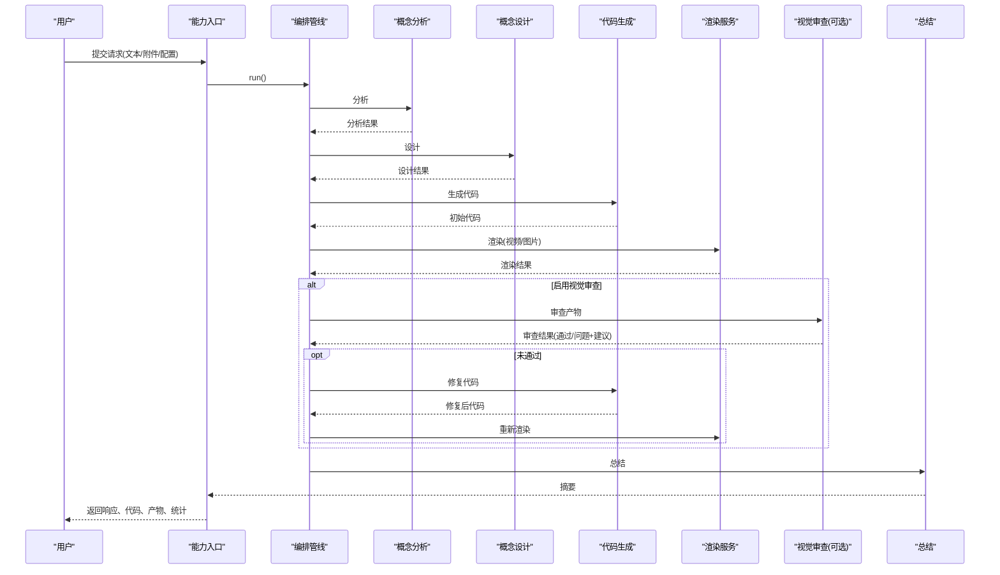
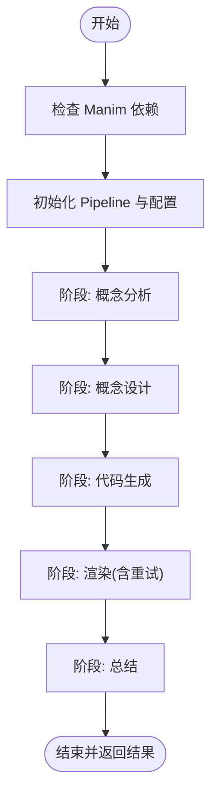
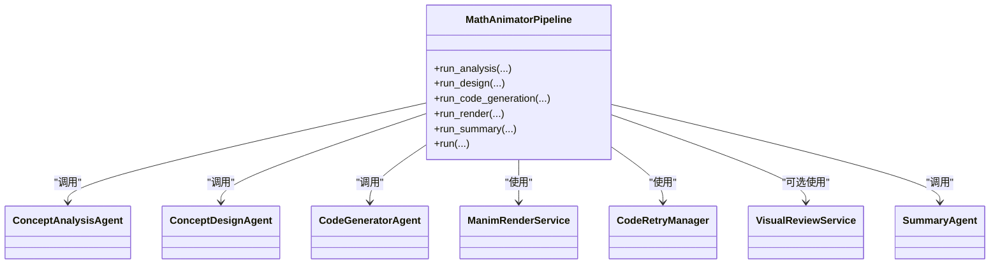
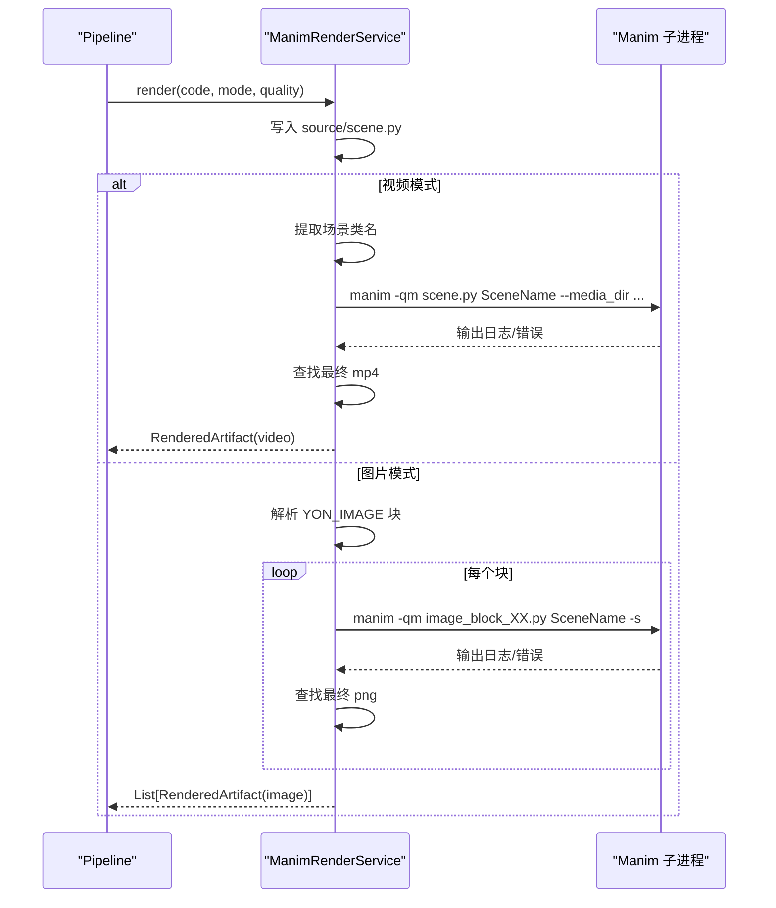
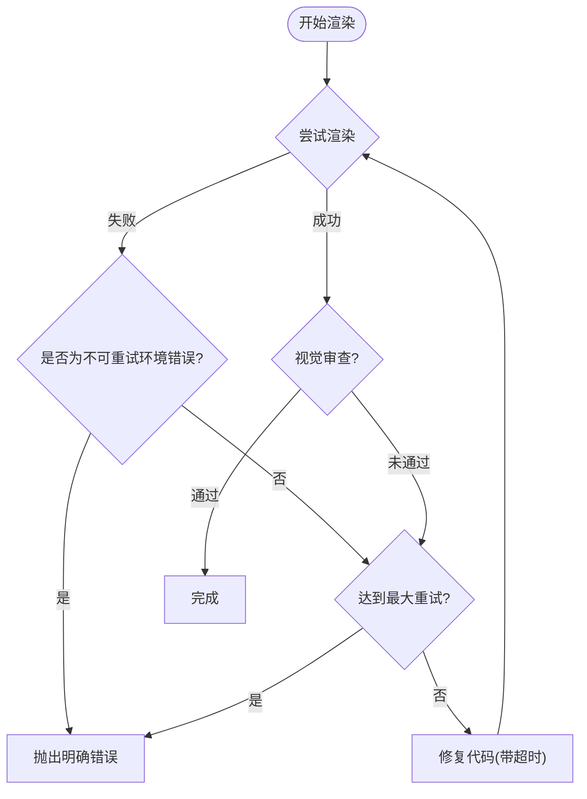
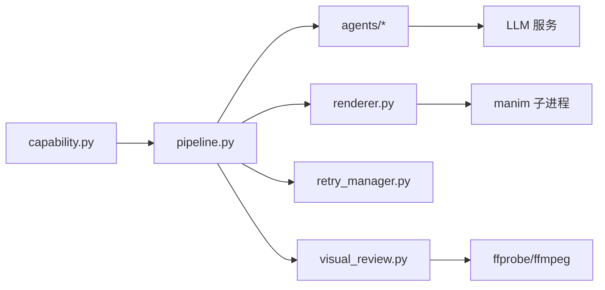

# 数学动画师

<cite>
**本文引用的文件**
- [capability.py](file://deeptutor/agents/math_animator/capability.py)
- [pipeline.py](file://deeptutor/agents/math_animator/pipeline.py)
- [renderer.py](file://deeptutor/agents/math_animator/renderer.py)
- [retry_manager.py](file://deeptutor/agents/math_animator/retry_manager.py)
- [visual_review.py](file://deeptutor/agents/math_animator/visual_review.py)
- [models.py](file://deeptutor/agents/math_animator/models.py)
- [request_config.py](file://deeptutor/agents/math_animator/request_config.py)
- [duration_utils.py](file://deeptutor/agents/math_animator/duration_utils.py)
- [concept_analysis_agent.py](file://deeptutor/agents/math_animator/agents/concept_analysis_agent.py)
- [concept_design_agent.py](file://deeptutor/agents/math_animator/agents/concept_design_agent.py)
- [code_generator_agent.py](file://deeptutor/agents/math_animator/agents/code_generator_agent.py)
- [summary_agent.py](file://deeptutor/agents/math_animator/agents/summary_agent.py)
</cite>

## 目录
1. [简介](#简介)
2. [项目结构](#项目结构)
3. [核心组件](#核心组件)
4. [架构总览](#架构总览)
5. [详细组件分析](#详细组件分析)
6. [依赖关系分析](#依赖关系分析)
7. [性能与时间管理](#性能与时间管理)
8. [故障排查指南](#故障排查指南)
9. [结论](#结论)
10. [附录：开发示例与扩展](#附录开发示例与扩展)

## 简介
本文件面向“数学动画师”智能体，系统性说明其基于 Manim 的动画生成流程、多智能体协作架构、渲染器实现原理、重试机制、请求配置、外部服务集成与错误处理策略。内容覆盖概念分析、代码生成、视觉审查与渲染输出等阶段，并提供可扩展的开发指引，帮助开发者创建数学动画、自定义渲染器与扩展动画类型。

## 项目结构
数学动画能力位于 deeptutor/agents/math_animator 目录下，采用“能力入口 + 编排管线 + 多智能体 + 渲染与重试 + 模型与工具”的分层组织方式：
- 能力入口：对外暴露能力清单、运行入口与流式进度桥接
- 编排管线：串联概念分析、概念设计、代码生成、渲染（含重试）、总结
- 智能体：概念分析、概念设计、代码生成、总结、可选的视觉审查
- 渲染器：Manim 脚本写入、子进程执行、产物收集与 URL 化
- 重试管理器：渲染失败或视觉审查不通过时的修复与重渲染循环
- 数据模型：各阶段输入输出的结构化 Pydantic 模型
- 工具：时长解析、文件名规范化、错误信息裁剪等

图表来源
- [capability.py:19-226](file://deeptutor/agents/math_animator/capability.py#L19-L226)
- [pipeline.py:25-277](file://deeptutor/agents/math_animator/pipeline.py#L25-L277)
- [renderer.py:35-243](file://deeptutor/agents/math_animator/renderer.py#L35-L243)
- [retry_manager.py:21-157](file://deeptutor/agents/math_animator/retry_manager.py#L21-L157)
- [visual_review.py:17-141](file://deeptutor/agents/math_animator/visual_review.py#L17-L141)

章节来源
- [capability.py:19-226](file://deeptutor/agents/math_animator/capability.py#L19-L226)
- [pipeline.py:25-277](file://deeptutor/agents/math_animator/pipeline.py#L25-L277)

## 核心组件
- 能力入口 MathAnimatorCapability：声明能力元数据、阶段划分、默认配置；负责 LLM 配置读取、请求配置校验、阶段计时、流式进度与结果汇总。
- 编排管线 MathAnimatorPipeline：按顺序调度概念分析、概念设计、代码生成、渲染（含重试）、总结；支持可选的视觉审查回调。
- 渲染服务 ManimRenderService：将生成的 Python/Manim 脚本落盘，调用 manim 命令行渲染视频或图片块，收集产物并生成可访问 URL。
- 重试管理器 CodeRetryManager：封装渲染-失败-修复-重渲染循环，支持视觉审查反馈驱动修复，提供超时保护与非可重试环境错误识别。
- 视觉审查服务 VisualReviewService：从视频抽取关键帧或读取图片产物，构造附件供视觉审查智能体评估质量。
- 数据模型 models.py：统一描述各阶段输入输出，如 ConceptAnalysis、SceneDesign、GeneratedCode、RenderResult、VisualReviewResult 等。
- 请求配置 request_config.py：约束 output_mode、quality、style_hint，提供校验与错误提示。
- 时长工具 duration_utils.py：从用户输入中解析目标时长（秒/分钟），用于代码生成与节奏预算提示。

章节来源
- [models.py:8-83](file://deeptutor/agents/math_animator/models.py#L8-L83)
- [request_config.py:10-32](file://deeptutor/agents/math_animator/request_config.py#L10-L32)
- [duration_utils.py:17-36](file://deeptutor/agents/math_animator/duration_utils.py#L17-L36)

## 架构总览
数学动画师采用“多智能体协作 + 渲染闭环”的架构：
- 概念分析智能体：理解学习目标、数学焦点、可视化目标、叙事步骤，结合历史上下文与参考图片，产出结构化分析。
- 概念设计智能体：基于分析结果，规划场景大纲、视觉风格、动画备注、图片计划与代码约束。
- 代码生成智能体：依据分析与设计，生成可执行的 Manim 脚本，并在失败时进行修复。
- 渲染服务：执行 Manim 渲染，输出视频或图片；支持质量等级与最后帧保存。
- 视觉审查（可选）：对渲染产物进行质量评估（重叠、可读性、构图），必要时触发修复。
- 总结智能体：综合分析、设计与渲染结果，生成面向用户的摘要与关键点。

图表来源
- [capability.py:41-226](file://deeptutor/agents/math_animator/capability.py#L41-L226)
- [pipeline.py:84-211](file://deeptutor/agents/math_animator/pipeline.py#L84-L211)
- [retry_manager.py:43-157](file://deeptutor/agents/math_animator/retry_manager.py#L43-L157)
- [visual_review.py:31-52](file://deeptutor/agents/math_animator/visual_review.py#L31-L52)

## 详细组件分析

### 能力入口：MathAnimatorCapability
- 职责：声明能力名称、阶段、默认配置；加载 LLM 配置；校验请求配置；构建追踪桥接；分阶段执行管线；汇总结果与使用量。
- 关键流程：
  - 检查 Manim 可选依赖是否安装
  - 初始化 MathAnimatorPipeline 并注入 LLM 参数与追踪回调
  - 分阶段执行：概念分析、概念设计、代码生成、渲染（含重试）、总结
  - 通过 StreamBus 推送进度、思考内容与错误信息
  - 最终 emit_capability_result 返回响应、代码、产物、时序与渲染详情

图表来源
- [capability.py:41-226](file://deeptutor/agents/math_animator/capability.py#L41-L226)

章节来源
- [capability.py:19-226](file://deeptutor/agents/math_animator/capability.py#L19-L226)

### 编排管线：MathAnimatorPipeline
- 职责：协调五个智能体与服务，计算目标时长，组装渲染与审查回调，记录各阶段耗时。
- 关键方法：
  - run_analysis：调用概念分析智能体
  - run_design：调用概念设计智能体
  - run_code_generation：解析目标时长并调用代码生成智能体
  - run_render：创建渲染服务与重试管理器，支持可选视觉审查回调
  - run_summary：调用总结智能体
  - run：完整流水线，聚合各阶段结果与时序

图表来源
- [pipeline.py:25-211](file://deeptutor/agents/math_animator/pipeline.py#L25-L211)

章节来源
- [pipeline.py:25-211](file://deeptutor/agents/math_animator/pipeline.py#L25-L211)

### 概念分析智能体：ConceptAnalysisAgent
- 职责：根据用户输入、历史上下文、输出模式与风格提示，结合参考图片数量，生成结构化分析（学习目标、数学焦点、可视化目标、叙事步骤、参考使用、输出意图）。
- 实现要点：
  - 加载系统提示与用户模板，若缺失则尝试重载提示
  - 流式获取 LLM 输出，拼接为 JSON 对象并校验为 ConceptAnalysis

章节来源
- [concept_analysis_agent.py:14-88](file://deeptutor/agents/math_animator/agents/concept_analysis_agent.py#L14-L88)

### 概念设计智能体：ConceptDesignAgent
- 职责：基于分析结果，生成场景设计（标题、场景大纲、视觉风格、动画备注、图片计划、代码约束）。
- 实现要点：
  - 加载提示模板，构造用户提示并传入分析结果 JSON
  - 流式获取 LLM 输出，解析为 SceneDesign

章节来源
- [concept_design_agent.py:14-67](file://deeptutor/agents/math_animator/agents/concept_design_agent.py#L14-L67)

### 代码生成智能体：CodeGeneratorAgent
- 职责：依据分析与设计生成 Manim 脚本；在渲染失败或视觉审查不通过时进行修复。
- 实现要点：
  - generate：构造包含目标时长要求的用户提示，生成 GeneratedCode
  - repair：接收当前代码与错误信息，生成修复后的代码，保持目标时长约束
  - 均通过流式 LLM 调用并解析 JSON 输出

章节来源
- [code_generator_agent.py:14-138](file://deeptutor/agents/math_animator/agents/code_generator_agent.py#L14-L138)

### 渲染服务：ManimRenderService
- 职责：将代码写入源目录，调用 Manim 渲染视频或图片块，收集产物并生成相对路径 URL。
- 关键逻辑：
  - render：根据输出模式选择视频或图片块渲染
  - _render_video：提取场景类名，执行 manim 命令，查找最终 mp4 产物
  - _render_image_blocks：解析 YON_IMAGE 锚点块，逐个渲染 PNG 并收集
  - _run_manim：跨平台子进程执行，线程读取 stdout/stderr，实时回传进度，非零退出码抛出异常
  - _find_rendered_file：忽略中间片段，选取最新最终产物
  - _build_artifact：生成 RenderedArtifact，URL 指向 /api/outputs/...

图表来源
- [renderer.py:52-122](file://deeptutor/agents/math_animator/renderer.py#L52-L122)
- [renderer.py:124-201](file://deeptutor/agents/math_animator/renderer.py#L124-L201)
- [renderer.py:208-243](file://deeptutor/agents/math_animator/renderer.py#L208-L243)

章节来源
- [renderer.py:35-243](file://deeptutor/agents/math_animator/renderer.py#L35-L243)

### 重试管理器：CodeRetryManager
- 职责：封装“渲染-失败-修复-重渲染”循环，支持视觉审查反馈驱动的修复，提供超时保护与环境错误识别。
- 关键逻辑：
  - render_with_retries：最多 max_retries+1 次尝试
  - 捕获 ManimRenderError，若非可重试环境错误（缺少 LaTeX）直接抛出明确提示
  - 可选视觉审查：超时保护，未通过则构造错误信息并触发修复回调
  - 修复回调：调用代码生成智能体的 repair，超时保护，更新代码并重试
  - 记录重试历史与次数，最终返回最终代码与渲染结果

图表来源
- [retry_manager.py:43-157](file://deeptutor/agents/math_animator/retry_manager.py#L43-L157)

章节来源
- [retry_manager.py:21-157](file://deeptutor/agents/math_animator/retry_manager.py#L21-L157)

### 视觉审查服务：VisualReviewService
- 职责：为视觉审查智能体准备附件（图片或直接抽取视频关键帧），便于评估重叠、可读性与构图。
- 关键逻辑：
  - build_attachments：图片模式直接使用产物；视频模式通过 ffprobe 探测时长并抽取关键帧
  - _extract_video_frames：调用 ffmpeg 抽取指定时间点的单帧
  - _probe_duration：调用 ffprobe 获取视频时长
  - _choose_timestamps：短视频取首尾与中点，长视频取 15%/50%/85% 时间点
  - _path_to_attachment：将本地图片转为 Attachment（base64）

章节来源
- [visual_review.py:17-141](file://deeptutor/agents/math_animator/visual_review.py#L17-L141)

### 总结智能体：SummaryAgent
- 职责：综合用户请求、分析、设计与渲染结果，生成面向用户的摘要与关键点。
- 实现要点：
  - 加载提示模板，构造用户提示并传入分析、设计、渲染结果的 JSON
  - 流式获取 LLM 输出，解析为 SummaryPayload

章节来源
- [summary_agent.py:14-69](file://deeptutor/agents/math_animator/agents/summary_agent.py#L14-L69)

## 依赖关系分析
- 模块内依赖：
  - capability 依赖 pipeline、request_config、llm 配置、i18n、trace、stream_bus
  - pipeline 依赖 agents、renderer、retry_manager、models、duration_utils、visual_review
  - renderer 依赖 models、utils、path_service、subprocess、re
  - retry_manager 依赖 renderer、models、asyncio
  - visual_review 依赖 models、renderer、path_service、asyncio、subprocess
  - agents 依赖 base_agent、prompt、models、utils、trace
- 外部依赖：
  - Manim：通过子进程调用 manim 命令行
  - FFmpeg/FFprobe：用于视频时长探测与关键帧抽取
  - LLM：通过 BaseAgent.stream_llm 流式调用

图表来源
- [capability.py:41-226](file://deeptutor/agents/math_animator/capability.py#L41-L226)
- [pipeline.py:25-211](file://deeptutor/agents/math_animator/pipeline.py#L25-L211)
- [renderer.py:124-201](file://deeptutor/agents/math_animator/renderer.py#L124-L201)
- [visual_review.py:54-118](file://deeptutor/agents/math_animator/visual_review.py#L54-L118)

章节来源
- [pipeline.py:25-211](file://deeptutor/agents/math_animator/pipeline.py#L25-L211)
- [renderer.py:124-201](file://deeptutor/agents/math_animator/renderer.py#L124-L201)
- [visual_review.py:54-118](file://deeptutor/agents/math_animator/visual_review.py#L54-L118)

## 性能与时间管理
- 阶段计时：能力入口与各阶段分别记录耗时，便于性能分析与优化定位
- 目标时长解析：duration_utils 从用户输入中解析秒/分钟，传递给代码生成以控制节奏预算
- 渲染质量：quality 映射到 manim 质量标志（low/medium/high），影响渲染速度与质量
- 子进程并发：渲染器使用线程读取 stdout/stderr 并通过 asyncio.Queue 回传，避免阻塞事件循环
- 超时保护：重试管理器对修复与视觉审查设置超时，防止长时间挂起
- 产物路径：使用 path_service 隔离每轮 turn_id 的工作目录，避免污染与冲突

章节来源
- [capability.py:66-181](file://deeptutor/agents/math_animator/capability.py#L66-L181)
- [duration_utils.py:17-36](file://deeptutor/agents/math_animator/duration_utils.py#L17-L36)
- [renderer.py:124-201](file://deeptutor/agents/math_animator/renderer.py#L124-L201)
- [retry_manager.py:43-157](file://deeptutor/agents/math_animator/retry_manager.py#L43-L157)

## 故障排查指南
- 依赖缺失：
  - Manim 未安装：能力入口会抛出运行时错误，需安装可选依赖
  - LaTeX 缺失：渲染器抛出明确提示，建议避免使用 Tex/MathTex 或安装 LaTeX 发行版
- 渲染失败：
  - 非零退出码：渲染器抛出 ManimRenderError，包含 stdout/stderr 摘要
  - 找不到最终产物：渲染器抛出错误，检查 media_dir 与场景类名是否正确
- 视觉审查超时：
  - 审查或修复超时：重试管理器抛出明确超时错误，调整 review_timeout_seconds 或 repair_timeout_seconds
- 外部工具问题：
  - ffprobe/ffmpeg 不可用：视觉审查服务抛出错误，确保系统已安装并可用
- 配置错误：
  - 请求配置非法：validate_math_animator_request_config 抛出 ValueError，包含字段级错误详情

章节来源
- [capability.py:41-47](file://deeptutor/agents/math_animator/capability.py#L41-L47)
- [renderer.py:194-227](file://deeptutor/agents/math_animator/renderer.py#L194-L227)
- [retry_manager.py:12-18](file://deeptutor/agents/math_animator/retry_manager.py#L12-L18)
- [retry_manager.py:74-77](file://deeptutor/agents/math_animator/retry_manager.py#L74-L77)
- [visual_review.py:54-118](file://deeptutor/agents/math_animator/visual_review.py#L54-L118)
- [request_config.py:18-32](file://deeptutor/agents/math_animator/request_config.py#L18-L32)

## 结论
数学动画师智能体通过清晰的多智能体协作与稳健的渲染重试机制，实现了从概念到可视化的端到端自动化。其模块化设计便于扩展新的动画类型与渲染后端；严格的配置校验与错误处理保障了稳定性；流式进度与追踪桥接提升了可观测性。结合目标时长解析与视觉审查，可在保证教学质量的同时提升生成效率。

## 附录：开发示例与扩展
- 创建数学动画
  - 通过能力入口提交用户消息与附件，设置 output_mode 与 quality，即可自动生成 Manim 脚本并渲染
  - 参考：能力入口的阶段划分与结果返回结构
  - 章节来源
    - [capability.py:41-226](file://deeptutor/agents/math_animator/capability.py#L41-L226)
- 自定义渲染器
  - 替换 ManimRenderService 的实现，保留 render 接口与 RenderResult 结构
  - 注意：保持产物路径与 URL 格式一致，以便前端展示
  - 章节来源
    - [renderer.py:52-69](file://deeptutor/agents/math_animator/renderer.py#L52-L69)
    - [renderer.py:229-243](file://deeptutor/agents/math_animator/renderer.py#L229-L243)
- 扩展动画类型
  - 在代码生成智能体中添加新类型的提示与约束，或在渲染器中新增分支处理
  - 利用 duration_utils 控制不同动画类型的节奏预算
  - 章节来源
    - [code_generator_agent.py:49-91](file://deeptutor/agents/math_animator/agents/code_generator_agent.py#L49-L91)
    - [duration_utils.py:17-36](file://deeptutor/agents/math_animator/duration_utils.py#L17-L36)
- 集成外部服务
  - LLM：通过 BaseAgent.stream_llm 流式调用，支持 thinking 与进度桥接
  - 媒体工具：使用 ffprobe/ffmpeg 进行视频时长探测与关键帧抽取
  - 章节来源
    - [concept_analysis_agent.py:70-88](file://deeptutor/agents/math_animator/agents/concept_analysis_agent.py#L70-L88)
    - [visual_review.py:54-118](file://deeptutor/agents/math_animator/visual_review.py#L54-L118)
- 错误处理策略
  - 非可重试环境错误快速失败并给出明确指引
  - 渲染失败与视觉审查不通过进入修复循环，带超时保护
  - 配置校验失败返回字段级错误详情
  - 章节来源
    - [retry_manager.py:12-18](file://deeptutor/agents/math_animator/retry_manager.py#L12-L18)
    - [retry_manager.py:74-77](file://deeptutor/agents/math_animator/retry_manager.py#L74-L77)
    - [request_config.py:18-32](file://deeptutor/agents/math_animator/request_config.py#L18-L32)