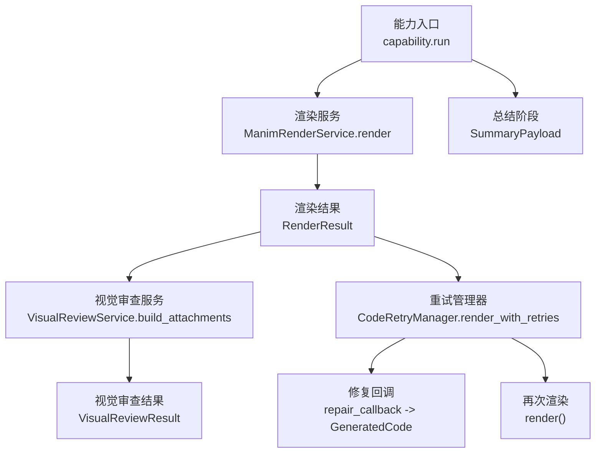
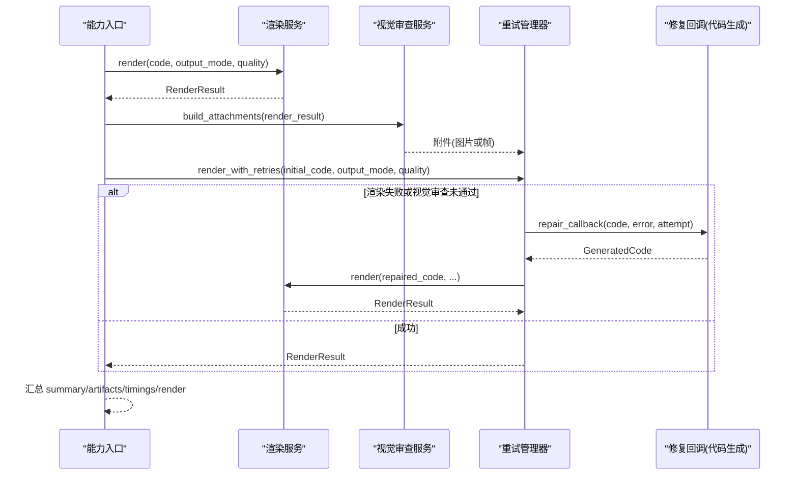
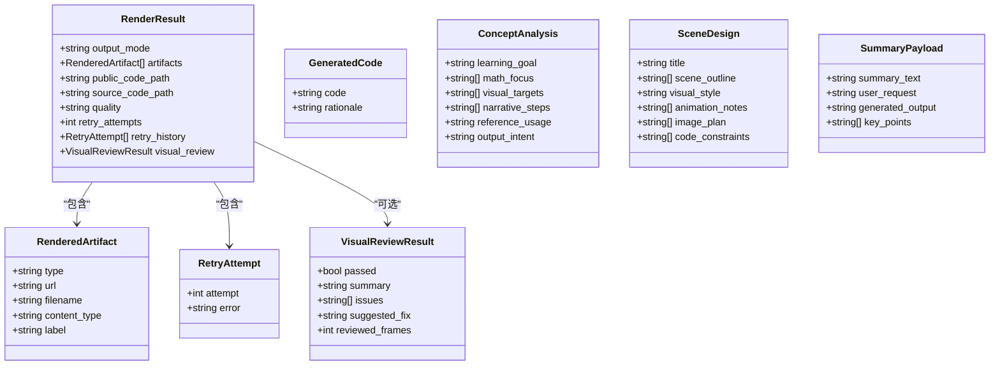
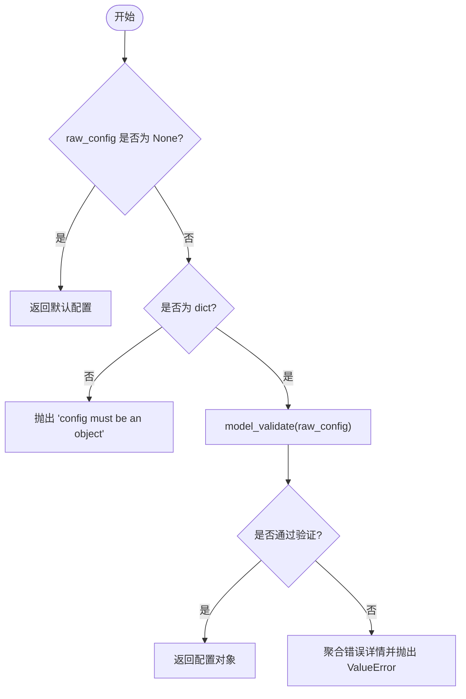
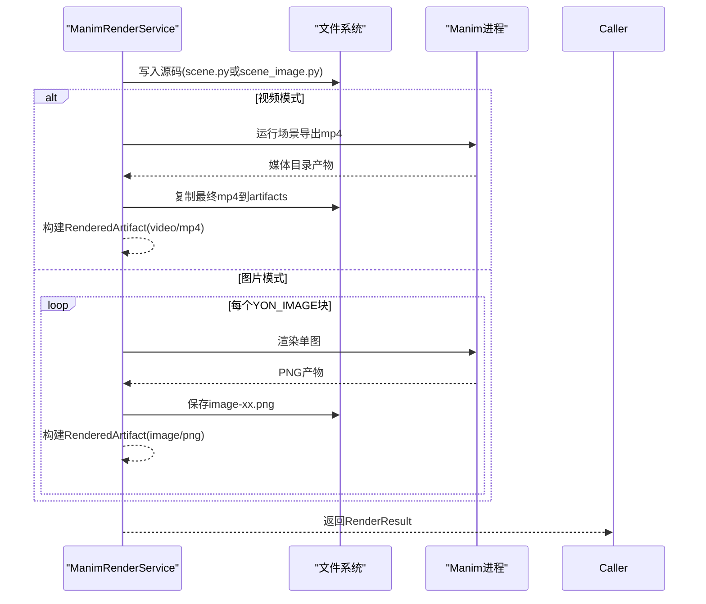
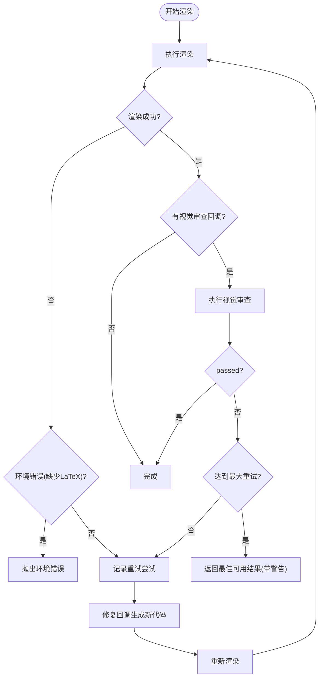
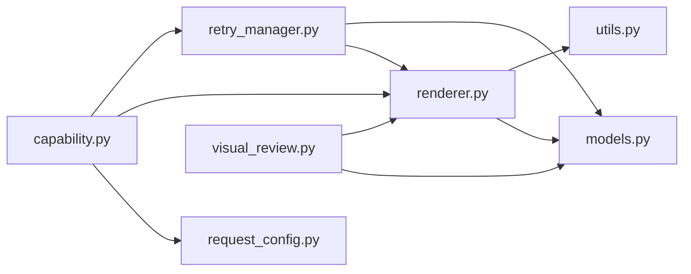

# 数据模型

<cite>
**本文引用的文件**
- [models.py](file://deeptutor/agents/math_animator/models.py)
- [request_config.py](file://deeptutor/agents/math_animator/request_config.py)
- [capability.py](file://deeptutor/agents/math_animator/capability.py)
- [renderer.py](file://deeptutor/agents/math_animator/renderer.py)
- [retry_manager.py](file://deeptutor/agents/math_animator/retry_manager.py)
- [visual_review.py](file://deeptutor/agents/math_animator/visual_review.py)
- [utils.py](file://deeptutor/agents/math_animator/utils.py)
- [duration_utils.py](file://deeptutor/agents/math_animator/duration_utils.py)
- [test_retry_manager.py](file://tests/agents/math_animator/test_retry_manager.py)
- [test_request_config.py](file://tests/agents/math_animator/test_request_config.py)
- [test_utils.py](file://tests/agents/math_animator/test_utils.py)
</cite>

## 目录
1. [简介](#简介)
2. [项目结构](#项目结构)
3. [核心组件](#核心组件)
4. [架构总览](#架构总览)
5. [详细组件分析](#详细组件分析)
6. [依赖关系分析](#依赖关系分析)
7. [性能考虑](#性能考虑)
8. [故障排查指南](#故障排查指南)
9. [结论](#结论)
10. [附录](#附录)

## 简介
本文件聚焦数学动画师（Math Animator）能力的数据模型与相关工具，系统性说明核心数据结构、验证规则、序列化/反序列化方式、版本兼容性与迁移策略，以及数据完整性检查与错误处理机制。重点覆盖 RenderResult、VisualReviewResult 等 Pydantic 模型，以及渲染、重试、视觉审查、请求配置等关键流程中的数据流转。

## 项目结构
数学动画师模块位于 agents/math_animator 下，围绕“概念分析—设计—代码生成—渲染—总结”的流水线组织数据与逻辑：
- models.py：定义共享数据模型（如 RenderResult、VisualReviewResult、RenderedArtifact、RetryAttempt、GeneratedCode、SceneDesign、ConceptAnalysis、SummaryPayload）。
- request_config.py：定义并校验请求配置（输出模式、质量、风格提示）。
- renderer.py：Manim 渲染服务，负责将代码转为视频或图片产物，并产出 RenderResult。
- retry_manager.py：渲染修复与重试循环，结合视觉审查结果驱动代码修复与重渲染。
- visual_review.py：从渲染产物中提取帧，构造附件用于视觉质量审查。
- utils.py：通用工具（文件名规范化、错误信息裁剪、针对性修复提示增强）。
- duration_utils.py：解析用户文本中的目标时长，辅助提示工程。
- capability.py：能力入口，编排各阶段并汇总最终结果。

图表来源
- [capability.py:41-226](file://deeptutor/agents/math_animator/capability.py#L41-L226)
- [renderer.py:52-69](file://deeptutor/agents/math_animator/renderer.py#L52-L69)
- [visual_review.py:31-52](file://deeptutor/agents/math_animator/visual_review.py#L31-L52)
- [retry_manager.py:43-157](file://deeptutor/agents/math_animator/retry_manager.py#L43-L157)

章节来源
- [capability.py:41-226](file://deeptutor/agents/math_animator/capability.py#L41-L226)
- [renderer.py:52-69](file://deeptutor/agents/math_animator/renderer.py#L52-L69)
- [visual_review.py:31-52](file://deeptutor/agents/math_animator/visual_review.py#L31-L52)
- [retry_manager.py:43-157](file://deeptutor/agents/math_animator/retry_manager.py#L43-L157)

## 核心组件
- 数据模型（Pydantic BaseModel）
  - ConceptAnalysis：概念分析摘要（学习目标、数学焦点、视觉目标、叙事步骤、参考使用、输出意图）。
  - SceneDesign：场景设计（标题、场景大纲、视觉风格、动画备注、图像计划、代码约束）。
  - GeneratedCode：生成的代码及理由。
  - SummaryPayload：总结载荷（总结文本、用户请求、生成输出、关键点）。
  - RenderedArtifact：渲染产物（类型、URL、文件名、内容类型、标签）。
  - RetryAttempt：重试尝试记录（尝试序号、错误信息）。
  - VisualReviewResult：视觉审查结果（是否通过、摘要、问题列表、建议修复、审查帧数）。
  - RenderResult：渲染结果（输出模式、产物列表、源码路径、质量、重试次数与历史、视觉审查结果）。
- 请求配置
  - MathAnimatorRequestConfig：输出模式（video/image）、质量（low/medium/high）、风格提示（长度限制）。
  - validate_math_animator_request_config：对原始配置进行严格校验，拒绝未知字段并聚合错误详情。
- 渲染服务
  - ManimRenderService：写入源码、调用 Manim、收集产物、构建 RenderResult。
- 重试管理器
  - CodeRetryManager：在渲染失败或视觉审查不通过时，触发修复回调并重试，累计重试历史。
- 视觉审查服务
  - VisualReviewService：从视频提取关键帧或读取图片，构造 Attachment 供视觉审查使用。
- 工具函数
  - slugify_filename：文件名规范化。
  - trim_error_message：裁剪错误消息长度。
  - build_repair_error_message：针对特定 Manim 错误注入修复提示。
  - parse_target_duration_seconds：从用户输入中解析目标时长。

章节来源
- [models.py:8-83](file://deeptutor/agents/math_animator/models.py#L8-L83)
- [request_config.py:10-32](file://deeptutor/agents/math_animator/request_config.py#L10-L32)
- [renderer.py:35-69](file://deeptutor/agents/math_animator/renderer.py#L35-L69)
- [retry_manager.py:21-157](file://deeptutor/agents/math_animator/retry_manager.py#L21-L157)
- [visual_review.py:17-52](file://deeptutor/agents/math_animator/visual_review.py#L17-L52)
- [utils.py:10-45](file://deeptutor/agents/math_animator/utils.py#L10-L45)
- [duration_utils.py:17-36](file://deeptutor/agents/math_animator/duration_utils.py#L17-L36)

## 架构总览
数学动画师能力在运行时按阶段推进：
- 概念分析与设计：生成分析与设计对象（ConceptAnalysis、SceneDesign）。
- 代码生成：产出初始代码（GeneratedCode）。
- 渲染：调用 ManimRenderService 生成视频或图片，得到 RenderResult。
- 视觉审查：可选地通过 VisualReviewService 抽取帧，交由视觉审查回调返回 VisualReviewResult。
- 重试与修复：若渲染错误或视觉审查未通过，CodeRetryManager 驱动修复回调再生成代码并重试。
- 总结：汇总分析、设计、渲染结果，输出 SummaryPayload。
- 能力结果：capability.run 将 summary、code、artifacts、timings、render 等信息统一发出。

图表来源
- [capability.py:81-226](file://deeptutor/agents/math_animator/capability.py#L81-L226)
- [renderer.py:52-69](file://deeptutor/agents/math_animator/renderer.py#L52-L69)
- [visual_review.py:31-52](file://deeptutor/agents/math_animator/visual_review.py#L31-L52)
- [retry_manager.py:43-157](file://deeptutor/agents/math_animator/retry_manager.py#L43-L157)

## 详细组件分析

### 数据模型与关系
- RenderResult 包含 artifacts（RenderedArtifact 列表）、quality、source_code_path、retry_attempts、retry_history（RetryAttempt 列表），以及可选的 visual_review（VisualReviewResult）。
- VisualReviewResult 提供 passed、summary、issues、suggested_fix、reviewed_frames。
- RenderedArtifact 描述单个产物（type、url、filename、content_type、label）。
- RetryAttempt 记录每次重试的 attempt 与 error。
- 其他模型（ConceptAnalysis、SceneDesign、GeneratedCode、SummaryPayload）贯穿分析、设计与总结阶段。

图表来源
- [models.py:8-83](file://deeptutor/agents/math_animator/models.py#L8-L83)

章节来源
- [models.py:8-83](file://deeptutor/agents/math_animator/models.py#L8-L83)

### 请求配置与验证
- MathAnimatorRequestConfig 限定 output_mode 为 video/image，quality 为 low/medium/high，style_hint 最大长度 500。
- validate_math_animator_request_config 对 None 返回默认配置；对非 dict 抛出 ValueError；对非法字段聚合错误位置与消息后抛出 ValueError。
- 测试用例验证默认值与拒绝未知字段的行为。

图表来源
- [request_config.py:18-32](file://deeptutor/agents/math_animator/request_config.py#L18-L32)

章节来源
- [request_config.py:10-32](file://deeptutor/agents/math_animator/request_config.py#L10-L32)
- [test_request_config.py:10-25](file://tests/agents/math_animator/test_request_config.py#L10-L25)

### 渲染服务与产物
- ManimRenderService 将代码保存至 source 目录，根据 output_mode 选择视频或图片渲染路径。
- 视频模式：提取 Scene 类名，执行 Manim，查找最终 mp4 产物，复制到 artifacts 目录并构建 RenderedArtifact。
- 图片模式：要求代码仅包含 YON_IMAGE 锚点块，逐个渲染并产出 PNG。
- 渲染过程通过 progress_callback 实时输出日志，异常时抛出 ManimRenderError。
- RenderResult 由渲染服务构建，包含 artifacts、source_code_path、quality。

图表来源
- [renderer.py:52-122](file://deeptutor/agents/math_animator/renderer.py#L52-L122)
- [renderer.py:124-201](file://deeptutor/agents/math_animator/renderer.py#L124-L201)
- [renderer.py:208-243](file://deeptutor/agents/math_animator/renderer.py#L208-L243)

章节来源
- [renderer.py:52-243](file://deeptutor/agents/math_animator/renderer.py#L52-L243)

### 重试管理与视觉审查
- CodeRetryManager 在渲染失败或视觉审查未通过时，调用修复回调生成新代码并重试，最多 max_retries+1 次。
- 视觉审查超时或修复回调超时会抛出 ManimRenderError。
- 当所有重试后视觉审查仍失败，返回最佳可用结果并附带警告状态。
- VisualReviewService 根据 output_mode 准备附件：图片模式直接读取 artifacts；视频模式通过 ffprobe 探测时长并抽取关键帧。

图表来源
- [retry_manager.py:43-157](file://deeptutor/agents/math_animator/retry_manager.py#L43-L157)
- [visual_review.py:31-52](file://deeptutor/agents/math_animator/visual_review.py#L31-L52)

章节来源
- [retry_manager.py:21-157](file://deeptutor/agents/math_animator/retry_manager.py#L21-L157)
- [visual_review.py:17-146](file://deeptutor/agents/math_animator/visual_review.py#L17-L146)
- [test_retry_manager.py:23-186](file://tests/agents/math_animator/test_retry_manager.py#L23-L186)

### 工具函数与时长解析
- slugify_filename：清理文件名，保留字母数字、点、下划线、连字符。
- trim_error_message：裁剪错误消息尾部以控制长度。
- build_repair_error_message：识别 2D/3D 点维度不匹配等常见 Manim 错误，附加针对性修复提示。
- parse_target_duration_seconds：从用户文本中解析秒或分钟的目标时长，取最大值。

章节来源
- [utils.py:10-45](file://deeptutor/agents/math_animator/utils.py#L10-L45)
- [duration_utils.py:17-36](file://deeptutor/agents/math_animator/duration_utils.py#L17-L36)
- [test_utils.py:6-45](file://tests/agents/math_animator/test_utils.py#L6-L45)

## 依赖关系分析
- capability.py 依赖 pipeline（内部导入）、request_config、llm 配置、stream 总线与 i18n。
- renderer.py 依赖 path_service、models、utils，并通过 subprocess 调用 manim。
- retry_manager.py 依赖 renderer、models，并协调 review_callback 与 repair_callback。
- visual_review.py 依赖 path_service、models、renderer 的异常类型，并使用 ffmpeg/ffprobe。
- 测试文件验证配置校验、重试行为与工具函数。

图表来源
- [capability.py:41-226](file://deeptutor/agents/math_animator/capability.py#L41-L226)
- [renderer.py:52-69](file://deeptutor/agents/math_animator/renderer.py#L52-L69)
- [retry_manager.py:43-157](file://deeptutor/agents/math_animator/retry_manager.py#L43-L157)
- [visual_review.py:31-52](file://deeptutor/agents/math_animator/visual_review.py#L31-L52)

章节来源
- [capability.py:41-226](file://deeptutor/agents/math_animator/capability.py#L41-L226)
- [renderer.py:52-69](file://deeptutor/agents/math_animator/renderer.py#L52-L69)
- [retry_manager.py:43-157](file://deeptutor/agents/math_animator/retry_manager.py#L43-L157)
- [visual_review.py:31-52](file://deeptutor/agents/math_animator/visual_review.py#L31-L52)

## 性能考虑
- 渲染过程使用线程读取子进程 stdout/stderr，避免阻塞事件循环，提升跨平台兼容性。
- 视频模式通过 ffprobe 探测时长并抽取少量关键帧，减少视觉审查开销。
- 重试与审查均设置超时，防止长时间挂起。
- 产物文件命名与路径规范化降低文件系统操作成本。

[本节为一般性指导，无需具体文件引用]

## 故障排查指南
- 渲染失败
  - 检查 Manim 进程退出码与日志；错误消息会被裁剪并封装为 ManimRenderError。
  - 若检测到缺失 LaTeX，会抛出明确的环境错误提示。
- 视觉审查超时
  - 审查回调或修复回调可能因耗时过长而超时，需优化审查逻辑或增加超时阈值。
- 配置错误
  - 未知字段或非法值会触发 ValueError，错误详情包含字段路径与消息。
- 工具函数
  - 构建修复提示可帮助快速定位 2D/3D 点维度不匹配等问题。

章节来源
- [renderer.py:194-201](file://deeptutor/agents/math_animator/renderer.py#L194-L201)
- [retry_manager.py:129-157](file://deeptutor/agents/math_animator/retry_manager.py#L129-L157)
- [request_config.py:18-32](file://deeptutor/agents/math_animator/request_config.py#L18-L32)
- [utils.py:22-45](file://deeptutor/agents/math_animator/utils.py#L22-L45)

## 结论
数学动画师的数据模型以 Pydantic 为核心，确保强类型与严格校验；渲染、重试与视觉审查形成闭环，保障输出质量；工具函数增强错误诊断与鲁棒性。通过清晰的模型关系与流程编排，系统可在复杂场景下稳定产出高质量的数学动画或分镜图像。

[本节为总结性内容，无需具体文件引用]

## 附录

### 数据序列化与反序列化示例
- 序列化
  - RenderResult.model_dump()：输出包含 artifacts、retry_history、visual_review 等的字典。
  - 能力结果中已对 summary、artifacts、retry_history、visual_review 进行 model_dump。
- 反序列化
  - MathAnimatorRequestConfig.model_validate(raw_config)：从字典创建配置对象。
  - 测试用例展示了默认值与拒绝未知字段的反序列化行为。

章节来源
- [capability.py:202-226](file://deeptutor/agents/math_animator/capability.py#L202-L226)
- [request_config.py:18-32](file://deeptutor/agents/math_animator/request_config.py#L18-L32)
- [test_request_config.py:10-25](file://tests/agents/math_animator/test_request_config.py#L10-L25)

### 模型版本兼容性与迁移策略
- 当前模型使用 ConfigDict(extra="ignore") 忽略额外字段，向后兼容新增字段。
- 请求配置使用 ConfigDict(extra="forbid") 禁止未知字段，向前严格校验。
- 迁移建议：
  - 新增可选字段优先采用默认值与 ignore 策略，保持旧客户端兼容。
  - 对破坏性变更（如字段重命名）应引入版本标识并在上游进行适配层转换。
  - 在能力结果中保留冗余字段（如 analysis、design、render）以便下游逐步迁移。

章节来源
- [models.py:8-83](file://deeptutor/agents/math_animator/models.py#L8-L83)
- [request_config.py:10-15](file://deeptutor/agents/math_animator/request_config.py#L10-L15)

### 数据完整性检查与错误处理机制
- 完整性检查
  - 图片模式要求代码仅包含 YON_IMAGE 锚点块，否则抛出渲染错误。
  - 视频模式要求存在可渲染的 Scene 类，否则抛出渲染错误。
  - 视觉审查服务在视频缺失或无法解析时长时抛出渲染错误。
- 错误处理
  - 渲染错误统一封装为 ManimRenderError，便于上层捕获与重试。
  - 重试管理器区分不可重试的环境错误（如缺少 LaTeX）与可修复错误。
  - 工具函数增强错误消息的可操作性，提高修复效率。

章节来源
- [renderer.py:84-94](file://deeptutor/agents/math_animator/renderer.py#L84-L94)
- [renderer.py:222-227](file://deeptutor/agents/math_animator/renderer.py#L222-L227)
- [visual_review.py:54-118](file://deeptutor/agents/math_animator/visual_review.py#L54-L118)
- [retry_manager.py:12-18](file://deeptutor/agents/math_animator/retry_manager.py#L12-L18)
- [utils.py:22-45](file://deeptutor/agents/math_animator/utils.py#L22-L45)