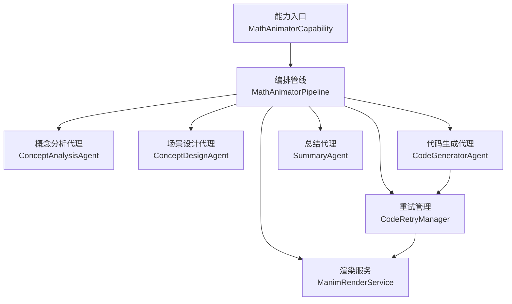
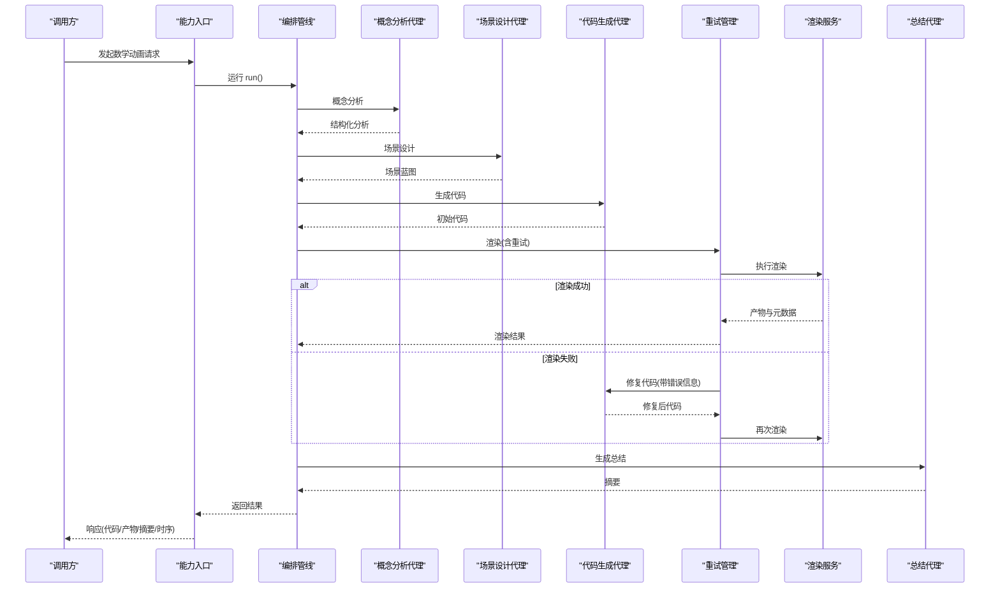
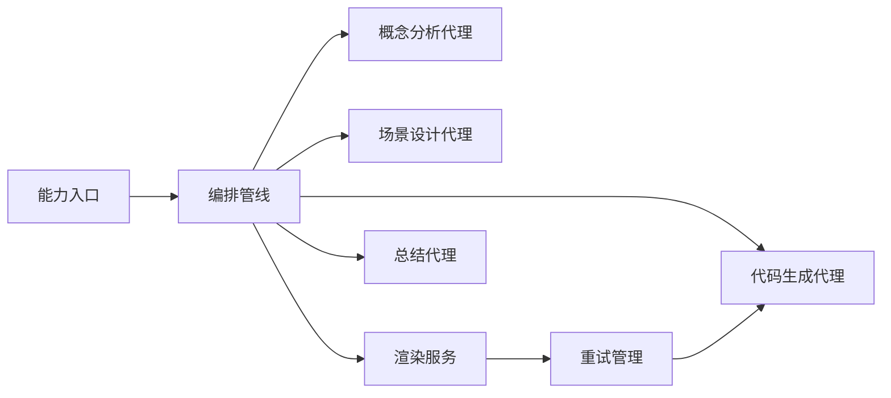

# 代码生成智能体

<cite>
**本文引用的文件**
- [capability.py](file://deeptutor/agents/math_animator/capability.py)
- [pipeline.py](file://deeptutor/agents/math_animator/pipeline.py)
- [models.py](file://deeptutor/agents/math_animator/models.py)
- [renderer.py](file://deeptutor/agents/math_animator/renderer.py)
- [retry_manager.py](file://deeptutor/agents/math_animator/retry_manager.py)
- [request_config.py](file://deeptutor/agents/math_animator/request_config.py)
- [utils.py](file://deeptutor/agents/math_animator/utils.py)
- [code_generator_agent.py](file://deeptutor/agents/math_animator/agents/code_generator_agent.py)
- [concept_analysis_agent.py](file://deeptutor/agents/math_animator/agents/concept_analysis_agent.py)
- [concept_design_agent.py](file://deeptutor/agents/math_animator/agents/concept_design_agent.py)
- [summary_agent.py](file://deeptutor/agents/math_animator/agents/summary_agent.py)
</cite>

## 目录
1. [简介](#简介)
2. [项目结构](#项目结构)
3. [核心组件](#核心组件)
4. [架构总览](#架构总览)
5. [详细组件分析](#详细组件分析)
6. [依赖关系分析](#依赖关系分析)
7. [性能考虑](#性能考虑)
8. [故障排查指南](#故障排查指南)
9. [结论](#结论)
10. [附录](#附录)

## 简介
本文件面向“数学动画器”代码生成智能体，系统性说明其如何将数学概念与教学意图转换为可执行的 Manim Python 代码，并渲染为视频或图片。内容覆盖：
- 代码结构规划：从概念分析、场景设计到代码生成与总结的流水线编排
- 动画元素生成：Manim 场景类提取、视频/图片渲染、质量与输出模式控制
- 数学公式渲染：LaTeX/MathTex 使用约束与环境检测
- 交互逻辑实现：重试修复、视觉审查、进度与追踪事件上报
- 验证机制与错误修复：渲染失败自动修复、非可重试环境错误快速失败
- 性能优化：流式 LLM 调用、子进程输出读取、超时与重试策略
- 配置选项、自定义模板与调试方法：请求参数校验、提示词模板、日志与产物路径

## 项目结构
数学动画器位于 agents/math_animator 下，采用“能力（Capability）+ 管线（Pipeline）+ 代理（Agents）+ 渲染服务（Renderer）+ 重试管理（RetryManager）”的分层组织方式。关键入口通过 capability 暴露为能力，内部由 pipeline 编排各阶段；每个阶段由独立 Agent 负责；渲染由 renderer 完成；异常与修复由 retry_manager 统一处理。

**图示来源**
- [capability.py:19-226](file://deeptutor/agents/math_animator/capability.py#L19-L226)
- [pipeline.py:25-277](file://deeptutor/agents/math_animator/pipeline.py#L25-L277)
- [retry_manager.py:21-157](file://deeptutor/agents/math_animator/retry_manager.py#L21-L157)
- [renderer.py:35-243](file://deeptutor/agents/math_animator/renderer.py#L35-L243)

**章节来源**
- [capability.py:19-226](file://deeptutor/agents/math_animator/capability.py#L19-L226)
- [pipeline.py:25-277](file://deeptutor/agents/math_animator/pipeline.py#L25-L277)

## 核心组件
- 能力入口 MathAnimatorCapability：声明能力元数据、阶段、默认配置，组装 LLM 配置与追踪桥接，驱动管线执行，并通过 StreamBus 推送进度与结果。
- 编排管线 MathAnimatorPipeline：顺序执行概念分析、场景设计、代码生成、渲染（含重试）、总结，并统计各阶段耗时。
- 代理集合：
  - ConceptAnalysisAgent：解析用户输入、历史上下文、附件，产出学习目标和可视化目标等结构化分析。
  - ConceptDesignAgent：基于分析结果生成场景大纲、视觉风格、动画备注与代码约束。
  - CodeGeneratorAgent：根据分析与设计生成 Manim Python 代码，支持初次生成与错误修复。
  - SummaryAgent：汇总分析、设计与渲染结果，生成面向用户的摘要。
- 渲染服务 ManimRenderService：将代码保存为 scene.py 或图片块，调用 Manim 命令行渲染，提取最终产物并构建资源 URL。
- 重试管理 CodeRetryManager：封装渲染-失败-修复-再渲染循环，支持可选视觉审查，提供超时保护与非可重试错误识别。
- 模型与配置：
  - models.py：定义分析、设计、代码、摘要、渲染产物、重试尝试、视觉审查等数据结构。
  - request_config.py：校验 output_mode、quality、style_hint 等请求参数。
  - utils.py：文件名规范化、错误消息裁剪、常见报错修复提示增强。

**章节来源**
- [capability.py:19-226](file://deeptutor/agents/math_animator/capability.py#L19-L226)
- [pipeline.py:25-277](file://deeptutor/agents/math_animator/pipeline.py#L25-L277)
- [models.py:8-95](file://deeptutor/agents/math_animator/models.py#L8-L95)
- [request_config.py:10-38](file://deeptutor/agents/math_animator/request_config.py#L10-L38)
- [utils.py:10-53](file://deeptutor/agents/math_animator/utils.py#L10-L53)

## 架构总览
整体流程如下：
1. 能力入口接收请求，校验配置，初始化管线与追踪回调。
2. 管线依次执行概念分析与场景设计，得到结构化理解与设计蓝图。
3. 代码生成代理依据蓝图生成 Manim 代码，支持时长预算注入。
4. 渲染服务执行 Manim 渲染，若失败则进入重试管理。
5. 重试管理在有限次数内调用代码修复代理进行修复并重试，必要时触发视觉审查。
6. 总结代理综合全部信息生成用户可读摘要。
7. 能力入口将代码、产物、时序与渲染元数据通过统一接口返回。

**图示来源**
- [capability.py:41-226](file://deeptutor/agents/math_animator/capability.py#L41-L226)
- [pipeline.py:84-277](file://deeptutor/agents/math_animator/pipeline.py#L84-L277)
- [retry_manager.py:43-157](file://deeptutor/agents/math_animator/retry_manager.py#L43-L157)
- [renderer.py:52-243](file://deeptutor/agents/math_animator/renderer.py#L52-L243)

## 详细组件分析

### 能力入口 MathAnimatorCapability
- 职责：声明能力名称、阶段、默认配置；加载 LLM 配置；构造管线；通过 StreamBus 推送阶段进度、思考片段与错误；最终输出包含代码、产物、摘要、时序与渲染元数据。
- 关键点：
  - 检查 manim 可选依赖是否安装，未安装时抛出明确错误。
  - 构建追踪桥接，将 LLM 调用状态映射为 thinking/progress/error 事件。
  - 渲染阶段通过 on_retry/on_render_progress/on_retry_status 回调向 UI 实时反馈。

**章节来源**
- [capability.py:19-226](file://deeptutor/agents/math_animator/capability.py#L19-L226)

### 编排管线 MathAnimatorPipeline
- 职责：串联概念分析、场景设计、代码生成、渲染（含重试）、总结，记录每阶段耗时。
- 关键点：
  - 解析目标时长（秒），注入到代码生成与修复提示中，以控制节奏预算。
  - 渲染阶段可选择启用视觉审查，审查失败会触发修复并重试。
  - 统一返回 analysis/design/code/render_result/summary/timings。

**章节来源**
- [pipeline.py:25-277](file://deeptutor/agents/math_animator/pipeline.py#L25-L277)

### 概念分析代理 ConceptAnalysisAgent
- 职责：结合用户输入、历史上下文、附件（如图片）生成结构化分析（学习目标、数学焦点、可视化目标、叙事步骤等）。
- 关键点：
  - 首次获取提示词失败时主动重载提示词管理器，避免缓存导致的空提示问题。
  - 通过流式 LLM 调用收集 JSON 输出并校验为 ConceptAnalysis。

**章节来源**
- [concept_analysis_agent.py:14-89](file://deeptutor/agents/math_animator/agents/concept_analysis_agent.py#L14-L89)

### 场景设计代理 ConceptDesignAgent
- 职责：基于分析结果生成场景大纲、视觉风格、动画备注、图片计划与代码约束。
- 关键点：
  - 将分析结果序列化为 JSON 注入提示，确保设计阶段具备充分上下文。
  - 输出 SceneDesign 供后续代码生成使用。

**章节来源**
- [concept_design_agent.py:14-68](file://deeptutor/agents/math_animator/agents/concept_design_agent.py#L14-L68)

### 代码生成代理 CodeGeneratorAgent
- 职责：根据分析与设计生成 Manim Python 代码；在渲染失败时进行修复。
- 关键点：
  - 初次生成：注入目标时长要求，强制围绕时长做节奏预算。
  - 修复模式：携带错误信息与当前代码，按尝试次数生成修复版本。
  - 输出 GeneratedCode，包含代码与理由。

**章节来源**
- [code_generator_agent.py:14-139](file://deeptutor/agents/math_animator/agents/code_generator_agent.py#L14-L139)

### 渲染服务 ManimRenderService
- 职责：将代码写入工作区，调用 Manim 渲染视频或图片，提取最终产物并构建可访问 URL。
- 关键点：
  - 视频模式：提取 Scene 类名，执行 manim 命令导出 mp4。
  - 图片模式：仅允许包含 YON_IMAGE 锚点块的代码，逐个块渲染 PNG。
  - 子进程输出：使用线程读取 stdout/stderr 并通过队列异步转发，保持实时进度。
  - 质量映射：low/medium/high 对应不同质量标志。
  - 产物定位：忽略中间 partial_movie_files，选择最新最终产物。

**章节来源**
- [renderer.py:35-243](file://deeptutor/agents/math_animator/renderer.py#L35-L243)

### 重试管理 CodeRetryManager
- 职责：封装“渲染-失败-修复-再渲染”循环，支持可选视觉审查与超时保护。
- 关键点：
  - 非可重试环境错误：检测到缺失 LaTeX 时直接抛出明确错误，避免无效重试。
  - 视觉审查：若开启，审查失败会生成修复提示并触发修复。
  - 超时保护：修复与审查均设置超时，防止长时间阻塞。
  - 重试历史：记录每次尝试的错误信息，便于诊断。

**章节来源**
- [retry_manager.py:21-157](file://deeptutor/agents/math_animator/retry_manager.py#L21-L157)

### 总结代理 SummaryAgent
- 职责：综合分析、设计与渲染结果，生成面向用户的摘要文本与要点。
- 关键点：
  - 将分析、设计、渲染结果序列化注入提示，保证摘要完整性。
  - 输出 SummaryPayload，包含 summary_text、user_request、generated_output、key_points。

**章节来源**
- [summary_agent.py:14-70](file://deeptutor/agents/math_animator/agents/summary_agent.py#L14-L70)

### 数据模型与配置
- 数据模型（models.py）：
  - ConceptAnalysis、SceneDesign、GeneratedCode、SummaryPayload：描述各阶段结构化输出。
  - RenderedArtifact、RenderResult、RetryAttempt、VisualReviewResult：描述渲染产物、结果与重试历史。
- 请求配置（request_config.py）：
  - output_mode：video 或 image。
  - quality：low、medium、high。
  - style_hint：风格提示，最大长度限制。
  - 提供 validate_math_animator_request_config 进行严格校验与错误聚合。
- 工具函数（utils.py）：
  - slugify_filename：安全化文件名。
  - trim_error_message：裁剪过长错误消息。
  - build_repair_error_message：针对常见 Manim 错误（如 2D/3D 点不匹配）附加修复建议。

**章节来源**
- [models.py:8-95](file://deeptutor/agents/math_animator/models.py#L8-L95)
- [request_config.py:10-38](file://deeptutor/agents/math_animator/request_config.py#L10-L38)
- [utils.py:10-53](file://deeptutor/agents/math_animator/utils.py#L10-L53)

## 依赖关系分析
- 能力入口依赖管线与各代理，并通过 StreamBus 与外部系统交互。
- 管线依赖代理、渲染服务与重试管理。
- 渲染服务依赖文件系统与外部 manim 命令行工具。
- 重试管理依赖渲染服务与代码修复回调（来自代码生成代理）。
- 所有代理共享 BaseAgent 能力，通过提示词模板与 LLM 通信。

**图示来源**
- [capability.py:41-226](file://deeptutor/agents/math_animator/capability.py#L41-L226)
- [pipeline.py:84-277](file://deeptutor/agents/math_animator/pipeline.py#L84-L277)
- [retry_manager.py:21-157](file://deeptutor/agents/math_animator/retry_manager.py#L21-L157)
- [renderer.py:52-243](file://deeptutor/agents/math_animator/renderer.py#L52-L243)

**章节来源**
- [capability.py:41-226](file://deeptutor/agents/math_animator/capability.py#L41-L226)
- [pipeline.py:84-277](file://deeptutor/agents/math_animator/pipeline.py#L84-L277)
- [retry_manager.py:21-157](file://deeptutor/agents/math_animator/retry_manager.py#L21-L157)
- [renderer.py:52-243](file://deeptutor/agents/math_animator/renderer.py#L52-L243)

## 性能考虑
- 流式 LLM 调用：各代理使用流式接口收集响应，降低首字节延迟。
- 子进程输出读取：渲染服务通过线程读取 stdout/stderr 并异步转发，避免阻塞事件循环。
- 超时保护：视觉审查与代码修复设置超时，防止长时间卡死。
- 质量与输出模式：通过 quality 与 output_mode 控制渲染开销与产物大小。
- 产物定位：跳过中间文件，仅保留最终产物，减少磁盘 I/O。
- 重试上限：默认最多重试次数限制，避免无限循环。

[本节为通用性能指导，无需特定文件引用]

## 故障排查指南
- 缺少 manim 依赖：能力入口会在未安装时抛出明确错误，需按提示安装可选依赖。
- 缺少 LaTeX：渲染失败且错误包含 LaTeX 相关提示时，属于非可重试环境错误，应安装 LaTeX 或避免使用 Tex/MathTex。
- 图片模式代码格式错误：必须仅包含 YON_IMAGE 锚点块，否则抛出渲染错误。
- 未定义 Scene 类：生成的代码必须包含可渲染的 Manim Scene 类，否则无法提取场景名。
- 2D/3D 点不匹配：当出现 append_points 形状不匹配错误时，utils 会附加修复建议，优先使用 axes.c2p 等方法生成 3D 点。
- 超时问题：视觉审查或修复超时会导致渲染失败，可适当调整超时时间或检查外部服务可用性。
- 产物查找失败：渲染服务找不到最终产物时会抛出错误，检查 media_dir 与 manim 输出目录权限。

**章节来源**
- [capability.py:41-47](file://deeptutor/agents/math_animator/capability.py#L41-L47)
- [retry_manager.py:12-18](file://deeptutor/agents/math_animator/retry_manager.py#L12-L18)
- [renderer.py:84-122](file://deeptutor/agents/math_animator/renderer.py#L84-L122)
- [renderer.py:222-227](file://deeptutor/agents/math_animator/renderer.py#L222-L227)
- [utils.py:22-45](file://deeptutor/agents/math_animator/utils.py#L22-L45)

## 结论
该代码生成智能体通过清晰的分层架构与严格的阶段编排，将数学概念转化为可执行的 Manim 代码，并在渲染阶段提供健壮的重试与修复机制。配合流式 LLM 调用、超时保护与可视化审查，能够在保证质量的同时提升鲁棒性与用户体验。通过配置项与提示词模板，可灵活定制输出模式、质量与风格，满足多样化教学与演示需求。

[本节为总结性内容，无需特定文件引用]

## 附录

### 代码生成配置选项
- output_mode：video 或 image，决定渲染为视频还是图片。
- quality：low、medium、high，影响渲染质量与速度。
- style_hint：风格提示，用于引导视觉风格与表现手法。
- 校验：validate_math_animator_request_config 对非法配置进行严格校验并返回详细错误。

**章节来源**
- [request_config.py:10-38](file://deeptutor/agents/math_animator/request_config.py#L10-L38)

### 自定义模板使用
- 各代理通过 get_prompt 加载提示词模板，支持多语言（zh/en）。
- 概念分析代理在首次获取提示词失败时会自动重载提示词管理器，确保可用。
- 代码生成代理在生成与修复阶段分别使用不同的系统提示与用户模板。

**章节来源**
- [concept_analysis_agent.py:40-55](file://deeptutor/agents/math_animator/agents/concept_analysis_agent.py#L40-L55)
- [code_generator_agent.py:58-73](file://deeptutor/agents/math_animator/agents/code_generator_agent.py#L58-L73)
- [code_generator_agent.py:103-119](file://deeptutor/agents/math_animator/agents/code_generator_agent.py#L103-L119)

### 调试方法
- 启用追踪回调：能力入口通过 _build_trace_bridge 将 LLM 调用状态映射为 thinking/progress/error 事件，便于前端展示与日志采集。
- 渲染进度：渲染服务通过 progress_callback 实时推送原始与摘要级进度。
- 产物路径：渲染服务在工作区 source/artifacts/media/meta 目录下保存中间与最终产物，便于离线检查。
- 错误信息裁剪：trim_error_message 限制错误消息长度，避免过大负载。

**章节来源**
- [capability.py:228-309](file://deeptutor/agents/math_animator/capability.py#L228-L309)
- [renderer.py:203-206](file://deeptutor/agents/math_animator/renderer.py#L203-L206)
- [renderer.py:44-50](file://deeptutor/agents/math_animator/renderer.py#L44-L50)
- [utils.py:15-19](file://deeptutor/agents/math_animator/utils.py#L15-L19)

### 完整示例流程（无代码片段）
- 输入：用户提出数学概念与教学目标，附带可选图片附件。
- 分析：概念分析代理输出学习目标、数学焦点、可视化目标与叙事步骤。
- 设计：场景设计代理生成标题、场景大纲、视觉风格、动画备注与代码约束。
- 生成：代码生成代理依据分析与设计生成 Manim 代码，并注入目标时长预算。
- 渲染：渲染服务执行 Manim 渲染，若失败则进入重试管理进行修复并重试。
- 总结：总结代理综合全部信息生成用户可读摘要。
- 输出：返回代码、产物、摘要、时序与渲染元数据。

[本节为流程概述，无需特定文件引用]