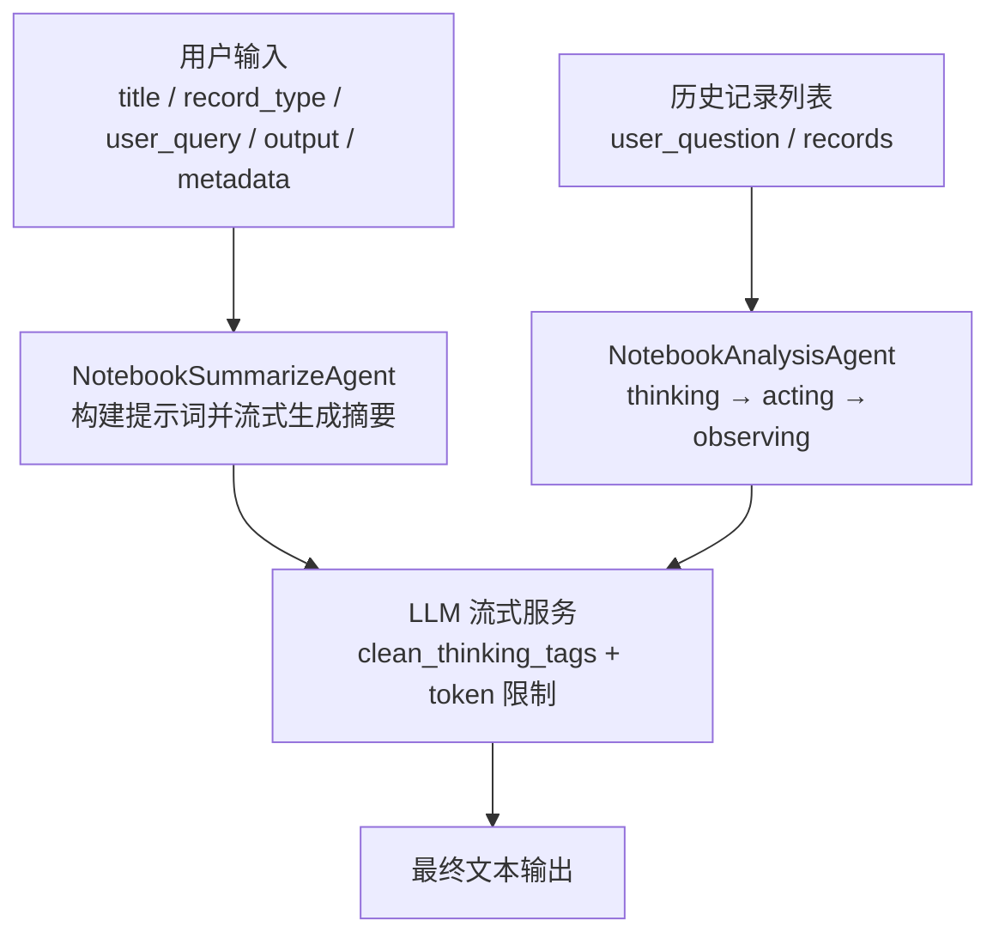
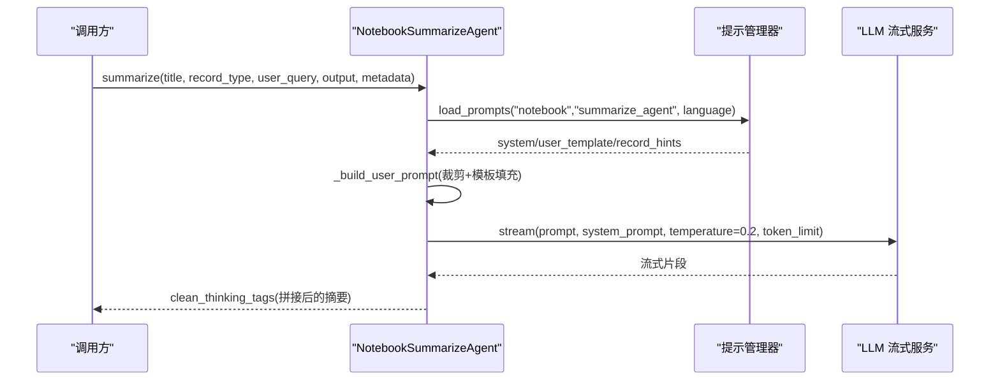
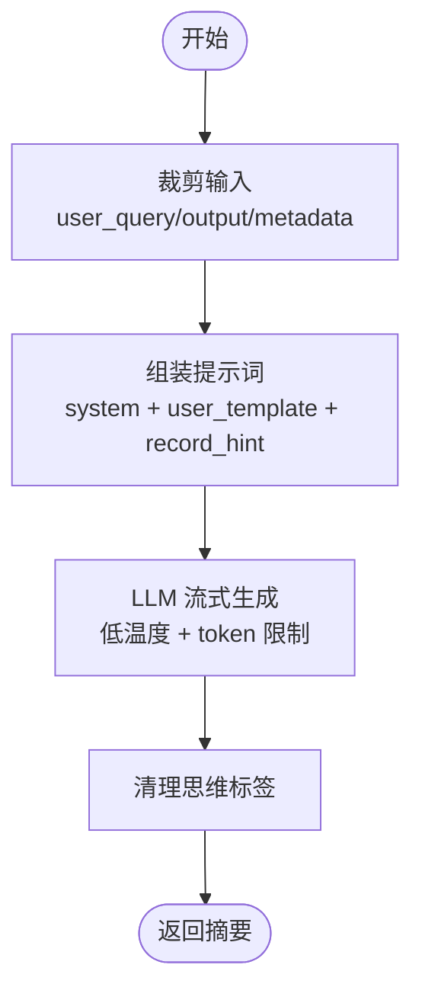
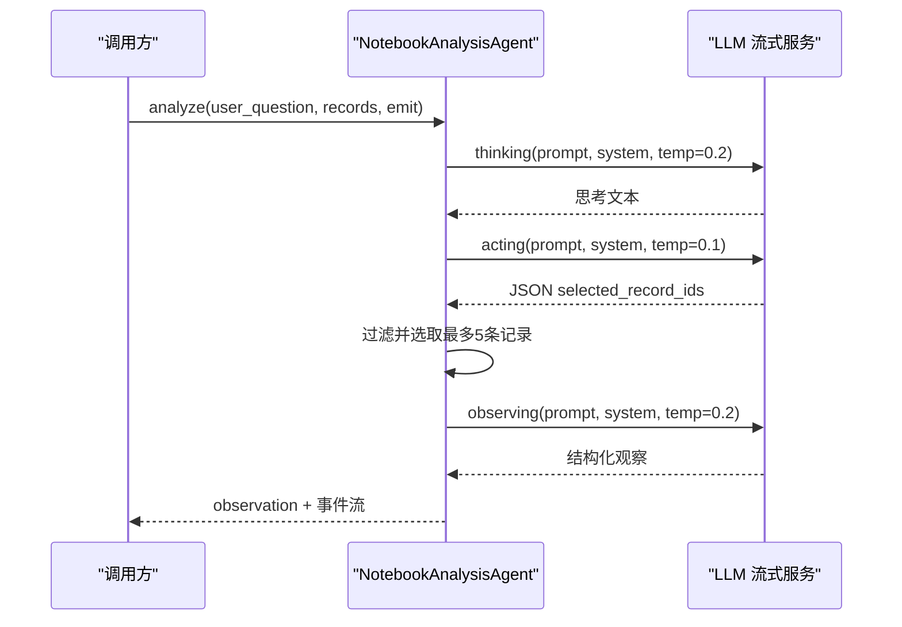
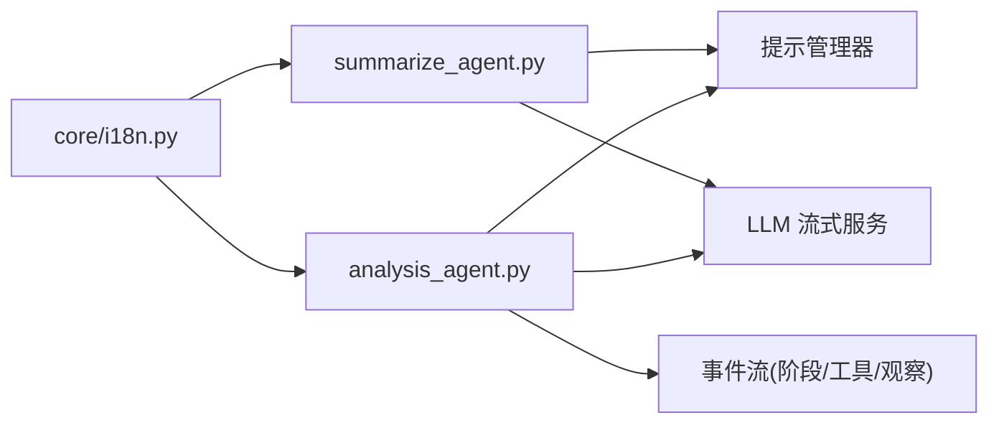

# 总结智能体

<cite>
**本文引用的文件**
- [summarize_agent.py](file://deeptutor/agents/notebook/summarize_agent.py)
- [analysis_agent.py](file://deeptutor/agents/notebook/analysis_agent.py)
- [summarize_agent.yaml（英文）](file://deeptutor/agents/notebook/prompts/en/summarize_agent.yaml)
- [summarize_agent.yaml（中文）](file://deeptutor/agents/notebook/prompts/zh/summarize_agent.yaml)
- [analysis_agent.yaml（英文）](file://deeptutor/agents/notebook/prompts/en/analysis_agent.yaml)
- [analysis_agent.yaml（中文）](file://deeptutor/agents/notebook/prompts/zh/analysis_agent.yaml)
- [i18n.py](file://deeptutor/core/i18n.py)
</cite>

## 目录
1. [简介](#简介)
2. [项目结构](#项目结构)
3. [核心组件](#核心组件)
4. [架构总览](#架构总览)
5. [详细组件分析](#详细组件分析)
6. [依赖关系分析](#依赖关系分析)
7. [性能与质量考量](#性能与质量考量)
8. [故障排查指南](#故障排查指南)
9. [结论](#结论)
10. [附录：配置、语言偏好与示例](#附录配置语言偏好与示例)

## 简介
本文件面向“总结智能体”，解释其如何生成最终的解释文本，涵盖内容组织、语言风格调整、多语言支持、教育性表达、结构化输出、关键概念强调与学习目标对齐。同时提供配置选项、语言偏好设置与内容质量控制方法，并给出不同学科领域的总结示例与定制化指南。

## 项目结构
总结智能体位于 notebook 子模块中，由两类能力组成：
- 记录摘要：将单条笔记记录压缩为可检索、可复用的摘要。
- 跨记录分析：在调用主能力前，先对多条历史记录进行思考、选择与观察，形成结构化上下文注入后续流程。

图表来源
- [summarize_agent.py:19-93](file://deeptutor/agents/notebook/summarize_agent.py#L19-L93)
- [analysis_agent.py:45-81](file://deeptutor/agents/notebook/analysis_agent.py#L45-L81)

章节来源
- [summarize_agent.py:19-93](file://deeptutor/agents/notebook/summarize_agent.py#L19-L93)
- [analysis_agent.py:27-81](file://deeptutor/agents/notebook/analysis_agent.py#L27-L81)

## 核心组件
- NotebookSummarizeAgent：负责将单条记录（聊天、引导学习、Co-Writer 草稿等）提炼为 80–180 字摘要，突出主题、关键信息、完成度与复用价值。
- NotebookAnalysisAgent：三阶段推理（thinking/acting/observing），从历史记录的摘要目录中选择最多 5 条关键记录，产出结构化上下文供主能力使用。

章节来源
- [summarize_agent.py:19-93](file://deeptutor/agents/notebook/summarize_agent.py#L19-L93)
- [analysis_agent.py:27-81](file://deeptutor/agents/notebook/analysis_agent.py#L27-L81)

## 架构总览
总结智能体的数据流如下：
- 输入裁剪：对用户输入、保存内容与元数据进行长度裁剪，避免超出 LLM 上下文。
- 提示组装：根据记录类型注入“类型提示”，结合系统提示与用户模板生成最终提示。
- 流式生成：通过 LLM 流式接口逐步输出，温度较低以保证稳定性。
- 后处理：清理思维标签，返回干净摘要或观察结果。

图表来源
- [summarize_agent.py:38-93](file://deeptutor/agents/notebook/summarize_agent.py#L38-L93)
- [summarize_agent.yaml（英文）:1-29](file://deeptutor/agents/notebook/prompts/en/summarize_agent.yaml#L1-L29)
- [summarize_agent.yaml（中文）:1-30](file://deeptutor/agents/notebook/prompts/zh/summarize_agent.yaml#L1-L30)

## 详细组件分析

### 记录摘要：NotebookSummarizeAgent
- 语言选择：自动识别 zh/非 zh，加载对应语言提示。
- 输入裁剪：user_query 上限约 1200 字符，output 上限约 6000 字符，metadata 上限约 1000 字符。
- 提示策略：
  - 系统提示：定义角色与输出约束（仅正文、无标题/项目符号）。
  - 用户模板：包含记录类型、类型提示、标题、用户输入、保存内容、元数据。
  - 类型提示：按记录类型注入差异化指导（chat/tutorbot/guided_learning/co_writer/default）。
- 生成控制：temperature=0.2；根据模型动态设置 token 限制；可选 extra_headers。
- 输出清洗：移除思维标签，返回纯文本摘要。

图表来源
- [summarize_agent.py:12-16](file://deeptutor/agents/notebook/summarize_agent.py#L12-L16)
- [summarize_agent.py:98-127](file://deeptutor/agents/notebook/summarize_agent.py#L98-L127)
- [summarize_agent.py:59-93](file://deeptutor/agents/notebook/summarize_agent.py#L59-L93)

章节来源
- [summarize_agent.py:19-127](file://deeptutor/agents/notebook/summarize_agent.py#L19-L127)
- [summarize_agent.yaml（英文）:1-29](file://deeptutor/agents/notebook/prompts/en/summarize_agent.yaml#L1-L29)
- [summarize_agent.yaml（中文）:1-30](file://deeptutor/agents/notebook/prompts/zh/summarize_agent.yaml#L1-L30)

### 跨记录分析：NotebookAnalysisAgent
- 三阶段流程：
  - thinking：阅读用户问题与摘要目录，判断哪些记录需要细节。
  - acting：输出 JSON 选择最多 5 条记录 id。
  - observing：综合问题、思考与选中记录详情，产出结构化上下文（事实/可复用/不确定性）。
- 事件与追踪：每个阶段发射阶段开始/结束事件，并在 acting/observing 阶段发射工具调用与结果事件，便于前端展示与审计。
- 提示策略：每阶段均有独立的 system 与 user_template，支持中英双语。

图表来源
- [analysis_agent.py:45-81](file://deeptutor/agents/notebook/analysis_agent.py#L45-L81)
- [analysis_agent.py:83-254](file://deeptutor/agents/notebook/analysis_agent.py#L83-L254)
- [analysis_agent.yaml（英文）:1-53](file://deeptutor/agents/notebook/prompts/en/analysis_agent.yaml#L1-L53)
- [analysis_agent.yaml（中文）:1-52](file://deeptutor/agents/notebook/prompts/zh/analysis_agent.yaml#L1-L52)

章节来源
- [analysis_agent.py:27-387](file://deeptutor/agents/notebook/analysis_agent.py#L27-L387)
- [analysis_agent.yaml（英文）:1-53](file://deeptutor/agents/notebook/prompts/en/analysis_agent.yaml#L1-L53)
- [analysis_agent.yaml（中文）:1-52](file://deeptutor/agents/notebook/prompts/zh/analysis_agent.yaml#L1-L52)

## 依赖关系分析
- 提示管理：通过提示管理器加载 notebook 下的 prompts，按语言区分 en/zh。
- LLM 服务：统一通过流式接口调用，支持 model/api_key/base_url/api_version/binding/extra_headers。
- 语言环境：后端 i18n 辅助用于解析 UI 语言，影响提示加载与消息呈现。
- 事件总线：分析阶段向外部发射阶段/工具/观察事件，便于前端渲染与追踪。

图表来源
- [summarize_agent.py:22-36](file://deeptutor/agents/notebook/summarize_agent.py#L22-L36)
- [analysis_agent.py:30-43](file://deeptutor/agents/notebook/analysis_agent.py#L30-L43)
- [i18n.py:8-12](file://deeptutor/core/i18n.py#L8-L12)

章节来源
- [summarize_agent.py:22-36](file://deeptutor/agents/notebook/summarize_agent.py#L22-L36)
- [analysis_agent.py:30-43](file://deeptutor/agents/notebook/analysis_agent.py#L30-L43)
- [i18n.py:8-12](file://deeptutor/core/i18n.py#L8-L12)

## 性能与质量考量
- 稳定性：低温度（0.1–0.2）减少发散，适合摘要与分析任务。
- 上下文控制：动态 token 限制与输入裁剪，避免超长导致截断或失败。
- 流式输出：降低首字节延迟，提升交互体验。
- 可观测性：阶段事件与工具调用/结果事件便于定位瓶颈与调试。
- 质量保障：
  - 明确输出约束（仅正文、字数范围、结构化字段）。
  - 类型化提示（record_hints）确保不同记录类型的侧重点一致。
  - 后处理清理思维标签，保证最终文本整洁。

[本节为通用指导，不直接引用具体代码文件]

## 故障排查指南
- 摘要为空或过短：检查输入是否被裁剪为空；确认提示模板中的 user_template 已正确填充；验证 LLM 返回是否包含有效内容。
- 语言不正确：确认传入的 language 参数是否以 zh 开头；检查 i18n 解析逻辑是否正确映射到 zh。
- 分析未选择记录：检查 acting 阶段 JSON 是否合法；确认 selected_record_ids 是否为空或被过滤；核对记录 id 是否存在于 records 映射中。
- 事件未触发：确认 emit 回调是否传入；检查阶段开始/结束事件是否在相应位置发射。

章节来源
- [summarize_agent.py:12-16](file://deeptutor/agents/notebook/summarize_agent.py#L12-L16)
- [summarize_agent.py:22-36](file://deeptutor/agents/notebook/summarize_agent.py#L22-L36)
- [analysis_agent.py:160-179](file://deeptutor/agents/notebook/analysis_agent.py#L160-L179)
- [analysis_agent.py:256-288](file://deeptutor/agents/notebook/analysis_agent.py#L256-L288)

## 结论
总结智能体通过“记录摘要”和“跨记录分析”两大能力，将零散的历史笔记转化为高质量、可检索、可复用的知识片段。其设计强调：
- 结构化输出与关键概念强调
- 教育性表达与学习目标对齐
- 多语言支持与语言偏好自适应
- 稳定可控的生成过程与完善的可观测性

## 附录：配置、语言偏好与示例

### 配置选项
- 模型与连接：model、api_key、base_url、api_version、binding、extra_headers。
- 生成参数：temperature（摘要 0.2，分析 acting 0.1，其他阶段 0.2）。
- 上下文控制：token 限制（依据模型动态计算）、输入裁剪（user_query/output/metadata）。
- 提示资源：notebook/prompts/{en,zh}/summarize_agent.yaml 与 analysis_agent.yaml。

章节来源
- [summarize_agent.py:22-36](file://deeptutor/agents/notebook/summarize_agent.py#L22-L36)
- [summarize_agent.py:75-93](file://deeptutor/agents/notebook/summarize_agent.py#L75-L93)
- [analysis_agent.py:101-126](file://deeptutor/agents/notebook/analysis_agent.py#L101-L126)
- [analysis_agent.py:147-158](file://deeptutor/agents/notebook/analysis_agent.py#L147-L158)
- [analysis_agent.py:229-254](file://deeptutor/agents/notebook/analysis_agent.py#L229-L254)

### 语言偏好设置
- 自动识别：language 参数以 zh 开头即视为中文，否则英文。
- 提示加载：根据语言选择 en/zh 下的 yaml 提示。
- 后端 i18n：current_language 可从 UI 设置读取语言，影响消息与行为。

章节来源
- [summarize_agent.py:22-36](file://deeptutor/agents/notebook/summarize_agent.py#L22-L36)
- [analysis_agent.py:30-43](file://deeptutor/agents/notebook/analysis_agent.py#L30-L43)
- [i18n.py:8-12](file://deeptutor/core/i18n.py#L8-L12)
- [i18n.py:113-120](file://deeptutor/core/i18n.py#L113-L120)

### 内容质量控制方法
- 输出约束：仅正文、无标题/项目符号；字数范围（80–180 字）。
- 类型化提示：针对不同记录类型注入差异化关注点。
- 结构化上下文：分析阶段输出需区分事实、可复用内容、不确定性。
- 后处理：清理思维标签，确保最终文本干净。

章节来源
- [summarize_agent.yaml（英文）:1-29](file://deeptutor/agents/notebook/prompts/en/summarize_agent.yaml#L1-L29)
- [summarize_agent.yaml（中文）:1-30](file://deeptutor/agents/notebook/prompts/zh/summarize_agent.yaml#L1-L30)
- [analysis_agent.yaml（英文）:1-53](file://deeptutor/agents/notebook/prompts/en/analysis_agent.yaml#L1-L53)
- [analysis_agent.yaml（中文）:1-52](file://deeptutor/agents/notebook/prompts/zh/analysis_agent.yaml#L1-L52)

### 不同学科领域的总结示例与定制化指南
- 数学：聚焦公式推导的关键步骤、定理适用条件与典型例题思路。
- 物理：强调实验目的、测量方法与误差分析，突出可复现实验要点。
- 编程：突出算法思路、边界条件、复杂度分析与调试经验。
- 人文社科：关注论点结构、证据链与批判性思考路径。
- 定制化建议：
  - 在 record_hints 中增加领域关键词，引导模型关注该领域核心要素。
  - 在 user_template 中加入学习目标对齐字段（如“掌握…能力”“理解…原理”）。
  - 通过额外元数据传递课程大纲或知识点标签，增强结构化输出。

[本节为概念性指导，不直接引用具体代码文件]