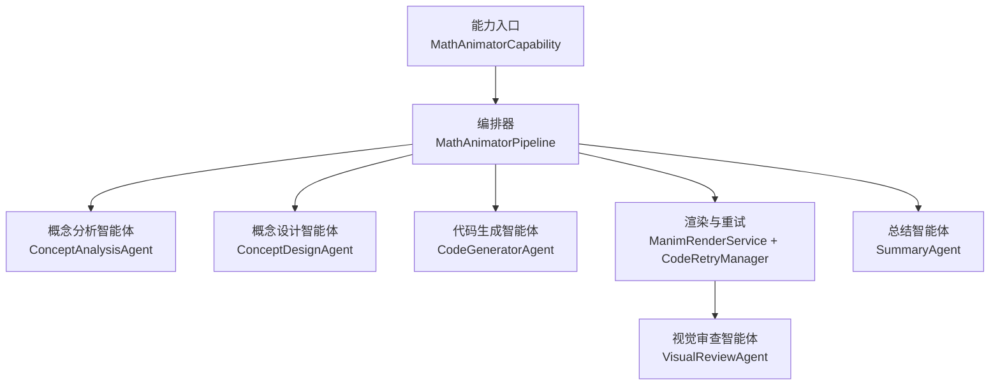
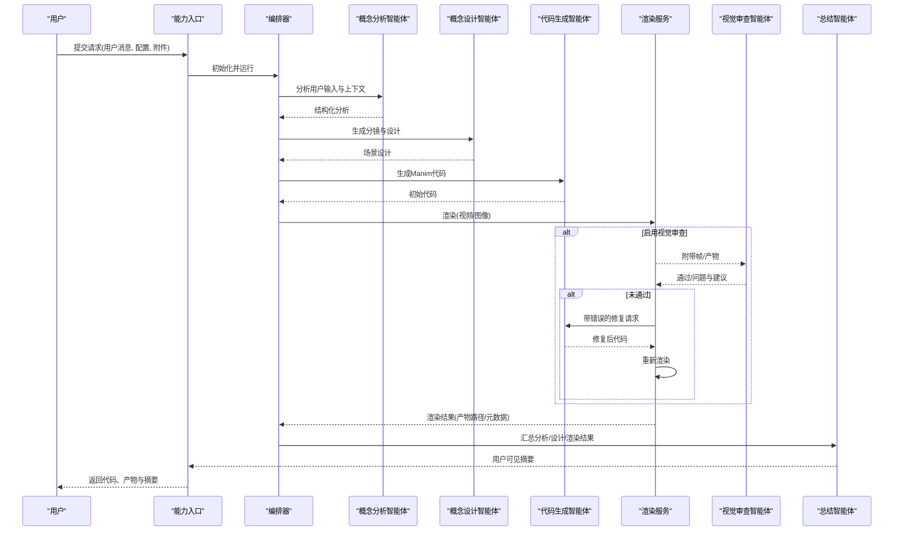
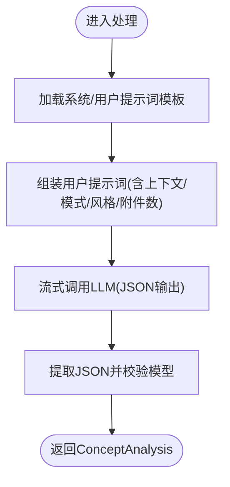
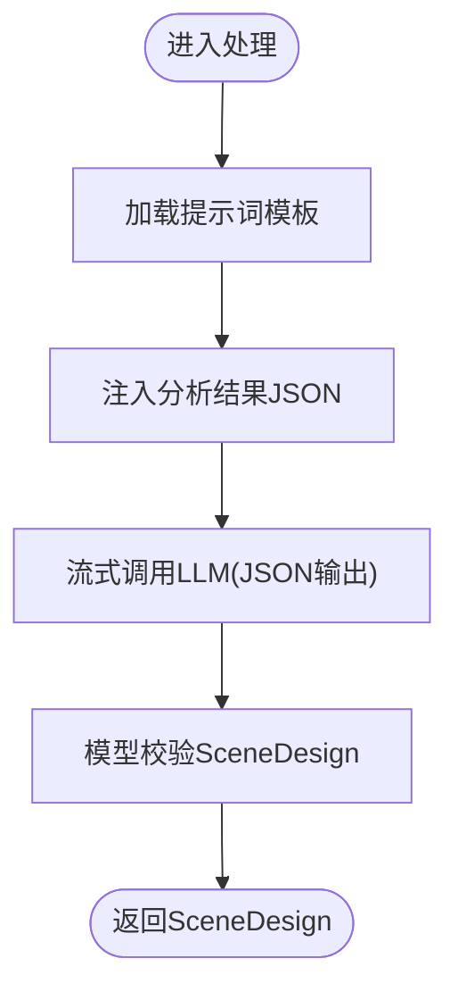
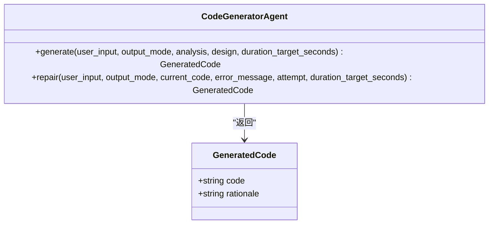
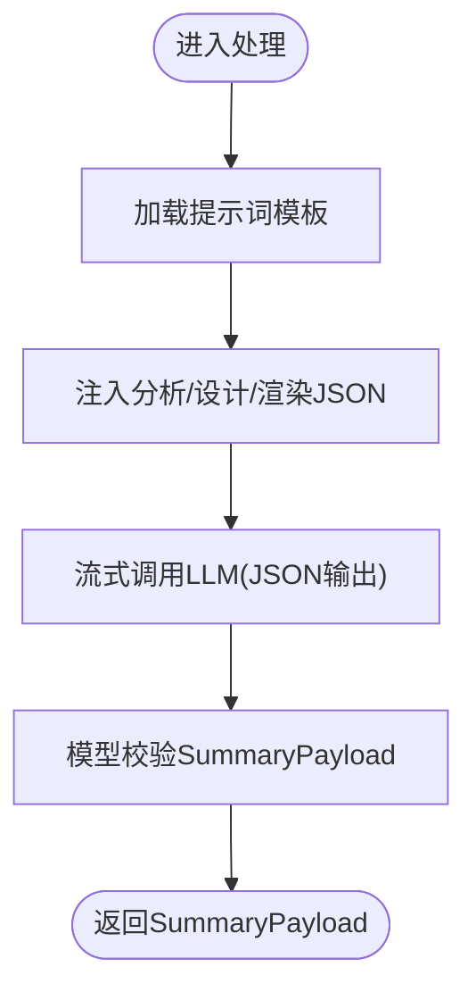
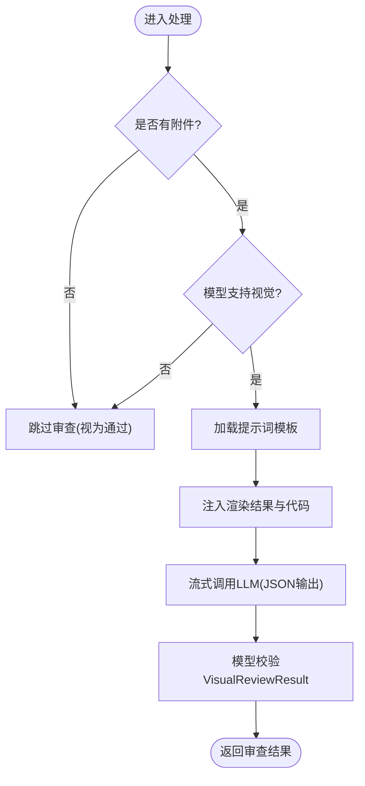
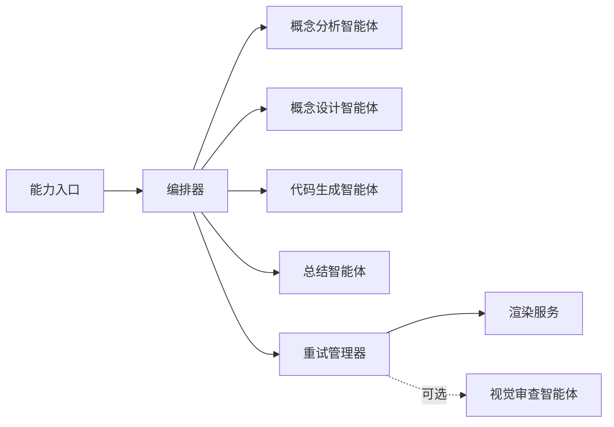

# 智能体协作

<cite>
**本文引用的文件**
- [capability.py](file://deeptutor/agents/math_animator/capability.py)
- [pipeline.py](file://deeptutor/agents/math_animator/pipeline.py)
- [models.py](file://deeptutor/agents/math_animator/models.py)
- [request_config.py](file://deeptutor/agents/math_animator/request_config.py)
- [utils.py](file://deeptutor/agents/math_animator/utils.py)
- [retry_manager.py](file://deeptutor/agents/math_animator/retry_manager.py)
- [concept_analysis_agent.py](file://deeptutor/agents/math_animator/agents/concept_analysis_agent.py)
- [concept_design_agent.py](file://deeptutor/agents/math_animator/agents/concept_design_agent.py)
- [code_generator_agent.py](file://deeptutor/agents/math_animator/agents/code_generator_agent.py)
- [summary_agent.py](file://deeptutor/agents/math_animator/agents/summary_agent.py)
- [visual_review_agent.py](file://deeptutor/agents/math_animator/agents/visual_review_agent.py)
</cite>

## 目录
1. [简介](#简介)
2. [项目结构](#项目结构)
3. [核心组件](#核心组件)
4. [架构总览](#架构总览)
5. [详细组件分析](#详细组件分析)
6. [依赖关系分析](#依赖关系分析)
7. [性能与可靠性](#性能与可靠性)
8. [故障排查指南](#故障排查指南)
9. [结论](#结论)
10. [附录：配置选项与使用示例](#附录配置选项与使用示例)

## 简介
本文件面向“数学动画师智能体协作系统”，系统性说明五个核心智能体的职责分工、通信协议、数据传递格式、提示词工程与多语言支持，以及每个智能体的配置选项和使用方式。该系统通过编排式流水线将用户输入逐步转化为可渲染的 Manim Python 代码，并在必要时进行视觉质量审查与自动修复，最终输出视频或图像产物与解释性文本。

## 项目结构
数学动画能力位于 deeptutor/agents/math_animator 目录下，采用“能力（Capability）+ 管道（Pipeline）+ 智能体（Agents）”的分层组织：
- capability.py：对外暴露能力入口，负责参数校验、阶段流控、进度与结果上报。
- pipeline.py：编排概念分析、概念设计、代码生成、渲染重试、总结等阶段。
- agents/*：五个智能体各自封装 LLM 调用、提示词加载、结构化输出解析。
- models.py：定义各阶段的数据模型（如 ConceptAnalysis、SceneDesign、RenderResult 等）。
- request_config.py：请求配置校验（输出模式、质量、风格提示）。
- retry_manager.py：渲染失败与视觉审查不通过的自动修复循环。
- utils.py：工具函数（错误信息增强、文件名规范化等）。

**图表来源**
- [capability.py:19-64](file://deeptutor/agents/math_animator/capability.py#L19-L64)
- [pipeline.py:25-71](file://deeptutor/agents/math_animator/pipeline.py#L25-L71)
- [retry_manager.py:21-49](file://deeptutor/agents/math_animator/retry_manager.py#L21-L49)

**章节来源**
- [capability.py:19-64](file://deeptutor/agents/math_animator/capability.py#L19-L64)
- [pipeline.py:25-71](file://deeptutor/agents/math_animator/pipeline.py#L25-L71)

## 核心组件
- 概念分析智能体：理解用户意图、历史上下文与附件，产出学习目标、数学焦点、可视化目标、叙事步骤等结构化分析。
- 概念设计智能体：基于分析结果设计分镜大纲、视觉风格、动画备注、图片计划与代码约束。
- 代码生成智能体：根据分析与设计生成 Manim Python 代码；在渲染失败或视觉审查不通过时进行修复再生成。
- 总结智能体：综合用户请求、分析、设计与渲染结果，生成面向用户的解释性摘要。
- 视觉审查智能体：对渲染产物进行视觉质量检查（重叠、可读性、构图），并给出修复建议。

**章节来源**
- [concept_analysis_agent.py:14-89](file://deeptutor/agents/math_animator/agents/concept_analysis_agent.py#L14-L89)
- [concept_design_agent.py:14-68](file://deeptutor/agents/math_animator/agents/concept_design_agent.py#L14-L68)
- [code_generator_agent.py:14-139](file://deeptutor/agents/math_animator/agents/code_generator_agent.py#L14-L139)
- [summary_agent.py:14-70](file://deeptutor/agents/math_animator/agents/summary_agent.py#L14-L70)
- [visual_review_agent.py:16-101](file://deeptutor/agents/math_animator/agents/visual_review_agent.py#L16-L101)

## 架构总览
下图展示从用户输入到最终产物的端到端流程，包括可选的视觉审查与自动修复闭环。

**图表来源**
- [capability.py:41-226](file://deeptutor/agents/math_animator/capability.py#L41-L226)
- [pipeline.py:84-277](file://deeptutor/agents/math_animator/pipeline.py#L84-L277)
- [retry_manager.py:43-157](file://deeptutor/agents/math_animator/retry_manager.py#L43-L157)

## 详细组件分析

### 概念分析智能体
- 职责：读取系统与用户提示词模板，结合用户输入、历史上下文、输出模式与风格提示，调用 LLM 并以 JSON 对象形式返回结构化分析。
- 输入：用户消息、历史上下文、输出模式、风格提示、附件列表。
- 输出：ConceptAnalysis（学习目标、数学焦点、可视化目标、叙事步骤、参考使用、输出意图）。
- 关键实现要点：
  - 动态加载多语言提示词，若缺失则尝试重载。
  - 使用 stream_llm 流式获取响应，拼接为完整字符串后解析 JSON。
  - 通过 trace 元数据标注阶段与调用类型，便于追踪。

**图表来源**
- [concept_analysis_agent.py:31-89](file://deeptutor/agents/math_animator/agents/concept_analysis_agent.py#L31-L89)

**章节来源**
- [concept_analysis_agent.py:14-89](file://deeptutor/agents/math_animator/agents/concept_analysis_agent.py#L14-L89)

### 概念设计智能体
- 职责：基于概念分析结果设计分镜大纲、视觉风格、动画备注、图片计划与代码约束。
- 输入：用户输入、输出模式、风格提示、ConceptAnalysis。
- 输出：SceneDesign（标题、分镜大纲、视觉风格、动画备注、图片计划、代码约束）。
- 关键实现要点：
  - 将分析结果序列化为 JSON 注入用户提示词。
  - 以 JSON 对象形式返回，确保下游稳定消费。

**图表来源**
- [concept_design_agent.py:31-68](file://deeptutor/agents/math_animator/agents/concept_design_agent.py#L31-L68)

**章节来源**
- [concept_design_agent.py:14-68](file://deeptutor/agents/math_animator/agents/concept_design_agent.py#L14-L68)

### 代码生成智能体
- 职责：依据分析与设计生成 Manim Python 代码；在渲染失败或视觉审查不通过时进行修复再生成。
- 输入：用户输入、输出模式、ConceptAnalysis、SceneDesign、目标时长（可选）。
- 输出：GeneratedCode（代码、理由）。
- 关键实现要点：
  - 生成与修复共用统一的 JSON 输出契约。
  - 修复时会注入错误信息与目标时长约束，引导模型修正。
  - 通过 trace 元数据记录每次修复尝试次数。

**图表来源**
- [code_generator_agent.py:49-139](file://deeptutor/agents/math_animator/agents/code_generator_agent.py#L49-L139)
- [models.py:30-35](file://deeptutor/agents/math_animator/models.py#L30-L35)

**章节来源**
- [code_generator_agent.py:14-139](file://deeptutor/agents/math_animator/agents/code_generator_agent.py#L14-L139)

### 总结智能体
- 职责：整合用户请求、分析、设计与渲染结果，生成面向用户的解释性摘要。
- 输入：用户输入、输出模式、ConceptAnalysis、SceneDesign、RenderResult。
- 输出：SummaryPayload（摘要文本、用户请求、生成输出、关键点）。
- 关键实现要点：
  - 将分析、设计与渲染结果序列化为 JSON 注入提示词。
  - 以 JSON 对象形式返回，便于上层统一处理。

**图表来源**
- [summary_agent.py:31-70](file://deeptutor/agents/math_animator/agents/summary_agent.py#L31-L70)

**章节来源**
- [summary_agent.py:14-70](file://deeptutor/agents/math_animator/agents/summary_agent.py#L14-L70)

### 视觉审查智能体
- 职责：对渲染产物进行视觉质量检查（重叠、可读性、构图），并给出是否通过及修复建议。
- 输入：用户输入、输出模式、当前代码、RenderResult、附件（渲染帧/产物）。
- 输出：VisualReviewResult（是否通过、摘要、问题列表、建议修复、已审帧数）。
- 关键实现要点：
  - 若无附件或模型不支持视觉，则跳过审查并标记已通过。
  - 将渲染结果（不含视觉审查字段）与当前代码注入提示词，结合附件进行判断。
  - 通过 trace 元数据标注审查阶段与角色。

**图表来源**
- [visual_review_agent.py:33-101](file://deeptutor/agents/math_animator/agents/visual_review_agent.py#L33-L101)

**章节来源**
- [visual_review_agent.py:16-101](file://deeptutor/agents/math_animator/agents/visual_review_agent.py#L16-L101)

## 依赖关系分析
- 能力入口依赖编排器，编排器组合五个智能体与渲染/重试服务。
- 智能体之间通过结构化数据模型传递信息，避免紧耦合。
- 渲染失败与视觉审查不通过会触发代码修复回调，形成闭环。

**图表来源**
- [capability.py:41-226](file://deeptutor/agents/math_animator/capability.py#L41-L226)
- [pipeline.py:84-277](file://deeptutor/agents/math_animator/pipeline.py#L84-L277)
- [retry_manager.py:43-157](file://deeptutor/agents/math_animator/retry_manager.py#L43-L157)

**章节来源**
- [capability.py:41-226](file://deeptutor/agents/math_animator/capability.py#L41-L226)
- [pipeline.py:84-277](file://deeptutor/agents/math_animator/pipeline.py#L84-L277)
- [retry_manager.py:43-157](file://deeptutor/agents/math_animator/retry_manager.py#L43-L157)

## 性能与可靠性
- 阶段计时：编排器在每个阶段前后记录耗时，便于定位瓶颈。
- 重试机制：渲染失败或视觉审查不通过时，最多重试指定次数；每次修复有超时保护，避免长时间阻塞。
- 非重试错误：当检测到本地 LaTeX 缺失等环境错误时，直接抛出明确错误，避免无效重试。
- 流式输出：所有智能体均使用流式 LLM 调用，提升交互体验与资源利用率。
- 提示词与多语言：通过多语言提示词模板与语言参数控制，保证不同语言下的稳定输出。

**章节来源**
- [pipeline.py:222-277](file://deeptutor/agents/math_animator/pipeline.py#L222-L277)
- [retry_manager.py:12-18](file://deeptutor/agents/math_animator/retry_manager.py#L12-L18)
- [retry_manager.py:43-157](file://deeptutor/agents/math_animator/retry_manager.py#L43-L157)

## 故障排查指南
- 渲染失败且提示缺少 LaTeX：属于环境错误，需安装 LaTeX 或避免使用 Tex/MathTex。
- 视觉审查超时：审查阶段设置了超时，若频繁超时请检查模型响应速度与附件大小。
- 修复超时：修复阶段也设置了超时，若频繁超时请简化提示词或降低复杂度。
- 配置错误：请求配置必须为对象且字段合法，否则抛出明确的验证错误。
- 提示词缺失：若提示词未正确加载，会抛出配置错误，可通过重载提示词解决。

**章节来源**
- [retry_manager.py:12-18](file://deeptutor/agents/math_animator/retry_manager.py#L12-L18)
- [retry_manager.py:43-157](file://deeptutor/agents/math_animator/retry_manager.py#L43-L157)
- [request_config.py:18-32](file://deeptutor/agents/math_animator/request_config.py#L18-L32)
- [concept_analysis_agent.py:41-55](file://deeptutor/agents/math_animator/agents/concept_analysis_agent.py#L41-L55)

## 结论
该协作系统通过清晰的分层与模块化设计，将数学动画生成过程拆解为可独立演进的五类智能体，并以结构化数据模型作为通信契约，确保高内聚低耦合。配合重试与视觉审查闭环，系统在鲁棒性与质量上具备良好保障。多语言与提示词工程使得在不同语言环境下也能稳定工作。

## 附录：配置选项与使用示例

### 请求配置选项
- output_mode：输出模式，取值 video 或 image，默认 video。
- quality：渲染质量，取值 low、medium、high，默认 medium。
- style_hint：风格提示，字符串，最大长度限制。

**章节来源**
- [request_config.py:10-16](file://deeptutor/agents/math_animator/request_config.py#L10-L16)

### 使用示例（能力入口）
- 通过能力入口传入用户消息、会话上下文、附件与配置，系统将依次执行概念分析、概念设计、代码生成、渲染（含可选视觉审查）、总结，并最终返回代码、产物与摘要。
- 可在能力入口中设置输出模式与质量，影响渲染与提示词行为。

**章节来源**
- [capability.py:41-226](file://deeptutor/agents/math_animator/capability.py#L41-L226)

### 使用示例（编排器）
- 编排器提供 run_analysis、run_design、run_code_generation、run_render、run_summary 等方法，可按需单独调用或组合使用。
- run_render 支持 on_retry、on_render_progress、on_retry_status 回调，用于实时反馈与调试。

**章节来源**
- [pipeline.py:84-211](file://deeptutor/agents/math_animator/pipeline.py#L84-L211)
- [pipeline.py:137-194](file://deeptutor/agents/math_animator/pipeline.py#L137-L194)

### 数据模型概览
- ConceptAnalysis：学习目标、数学焦点、可视化目标、叙事步骤、参考使用、输出意图。
- SceneDesign：标题、分镜大纲、视觉风格、动画备注、图片计划、代码约束。
- GeneratedCode：代码、理由。
- RenderResult：输出模式、产物列表、公开源码路径、源码路径、质量、重试次数与历史、视觉审查结果。
- VisualReviewResult：是否通过、摘要、问题列表、建议修复、已审帧数。
- SummaryPayload：摘要文本、用户请求、生成输出、关键点。

**章节来源**
- [models.py:8-84](file://deeptutor/agents/math_animator/models.py#L8-L84)

### 提示词工程与多语言支持
- 每个智能体通过模块名与智能体名加载对应语言的提示词模板（en/zh），并支持在运行时重载。
- 多语言由 language 参数控制，确保不同语言下的一致行为。
- 所有智能体均以 JSON 对象形式输出，便于跨语言与跨阶段稳定消费。

**章节来源**
- [concept_analysis_agent.py:41-55](file://deeptutor/agents/math_animator/agents/concept_analysis_agent.py#L41-L55)
- [concept_design_agent.py:39-49](file://deeptutor/agents/math_animator/agents/concept_design_agent.py#L39-L49)
- [code_generator_agent.py:58-73](file://deeptutor/agents/math_animator/agents/code_generator_agent.py#L58-L73)
- [summary_agent.py:40-51](file://deeptutor/agents/math_animator/agents/summary_agent.py#L40-L51)
- [visual_review_agent.py:57-70](file://deeptutor/agents/math_animator/agents/visual_review_agent.py#L57-L70)

### 错误修复与健壮性
- 错误信息会被增强，针对常见 Manim 错误（如 2D/3D 点不匹配）附加针对性修复提示。
- 渲染失败与视觉审查不通过都会触发修复回调，直至成功或达到最大重试次数。
- 非重试错误（如 LaTeX 缺失）会直接抛出明确错误，避免无效重试。

**章节来源**
- [utils.py:22-45](file://deeptutor/agents/math_animator/utils.py#L22-L45)
- [retry_manager.py:43-157](file://deeptutor/agents/math_animator/retry_manager.py#L43-L157)